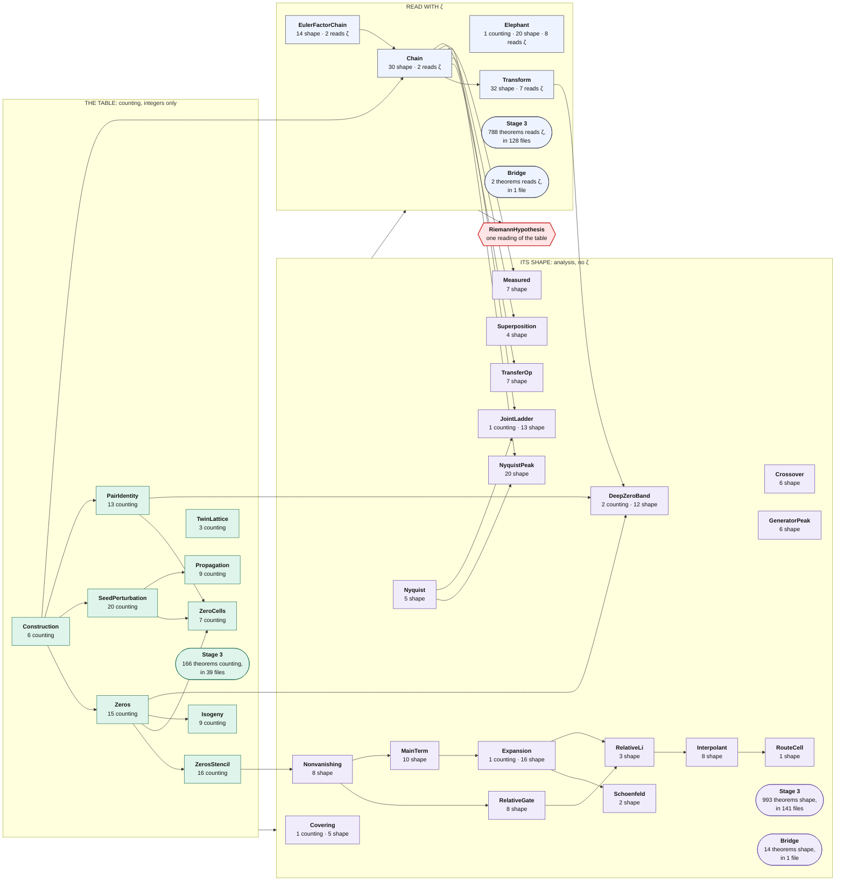
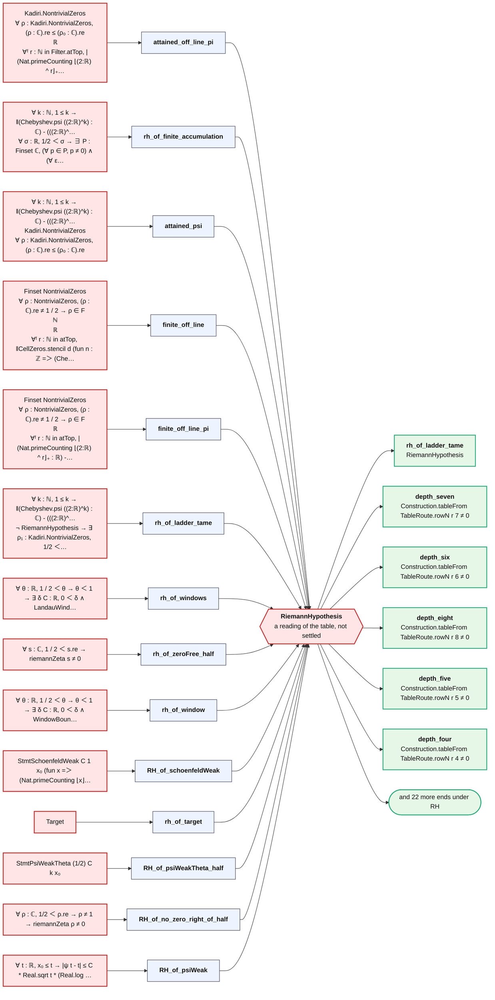
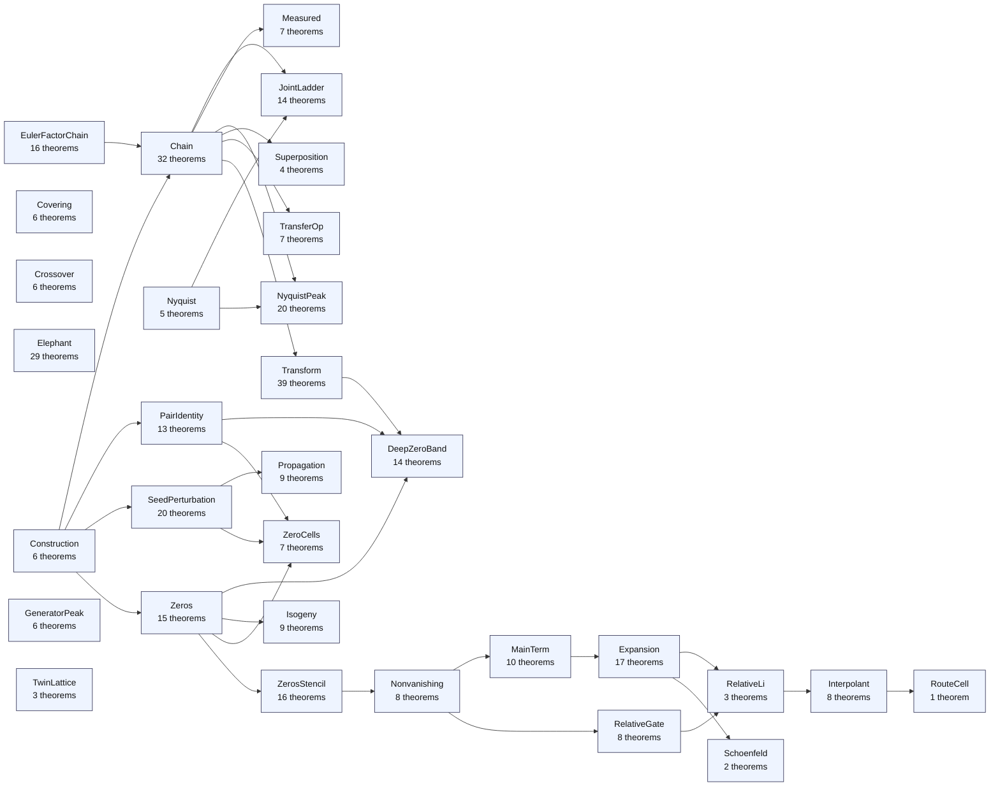
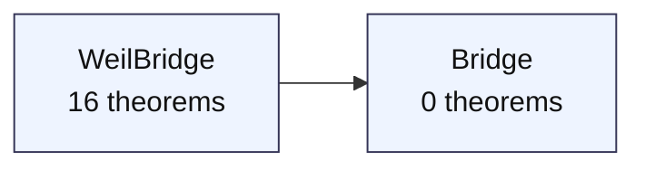

```mermaid
flowchart LR
  f0["Abscissa<br/>11 theorems"]:::thm
  f1["AliasClass<br/>8 theorems"]:::thm
  f2["ArgCount<br/>15 theorems"]:::thm
  f3["ArgCrude<br/>4 theorems"]:::thm
  f4["ArgIdentity<br/>53 theorems"]:::thm
  f5["ArgLegs<br/>10 theorems"]:::thm
  f6["Assembly<br/>13 theorems"]:::thm
  f7["AssemblyFloor<br/>6 theorems"]:::thm
  f8["AttainedPi<br/>17 theorems"]:::thm
  f9["BandJoin<br/>12 theorems"]:::thm
  f10["BoxBounds<br/>6 theorems"]:::thm
  f11["BoxFinite<br/>1 theorem"]:::thm
  f12["CellBdiff<br/>6 theorems"]:::thm
  f13["CellFixedRow<br/>5 theorems"]:::thm
  f14["CellModes<br/>3 theorems"]:::thm
  f15["CellResidual<br/>15 theorems"]:::thm
  f16["CellRows<br/>2 theorems"]:::thm
  f17["CellZeros<br/>10 theorems"]:::thm
  f18["ClosedLoopChain<br/>16 theorems"]:::thm
  f19["ClosedLoopJoin<br/>11 theorems"]:::thm
  f20["CompositeSplit<br/>6 theorems"]:::thm
  f21["Compression<br/>3 theorems"]:::thm
  f22["ContourShift<br/>28 theorems"]:::thm
  f23["CountEuler<br/>46 theorems"]:::thm
  f24["CountModes<br/>29 theorems"]:::thm
  f25["CountReduction<br/>12 theorems"]:::thm
  f26["DirichletMean<br/>13 theorems"]:::thm
  f27["DirichletMeanW<br/>5 theorems"]:::thm
  f28["Doubling<br/>9 theorems"]:::thm
  f29["EdgeBound<br/>15 theorems"]:::thm
  f30["EdgeNum<br/>6 theorems"]:::thm
  f31["ExplicitBump<br/>12 theorems"]:::thm
  f32["ExplicitLeft<br/>4 theorems"]:::thm
  f33["ExplicitTwo<br/>12 theorems"]:::thm
  f34["FilterAccum<br/>10 theorems"]:::thm
  f35["FilterAttained<br/>9 theorems"]:::thm
  f36["FilterLadder<br/>21 theorems"]:::thm
  f37["FiniteOffLine<br/>12 theorems"]:::thm
  f38["FiniteOffLinePi<br/>13 theorems"]:::thm
  f39["FixedRowTwo<br/>13 theorems"]:::thm
  f40["GateEval<br/>5 theorems"]:::thm
  f41["Glue<br/>8 theorems"]:::thm
  f42["GlueFloor<br/>6 theorems"]:::thm
  f43["GlueNum<br/>13 theorems"]:::thm
  f44["HalfSieve<br/>12 theorems"]:::thm
  f45["HardyZ<br/>6 theorems"]:::thm
  f46["HolyChannel<br/>6 theorems"]:::thm
  f47["IndicatorContDiff<br/>1 theorem"]:::thm
  f48["JensenCount<br/>17 theorems"]:::thm
  f49["JointDialGate<br/>5 theorems"]:::thm
  f50["JointFloorGate<br/>2 theorems"]:::thm
  f51["JointSymbol<br/>6 theorems"]:::thm
  f52["JointWindowDial<br/>3 theorems"]:::thm
  f53["LadderAssembly<br/>2 theorems"]:::thm
  f54["LadderFading<br/>4 theorems"]:::thm
  f55["LadderMean<br/>4 theorems"]:::thm
  f56["LandauChebyshev<br/>5 theorems"]:::thm
  f57["LandauCriterion<br/>3 theorems"]:::thm
  f58["LandauCrude<br/>4 theorems"]:::thm
  f59["LandauKernel<br/>6 theorems"]:::thm
  f60["LandauMellin<br/>7 theorems"]:::thm
  f61["LandauMellinG<br/>10 theorems"]:::thm
  f62["LandauPoleDisc<br/>1 theorem"]:::thm
  f63["LandauPoleLocal<br/>3 theorems"]:::thm
  f64["LandauPoleSub<br/>3 theorems"]:::thm
  f65["LandauPrimeSide<br/>3 theorems"]:::thm
  f66["LandauRates<br/>3 theorems"]:::thm
  f67["LandauTail<br/>3 theorems"]:::thm
  f68["LandauTaylor<br/>6 theorems"]:::thm
  f69["LandauTrig<br/>6 theorems"]:::thm
  f70["LandauWindow<br/>4 theorems"]:::thm
  f71["LandauZeroSide<br/>2 theorems"]:::thm
  f72["LeftKernel<br/>8 theorems"]:::thm
  f73["LeftSmooth<br/>40 theorems"]:::thm
  f74["LevinsonArg<br/>7 theorems"]:::thm
  f75["LevinsonAvoid<br/>6 theorems"]:::thm
  f76["LevinsonCount<br/>5 theorems"]:::thm
  f77["LevinsonEdge<br/>13 theorems"]:::thm
  f78["LevinsonLine<br/>6 theorems"]:::thm
  f79["LevinsonMollEdge<br/>21 theorems"]:::thm
  f80["LevinsonMultiple<br/>25 theorems"]:::thm
  f81["LevinsonRight<br/>7 theorems"]:::thm
  f82["LevinsonSize<br/>11 theorems"]:::thm
  f83["LevinsonTurn<br/>11 theorems"]:::thm
  f84["LevinsonWindow<br/>10 theorems"]:::thm
  f85["LineBound<br/>70 theorems"]:::thm
  f86["LineCount<br/>6 theorems"]:::thm
  f87["Littlewood<br/>28 theorems"]:::thm
  f88["LowCount<br/>3 theorems"]:::thm
  f89["LowEdge<br/>4 theorems"]:::thm
  f90["MirrorArea<br/>6 theorems"]:::thm
  f91["Mollified<br/>12 theorems"]:::thm
  f92["MollifiedMean<br/>12 theorems"]:::thm
  f93["NoHoles<br/>10 theorems"]:::thm
  f94["OneChain<br/>8 theorems"]:::thm
  f95["PerfectFit<br/>1 theorem"]:::thm
  f96["PerronKernel<br/>31 theorems"]:::thm
  f97["PerronTwo<br/>10 theorems"]:::thm
  f98["PiFixedRow<br/>23 theorems"]:::thm
  f99["PiRemainder<br/>15 theorems"]:::thm
  f100["PiToPsi<br/>12 theorems"]:::thm
  f101["PiZeros<br/>15 theorems"]:::thm
  f102["PsiToPi<br/>12 theorems"]:::thm
  f103["RateBelow<br/>1 theorem"]:::thm
  f104["ReZetaCount<br/>15 theorems"]:::thm
  f105["ReachRoute<br/>3 theorems"]:::thm
  f106["Readings<br/>14 theorems"]:::thm
  f107["RealSegment<br/>4 theorems"]:::thm
  f108["ResidueRoute<br/>15 theorems"]:::thm
  f109["RouteGate<br/>1 theorem"]:::thm
  f110["RouteNum<br/>14 theorems"]:::thm
  f111["RowLeaves<br/>7 theorems"]:::thm
  f112["RunTheorems<br/>5 theorems"]:::thm
  f113["RvMCrude<br/>1 theorem"]:::thm
  f114["Saddle<br/>11 theorems"]:::thm
  f115["SelfBound<br/>5 theorems"]:::thm
  f116["ShareLink<br/>8 theorems"]:::thm
  f117["SieveExact<br/>18 theorems"]:::thm
  f118["SieveIdem<br/>8 theorems"]:::thm
  f119["SieveResidual<br/>4 theorems"]:::thm
  f120["SpiralLink<br/>9 theorems"]:::thm
  f121["SquareMean<br/>6 theorems"]:::thm
  f122["Statement<br/>6 theorems"]:::thm
  f123["StencilWeil<br/>13 theorems"]:::thm
  f124["StepsBelow<br/>41 theorems"]:::thm
  f125["StepsPeak<br/>17 theorems"]:::thm
  f126["StepsPole<br/>5 theorems"]:::thm
  f127["StepsRate<br/>2 theorems"]:::thm
  f128["Stirling<br/>17 theorems"]:::thm
  f129["TableDepths<br/>14 theorems"]:::thm
  f130["Chain<br/>copy"]:::ext
  f131["Construction<br/>copy"]:::ext
  f132["EulerFactorChain<br/>copy"]:::ext
  f133["Expansion<br/>copy"]:::ext
  f134["Interpolant<br/>copy"]:::ext
  f135["MainTerm<br/>copy"]:::ext
  f136["Nonvanishing<br/>copy"]:::ext
  f137["RelativeGate<br/>copy"]:::ext
  f138["RelativeLi<br/>copy"]:::ext
  f139["RouteCell<br/>copy"]:::ext
  f140["Superposition<br/>copy"]:::ext
  f141["Zeros<br/>copy"]:::ext
  f142["ZerosStencil<br/>copy"]:::ext
  f143["TableRoute<br/>1 theorem"]:::thm
  f144["Target<br/>1 theorem"]:::thm
  f145["ThetaConverse<br/>14 theorems"]:::thm
  f146["ThetaLine<br/>4 theorems"]:::thm
  f147["ThetaPi<br/>10 theorems"]:::thm
  f148["ThetaPsi<br/>16 theorems"]:::thm
  f149["ThetaPull<br/>10 theorems"]:::thm
  f150["VonKochScaffold<br/>21 theorems"]:::thm
  f151["WeilBackground<br/>7 theorems"]:::thm
  f152["WeilBands<br/>4 theorems"]:::thm
  f153["WeilBridgeLeaf<br/>4 theorems"]:::thm
  f154["WeilDetect<br/>5 theorems"]:::thm
  f155["WeilLobe<br/>17 theorems"]:::thm
  f156["WeilOddPower<br/>11 theorems"]:::thm
  f157["WeilOffLine<br/>7 theorems"]:::thm
  f158["WeilOnLine<br/>18 theorems"]:::thm
  f159["WeilPower<br/>24 theorems"]:::thm
  f160["WeilPowerAssembly<br/>8 theorems"]:::bad
  f161["WeilPowerBackground<br/>16 theorems"]:::thm
  f162["WeilPowerBands<br/>21 theorems"]:::thm
  f163["WeilPowerBounds<br/>19 theorems"]:::thm
  f164["WeilPowerBridge<br/>7 theorems"]:::thm
  f165["WeilPowerClean<br/>4 theorems"]:::thm
  f166["WeilPowerCompare<br/>21 theorems"]:::thm
  f167["WeilPowerCount<br/>4 theorems"]:::thm
  f168["WeilPowerGauss<br/>25 theorems"]:::thm
  f169["WeilPowerGeom<br/>12 theorems"]:::thm
  f170["WeilPowerGeomGen<br/>9 theorems"]:::thm
  f171["WeilPowerNear<br/>9 theorems"]:::thm
  f172["WeilPowerOnLine<br/>11 theorems"]:::thm
  f173["WeilPowerPhase<br/>21 theorems"]:::thm
  f174["WeilPowerSelect<br/>7 theorems"]:::thm
  f175["WeilPowerSharp<br/>7 theorems"]:::thm
  f176["WeilPowerShell<br/>15 theorems"]:::thm
  f177["WeilPowerSigma<br/>10 theorems"]:::thm
  f178["WeilPowerTail<br/>6 theorems"]:::thm
  f179["WeilSeries<br/>18 theorems"]:::thm
  f180["WeilTiles<br/>8 theorems"]:::thm
  f181["WeilTransform<br/>9 theorems"]:::thm
  f182["WeilWindow<br/>12 theorems"]:::thm
  f183["WholeChain<br/>4 theorems"]:::thm
  f184["WindowsOfRH<br/>17 theorems"]:::thm
  f185["WobbleCount<br/>4 theorems"]:::thm
  f186["ZeroDensity<br/>10 theorems"]:::thm
  f187["ZeroSquares<br/>17 theorems"]:::thm
  f188["ZeroSum<br/>7 theorems"]:::thm
  f189["ZeroSummable<br/>14 theorems"]:::thm
  f190["ZetaEM<br/>20 theorems"]:::thm
  f191["ZetaGrowth<br/>18 theorems"]:::thm
  f192["Stage3<br/>0 theorems"]:::thm
  f85 --> f0
  f14 --> f1
  f5 --> f2
  f104 --> f2
  f113 --> f3
  f48 --> f4
  f128 --> f4
  f4 --> f5
  f102 --> f6
  f188 --> f6
  f2 --> f7
  f41 --> f7
  f38 --> f8
  f189 --> f8
  f44 --> f9
  f127 --> f9
  f191 --> f10
  f154 --> f11
  f14 --> f12
  f16 --> f13
  f73 --> f13
  f17 --> f14
  f140 --> f14
  f100 --> f15
  f143 --> f15
  f37 --> f16
  f43 --> f17
  f120 --> f18
  f37 --> f19
  f90 --> f19
  f127 --> f20
  f20 --> f21
  f6 --> f22
  f48 --> f22
  f96 --> f22
  f25 --> f23
  f38 --> f24
  f8 --> f25
  f24 --> f25
  f39 --> f25
  f26 --> f27
  f93 --> f28
  f191 --> f29
  f89 --> f30
  f43 --> f32
  f73 --> f33
  f85 --> f33
  f97 --> f33
  f35 --> f34
  f36 --> f35
  f189 --> f35
  f38 --> f36
  f39 --> f36
  f55 --> f37
  f70 --> f37
  f107 --> f37
  f99 --> f38
  f33 --> f39
  f98 --> f39
  f110 --> f40
  f29 --> f41
  f7 --> f42
  f30 --> f43
  f42 --> f43
  f94 --> f44
  f126 --> f44
  f116 --> f46
  f3 --> f48
  f52 --> f49
  f42 --> f50
  f49 --> f50
  f63 --> f51
  f57 --> f52
  f147 --> f52
  f19 --> f53
  f108 --> f53
  f1 --> f54
  f54 --> f55
  f58 --> f56
  f66 --> f57
  f71 --> f57
  f70 --> f58
  f70 --> f60
  f60 --> f61
  f63 --> f62
  f64 --> f62
  f22 --> f63
  f61 --> f63
  f67 --> f65
  f68 --> f65
  f59 --> f67
  f56 --> f68
  f59 --> f68
  f61 --> f68
  f62 --> f71
  f65 --> f71
  f69 --> f71
  f32 --> f72
  f72 --> f73
  f78 --> f74
  f86 --> f74
  f82 --> f75
  f77 --> f76
  f82 --> f77
  f45 --> f78
  f81 --> f79
  f84 --> f80
  f76 --> f81
  f83 --> f82
  f74 --> f83
  f87 --> f83
  f75 --> f84
  f79 --> f84
  f6 --> f85
  f48 --> f85
  f19 --> f86
  f24 --> f86
  f45 --> f86
  f10 --> f88
  f29 --> f88
  f88 --> f89
  f123 --> f90
  f27 --> f92
  f91 --> f92
  f190 --> f92
  f115 --> f93
  f18 --> f94
  f23 --> f94
  f34 --> f94
  f93 --> f95
  f96 --> f97
  f13 --> f98
  f99 --> f98
  f101 --> f99
  f42 --> f100
  f111 --> f100
  f150 --> f100
  f15 --> f101
  f37 --> f101
  f122 --> f102
  f127 --> f103
  f145 --> f103
  f48 --> f104
  f108 --> f105
  f114 --> f106
  f6 --> f107
  f25 --> f108
  f34 --> f108
  f50 --> f109
  f107 --> f109
  f111 --> f109
  f43 --> f110
  f109 --> f110
  f102 --> f111
  f94 --> f112
  f188 --> f113
  f103 --> f114
  f116 --> f114
  f44 --> f115
  f9 --> f116
  f20 --> f118
  f101 --> f119
  f117 --> f119
  f19 --> f120
  f158 --> f120
  f153 --> f123
  f127 --> f124
  f145 --> f124
  f39 --> f125
  f126 --> f125
  f119 --> f126
  f125 --> f127
  f113 --> f128
  f143 --> f129
  f131 --> f130
  f132 --> f130
  f135 --> f133
  f138 --> f134
  f136 --> f135
  f142 --> f136
  f136 --> f137
  f133 --> f138
  f137 --> f138
  f134 --> f139
  f130 --> f140
  f131 --> f141
  f141 --> f142
  f40 --> f143
  f139 --> f143
  f57 --> f144
  f147 --> f145
  f150 --> f145
  f0 --> f146
  f148 --> f147
  f149 --> f148
  f146 --> f149
  f85 --> f150
  f154 --> f151
  f155 --> f151
  f48 --> f152
  f151 --> f152
  f154 --> f153
  f181 --> f155
  f159 --> f156
  f151 --> f157
  f179 --> f158
  f155 --> f159
  f11 --> f160
  f47 --> f160
  f164 --> f160
  f166 --> f160
  f171 --> f160
  f172 --> f160
  f154 --> f161
  f163 --> f161
  f161 --> f162
  f179 --> f162
  f156 --> f163
  f162 --> f164
  f173 --> f164
  f122 --> f165
  f168 --> f166
  f165 --> f167
  f163 --> f168
  f122 --> f169
  f169 --> f170
  f177 --> f170
  f176 --> f171
  f158 --> f172
  f162 --> f172
  f175 --> f173
  f166 --> f174
  f168 --> f175
  f170 --> f176
  f173 --> f177
  f173 --> f178
  f180 --> f179
  f152 --> f180
  f182 --> f181
  f21 --> f183
  f46 --> f183
  f106 --> f183
  f112 --> f183
  f115 --> f183
  f118 --> f183
  f124 --> f183
  f184 --> f183
  f114 --> f184
  f191 --> f185
  f187 --> f186
  f48 --> f187
  f92 --> f187
  f121 --> f187
  f37 --> f189
  f158 --> f189
  f186 --> f189
  f22 --> f191
  f12 --> f192
  f28 --> f192
  f31 --> f192
  f51 --> f192
  f53 --> f192
  f80 --> f192
  f95 --> f192
  f105 --> f192
  f129 --> f192
  f144 --> f192
  f157 --> f192
  f160 --> f192
  f167 --> f192
  f174 --> f192
  f178 --> f192
  f183 --> f192
  f185 --> f192
  classDef cnt fill:#dff5ec,stroke:#17694a,color:#111
  classDef shp fill:#f1ecfb,stroke:#5b3fa0,color:#111
  classDef rh fill:#ffe5e5,stroke:#c22,color:#111,stroke-width:2px
  classDef thm fill:#eef4ff,stroke:#335,color:#111
  classDef end_ fill:#e7f7e7,stroke:#2a7,color:#111,stroke-width:2px
  classDef lone fill:#fff,stroke:#999,color:#111,stroke-dasharray:4 3
  classDef bad fill:#ffe5e5,stroke:#c22,color:#111,stroke-width:2px
  classDef ext fill:#fff8e1,stroke:#b80,color:#111
```

# The Lean map

Every declaration in every Lean file of this repo: what it proves, what it needs, why, what feeds it and what it feeds. Generated by `python3 utilities/lean_map.py`; nothing here is written by hand. The workflow `.github/workflows/lean_map.yml` regenerates it on every push that touches a `.lean` file.

**213 files, 2807 declarations, 2323 theorems.** 339 theorems are ends (nothing in the repo uses them). 58 theorems connect to nothing. 1 declaration contains `sorry`. 13 files are copies under `TablePort/`.

## The table first

The table is the number line's own rate of change, counted at the doublings. It comes before anything else here. Green: counting, integers only (270 theorems). Violet: its shape, by analysis with no ζ (1244). Blue: read with ζ (809). Every counting theorem is listed in [`TABLE.md`](./TABLE.md).

## One reading of it: the Riemann hypothesis

Red: a statement nobody has proved, here or anywhere. Blue: a theorem Lean has checked. Green: where a checked line arrives. The table is the source: it is counting, and every box is a statement about the count. `RiemannHypothesis` is one reading of it. Left of it: statements about the count that settle the reading. Right of it: how the table's cells behave under it. Every box, with its statement and what is open: [`ROAD.md`](./ROAD.md).

## How to look something up

- **What is proved by counting alone?** [`TABLE.md`](./TABLE.md).
- **Is it already here?** [`ALL.md`](./ALL.md): every declaration, one line, sorted by name.
- **What does a file do?** The tables below, one row per file.
- **What does a theorem rest on, and what rests on it?** Its file's page: each theorem has *Proves*, *Needs*, *Fed by*, *Feeds*, each feeder and consumer with its own statement.
- **The whole line behind one theorem:** the table of ends at the bottom of this page links each long one; for any other, `python3 utilities/lean_map.py --chain NAME`.
- **Did the map read the code right?** [`RECONCILE.md`](./RECONCILE.md).

## Reconciliation

The arrows are Lean's record of what each statement and proof uses (`python3 utilities/lean_map.py --dump`, stored in `map/kernel/`). The names are checked both ways against the source.

| check | result |
|---|---|
| declarations whose arrows come from Lean | 1994 of 2807 |
| source declarations Lean does not hold | 0 |
| Lean constants that are neither a source declaration nor a helper of one | 0 |
| Lean's helper constants, followed through to their owners | 2883 |
| notation and macro constants | 125 |
| declarations in `TablePort/` copies resting on different declarations than the original | 0 |
| files changed since the last dump (arrows read from text) | 1 |
| files never dumped | 59 |

**Files changed since the last dump:**

- `lean_stage3/Stage3.lean`

**Files never dumped:**

- `lean_stage3/Stage3/BandJoin.lean`
- `lean_stage3/Stage3/CellFixedRow.lean`
- `lean_stage3/Stage3/ClosedLoopChain.lean`
- `lean_stage3/Stage3/ClosedLoopJoin.lean`
- `lean_stage3/Stage3/CompositeSplit.lean`
- `lean_stage3/Stage3/Compression.lean`
- `lean_stage3/Stage3/CountEuler.lean`
- `lean_stage3/Stage3/CountModes.lean`
- `lean_stage3/Stage3/CountReduction.lean`
- `lean_stage3/Stage3/Doubling.lean`
- `lean_stage3/Stage3/ExplicitLeft.lean`
- `lean_stage3/Stage3/ExplicitTwo.lean`
- `lean_stage3/Stage3/FilterAccum.lean`
- `lean_stage3/Stage3/FilterAttained.lean`
- `lean_stage3/Stage3/FilterLadder.lean`
- `lean_stage3/Stage3/FixedRowTwo.lean`
- `lean_stage3/Stage3/HalfSieve.lean`
- `lean_stage3/Stage3/HardyZ.lean`
- `lean_stage3/Stage3/HolyChannel.lean`
- `lean_stage3/Stage3/LadderAssembly.lean`
- `lean_stage3/Stage3/LeftKernel.lean`
- `lean_stage3/Stage3/LeftSmooth.lean`
- `lean_stage3/Stage3/LevinsonArg.lean`
- `lean_stage3/Stage3/LevinsonAvoid.lean`
- `lean_stage3/Stage3/LevinsonCount.lean`
- `lean_stage3/Stage3/LevinsonEdge.lean`
- `lean_stage3/Stage3/LevinsonLine.lean`
- `lean_stage3/Stage3/LevinsonMollEdge.lean`
- `lean_stage3/Stage3/LevinsonMultiple.lean`
- `lean_stage3/Stage3/LevinsonRight.lean`
- `lean_stage3/Stage3/LevinsonSize.lean`
- `lean_stage3/Stage3/LevinsonTurn.lean`
- `lean_stage3/Stage3/LevinsonWindow.lean`
- `lean_stage3/Stage3/LineCount.lean`
- `lean_stage3/Stage3/Littlewood.lean`
- `lean_stage3/Stage3/NoHoles.lean`
- `lean_stage3/Stage3/OneChain.lean`
- `lean_stage3/Stage3/PerfectFit.lean`
- `lean_stage3/Stage3/PerronTwo.lean`
- `lean_stage3/Stage3/PiFixedRow.lean`
- `lean_stage3/Stage3/RateBelow.lean`
- `lean_stage3/Stage3/ReachRoute.lean`
- `lean_stage3/Stage3/Readings.lean`
- `lean_stage3/Stage3/ResidueRoute.lean`
- `lean_stage3/Stage3/RunTheorems.lean`
- `lean_stage3/Stage3/Saddle.lean`
- `lean_stage3/Stage3/SelfBound.lean`
- `lean_stage3/Stage3/ShareLink.lean`
- `lean_stage3/Stage3/SieveExact.lean`
- `lean_stage3/Stage3/SieveIdem.lean`
- `lean_stage3/Stage3/SieveResidual.lean`
- `lean_stage3/Stage3/SpiralLink.lean`
- `lean_stage3/Stage3/StepsBelow.lean`
- `lean_stage3/Stage3/StepsPeak.lean`
- `lean_stage3/Stage3/StepsPole.lean`
- `lean_stage3/Stage3/StepsRate.lean`
- `lean_stage3/Stage3/Target.lean`
- `lean_stage3/Stage3/WholeChain.lean`
- `lean_stage3/Stage3/WindowsOfRH.lean`

Reading names out of the source text instead, on the same declarations: 4512 arrows agree with Lean, 533 that Lean records are not visible in the text, 25 names occur in the text without Lean recording a use. That is the error a page carries when it says "read from the source text".

## `lean/` — the table's tree, Lean v4.28.0

Files, arrows by import (indirect imports left out):

| file | theorems | what it does (its own header) |
|---|---|---|
| [`lean/Chain.lean`](./lean/Chain.md) | 32 | The Euler Factor Chain, as a chain. Companion to papers/Euler-Factor-Chain.md. |
| [`lean/Construction.lean`](./lean/Construction.md) | 6 | Construction — the table has no free parameter, so the zeros were not placed. `Zeros.lean` records that nothing predicts WHERE the four exact zeros are. That is true and stays true. This file proves the complementary thing, which is what makes them structural rather than arbitrary: |
| [`lean/Covering.lean`](./lean/Covering.md) | 6 | Covering — why 25 of 36 primes contribute, and why the set skips 13. THE MEASUREMENT (results/O37_weil_form_on_stencil_run1.log): with b = 2, N = 7, W = 0.05, K = 2, the mollified Weil form has 36 primes inside its support and exactly 25 contribute: |
| [`lean/Crossover.lean`](./lean/Crossover.md) | 6 | Crossover — what the "breakdown depth" actually is. THE MEASUREMENT (results/transform_radius.json → summary.breakdown_rel_spread_by_depth): relative spread of the z-transform's root moduli, by depth, at R = 45. |
| [`lean/DeepZeroBand.lean`](./lean/DeepZeroBand.md) | 14 | DeepZeroBand — the deep zero, inverted, and the band between the two. Joins three things already in this tree: |
| [`lean/Elephant.lean`](./lean/Elephant.md) | 29 | # Elephant.lean — the one object, derived from nothing Standalone. This file imports Mathlib and imports no module of this development. It defines |
| [`lean/EulerFactorChain.lean`](./lean/EulerFactorChain.md) | 16 | Euler Factor Chain — the algebraic core, formalised. Companion to papers/Euler-Factor-Chain.md (statements A1, A2, A3, B1, B2, B4, C1). |
| [`lean/Expansion.lean`](./lean/Expansion.md) | 17 | Expansion — stage 2b: the derivative of 2^x/x, explicitly, and its floor. `MainTerm.lean` reduced O67's main-term hypothesis to `hD`: a floor on the `(d+1)`-th derivative of the li-interpolant on the window — equivalently, on the `d`-th derivative of `2^x/x`. This module supplies both halves: |
| [`lean/GeneratorPeak.lean`](./lean/GeneratorPeak.md) | 6 | GeneratorPeak — why the block-size account cannot explain a peak at four. THE MEASUREMENT (results/O24_gen_xmax3e9_run.log, and the 1.5e8 and 1e9 logs): `P_max/median` over generator sets G1..G8 rises to G4 = {2,3,5,7} and falls after, at every xmax measured. The peak is interior. |
| [`lean/Interpolant.lean`](./lean/Interpolant.md) | 8 | Interpolant — the smooth interpolant of the main term, constructed. Block C1 of `lean_stage3/design/joints.md`. 2026-11-22. |
| [`lean/Isogeny.lean`](./lean/Isogeny.md) | 9 | Isogeny — what the isogeny does to the row. `Transform.tau_ratio_of_meet` proves that two ladders which meet have rationally related modular parameters: `bⁿ = cᵐ → τ(b)/τ(c) = n/m`. That is a statement about the tori `ℂ*/b^ℤ`, and the torus knows only `b`. No prime enters it. |
| [`lean/JointLadder.lean`](./lean/JointLadder.md) | 14 | JointLadder — the joint `{2^m 3^n}` grid has NO aliases, and its difference operator carries two Euler factors. |
| [`lean/MainTerm.lean`](./lean/MainTerm.md) | 10 | MainTerm — stage 2: the difference calculus that discharges hM's structure. `Nonvanishing.lean` proved the arrow of O67's theorem with three named hypotheses. This module attacks `hM` — the main-term floor `Mlow ≤ \|stencil of li\|` — by formalising the calculus O67 verified numerically: the MVT step,… |
| [`lean/Measured.lean`](./lean/Measured.md) | 7 | The chain's numbers, as a Lean object. Third layer of `lean/`. Not a proof file — a RECORD file with checkable numeric relations. |
| [`lean/Nonvanishing.lean`](./lean/Nonvanishing.md) | 8 | Nonvanishing — the arrow of O67's conditional theorem, in the house pattern. `papers/The-Four-Zeros.md` § I states: under RH, `cell(r,d) ≠ 0` for every `r ≥ R(d)`, which with O43's census makes the four zeros complete at every depth `d ≤ 15`. The proof has two analytic inputs and one arithmetic gap … |
| [`lean/Nyquist.lean`](./lean/Nyquist.md) | 5 | Nyquist — why an entire family of integer-base approaches must fail, rather than merely happening to. |
| [`lean/NyquistPeak.lean`](./lean/NyquistPeak.md) | 20 | NyquistPeak — the difference filter's gain at frequency `γ` is stationary, and maximal, exactly at the Nyquist boundary `b* = exp(π/γ)`. |
| [`lean/PairIdentity.lean`](./lean/PairIdentity.md) | 13 | PairIdentity — the complementary pair, and why base two is singular. Encodes statement **I1** of `papers/Euler-Factor-Chain.md` § I ("The complementary pair"): |
| [`lean/Propagation.lean`](./lean/Propagation.md) | 9 | Propagation — the recurrence as transport: the light cone, and the propagator. `papers/Depth-as-Time.md` reads depth as time. Take that literally: with `d` as time and `r` as space, the recurrence |
| [`lean/RelativeGate.lean`](./lean/RelativeGate.md) | 8 | RelativeGate — the census gate, stated without assuming an error shape. WHY THIS FILE EXISTS. `Nonvanishing.lean` states the census gate in the RH shape: `StmtSchoenfeldWindow` carries `√x·log x/(8π)` per value, and `Ehigh` accumulates it into `2^(r/2)·(1+2^(−1/2))^n`. Every downstream tolerance stu… |
| [`lean/RelativeLi.lean`](./lean/RelativeLi.md) | 3 | RelativeLi — the relative-error gate with its main term discharged. `RelativeGate.tableFrom_ne_zero_of_relErr` makes a cell nonzero from a relative error on a window of rows, a floor `hM` under the main term's stencil, and the gap. `Expansion.hD_of_window` with `MainTerm.stencilR_ge_of` proves that … |
| [`lean/RouteCell.lean`](./lean/RouteCell.md) | 1 | RouteCell — block E9 of `lean_stage3/design/joints.md`, the table tree's half. The gate (`Interpolant.tableFrom_ne_zero_of_relErr_liRow`) at depth six, on the statement the other tree's explicit-formula route proves under RH. |
| [`lean/Schoenfeld.lean`](./lean/Schoenfeld.md) | 2 | Schoenfeld — stage 3's interface: the literature sentence, verbatim. `Expansion.tableFrom_ne_zero_of_li` carries the conditional arrow with `hS` stated window-wise, in bench shape: per-`k` bounds with the power already translated to `2^((r−k)/2)`. Nobody can check that against Schoenfeld 1976 by eye… |
| [`lean/SeedPerturbation.lean`](./lean/SeedPerturbation.md) | 20 | SeedPerturbation — changing the seed convention cannot reach a deep cell. THE QUESTION. The dyadic tables in `imported/lattice_mapper/` are built on a seed convention: the primes 2 and 3 are treated as lattice rather than counted as primes. That is a choice. If a different choice moved the zeros, th… |
| [`lean/Superposition.lean`](./lean/Superposition.md) | 4 | Superposition — the missing licence for building the residual from the zeros. `Chain.A4_of_A1` gives the depth-N gain for a SINGLE mode. Every use of it on the bench applies it to a SUM over zeta zeros (O34, O35). Nothing so far permits that step. This file supplies it, and nothing else. |
| [`lean/TransferOp.lean`](./lean/TransferOp.md) | 7 | TransferOp — bdiff named as the operator it is, in Mathlib's own vocabulary. `papers/Depth-as-Time.md` reads depth as iteration: each mode `x^ρ` is multiplied by `(1 − b^(−ρ))` per step (A2), the operator has a growth factor per mode (A3), and the first Riemann zero is the fastest-growing mode of th… |
| [`lean/Transform.lean`](./lean/Transform.md) | 39 | Transform — block G's geometry: the strip, the annulus, and what closes it. `papers/Euler-Factor-Chain.md` § G is listed as **not formalised** in `lean/BUILD.md`, and most of it is measurement (G2, G4, G5, G7 from O39) or literature (G3 Jentzsch, G9 Hardy, G10 Odlyzko–te Riele). This file takes the … |
| [`lean/TwinLattice.lean`](./lean/TwinLattice.md) | 3 | TwinLattice — a twin pair is a lattice site, not a coincidence of spacing. Every twin pair above 3 is `(6k − 1, 6k + 1)`. The single integer between them is `6k`. So a twin pair is not two primes that happen to sit two apart: it is a site on the `2·3` lattice with primes on both shoulders, and count… |
| [`lean/ZeroCells.lean`](./lean/ZeroCells.md) | 7 | ZeroCells — the four zeros are one object with four names, and the kernel now says so. |
| [`lean/Zeros.lean`](./lean/Zeros.md) | 15 | Zeros — what is provable about the four exact zeros, and what is not. THE MEASUREMENT (results/O16_run2.log): over r &lt;= 62, d &lt;= 61 the dyadic prime difference table has exactly four exact zeros — (2,1), (4,1), (8,3), (20,6) — and no others. The centered table has none at all. |
| [`lean/ZerosStencil.lean`](./lean/ZerosStencil.md) | 16 | ZerosStencil — the Mathlib-dependent half of `Zeros.lean`. Split out of `Zeros.lean` on 2026-08-26. The classification is by axiom pin, not by subject: these are exactly the fifteen theorems whose `#print axioms` carries `Classical.choice`, and every one of them acquires it from Mathlib — `Finset.ra… |

## `lean_stage3/` — Stage 3, Lean v4.32.2

Files, arrows by import (indirect imports left out):

| file | theorems | what it does (its own header) |
|---|---|---|
| [`lean_stage3/Stage3.lean`](./lean_stage3/Stage3.md) | 0 | Stage3 — scaffold and weld check. Entry 118's step 1. THE WELD, STATED LOUDLY. This package lives on toolchain v4.32.2 with PrimeNumberTheoremAnd (pinned rev 47fa486) and its Mathlib v4.32.2; the bench's lean/ lives on v4.28.0. Results here compose with the bench's arrow (Expansion.tableFrom_ne_zero… |
| [`lean_stage3/Stage3/Abscissa.lean`](./lean_stage3/Abscissa.md) | 11 | Abscissa — the contour's abscissa as a parameter, with RH as one instance. WHY THIS FILE EXISTS. `lean_stage3/Stage3/LineBound.lean:1091` defines |
| [`lean_stage3/Stage3/AliasClass.lean`](./lean_stage3/AliasClass.md) | 8 | AliasClass — block J10a of `lean_stage3/design/joints.md`. 2026-11-22. Joint 10 on the table's own ladder, first piece. On the ladder `2^r` a zero `ρ` of ζ enters only through `z = 2^ρ`: its mode at row `r` is `z^r` and its symbol is `1 − z⁻¹`. Zeros with the same `z` have the same real part and hei… |
| [`lean_stage3/Stage3/ArgCount.lean`](./lean_stage3/ArgCount.md) | 15 | ArgCount — block `hnt.md#H3` of `lean_stage3/design/hnt.md`, "The assembly: StmtSCrude argS, good heights by the identity, bad heights by a good one beside them". |
| [`lean_stage3/Stage3/ArgCrude.lean`](./lean_stage3/ArgCrude.md) | 4 | ArgCrude — hNT slice 2: the argument-principle half of Backlund, decomposed to the point where the Jensen zero-count is the only analytic content left. |
| [`lean_stage3/Stage3/ArgIdentity.lean`](./lean_stage3/ArgIdentity.md) | 53 | ArgIdentity — StmtArgIdentity discharged, and the contour machinery the remaining bound will need. |
| [`lean_stage3/Stage3/ArgLegs.lean`](./lean_stage3/ArgLegs.md) | 10 | ArgLegs — block H1 of `lean_stage3/design/hnt.md`, "The two contour legs". The count-to-argument step needs `\|zetaArgContour T\|` bounded by the number of zeros of `Re ζ` on the horizontal cut plus a constant. This module is the geometric half: on a segment where a path `g` avoids `0`, the imaginary … |
| [`lean_stage3/Stage3/Assembly.lean`](./lean_stage3/Assembly.md) | 13 | Assembly — step 5, slice 1: RH meets the zero sum. The explicit formula's zero side is `Σ_{\|γ\|&lt;T} m(ρ)·x^ρ/ρ`. This module defines that sum (`zeroPartialSum`), states the hEF leaf (`StmtExplicitFormula` — the truncated explicit formula with explicit remainder, the one genuinely open piece), and prov… |
| [`lean_stage3/Stage3/AssemblyFloor.lean`](./lean_stage3/AssemblyFloor.md) | 6 | AssemblyFloor — block E1 of `lean_stage3/design/joints.md`. 2026-11-22. `Assembly.psiWeak_of_RH_EF_NT` with nothing rounded at the end. Inside that proof the contour constants `c₁`, `c₂` multiply `log²x` with no `√x`, and the zero side is a polynomial in `log T`; its closing lemmas round every term … |
| [`lean_stage3/Stage3/AttainedPi.lean`](./lean_stage3/AttainedPi.md) | 17 | AttainedPi — block C7 of `lean_stage3/design/carlson.md`. 2026-11-23. The one-ladder converse for the count of primes when the largest real part of the zeros of ζ is attained. Let `ρ₀` have the largest real part `Θ` among the zeros. If the count of primes at the doublings `2^r` stays within `C·r²·√2… |
| [`lean_stage3/Stage3/BandJoin.lean`](./lean_stage3/BandJoin.md) | 12 | BandJoin — block J5 of `lean_stage3/design/closedloop.md`. 2026-11-23. The band of the deep zero and the strip of the zeros, under one map. |
| [`lean_stage3/Stage3/BoxBounds.lean`](./lean_stage3/BoxBounds.md) | 6 | BoxBounds — blocks E7a and E7b of `lean_stage3/design/joints.md`. 2026-11-22. Two of the quantities the explicit-formula route took from existence statements, as numerals. |
| [`lean_stage3/Stage3/BoxFinite.lean`](./lean_stage3/BoxFinite.md) | 1 | BoxFinite — the off-line box of `WeilDetect` is a finite set of zeros (block 15 of rung5.md). |
| [`lean_stage3/Stage3/CellBdiff.lean`](./lean_stage3/CellBdiff.md) | 6 | CellBdiff — block T1b of `lean_stage3/design/joints.md`. 2026-11-22. Joint T1 on the table tree's own operator. `CellZeros.stencil` is a second writing of `d` backward differences. The table tree's writing is `Chain.bdiff` iterated `d` times, the operator `Chain.A4` and `Superposition` are stated on… |
| [`lean_stage3/Stage3/CellFixedRow.lean`](./lean_stage3/CellFixedRow.md) | 5 | CellFixedRow — block F3 of `lean_stage3/design/leftedge.md`. 2026-11-23. The cell at a fixed row with the height of the zero sum taken to infinity. `LeftSmooth.explicit_formula_all` holds at every height `T ≥ 2`, with no cap `T ≤ x²`. Through the stencil, the cell at row `r`, depth `d`, and its zero… |
| [`lean_stage3/Stage3/CellModes.lean`](./lean_stage3/CellModes.md) | 3 | CellModes — block T1 of `lean_stage3/design/joints.md`, second part. 2026-11-22. |
| [`lean_stage3/Stage3/CellResidual.lean`](./lean_stage3/CellResidual.md) | 15 | CellResidual — block T5 of `lean_stage3/design/joints.md`, second part. 2026-11-22. |
| [`lean_stage3/Stage3/CellRows.lean`](./lean_stage3/CellRows.md) | 2 | CellRows — block T3a of `lean_stage3/design/joints.md`. 2026-11-22. The height of the zero sum taken to infinity along the rows. At row `r` the height is the doubling of the cell's lowest row, `2^(r−d)`. The cell is then its main term minus the sum over the zeros below that height, within a constant… |
| [`lean_stage3/Stage3/CellZeros.lean`](./lean_stage3/CellZeros.md) | 10 | CellZeros — block T1 of `lean_stage3/design/joints.md`. 2026-11-22. The cell as a sum over the zeros. For the row `ψ(2^n)` of the log-weighted prime count along the doublings, the `d`-fold backward difference at `r` is the main term `2^r·(1 − 1/2)^d` minus a sum over the zeros of ζ below a height, e… |
| [`lean_stage3/Stage3/ClosedLoopChain.lean`](./lean_stage3/ClosedLoopChain.md) | 16 | ClosedLoopChain — block J3 of `lean_stage3/design/closedloop.md`. 2026-11-23. The rest of Julian's closed loop (`lean_primebeat/PrimeBeat/primebeat_closed_loop.lean`, Parts I, III, IV, V, VI) restated word for word in Stage 3 and joined, link by link, to the table and its mirror. Unit 0476 joined Pa… |
| [`lean_stage3/Stage3/ClosedLoopJoin.lean`](./lean_stage3/ClosedLoopJoin.md) | 11 | ClosedLoopJoin — block J1 of `lean_stage3/design/closedloop.md`: the join between `lean_primebeat` and Stage 3. 2026-11-23. |
| [`lean_stage3/Stage3/CompositeSplit.lean`](./lean_stage3/CompositeSplit.md) | 6 | CompositeSplit — block R10 of `lean_stage3/design/runs.md`. 2026-11-23. The composite table has no signs. The sieve's sum counts a composite once for every set of small primes dividing it and corrects with the Pascal signs. Each composite has exactly one least prime. Counted under its least prime, e… |
| [`lean_stage3/Stage3/Compression.lean`](./lean_stage3/Compression.md) | 3 | Compression — block R11 of `lean_stage3/design/runs.md`. 2026-11-23. The primes as the compression of the composites. The combinations of the primes up to `√N` never repeat and do not fill the numbers up to `N`. What they leave is exactly the new primes, each with its multiples, and no number is cou… |
| [`lean_stage3/Stage3/ContourShift.lean`](./lean_stage3/ContourShift.md) | 28 | # The contour shift — slices 2, 3, 4 (hEF's build order, entry 257) Written as the slice map for the contour shift, with named `sorry`s so the obligations were real Lean statements before proof. S2 and S4 are proved here; S3 is proved downstream (`EdgeBound`, `Glue`) and its placeholder is gone. Sor… |
| [`lean_stage3/Stage3/CountEuler.lean`](./lean_stage3/CountEuler.md) | 46 | CountEuler — block N3-E of `lean_stage3/design/countmodes.md`, from its section "After the independent check". 2026-11-23. |
| [`lean_stage3/Stage3/CountModes.lean`](./lean_stage3/CountModes.md) | 29 | CountModes — block N1 of `lean_stage3/design/countmodes.md`, as corrected in its section "After the independent check". 2026-11-23. |
| [`lean_stage3/Stage3/CountReduction.lean`](./lean_stage3/CountReduction.md) | 12 | CountReduction — block N2 of `lean_stage3/design/countmodes.md`, as corrected in its section "After the independent check". 2026-11-23. |
| [`lean_stage3/Stage3/DirichletMean.lean`](./lean_stage3/DirichletMean.md) | 13 | DirichletMean — block C1 of `lean_stage3/design/carlson.md`. 2026-11-23. An elementary mean value theorem for a finite Dirichlet sum. For `S(t) = Σ_{n ≤ N} a_n n^{-it}` the integral of `\|S\|²` over a window of length `L` is at most `(L + 8N(1 + log N))·Σ \|a_n\|²`. The square expands into a double sum;… |
| [`lean_stage3/Stage3/DirichletMeanW.lean`](./lean_stage3/DirichletMeanW.md) | 5 | DirichletMeanW — block C1b of `lean_stage3/design/carlson.md`. 2026-11-23. A weighted mean value theorem for a finite Dirichlet sum. It replaces the uniform length `N` of block C1 by each term's own index: for `S(t) = Σ_{n ≤ N} a_n n^{-it}` the integral of `\|S\|²` over a window of length `L` is at mo… |
| [`lean_stage3/Stage3/Doubling.lean`](./lean_stage3/Doubling.md) | 9 | Doubling — block R15 of `lean_stage3/design/runs.md`. 2026-11-24. The self-bound at `N` less twice the self-bound at `⌊N/2⌋`. The even scales `N/(2j)` are the scales of `⌊N/2⌋`, so the difference keeps the odd scales and subtracts the even ones: an alternating sum of the staircase, equal to `log N! … |
| [`lean_stage3/Stage3/EdgeBound.lean`](./lean_stage3/EdgeBound.md) | 15 | # S3 — the edge bound (FinalBound rescale + gap-eating) The Landau partial fraction transported from PNT+'s normalized `FinalBound` (unit ball) to the ball at `3/2 + iT′`, for `g = (s−1)²·ζ` (entire; the pole cleared, one extra order-1 zero at `1`). Inputs: `ZetaGrowth.sq_zeta_band_bound` (the B), P… |
| [`lean_stage3/Stage3/EdgeNum.lean`](./lean_stage3/EdgeNum.md) | 6 | EdgeNum — block E8a of `lean_stage3/design/joints.md`. 2026-11-22. `EdgeBound`'s three edge theorems with their constants as definitions. Each proof is the original with its existence step replaced: the band bound is `BoxBounds.sq_zeta_band_explicit` in place of `sq_zeta_band_bound`, and each `refin… |
| [`lean_stage3/Stage3/ExplicitBump.lean`](./lean_stage3/ExplicitBump.md) | 12 | ExplicitBump — a concrete `ν`, so `mellin_bump_bounded`'s `B` is a numeral. WHY THIS FILE EXISTS. `RHPull.psi_weak_of_RH` (`Stage3/LineBound.lean:2357`) assembles its constant from four distinct existentials: |
| [`lean_stage3/Stage3/ExplicitLeft.lean`](./lean_stage3/ExplicitLeft.md) | 4 | ExplicitLeft — block F1 of `lean_stage3/design/leftedge.md`. 2026-11-23. The truncated explicit formula at every height `T ≥ 2`, with no cap `T ≤ x²`. `Glue.explicit_formula_split_num` used the cap once, to bound the left edge `VIntegral (Gf x) (-1/4) (-T') T'` by `log²x`. Here the left edge is kept… |
| [`lean_stage3/Stage3/ExplicitTwo.lean`](./lean_stage3/ExplicitTwo.md) | 12 | ExplicitTwo — block G2 of `lean_stage3/design/floor.md`. 2026-11-23. `LeftSmooth.explicit_formula_all` with the floor lowered from `16 ≤ x` to `2 ≤ x`, as a parallel chain. Perron's formula comes from block G1 (`PerronTwo.explicit_formula_perron_two`). Every `x`-free lemma is reused unchanged; the l… |
| [`lean_stage3/Stage3/FilterAccum.lean`](./lean_stage3/FilterAccum.md) | 10 | FilterAccum — block S3 of `lean_stage3/design/stencil.md`, in its corrected form (the section "After the independent check"). 2026-11-23. |
| [`lean_stage3/Stage3/FilterAttained.lean`](./lean_stage3/FilterAttained.md) | 9 | FilterAttained — block S2 of `lean_stage3/design/stencil.md`, in its corrected form (the section "After the independent check"). 2026-11-23. |
| [`lean_stage3/Stage3/FilterLadder.lean`](./lean_stage3/FilterLadder.md) | 21 | FilterLadder — block S1 of `lean_stage3/design/stencil.md`. 2026-11-23. The filtered ladder. Put `a_k = ψ(2^k) − 2^k`. A polynomial `q` acts on the ladder by `Σ_j q_j·a_{n−j}`, and on a mode `z^n` as multiplication by `q(1/z)`. With the weighted norm `‖q‖_W = Σ_j \|q_j\|·2^(−j/2)`, which is submultipl… |
| [`lean_stage3/Stage3/FiniteOffLine.lean`](./lean_stage3/FiniteOffLine.md) | 12 | FiniteOffLine — block J10d of `lean_stage3/design/joints.md`. 2026-11-22. The one-ladder converse, in the case of finitely many zeros off the line. Let a finite set hold every zero of ζ off the line. If at one depth the cells of the log-weighted prime count on the table's own ladder stay within `C·r… |
| [`lean_stage3/Stage3/FiniteOffLinePi.lean`](./lean_stage3/FiniteOffLinePi.md) | 13 | FiniteOffLinePi — block J10e of `lean_stage3/design/joints.md`. 2026-11-23. The one-ladder converse for the count of primes, in the case of finitely many zeros off the line. Let a finite set hold every zero of ζ off the line. If the count of primes at the doublings `2^r` stays within `C·r²·√2^r` of … |
| [`lean_stage3/Stage3/FixedRowTwo.lean`](./lean_stage3/FixedRowTwo.md) | 13 | FixedRowTwo — block G3 of `lean_stage3/design/floor.md`. 2026-11-23. The fixed-row theorems of `CellFixedRow` and `PiFixedRow` restated on `ExplicitTwo.explicit_formula_all_two`, the explicit formula at every height from `x = 2`. The originals read `LeftSmooth.explicit_formula_all` and carry its flo… |
| [`lean_stage3/Stage3/GateEval.lean`](./lean_stage3/GateEval.md) | 5 | GateEval — block E9 of `lean_stage3/design/joints.md`. 2026-11-22. The table gate's own inequality, evaluated on the explicit-formula route at the floor `x₀ = 2^36` and depth six. |
| [`lean_stage3/Stage3/Glue.lean`](./lean_stage3/Glue.md) | 8 | # The glue — assembling StmtExplicitFormula from the four slices Pieces, in build order: - the band count and the `zeroPartialSum` swap (`T′ → T`), - the edge-integral estimates (S3's pointwise bounds integrated), - the rectangle-edge splitting matching S1's line integral, - the final assembly in th… |
| [`lean_stage3/Stage3/GlueFloor.lean`](./lean_stage3/GlueFloor.md) | 6 | GlueFloor — block E2 of `lean_stage3/design/joints.md`. 2026-11-22. `Glue.edge_left_bound` proves the left edge of the explicit formula's contour is at most `72·D·log²x·x^(−1/4)` and then rounds that to `C·log x` (unit 0408: that rounding is the whole of `c₂`). Three copies with a different last lin… |
| [`lean_stage3/Stage3/GlueNum.lean`](./lean_stage3/GlueNum.md) | 13 | GlueNum — block E8b of `lean_stage3/design/joints.md`. 2026-11-22. `Glue`'s theorems under the truncated explicit formula, and the formula itself, with their constants as definitions. Each proof is the original with its existence step replaced (`LOOP.md` § 3); the left edge takes `EdgeBound.logDeriv… |
| [`lean_stage3/Stage3/HalfSieve.lean`](./lean_stage3/HalfSieve.md) | 12 | HalfSieve — block R6 of `lean_stage3/design/runs.md`. 2026-11-23. The half of the closed loop, carried into the sieve. |
| [`lean_stage3/Stage3/HardyZ.lean`](./lean_stage3/HardyZ.md) | 6 | HardyZ — block S10 of `lean_stage3/design/stencil.md`, steps 1 and 2. 2026-11-24. |
| [`lean_stage3/Stage3/HolyChannel.lean`](./lean_stage3/HolyChannel.md) | 6 | HolyChannel — block J9 of `lean_stage3/design/closedloop.md`. 2026-11-23. Julian's Holy Family is an uneven mirror pair: support `J = 1/3`, condition `M = 2/3`, adding to one, the condition the mirror of the support. Every prime carries that pair as its residual and never resolves it. The zero is th… |
| [`lean_stage3/Stage3/IndicatorContDiff.lean`](./lean_stage3/IndicatorContDiff.md) | 1 | IndicatorContDiff — the C¹ indicator lemma (follow-up to block 15 of rung5.md, to unit 0369; the second of the two lemmas unit 0368 named as blocking `WeilPowerAssembly`'s `isTest_phiWC`). |
| [`lean_stage3/Stage3/JensenCount.lean`](./lean_stage3/JensenCount.md) | 17 | JensenCount — `StmtLocalCount` discharged: the Backlund-style local zero count for `ζ`, with explicit constants. |
| [`lean_stage3/Stage3/JointDialGate.lean`](./lean_stage3/JointDialGate.md) | 5 | JointDialGate — joints 3, 4, 5 of `SECTIONS.md`: the dial onto the table's gate. Block 3 of `lean_stage3/design/joints.md`. 2026-11-22. |
| [`lean_stage3/Stage3/JointFloorGate.lean`](./lean_stage3/JointFloorGate.md) | 2 | JointFloorGate — block E3 of `lean_stage3/design/joints.md`. 2026-11-22. The explicit-formula route (unit 0409, `schoenfeldWeak_floor_split_of_RH`) carried to the statement the table's gate takes, `StmtRelErrWindow` (`JointDialGate`, a character copy of `lean/RelativeGate.lean`, welded). |
| [`lean_stage3/Stage3/JointSymbol.lean`](./lean_stage3/JointSymbol.md) | 6 | JointSymbol — joint 9a of `SECTIONS.md`: the table of `G` along the doublings and the symbol, on the transform side. Block 9a of `lean_stage3/design/joints.md`. 2026-11-22. |
| [`lean_stage3/Stage3/JointWindowDial.lean`](./lean_stage3/JointWindowDial.md) | 3 | JointWindowDial — joint 1 of `SECTIONS.md`: the Landau window onto the dial. Block 1 of `lean_stage3/design/joints.md`. 2026-11-22. |
| [`lean_stage3/Stage3/LadderAssembly.lean`](./lean_stage3/LadderAssembly.md) | 2 | LadderAssembly — block S5 of `lean_stage3/design/stencil.md`. 2026-11-24. Julian, 2026-11-24: assemble the ladder route; step (D) and the assembled theorem. Block S4 (`ResidueRoute.isolated_boundary_mode_false`) needs a mode `u₁ = 2^(−ρ₁)` isolated in `K σ = closure {2^(−ρ) : Re ρ ≥ σ}` and on the f… |
| [`lean_stage3/Stage3/LadderFading.lean`](./lean_stage3/LadderFading.md) | 4 | LadderFading — block J10b of `lean_stage3/design/joints.md`. 2026-11-22. Joint 10 on the table's own ladder, second piece. `AliasClass` showed that the zeros the ladder folds together contribute one mode with a weight that is not zero. This module shows that finitely many such modes of one size cann… |
| [`lean_stage3/Stage3/LadderMean.lean`](./lean_stage3/LadderMean.md) | 4 | LadderMean — block J10c of `lean_stage3/design/joints.md`. 2026-11-22. Joint 10 on the table's own ladder, third piece. `LadderFading` showed that finitely many modes of one size cannot fade. Here the modes may be infinitely many, with weights that are absolutely summable: averaging along the rows p… |
| [`lean_stage3/Stage3/LandauChebyshev.lean`](./lean_stage3/LandauChebyshev.md) | 5 | LandauChebyshev — the bound on `G` of Chebyshev's order: `G y ≤ 8y` and `\|G(y)\| ≤ 8y(1 + log y)` for `y ≥ 1`. Block 5b of `lean_stage3/design/landau.md`. 2026-11-22. |
| [`lean_stage3/Stage3/LandauCriterion.lean`](./lean_stage3/LandauCriterion.md) | 3 | LandauCriterion — the Landau window criterion, proved. Block 7d of `lean_stage3/design/landau.md`. 2026-11-22. |
| [`lean_stage3/Stage3/LandauCrude.lean`](./lean_stage3/LandauCrude.md) | 4 | LandauCrude — a crude bound on `G`: `\|G(y)\| ≤ 2y(1 + log y)²` for `y ≥ 1`. Block 5 of `lean_stage3/design/landau.md`. 2026-11-22. |
| [`lean_stage3/Stage3/LandauKernel.lean`](./lean_stage3/LandauKernel.md) | 6 | LandauKernel — the kernel's integral: for `a &gt; 0`, `∫₁^∞ (log y)^k · y^(−a−1) dy = k!/a^(k+1)`. Block 4a of `lean_stage3/design/landau.md`. 2026-11-22. |
| [`lean_stage3/Stage3/LandauMellin.lean`](./lean_stage3/LandauMellin.md) | 7 | LandauMellin — the Mellin transform of the ramp sum on `Re s &gt; 1`. Block 2 of `lean_stage3/design/landau.md`. 2026-11-22. |
| [`lean_stage3/Stage3/LandauMellinG.lean`](./lean_stage3/LandauMellinG.md) | 10 | LandauMellinG — the Mellin transform of `G` on `Re s &gt; 1`. Block 2b of `lean_stage3/design/landau.md`. 2026-11-22. |
| [`lean_stage3/Stage3/LandauPoleDisc.lean`](./lean_stage3/LandauPoleDisc.md) | 1 | LandauPoleDisc — the derivatives of `Phi` at a regular point, from the zeros of `ζ` in a disc around it. Block 3b2 of `lean_stage3/design/landau.md`. 2026-11-22. |
| [`lean_stage3/Stage3/LandauPoleLocal.lean`](./lean_stage3/LandauPoleLocal.md) | 3 | LandauPoleLocal — `Phi` near a zero of `ζ` and near `1`. Block 3a of `lean_stage3/design/landau.md`. 2026-11-22. |
| [`lean_stage3/Stage3/LandauPoleSub.lean`](./lean_stage3/LandauPoleSub.md) | 3 | LandauPoleSub — finitely many simple poles subtracted on an open set, and what that gives for the Taylor coefficients. Nothing here is about `ζ`. Block 3b1 of `lean_stage3/design/landau.md`. 2026-11-22. |
| [`lean_stage3/Stage3/LandauPrimeSide.lean`](./lean_stage3/LandauPrimeSide.md) | 3 | LandauPrimeSide — the primes' reading of the Taylor coefficients of `Phi`, bounded from above by a window bound on `G`. Block 7a of `lean_stage3/design/landau.md`. 2026-11-22. |
| [`lean_stage3/Stage3/LandauRates.lean`](./lean_stage3/LandauRates.md) | 3 | LandauRates — the scalar inequalities of the assembly. Block 7c of `lean_stage3/design/landau.md`. 2026-11-22. |
| [`lean_stage3/Stage3/LandauTail.lean`](./lean_stage3/LandauTail.md) | 3 | LandauTail — the kernel off the window: the integral of `(log y)^k·y^(−a−1)` over `(1, Y]` and over `(Z, ∞)`, each bounded by a shift of the exponent. Block 4b of `lean_stage3/design/landau.md`. 2026-11-22. |
| [`lean_stage3/Stage3/LandauTaylor.lean`](./lean_stage3/LandauTaylor.md) | 6 | LandauTaylor — the derivatives of `Phi` on `Re s &gt; 1`, from the primes: iteratedDeriv k Phi s = ∫₁^∞ G(y)·(−log y)^k·y^(−s−1) dy. |
| [`lean_stage3/Stage3/LandauTrig.lean`](./lean_stage3/LandauTrig.md) | 6 | LandauTrig — a real exponential sum is large somewhere in every long block. Block 6 of `lean_stage3/design/landau.md`. 2026-11-22. |
| [`lean_stage3/Stage3/LandauWindow.lean`](./lean_stage3/LandauWindow.md) | 4 | LandauWindow — the Landau window criterion as a statement, and what it gives: a one-sided bound on one function of the primes, on long windows, implies Mathlib's `RiemannHypothesis`. Block 1 of `lean_stage3/design/landau.md`. 2026-11-22. |
| [`lean_stage3/Stage3/LandauZeroSide.lean`](./lean_stage3/LandauZeroSide.md) | 2 | LandauZeroSide — the zeros' reading of the Taylor coefficients of `Phi`, from below. Block 7b of `lean_stage3/design/landau.md`. 2026-11-22. |
| [`lean_stage3/Stage3/LeftKernel.lean`](./lean_stage3/LeftKernel.md) | 8 | LeftKernel — blocks F2a and F2b of `lean_stage3/design/leftedge.md`. 2026-11-23. |
| [`lean_stage3/Stage3/LeftSmooth.lean`](./lean_stage3/LeftSmooth.md) | 40 | LeftSmooth — blocks F2c, F2 and F3 of `lean_stage3/design/leftedge.md`. 2026-11-23. |
| [`lean_stage3/Stage3/LevinsonArg.lean`](./lean_stage3/LevinsonArg.md) | 7 | LevinsonArg — block S11 of `lean_stage3/design/stencil.md`, step 1b. 2026-11-24. |
| [`lean_stage3/Stage3/LevinsonAvoid.lean`](./lean_stage3/LevinsonAvoid.md) | 6 | LevinsonAvoid — block S11 of `lean_stage3/design/stencil.md`, avoidance. 2026-11-25. |
| [`lean_stage3/Stage3/LevinsonCount.lean`](./lean_stage3/LevinsonCount.md) | 5 | LevinsonCount — block S11 of `lean_stage3/design/stencil.md`, step 1 assembled. 2026-11-24. |
| [`lean_stage3/Stage3/LevinsonEdge.lean`](./lean_stage3/LevinsonEdge.md) | 13 | LevinsonEdge — block S11 of `lean_stage3/design/stencil.md`, step 1d (ii). 2026-11-24. |
| [`lean_stage3/Stage3/LevinsonLine.lean`](./lean_stage3/LevinsonLine.md) | 6 | LevinsonLine — block S11 of `lean_stage3/design/stencil.md`, step 1a. 2026-11-24. |
| [`lean_stage3/Stage3/LevinsonMollEdge.lean`](./lean_stage3/LevinsonMollEdge.md) | 21 | LevinsonMollEdge — block S11 of `lean_stage3/design/stencil.md`, the mollifier's edge terms. 2026-11-24. |
| [`lean_stage3/Stage3/LevinsonMultiple.lean`](./lean_stage3/LevinsonMultiple.md) | 25 | LevinsonMultiple — block S11 of `lean_stage3/design/stencil.md`, removing `hsimple` by counting. 2026-11-25. |
| [`lean_stage3/Stage3/LevinsonRight.lean`](./lean_stage3/LevinsonRight.md) | 7 | LevinsonRight — block S11 of `lean_stage3/design/stencil.md`, steps 2–4. 2026-11-24. |
| [`lean_stage3/Stage3/LevinsonSize.lean`](./lean_stage3/LevinsonSize.md) | 11 | LevinsonSize — block S11 of `lean_stage3/design/stencil.md`, step 1d (i), (iii). 2026-11-24. |
| [`lean_stage3/Stage3/LevinsonTurn.lean`](./lean_stage3/LevinsonTurn.md) | 11 | LevinsonTurn — block S11 of `lean_stage3/design/stencil.md`, step 1c. 2026-11-24. |
| [`lean_stage3/Stage3/LevinsonWindow.lean`](./lean_stage3/LevinsonWindow.md) | 10 | LevinsonWindow — block S11 of `lean_stage3/design/stencil.md`, the assembled window theorem. 2026-11-25. |
| [`lean_stage3/Stage3/LineBound.lean`](./lean_stage3/LineBound.md) | 70 | no header |
| [`lean_stage3/Stage3/LineCount.lean`](./lean_stage3/LineCount.md) | 6 | LineCount — block S10 of `lean_stage3/design/stencil.md`, step 3. 2026-11-24. The count up to height `T` is a finite sum of `riemannZeta.order` over the nontrivial zeros with `0 &lt; Im ρ ≤ T` (the set is finite by `Kadiri.nontrivialZeros_abs_im_lt_finite`); the line count is the same sum over the zero… |
| [`lean_stage3/Stage3/Littlewood.lean`](./lean_stage3/Littlewood.md) | 28 | Littlewood — block S10 of `lean_stage3/design/stencil.md`, step 4a. 2026-11-24. Littlewood's lemma on a rectangle, with no branch of arg anywhere. The argument principle (PNT+ `rectangleIntegral_logDeriv_eq_sum_meromorphicOrderAt`) is applied on `[σ, b] × [c, d]` for every `σ` whose vertical line mi… |
| [`lean_stage3/Stage3/LowCount.lean`](./lean_stage3/LowCount.md) | 3 | LowCount — block E7c of `lean_stage3/design/joints.md`. 2026-11-22. The zeros of ζ below height six, counted. `EdgeBound.ball_order_sum_le` takes their number `M0` as a finite sum with no numeral; here it is bounded by Jensen's count (upstream `ZerosBound`) on six discs about `3/2 + i(j + 1/2)`, `j … |
| [`lean_stage3/Stage3/LowEdge.lean`](./lean_stage3/LowEdge.md) | 4 | LowEdge — block E7d of `lean_stage3/design/joints.md`. 2026-11-22. The logarithmic derivative of ζ on the short segment `Re s = −1/4`, `\|t\| ≤ 2`, bounded by a numeral. `Glue.edge_left_bound` takes that supremum `Mc` from compactness. `EdgeBound.gz_partial_fraction` gives the bound at heights `≥ 2` b… |
| [`lean_stage3/Stage3/MirrorArea.lean`](./lean_stage3/MirrorArea.md) | 6 | MirrorArea — block S1 of `lean_stage3/design/joints.md`. 2026-11-22. A mode of the table at base `b` and its mirror, read as the two sides of a rectangle. The sides are `‖b^ρ‖` and `‖b^(1−ρ)‖`. Their product is `b` for every `ρ`: the area is fixed by the base and by nothing else. So one side gives t… |
| [`lean_stage3/Stage3/Mollified.lean`](./lean_stage3/Mollified.md) | 12 | Mollified — block C2 of `lean_stage3/design/carlson.md`. 2026-11-23. The product of the finite sum `P_N(s) = Σ_{n ≤ N} n^{-s}` with the short Möbius sum `M_X(s) = Σ_{d &lt; X} μ(d)·d^{-s}` is a finite Dirichlet sum `Σ_n c_n·n^{-s}` with `c_n = Σ_{d \| n, d &lt; X, n/d ≤ N} μ(d)`. For `1 &lt; n &lt; X`, `n ≤ N` t… |
| [`lean_stage3/Stage3/MollifiedMean.lean`](./lean_stage3/MollifiedMean.md) | 12 | MollifiedMean — block C4 of `lean_stage3/design/carlson.md`. 2026-11-23. The mean square of `f_X(s) = ζ(s)·M_X(s) − 1` along `Re s = u`, `1/2 &lt; u ≤ 2`, over `t ∈ [1, T]`. Euler–Maclaurin of order `k` (block C3) writes `ζ = P_N − N^{1−s}/(1−s) + E` with `‖E‖ ≤ A_k N^{−u}(1 + (T+2+k)^k N^{1−k})`. Then… |
| [`lean_stage3/Stage3/NoHoles.lean`](./lean_stage3/NoHoles.md) | 10 | NoHoles — block R13 of `lean_stage3/design/runs.md`. 2026-11-24. The staircase at `N` read back from the logarithms of the integers alone. Möbius inversion over the scales `N/k` undoes the self-bound of `Stage3.SelfBound`, so `ψ(N)` is a signed sum of the log-sums up to `N/k`. Each log-sum is `M log… |
| [`lean_stage3/Stage3/OneChain.lean`](./lean_stage3/OneChain.md) | 8 | OneChain — block J4 of `lean_stage3/design/closedloop.md`. 2026-11-23. The capstone: Julian's closed loop tied to the tree's main theorems, so that the loop and the tree are one chain of theorems. |
| [`lean_stage3/Stage3/PerfectFit.lean`](./lean_stage3/PerfectFit.md) | 1 | PerfectFit — block R14 of `lean_stage3/design/runs.md`. 2026-11-24. Julian, 2026-11-24: the harmonic of the integers absorbs the primes' signs as a perfect fit. For the counts it is exact: at every `N`, the counts `⌊N/k⌋` of the integers with nothing missing, signed by `μ(k)`, add up to exactly one. |
| [`lean_stage3/Stage3/PerronKernel.lean`](./lean_stage3/PerronKernel.md) | 31 | # Slice 1a — the truncated Perron kernel bound (hEF's entry point) COMPLETE, 2026-08-29: every branch proved, no sorry. `perron_kernel_truncated` sits at `[propext, Classical.choice, Quot.sound]`. (Build order: entry 257; ledger: CONTEXT.md § hEF, roadmap D. This was hEF's load-bearing unknown — the… |
| [`lean_stage3/Stage3/PerronTwo.lean`](./lean_stage3/PerronTwo.md) | 10 | PerronTwo — block G1 of `lean_stage3/design/floor.md`. 2026-11-23. `PerronKernel.explicit_formula_perron` with the floor lowered from `16 ≤ x` to `2 ≤ x`. Every `x`-free helper of `PerronKernel` is reused unchanged; the lemmas below are copies of the originals with the lines that used the floor rewr… |
| [`lean_stage3/Stage3/PiFixedRow.lean`](./lean_stage3/PiFixedRow.md) | 23 | PiFixedRow — block F4 of `lean_stage3/design/leftedge.md`. 2026-11-23. The integer count at a fixed `x` with the height of the zero sum taken to infinity. `PiZeros.pi_eq_zero_sum` is an identity at every height; what has to be bounded free of the height is `tr (efRem T) x`, the passage of the explic… |
| [`lean_stage3/Stage3/PiRemainder.lean`](./lean_stage3/PiRemainder.md) | 15 | PiRemainder — block T2b of `lean_stage3/design/joints.md`. 2026-11-23. The passage of the explicit formula's remainder is of square-root size, with no hypothesis on the zeros. Take the height equal to `x` and split the integral in `tr (efRem x) x` at `√x`. Above `√x` the explicit formula holds and b… |
| [`lean_stage3/Stage3/PiToPsi.lean`](./lean_stage3/PiToPsi.md) | 12 | PiToPsi — block T5 of `lean_stage3/design/joints.md`, first part. 2026-11-22. From the count `π` back to `ψ`. `PsiToPi` carries a bound on `ψ` to a bound on `π − Li`; this module carries it back, by upstream's Abel summation `Chebyshev.theta_eq_primeCounting_mul_log_sub_integral` and the matching id… |
| [`lean_stage3/Stage3/PiZeros.lean`](./lean_stage3/PiZeros.md) | 15 | PiZeros — block T2 of `lean_stage3/design/joints.md`. 2026-11-22. Joint T1 in the integer table: the count of primes in place of the log-weighted count, zero by zero. The passage from one to the other is linear: `tr f x` is `f x / log x` plus the integral of `f` against `1/(t·log²t)` from `2`, and `… |
| [`lean_stage3/Stage3/PsiToPi.lean`](./lean_stage3/PsiToPi.md) | 12 | PsiToPi — step 3: the transfer from ψ-error to π−Li error. The classical chain: Mathlib's Abel-summation bridge (`Chebyshev.primeCounting_eq_theta_div_log_add_integral`) writes π(⌊x⌋) = θ(x)/log x + ∫₂ˣ θ(t)/(t·log²t) dt, and the same identity for the logarithmic integral turns any bound on \|θ − id\|… |
| [`lean_stage3/Stage3/RateBelow.lean`](./lean_stage3/RateBelow.md) | 1 | RateBelow — block R9 of `lean_stage3/design/runs.md`, the staircase. 2026-11-23. |
| [`lean_stage3/Stage3/ReZetaCount.lean`](./lean_stage3/ReZetaCount.md) | 15 | ReZetaCount — block H2 of `lean_stage3/design/hnt.md`, "The count: zeros of Re ζ on the segment, and Re ζ &gt; 0 on the line Re s = 2". |
| [`lean_stage3/Stage3/ReachRoute.lean`](./lean_stage3/ReachRoute.md) | 3 | ReachRoute — block S6 of `lean_stage3/design/stencil.md`. 2026-11-24. Julian, 2026-11-24, case 2 on the ψ ladder: a mode reached from `0` that other modes crowd. Block S4 (`ResidueRoute.isolated_boundary_mode_false`) needs isolation for one limit only, and that limit survives along any approach that… |
| [`lean_stage3/Stage3/Readings.lean`](./lean_stage3/Readings.md) | 14 | Readings — block J10 of `lean_stage3/design/closedloop.md`. 2026-11-23. The runs and readings of the day, each in its exact form. |
| [`lean_stage3/Stage3/RealSegment.lean`](./lean_stage3/RealSegment.md) | 4 | RealSegment — block E5 of `lean_stage3/design/joints.md`. 2026-11-22. ζ has no zero on the real segment `(0, 1)`, so the bucket `W` of real nontrivial zeros in the explicit-formula route is zero. |
| [`lean_stage3/Stage3/ResidueRoute.lean`](./lean_stage3/ResidueRoute.md) | 15 | ResidueRoute — block S4 of `lean_stage3/design/stencil.md`. 2026-11-24. The residue route, from the section "After the independent check". Under the ladder bound `H`, `\|ψ(2^k) − 2^k\| ≤ C·k²·√2^k` for `k ≥ 1`, fix `1/2 &lt; σ₀ &lt; Θ ≤ 1` with `Θ` an upper bound for the real parts of the zeros. The tail-ra… |
| [`lean_stage3/Stage3/RouteGate.lean`](./lean_stage3/RouteGate.md) | 1 | RouteGate — block E6 of `lean_stage3/design/joints.md`. 2026-11-22. The explicit-formula route at the gate's statement (unit 0411) with two of its leaves substituted: `W = 0` (unit 0414) and the main term written as the formula the table tree's interpolant has at the rows (unit 0413). |
| [`lean_stage3/Stage3/RouteNum.lean`](./lean_stage3/RouteNum.md) | 14 | RouteNum — block E8c of `lean_stage3/design/joints.md`. 2026-11-22. The explicit-formula route at the gate with its three constants named, and a numeral above each constant in the chain. |
| [`lean_stage3/Stage3/RowLeaves.lean`](./lean_stage3/RowLeaves.md) | 7 | RowLeaves — block E4 of `lean_stage3/design/joints.md`. 2026-11-22. Two leaves the route to the gate left open (unit 0412). |
| [`lean_stage3/Stage3/RunTheorems.lean`](./lean_stage3/RunTheorems.md) | 5 | RunTheorems — block R1 of `lean_stage3/design/runs.md`. 2026-11-23. The exploratory runs of units 0473 and 0474 measured two patterns on a stretch of rows. Each has an exact core that holds at every row, with nothing computed. |
| [`lean_stage3/Stage3/RvMCrude.lean`](./lean_stage3/RvMCrude.md) | 1 | RvMCrude — hNT slice 1, corrected: Backlund's decomposition, assembled over an abstract continuous phase. |
| [`lean_stage3/Stage3/Saddle.lean`](./lean_stage3/Saddle.md) | 11 | Saddle — block J7 of `lean_stage3/design/closedloop.md`. 2026-11-23. The table as stretch-and-fold, and a zero off the line as a saddle. |
| [`lean_stage3/Stage3/SelfBound.lean`](./lean_stage3/SelfBound.md) | 5 | SelfBound — block R7 of `lean_stage3/design/runs.md`. 2026-11-23. The number line bounded by itself. Every integer's logarithm is the sum of the steps at its divisors, so the staircase of the steps, read at `N`, `N/2`, `N/3`, …, adds up to the logarithms of the integers up to `N`, exactly, at every … |
| [`lean_stage3/Stage3/ShareLink.lean`](./lean_stage3/ShareLink.md) | 8 | ShareLink — block J6 of `lean_stage3/design/closedloop.md`. 2026-11-23. The table flipped inside out. A cell's total `T` splits two ways. The primes and the composites split it by adding: `P + C = T`. A zero and its mirror split it by multiplying: their modes have sizes `T^β` and `T^(1−β)`, whose pr… |
| [`lean_stage3/Stage3/SieveExact.lean`](./lean_stage3/SieveExact.md) | 18 | # Stage3.SieveExact — the sieve of Legendre, exactly Block R2 of `lean_stage3/design/runs.md` ("The sieve, exactly"). An exploratory run (unit 0475) checked on rows 10..24 that the number of primes up to `2^r` is given exactly by the sieve of Legendre from the primes up to `2^(r/2)`. This module pro… |
| [`lean_stage3/Stage3/SieveIdem.lean`](./lean_stage3/SieveIdem.md) | 8 | SieveIdem — block R12 of `lean_stage3/design/runs.md`. 2026-11-23. Julian, 2026-11-23: the settling happens one slot at a time because of idempotence; every step is the same `f`, and it scales at any `x`. |
| [`lean_stage3/Stage3/SieveResidual.lean`](./lean_stage3/SieveResidual.md) | 4 | SieveResidual — block R3 of `lean_stage3/design/runs.md`. 2026-11-23. The roundings of the sieve and the residual of the table are tied exactly. |
| [`lean_stage3/Stage3/SpiralLink.lean`](./lean_stage3/SpiralLink.md) | 9 | SpiralLink — block J2 of `lean_stage3/design/closedloop.md`. 2026-11-23. The link of Julian's paper, §6.3 ("The Phasor Mechanism"), stated in Lean: |
| [`lean_stage3/Stage3/SquareMean.lean`](./lean_stage3/SquareMean.md) | 6 | SquareMean — block C5a of `lean_stage3/design/carlson.md`. 2026-11-23. An analytic function cannot be small in mean square on a square around a point where it has size one. For `f` complex differentiable on an open set containing the closed square of half-side `δ` about `c`, the iterated integral of… |
| [`lean_stage3/Stage3/Statement.lean`](./lean_stage3/Statement.md) | 6 | Statement — step 2: the weak bound family, and the bridges between shapes. O68 (entry 118) measured the tolerance: the census survives bounds of the shape C·√x·(log x)^k far weaker than Schoenfeld's — depth 10 at C = 1, k = 2; depth 6 at C = 1000. This module gives that family its Lean name and prov… |
| [`lean_stage3/Stage3/StencilWeil.lean`](./lean_stage3/StencilWeil.md) | 13 | StencilWeil — block T4 of `lean_stage3/design/joints.md`. 2026-11-22. The table's stencil inside Weil's form, and the restoring force read off a mode of the table. In the variable `u = log x` one doubling is the shift by `log 2`; `stencilTest d φ` is the depth-`d` stencil applied to a test function … |
| [`lean_stage3/Stage3/StepsBelow.lean`](./lean_stage3/StepsBelow.md) | 41 | StepsBelow — block R9 of `lean_stage3/design/runs.md`, the turned steps. 2026-11-23. |
| [`lean_stage3/Stage3/StepsPeak.lean`](./lean_stage3/StepsPeak.md) | 17 | StepsPeak — block R5 of `lean_stage3/design/runs.md`. 2026-11-23. The first size of unit 0472: the turned steps up to a cutoff `N`, with the ramp `1 − n/N`, stand at height `m·log N` at a zero of order `m`. |
| [`lean_stage3/Stage3/StepsPole.lean`](./lean_stage3/StepsPole.md) | 5 | StepsPole — block R4 of `lean_stage3/design/runs.md`. 2026-11-23. Unit 0472 turned the steps of the staircase and saw them line up at the heights of the zeros. The exact core: the sum of the turned steps is the logarithmic derivative of zeta, and it has a pole at every nontrivial zero, whose weight … |
| [`lean_stage3/Stage3/StepsRate.lean`](./lean_stage3/StepsRate.md) | 2 | StepsRate — block R8 of `lean_stage3/design/runs.md`. 2026-11-23. The second size of unit 0472: the size rate. Away from the zeros the turned steps to a cutoff `N`, less their smooth term, grow no faster than `N` to the power of the largest real part of a zero below the height less the real part of … |
| [`lean_stage3/Stage3/Stirling.lean`](./lean_stage3/Stirling.md) | 17 | Stirling — the phase construction: θ as the digamma integral. Entry 132 made the continuous phase part of the Stirling half's discharge. This module constructs it. The classical θ(T) is `Im log Γ(1/4 + iT/2) − (T/2)·log π` along the continuous branch, and the continuous branch IS the integral of the… |
| [`lean_stage3/Stage3/TableDepths.lean`](./lean_stage3/TableDepths.md) | 14 | TableDepths — block E11 of `lean_stage3/design/joints.md`. 2026-11-22. `TableRoute.cell_ne_zero_of_RH` is depth six. The same route and gate at any depth, from one numeric check at one row, and the instances that fall inside the computed table. |
| [`lean_stage3/Stage3/TablePort/Chain.lean`](./lean_stage3/TablePort_Chain.md) | 32 | copy of `lean/Chain.lean` |
| [`lean_stage3/Stage3/TablePort/Construction.lean`](./lean_stage3/TablePort_Construction.md) | 6 | copy of `lean/Construction.lean` |
| [`lean_stage3/Stage3/TablePort/EulerFactorChain.lean`](./lean_stage3/TablePort_EulerFactorChain.md) | 16 | copy of `lean/EulerFactorChain.lean` |
| [`lean_stage3/Stage3/TablePort/Expansion.lean`](./lean_stage3/TablePort_Expansion.md) | 17 | copy of `lean/Expansion.lean` |
| [`lean_stage3/Stage3/TablePort/Interpolant.lean`](./lean_stage3/TablePort_Interpolant.md) | 8 | copy of `lean/Interpolant.lean` |
| [`lean_stage3/Stage3/TablePort/MainTerm.lean`](./lean_stage3/TablePort_MainTerm.md) | 10 | copy of `lean/MainTerm.lean` |
| [`lean_stage3/Stage3/TablePort/Nonvanishing.lean`](./lean_stage3/TablePort_Nonvanishing.md) | 8 | copy of `lean/Nonvanishing.lean` |
| [`lean_stage3/Stage3/TablePort/RelativeGate.lean`](./lean_stage3/TablePort_RelativeGate.md) | 8 | copy of `lean/RelativeGate.lean` |
| [`lean_stage3/Stage3/TablePort/RelativeLi.lean`](./lean_stage3/TablePort_RelativeLi.md) | 3 | copy of `lean/RelativeLi.lean` |
| [`lean_stage3/Stage3/TablePort/RouteCell.lean`](./lean_stage3/TablePort_RouteCell.md) | 1 | copy of `lean/RouteCell.lean` |
| [`lean_stage3/Stage3/TablePort/Superposition.lean`](./lean_stage3/TablePort_Superposition.md) | 4 | copy of `lean/Superposition.lean` |
| [`lean_stage3/Stage3/TablePort/Zeros.lean`](./lean_stage3/TablePort_Zeros.md) | 15 | copy of `lean/Zeros.lean` |
| [`lean_stage3/Stage3/TablePort/ZerosStencil.lean`](./lean_stage3/TablePort_ZerosStencil.md) | 16 | copy of `lean/ZerosStencil.lean` |
| [`lean_stage3/Stage3/TableRoute.lean`](./lean_stage3/TableRoute.md) | 1 | TableRoute — block E10 of `lean_stage3/design/joints.md`: the join between the two trees, closed for the explicit-formula route. 2026-11-22. |
| [`lean_stage3/Stage3/Target.lean`](./lean_stage3/Target.md) | 1 | Target — the one open statement of the chain, fixed. 2026-11-24. Julian, 2026-11-24: the target is not to move. It is the window bound on `G` (`LandauWindow.WindowBound`, the ramp sum of the von Mangoldt function less its main terms) at every `θ` in `(1/2, 1)`: upper side only, on windows `[Y, Y^(1+… |
| [`lean_stage3/Stage3/ThetaConverse.lean`](./lean_stage3/ThetaConverse.md) | 14 | ThetaConverse — the Landau converse of the θ-dial. 2026-09-01. `ThetaPsi.psi_weak_of_theta` and `ThetaPi.schoenfeldWeakTheta_of_zeroFree` run one way: a zero-free half-plane `re s &gt; θ` gives `\|ψ − x\| ≤ C·x^θ·log^k x`. This file runs the other way: |
| [`lean_stage3/Stage3/ThetaLine.lean`](./lean_stage3/ThetaLine.md) | 4 | ThetaLine — the vertical-line bound on `ζ'/ζ`, at a general abscissa `θ`. WHAT THIS PORTS. `RHPull.integrand_norm_le` (`LineBound.lean:1096`) draws its line bound from `Slice4b.logDerivZeta_line` (`:801`), which splits on `\|t\| ≤ 2`: |
| [`lean_stage3/Stage3/ThetaPi.lean`](./lean_stage3/ThetaPi.md) | 10 | ThetaPi — the ψ → π transfer at a general abscissa θ. `PsiToPi.schoenfeldWeak_of_psiWeak` is hardwired to exponent `1/2`: `StmtPsiWeak` carries a literal `Real.sqrt t`, and the envelope integral `integral_A_rpow_le` integrates `t^(−1/2)` to `2A·√x`. This file is the same proof with `x^θ` in place of… |
| [`lean_stage3/Stage3/ThetaPsi.lean`](./lean_stage3/ThetaPsi.md) | 16 | ThetaPsi — `\|ψ(X) − X\| ≤ C·X^θ·log³X` from a zero-free half-plane `re &gt; θ`. WHAT THIS PORTS. The last stretch of `RHPull` (`LineBound.lean`): |
| [`lean_stage3/Stage3/ThetaPull.lean`](./lean_stage3/ThetaPull.md) | 10 | ThetaPull — the vertical segment `I₃₇` at a general abscissa `θ`. WHAT THIS PORTS. `RHPull` (`LineBound.lean:1085` onward) bounds the vertical segment of the Perron contour at `σRH X = 1/2 + 1/log X`: |
| [`lean_stage3/Stage3/VonKochScaffold.lean`](./lean_stage3/VonKochScaffold.md) | 21 | # Von Koch converse — roadmap B1, COMPLETE (∃ C x₀, ∀ t ≥ x₀, \|ψ t − t\| ≤ C·√t·(log t)³) → RiemannHypothesis |
| [`lean_stage3/Stage3/WeilBackground.lean`](./lean_stage3/WeilBackground.md) | 7 | WeilBackground — the window as a test function of the explicit formula, and the on-line terms of the zero side. Rung 4b, first half, of the detection ladder (units 0316–0319). 2026-09-06. |
| [`lean_stage3/Stage3/WeilBands.lean`](./lean_stage3/WeilBands.md) | 4 | WeilBands — the on-line zeros counted by band. Rung 4b, second half, slice A of the detection ladder (units 0316–0320). 2026-09-06. |
| [`lean_stage3/Stage3/WeilBridgeLeaf.lean`](./lean_stage3/WeilBridgeLeaf.md) | 4 | WeilBridgeLeaf — the zero-set lemma and the bridge leaf: `zeroForm` gets a prime side. Block 1 of `lean_stage3/design/bridge.md`. 2026-11-22. |
| [`lean_stage3/Stage3/WeilDetect.lean`](./lean_stage3/WeilDetect.md) | 5 | WeilDetect — the zero side of Weil's form on bounded support, and the bounded-height detection statement. 2026-09-06, the first attempt at entry 297's rung-to-strip arrow, in the shape entry 303 §(d) drafted and did not add. |
| [`lean_stage3/Stage3/WeilLobe.lean`](./lean_stage3/WeilLobe.md) | 17 | WeilLobe — the 2γ lobe bounded above. Rung 4a of the detection ladder (units 0316–0318). 2026-09-06. |
| [`lean_stage3/Stage3/WeilOddPower.lean`](./lean_stage3/WeilOddPower.md) | 11 | WeilOddPower — the odd envelope `sin(πx)·P(x)^m` and its transform in closed form; the switched window and its transform. Rung 5, third slice. 2026-09-06. |
| [`lean_stage3/Stage3/WeilOffLine.lean`](./lean_stage3/WeilOffLine.md) | 7 | WeilOffLine — every term of the zero form is minus a square, and the sign of an off-line zero's own term. Rung 5, first slice of the detection ladder (units 0316–0325). 2026-09-06. |
| [`lean_stage3/Stage3/WeilOnLine.lean`](./lean_stage3/WeilOnLine.md) | 18 | WeilOnLine — the on-line background, all heights. Rung 4b, second half, slice B3 of the detection ladder (units 0316–0323). 2026-09-06. |
| [`lean_stage3/Stage3/WeilPower.lean`](./lean_stage3/WeilPower.md) | 24 | WeilPower — the m-th power window's transform in closed form. Rung 5, second slice, first module of the switched window (units 0326–0328). 2026-09-06. |
| [`lean_stage3/Stage3/WeilPowerAssembly.lean`](./lean_stage3/WeilPowerAssembly.md) | 8 | WeilPowerAssembly — block `rung5.md#15` of `lean_stage3/design/rung5.md`, "The conditional theorem: detection under the gap hypothesis". The assembly promised by sections 6, 7, 8, 13g, 13j and 0367; unit 0368, extended by units 0369 (BoxFinite), 0370 (IndicatorContDiff) and the present relay close-o… |
| [`lean_stage3/Stage3/WeilPowerBackground.lean`](./lean_stage3/WeilPowerBackground.md) | 16 | WeilPowerBackground — the switched window as a test function of the explicit formula, every term of the zero form as minus a square, and the on-line terms bounded. Rung 5, fifth slice. 2026-09-06. |
| [`lean_stage3/Stage3/WeilPowerBands.lean`](./lean_stage3/WeilPowerBands.md) | 21 | WeilPowerBands — the on-line background of the switched window over the upper heights: bands, tiles and the explicit band series. Rung 5, seventh slice. 2026-09-06. |
| [`lean_stage3/Stage3/WeilPowerBounds.lean`](./lean_stage3/WeilPowerBounds.md) | 19 | WeilPowerBounds — bounds on the odd transform read off its polynomial. Rung 5, fourth slice. 2026-09-06. |
| [`lean_stage3/Stage3/WeilPowerBridge.lean`](./lean_stage3/WeilPowerBridge.md) | 7 | WeilPowerBridge — the term at an actual zero: two sidebands, the far one bounded. Rung 5, twentieth slice; worksheet § 13 block 13j. 2026-09-07. |
| [`lean_stage3/Stage3/WeilPowerClean.lean`](./lean_stage3/WeilPowerClean.md) | 4 | WeilPowerClean — the clean shell. Rung 5, eighteenth slice; worksheet § 13 block 13h. 2026-09-07. |
| [`lean_stage3/Stage3/WeilPowerCompare.lean`](./lean_stage3/WeilPowerCompare.md) | 21 | WeilPowerCompare — the comparison at another off-line zero. Rung 5, ninth slice, worksheet section 7. 2026-09-06. |
| [`lean_stage3/Stage3/WeilPowerCount.lean`](./lean_stage3/WeilPowerCount.md) | 4 | WeilPowerCount — the short-interval count leaf, and the range that closes. Rung 5, nineteenth slice; worksheet § 13 block 13i. 2026-09-07. |
| [`lean_stage3/Stage3/WeilPowerGauss.lean`](./lean_stage3/WeilPowerGauss.md) | 25 | WeilPowerGauss — the odd transform in the Gaussian regime, through Euler's product for `sinh`. Rung 5, sixth slice. 2026-09-06. |
| [`lean_stage3/Stage3/WeilPowerGeom.lean`](./lean_stage3/WeilPowerGeom.md) | 12 | WeilPowerGeom — the geometric sum and the harmonic correction: the two sums the averaging route needs over a range of `h`, one bounded independently of the range length, the other by a logarithm of it. Rung 5, fourteenth slice; worksheet § 13 block 13d. 2026-09-06. |
| [`lean_stage3/Stage3/WeilPowerGeomGen.lean`](./lean_stage3/WeilPowerGeomGen.md) | 9 | WeilPowerGeomGen — the geometric bound with a free slope, and `u` at general `λ`. Rung 5, fifteenth slice; worksheet § 13 block 13e. 2026-09-06. |
| [`lean_stage3/Stage3/WeilPowerNear.lean`](./lean_stage3/WeilPowerNear.md) | 9 | WeilPowerNear — the near members' sign. Rung 5, seventeenth slice; worksheet § 13 block 13g. 2026-09-07. |
| [`lean_stage3/Stage3/WeilPowerOnLine.lean`](./lean_stage3/WeilPowerOnLine.md) | 11 | WeilPowerOnLine — the switched window's on-line background, all heights. Rung 5, eighth slice. 2026-09-06. |
| [`lean_stage3/Stage3/WeilPowerPhase.lean`](./lean_stage3/WeilPowerPhase.md) | 21 | WeilPowerPhase — the phase of the tail product: `S m w` is its principal part `c·w·exp(w²σ)` up to a relative error `2q`, and `Re (S m w)²` has an explicit lower bound. Rung 5, twelfth slice; worksheet § 13 requirement (b). 2026-09-06. Unit 0347. |
| [`lean_stage3/Stage3/WeilPowerSelect.lean`](./lean_stage3/WeilPowerSelect.md) | 7 | WeilPowerSelect — selection of the target. Rung 5, tenth slice, worksheet section 8. 2026-09-06. |
| [`lean_stage3/Stage3/WeilPowerSharp.lean`](./lean_stage3/WeilPowerSharp.md) | 7 | WeilPowerSharp — the Gaussian bounds with the constant kept exact and the tail sum sharp: the two lost factors of WeilPowerGauss removed. Rung 5, eleventh slice. 2026-09-06. Unit 0346; the decision is unit 0345. |
| [`lean_stage3/Stage3/WeilPowerShell.lean`](./lean_stage3/WeilPowerShell.md) | 15 | WeilPowerShell — one shell member's weighted sum, explicit. Rung 5, sixteenth slice; worksheet § 13 block 13f. 2026-09-06. |
| [`lean_stage3/Stage3/WeilPowerSigma.lean`](./lean_stage3/WeilPowerSigma.md) | 10 | WeilPowerSigma — the tail sum to order `1/m`: `σ(m) = Σ_{j≥m+2} 1/(π²j²)` bracketed sharply enough that `u m = (m+1)²σ(m)` is `(m+½)/π²` plus a correction of size `1/m`. Rung 5, thirteenth slice; worksheet § 13 block 13c. 2026-09-06. |
| [`lean_stage3/Stage3/WeilPowerTail.lean`](./lean_stage3/WeilPowerTail.md) | 6 | WeilPowerTail — the tail bound: an upper bound on `‖S m w‖` for every `w`, with no regime. Block 16a of `lean_stage3/design/rung5.md` (section 16, its line T12). 2026-11-22. Priced in unit 0378. |
| [`lean_stage3/Stage3/WeilSeries.lean`](./lean_stage3/WeilSeries.md) | 18 | WeilSeries — the band series made explicit. Rung 4b, second half, slice B2 of the detection ladder (units 0316–0322). 2026-09-06. |
| [`lean_stage3/Stage3/WeilTiles.lean`](./lean_stage3/WeilTiles.md) | 8 | WeilTiles — the heights tiled by bands. Rung 4b, second half, slice B1 of the detection ladder (units 0316–0321). 2026-09-06. |
| [`lean_stage3/Stage3/WeilTransform.lean`](./lean_stage3/WeilTransform.md) | 9 | WeilTransform — the transform of the tuned window in closed form. Rung 3 of the detection ladder (units 0316, 0317). 2026-09-06. |
| [`lean_stage3/Stage3/WeilWindow.lean`](./lean_stage3/WeilWindow.md) | 12 | WeilWindow — the raised-cosine window of entry 302, first two rungs of the detection ladder, crude constants. 2026-09-06. |
| [`lean_stage3/Stage3/WholeChain.lean`](./lean_stage3/WholeChain.md) | 4 | WholeChain — blocks J8 and J11 of `lean_stage3/design/closedloop.md`. 2026-11-23. |
| [`lean_stage3/Stage3/WindowsOfRH.lean`](./lean_stage3/WindowsOfRH.md) | 17 | WindowsOfRH — block R16 of `lean_stage3/design/runs.md`. 2026-11-24. The reverse of `LandauCriterion.rh_of_windows`, built in steps. This file holds steps S2 and S4 of the design. |
| [`lean_stage3/Stage3/WobbleCount.lean`](./lean_stage3/WobbleCount.md) | 4 | WobbleCount — block W1 of `lean_stage3/design/joints.md`. 2026-11-22. Why the number line has zeros, as a statement about counting. Each integer is built from primes in one way; summed over the integers up to `N` that says the prime content read at `N`, `N/2`, `N/3`, … adds to the logarithms of the … |
| [`lean_stage3/Stage3/ZeroDensity.lean`](./lean_stage3/ZeroDensity.md) | 10 | ZeroDensity — block C6 of `lean_stage3/design/carlson.md`. 2026-11-23. The zero-density bound with a power saving. Fix `σ &gt; 1/2` and put `δ = (σ − 1/2)/4`. For a height `T` take `X = ⌈T^δ⌉₊`, `N = ⌈T^(1+δ)⌉₊` and the order `k = ⌈1/δ⌉₊ + 1`. On every line `u ∈ (σ − δ, 1 + δ]` the four terms of `Molli… |
| [`lean_stage3/Stage3/ZeroSquares.lean`](./lean_stage3/ZeroSquares.md) | 17 | ZeroSquares — block C5 of `lean_stage3/design/carlson.md`. 2026-11-23. The number of zeros of ζ to the right of a line is bounded by the mean square of the mollified function `f X s = ζ(s)·M X s − 1` over a strip. At a zero `ρ` the function `f X` takes the value `−1`, so the mean-square lower bound … |
| [`lean_stage3/Stage3/ZeroSum.lean`](./lean_stage3/ZeroSum.md) | 7 | ZeroSum — step 4: the dyadic zero-count arithmetic under hNT. The hNT leaf is IEANTN's `riemannZeta.Riemann_vonMangoldt_bound b₁ b₂ b₃` (Rosser Th. 19 shape; the literature instantiates (0.137, 0.443, 6.1)). O69 measured what it asserts: the angle count IS the logarithm curve, the fluctuation under … |
| [`lean_stage3/Stage3/ZeroSummable.lean`](./lean_stage3/ZeroSummable.md) | 14 | ZeroSummable — block C6b of `lean_stage3/design/carlson.md`. 2026-11-23. The zeros of ζ to the right of a line `Re s = σ &gt; 1/2` have summable weights `m(ρ)/\|ρ\|`. A zero in the shell `2^j ≤ \|Im ρ\| &lt; 2^(j+1)` has order at most `103·(j + 1)` (the local count of `Stage3.zeta_local_zero_count`, with conj… |
| [`lean_stage3/Stage3/ZetaEM.lean`](./lean_stage3/ZetaEM.md) | 20 | ZetaEM — block C3 of `lean_stage3/design/carlson.md`. 2026-11-23. Euler–Maclaurin for the Riemann zeta function to any order `k ≥ 1` on `Re s &gt; 0`, with the remainder bounded. The periodic Bernoulli function `P_k(x) = B_k({x})` has right derivative `k·P_{k-1}` everywhere and is continuous for `k ≠ 1… |
| [`lean_stage3/Stage3/ZetaGrowth.lean`](./lean_stage3/ZetaGrowth.md) | 18 | # Zeta growth on the strip `re &gt; −1` (S3a — the load-bearing unknown of S3) Second-order Euler–Maclaurin: one integration by parts past PNT+'s `riemannZeta0`. The antiderivative `emA x = ({x} − {x}²)/2` of `⌊x⌋ + 1/2 − x` vanishes at every integer, so the per-interval boundary terms die and the new … |

## `lean_bridge/` — the bridge, Lean v4.33.0-rc2

Files, arrows by import (indirect imports left out):

| file | theorems | what it does (its own header) |
|---|---|---|
| [`lean_bridge/Bridge.lean`](./lean_bridge/Bridge.md) | 0 | no header |
| [`lean_bridge/Bridge/WeilBridge.lean`](./lean_bridge/WeilBridge.md) | 16 | WeilBridge — the bridge to primes: the zero side of Weil's form at a test function of Stage 3's class equals the prime side, proved against zeta23's explicit formula. The third tree, `lean_bridge/`. 2026-11-22. The statement is unit 0379's; the choice of a third tree is Julian's of the same day. |

## Ends: theorems nothing else uses

Each is where a line of the repo arrives. "Behind it" counts the declarations it rests on, through every file; where the number is a link, it opens the whole line: the files it passes through and every declaration on the way.

| theorem | proves | behind it | files behind it |
|---|---|---|---|
| [`OneChain.no_exposed_zero`](./lean_stage3/OneChain.md#OneChain-no_exposed_zero) | ∃ E : ℝ, σ ≤ E ∧ E &lt; Θ ∧ ∀ (ρ₁ : NontrivialZeros), E &lt; (ρ₁:ℂ).re → ∀ κ r₀ : ℝ, 0 ≤ κ → r₀ &lt; ‖(2:ℂ)^(ρ₁:ℂ)‖ + κ → (∀ ρ : NontrivialZeros, σ ≤… | [627](./chains/OneChain-no_exposed_zero.md) | 47 |
| [`WholeChain.whole_chain`](./lean_stage3/WholeChain.md#WholeChain-whole_chain) | (RiemannHypothesis ↔ SpiralLink.SpiralLink) ∧ (SpiralLink.SpiralLink ↔ OneAtEachHeight) ∧ (SpiralLink.SpiralLink ↔ ∃ (C : ℝ) (r₀ : ℤ), CellR… | [613](./chains/WholeChain-whole_chain.md) | 62 |
| [`LadderAssembly.rh_of_ladder_tame`](./lean_stage3/LadderAssembly.md#LadderAssembly-rh_of_ladder_tame) | RiemannHypothesis | [551](./chains/LadderAssembly-rh_of_ladder_tame.md) | 50 |
| [`ReachRoute.isolated_boundary_mode_false'`](./lean_stage3/ReachRoute.md#ReachRoute-isolated_boundary_mode_false-) | ∃ E : ℝ, σ₀ ≤ E ∧ E &lt; Θ ∧ ∀ σ : ℝ, E ≤ σ → ∀ ρ₁ : Kadiri.NontrivialZeros, σ &lt; (ρ₁ : ℂ).re → (∃ ε : ℝ, 0 &lt; ε ∧ ∀ u ∈ K σ, ‖u - (2:ℂ) ^ (-(ρ₁ … | [551](./chains/ReachRoute-isolated_boundary_mode_false-.md) | 50 |
| [`OneChain.spiralLink_of_finite_accumulation`](./lean_stage3/OneChain.md#OneChain-spiralLink_of_finite_accumulation) | SpiralLink.SpiralLink | [550](./chains/OneChain-spiralLink_of_finite_accumulation.md) | 50 |
| [`OneChain.spiralLink_of_attained_psi`](./lean_stage3/OneChain.md#OneChain-spiralLink_of_attained_psi) | SpiralLink.SpiralLink | [538](./chains/OneChain-spiralLink_of_attained_psi.md) | 49 |
| [`OneChain.spiralLink_of_attained`](./lean_stage3/OneChain.md#OneChain-spiralLink_of_attained) | SpiralLink.SpiralLink | [509](./chains/OneChain-spiralLink_of_attained.md) | 47 |
| [`PiFixedRow.table_cell_fixed_row`](./lean_stage3/PiFixedRow.md#PiFixedRow-table_cell_fixed_row) | ∀ ε : ℝ, 0 &lt; ε → ∀ᶠ T : ℝ in Filter.atTop, ‖((((Construction.tableFrom TableRoute.rowN (r : ℤ) d : ℤ) : ℝ) - Nonvanishing.stencilR (d + 1) (… | [419](./chains/PiFixedRow-table_cell_fixed_row.md) | 34 |
| [`TableDepths.depth_seven`](./lean_stage3/TableDepths.md#TableDepths-depth_seven) | Construction.tableFrom TableRoute.rowN r 7 ≠ 0 | [418](./chains/TableDepths-depth_seven.md) | 40 |
| [`TableDepths.depth_six`](./lean_stage3/TableDepths.md#TableDepths-depth_six) | Construction.tableFrom TableRoute.rowN r 6 ≠ 0 | [418](./chains/TableDepths-depth_six.md) | 40 |
| [`TableDepths.depth_eight`](./lean_stage3/TableDepths.md#TableDepths-depth_eight) | Construction.tableFrom TableRoute.rowN r 8 ≠ 0 | [417](./chains/TableDepths-depth_eight.md) | 40 |
| [`TableDepths.depth_five`](./lean_stage3/TableDepths.md#TableDepths-depth_five) | Construction.tableFrom TableRoute.rowN r 5 ≠ 0 | [417](./chains/TableDepths-depth_five.md) | 40 |
| [`TableDepths.depth_four`](./lean_stage3/TableDepths.md#TableDepths-depth_four) | Construction.tableFrom TableRoute.rowN r 4 ≠ 0 | [417](./chains/TableDepths-depth_four.md) | 40 |
| [`TableDepths.depth_one`](./lean_stage3/TableDepths.md#TableDepths-depth_one) | Construction.tableFrom TableRoute.rowN r 1 ≠ 0 | [417](./chains/TableDepths-depth_one.md) | 40 |
| [`TableDepths.depth_three`](./lean_stage3/TableDepths.md#TableDepths-depth_three) | Construction.tableFrom TableRoute.rowN r 3 ≠ 0 | [417](./chains/TableDepths-depth_three.md) | 40 |
| [`TableDepths.depth_two`](./lean_stage3/TableDepths.md#TableDepths-depth_two) | Construction.tableFrom TableRoute.rowN r 2 ≠ 0 | [417](./chains/TableDepths-depth_two.md) | 40 |
| [`TableRoute.cell_ne_zero_of_RH`](./lean_stage3/TableRoute.md#TableRoute-cell_ne_zero_of_RH) | Construction.tableFrom rowN r 6 ≠ 0 | [416](./chains/TableRoute-cell_ne_zero_of_RH.md) | 40 |
| [`OneChain.table_of_spiralLink`](./lean_stage3/OneChain.md#OneChain-table_of_spiralLink) | ∃ (C : ℝ) (r₀ : ℤ), ∀ (d : ℕ) (r : ℤ), r₀ + ((d + 1 : ℕ) : ℤ) ≤ r → \|((Construction.tableFrom TableRoute.rowN r d : ℤ) : ℝ) - Nonvanishing.s… | [406](./chains/OneChain-table_of_spiralLink.md) | 30 |
| [`PiFixedRow.pi_fixed_row`](./lean_stage3/PiFixedRow.md#PiFixedRow-pi_fixed_row) | ∀ ε : ℝ, 0 &lt; ε → ∀ᶠ T : ℝ in Filter.atTop, ‖(((Nat.primeCounting ⌊x⌋₊ : ℝ) - Stage3.Li x : ℝ) : ℂ) + ∑ ρ ∈ ZF T, ((riemannZeta.order (ρ : ℂ)… | [393](./chains/PiFixedRow-pi_fixed_row.md) | 28 |
| [`FilterLadder.filtered_modes_small`](./lean_stage3/FilterLadder.md#FilterLadder-filtered_modes_small) | ∃ A : ℝ, ∀ (q : Polynomial ℂ) (n m : ℕ), 2 ≤ n → m * q.natDegree &lt; n → ‖∑ ρ ∈ (FiniteOffLine.ZF ((2:ℝ)^n)).filter (fun ρ : NontrivialZeros =… | [391](./chains/FilterLadder-filtered_modes_small.md) | 32 |
| [`OneChain.spiralLink_of_finite`](./lean_stage3/OneChain.md#OneChain-spiralLink_of_finite) | SpiralLink.SpiralLink | [370](./chains/OneChain-spiralLink_of_finite.md) | 34 |
| [`FiniteOffLine.finite_off_line`](./lean_stage3/FiniteOffLine.md#FiniteOffLine-finite_off_line) | RiemannHypothesis | [330](./chains/FiniteOffLine-finite_off_line.md) | 28 |
| [`PiRemainder.norm_tr_efRem_le`](./lean_stage3/PiRemainder.md#PiRemainder-norm_tr_efRem_le) | ∃ A x₀ : ℝ, 0 ≤ A ∧ ∀ x : ℝ, x₀ ≤ x → ‖PiZeros.tr (PiZeros.efRem x) x‖ ≤ A * Real.sqrt x * Real.log x ^ 2 | [322](./chains/PiRemainder-norm_tr_efRem_le.md) | 25 |
| [`RouteGate.relErrWindow_route`](./lean_stage3/RouteGate.md#RouteGate-relErrWindow_route) | ∃ c₁ c₃ c₄ : ℝ, 0 ≤ c₁ ∧ 0 ≤ c₃ ∧ 0 ≤ c₄ ∧ ∀ x₀ : ℝ, 16 ≤ x₀ → ∀ (r : ℤ) (n : ℕ), x₀ ^ 2 ≤ (2 : ℝ) ^ ((r : ℝ) - n) → JointDialGate.StmtRelEr… | [302](./chains/RouteGate-relErrWindow_route.md) | 23 |
| [`Stage3.schoenfeldWeak_floor_of_RH`](./lean_stage3/AssemblyFloor.md#Stage3-schoenfeldWeak_floor_of_RH) | ∃ c₁ c₂ : ℝ, 0 ≤ c₁ ∧ 0 ≤ c₂ ∧ ∀ x₀ : ℝ, 16 ≤ x₀ → StmtSchoenfeldWeak (3 * floorConst c₁ c₂ 112 0 698 weightedZeroHeightBucket x₀ + 13) 1 (m… | [284](./chains/Stage3-schoenfeldWeak_floor_of_RH.md) | 18 |
| [`FixedRowTwo.table_cell_fixed_row_two`](./lean_stage3/FixedRowTwo.md#FixedRowTwo-table_cell_fixed_row_two) | ∀ ε : ℝ, 0 &lt; ε → ∀ᶠ T : ℝ in Filter.atTop, ‖((((Construction.tableFrom TableRoute.rowN (r : ℤ) d : ℤ) : ℝ) - Nonvanishing.stencilR (d + 1) (… | [269](./chains/FixedRowTwo-table_cell_fixed_row_two.md) | 26 |
| [`LevinsonMultiple.levinson_window'`](./lean_stage3/LevinsonMultiple.md#LevinsonMultiple-levinson_window-) | (riemannZeta.N b - riemannZeta.N a) - (1 / (Real.pi * (1 / 2 - σ₀))) * ((b - a) / 2 * Real.log K + windowE M B X T a b) - (134 * Real.log T … | [265](./chains/LevinsonMultiple-levinson_window-.md) | 22 |
| [`LevinsonWindow.levinson_window`](./lean_stage3/LevinsonWindow.md#LevinsonWindow-levinson_window) | (riemannZeta.N b - riemannZeta.N a) - (1 / (Real.pi * (1 / 2 - σ₀))) * ((b - a) / 2 * Real.log K + windowE M B X T a b) - (134 * Real.log T … | [250](./chains/LevinsonWindow-levinson_window.md) | 21 |
| [`FixedRowTwo.pi_fixed_row_two`](./lean_stage3/FixedRowTwo.md#FixedRowTwo-pi_fixed_row_two) | ∀ ε : ℝ, 0 &lt; ε → ∀ᶠ T : ℝ in Filter.atTop, ‖(((Nat.primeCounting ⌊x⌋₊ : ℝ) - Stage3.Li x : ℝ) : ℂ) + ∑ ρ ∈ ZF T, ((riemannZeta.order (ρ : ℂ)… | [244](./chains/FixedRowTwo-pi_fixed_row_two.md) | 20 |
| [`StepsPeak.peak_height`](./lean_stage3/StepsPeak.md#StepsPeak-peak_height) | ‖S N ρ₀ - K N ρ₀ 1 + ((riemannZeta.order (ρ₀ : ℂ) : ℤ) : ℂ) * (Real.log N : ℂ)‖ ≤ ((riemannZeta.order (ρ₀ : ℂ) : ℤ) : ℝ) * Real.log 2 + ((ri… | [242](./chains/StepsPeak-peak_height.md) | 20 |
| [`StepsRate.rate_upper`](./lean_stage3/StepsRate.md#StepsRate-rate_upper) | ‖S N s - K N s 1‖ ≤ (∑ ρ ∈ FiniteOffLine.ZF T, ((riemannZeta.order (ρ : ℂ) : ℤ) : ℝ) / ‖(ρ : ℂ)‖ * ((‖s‖ / ‖(ρ : ℂ) - s‖ + ‖s - 1‖ / ‖(ρ : ℂ… | [240](./chains/StepsRate-rate_upper.md) | 21 |
| [`FixedRowTwo.cell_fixed_row_two`](./lean_stage3/FixedRowTwo.md#FixedRowTwo-cell_fixed_row_two) | ∀ ε : ℝ, 0 &lt; ε → ∀ᶠ T : ℝ in Filter.atTop, ‖CellZeros.stencil d (fun n : ℤ =&gt; (Chebyshev.psi ((2:ℝ) ^ n) : ℂ)) (r : ℤ) - (2:ℂ) ^ (r : ℤ) * (… | [230](./chains/FixedRowTwo-cell_fixed_row_two.md) | 19 |
| [`CellFixedRow.cell_fixed_row`](./lean_stage3/CellFixedRow.md#CellFixedRow-cell_fixed_row) | ∀ ε : ℝ, 0 &lt; ε → ∀ᶠ T : ℝ in Filter.atTop, ‖CellZeros.stencil d (fun n : ℤ =&gt; (Chebyshev.psi ((2:ℝ) ^ n) : ℂ)) (r : ℤ) - (2:ℂ) ^ (r : ℤ) * (… | [216](./chains/CellFixedRow-cell_fixed_row.md) | 16 |
| [`CellBdiff.cell_eq_modeSum_bdiff`](./lean_stage3/CellBdiff.md#CellBdiff-cell_eq_modeSum_bdiff) | ‖(Chain.bdiff^[d]) psiRow (r : ℂ) - Chain.Sym 2 1 ^ d * Chain.mode 2 1 (r : ℂ) + Superposition.modeSum 2 (fun ρ : {ρ : Kadiri.NontrivialZero… | [177](./chains/CellBdiff-cell_eq_modeSum_bdiff.md) | 17 |
| [`CellRows.cell_tail_tendsto`](./lean_stage3/CellRows.md#CellRows-cell_tail_tendsto) | Tendsto (fun r : ℕ =&gt; ‖CellZeros.stencil d (fun n : ℤ =&gt; (Chebyshev.psi ((2:ℝ) ^ n) : ℂ)) (r : ℤ) - (2:ℂ) ^ (r : ℤ) * (1 - (2:ℂ)⁻¹) ^ d + ∑ … | [173](./chains/CellRows-cell_tail_tendsto.md) | 15 |
| [`JointDialGate.relErrWindow_of_window`](./lean_stage3/JointDialGate.md#JointDialGate-relErrWindow_of_window) | ∃ A x₀ : ℝ, 0 ≤ A ∧ ∀ (r : ℤ) (n : ℕ), x₀ ≤ (2 : ℝ) ^ ((r : ℝ) - n) → 0 ≤ (r : ℝ) - n → StmtRelErrWindow (fun m : ℤ =&gt; (Nat.primeCounting ⌊(… | [165](./chains/JointDialGate-relErrWindow_of_window.md) | 27 |
| [`ExplicitLeft.explicit_formula_any`](./lean_stage3/ExplicitLeft.md#ExplicitLeft-explicit_formula_any) | ‖(Chebyshev.psi x : ℂ) - (x:ℂ) + Stage3.zeroPartialSum x T‖ ≤ Glue.c1n * x * Real.log (x*T)^2 / T + Glue.c3n * Real.log x + Aleft * (Real.lo… | [151](./chains/ExplicitLeft-explicit_formula_any.md) | 13 |
| [`WeilPowerOnLine.summable_onLine`](./lean_stage3/WeilPowerOnLine.md#WeilPowerOnLine-summable_onLine) | Summable (fun ρ : OnLine =&gt; weightedTermW h γ m ρ.1) | [148](./chains/WeilPowerOnLine-summable_onLine.md) | 15 |
| [`WeilPowerOnLine.tsum_onLine_le`](./lean_stage3/WeilPowerOnLine.md#WeilPowerOnLine-tsum_onLine_le) | ∑' ρ : OnLine, weightedTermW h γ m ρ.1 ≤ onLineBound h γ m | [148](./chains/WeilPowerOnLine-tsum_onLine_le.md) | 15 |
| [`JointWindowDial.psiWeakTheta_of_window`](./lean_stage3/JointWindowDial.md#JointWindowDial-psiWeakTheta_of_window) | ∃ C' &gt; 0, ∃ x₀ : ℝ, ∀ t : ℝ, x₀ ≤ t → \|Chebyshev.psi t - t\| ≤ C' * t ^ θ * Real.log t ^ 3 | [142](./chains/JointWindowDial-psiWeakTheta_of_window.md) | 24 |
| [`WeilPowerBands.tsum_upper_le_explicit'`](./lean_stage3/WeilPowerBands.md#WeilPowerBands-tsum_upper_le_explicit-) | ∑' ρ : Upper, weightedTermW h γ m ρ.1 ≤ 88 * (γ + r h m + 2) ^ 4 * (4 * h ^ 2 + cFarM m / h ^ 2) * (Real.pi ^ 2 / 6) | [133](./chains/WeilPowerBands-tsum_upper_le_explicit-.md) | 13 |
| [`LevinsonSize.gamma_part_count_le`](./lean_stage3/LevinsonSize.md#LevinsonSize-gamma_part_count_le) | \|(∫ t in a..b, logDeriv Gammaℝ (1/2 + t * I)).re - Real.pi * (riemannZeta.N b - riemannZeta.N a)\| ≤ Real.pi * (30 * Real.log b + 1200) | [124](./chains/LevinsonSize-gamma_part_count_le.md) | 12 |
| [`ArgCount.rvM_crude_of_good_two`](./lean_stage3/ArgCount.md#ArgCount-rvM_crude_of_good_two) | riemannZeta.Riemann_vonMangoldt_bound 112 0 173 | [118](./chains/ArgCount-rvM_crude_of_good_two.md) | 8 |
| [`WeilPowerAssembly.target_lower`](./lean_stage3/WeilPowerAssembly.md#WeilPowerAssembly-target_lower) | WeilPowerBands.termW h γ m (ρ : ℂ) ≤ -((h / 2) ^ 2 * ((cS m / D m) ^ 2 * Real.exp (2 * ((wm h γ (ρ : ℂ)) ^ 2).re * sigma m) * (((wm h γ (ρ :… | [115](./chains/WeilPowerAssembly-target_lower.md) | 12 |
| [`WeilOnLine.summable_onLine`](./lean_stage3/WeilOnLine.md#WeilOnLine-summable_onLine) | Summable (fun ρ : OnLine =&gt; weightedTerm h γ ρ.1) | [114](./chains/WeilOnLine-summable_onLine.md) | 10 |
| [`WeilOnLine.tsum_onLine_le`](./lean_stage3/WeilOnLine.md#WeilOnLine-tsum_onLine_le) | ∑' ρ : OnLine, weightedTerm h γ ρ.1 ≤ onLineBound h γ | [114](./chains/WeilOnLine-tsum_onLine_le.md) | 10 |
| [`Readings.wire_holds_iff`](./lean_stage3/Readings.md#Readings-wire_holds_iff) | SpiralLink.SpiralLink ↔ Saddle.NoRunaway | [109](./chains/Readings-wire_holds_iff.md) | 15 |
| [`WeilSeries.tsum_upper_le_explicit'`](./lean_stage3/WeilSeries.md#WeilSeries-tsum_upper_le_explicit-) | ∑' ρ : Upper, weightedTerm h γ ρ.1 ≤ 88 * (γ + 3) ^ 4 * (4 * h ^ 2 + cFar / h ^ 2) * (Real.pi ^ 2 / 6) | [98](./chains/WeilSeries-tsum_upper_le_explicit-.md) | 9 |
| [`WeilPowerCompare.compare_suppressed`](./lean_stage3/WeilPowerCompare.md#WeilPowerCompare-compare_suppressed) | ‖S m (wOf ε' Δ h)‖ ≤ (2 * (m : ℝ) + 3) * (‖wOf ε' Δ h‖ / (ε * h)) * Real.exp (rate m ε' Δ ε * h ^ 2 / 2) * (S m ((ε * h : ℝ) : ℂ)).re | [94](./chains/WeilPowerCompare-compare_suppressed.md) | 6 |
| [`Stage3.schoenfeldWeak_of_RH_half`](./lean_stage3/ThetaPi.md#Stage3-schoenfeldWeak_of_RH_half) | ∃ C &gt; 0, ∃ x₀ : ℝ, StmtSchoenfeldWeak C 2 x₀ (fun x =&gt; (Nat.primeCounting ⌊x⌋₊ : ℝ)) Li | [88](./chains/Stage3-schoenfeldWeak_of_RH_half.md) | 9 |
| [`WholeChain.steps_side`](./lean_stage3/WholeChain.md#WholeChain-steps_side) | (∀ ρ : NontrivialZeros, -(analyticOrderNatAt riemannZeta (ρ : ℂ) : ℂ) / (ρ : ℂ) ≠ 0) ∧ (∀ (ρ₀ : NontrivialZeros) (θ : ℝ), θ &lt; (ρ₀ : ℂ).re → … | [88](./chains/WholeChain-steps_side.md) | 8 |
| [`Stage3.rh_of_target`](./lean_stage3/Target.md#Stage3-rh_of_target) | RiemannHypothesis | [81](./chains/Stage3-rh_of_target.md) | 18 |
| [`WeilPowerSharp.compare_sharp`](./lean_stage3/WeilPowerSharp.md#WeilPowerSharp-compare_sharp) | ‖S m w‖ ≤ ‖w‖ / s * Real.exp (((w ^ 2).re - s ^ 2) / (Real.pi ^ 2 * ((m : ℝ) + 1)) + s ^ 2 / (Real.pi ^ 2 * ((m : ℝ) + 1) * ((m : ℝ) + 2)) +… | [73](./chains/WeilPowerSharp-compare_sharp.md) | 6 |
| [`Stage3.stmtPsiWeak_of_RH_half`](./lean_stage3/ThetaPsi.md#Stage3-stmtPsiWeak_of_RH_half) | ∃ C &gt; 0, ∃ x₀ : ℝ, Stage3.StmtPsiWeak C 3 x₀ | [71](./chains/Stage3-stmtPsiWeak_of_RH_half.md) | 7 |
| [`WeilPowerTail.norm_S_le_tail`](./lean_stage3/WeilPowerTail.md#WeilPowerTail-norm_S_le_tail) | ‖S m w‖ ≤ cS m / D m * ‖w‖ * Real.exp ((w ^ 2).re * sigma m + ‖w‖ ^ 4 / (6 * Real.pi ^ 4 * ((m : ℝ) + 1) ^ 3)) | [66](./chains/WeilPowerTail-norm_S_le_tail.md) | 7 |
| [`WeilPowerSharp.norm_S_le_c_neg`](./lean_stage3/WeilPowerSharp.md#WeilPowerSharp-norm_S_le_c_neg) | ‖S m w‖ ≤ cS m / D m * ‖w‖ * Real.exp ((w ^ 2).re * ((m : ℝ) + 2) / (Real.pi ^ 2 * (2 * (m : ℝ) + 3) ^ 2) + ‖w‖ ^ 4 / (Real.pi ^ 4 * ((m : ℝ… | [61](./chains/WeilPowerSharp-norm_S_le_c_neg.md) | 5 |
| [`RelativeLi.tableFrom_ne_zero_of_powerSaving`](./lean/RelativeLi.md#RelativeLi-tableFrom_ne_zero_of_powerSaving) | Construction.tableFrom N r d ≠ 0 | [53](./chains/RelativeLi-tableFrom_ne_zero_of_powerSaving.md) | 7 |
| [`Schoenfeld.tableFrom_ne_zero_of_schoenfeld`](./lean/Schoenfeld.md#Schoenfeld-tableFrom_ne_zero_of_schoenfeld) | Construction.tableFrom N r d ≠ 0 | [53](./chains/Schoenfeld-tableFrom_ne_zero_of_schoenfeld.md) | 6 |
| [`Stage3.rvM_of_sFromLocal`](./lean_stage3/ArgIdentity.md#Stage3-rvM_of_sFromLocal) | riemannZeta.Riemann_vonMangoldt_bound (97 + a * 15) 0 (98 + (a * 73 + b)) | [53](./chains/Stage3-rvM_of_sFromLocal.md) | 5 |
| [`WeilPowerShell.shellSum_le_abs`](./lean_stage3/WeilPowerShell.md#WeilPowerShell-shellSum_le_abs) | \|shellSum e' D e lam a b\| ≤ (e' ^ 2 + \|D\| ^ 2) / e ^ 2 * Real.exp (2 * eta * (b : ℝ) / ((lam : ℝ) * Real.pi ^ 2)) * ((lam : ℝ) * Real.pi ^ 3… | [51](./chains/WeilPowerShell-shellSum_le_abs.md) | 5 |
| [`WeilPowerBounds.norm_S_le`](./lean_stage3/WeilPowerBounds.md#WeilPowerBounds-norm_S_le) | ‖S m w‖ ≤ cS m * Real.cosh w.re / ‖QS m w‖ | [49](./chains/WeilPowerBounds-norm_S_le.md) | 5 |
| [`WeilPowerBounds.S_real_ge`](./lean_stage3/WeilPowerBounds.md#WeilPowerBounds-S_real_ge) | cS m * Real.exp s / (4 * (s ^ 2 + Real.pi ^ 2 * ((m : ℝ) + 1) ^ 2) ^ (m + 1)) ≤ (S m (s : ℂ)).re | [47](./chains/WeilPowerBounds-S_real_ge.md) | 4 |
| [`RHPull.smoothedChebyshev_sqrt_bound`](./lean_stage3/LineBound.md#RHPull-smoothedChebyshev_sqrt_bound) | ‖SmoothedChebyshev ν ε X - mellin (fun x ↦ (Smooth1 ν ε x : ℂ)) 1 * X‖ ≤ B₁ + B₉ + (22200 * Real.exp 1 * C / ε) * Real.sqrt X * (Real.log X)… | [46](./chains/RHPull-smoothedChebyshev_sqrt_bound.md) | 2 |
| [`WeilPowerBounds.S_eq_div`](./lean_stage3/WeilPowerBounds.md#WeilPowerBounds-S_eq_div) | S m w = (cS m : ℂ) * Complex.sinh w / QS m w | [46](./chains/WeilPowerBounds-S_eq_div.md) | 4 |
| [`Stage3.I37_sqrt_log3_half`](./lean_stage3/ThetaPull.md#Stage3-I37_sqrt_log3_half) | ‖I₃₇ ν ε T X (RHPull.σRH X)‖ ≤ (66600 * Real.exp 1 * B / Real.pi) * Real.sqrt X * (Real.log X) ^ 3 | [44](./chains/Stage3-I37_sqrt_log3_half.md) | 5 |
| [`WeilOffLine.offline_term_le_explicit`](./lean_stage3/WeilOffLine.md#WeilOffLine-offline_term_le_explicit) | (laplace (phiC h γ) (-offPt ε γ) * laplace (phiC h γ) (-(1 - offPt ε γ))).re ≤ -((h / 2) ^ 2 * (WeilWindow.Sigma (ε * h) * (WeilWindow.Sigma… | [44](./chains/WeilOffLine-offline_term_le_explicit.md) | 6 |
| [`RHPull.smoothedChebyshev_sub_main_norm_le`](./lean_stage3/LineBound.md#RHPull-smoothedChebyshev_sub_main_norm_le) | ‖SmoothedChebyshev ν ε X - mellin (fun x ↦ (Smooth1 ν ε x : ℂ)) 1 * X‖ ≤ B₁ + B₉ + (1 / (2 * Real.pi)) * (2 * T) * (11100 * (Real.log X) ^ 2… | [41](./chains/RHPull-smoothedChebyshev_sub_main_norm_le.md) | 2 |
| [`WeilOddPower.S_zero_mul`](./lean_stage3/WeilOddPower.md#WeilOddPower-S_zero_mul) | S 0 w * (w ^ 2 + (Real.pi : ℂ) ^ 2) = 2 * (Real.pi : ℂ) * Complex.sinh w | [40](./chains/WeilOddPower-S_zero_mul.md) | 3 |
| [`Stage3.I37_power_form_theta`](./lean_stage3/ThetaPull.md#Stage3-I37_power_form_theta) | ‖I₃₇ ν ε T X (σθ θ X)‖ ≤ (22200 * Real.exp 1 * C / ε) * X ^ θ * (Real.log X) ^ 2 | [37](./chains/Stage3-I37_power_form_theta.md) | 5 |
| [`WeilPowerNear.shellSum_nonneg_abs`](./lean_stage3/WeilPowerNear.md#WeilPowerNear-shellSum_nonneg_abs) | 0 ≤ WeilPowerShell.shellSum e' D e lam a b | [37](./chains/WeilPowerNear-shellSum_nonneg_abs.md) | 6 |
| [`WholeChain.table_side`](./lean_stage3/WholeChain.md#WholeChain-table_side) | (∀ N : ℕ, 2 ≤ N → (Nat.primeCounting N : ℤ) = (Nat.primeCounting (Nat.sqrt N) : ℤ) - 1 + ∑ T ∈ (SieveExact.smallPrimes N).powerset, (-1 : ℤ)… | [33](./chains/WholeChain-table_side.md) | 6 |
| [`Stage3.logDerivZeta_line_half`](./lean_stage3/ThetaLine.md#Stage3-logDerivZeta_line_half) | ‖deriv ζ (((1/2 + 1/Real.log X : ℝ)) + I * (t : ℂ)) / ζ (((1/2 + 1/Real.log X : ℝ)) + I * (t : ℂ))‖ ≤ 11100 * (Real.log X) ^ 2 | [31](./chains/Stage3-logDerivZeta_line_half.md) | 4 |
| [`WeilPower.K_one_mul`](./lean_stage3/WeilPower.md#WeilPower-K_one_mul) | K 1 w * (w * (w ^ 2 + (Real.pi : ℂ) ^ 2)) = (Real.pi : ℂ) ^ 2 * Complex.sinh w | [30](./chains/WeilPower-K_one_mul.md) | 2 |
| [`Littlewood.littlewood_rect_zero_free`](./lean_stage3/Littlewood.md#Littlewood-littlewood_rect_zero_free) | (∫ t in z.im..w.im, Real.log ‖f (↑z.re + ↑t * I)‖) - (∫ t in z.im..w.im, Real.log ‖f (↑w.re + ↑t * I)‖) + (w.re - z.re) * (∫ t in z.im..w.im… | [29](./chains/Littlewood-littlewood_rect_zero_free.md) | 1 |
| [`JointSymbol.mellin_dd_iter`](./lean_stage3/JointSymbol.md#JointSymbol-mellin_dd_iter) | ∫ y in Ioi (1 : ℝ), (dd^[d] cutG) y * (y : ℂ) ^ (-s - 1) = (1 - (2 : ℂ) ^ (-s)) ^ d * LandauMellinG.Phi s | [27](./chains/JointSymbol-mellin_dd_iter.md) | 4 |
| [`Stage3.RH_of_psiWeakTheta_half`](./lean_stage3/ThetaConverse.md#Stage3-RH_of_psiWeakTheta_half) | RiemannHypothesis | [27](./chains/Stage3-RH_of_psiWeakTheta_half.md) | 4 |
| [`Stage3.zeroFreeRight_one_of_chebyshev`](./lean_stage3/ThetaConverse.md#Stage3-zeroFreeRight_one_of_chebyshev) | StmtZeroFreeRight 1 | [26](./chains/Stage3-zeroFreeRight_one_of_chebyshev.md) | 4 |
| [`Bridge.stmtWeilBridge_holds`](./lean_bridge/WeilBridge.md#Bridge-stmtWeilBridge_holds) | StmtWeilBridge | [24](./chains/Bridge-stmtWeilBridge_holds.md) | 1 |
| [`Chain.C3`](./lean/Chain.md#Chain-C3) | StmtC3 b | [20](./chains/Chain-C3.md) | 2 |
| [`Chain.C3lower`](./lean/Chain.md#Chain-C3lower) | StmtC3lower b | [20](./chains/Chain-C3lower.md) | 2 |
| [`Stage3.psiWeak_of_RH_EF_NT`](./lean_stage3/Assembly.md#Stage3-psiWeak_of_RH_EF_NT) | StmtPsiWeak (9 * c₁ + c₂ + 28 + 16 * b₁ + 16 * b₂ + 8 * b₃ + 4 * W) 2 (max x₁ 16) | [20](./chains/Stage3-psiWeak_of_RH_EF_NT.md) | 3 |
| [`SieveResidual.net_wobble_rows`](./lean_stage3/SieveResidual.md#SieveResidual-net_wobble_rows) | ((netRounding (2 ^ (2 * m)) : ℚ) : ℝ) - smoothNet (2 ^ (2 * m)) = -(((Nat.primeCounting (2 ^ (2 * m)) : ℝ) - Stage3.Li (((2 ^ (2 * m) : ℕ) :… | [20](./chains/SieveResidual-net_wobble_rows.md) | 3 |
| [`Stage3.schoenfeldWeak_of_psiWeak_half`](./lean_stage3/ThetaPi.md#Stage3-schoenfeldWeak_of_psiWeak_half) | StmtSchoenfeldWeak (3 * C + 13) (k - 1) (max (x₀ ^ 2) 9) (fun x =&gt; (Nat.primeCounting ⌊x⌋₊ : ℝ)) Li | [20](./chains/Stage3-schoenfeldWeak_of_psiWeak_half.md) | 3 |
| [`VonKoch.F_eq_neg_logDeriv_ext`](./lean_stage3/VonKochScaffold.md#VonKoch-F_eq_neg_logDeriv_ext) | F s = -deriv riemannZeta s / riemannZeta s | [20](./chains/VonKoch-F_eq_neg_logDeriv_ext.md) | 1 |
| [`Chain.B5`](./lean/Chain.md#Chain-B5) | StmtB5 b N | 19 | 2 |
| [`Stage3.logDerivZeta_crude_half`](./lean_stage3/Abscissa.md#Stage3-logDerivZeta_crude_half) | ‖deriv ζ ((σ₁ : ℂ) + I * (t : ℂ)) / ζ ((σ₁ : ℂ) + I * (t : ℂ))‖ ≤ 1996 * Real.log (84 * t) + (29 * Real.log t + 129) / (σ₁ - 1/2) | 19 | 3 |
| [`WeilPowerAssembly.on_line_le`](./lean_stage3/WeilPowerAssembly.md#WeilPowerAssembly-on_line_le) | WeilPowerOnLine.onLineBound h γ m ≤ 2 * (88 * (γ + WeilPowerBands.r h m + 2) ^ 4 * (4 * h ^ 2 + WeilPowerBands.cFarM m / h ^ 2) * (Real.pi ^… | 19 | 6 |
| [`Doubling.alt_resid_small`](./lean_stage3/Doubling.md#Doubling-alt_resid_small) | \|∑ k ∈ Icc 1 N, (-1 : ℝ) ^ (k + 1) * (Chebyshev.psi ((N : ℝ) / (k : ℝ)) - (N : ℝ) / (k : ℝ))\| ≤ 4 * Real.log N + 5 | 17 | 4 |
| [`WeilPowerSigma.u_mono`](./lean_stage3/WeilPowerSigma.md#WeilPowerSigma-u_mono) | u m ≤ u (m + 1) | 17 | 2 |
| [`WholeChain.readings_side`](./lean_stage3/WholeChain.md#WholeChain-readings_side) | (∀ n : ℕ, ClosedLoopChain.Midpoint n - ((2 ^ n : ℚ) - 1) = 1 / 2) ∧ (∀ ρ : NontrivialZeros, (ρ : ℂ).re ≠ 1 / 2 → ¬ Saddle.NoRunaway) ∧ (∀ k … | 16 | 5 |
| [`ExplicitLeft.Aleft_pos`](./lean_stage3/ExplicitLeft.md#ExplicitLeft-Aleft_pos) | 0 &lt; Aleft | 15 | 5 |
| [`Slice3.logDerivZeta_sq_at_t`](./lean_stage3/LineBound.md#Slice3-logDerivZeta_sq_at_t) | ‖deriv ζ (((1/2 + 1/Real.log t : ℝ)) + I * (t : ℂ)) / ζ (((1/2 + 1/Real.log t : ℝ)) + I * (t : ℂ))‖ ≤ 21600 * (Real.log t) ^ 2 | 15 | 2 |
| [`StencilWeil.zeroForm_stencilTest_eq_primeSide`](./lean_stage3/StencilWeil.md#StencilWeil-zeroForm_stencilTest_eq_primeSide) | zeroForm (stencilTest d φ) = WeilBridgeLeaf.primeSideM (WeilBridgeLeaf.kOfM (stencilTest d φ)) | 15 | 3 |
| [`WeilOnLine.onLineBound_le`](./lean_stage3/WeilOnLine.md#WeilOnLine-onLineBound_le) | onLineBound h γ ≤ 2 * (88 * (γ + 3) ^ 4 * (4 * h ^ 2 + cFar / h ^ 2) * (Real.pi ^ 2 / 6)) + 4 * h ^ 2 * lowCount | 15 | 3 |
| [`Zeros.repeat_iff_wings`](./lean/ZerosStencil.md#Zeros-repeat_iff_wings) | Construction.tableFrom N r d = Construction.tableFrom N (r - 1) d ↔ wingPlus (d + 1) (fun k =&gt; N (r - k)) = wingMinus (d + 1) (fun k =&gt; N (r… | 14 | 3 |
| [`Stage3.backlundArg_of_sFromLocal`](./lean_stage3/ArgIdentity.md#Stage3-backlundArg_of_sFromLocal) | StmtBacklundArg phaseTheta (a * A₁) (a * A₃ + b) | 14 | 5 |
| [`Slice8.schoenfeldWeak_of_psiWeak_three`](./lean_stage3/LineBound.md#Slice8-schoenfeldWeak_of_psiWeak_three) | Stage3.StmtSchoenfeldWeak (3 * C + 13) 2 (max (x₀ ^ 2) 9) (fun x =&gt; (Nat.primeCounting ⌊x⌋₊ : ℝ)) Stage3.Li | 14 | 2 |
| [`WobbleCount.invisible_iff`](./lean_stage3/WobbleCount.md#WobbleCount-invisible_iff) | (∃ C : ℝ, ∀ N : ℕ, 0 &lt; N → ‖wobbleSum ρ N - (N : ℂ) / (1 - ρ)‖ ≤ C) ↔ riemannZeta ρ = 0 | 14 | 2 |
| [`SeedPerturbation.silence46_cell_4_1_moves`](./lean/SeedPerturbation.md#SeedPerturbation-silence46_cell_4_1_moves) | tableFrom (fun x =&gt; N x - silence46_excess x) 4 1 ≠ tableFrom N 4 1 | 13 | 2 |
| [`LeftSmooth.continuous_tanPiece'`](./lean_stage3/LeftSmooth.md#LeftSmooth-continuous_tanPiece-) | Continuous tanPiece' | 13 | 1 |
| [`WeilPowerAssembly.isTest_phiWC`](./lean_stage3/WeilPowerAssembly.md#WeilPowerAssembly-isTest_phiWC) | IsTest (2 * h) (WeilPowerBackground.phiWC h γ m) | 13 | 7 |
| [`WeilPowerGeom.norm_sum_exp_u_le`](./lean_stage3/WeilPowerGeom.md#WeilPowerGeom-norm_sum_exp_u_le) | ‖∑ m ∈ Finset.Ico a b, Complex.exp (z * (u m : ℂ))‖ ≤ geomBound z a b + 2 * ‖z‖ * Mab z a b * ((Real.log b - Real.log a) / (4 * Real.pi ^ 2)… | 13 | 1 |
| [`NyquistPeak.boundary_is_smooth_stationary_maximum`](./lean/NyquistPeak.md#NyquistPeak-boundary_is_smooth_stationary_maximum) | Nyquist.nyquist (boundaryBase γ) = γ ∧ HasDerivAt (fun b : ℝ =&gt; gain d (γ * Real.log b)) 0 (boundaryBase γ) ∧ (∀ b : ℝ, gain d (γ * Real.log… | 12 | 2 |
| [`Propagation.cone_filled`](./lean/Propagation.md#Propagation-cone_filled) | tableFrom (deltaRow s) (s + (k : ℤ)) d ≠ 0 | 12 | 3 |
| [`ClosedLoopJoin.off_line_zero`](./lean_stage3/ClosedLoopJoin.md#ClosedLoopJoin-off_line_zero) | restoringForce (ρ : ℂ).re ≠ 0 ∧ ¬ isHermitianHandshake (ρ : ℂ).re ∧ ∀ b : ℝ, 1 &lt; b → StencilWeil.restoringForce b (ρ : ℂ) ≠ 0 ∧ Real.sqrt b … | 12 | 3 |
| [`DirichletMean.dirichlet_mean_value_sigma`](./lean_stage3/DirichletMean.md#DirichletMean-dirichlet_mean_value_sigma) | ∫ t in (0:ℝ)..T, ‖∑ n ∈ Finset.Icc 1 N, a n * (n : ℂ) ^ (-((σ : ℂ) + Complex.I * (t : ℂ)))‖ ^ 2 ≤ (T + 8 * N * (1 + Real.log N)) * ∑ n ∈ Fin… | 12 | 1 |
| [`HolyChannel.member_is_two`](./lean_stage3/HolyChannel.md#HolyChannel-member_is_two) | mirrorZ ρ ≠ ρ ∧ ‖(T : ℂ) ^ (ρ : ℂ)‖ ≠ ‖(T : ℂ) ^ ((mirrorZ ρ : NontrivialZeros) : ℂ)‖ | 12 | 4 |
| [`NoHoles.holes_resid`](./lean_stage3/NoHoles.md#NoHoles-holes_resid) | Chebyshev.psi (N : ℝ) = ∑ k ∈ Icc 1 N, ((moebius k : ℤ) : ℝ) * S (N / k) + ∑ k ∈ Icc 1 N, ((moebius k : ℤ) : ℝ) * e (N / k) | 12 | 3 |
| [`DeepZeroBand.share_pair_product`](./lean/DeepZeroBand.md#DeepZeroBand-share_pair_product) | ‖(b : ℂ) ^ (-((share P r d e : ℝ) : ℂ))‖ * ‖(b : ℂ) ^ (-((share C r d e : ℝ) : ℂ))‖ = b ^ (-(1 : ℝ)) | 11 | 4 |
| [`JointLadder.dyadic_alias_resolved_jointly`](./lean/JointLadder.md#JointLadder-dyadic_alias_resolved_jointly) | ∃ γ' : ℝ, γ' ≠ γ ∧ Nyquist.Aliases 2 γ γ' ∧ ¬ JointAliases γ γ' | 11 | 2 |
| [`Superposition.tableFrom_eq_modeSum_reweighted`](./lean/Superposition.md#Superposition-tableFrom_eq_modeSum_reweighted) | ((Construction.tableFrom N r d : ℤ) : ℂ) = modeSum b ρ (fun i =&gt; c i * (Sym b (ρ i)) ^ d) s (r : ℂ) | 11 | 3 |
| [`TransferOp.eigenvalue_zero_iff_lattice`](./lean/TransferOp.md#TransferOp-eigenvalue_zero_iff_lattice) | bdiffL (mode b ρ) = 0 ↔ ∃ k : ℤ, ρ = (k : ℂ) * (2 * Real.pi * I / Real.log b) | 11 | 3 |
| [`TransferOp.mode_pow`](./lean/TransferOp.md#TransferOp-mode_pow) | (bdiffL ^ N) (mode b ρ) = (Sym b ρ) ^ N • mode b ρ | 11 | 3 |
| [`TransferOp.sym_hasEigenvalue`](./lean/TransferOp.md#TransferOp-sym_hasEigenvalue) | bdiffL.HasEigenvalue (Sym b ρ) | 11 | 3 |
| [`LineCount.rh_iff_line_count`](./lean_stage3/LineCount.md#LineCount-rh_iff_line_count) | RiemannHypothesis ↔ ∀ T : ℝ, lineCount T = allCount T | 11 | 4 |
| [`SeedPerturbation.emptied_protected_cells_fixed`](./lean/SeedPerturbation.md#SeedPerturbation-emptied_protected_cells_fixed) | tableFrom (fun x =&gt; N x - emptied_excess x) 4 1 = tableFrom N 4 1 ∧ tableFrom (fun x =&gt; N x - emptied_excess x) 8 3 = tableFrom N 8 3 ∧ tabl… | 10 | 2 |
| [`SeedPerturbation.silence46_deep_cells_fixed`](./lean/SeedPerturbation.md#SeedPerturbation-silence46_deep_cells_fixed) | tableFrom (fun x =&gt; N x - silence46_excess x) 8 3 = tableFrom N 8 3 ∧ tableFrom (fun x =&gt; N x - silence46_excess x) 20 6 = tableFrom N 20 6 | 10 | 2 |
| [`HolyChannel.meet_iff_channel`](./lean_stage3/HolyChannel.md#HolyChannel-meet_iff_channel) | ‖(T : ℂ) ^ (ρ : ℂ)‖ = ‖(T : ℂ) ^ ((mirrorZ ρ : NontrivialZeros) : ℂ)‖ ↔ (ρ : ℂ).re = (hf.J + hf.M) / 2 | 10 | 5 |
| [`SieveExact.row_by_sieve`](./lean_stage3/SieveExact.md#SieveExact-row_by_sieve) | (Nat.primeCounting (2 ^ r) : ℤ) = (Nat.primeCounting (Nat.sqrt (2 ^ r)) : ℤ) - 1 + ∑ T ∈ (smallPrimes (2 ^ r)).powerset, (-1 : ℤ) ^ T.card *… | 10 | 1 |
| [`WeilWindow.Sigma_ge`](./lean_stage3/WeilWindow.md#WeilWindow-Sigma_ge) | s / 24 ≤ Sigma s | 10 | 1 |
| [`Chain.tableFrom_norm_on_critical_line`](./lean/Chain.md#Chain-tableFrom_norm_on_critical_line) | ‖((Construction.tableFrom N r d : ℤ) : ℂ)‖ = ‖Sym b ((1 : ℂ)/2 + γ * I)‖ ^ d * ‖mode b ((1 : ℂ)/2 + γ * I) (r : ℂ)‖ | 9 | 3 |
| [`NyquistPeak.norm_sym_pow_at_boundaryBase`](./lean/NyquistPeak.md#NyquistPeak-norm_sym_pow_at_boundaryBase) | ‖Chain.Sym (boundaryBase γ) (γ * Complex.I)‖ ^ d = 2 ^ d | 9 | 2 |
| [`AliasClass.alias_weight_ne_zero`](./lean_stage3/AliasClass.md#AliasClass-alias_weight_ne_zero) | ∑ ρ ∈ S, (((riemannZeta.order (ρ : ℂ) : ℤ) : ℂ)) / (ρ : ℂ) * Chain.Sym 2 (ρ : ℂ) ^ d * Chain.mode 2 (ρ : ℂ) (r : ℂ) ≠ 0 | 9 | 3 |
| [`HolyChannel.channel_iff_self_mirror`](./lean_stage3/HolyChannel.md#HolyChannel-channel_iff_self_mirror) | (ρ : ℂ).re = (hf.J + hf.M) / 2 ↔ mirrorZ ρ = ρ | 9 | 4 |
| [`SpiralLink.off_line_is_two`](./lean_stage3/SpiralLink.md#SpiralLink-off_line_is_two) | mirrorZ ρ ≠ ρ ∧ ((mirrorZ ρ : NontrivialZeros) : ℂ).im = (ρ : ℂ).im ∧ ¬ isHermitianHandshake (ρ : ℂ).re ∧ ¬ isHermitianHandshake ((mirrorZ ρ… | 9 | 3 |
| [`StencilWeil.zeroForm_stencilTest_nonneg_of_RH`](./lean_stage3/StencilWeil.md#StencilWeil-zeroForm_stencilTest_nonneg_of_RH) | 0 ≤ (zeroForm (stencilTest d φ)).re | 9 | 2 |
| [`DeepZeroBand.deep_zero_inverse_on_inner_circle`](./lean/DeepZeroBand.md#DeepZeroBand-deep_zero_inverse_on_inner_circle) | ‖(b : ℂ) ^ (-((share compRow 20 6 13 : ℝ) : ℂ))‖ = b ^ (-(1 : ℝ)) | 8 | 4 |
| [`DeepZeroBand.share_eq_iff_half`](./lean/DeepZeroBand.md#DeepZeroBand-share_eq_iff_half) | share P r d e = share C r d e ↔ share P r d e = 1 / 2 | 8 | 3 |
| [`Elephant.primeTable_eq_sym_weighted`](./lean/Elephant.md#Elephant-primeTable_eq_sym_weighted) | (bdiff^[d]) (primeRowZ b) r = ∑ i ∈ s, c i * (Sym (b : ℝ) (ρ i)) ^ d * mode (b : ℝ) (ρ i) r | 8 | 1 |
| [`SeedPerturbation.zero_iff_of_seed_perturbation`](./lean/SeedPerturbation.md#SeedPerturbation-zero_iff_of_seed_perturbation) | tableFrom (fun x =&gt; N x - e x) r d = 0 ↔ tableFrom N r d = 0 | 8 | 2 |
| [`SeedPerturbation.zero_stable_of_seed_perturbation`](./lean/SeedPerturbation.md#SeedPerturbation-zero_stable_of_seed_perturbation) | tableFrom (fun x =&gt; N x - e x) r d = 0 | 8 | 2 |
| [`LeftSmooth.continuous_tan_wL`](./lean_stage3/LeftSmooth.md#LeftSmooth-continuous_tan_wL) | Continuous fun t : ℝ =&gt; Complex.tan ((Real.pi:ℂ) * wL t / 2) | 8 | 1 |
| [`LineCount.signChanges_le_line_count`](./lean_stage3/LineCount.md#LineCount-signChanges_le_line_count) | (k : ℤ) ≤ lineCount T | 8 | 2 |
| [`Saddle.saddle_area`](./lean_stage3/Saddle.md#Saddle-saddle_area) | stretch ρ * stretch (mirrorZ ρ) = 1 | 8 | 5 |
| [`Saddle.saddle_of_off_line`](./lean_stage3/Saddle.md#Saddle-saddle_of_off_line) | (1 &lt; stretch ρ ∧ stretch (mirrorZ ρ) &lt; 1) ∨ (stretch ρ &lt; 1 ∧ 1 &lt; stretch (mirrorZ ρ)) | 8 | 5 |
| [`WeilPowerAssembly.far_large_le`](./lean_stage3/WeilPowerAssembly.md#WeilPowerAssembly-far_large_le) | \|∑ ρ ∈ fl_set, WeilPowerBands.termW h γ m ρ\| ≤ (15 * Real.log T + 698) * ((h/2)^2 * U_far^2) | 8 | 5 |
| [`WeilPowerAssembly.far_moderate_le`](./lean_stage3/WeilPowerAssembly.md#WeilPowerAssembly-far_moderate_le) | \|∑ ρ ∈ fm_set, WeilPowerBands.termW h γ m ρ\| ≤ (15 * Real.log T + 73) * ((h/2)^2 * U_mem^2) | 8 | 5 |
| [`WeilPowerAssembly.near_nonneg`](./lean_stage3/WeilPowerAssembly.md#WeilPowerAssembly-near_nonneg) | 0 ≤ ∑ ρ ∈ near_set, WeilPowerBands.termW h γ m ρ | 8 | 5 |
| [`WeilPowerPhase.sigma_le`](./lean_stage3/WeilPowerPhase.md#WeilPowerPhase-sigma_le) | sigma m ≤ 1 / (Real.pi ^ 2 * ((m : ℝ) + 1)) | 8 | 2 |
| [`PairIdentity.composite_at_zero_20_6`](./lean/PairIdentity.md#PairIdentity-composite_at_zero_20_6) | tableFrom C 20 6 = 8192 | 7 | 2 |
| [`Transform.periodLattice_discrete`](./lean/Transform.md#Transform-periodLattice_discrete) | DiscreteTopology (periodLattice b) | 7 | 1 |
| [`ZeroCells.construction_all_vanish`](./lean/ZeroCells.md#ZeroCells-construction_all_vanish) | ∀ c ∈ Construction.measured_zeros, Construction.tableFrom Zeros.dyadicRow (c.1 : ℤ) c.2 = 0 | 7 | 3 |
| [`ZeroCells.pairIdentity_all_vanish`](./lean/ZeroCells.md#ZeroCells-pairIdentity_all_vanish) | ∀ c ∈ PairIdentity.zero_cells, Construction.tableFrom Zeros.dyadicRow (c.1 : ℤ) c.2 = 0 | 7 | 4 |
| [`ZeroCells.seedPerturbation_all_vanish`](./lean/ZeroCells.md#ZeroCells-seedPerturbation_all_vanish) | ∀ c ∈ SeedPerturbation.zero_cells, Construction.tableFrom Zeros.dyadicRow (c.1 : ℤ) c.2 = 0 | 7 | 4 |
| [`Zeros.zero_at_20_6_of_repeat`](./lean/Zeros.md#Zeros-zero_at_20_6_of_repeat) | Construction.tableFrom N 20 6 = 0 | 7 | 2 |
| [`Zeros.zero_at_8_3_of_repeat`](./lean/Zeros.md#Zeros-zero_at_8_3_of_repeat) | Construction.tableFrom N 8 3 = 0 | 7 | 2 |
| [`BandJoin.zero_pair`](./lean_stage3/BandJoin.md#BandJoin-zero_pair) | ‖(2:ℂ) ^ (-(ρ:ℂ))‖ * ‖(2:ℂ) ^ (-((SpiralLink.mirrorZ ρ : NontrivialZeros):ℂ))‖ = 1 / 2 | 7 | 3 |
| [`Stage3.window_of_global`](./lean_stage3/Statement.md#Stage3-window_of_global) | StmtSchoenfeldWindow f L r n | 7 | 1 |
| [`StencilWeil.zeroForm_stencilTest`](./lean_stage3/StencilWeil.md#StencilWeil-zeroForm_stencilTest) | zeroForm (stencilTest d φ) = riemannZeta.zeroes_sum (Set.Ioo 0 1) (Set.univ : Set ℝ) (fun ρ =&gt; ((1 - (2 : ℂ) ^ (-ρ)) * (1 - (2 : ℂ) ^ (-(1 -… | 7 | 2 |
| [`WeilDetect.weilPositive_of_RH`](./lean_stage3/WeilDetect.md#WeilDetect-weilPositive_of_RH) | StmtWeilPositive L | 7 | 1 |
| [`WeilPowerCompare.rate_neg_of_qerr`](./lean_stage3/WeilPowerCompare.md#WeilPowerCompare-rate_neg_of_qerr) | rate m ε' Δ ε &lt; 0 | 7 | 1 |
| [`Chain.A3`](./lean/Chain.md#Chain-A3) | StmtA3 | 6 | 2 |
| [`DeepZeroBand.deep_zero_on_outer_circle`](./lean/DeepZeroBand.md#DeepZeroBand-deep_zero_on_outer_circle) | ‖(b : ℂ) ^ (-((share Zeros.dyadicRow 20 6 13 : ℝ) : ℂ))‖ = 1 | 6 | 3 |
| [`GeneratorPeak.no_interior_peak`](./lean/GeneratorPeak.md#GeneratorPeak-no_interior_peak) | False | 6 | 1 |
| [`NyquistPeak.gain_continuousAt_boundaryBase`](./lean/NyquistPeak.md#NyquistPeak-gain_continuousAt_boundaryBase) | ContinuousAt (fun b : ℝ =&gt; gain d (γ * Real.log b)) (boundaryBase γ) | 6 | 1 |
| [`Transform.riemannHypothesis_iff_zeros_inversion_fixed`](./lean/Transform.md#Transform-riemannHypothesis_iff_zeros_inversion_fixed) | RiemannHypothesis ↔ ∀ (s : ℂ), riemannZeta s = 0 → ¬(∃ n : ℕ, s = -2 * (n + 1)) → s ≠ 1 → ‖(b : ℂ) ^ (-(1 : ℂ)) / (b : ℂ) ^ (-s)‖ = ‖(b : ℂ)… | 6 | 1 |
| [`Stage3.bump_le_numeral`](./lean_stage3/ExplicitBump.md#Stage3-bump_le_numeral) | bump x ≤ 1.4757 | 6 | 1 |
| [`FilterLadder.norm_eval_le_Wn`](./lean_stage3/FilterLadder.md#FilterLadder-norm_eval_le_Wn) | ‖q.eval u‖ ≤ Wn q | 6 | 1 |
| [`HolyChannel.holy_pair_shares`](./lean_stage3/HolyChannel.md#HolyChannel-holy_pair_shares) | ((mirrorZ ρ : NontrivialZeros) : ℂ).re = hf.M | 6 | 3 |
| [`LevinsonTurn.countRight_left_eq`](./lean_stage3/LevinsonTurn.md#LevinsonTurn-countRight_left_eq) | Littlewood.countRight f z w z.re = ∑ p ∈ (divisor_support_rectangle_finite f z w).toFinset, ((MeromorphicOn.divisor f (Rectangle z w) p : ℤ)… | 6 | 1 |
| [`ShareLink.pair_shares_add`](./lean_stage3/ShareLink.md#ShareLink-pair_shares_add) | Real.logb T ‖(T : ℂ) ^ (ρ : ℂ)‖ + Real.logb T ‖(T : ℂ) ^ ((mirrorZ ρ : NontrivialZeros) : ℂ)‖ = 1 | 6 | 3 |
| [`StepsPole.steps_pole`](./lean_stage3/StepsPole.md#StepsPole-steps_pole) | Tendsto (fun s : ℂ =&gt; (s - (ρ : ℂ)) * (- deriv riemannZeta s / riemannZeta s / s)) (𝓝[≠] (ρ : ℂ)) (𝓝 (-(analyticOrderNatAt riemannZeta (ρ : … | 6 | 1 |
| [`WeilDetect.box_empty_of_positive_of_detect`](./lean_stage3/WeilDetect.md#WeilDetect-box_empty_of_positive_of_detect) | OffLineBox ε T = ∅ | 6 | 1 |
| [`WeilOnLine.lowCount_nonneg`](./lean_stage3/WeilOnLine.md#WeilOnLine-lowCount_nonneg) | 0 ≤ lowCount | 6 | 1 |
| [`WeilPowerCount.exists_clean_shell_of_leaf`](./lean_stage3/WeilPowerCount.md#WeilPowerCount-exists_clean_shell_of_leaf) | ∃ k, k &lt; K ∧ ∀ j ∈ S, k ∉ B j | 6 | 2 |
| [`Chain.C2_ceiling_attained`](./lean/Chain.md#Chain-C2_ceiling_attained) | ∃ γ : ℝ, ‖Sym b ((1 : ℂ)/2 + γ * I)‖ ^ 2 = (1 + b ^ (-(1:ℝ)/2)) ^ 2 | 5 | 2 |
| [`Chain.C2_floor_attained`](./lean/Chain.md#Chain-C2_floor_attained) | ‖Sym b ((1 : ℂ)/2 + (0 : ℝ) * I)‖ ^ 2 = (1 - b ^ (-(1:ℝ)/2)) ^ 2 | 5 | 2 |
| [`Chain.ceiling_base`](./lean/Chain.md#Chain-ceiling_base) | ‖Sym (Real.exp (Real.pi * (2 * k + 1) / γ)) ((1 : ℂ)/2 + γ * I)‖ ^ 2 = (1 + (Real.exp (Real.pi * (2 * k + 1) / γ)) ^ (-(1:ℝ)/2)) ^ 2 | 5 | 2 |
| [`DeepZeroBand.share_15_6_neg`](./lean/DeepZeroBand.md#DeepZeroBand-share_15_6_neg) | share Zeros.dyadicRow 15 6 8 &lt; 0 | 5 | 3 |
| [`Elephant.bdiff_iter_mode`](./lean/Elephant.md#Elephant-bdiff_iter_mode) | (bdiff^[d]) (mode b ρ) r = (Sym b ρ) ^ d * mode b ρ r | 5 | 1 |
| [`Elephant.sym_mul_logDeriv_zeta`](./lean/Elephant.md#Elephant-sym_mul_logDeriv_zeta) | Sym (b : ℝ) s * (-deriv riemannZeta s / riemannZeta s) = LSeries (fun n =&gt; (vonMangoldt n : ℂ)) s - LSeries (fun m =&gt; if b ∣ m then (vonMang… | 5 | 1 |
| [`JointLadder.triadic_winds_densely_on_dyadic`](./lean/JointLadder.md#JointLadder-triadic_winds_densely_on_dyadic) | DenseRange (fun k : ℤ =&gt; k • ((2 * Real.pi / Real.log 3 : ℝ) : AddCircle (2 * Real.pi / Real.log 2))) | 5 | 2 |
| [`Nyquist.base_bound_of_resolvable`](./lean/Nyquist.md#Nyquist-base_bound_of_resolvable) | b ≤ Real.exp (π / γ) | 5 | 1 |
| [`NyquistPeak.stationary_maximum`](./lean/NyquistPeak.md#NyquistPeak-stationary_maximum) | HasDerivAt (gain d) 0 Real.pi ∧ (∀ θ : ℝ, gain d θ ≤ gain d Real.pi) ∧ (∀ θ : ℝ, \|Real.sin (θ / 2)\| ≠ 1 → gain d θ &lt; gain d Real.pi) | 5 | 1 |
| [`Transform.sym_zero_partner_on_inner_circle`](./lean/Transform.md#Transform-sym_zero_partner_on_inner_circle) | ‖(b : ℂ) ^ (-(1 - s))‖ = b ^ (-(1 : ℝ)) | 5 | 2 |
| [`Stage3.norm_zeroPartialSum_le`](./lean_stage3/Assembly.md#Stage3-norm_zeroPartialSum_le) | ‖zeroPartialSum x ((2 : ℝ) ^ (K + 1))‖ ≤ 2 * Real.sqrt x * (2 * \|riemannZeta.N ((2 : ℝ) ^ (K + 1))\| + weightedZeroHeightBucket) | 5 | 1 |
| [`BandJoin.zero_in_band`](./lean_stage3/BandJoin.md#BandJoin-zero_in_band) | 1 / 2 &lt; ‖(2:ℂ) ^ (-(ρ:ℂ))‖ ∧ ‖(2:ℂ) ^ (-(ρ:ℂ))‖ &lt; 1 | 5 | 1 |
| [`ClosedLoopJoin.force_join`](./lean_stage3/ClosedLoopJoin.md#ClosedLoopJoin-force_join) | StencilWeil.restoringForce b ρ = 2 * Real.log b / 5 * restoringForce ρ.re | 5 | 2 |
| [`Stage3.bump_contDiff`](./lean_stage3/ExplicitBump.md#Stage3-bump_contDiff) | ContDiff ℝ 1 bump | 5 | 1 |
| [`Stage3.bump_support`](./lean_stage3/ExplicitBump.md#Stage3-bump_support) | Function.support bump ⊆ Set.Icc (1/2 : ℝ) 2 | 5 | 1 |
| [`JointSymbol.symPhi_principal_part`](./lean_stage3/JointSymbol.md#JointSymbol-symPhi_principal_part) | ∃ h : ℂ → ℂ, AnalyticAt ℂ h ρ ∧ ∀ᶠ s in 𝓝[≠] ρ, (1 - (2 : ℂ) ^ (-s)) ^ d * LandauMellinG.Phi s = h s + (1 - (2 : ℂ) ^ (-ρ)) ^ d * ((analytic… | 5 | 3 |
| [`LandauCrude.abs_G_le`](./lean_stage3/LandauCrude.md#LandauCrude-abs_G_le) | \|LandauWindow.G y\| ≤ 2 * y * (1 + Real.log y) ^ 2 | 5 | 2 |
| [`Stage3.abs_pi_sub_Li_le`](./lean_stage3/PsiToPi.md#Stage3-abs_pi_sub_Li_le) | \|(Nat.primeCounting ⌊x⌋₊ : ℝ) - Li x\| ≤ \|θ x - x\| / Real.log x + ∫ t in (2 : ℝ)..x, env t / (t * Real.log t ^ 2) | 5 | 1 |
| [`SelfBound.self_bound_resid`](./lean_stage3/SelfBound.md#SelfBound-self_bound_resid) | ∑ k ∈ Icc 1 N, (Chebyshev.psi ((N : ℝ) / (k : ℝ)) - (N : ℝ) / (k : ℝ)) = ∑ n ∈ Icc 1 N, Real.log (n : ℝ) - (N : ℝ) * ∑ k ∈ Icc 1 N, 1 / (k :… | 5 | 2 |
| [`WeilPowerAssembly.detect_gap_exists`](./lean_stage3/WeilPowerAssembly.md#WeilPowerAssembly-detect_gap_exists) | ∃ L : ℝ, StmtDetectGap ε T δ L | 5 | 2 |
| [`WeilPowerBands.cFarM_le`](./lean_stage3/WeilPowerBands.md#WeilPowerBands-cFarM_le) | cFarM m ≤ 1000 * ((m : ℝ) + 1) ^ 2 | 5 | 3 |
| [`WeilPowerCompare.rate_neg_of_le`](./lean_stage3/WeilPowerCompare.md#WeilPowerCompare-rate_neg_of_le) | rate m ε' Δ ε &lt; 0 | 5 | 1 |
| [`WeilWindow.m2_le`](./lean_stage3/WeilWindow.md#WeilWindow-m2_le) | m2 ≤ 2 / 3 | 5 | 1 |
| [`Elephant.primeCount_backward_diff`](./lean/Elephant.md#Elephant-primeCount_backward_diff) | ∑ m ∈ Finset.range (b ^ (r + 1) + 1), (primeIndicator m - (if b ∣ m then primeIndicator (m / b) else 0)) = (Nat.primeCounting (b ^ (r + 1)) … | 4 | 1 |
| [`Transform.zeros_in_fundamental_annulus`](./lean/Transform.md#Transform-zeros_in_fundamental_annulus) | b ^ (-(1 : ℝ)) &lt; ‖(b : ℂ) ^ (-s)‖ ∧ ‖(b : ℂ) ^ (-s)‖ &lt; 1 | 4 | 1 |
| [`ZeroCells.all_four_have_length_four`](./lean/ZeroCells.md#ZeroCells-all_four_have_length_four) | Construction.measured_zeros.length = 4 ∧ SeedPerturbation.zero_cells.length = 4 ∧ PairIdentity.zero_cells.length = 4 ∧ Zeros.measured_zeros.… | 4 | 4 |
| [`Stage3.bump_nonneg`](./lean_stage3/ExplicitBump.md#Stage3-bump_nonneg) | 0 ≤ bump x | 4 | 1 |
| [`HalfSieve.netRounding_centered`](./lean_stage3/HalfSieve.md#HalfSieve-netRounding_centered) | netRounding N = ∑ T ∈ (smallPrimes N).powerset, (-1 : ℚ) ^ T.card * (Int.fract ((N : ℚ) / ((∏ p ∈ T, p : ℕ) : ℚ)) - 1 / 2) | 4 | 2 |
| [`HardyZ.signChange_zero_on_line`](./lean_stage3/HardyZ.md#HardyZ-signChange_zero_on_line) | ∃ γ ∈ Set.Icc t₁ t₂, riemannZeta (1/2 + γ * I) = 0 | 4 | 1 |
| [`Slice4.zetaE_ne_zero_of_RH`](./lean_stage3/LineBound.md#Slice4-zetaE_ne_zero_of_RH) | zetaE s ≠ 0 | 4 | 1 |
| [`Slice5.norm_logDerivZeta_sigma0`](./lean_stage3/LineBound.md#Slice5-norm_logDerivZeta_sigma0) | ‖deriv ζ (((1 + 1 / L : ℝ) : ℂ) + I * (t : ℂ)) / ζ (((1 + 1 / L : ℝ) : ℂ) + I * (t : ℂ))‖ ≤ 2 * L + 4 * L ^ 2 | 4 | 1 |
| [`NoHoles.e_bound`](./lean_stage3/NoHoles.md#NoHoles-e_bound) | \|e M\| ≤ Real.log (M : ℝ) + 1 | 4 | 1 |
| [`SpiralLink.mirror_pair_area`](./lean_stage3/SpiralLink.md#SpiralLink-mirror_pair_area) | ‖(b : ℂ) ^ (ρ : ℂ)‖ * ‖(b : ℂ) ^ ((mirrorZ ρ : NontrivialZeros) : ℂ)‖ = b | 4 | 2 |
| [`WeilPowerSelect.target_bound`](./lean_stage3/WeilPowerSelect.md#WeilPowerSelect-target_bound) | ∃ k : ℕ, (k : ℝ) ≤ h / (4 * K' * Real.pi ^ 2 * lam) ∧ ∀ ε', 0 ≤ ε' → ε' ≤ E (k + 1) → ε' ^ 2 ≤ (E k) ^ 2 + δSel K' lam h | 4 | 1 |
| [`Chain.joint_gain_periodic_of_commensurate`](./lean/Chain.md#Chain-joint_gain_periodic_of_commensurate) | Function.Periodic (fun γ : ℝ =&gt; ‖Sym b₁ ((1 : ℂ)/2 + γ * I)‖ ^ 2 * ‖Sym b₂ ((1 : ℂ)/2 + γ * I)‖ ^ 2) ((m : ℝ) * (2 * Real.pi / Real.log b₁)) | 3 | 1 |
| [`Construction.eq_of_same_row`](./lean/Construction.md#Construction-eq_of_same_row) | ∀ r d, f r d = g r d | 3 | 1 |
| [`DeepZeroBand.share_on_middle_circle_iff`](./lean/DeepZeroBand.md#DeepZeroBand-share_on_middle_circle_iff) | ‖(b : ℂ) ^ (-(x : ℂ))‖ = b ^ (-(1 : ℝ) / 2) ↔ x = 1 / 2 | 3 | 1 |
| [`Elephant.filter_ne_zero_at_zeta_zero`](./lean/Elephant.md#Elephant-filter_ne_zero_at_zeta_zero) | (Sym b ρ) ^ d ≠ 0 | 3 | 1 |
| [`Elephant.sym_ne_zero_on_critical_line`](./lean/Elephant.md#Elephant-sym_ne_zero_on_critical_line) | Sym b ((1 : ℂ)/2 + γ * Complex.I) ≠ 0 | 3 | 1 |
| [`Elephant.zeta_zero_weight_band`](./lean/Elephant.md#Elephant-zeta_zero_weight_band) | (1 - b ^ (-(1:ℝ)/2)) ^ d ≤ ‖Sym b ρ‖ ^ d ∧ ‖Sym b ρ‖ ^ d ≤ (1 + b ^ (-(1:ℝ)/2)) ^ d | 3 | 1 |
| [`EulerFactorChain.h_one`](./lean/EulerFactorChain.md#EulerFactorChain-h_one) | h b N 1 = 0 | 3 | 1 |
| [`Isogeny.dyadicRow_eq_rowN`](./lean/Isogeny.md#Isogeny-dyadicRow_eq_rowN) | Zeros.dyadicRow ((r : ℤ) + 1) = rowN Zeros.pi2 1 r | 3 | 2 |
| [`JointLadder.d2_iter_jmode`](./lean/JointLadder.md#JointLadder-d2_iter_jmode) | (d2^[a]) (jmode ρ) = fun r m =&gt; (Chain.Sym 2 ρ) ^ a * jmode ρ r m | 3 | 2 |
| [`JointLadder.d2_jmode`](./lean/JointLadder.md#JointLadder-d2_jmode) | d2 (jmode ρ) r m = Chain.Sym 2 ρ * jmode ρ r m | 3 | 2 |
| [`JointLadder.d3_iter_jmode`](./lean/JointLadder.md#JointLadder-d3_iter_jmode) | (d3^[b]) (jmode ρ) = fun r m =&gt; (Chain.Sym 3 ρ) ^ b * jmode ρ r m | 3 | 2 |
| [`JointLadder.d3_jmode`](./lean/JointLadder.md#JointLadder-d3_jmode) | d3 (jmode ρ) r m = Chain.Sym 3 ρ * jmode ρ r m | 3 | 2 |
| [`SeedPerturbation.measured_emptied_matches_shift`](./lean/SeedPerturbation.md#SeedPerturbation-measured_emptied_matches_shift) | [1 - tableFrom emptied_excess 2 1, 4 - tableFrom emptied_excess 4 1, 16 - tableFrom emptied_excess 8 3, 8192 - tableFrom emptied_excess 20 6… | 3 | 2 |
| [`SeedPerturbation.measured_silence46_matches_shift`](./lean/SeedPerturbation.md#SeedPerturbation-measured_silence46_matches_shift) | [4 - tableFrom silence46_excess 4 1, 16 - tableFrom silence46_excess 8 3, 8192 - tableFrom silence46_excess 20 6] = measured_composite_silen… | 3 | 2 |
| [`Transform.critical_circle_is_lattice_inversion_mean`](./lean/Transform.md#Transform-critical_circle_is_lattice_inversion_mean) | ‖(b : ℂ) ^ (-s)‖ * ‖(b : ℂ) ^ (-(1 - s))‖ = (b ^ (-(1 : ℝ) / 2)) ^ 2 | 3 | 2 |
| [`Transform.riemannHypothesis_iff_pair_collapses`](./lean/Transform.md#Transform-riemannHypothesis_iff_pair_collapses) | RiemannHypothesis ↔ ∀ (s : ℂ), riemannZeta s = 0 → ¬(∃ n : ℕ, s = -2 * (n + 1)) → s ≠ 1 → ‖(b : ℂ) ^ (-s)‖ = ‖(b : ℂ) ^ (-(1 - s))‖ | 3 | 1 |
| [`Transform.riemannHypothesis_iff_zeros_on_middle_circle`](./lean/Transform.md#Transform-riemannHypothesis_iff_zeros_on_middle_circle) | RiemannHypothesis ↔ ∀ (s : ℂ), riemannZeta s = 0 → ¬(∃ n : ℕ, s = -2 * (n + 1)) → s ≠ 1 → ‖(b : ℂ) ^ (-s)‖ = b ^ (-(1 : ℝ) / 2) | 3 | 1 |
| [`Transform.torus_period`](./lean/Transform.md#Transform-torus_period) | ((s + (tau b : ℂ) * I : ℂ) : Torus b) = (s : Torus b) | 3 | 1 |
| [`Transform.torus_shift`](./lean/Transform.md#Transform-torus_shift) | ((s + 1 : ℂ) : Torus b) = (s : Torus b) | 3 | 1 |
| [`Zeros.nonzero_19_6`](./lean/Zeros.md#Zeros-nonzero_19_6) | Construction.tableFrom dyadicRow 19 6 = 343 | 3 | 2 |
| [`Zeros.nonzero_7_3`](./lean/Zeros.md#Zeros-nonzero_7_3) | Construction.tableFrom dyadicRow 7 3 = 5 | 3 | 2 |
| [`Zeros.zero_2_1`](./lean/Zeros.md#Zeros-zero_2_1) | Construction.tableFrom dyadicRow 2 1 = 0 | 3 | 2 |
| [`Zeros.zero_4_1`](./lean/Zeros.md#Zeros-zero_4_1) | Construction.tableFrom dyadicRow 4 1 = 0 | 3 | 2 |
| [`Zeros.zero_8_3`](./lean/Zeros.md#Zeros-zero_8_3) | Construction.tableFrom dyadicRow 8 3 = 0 | 3 | 2 |
| [`BandJoin.bandR_in_band`](./lean_stage3/BandJoin.md#BandJoin-bandR_in_band) | 1 / 2 ≤ bandR x ∧ bandR x ≤ 1 | 3 | 1 |
| [`ClosedLoopChain.generalized_at_half`](./lean_stage3/ClosedLoopChain.md#ClosedLoopChain-generalized_at_half) | generalizedPrimeBeat N (1 / 2) t = primeBeat N t | 3 | 1 |
| [`ClosedLoopChain.row_at_midpoint`](./lean_stage3/ClosedLoopChain.md#ClosedLoopChain-row_at_midpoint) | Nat.primeCounting ⌊((Midpoint n : ℚ) : ℝ)⌋₊ = Nat.primeCounting (2 ^ n) | 3 | 1 |
| [`ClosedLoopJoin.handshake_iff_sides`](./lean_stage3/ClosedLoopJoin.md#ClosedLoopJoin-handshake_iff_sides) | isHermitianHandshake ρ.re ↔ ∀ p : ℕ, Nat.Prime p → p &gt; 3 → ‖((p : ℝ) : ℂ) ^ ρ‖ = ‖((p : ℝ) : ℂ) ^ (1 - ρ)‖ | 3 | 1 |
| [`LineCount.lineCount_le_allCount`](./lean_stage3/LineCount.md#LineCount-lineCount_le_allCount) | lineCount T ≤ allCount T | 3 | 1 |
| [`PerfectFit.perfect_fit`](./lean_stage3/PerfectFit.md#PerfectFit-perfect_fit) | ∑ k ∈ Icc 1 N, ((moebius k : ℤ) : ℝ) * ((N / k : ℕ) : ℝ) = 1 | 3 | 1 |
| [`SieveExact.abs_netRounding_le`](./lean_stage3/SieveExact.md#SieveExact-abs_netRounding_le) | \|netRounding N\| ≤ roundingMass N | 3 | 1 |
| [`StencilWeil.handshake_iff`](./lean_stage3/StencilWeil.md#StencilWeil-handshake_iff) | ‖(b : ℂ) ^ ρ‖ = ‖(b : ℂ) ^ (1 - ρ)‖ ↔ ρ.re = 1 / 2 | 3 | 1 |
| [`WeilPowerCompare.rate_neg_of_ge`](./lean_stage3/WeilPowerCompare.md#WeilPowerCompare-rate_neg_of_ge) | rate m ε' Δ ε &lt; 0 | 3 | 1 |
| [`Chain.A2`](./lean/Chain.md#Chain-A2) | StmtA2 | 2 | 2 |
| [`Covering.bench_selects`](./lean/Covering.md#Covering-bench_selects) | measured_contributing &lt; measured_in_support | 2 | 1 |
| [`Covering.covered_of_half_spacing`](./lean/Covering.md#Covering-covered_of_half_spacing) | covered L eps u | 2 | 1 |
| [`Crossover.at_most_one_crossover`](./lean/Crossover.md#Crossover-at_most_one_crossover) | i = j | 2 | 1 |
| [`Crossover.dominance_flips`](./lean/Crossover.md#Crossover-dominance_flips) | ratio A B x y i &lt; 1 ∧ 1 &lt; ratio A B x y j | 2 | 1 |
| [`Elephant.lattice_step`](./lean/Elephant.md#Elephant-lattice_step) | Sym b ((k : ℂ) * (2 * Real.pi * Complex.I / Real.log b)) = 0 ∧ Sym b (((k + 1 : ℤ) : ℂ) * (2 * Real.pi * Complex.I / Real.log b)) = 0 ∧ ((k … | 2 | 1 |
| [`EulerFactorChain.diagonal_cell`](./lean/EulerFactorChain.md#EulerFactorChain-diagonal_cell) | (b : ℂ) ^ (((d : ℂ) + c) * ρ) * (sym b ρ) ^ d = (b : ℂ) ^ ((c : ℂ) * ρ) * ((b : ℂ) ^ ρ - 1) ^ d | 2 | 1 |
| [`EulerFactorChain.diagonal_over_column`](./lean/EulerFactorChain.md#EulerFactorChain-diagonal_over_column) | ((b : ℂ) ^ ρ - 1) / sym b ρ = (b : ℂ) ^ ρ | 2 | 1 |
| [`EulerFactorChain.symbol_at_one`](./lean/EulerFactorChain.md#EulerFactorChain-symbol_at_one) | (b : ℂ) ^ (r * 1) - (b : ℂ) ^ ((r - 1) * 1) = sym b 1 * (b : ℂ) ^ (r * 1) | 2 | 1 |
| [`Isogeny.measured_row_eight`](./lean/Isogeny.md#Isogeny-measured_row_eight) | (List.range 6).map (rowN Zeros.pi2 3) = [4, 14, 79, 467, 2948, 19488] | 2 | 2 |
| [`Isogeny.measured_row_four`](./lean/Isogeny.md#Isogeny-measured_row_four) | (List.range 10).map (rowN Zeros.pi2 2) = [2, 4, 12, 36, 118, 392, 1336, 4642, 16458, 59025] | 2 | 2 |
| [`Isogeny.rowN_eq_blockSum`](./lean/Isogeny.md#Isogeny-rowN_eq_blockSum) | rowN Q k r = ∑ j ∈ range k, rowN Q 1 (k * r + j) | 2 | 1 |
| [`Isogeny.rowOf_eq_rowN`](./lean/Isogeny.md#Isogeny-rowOf_eq_rowN) | rowOf P b r = rowN (fun n =&gt; P (b ^ n)) 1 r | 2 | 1 |
| [`JointLadder.d2_d3_comm`](./lean/JointLadder.md#JointLadder-d2_d3_comm) | d2 (d3 f) = d3 (d2 f) | 2 | 1 |
| [`Measured.agreement_offsets_match`](./lean/Measured.md#Measured-agreement_offsets_match) | \|measured_offset_smooth - measured_offset_resid\| &lt; 0.001 | 2 | 1 |
| [`Measured.agreement_radius_smooth`](./lean/Measured.md#Measured-agreement_radius_smooth) | \|measured_radius_smooth - 0.5 * (1 + measured_offset_smooth)\| &lt; 1e-9 | 2 | 1 |
| [`Measured.agreement_rank_11a1`](./lean/Measured.md#Measured-agreement_rank_11a1) | \|measured_rank_11a1 - predicted_rank_11a1\| &lt; 0.05 | 2 | 1 |
| [`Measured.agreement_rank_37a1`](./lean/Measured.md#Measured-agreement_rank_37a1) | \|measured_rank_37a1 - predicted_rank_37a1\| &lt; 0.3 | 2 | 1 |
| [`Measured.agreement_rank_389a1`](./lean/Measured.md#Measured-agreement_rank_389a1) | \|measured_rank_389a1 - predicted_rank_389a1\| &lt; 0.01 | 2 | 1 |
| [`Measured.agreement_weil_balance`](./lean/Measured.md#Measured-agreement_weil_balance) | \|measured_weil_arithmetic - measured_weil_spectral\| &lt; 1e-6 * measured_weil_arithmetic | 2 | 1 |
| [`NyquistPeak.deriv_gain_pi`](./lean/NyquistPeak.md#NyquistPeak-deriv_gain_pi) | deriv (gain d) Real.pi = 0 | 2 | 1 |
| [`PairIdentity.measured_composite_matches_pair_identity`](./lean/PairIdentity.md#PairIdentity-measured_composite_matches_pair_identity) | zero_cells.map (fun c =&gt; ((2 : ℤ) - 1) ^ (c.2 + 1) * 2 ^ (c.1 - 1 - c.2)) = measured_composite_at_zeros | 2 | 1 |
| [`RelativeGate.schoenfeldWindow_relErr`](./lean/RelativeGate.md#RelativeGate-schoenfeldWindow_relErr) | StmtRelErrWindow f L r n ((Real.log 2 * r / (8 * Real.pi)) * (2 : ℝ) ^ (-((r : ℝ) - n) / 2)) | 2 | 2 |
| [`SeedPerturbation.window_bottoms_correct`](./lean/SeedPerturbation.md#SeedPerturbation-window_bottoms_correct) | zero_cells.map (fun c =&gt; (c.1 : ℤ) - (c.2 : ℤ)) = zero_window_bottoms | 2 | 1 |
| [`Transform.generators_indep`](./lean/Transform.md#Transform-generators_indep) | a = 0 ∧ c = 0 | 2 | 1 |
| [`Transform.strip_is_fundamental_domain`](./lean/Transform.md#Transform-strip_is_fundamental_domain) | ‖(b : ℂ) ^ (-s)‖ = 1 ∧ (s + 1).re = 1 ∧ ‖(b : ℂ) ^ (-(s + 1))‖ = b ^ (-(1 : ℝ)) | 2 | 1 |
| [`Transform.zmap_period_tau`](./lean/Transform.md#Transform-zmap_period_tau) | (b : ℂ) ^ (-(s + (tau b : ℂ) * I)) = (b : ℂ) ^ (-s) | 2 | 1 |
| [`Stage3.abscissa_gives_power`](./lean_stage3/Abscissa.md#Stage3-abscissa_gives_power) | K * X ^ (σθ θ X) = (Real.exp 1 * K) * X ^ θ | 2 | 1 |
| [`Stage3.rpow_σθ_half`](./lean_stage3/Abscissa.md#Stage3-rpow_--_half) | X ^ (σθ (1/2) X) = Real.exp 1 * Real.sqrt X | 2 | 1 |
| [`Stage3.σθ_half`](./lean_stage3/Abscissa.md#Stage3---_half) | σθ (1/2) X = RHPull.σRH X | 2 | 2 |
| [`AliasClass.mode_eq_of_alias`](./lean_stage3/AliasClass.md#AliasClass-mode_eq_of_alias) | Chain.mode 2 ρ (r : ℂ) = Chain.mode 2 ρ' (r : ℂ) | 2 | 2 |
| [`AliasClass.sym_eq_of_alias`](./lean_stage3/AliasClass.md#AliasClass-sym_eq_of_alias) | Chain.Sym 2 ρ = Chain.Sym 2 ρ' | 2 | 2 |
| [`BandJoin.share_pair`](./lean_stage3/BandJoin.md#BandJoin-share_pair) | bandR (P / tot) * bandR (C / tot) = 1 / 2 | 2 | 1 |
| [`Glue.Gf_norm_conj`](./lean_stage3/Glue.md#Glue-Gf_norm_conj) | ‖Gf x ((starRingEnd ℂ) u)‖ = ‖Gf x u‖ | 2 | 2 |
| [`HalfSieve.ignition_is_zeta_zero`](./lean_stage3/HalfSieve.md#HalfSieve-ignition_is_zeta_zero) | ((ClosedLoopChain.Midpoint n : ℚ) : ℂ) - ((2 : ℂ) ^ n - 1) = - riemannZeta 0 | 2 | 1 |
| [`LeftSmooth.continuous_digamma_wL`](./lean_stage3/LeftSmooth.md#LeftSmooth-continuous_digamma_wL) | Continuous fun t : ℝ =&gt; Complex.digamma (wL t) | 2 | 1 |
| [`NoHoles.holes_err_trivial`](./lean_stage3/NoHoles.md#NoHoles-holes_err_trivial) | \|∑ k ∈ Icc 1 N, ((moebius k : ℤ) : ℝ) * e (N / k)\| ≤ ∑ k ∈ Icc 1 N, \|e (N / k)\| | 2 | 1 |
| [`RunTheorems.zero_pair_beat`](./lean_stage3/RunTheorems.md#RunTheorems-zero_pair_beat) | (c₁ * (starRingEnd ℂ) c₂ * ((2:ℂ) ^ ρ₁ * (starRingEnd ℂ) ((2:ℂ) ^ ρ₂)) ^ k) = c₁ * (starRingEnd ℂ) c₂ * ((((2:ℝ) ^ ((ρ₁.re + ρ₂.re) * (k:ℝ))… | 2 | 1 |
| [`SieveExact.roundingMass_nonneg`](./lean_stage3/SieveExact.md#SieveExact-roundingMass_nonneg) | 0 ≤ roundingMass N | 2 | 1 |
| [`SieveExact.sieve_by_level_sign`](./lean_stage3/SieveExact.md#SieveExact-sieve_by_level_sign) | ∑ T ∈ (smallPrimes N).powerset, (-1 : ℤ) ^ T.card * ((N / ∏ p ∈ T, p : ℕ) : ℤ) = ∑ k ∈ Finset.range ((smallPrimes N).card + 1), (-1 : ℤ) ^ k… | 2 | 1 |
| [`SieveIdem.rough_eq_card`](./lean_stage3/SieveIdem.md#SieveIdem-rough_eq_card) | CompositeSplit.rough N p = (sieveBelow p (Icc 1 (N / p))).card | 2 | 2 |
| [`StencilWeil.restoringForce_mono`](./lean_stage3/StencilWeil.md#StencilWeil-restoringForce_mono) | restoringForce b ρ ≤ restoringForce c ρ | 2 | 1 |
| [`Stage3.phaseTheta_zero`](./lean_stage3/Stirling.md#Stage3-phaseTheta_zero) | phaseTheta 0 = 0 | 2 | 1 |
| [`Stage3.regionθ_half`](./lean_stage3/ThetaConverse.md#Stage3-region-_half) | regionθ (1/2) = VonKoch.region | 2 | 2 |
| [`WeilPowerCompare.cE_le_cP`](./lean_stage3/WeilPowerCompare.md#WeilPowerCompare-cE_le_cP) | cE m ≤ cP m | 2 | 1 |
| [`Covering.covered_smul`](./lean/Covering.md#Covering-covered_smul) | covered (c * L) (c * eps) (c * u) | 1 | 1 |
| [`Covering.covering_not_monotone`](./lean/Covering.md#Covering-covering_not_monotone) | ∃ (L eps u v : ℝ), 0 &lt; L ∧ u &lt; v ∧ ¬ covered L eps u ∧ covered L eps v | 1 | 1 |
| [`Crossover.no_crossover_of_single`](./lean/Crossover.md#Crossover-no_crossover_of_single) | ratio A 0 x y j ≠ 1 | 1 | 1 |
| [`DeepZeroBand.band_in_annulus`](./lean/DeepZeroBand.md#DeepZeroBand-band_in_annulus) | b ^ (-(1 : ℝ)) ≤ ‖(b : ℂ) ^ (-(x : ℂ))‖ ∧ ‖(b : ℂ) ^ (-(x : ℂ))‖ ≤ 1 | 1 | 1 |
| [`Elephant.norm_sym_imaginary`](./lean/Elephant.md#Elephant-norm_sym_imaginary) | ‖Sym b ((γ : ℂ) * Complex.I)‖ = 2 * \|Real.sin (γ * Real.log b / 2)\| | 1 | 1 |
| [`Elephant.primeTable_eq_stencil`](./lean/Elephant.md#Elephant-primeTable_eq_stencil) | ((fwdDiff (1 : ℕ))^[d] (primeRow b)) r = ∑ k ∈ Finset.range (d + 1), ((-1 : ℤ) ^ (d - k) * d.choose k) • primeRow b (r + k • 1) | 1 | 1 |
| [`Elephant.sym_pow_expand`](./lean/Elephant.md#Elephant-sym_pow_expand) | (Sym b ρ) ^ d = ∑ k ∈ Finset.range (d + 1), (-1 : ℂ) ^ k * (d.choose k : ℂ) * ((b : ℂ) ^ (-ρ)) ^ k | 1 | 1 |
| [`Elephant.sym_tprod_eq_zeta`](./lean/Elephant.md#Elephant-sym_tprod_eq_zeta) | ∏' p : Nat.Primes, (Sym ((p : ℕ) : ℝ) s)⁻¹ = riemannZeta s | 1 | 1 |
| [`Isogeny.rowN_comp`](./lean/Isogeny.md#Isogeny-rowN_comp) | rowN Q (k * l) r = rowN (fun n =&gt; Q (k * n)) l r | 1 | 1 |
| [`Isogeny.row_three_eq_triple`](./lean/Isogeny.md#Isogeny-row_three_eq_triple) | rowN Q 3 r = rowN Q 1 (3 * r) + rowN Q 1 (3 * r + 1) + rowN Q 1 (3 * r + 2) | 1 | 1 |
| [`Isogeny.row_two_eq_pair`](./lean/Isogeny.md#Isogeny-row_two_eq_pair) | rowN Q 2 r = rowN Q 1 (2 * r) + rowN Q 1 (2 * r + 1) | 1 | 1 |
| [`Measured.agreement_elliptic`](./lean/Measured.md#Measured-agreement_elliptic) | measured_elliptic_max_dev &lt; 1e-15 | 1 | 1 |
| [`Nyquist.base_two_fails_by_three`](./lean/Nyquist.md#Nyquist-base_two_fails_by_three) | 3 * nyquist 2 &lt; 14 | 1 | 1 |
| [`Nyquist.base_two_past_nyquist`](./lean/Nyquist.md#Nyquist-base_two_past_nyquist) | nyquist 2 &lt; γ | 1 | 1 |
| [`NyquistPeak.depth_zero_vacuous`](./lean/NyquistPeak.md#NyquistPeak-depth_zero_vacuous) | gain 0 θ = 1 | 1 | 1 |
| [`NyquistPeak.gain_zero_phase`](./lean/NyquistPeak.md#NyquistPeak-gain_zero_phase) | gain d 0 = 0 | 1 | 1 |
| [`NyquistPeak.one_lt_boundaryBase`](./lean/NyquistPeak.md#NyquistPeak-one_lt_boundaryBase) | 1 &lt; boundaryBase γ | 1 | 1 |
| [`PairIdentity.total_eq_pow_iff_base_two`](./lean/PairIdentity.md#PairIdentity-total_eq_pow_iff_base_two) | (b - 1) ^ (d + 1) * b ^ e = b ^ e ↔ b = 2 | 1 | 1 |
| [`Propagation.flux_form`](./lean/Propagation.md#Propagation-flux_form) | tableFrom N r (d + 1) + tableFrom N (r - 1) d = tableFrom N r d | 1 | 1 |
| [`SeedPerturbation.protected_at_R_three`](./lean/SeedPerturbation.md#SeedPerturbation-protected_at_R_three) | zero_cells.map (fun c =&gt; decide (3 &lt; (c.1 : ℤ) - (c.2 : ℤ))) = [false, false, true, true] | 1 | 1 |
| [`SeedPerturbation.protected_at_R_two`](./lean/SeedPerturbation.md#SeedPerturbation-protected_at_R_two) | zero_cells.map (fun c =&gt; decide (2 &lt; (c.1 : ℤ) - (c.2 : ℤ))) = [false, true, true, true] | 1 | 1 |
| [`Transform.norm_zmap_critical`](./lean/Transform.md#Transform-norm_zmap_critical) | ‖(b : ℂ) ^ (-((1 : ℂ)/2 + γ * I))‖ = b ^ (-(1:ℝ)/2) | 1 | 1 |
| [`Transform.tau_pow`](./lean/Transform.md#Transform-tau_pow) | tau (b ^ n) = tau b / n | 1 | 1 |
| [`Transform.tau_ratio_of_meet`](./lean/Transform.md#Transform-tau_ratio_of_meet) | tau b / tau c = n / m | 1 | 1 |
| [`Transform.zmap_period_zsmul`](./lean/Transform.md#Transform-zmap_period_zsmul) | (b : ℂ) ^ (-(s + (n : ℂ) * ((tau b : ℂ) * I))) = (b : ℂ) ^ (-s) | 1 | 1 |
| [`TwinLattice.twin_pocket`](./lean/TwinLattice.md#TwinLattice-twin_pocket) | (p + 1) % 6 = 0 | 1 | 1 |
| [`Zeros.four_zeros_only`](./lean/Zeros.md#Zeros-four_zeros_only) | measured_zeros.length = 4 | 1 | 1 |
| [`Zeros.neg_below_zero`](./lean/Zeros.md#Zeros-neg_below_zero) | Construction.tableFrom N r (d + 1) = -Construction.tableFrom N (r - 1) d | 1 | 1 |
| [`Zeros.primeFactors_eq_of_meets`](./lean/ZerosStencil.md#Zeros-primeFactors_eq_of_meets) | b.primeFactors = c.primeFactors | 1 | 1 |
| [`Zeros.stencil_add`](./lean/ZerosStencil.md#Zeros-stencil_add) | stencil N (fun k =&gt; g k + h k) = stencil N g + stencil N h | 1 | 1 |
| [`Zeros.stencil_annihilates_const`](./lean/ZerosStencil.md#Zeros-stencil_annihilates_const) | stencil N (fun _ =&gt; c) = 0 | 1 | 1 |
| [`Zeros.stencil_smul`](./lean/ZerosStencil.md#Zeros-stencil_smul) | stencil N (fun k =&gt; c * g k) = c * stencil N g | 1 | 1 |
| [`Stage3.zeroFreeRight_mono`](./lean_stage3/Abscissa.md#Stage3-zeroFreeRight_mono) | StmtZeroFreeRight θ' | 1 | 1 |
| [`Stage3.zeroFreeRight_one`](./lean_stage3/Abscissa.md#Stage3-zeroFreeRight_one) | StmtZeroFreeRight 1 | 1 | 1 |
| [`Stage3.offLineBox_finite`](./lean_stage3/BoxFinite.md#Stage3-offLineBox_finite) | (WeilDetect.OffLineBox ε T).Finite | 1 | 1 |
| [`ClosedLoopChain.generalized_weight`](./lean_stage3/ClosedLoopChain.md#ClosedLoopChain-generalized_weight) | (p : ℝ) ^ (-σ) = primeWeight p σ | 1 | 1 |
| [`ClosedLoopChain.holyFamily_pair_area`](./lean_stage3/ClosedLoopChain.md#ClosedLoopChain-holyFamily_pair_area) | b ^ hf.J * b ^ hf.M = b | 1 | 1 |
| [`ClosedLoopChain.primeBeatTerm_eq_im`](./lean_stage3/ClosedLoopChain.md#ClosedLoopChain-primeBeatTerm_eq_im) | primeBeatTerm t p = -(((p : ℝ) : ℂ) ^ (-((1 / 2 : ℂ) + (t : ℂ) * Complex.I))).im | 1 | 1 |
| [`CountModes.J_eq_segment`](./lean_stage3/CountModes.md#CountModes-J_eq_segment) | J k w = ∫ s in Set.Ioi (0:ℝ), (Complex.exp w * Real.exp (-s)) ^ k / (w - s) | 1 | 1 |
| [`JointSymbol.dd_iter_rule`](./lean_stage3/JointSymbol.md#JointSymbol-dd_iter_rule) | (dd^[d + 1] f) y = (dd^[d] f) y - (dd^[d] f) (y / 2) | 1 | 1 |
| [`LeftKernel.vmTerm_summable`](./lean_stage3/LeftKernel.md#LeftKernel-vmTerm_summable) | Summable vmTerm | 1 | 1 |
| [`RHPull.psi_weak_at`](./lean_stage3/LineBound.md#RHPull-psi_weak_at) | \|ψ X - X\| ≤ (c₁ + c₂ + c₃) * Real.sqrt X * (Real.log X) ^ 3 | 1 | 1 |
| [`MirrorArea.mirror_side`](./lean_stage3/MirrorArea.md#MirrorArea-mirror_side) | ‖(b : ℂ) ^ (1 - ρ)‖ = b / ‖(b : ℂ) ^ ρ‖ | 1 | 1 |
| [`MirrorArea.restoringForce_eq_log_ratio`](./lean_stage3/MirrorArea.md#MirrorArea-restoringForce_eq_log_ratio) | restoringForce b ρ = \|Real.log (‖(b : ℂ) ^ ρ‖ / ‖(b : ℂ) ^ (1 - ρ)‖)\| | 1 | 1 |
| [`MirrorArea.square_iff`](./lean_stage3/MirrorArea.md#MirrorArea-square_iff) | (‖(b : ℂ) ^ ρ‖ = Real.sqrt b ∧ ‖(b : ℂ) ^ (1 - ρ)‖ = Real.sqrt b) ↔ ρ.re = 1 / 2 | 1 | 1 |
| [`Readings.paper_first_mid`](./lean_stage3/Readings.md#Readings-paper_first_mid) | 2 * (1 / 2 : ℚ) + 1 / 2 ≠ paperMid 1 | 1 | 1 |
| [`Readings.paper_mid_rec`](./lean_stage3/Readings.md#Readings-paper_mid_rec) | paperMid (k + 1) = 2 * paperMid k + 1 / 2 | 1 | 1 |
| [`Readings.paper_mid_values`](./lean_stage3/Readings.md#Readings-paper_mid_values) | paperMid 1 = 5 / 2 ∧ paperMid 2 = 11 / 2 | 1 | 1 |
| [`Saddle.fold_rounding`](./lean_stage3/Saddle.md#Saddle-fold_rounding) | Int.fract (2 * (N : ℝ) / (d : ℝ)) = if Int.fract ((N : ℝ) / (d : ℝ)) &lt; 1 / 2 then 2 * Int.fract ((N : ℝ) / (d : ℝ)) else 2 * Int.fract ((N :… | 1 | 1 |
| [`ShareLink.meet_sqrt_iff`](./lean_stage3/ShareLink.md#ShareLink-meet_sqrt_iff) | ‖(T : ℂ) ^ (ρ : ℂ)‖ = Real.sqrt T ↔ (ρ : ℂ).re = 1 / 2 | 1 | 1 |
| [`SieveExact.level_card`](./lean_stage3/SieveExact.md#SieveExact-level_card) | ((smallPrimes N).powersetCard k).card = ((smallPrimes N).card).choose k | 1 | 1 |
| [`SieveIdem.mem_sieveStep`](./lean_stage3/SieveIdem.md#SieveIdem-mem_sieveStep) | m ∈ sieveStep p A ↔ m ∈ A ∧ ¬ p ∣ m | 1 | 1 |
| [`SieveIdem.sieveBelow_idem`](./lean_stage3/SieveIdem.md#SieveIdem-sieveBelow_idem) | sieveBelow p (sieveBelow p A) = sieveBelow p A | 1 | 1 |
| [`SieveIdem.sieveBelow_succ_of_not_prime`](./lean_stage3/SieveIdem.md#SieveIdem-sieveBelow_succ_of_not_prime) | sieveBelow (p + 1) A = sieveBelow p A | 1 | 1 |
| [`SieveIdem.sieveStep_comm`](./lean_stage3/SieveIdem.md#SieveIdem-sieveStep_comm) | sieveStep p (sieveStep q A) = sieveStep q (sieveStep p A) | 1 | 1 |
| [`Stage3.weak_anti_x₀`](./lean_stage3/Statement.md#Stage3-weak_anti_x-) | StmtSchoenfeldWeak C k x₀' pi li | 1 | 1 |
| [`Stage3.weak_mono`](./lean_stage3/Statement.md#Stage3-weak_mono) | StmtSchoenfeldWeak C' k x₀ pi li | 1 | 1 |
| [`StepsPole.steps_regular`](./lean_stage3/StepsPole.md#StepsPole-steps_regular) | AnalyticAt ℂ (fun t : ℂ =&gt; deriv riemannZeta t / riemannZeta t) s | 1 | 1 |
| [`WeilPowerCompare.cP_pos`](./lean_stage3/WeilPowerCompare.md#WeilPowerCompare-cP_pos) | 0 &lt; cP m | 1 | 1 |
| [`WeilWindow.P_neg_one`](./lean_stage3/WeilWindow.md#WeilWindow-P_neg_one) | P (-1) = 0 | 1 | 1 |
| [`WeilWindow.P_one`](./lean_stage3/WeilWindow.md#WeilWindow-P_one) | P 1 = 0 | 1 | 1 |
| [`WindowsOfRH.E_div_measurable`](./lean_stage3/WindowsOfRH.md#WindowsOfRH-E_div_measurable) | Measurable (fun t : ℝ =&gt; E t / t ^ 2) | 1 | 1 |

## Theorems that connect to nothing

No repo declaration in their statement or proof, and nothing uses them.

| theorem | proves |
|---|---|
| [`Chain.ceiling_dominates_floor`](./lean/Chain.md#Chain-ceiling_dominates_floor) | (1 - b ^ (-(1:ℝ)/2)) ^ 2 &lt; (1 + b ^ (-(1:ℝ)/2)) ^ 2 |
| [`Chain.period_vacuous_at_one`](./lean/Chain.md#Chain-period_vacuous_at_one) | Function.Periodic f (2 * Real.pi / Real.log 1) |
| [`Covering.bench_is_selective`](./lean/Covering.md#Covering-bench_is_selective) | (0.2 : ℝ) &lt; 0.34657 |
| [`Crossover.count_does_not_determine_spread`](./lean/Crossover.md#Crossover-count_does_not_determine_spread) | (6.892378652639774e-07 : ℝ) &lt; 0.0736589 ∧ (0.0736589 : ℝ) / 6.892378652639774e-07 &gt; 100000 |
| [`Crossover.spread_is_non_monotone`](./lean/Crossover.md#Crossover-spread_is_non_monotone) | (0.0591885 : ℝ) &lt; 0.3026405 ∧ (0.0219312 : ℝ) &lt; 0.3026405 |
| [`DeepZeroBand.share_in_band`](./lean/DeepZeroBand.md#DeepZeroBand-share_in_band) | 0 ≤ (P : ℝ) / 2 ^ e ∧ (P : ℝ) / 2 ^ e ≤ 1 |
| [`Elephant.coupling_coeff`](./lean/Elephant.md#Elephant-coupling_coeff) | ∑ k ∈ Finset.Icc 1 d, ((d.choose k : ℝ) * (-1) ^ k * vonMangoldt (b ^ k) * ((b : ℝ)⁻¹) ^ k) = -(vonMangoldt b) * (1 - (1 - (b : ℝ)⁻¹) ^ d) |
| [`Elephant.cpow_neg_pow`](./lean/Elephant.md#Elephant-cpow_neg_pow) | ((b : ℂ) ^ (-ρ)) ^ k = (b : ℂ) ^ (-((k : ℂ) * ρ)) |
| [`Elephant.filter_couples_iff_isPrimePow`](./lean/Elephant.md#Elephant-filter_couples_iff_isPrimePow) | vonMangoldt (b ^ k) ≠ 0 ↔ IsPrimePow b |
| [`EulerFactorChain.diagonal_over_column_at_half`](./lean/EulerFactorChain.md#EulerFactorChain-diagonal_over_column_at_half) | (b : ℂ) ^ ((1 : ℂ) / 2) = (Real.sqrt b : ℂ) |
| [`GeneratorPeak.measured_has_interior_peak`](./lean/GeneratorPeak.md#GeneratorPeak-measured_has_interior_peak) | (23.628706 : ℝ) &lt; 38.299307 ∧ (27.061132 : ℝ) &lt; 38.299307 |
| [`PairIdentity.backward_difference_pow`](./lean/PairIdentity.md#PairIdentity-backward_difference_pow) | b ^ (r + 1) - b ^ r = (b - 1) * b ^ r |
| [`PairIdentity.base_four_carries_factor`](./lean/PairIdentity.md#PairIdentity-base_four_carries_factor) | ((4 : ℤ) - 1) ^ (d + 1) * 4 ^ e = 3 ^ (d + 1) * 4 ^ e |
| [`PairIdentity.base_three_carries_factor`](./lean/PairIdentity.md#PairIdentity-base_three_carries_factor) | ((3 : ℤ) - 1) ^ (d + 1) * 3 ^ e = 2 ^ (d + 1) * 3 ^ e |
| [`PairIdentity.exponent_const_on_diagonal`](./lean/PairIdentity.md#PairIdentity-exponent_const_on_diagonal) | e₁ = e₂ |
| [`PairIdentity.total_const_on_diagonal`](./lean/PairIdentity.md#PairIdentity-total_const_on_diagonal) | (∀ d₁ d₂ : ℕ, (b - 1) ^ (d₁ + 1) * b ^ e = (b - 1) ^ (d₂ + 1) * b ^ e) ↔ b = 2 |
| [`RelativeGate.relGate_eps`](./lean/RelativeGate.md#RelativeGate-relGate_eps) | Real.log 2 ^ d / (2 * r * 3 ^ (d + 1)) = ((1 / 2) * (Real.log 2 / 3) ^ (d + 1)) / ((r : ℝ) * Real.log 2) |
| [`Transform.annulus_modulus`](./lean/Transform.md#Transform-annulus_modulus) | Real.log (b ^ (-(1:ℝ)/2) / b ^ (-(1:ℝ))) / (2 * Real.pi) = Real.log b / (4 * Real.pi) |
| [`Transform.zmap_functional_equation`](./lean/Transform.md#Transform-zmap_functional_equation) | (b : ℂ) ^ (-((1 : ℂ) - s)) = (b : ℂ) ^ (-(1 : ℂ)) / (b : ℂ) ^ (-s) |
| [`Transform.zmap_shift`](./lean/Transform.md#Transform-zmap_shift) | (b : ℂ) ^ (-(s + 1)) = (b : ℂ) ^ (-s) / (b : ℂ) |
| [`Transform.zmap_shift_modulus`](./lean/Transform.md#Transform-zmap_shift_modulus) | ‖(b : ℂ) ^ (-(s + n))‖ = ‖(b : ℂ) ^ (-s)‖ / b ^ n |
| [`TwinLattice.three_five_exceptional`](./lean/TwinLattice.md#TwinLattice-three_five_exceptional) | (3 : ℕ).Prime ∧ (5 : ℕ).Prime ∧ (3 + 1) % 6 ≠ 0 |
| [`Zeros.pair_shares_diagonal`](./lean/Zeros.md#Zeros-pair_shares_diagonal) | (r - 1) - (d : ℤ) = r - ((d + 1 : ℕ) : ℤ) |
| [`Zeros.window_shared_of_composite_exponent`](./lean/Zeros.md#Zeros-window_shared_of_composite_exponent) | (4 : ℕ) ^ 2 = 2 ^ 4 |
| [`Zeros.base_of_meets_two`](./lean/ZerosStencil.md#Zeros-base_of_meets_two) | ∃ i, b = 2 ^ i |
| [`Zeros.stencil_arm_doubled`](./lean/ZerosStencil.md#Zeros-stencil_arm_doubled) | (∑ k ∈ Finset.range (N + 1), (1 + (-1 : ℤ) ^ k) * (N.choose k)) = 2 ^ N |
| [`Zeros.stencil_arms_eq`](./lean/ZerosStencil.md#Zeros-stencil_arms_eq) | (∑ k ∈ Finset.range (N + 1), (1 + (-1 : ℤ) ^ k) * (N.choose k)) = ∑ k ∈ Finset.range (N + 1), (1 - (-1 : ℤ) ^ k) * (N.choose k) |
| [`Zeros.stencil_weights_antisymm`](./lean/ZerosStencil.md#Zeros-stencil_weights_antisymm) | ((-1 : ℤ)) ^ (N - k) * (N.choose (N - k)) = -(((-1 : ℤ)) ^ k * (N.choose k)) |
| [`Zeros.window_exclusive_of_prime_exponent`](./lean/ZerosStencil.md#Zeros-window_exclusive_of_prime_exponent) | b = 2 ∧ k = 7 |
| [`Stage3.intervalIntegral_im`](./lean_stage3/ArgIdentity.md#Stage3-intervalIntegral_im) | (∫ t in a..b, f t).im = ∫ t in a..b, (f t).im |
| [`ClosedLoopChain.boundary_is_two`](./lean_stage3/ClosedLoopChain.md#ClosedLoopChain-boundary_is_two) | B = 2 |
| [`ClosedLoopChain.midpoint_base_is_unique`](./lean_stage3/ClosedLoopChain.md#ClosedLoopChain-midpoint_base_is_unique) | B = 2 |
| [`ClosedLoopChain.sextic_lattice`](./lean_stage3/ClosedLoopChain.md#ClosedLoopChain-sextic_lattice) | p % 6 = 1 ∨ p % 6 = 5 |
| [`Stage3.sqPos_eq`](./lean_stage3/ExplicitBump.md#Stage3-sqPos_eq) | (max 0 u) ^ 2 = if u ≤ 0 then 0 else u ^ 2 |
| [`HardyZ.Gammaℝ_conj`](./lean_stage3/HardyZ.md#HardyZ-Gamma-_conj) | Gammaℝ (conj s) = conj (Gammaℝ s) |
| [`LevinsonLine.differentiableAt_Gammaℝ`](./lean_stage3/LevinsonLine.md#LevinsonLine-differentiableAt_Gamma-) | DifferentiableAt ℂ Gammaℝ s |
| [`LevinsonSize.continuous_three`](./lean_stage3/LevinsonSize.md#LevinsonSize-continuous_three) | Continuous (fun t : ℝ =&gt; (3 + t * I : ℂ)) |
| [`LevinsonTurn.analyticAt_Gammaℝ`](./lean_stage3/LevinsonTurn.md#LevinsonTurn-analyticAt_Gamma-) | AnalyticAt ℂ Gammaℝ s |
| [`RHPull.eps_choice_ok`](./lean_stage3/LineBound.md#RHPull-eps_choice_ok) | c * (Real.sqrt X)⁻¹ * X * Real.log X ≤ c * Real.sqrt X * (Real.log X) ^ 3 |
| [`Slice3.log_3029_ge`](./lean_stage3/LineBound.md#Slice3-log_3029_ge) | (1:ℝ)/30 ≤ Real.log (30/29) |
| [`Readings.five_sixths_midpoint`](./lean_stage3/Readings.md#Readings-five_sixths_midpoint) | ((2 : ℝ) / 3 + 1) / 2 = 5 / 6 |
| [`Readings.five_sixths_step`](./lean_stage3/Readings.md#Readings-five_sixths_step) | (5 : ℝ) / 6 - 2 / 3 = 1 / 6 ∧ 1 - (5 : ℝ) / 6 = 1 / 6 |
| [`Readings.half_regime_shares`](./lean_stage3/Readings.md#Readings-half_regime_shares) | (Real.sqrt 2 * 2 ^ n - 2 ^ n) / 2 ^ n = Real.sqrt 2 - 1 ∧ (2 ^ (n + 1) - Real.sqrt 2 * 2 ^ n) / (2 : ℝ) ^ n = 2 - Real.sqrt 2 |
| [`Readings.lattice_opens`](./lean_stage3/Readings.md#Readings-lattice_opens) | Nat.Prime 5 ∧ 5 % 6 = 5 ∧ Nat.Prime 7 ∧ 7 % 6 = 1 |
| [`Readings.net_is_sum_of_steps`](./lean_stage3/Readings.md#Readings-net_is_sum_of_steps) | ∑ d ∈ D, f d = ∑ p ∈ P, ∑ d ∈ D.filter (fun d =&gt; g d = p), f d |
| [`Readings.paper_lemma_zero`](./lean_stage3/Readings.md#Readings-paper_lemma_zero) | \|(2.5 : ℝ) - (6 * ε + 0.5)\| = 0 ↔ ε = 1 / 3 |
| [`RunTheorems.two_mode_beat`](./lean_stage3/RunTheorems.md#RunTheorems-two_mode_beat) | ‖c₁ * z₁ ^ k + c₂ * z₂ ^ k‖ ^ 2 = ‖c₁ * z₁ ^ k‖ ^ 2 + ‖c₂ * z₂ ^ k‖ ^ 2 + 2 * (c₁ * (starRingEnd ℂ) c₂ * (z₁ * (starRingEnd ℂ) z₂) ^ k).re |
| [`Saddle.fold_mirror`](./lean_stage3/Saddle.md#Saddle-fold_mirror) | Int.fract (2 * (1 - x)) = 1 - Int.fract (2 * x) |
| [`ShareLink.add_shares_add`](./lean_stage3/ShareLink.md#ShareLink-add_shares_add) | P / T + C / T = 1 |
| [`ShareLink.swap_flips_residual`](./lean_stage3/ShareLink.md#ShareLink-swap_flips_residual) | C = (T - S) - R |
| [`StencilWeil.mirror_symbol_on_line`](./lean_stage3/StencilWeil.md#StencilWeil-mirror_symbol_on_line) | (1 - (2 : ℂ) ^ (-ρ)) * (1 - (2 : ℂ) ^ (-(1 - ρ))) = ((‖1 - (2 : ℂ) ^ (-ρ)‖ ^ 2 : ℝ) : ℂ) |
| [`WeilPowerCount.count_lt_shells`](./lean_stage3/WeilPowerCount.md#WeilPowerCount-count_lt_shells) | N * (W + 1) &lt; K |
| [`WeilPowerCount.exists_range_log`](./lean_stage3/WeilPowerCount.md#WeilPowerCount-exists_range_log) | ∃ L : ℝ, 0 ≤ L ∧ ∀ M : ℝ, 0 ≤ M → M ≤ D + L → (c₁ * M + c₂) * ((W : ℝ) + 1) * lρ + E ≤ L |
| [`WeilPowerSelect.farDelta_le`](./lean_stage3/WeilPowerSelect.md#WeilPowerSelect-farDelta_le) | ε' ^ 2 - Δ ^ 2 ≤ 0 |
| [`WeilPowerSelect.target_ge_box`](./lean_stage3/WeilPowerSelect.md#WeilPowerSelect-target_ge_box) | E 0 ≤ E k |
| [`WeilPowerSelect.target_height_le`](./lean_stage3/WeilPowerSelect.md#WeilPowerSelect-target_height_le) | T + (k : ℝ) / 2 ≤ T + h / (8 * K' * Real.pi ^ 2 * lam) |
| [`WobbleCount.count_identity`](./lean_stage3/WobbleCount.md#WobbleCount-count_identity) | ∑ n ∈ Finset.Ioc 0 N, Real.log n = ∑ d ∈ Finset.Ioc 0 N, ∑ m ∈ Finset.Ioc 0 (N / d), Λ m |
| [`ZetaEM.sum_range_eq_sum_Icc`](./lean_stage3/ZetaEM.md#ZetaEM-sum_range_eq_sum_Icc) | ∑ n ∈ Finset.range N, 1 / ((n:ℂ) + 1) ^ s = ∑ n ∈ Finset.Icc 1 N, (n : ℂ) ^ (-s) |

## Declarations containing `sorry`

| declaration | file |
|---|---|
| [`WeilPowerAssembly.detect_gap_exists`](./lean_stage3/WeilPowerAssembly.md#WeilPowerAssembly-detect_gap_exists) | `WeilPowerAssembly` |

