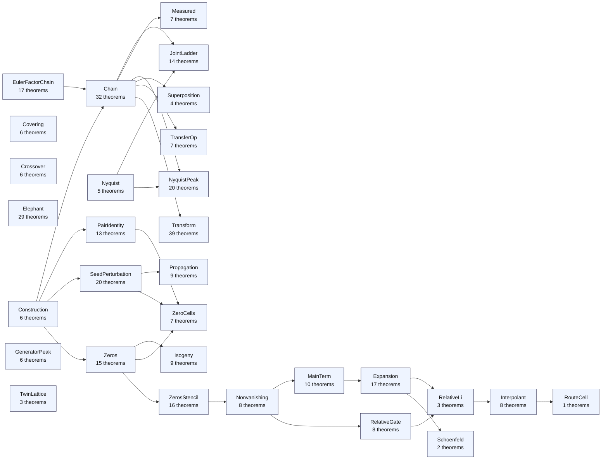
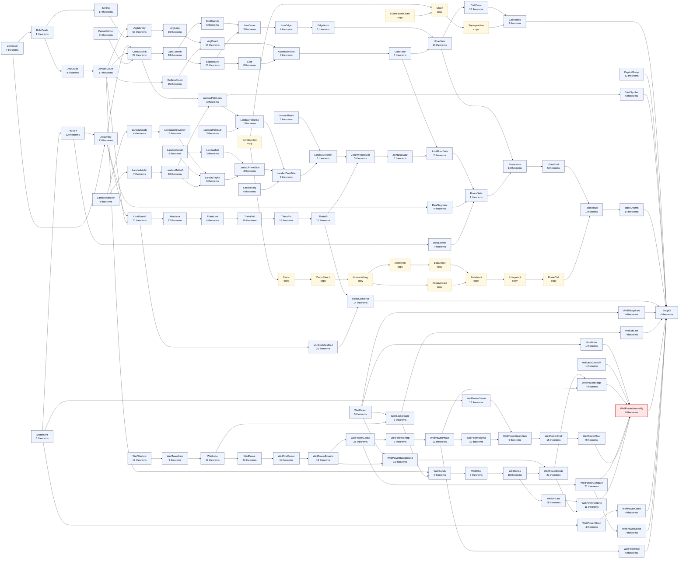
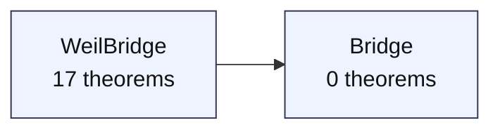

# The Lean map

Every declaration in every Lean file of this repo: what it proves, what it needs, why, and what it connects to. Generated by `python3 utilities/lean_map.py` from the `.lean` files; the workflow `.github/workflows/lean_map.yml` regenerates it on every push that touches one. Do not edit by hand.

**129 files, 1679 declarations, 1370 theorems.** 246 theorems are ends (nothing in the repo uses them). 64 theorems connect to nothing. 1 declarations contain `sorry`. 13 files are copies under `TablePort/`.

How to read a diagram: an arrow A → B means A is used by B. Blue: theorem. Green: an end. Dashed white: connects to nothing. Grey: definition. Red: contains `sorry`. Yellow: a copy, or a declaration in another file.

How each field is made, and what the reading of the code cannot see, is in the docstring of `utilities/lean_map.py`.

## `lean/` — the table's tree, Lean v4.28.0

Files, arrows by import (indirect imports left out):

| file | theorems | what it does (its own header) |
|---|---|---|
| [`lean/Chain.lean`](./lean/Chain.md) | 32 | The Euler Factor Chain, as a chain. Companion to papers/Euler-Factor-Chain.md. |
| [`lean/Construction.lean`](./lean/Construction.md) | 6 | Construction — the table has no free parameter, so the zeros were not placed. `Zeros.lean` records that nothing predicts WHERE the four exact zeros are. That is true and stays true. This file proves the complementary thing, which is what makes them structural rather than arbitrary: |
| [`lean/Covering.lean`](./lean/Covering.md) | 6 | Covering — why 25 of 36 primes contribute, and why the set skips 13. THE MEASUREMENT (results/O37_weil_form_on_stencil_run1.log): with b = 2, N = 7, W = 0.05, K = 2, the mollified Weil form has 36 primes inside its support and exactly 25 contribute: |
| [`lean/Crossover.lean`](./lean/Crossover.md) | 6 | Crossover — what the "breakdown depth" actually is. THE MEASUREMENT (results/transform_radius.json → summary.breakdown_rel_spread_by_depth): relative spread of the z-transform's root moduli, by depth, at R = 45. |
| [`lean/Elephant.lean`](./lean/Elephant.md) | 29 | # Elephant.lean — the one object, derived from nothing Standalone. This file imports Mathlib and imports no module of this development. It defines |
| [`lean/EulerFactorChain.lean`](./lean/EulerFactorChain.md) | 17 | Euler Factor Chain — the algebraic core, formalised. Companion to papers/Euler-Factor-Chain.md (statements A1, A2, A3, B1, B2, B4, C1). |
| [`lean/Expansion.lean`](./lean/Expansion.md) | 17 | Expansion — stage 2b: the derivative of 2^x/x, explicitly, and its floor. `MainTerm.lean` reduced O67's main-term hypothesis to `hD`: a floor on the `(d+1)`-th derivative of the li-interpolant on the window — equivalently, on the `d`-th derivative of `2^x/x`. This module supplies both halves: |
| [`lean/GeneratorPeak.lean`](./lean/GeneratorPeak.md) | 6 | GeneratorPeak — why the block-size account cannot explain a peak at four. THE MEASUREMENT (results/O24_gen_xmax3e9_run.log, and the 1.5e8 and 1e9 logs): `P_max/median` over generator sets G1..G8 rises to G4 = {2,3,5,7} and falls after, at every xmax measured. The peak is interior. |
| [`lean/Interpolant.lean`](./lean/Interpolant.md) | 8 | Interpolant — the smooth interpolant of the main term, constructed. Block C1 of `lean_stage3/design/joints.md`. 2026-11-22. |
| [`lean/Isogeny.lean`](./lean/Isogeny.md) | 9 | Isogeny — what the isogeny does to the row. `Transform.tau_ratio_of_meet` proves that two ladders which meet have rationally related modular parameters: `bⁿ = cᵐ → τ(b)/τ(c) = n/m`. That is a statement about the tori `ℂ*/b^ℤ`, and the torus knows only `b`. No prime enters it. |
| [`lean/JointLadder.lean`](./lean/JointLadder.md) | 14 | JointLadder — the joint `{2^m 3^n}` grid has NO aliases, and its difference operator carries two Euler factors. |
| [`lean/MainTerm.lean`](./lean/MainTerm.md) | 10 | MainTerm — stage 2: the difference calculus that discharges hM's structure. `Nonvanishing.lean` proved the arrow of O67's theorem with three named hypotheses. This module attacks `hM` — the main-term floor `Mlow ≤ \|stencil of li\|` — by formalising the calculus O67 verified numerically: the MVT step,… |
| [`lean/Measured.lean`](./lean/Measured.md) | 7 | The chain's numbers, as a Lean object. Third layer of `lean/`. Not a proof file — a RECORD file with checkable numeric relations. |
| [`lean/Nonvanishing.lean`](./lean/Nonvanishing.md) | 8 | Nonvanishing — the arrow of O67's conditional theorem, in the house pattern. `papers/The-Four-Zeros.md` § I states: under RH, `cell(r,d) ≠ 0` for every `r ≥ R(d)`, which with O43's census makes the four zeros complete at every depth `d ≤ 15`. The proof has two analytic inputs and one arithmetic gap … |
| [`lean/Nyquist.lean`](./lean/Nyquist.md) | 5 | Nyquist — why an entire family of integer-base approaches must fail, rather than merely happening to. |
| [`lean/NyquistPeak.lean`](./lean/NyquistPeak.md) | 20 | NyquistPeak — the difference filter's gain at frequency `γ` is stationary, and maximal, exactly at the Nyquist boundary `b* = exp(π/γ)`. |
| [`lean/PairIdentity.lean`](./lean/PairIdentity.md) | 13 | PairIdentity — the complementary pair, and why base two is singular. Encodes statement **I1** of `papers/Euler-Factor-Chain.md` § I ("The complementary pair"): |
| [`lean/Propagation.lean`](./lean/Propagation.md) | 9 | Propagation — the recurrence as transport: the light cone, and the propagator. `papers/Depth-as-Time.md` reads depth as time. Take that literally: with `d` as time and `r` as space, the recurrence |
| [`lean/RelativeGate.lean`](./lean/RelativeGate.md) | 8 | RelativeGate — the census gate, stated without assuming an error shape. WHY THIS FILE EXISTS. `Nonvanishing.lean` states the census gate in the RH shape: `StmtSchoenfeldWindow` carries `√x·log x/(8π)` per value, and `Ehigh` accumulates it into `2^(r/2)·(1+2^(−1/2))^n`. Every downstream tolerance stu… |
| [`lean/RelativeLi.lean`](./lean/RelativeLi.md) | 3 | RelativeLi — the relative-error gate with its main term discharged. `RelativeGate.tableFrom_ne_zero_of_relErr` makes a cell nonzero from a relative error on a window of rows, a floor `hM` under the main term's stencil, and the gap. `Expansion.hD_of_window` with `MainTerm.stencilR_ge_of` proves that … |
| [`lean/RouteCell.lean`](./lean/RouteCell.md) | 1 | RouteCell — block E9 of `lean_stage3/design/joints.md`, the table tree's half. The gate (`Interpolant.tableFrom_ne_zero_of_relErr_liRow`) at depth six, on the statement the other tree's explicit-formula route proves under RH. |
| [`lean/Schoenfeld.lean`](./lean/Schoenfeld.md) | 2 | Schoenfeld — stage 3's interface: the literature sentence, verbatim. `Expansion.tableFrom_ne_zero_of_li` carries the conditional arrow with `hS` stated window-wise, in bench shape: per-`k` bounds with the power already translated to `2^((r−k)/2)`. Nobody can check that against Schoenfeld 1976 by eye… |
| [`lean/SeedPerturbation.lean`](./lean/SeedPerturbation.md) | 20 | SeedPerturbation — changing the seed convention cannot reach a deep cell. THE QUESTION. The dyadic tables in `imported/lattice_mapper/` are built on a seed convention: the primes 2 and 3 are treated as lattice rather than counted as primes. That is a choice. If a different choice moved the zeros, th… |
| [`lean/Superposition.lean`](./lean/Superposition.md) | 4 | Superposition — the missing licence for building the residual from the zeros. `Chain.A4_of_A1` gives the depth-N gain for a SINGLE mode. Every use of it on the bench applies it to a SUM over zeta zeros (O34, O35). Nothing so far permits that step. This file supplies it, and nothing else. |
| [`lean/TransferOp.lean`](./lean/TransferOp.md) | 7 | TransferOp — bdiff named as the operator it is, in Mathlib's own vocabulary. `papers/Depth-as-Time.md` reads depth as iteration: each mode `x^ρ` is multiplied by `(1 − b^(−ρ))` per step (A2), the operator has a growth factor per mode (A3), and the first Riemann zero is the fastest-growing mode of th… |
| [`lean/Transform.lean`](./lean/Transform.md) | 39 | Transform — block G's geometry: the strip, the annulus, and what closes it. `papers/Euler-Factor-Chain.md` § G is listed as **not formalised** in `lean/BUILD.md`, and most of it is measurement (G2, G4, G5, G7 from O39) or literature (G3 Jentzsch, G9 Hardy, G10 Odlyzko–te Riele). This file takes the … |
| [`lean/TwinLattice.lean`](./lean/TwinLattice.md) | 3 | TwinLattice — a twin pair is a lattice site, not a coincidence of spacing. Every twin pair above 3 is `(6k − 1, 6k + 1)`. The single integer between them is `6k`. So a twin pair is not two primes that happen to sit two apart: it is a site on the `2·3` lattice with primes on both shoulders, and count… |
| [`lean/ZeroCells.lean`](./lean/ZeroCells.md) | 7 | ZeroCells — the four zeros are one object with four names, and the kernel now says so. |
| [`lean/Zeros.lean`](./lean/Zeros.md) | 15 | Zeros — what is provable about the four exact zeros, and what is not. THE MEASUREMENT (results/O16_run2.log): over r &lt;= 62, d &lt;= 61 the dyadic prime difference table has exactly four exact zeros — (2,1), (4,1), (8,3), (20,6) — and no others. The centered table has none at all. |
| [`lean/ZerosStencil.lean`](./lean/ZerosStencil.md) | 16 | ZerosStencil — the Mathlib-dependent half of `Zeros.lean`. Split out of `Zeros.lean` on 2026-08-26. The classification is by axiom pin, not by subject: these are exactly the fifteen theorems whose `#print axioms` carries `Classical.choice`, and every one of them acquires it from Mathlib — `Finset.ra… |

## `lean_stage3/` — Stage 3, Lean v4.32.2

Files, arrows by import (indirect imports left out):

| file | theorems | what it does (its own header) |
|---|---|---|
| [`lean_stage3/Stage3.lean`](./lean_stage3/Stage3.md) | 0 | Stage3 — scaffold and weld check. Entry 118's step 1. THE WELD, STATED LOUDLY. This package lives on toolchain v4.32.2 with PrimeNumberTheoremAnd (pinned rev 47fa486) and its Mathlib v4.32.2; the bench's lean/ lives on v4.28.0. Results here compose with the bench's arrow (Expansion.tableFrom_ne_zero… |
| [`lean_stage3/Stage3/Abscissa.lean`](./lean_stage3/Abscissa.md) | 12 | Abscissa — the contour's abscissa as a parameter, with RH as one instance. WHY THIS FILE EXISTS. `lean_stage3/Stage3/LineBound.lean:1091` defines |
| [`lean_stage3/Stage3/ArgCount.lean`](./lean_stage3/ArgCount.md) | 15 | ArgCount — block `hnt.md#H3` of `lean_stage3/design/hnt.md`, "The assembly: StmtSCrude argS, good heights by the identity, bad heights by a good one beside them". |
| [`lean_stage3/Stage3/ArgCrude.lean`](./lean_stage3/ArgCrude.md) | 4 | ArgCrude — hNT slice 2: the argument-principle half of Backlund, decomposed to the point where the Jensen zero-count is the only analytic content left. |
| [`lean_stage3/Stage3/ArgIdentity.lean`](./lean_stage3/ArgIdentity.md) | 53 | ArgIdentity — StmtArgIdentity discharged, and the contour machinery the remaining bound will need. |
| [`lean_stage3/Stage3/ArgLegs.lean`](./lean_stage3/ArgLegs.md) | 10 | ArgLegs — block H1 of `lean_stage3/design/hnt.md`, "The two contour legs". The count-to-argument step needs `\|zetaArgContour T\|` bounded by the number of zeros of `Re ζ` on the horizontal cut plus a constant. This module is the geometric half: on a segment where a path `g` avoids `0`, the imaginary … |
| [`lean_stage3/Stage3/Assembly.lean`](./lean_stage3/Assembly.md) | 13 | Assembly — step 5, slice 1: RH meets the zero sum. The explicit formula's zero side is `Σ_{\|γ\|&lt;T} m(ρ)·x^ρ/ρ`. This module defines that sum (`zeroPartialSum`), states the hEF leaf (`StmtExplicitFormula` — the truncated explicit formula with explicit remainder, the one genuinely open piece), and prov… |
| [`lean_stage3/Stage3/AssemblyFloor.lean`](./lean_stage3/AssemblyFloor.md) | 6 | AssemblyFloor — block E1 of `lean_stage3/design/joints.md`. 2026-11-22. `Assembly.psiWeak_of_RH_EF_NT` with nothing rounded at the end. Inside that proof the contour constants `c₁`, `c₂` multiply `log²x` with no `√x`, and the zero side is a polynomial in `log T`; its closing lemmas round every term … |
| [`lean_stage3/Stage3/BoxBounds.lean`](./lean_stage3/BoxBounds.md) | 6 | BoxBounds — blocks E7a and E7b of `lean_stage3/design/joints.md`. 2026-11-22. Two of the quantities the explicit-formula route took from existence statements, as numerals. |
| [`lean_stage3/Stage3/BoxFinite.lean`](./lean_stage3/BoxFinite.md) | 1 | BoxFinite — the off-line box of `WeilDetect` is a finite set of zeros (block 15 of rung5.md). |
| [`lean_stage3/Stage3/CellModes.lean`](./lean_stage3/CellModes.md) | 3 | CellModes — block T1 of `lean_stage3/design/joints.md`, second part. 2026-11-22. |
| [`lean_stage3/Stage3/CellZeros.lean`](./lean_stage3/CellZeros.md) | 10 | CellZeros — block T1 of `lean_stage3/design/joints.md`. 2026-11-22. The cell as a sum over the zeros. For the row `ψ(2^n)` of the log-weighted prime count along the doublings, the `d`-fold backward difference at `r` is the main term `2^r·(1 − 1/2)^d` minus a sum over the zeros of ζ below a height, e… |
| [`lean_stage3/Stage3/ContourShift.lean`](./lean_stage3/ContourShift.md) | 29 | # The contour shift — slices 2, 3, 4 (hEF's build order, entry 257) Written as the slice map for the contour shift, with named `sorry`s so the obligations were real Lean statements before proof. S2 and S4 are proved here; S3 is proved downstream (`EdgeBound`, `Glue`) and its placeholder is gone. Sor… |
| [`lean_stage3/Stage3/EdgeBound.lean`](./lean_stage3/EdgeBound.md) | 15 | # S3 — the edge bound (FinalBound rescale + gap-eating) The Landau partial fraction transported from PNT+'s normalized `FinalBound` (unit ball) to the ball at `3/2 + iT′`, for `g = (s−1)²·ζ` (entire; the pole cleared, one extra order-1 zero at `1`). Inputs: `ZetaGrowth.sq_zeta_band_bound` (the B), P… |
| [`lean_stage3/Stage3/EdgeNum.lean`](./lean_stage3/EdgeNum.md) | 6 | EdgeNum — block E8a of `lean_stage3/design/joints.md`. 2026-11-22. `EdgeBound`'s three edge theorems with their constants as definitions. Each proof is the original with its existence step replaced: the band bound is `BoxBounds.sq_zeta_band_explicit` in place of `sq_zeta_band_bound`, and each `refin… |
| [`lean_stage3/Stage3/ExplicitBump.lean`](./lean_stage3/ExplicitBump.md) | 12 | ExplicitBump — a concrete `ν`, so `mellin_bump_bounded`'s `B` is a numeral. WHY THIS FILE EXISTS. `RHPull.psi_weak_of_RH` (`Stage3/LineBound.lean:2357`) assembles its constant from four distinct existentials: |
| [`lean_stage3/Stage3/GateEval.lean`](./lean_stage3/GateEval.md) | 5 | GateEval — block E9 of `lean_stage3/design/joints.md`. 2026-11-22. The table gate's own inequality, evaluated on the explicit-formula route at the floor `x₀ = 2^36` and depth six. |
| [`lean_stage3/Stage3/Glue.lean`](./lean_stage3/Glue.md) | 8 | # The glue — assembling StmtExplicitFormula from the four slices Pieces, in build order: - the band count and the `zeroPartialSum` swap (`T′ → T`), - the edge-integral estimates (S3's pointwise bounds integrated), - the rectangle-edge splitting matching S1's line integral, - the final assembly in th… |
| [`lean_stage3/Stage3/GlueFloor.lean`](./lean_stage3/GlueFloor.md) | 6 | GlueFloor — block E2 of `lean_stage3/design/joints.md`. 2026-11-22. `Glue.edge_left_bound` proves the left edge of the explicit formula's contour is at most `72·D·log²x·x^(−1/4)` and then rounds that to `C·log x` (unit 0408: that rounding is the whole of `c₂`). Three copies with a different last lin… |
| [`lean_stage3/Stage3/GlueNum.lean`](./lean_stage3/GlueNum.md) | 13 | GlueNum — block E8b of `lean_stage3/design/joints.md`. 2026-11-22. `Glue`'s theorems under the truncated explicit formula, and the formula itself, with their constants as definitions. Each proof is the original with its existence step replaced (`LOOP.md` § 3); the left edge takes `EdgeBound.logDeriv… |
| [`lean_stage3/Stage3/IndicatorContDiff.lean`](./lean_stage3/IndicatorContDiff.md) | 1 | IndicatorContDiff — the C¹ indicator lemma (follow-up to block 15 of rung5.md, to unit 0369; the second of the two lemmas unit 0368 named as blocking `WeilPowerAssembly`'s `isTest_phiWC`). |
| [`lean_stage3/Stage3/JensenCount.lean`](./lean_stage3/JensenCount.md) | 17 | JensenCount — `StmtLocalCount` discharged: the Backlund-style local zero count for `ζ`, with explicit constants. |
| [`lean_stage3/Stage3/JointDialGate.lean`](./lean_stage3/JointDialGate.md) | 5 | JointDialGate — joints 3, 4, 5 of `SECTIONS.md`: the dial onto the table's gate. Block 3 of `lean_stage3/design/joints.md`. 2026-11-22. |
| [`lean_stage3/Stage3/JointFloorGate.lean`](./lean_stage3/JointFloorGate.md) | 2 | JointFloorGate — block E3 of `lean_stage3/design/joints.md`. 2026-11-22. The explicit-formula route (unit 0409, `schoenfeldWeak_floor_split_of_RH`) carried to the statement the table's gate takes, `StmtRelErrWindow` (`JointDialGate`, a character copy of `lean/RelativeGate.lean`, welded). |
| [`lean_stage3/Stage3/JointSymbol.lean`](./lean_stage3/JointSymbol.md) | 6 | JointSymbol — joint 9a of `SECTIONS.md`: the table of `G` along the doublings and the symbol, on the transform side. Block 9a of `lean_stage3/design/joints.md`. 2026-11-22. |
| [`lean_stage3/Stage3/JointWindowDial.lean`](./lean_stage3/JointWindowDial.md) | 3 | JointWindowDial — joint 1 of `SECTIONS.md`: the Landau window onto the dial. Block 1 of `lean_stage3/design/joints.md`. 2026-11-22. |
| [`lean_stage3/Stage3/LandauChebyshev.lean`](./lean_stage3/LandauChebyshev.md) | 5 | LandauChebyshev — the bound on `G` of Chebyshev's order: `G y ≤ 8y` and `\|G(y)\| ≤ 8y(1 + log y)` for `y ≥ 1`. Block 5b of `lean_stage3/design/landau.md`. 2026-11-22. |
| [`lean_stage3/Stage3/LandauCriterion.lean`](./lean_stage3/LandauCriterion.md) | 3 | LandauCriterion — the Landau window criterion, proved. Block 7d of `lean_stage3/design/landau.md`. 2026-11-22. |
| [`lean_stage3/Stage3/LandauCrude.lean`](./lean_stage3/LandauCrude.md) | 4 | LandauCrude — a crude bound on `G`: `\|G(y)\| ≤ 2y(1 + log y)²` for `y ≥ 1`. Block 5 of `lean_stage3/design/landau.md`. 2026-11-22. |
| [`lean_stage3/Stage3/LandauKernel.lean`](./lean_stage3/LandauKernel.md) | 6 | LandauKernel — the kernel's integral: for `a &gt; 0`, `∫₁^∞ (log y)^k · y^(−a−1) dy = k!/a^(k+1)`. Block 4a of `lean_stage3/design/landau.md`. 2026-11-22. |
| [`lean_stage3/Stage3/LandauMellin.lean`](./lean_stage3/LandauMellin.md) | 7 | LandauMellin — the Mellin transform of the ramp sum on `Re s &gt; 1`. Block 2 of `lean_stage3/design/landau.md`. 2026-11-22. |
| [`lean_stage3/Stage3/LandauMellinG.lean`](./lean_stage3/LandauMellinG.md) | 10 | LandauMellinG — the Mellin transform of `G` on `Re s &gt; 1`. Block 2b of `lean_stage3/design/landau.md`. 2026-11-22. |
| [`lean_stage3/Stage3/LandauPoleDisc.lean`](./lean_stage3/LandauPoleDisc.md) | 1 | LandauPoleDisc — the derivatives of `Phi` at a regular point, from the zeros of `ζ` in a disc around it. Block 3b2 of `lean_stage3/design/landau.md`. 2026-11-22. |
| [`lean_stage3/Stage3/LandauPoleLocal.lean`](./lean_stage3/LandauPoleLocal.md) | 3 | LandauPoleLocal — `Phi` near a zero of `ζ` and near `1`. Block 3a of `lean_stage3/design/landau.md`. 2026-11-22. |
| [`lean_stage3/Stage3/LandauPoleSub.lean`](./lean_stage3/LandauPoleSub.md) | 3 | LandauPoleSub — finitely many simple poles subtracted on an open set, and what that gives for the Taylor coefficients. Nothing here is about `ζ`. Block 3b1 of `lean_stage3/design/landau.md`. 2026-11-22. |
| [`lean_stage3/Stage3/LandauPrimeSide.lean`](./lean_stage3/LandauPrimeSide.md) | 3 | LandauPrimeSide — the primes' reading of the Taylor coefficients of `Phi`, bounded from above by a window bound on `G`. Block 7a of `lean_stage3/design/landau.md`. 2026-11-22. |
| [`lean_stage3/Stage3/LandauRates.lean`](./lean_stage3/LandauRates.md) | 3 | LandauRates — the scalar inequalities of the assembly. Block 7c of `lean_stage3/design/landau.md`. 2026-11-22. |
| [`lean_stage3/Stage3/LandauTail.lean`](./lean_stage3/LandauTail.md) | 3 | LandauTail — the kernel off the window: the integral of `(log y)^k·y^(−a−1)` over `(1, Y]` and over `(Z, ∞)`, each bounded by a shift of the exponent. Block 4b of `lean_stage3/design/landau.md`. 2026-11-22. |
| [`lean_stage3/Stage3/LandauTaylor.lean`](./lean_stage3/LandauTaylor.md) | 6 | LandauTaylor — the derivatives of `Phi` on `Re s &gt; 1`, from the primes: iteratedDeriv k Phi s = ∫₁^∞ G(y)·(−log y)^k·y^(−s−1) dy. |
| [`lean_stage3/Stage3/LandauTrig.lean`](./lean_stage3/LandauTrig.md) | 6 | LandauTrig — a real exponential sum is large somewhere in every long block. Block 6 of `lean_stage3/design/landau.md`. 2026-11-22. |
| [`lean_stage3/Stage3/LandauWindow.lean`](./lean_stage3/LandauWindow.md) | 4 | LandauWindow — the Landau window criterion as a statement, and what it gives: a one-sided bound on one function of the primes, on long windows, implies Mathlib's `RiemannHypothesis`. Block 1 of `lean_stage3/design/landau.md`. 2026-11-22. |
| [`lean_stage3/Stage3/LandauZeroSide.lean`](./lean_stage3/LandauZeroSide.md) | 2 | LandauZeroSide — the zeros' reading of the Taylor coefficients of `Phi`, from below. Block 7b of `lean_stage3/design/landau.md`. 2026-11-22. |
| [`lean_stage3/Stage3/LineBound.lean`](./lean_stage3/LineBound.md) | 70 | no header |
| [`lean_stage3/Stage3/LowCount.lean`](./lean_stage3/LowCount.md) | 3 | LowCount — block E7c of `lean_stage3/design/joints.md`. 2026-11-22. The zeros of ζ below height six, counted. `EdgeBound.ball_order_sum_le` takes their number `M0` as a finite sum with no numeral; here it is bounded by Jensen's count (upstream `ZerosBound`) on six discs about `3/2 + i(j + 1/2)`, `j … |
| [`lean_stage3/Stage3/LowEdge.lean`](./lean_stage3/LowEdge.md) | 4 | LowEdge — block E7d of `lean_stage3/design/joints.md`. 2026-11-22. The logarithmic derivative of ζ on the short segment `Re s = −1/4`, `\|t\| ≤ 2`, bounded by a numeral. `Glue.edge_left_bound` takes that supremum `Mc` from compactness. `EdgeBound.gz_partial_fraction` gives the bound at heights `≥ 2` b… |
| [`lean_stage3/Stage3/PerronKernel.lean`](./lean_stage3/PerronKernel.md) | 31 | # Slice 1a — the truncated Perron kernel bound (hEF's entry point) COMPLETE, 2026-08-29: every branch proved, no sorry. `perron_kernel_truncated` sits at `[propext, Classical.choice, Quot.sound]`. (Build order: entry 257; ledger: CONTEXT.md § hEF, roadmap D. This was hEF's load-bearing unknown — the… |
| [`lean_stage3/Stage3/PsiToPi.lean`](./lean_stage3/PsiToPi.md) | 12 | PsiToPi — step 3: the transfer from ψ-error to π−Li error. The classical chain: Mathlib's Abel-summation bridge (`Chebyshev.primeCounting_eq_theta_div_log_add_integral`) writes π(⌊x⌋) = θ(x)/log x + ∫₂ˣ θ(t)/(t·log²t) dt, and the same identity for the logarithmic integral turns any bound on \|θ − id\|… |
| [`lean_stage3/Stage3/ReZetaCount.lean`](./lean_stage3/ReZetaCount.md) | 15 | ReZetaCount — block H2 of `lean_stage3/design/hnt.md`, "The count: zeros of Re ζ on the segment, and Re ζ &gt; 0 on the line Re s = 2". |
| [`lean_stage3/Stage3/RealSegment.lean`](./lean_stage3/RealSegment.md) | 4 | RealSegment — block E5 of `lean_stage3/design/joints.md`. 2026-11-22. ζ has no zero on the real segment `(0, 1)`, so the bucket `W` of real nontrivial zeros in the explicit-formula route is zero. |
| [`lean_stage3/Stage3/RouteGate.lean`](./lean_stage3/RouteGate.md) | 1 | RouteGate — block E6 of `lean_stage3/design/joints.md`. 2026-11-22. The explicit-formula route at the gate's statement (unit 0411) with two of its leaves substituted: `W = 0` (unit 0414) and the main term written as the formula the table tree's interpolant has at the rows (unit 0413). |
| [`lean_stage3/Stage3/RouteNum.lean`](./lean_stage3/RouteNum.md) | 14 | RouteNum — block E8c of `lean_stage3/design/joints.md`. 2026-11-22. The explicit-formula route at the gate with its three constants named, and a numeral above each constant in the chain. |
| [`lean_stage3/Stage3/RowLeaves.lean`](./lean_stage3/RowLeaves.md) | 7 | RowLeaves — block E4 of `lean_stage3/design/joints.md`. 2026-11-22. Two leaves the route to the gate left open (unit 0412). |
| [`lean_stage3/Stage3/RvMCrude.lean`](./lean_stage3/RvMCrude.md) | 1 | RvMCrude — hNT slice 1, corrected: Backlund's decomposition, assembled over an abstract continuous phase. |
| [`lean_stage3/Stage3/Statement.lean`](./lean_stage3/Statement.md) | 6 | Statement — step 2: the weak bound family, and the bridges between shapes. O68 (entry 118) measured the tolerance: the census survives bounds of the shape C·√x·(log x)^k far weaker than Schoenfeld's — depth 10 at C = 1, k = 2; depth 6 at C = 1000. This module gives that family its Lean name and prov… |
| [`lean_stage3/Stage3/Stirling.lean`](./lean_stage3/Stirling.md) | 17 | Stirling — the phase construction: θ as the digamma integral. Entry 132 made the continuous phase part of the Stirling half's discharge. This module constructs it. The classical θ(T) is `Im log Γ(1/4 + iT/2) − (T/2)·log π` along the continuous branch, and the continuous branch IS the integral of the… |
| [`lean_stage3/Stage3/TableDepths.lean`](./lean_stage3/TableDepths.md) | 14 | TableDepths — block E11 of `lean_stage3/design/joints.md`. 2026-11-22. `TableRoute.cell_ne_zero_of_RH` is depth six. The same route and gate at any depth, from one numeric check at one row, and the instances that fall inside the computed table. |
| [`lean_stage3/Stage3/TablePort/Chain.lean`](./lean_stage3/TablePort_Chain.md) | 32 | copy of `lean/Chain.lean` |
| [`lean_stage3/Stage3/TablePort/Construction.lean`](./lean_stage3/TablePort_Construction.md) | 6 | copy of `lean/Construction.lean` |
| [`lean_stage3/Stage3/TablePort/EulerFactorChain.lean`](./lean_stage3/TablePort_EulerFactorChain.md) | 17 | copy of `lean/EulerFactorChain.lean` |
| [`lean_stage3/Stage3/TablePort/Expansion.lean`](./lean_stage3/TablePort_Expansion.md) | 17 | copy of `lean/Expansion.lean` |
| [`lean_stage3/Stage3/TablePort/Interpolant.lean`](./lean_stage3/TablePort_Interpolant.md) | 8 | copy of `lean/Interpolant.lean` |
| [`lean_stage3/Stage3/TablePort/MainTerm.lean`](./lean_stage3/TablePort_MainTerm.md) | 10 | copy of `lean/MainTerm.lean` |
| [`lean_stage3/Stage3/TablePort/Nonvanishing.lean`](./lean_stage3/TablePort_Nonvanishing.md) | 8 | copy of `lean/Nonvanishing.lean` |
| [`lean_stage3/Stage3/TablePort/RelativeGate.lean`](./lean_stage3/TablePort_RelativeGate.md) | 8 | copy of `lean/RelativeGate.lean` |
| [`lean_stage3/Stage3/TablePort/RelativeLi.lean`](./lean_stage3/TablePort_RelativeLi.md) | 3 | copy of `lean/RelativeLi.lean` |
| [`lean_stage3/Stage3/TablePort/RouteCell.lean`](./lean_stage3/TablePort_RouteCell.md) | 1 | copy of `lean/RouteCell.lean` |
| [`lean_stage3/Stage3/TablePort/Superposition.lean`](./lean_stage3/TablePort_Superposition.md) | 4 | copy of `lean/Superposition.lean` |
| [`lean_stage3/Stage3/TablePort/Zeros.lean`](./lean_stage3/TablePort_Zeros.md) | 15 | copy of `lean/Zeros.lean` |
| [`lean_stage3/Stage3/TablePort/ZerosStencil.lean`](./lean_stage3/TablePort_ZerosStencil.md) | 16 | copy of `lean/ZerosStencil.lean` |
| [`lean_stage3/Stage3/TableRoute.lean`](./lean_stage3/TableRoute.md) | 1 | TableRoute — block E10 of `lean_stage3/design/joints.md`: the join between the two trees, closed for the explicit-formula route. 2026-11-22. |
| [`lean_stage3/Stage3/ThetaConverse.lean`](./lean_stage3/ThetaConverse.md) | 14 | ThetaConverse — the Landau converse of the θ-dial. 2026-09-01. `ThetaPsi.psi_weak_of_theta` and `ThetaPi.schoenfeldWeakTheta_of_zeroFree` run one way: a zero-free half-plane `re s &gt; θ` gives `\|ψ − x\| ≤ C·x^θ·log^k x`. This file runs the other way: |
| [`lean_stage3/Stage3/ThetaLine.lean`](./lean_stage3/ThetaLine.md) | 4 | ThetaLine — the vertical-line bound on `ζ'/ζ`, at a general abscissa `θ`. WHAT THIS PORTS. `RHPull.integrand_norm_le` (`LineBound.lean:1096`) draws its line bound from `Slice4b.logDerivZeta_line` (`:801`), which splits on `\|t\| ≤ 2`: |
| [`lean_stage3/Stage3/ThetaPi.lean`](./lean_stage3/ThetaPi.md) | 10 | ThetaPi — the ψ → π transfer at a general abscissa θ. `PsiToPi.schoenfeldWeak_of_psiWeak` is hardwired to exponent `1/2`: `StmtPsiWeak` carries a literal `Real.sqrt t`, and the envelope integral `integral_A_rpow_le` integrates `t^(−1/2)` to `2A·√x`. This file is the same proof with `x^θ` in place of… |
| [`lean_stage3/Stage3/ThetaPsi.lean`](./lean_stage3/ThetaPsi.md) | 16 | ThetaPsi — `\|ψ(X) − X\| ≤ C·X^θ·log³X` from a zero-free half-plane `re &gt; θ`. WHAT THIS PORTS. The last stretch of `RHPull` (`LineBound.lean`): |
| [`lean_stage3/Stage3/ThetaPull.lean`](./lean_stage3/ThetaPull.md) | 10 | ThetaPull — the vertical segment `I₃₇` at a general abscissa `θ`. WHAT THIS PORTS. `RHPull` (`LineBound.lean:1085` onward) bounds the vertical segment of the Perron contour at `σRH X = 1/2 + 1/log X`: |
| [`lean_stage3/Stage3/VonKochScaffold.lean`](./lean_stage3/VonKochScaffold.md) | 21 | # Von Koch converse — roadmap B1, COMPLETE (∃ C x₀, ∀ t ≥ x₀, \|ψ t − t\| ≤ C·√t·(log t)³) → RiemannHypothesis |
| [`lean_stage3/Stage3/WeilBackground.lean`](./lean_stage3/WeilBackground.md) | 7 | WeilBackground — the window as a test function of the explicit formula, and the on-line terms of the zero side. Rung 4b, first half, of the detection ladder (units 0316–0319). 2026-09-06. |
| [`lean_stage3/Stage3/WeilBands.lean`](./lean_stage3/WeilBands.md) | 4 | WeilBands — the on-line zeros counted by band. Rung 4b, second half, slice A of the detection ladder (units 0316–0320). 2026-09-06. |
| [`lean_stage3/Stage3/WeilBridgeLeaf.lean`](./lean_stage3/WeilBridgeLeaf.md) | 4 | WeilBridgeLeaf — the zero-set lemma and the bridge leaf: `zeroForm` gets a prime side. Block 1 of `lean_stage3/design/bridge.md`. 2026-11-22. |
| [`lean_stage3/Stage3/WeilDetect.lean`](./lean_stage3/WeilDetect.md) | 5 | WeilDetect — the zero side of Weil's form on bounded support, and the bounded-height detection statement. 2026-09-06, the first attempt at entry 297's rung-to-strip arrow, in the shape entry 303 §(d) drafted and did not add. |
| [`lean_stage3/Stage3/WeilLobe.lean`](./lean_stage3/WeilLobe.md) | 17 | WeilLobe — the 2γ lobe bounded above. Rung 4a of the detection ladder (units 0316–0318). 2026-09-06. |
| [`lean_stage3/Stage3/WeilOddPower.lean`](./lean_stage3/WeilOddPower.md) | 11 | WeilOddPower — the odd envelope `sin(πx)·P(x)^m` and its transform in closed form; the switched window and its transform. Rung 5, third slice. 2026-09-06. |
| [`lean_stage3/Stage3/WeilOffLine.lean`](./lean_stage3/WeilOffLine.md) | 7 | WeilOffLine — every term of the zero form is minus a square, and the sign of an off-line zero's own term. Rung 5, first slice of the detection ladder (units 0316–0325). 2026-09-06. |
| [`lean_stage3/Stage3/WeilOnLine.lean`](./lean_stage3/WeilOnLine.md) | 18 | WeilOnLine — the on-line background, all heights. Rung 4b, second half, slice B3 of the detection ladder (units 0316–0323). 2026-09-06. |
| [`lean_stage3/Stage3/WeilPower.lean`](./lean_stage3/WeilPower.md) | 24 | WeilPower — the m-th power window's transform in closed form. Rung 5, second slice, first module of the switched window (units 0326–0328). 2026-09-06. |
| [`lean_stage3/Stage3/WeilPowerAssembly.lean`](./lean_stage3/WeilPowerAssembly.md) | 8 | WeilPowerAssembly — block `rung5.md#15` of `lean_stage3/design/rung5.md`, "The conditional theorem: detection under the gap hypothesis". The assembly promised by sections 6, 7, 8, 13g, 13j and 0367; unit 0368, extended by units 0369 (BoxFinite), 0370 (IndicatorContDiff) and the present relay close-o… |
| [`lean_stage3/Stage3/WeilPowerBackground.lean`](./lean_stage3/WeilPowerBackground.md) | 16 | WeilPowerBackground — the switched window as a test function of the explicit formula, every term of the zero form as minus a square, and the on-line terms bounded. Rung 5, fifth slice. 2026-09-06. |
| [`lean_stage3/Stage3/WeilPowerBands.lean`](./lean_stage3/WeilPowerBands.md) | 21 | WeilPowerBands — the on-line background of the switched window over the upper heights: bands, tiles and the explicit band series. Rung 5, seventh slice. 2026-09-06. |
| [`lean_stage3/Stage3/WeilPowerBounds.lean`](./lean_stage3/WeilPowerBounds.md) | 19 | WeilPowerBounds — bounds on the odd transform read off its polynomial. Rung 5, fourth slice. 2026-09-06. |
| [`lean_stage3/Stage3/WeilPowerBridge.lean`](./lean_stage3/WeilPowerBridge.md) | 7 | WeilPowerBridge — the term at an actual zero: two sidebands, the far one bounded. Rung 5, twentieth slice; worksheet § 13 block 13j. 2026-09-07. |
| [`lean_stage3/Stage3/WeilPowerClean.lean`](./lean_stage3/WeilPowerClean.md) | 4 | WeilPowerClean — the clean shell. Rung 5, eighteenth slice; worksheet § 13 block 13h. 2026-09-07. |
| [`lean_stage3/Stage3/WeilPowerCompare.lean`](./lean_stage3/WeilPowerCompare.md) | 21 | WeilPowerCompare — the comparison at another off-line zero. Rung 5, ninth slice, worksheet section 7. 2026-09-06. |
| [`lean_stage3/Stage3/WeilPowerCount.lean`](./lean_stage3/WeilPowerCount.md) | 4 | WeilPowerCount — the short-interval count leaf, and the range that closes. Rung 5, nineteenth slice; worksheet § 13 block 13i. 2026-09-07. |
| [`lean_stage3/Stage3/WeilPowerGauss.lean`](./lean_stage3/WeilPowerGauss.md) | 25 | WeilPowerGauss — the odd transform in the Gaussian regime, through Euler's product for `sinh`. Rung 5, sixth slice. 2026-09-06. |
| [`lean_stage3/Stage3/WeilPowerGeom.lean`](./lean_stage3/WeilPowerGeom.md) | 12 | WeilPowerGeom — the geometric sum and the harmonic correction: the two sums the averaging route needs over a range of `h`, one bounded independently of the range length, the other by a logarithm of it. Rung 5, fourteenth slice; worksheet § 13 block 13d. 2026-09-06. |
| [`lean_stage3/Stage3/WeilPowerGeomGen.lean`](./lean_stage3/WeilPowerGeomGen.md) | 9 | WeilPowerGeomGen — the geometric bound with a free slope, and `u` at general `λ`. Rung 5, fifteenth slice; worksheet § 13 block 13e. 2026-09-06. |
| [`lean_stage3/Stage3/WeilPowerNear.lean`](./lean_stage3/WeilPowerNear.md) | 9 | WeilPowerNear — the near members' sign. Rung 5, seventeenth slice; worksheet § 13 block 13g. 2026-09-07. |
| [`lean_stage3/Stage3/WeilPowerOnLine.lean`](./lean_stage3/WeilPowerOnLine.md) | 11 | WeilPowerOnLine — the switched window's on-line background, all heights. Rung 5, eighth slice. 2026-09-06. |
| [`lean_stage3/Stage3/WeilPowerPhase.lean`](./lean_stage3/WeilPowerPhase.md) | 21 | WeilPowerPhase — the phase of the tail product: `S m w` is its principal part `c·w·exp(w²σ)` up to a relative error `2q`, and `Re (S m w)²` has an explicit lower bound. Rung 5, twelfth slice; worksheet § 13 requirement (b). 2026-09-06. Unit 0347. |
| [`lean_stage3/Stage3/WeilPowerSelect.lean`](./lean_stage3/WeilPowerSelect.md) | 7 | WeilPowerSelect — selection of the target. Rung 5, tenth slice, worksheet section 8. 2026-09-06. |
| [`lean_stage3/Stage3/WeilPowerSharp.lean`](./lean_stage3/WeilPowerSharp.md) | 7 | WeilPowerSharp — the Gaussian bounds with the constant kept exact and the tail sum sharp: the two lost factors of WeilPowerGauss removed. Rung 5, eleventh slice. 2026-09-06. Unit 0346; the decision is unit 0345. |
| [`lean_stage3/Stage3/WeilPowerShell.lean`](./lean_stage3/WeilPowerShell.md) | 15 | WeilPowerShell — one shell member's weighted sum, explicit. Rung 5, sixteenth slice; worksheet § 13 block 13f. 2026-09-06. |
| [`lean_stage3/Stage3/WeilPowerSigma.lean`](./lean_stage3/WeilPowerSigma.md) | 10 | WeilPowerSigma — the tail sum to order `1/m`: `σ(m) = Σ_{j≥m+2} 1/(π²j²)` bracketed sharply enough that `u m = (m+1)²σ(m)` is `(m+½)/π²` plus a correction of size `1/m`. Rung 5, thirteenth slice; worksheet § 13 block 13c. 2026-09-06. |
| [`lean_stage3/Stage3/WeilPowerTail.lean`](./lean_stage3/WeilPowerTail.md) | 6 | WeilPowerTail — the tail bound: an upper bound on `‖S m w‖` for every `w`, with no regime. Block 16a of `lean_stage3/design/rung5.md` (section 16, its line T12). 2026-11-22. Priced in unit 0378. |
| [`lean_stage3/Stage3/WeilSeries.lean`](./lean_stage3/WeilSeries.md) | 18 | WeilSeries — the band series made explicit. Rung 4b, second half, slice B2 of the detection ladder (units 0316–0322). 2026-09-06. |
| [`lean_stage3/Stage3/WeilTiles.lean`](./lean_stage3/WeilTiles.md) | 8 | WeilTiles — the heights tiled by bands. Rung 4b, second half, slice B1 of the detection ladder (units 0316–0321). 2026-09-06. |
| [`lean_stage3/Stage3/WeilTransform.lean`](./lean_stage3/WeilTransform.md) | 9 | WeilTransform — the transform of the tuned window in closed form. Rung 3 of the detection ladder (units 0316, 0317). 2026-09-06. |
| [`lean_stage3/Stage3/WeilWindow.lean`](./lean_stage3/WeilWindow.md) | 12 | WeilWindow — the raised-cosine window of entry 302, first two rungs of the detection ladder, crude constants. 2026-09-06. |
| [`lean_stage3/Stage3/ZeroSum.lean`](./lean_stage3/ZeroSum.md) | 7 | ZeroSum — step 4: the dyadic zero-count arithmetic under hNT. The hNT leaf is IEANTN's `riemannZeta.Riemann_vonMangoldt_bound b₁ b₂ b₃` (Rosser Th. 19 shape; the literature instantiates (0.137, 0.443, 6.1)). O69 measured what it asserts: the angle count IS the logarithm curve, the fluctuation under … |
| [`lean_stage3/Stage3/ZetaGrowth.lean`](./lean_stage3/ZetaGrowth.md) | 18 | # Zeta growth on the strip `re &gt; −1` (S3a — the load-bearing unknown of S3) Second-order Euler–Maclaurin: one integration by parts past PNT+'s `riemannZeta0`. The antiderivative `emA x = ({x} − {x}²)/2` of `⌊x⌋ + 1/2 − x` vanishes at every integer, so the per-interval boundary terms die and the new … |

## `lean_bridge/` — the bridge, Lean v4.33.0-rc2

Files, arrows by import (indirect imports left out):

| file | theorems | what it does (its own header) |
|---|---|---|
| [`lean_bridge/Bridge.lean`](./lean_bridge/Bridge.md) | 0 | no header |
| [`lean_bridge/Bridge/WeilBridge.lean`](./lean_bridge/WeilBridge.md) | 17 | WeilBridge — the bridge to primes: the zero side of Weil's form at a test function of Stage 3's class equals the prime side, proved against zeta23's explicit formula. The third tree, `lean_bridge/`. 2026-11-22. The statement is unit 0379's; the choice of a third tree is Julian's of the same day. |

## Ends: theorems nothing else uses

Each is where a line of the repo arrives. "Behind it" counts the declarations it rests on, through every file.

| theorem | file | behind it | files behind it |
|---|---|---|---|
| `TableDepths.depth_seven` | [`TableDepths`](./lean_stage3/TableDepths.md) | 405 | 39 |
| `TableDepths.depth_six` | [`TableDepths`](./lean_stage3/TableDepths.md) | 405 | 39 |
| `TableDepths.depth_eight` | [`TableDepths`](./lean_stage3/TableDepths.md) | 404 | 39 |
| `TableDepths.depth_five` | [`TableDepths`](./lean_stage3/TableDepths.md) | 404 | 39 |
| `TableDepths.depth_four` | [`TableDepths`](./lean_stage3/TableDepths.md) | 404 | 39 |
| `TableDepths.depth_one` | [`TableDepths`](./lean_stage3/TableDepths.md) | 404 | 39 |
| `TableDepths.depth_three` | [`TableDepths`](./lean_stage3/TableDepths.md) | 404 | 39 |
| `TableDepths.depth_two` | [`TableDepths`](./lean_stage3/TableDepths.md) | 404 | 39 |
| `TableRoute.cell_ne_zero_of_RH` | [`TableRoute`](./lean_stage3/TableRoute.md) | 403 | 39 |
| `RouteGate.relErrWindow_route` | [`RouteGate`](./lean_stage3/RouteGate.md) | 296 | 23 |
| `Stage3.schoenfeldWeak_floor_of_RH` | [`AssemblyFloor`](./lean_stage3/AssemblyFloor.md) | 280 | 18 |
| `CellModes.cell_eq_modeSum` | [`CellModes`](./lean_stage3/CellModes.md) | 167 | 16 |
| `JointDialGate.relErrWindow_of_window` | [`JointDialGate`](./lean_stage3/JointDialGate.md) | 160 | 27 |
| `JointWindowDial.psiWeakTheta_of_window` | [`JointWindowDial`](./lean_stage3/JointWindowDial.md) | 137 | 24 |
| `ArgCount.rvM_crude_of_good_two` | [`ArgCount`](./lean_stage3/ArgCount.md) | 115 | 8 |
| `WeilPowerAssembly.target_lower` | [`WeilPowerAssembly`](./lean_stage3/WeilPowerAssembly.md) | 113 | 12 |
| `WeilOnLine.summable_onLine` | [`WeilOnLine`](./lean_stage3/WeilOnLine.md) | 107 | 10 |
| `WeilOnLine.tsum_onLine_le` | [`WeilOnLine`](./lean_stage3/WeilOnLine.md) | 107 | 10 |
| `WeilPowerOnLine.summable_onLine` | [`WeilPowerOnLine`](./lean_stage3/WeilPowerOnLine.md) | 106 | 13 |
| `WeilPowerOnLine.tsum_onLine_le` | [`WeilPowerOnLine`](./lean_stage3/WeilPowerOnLine.md) | 106 | 13 |
| `WeilSeries.tsum_upper_le_explicit'` | [`WeilSeries`](./lean_stage3/WeilSeries.md) | 96 | 9 |
| `WeilPowerCompare.compare_suppressed` | [`WeilPowerCompare`](./lean_stage3/WeilPowerCompare.md) | 93 | 6 |
| `VonKoch.RH_iff_psiWeak` | [`VonKochScaffold`](./lean_stage3/VonKochScaffold.md) | 81 | 4 |
| `Stage3.schoenfeldWeak_of_RH_half` | [`ThetaPi`](./lean_stage3/ThetaPi.md) | 80 | 9 |
| `WeilPowerBands.tsum_upper_le_explicit'` | [`WeilPowerBands`](./lean_stage3/WeilPowerBands.md) | 80 | 11 |
| `LandauCriterion.rh_of_windows` | [`LandauCriterion`](./lean_stage3/LandauCriterion.md) | 79 | 17 |
| `Stage3.zeroFreeRight_iff_psiWeakTheta` | [`ThetaConverse`](./lean_stage3/ThetaConverse.md) | 79 | 9 |
| `WeilPowerSharp.compare_sharp` | [`WeilPowerSharp`](./lean_stage3/WeilPowerSharp.md) | 72 | 6 |
| `WeilPowerBackground.online_term_le_far` | [`WeilPowerBackground`](./lean_stage3/WeilPowerBackground.md) | 67 | 8 |
| `Stage3.stmtPsiWeak_of_RH_half` | [`ThetaPsi`](./lean_stage3/ThetaPsi.md) | 64 | 7 |
| `WeilPowerSharp.norm_S_le_c_neg` | [`WeilPowerSharp`](./lean_stage3/WeilPowerSharp.md) | 60 | 5 |
| `WeilPowerTail.norm_S_le_tail` | [`WeilPowerTail`](./lean_stage3/WeilPowerTail.md) | 56 | 6 |
| `RelativeLi.tableFrom_ne_zero_of_powerSaving` | [`RelativeLi`](./lean/RelativeLi.md) | 53 | 7 |
| `Schoenfeld.tableFrom_ne_zero_of_schoenfeld` | [`Schoenfeld`](./lean/Schoenfeld.md) | 53 | 6 |
| `Stage3.rvM_of_sFromLocal` | [`ArgIdentity`](./lean_stage3/ArgIdentity.md) | 52 | 5 |
| `WeilPowerShell.shellSum_le_abs` | [`WeilPowerShell`](./lean_stage3/WeilPowerShell.md) | 51 | 5 |
| `WeilPowerBounds.norm_S_le` | [`WeilPowerBounds`](./lean_stage3/WeilPowerBounds.md) | 48 | 5 |
| `WeilPowerBounds.S_real_ge` | [`WeilPowerBounds`](./lean_stage3/WeilPowerBounds.md) | 46 | 4 |
| `WeilPowerBounds.S_eq_div` | [`WeilPowerBounds`](./lean_stage3/WeilPowerBounds.md) | 45 | 4 |
| `WeilOffLine.offline_term_le_explicit` | [`WeilOffLine`](./lean_stage3/WeilOffLine.md) | 44 | 6 |
| `RHPull.smoothedChebyshev_sqrt_bound` | [`LineBound`](./lean_stage3/LineBound.md) | 39 | 2 |
| `Stage3.I37_sqrt_log3_half` | [`ThetaPull`](./lean_stage3/ThetaPull.md) | 39 | 5 |
| `WeilOddPower.S_zero_mul` | [`WeilOddPower`](./lean_stage3/WeilOddPower.md) | 39 | 3 |
| `WeilPowerNear.shellSum_nonneg_abs` | [`WeilPowerNear`](./lean_stage3/WeilPowerNear.md) | 37 | 6 |
| `RHPull.smoothedChebyshev_sub_main_norm_le` | [`LineBound`](./lean_stage3/LineBound.md) | 36 | 2 |
| `Stage3.I37_power_form_theta` | [`ThetaPull`](./lean_stage3/ThetaPull.md) | 35 | 5 |
| `Stage3.logDerivZeta_line_half` | [`ThetaLine`](./lean_stage3/ThetaLine.md) | 31 | 4 |
| `WeilPower.K_one_mul` | [`WeilPower`](./lean_stage3/WeilPower.md) | 29 | 2 |
| `JointSymbol.mellin_dd_iter` | [`JointSymbol`](./lean_stage3/JointSymbol.md) | 27 | 4 |
| `Bridge.stmtWeilBridge_holds` | [`WeilBridge`](./lean_bridge/WeilBridge.md) | 24 | 1 |
| `WeilPowerBackground.online_term_nonneg` | [`WeilPowerBackground`](./lean_stage3/WeilPowerBackground.md) | 22 | 5 |
| `Chain.C3` | [`Chain`](./lean/Chain.md) | 20 | 2 |
| `Chain.C3lower` | [`Chain`](./lean/Chain.md) | 20 | 2 |
| `Stage3.psiWeak_of_RH_EF_NT` | [`Assembly`](./lean_stage3/Assembly.md) | 20 | 3 |
| `Stage3.RH_of_psiWeakTheta_half` | [`ThetaConverse`](./lean_stage3/ThetaConverse.md) | 20 | 4 |
| `Chain.B5` | [`Chain`](./lean/Chain.md) | 19 | 2 |
| `Stage3.logDerivZeta_crude_half` | [`Abscissa`](./lean_stage3/Abscissa.md) | 19 | 3 |
| `Stage3.zeroFreeRight_one_of_chebyshev` | [`ThetaConverse`](./lean_stage3/ThetaConverse.md) | 19 | 4 |
| `Stage3.schoenfeldWeak_of_psiWeak_half` | [`ThetaPi`](./lean_stage3/ThetaPi.md) | 18 | 3 |
| `VonKoch.F_eq_neg_logDeriv_ext` | [`VonKochScaffold`](./lean_stage3/VonKochScaffold.md) | 18 | 1 |
| `WeilPowerSigma.u_mono` | [`WeilPowerSigma`](./lean_stage3/WeilPowerSigma.md) | 17 | 2 |
| `Slice3.logDerivZeta_sq_at_t` | [`LineBound`](./lean_stage3/LineBound.md) | 15 | 2 |
| `Zeros.repeat_iff_wings` | [`ZerosStencil`](./lean/ZerosStencil.md) | 14 | 3 |
| `Stage3.backlundArg_of_sFromLocal` | [`ArgIdentity`](./lean_stage3/ArgIdentity.md) | 14 | 5 |
| `Slice8.schoenfeldWeak_of_psiWeak_three` | [`LineBound`](./lean_stage3/LineBound.md) | 14 | 2 |
| `WeilPowerAssembly.on_line_le` | [`WeilPowerAssembly`](./lean_stage3/WeilPowerAssembly.md) | 14 | 6 |
| `SeedPerturbation.silence46_cell_4_1_moves` | [`SeedPerturbation`](./lean/SeedPerturbation.md) | 13 | 2 |
| `WeilPowerAssembly.isTest_phiWC` | [`WeilPowerAssembly`](./lean_stage3/WeilPowerAssembly.md) | 13 | 7 |
| `WeilPowerGeom.norm_sum_exp_u_le` | [`WeilPowerGeom`](./lean_stage3/WeilPowerGeom.md) | 13 | 1 |
| `NyquistPeak.boundary_is_smooth_stationary_maximum` | [`NyquistPeak`](./lean/NyquistPeak.md) | 12 | 2 |
| `Propagation.cone_filled` | [`Propagation`](./lean/Propagation.md) | 12 | 3 |
| `TransferOp.eigenvalue_zero_iff_lattice` | [`TransferOp`](./lean/TransferOp.md) | 12 | 3 |
| `TransferOp.mode_pow` | [`TransferOp`](./lean/TransferOp.md) | 12 | 3 |
| `JointLadder.dyadic_alias_resolved_jointly` | [`JointLadder`](./lean/JointLadder.md) | 11 | 2 |
| `Superposition.tableFrom_eq_modeSum_reweighted` | [`Superposition`](./lean/Superposition.md) | 11 | 3 |
| `TransferOp.sym_hasEigenvalue` | [`TransferOp`](./lean/TransferOp.md) | 11 | 3 |
| `WeilBridgeLeaf.zeroForm_eq_primeSide` | [`WeilBridgeLeaf`](./lean_stage3/WeilBridgeLeaf.md) | 11 | 2 |
| `SeedPerturbation.emptied_protected_cells_fixed` | [`SeedPerturbation`](./lean/SeedPerturbation.md) | 10 | 2 |
| `SeedPerturbation.silence46_deep_cells_fixed` | [`SeedPerturbation`](./lean/SeedPerturbation.md) | 10 | 2 |
| `WeilOnLine.onLineBound_le` | [`WeilOnLine`](./lean_stage3/WeilOnLine.md) | 10 | 3 |
| `WeilWindow.Sigma_ge` | [`WeilWindow`](./lean_stage3/WeilWindow.md) | 10 | 1 |
| `Chain.tableFrom_norm_on_critical_line` | [`Chain`](./lean/Chain.md) | 9 | 3 |
| `NyquistPeak.norm_sym_pow_at_boundaryBase` | [`NyquistPeak`](./lean/NyquistPeak.md) | 9 | 2 |
| `Elephant.primeTable_eq_sym_weighted` | [`Elephant`](./lean/Elephant.md) | 8 | 1 |
| `SeedPerturbation.zero_iff_of_seed_perturbation` | [`SeedPerturbation`](./lean/SeedPerturbation.md) | 8 | 2 |
| `SeedPerturbation.zero_stable_of_seed_perturbation` | [`SeedPerturbation`](./lean/SeedPerturbation.md) | 8 | 2 |
| `Stage3.xi_eq_zero_iff` | [`ArgIdentity`](./lean_stage3/ArgIdentity.md) | 8 | 1 |
| `WeilPowerPhase.sigma_le` | [`WeilPowerPhase`](./lean_stage3/WeilPowerPhase.md) | 8 | 2 |
| `PairIdentity.composite_at_zero_20_6` | [`PairIdentity`](./lean/PairIdentity.md) | 7 | 2 |
| `Transform.periodLattice_discrete` | [`Transform`](./lean/Transform.md) | 7 | 1 |
| `ZeroCells.construction_all_vanish` | [`ZeroCells`](./lean/ZeroCells.md) | 7 | 3 |
| `ZeroCells.pairIdentity_all_vanish` | [`ZeroCells`](./lean/ZeroCells.md) | 7 | 4 |
| `ZeroCells.seedPerturbation_all_vanish` | [`ZeroCells`](./lean/ZeroCells.md) | 7 | 4 |
| `Zeros.zero_at_20_6_of_repeat` | [`Zeros`](./lean/Zeros.md) | 7 | 2 |
| `Zeros.zero_at_8_3_of_repeat` | [`Zeros`](./lean/Zeros.md) | 7 | 2 |
| `WeilDetect.weilPositive_of_RH` | [`WeilDetect`](./lean_stage3/WeilDetect.md) | 7 | 1 |
| `WeilPowerCompare.rate_neg_of_qerr` | [`WeilPowerCompare`](./lean_stage3/WeilPowerCompare.md) | 7 | 1 |
| `Chain.A3` | [`Chain`](./lean/Chain.md) | 6 | 2 |
| `Chain.ceiling_base` | [`Chain`](./lean/Chain.md) | 6 | 2 |
| `GeneratorPeak.no_interior_peak` | [`GeneratorPeak`](./lean/GeneratorPeak.md) | 6 | 1 |
| `NyquistPeak.gain_continuousAt_boundaryBase` | [`NyquistPeak`](./lean/NyquistPeak.md) | 6 | 1 |
| `Transform.riemannHypothesis_iff_zeros_inversion_fixed` | [`Transform`](./lean/Transform.md) | 6 | 1 |
| `WeilDetect.box_empty_of_positive_of_detect` | [`WeilDetect`](./lean_stage3/WeilDetect.md) | 6 | 1 |
| `WeilPowerCount.exists_clean_shell_of_leaf` | [`WeilPowerCount`](./lean_stage3/WeilPowerCount.md) | 6 | 2 |
| `Chain.C2_ceiling_attained` | [`Chain`](./lean/Chain.md) | 5 | 2 |
| `Chain.C2_floor_attained` | [`Chain`](./lean/Chain.md) | 5 | 2 |
| `Elephant.bdiff_iter_mode` | [`Elephant`](./lean/Elephant.md) | 5 | 1 |
| `Elephant.sym_mul_logDeriv_zeta` | [`Elephant`](./lean/Elephant.md) | 5 | 1 |
| `JointLadder.triadic_winds_densely_on_dyadic` | [`JointLadder`](./lean/JointLadder.md) | 5 | 2 |
| `Nyquist.base_bound_of_resolvable` | [`Nyquist`](./lean/Nyquist.md) | 5 | 1 |
| `NyquistPeak.stationary_maximum` | [`NyquistPeak`](./lean/NyquistPeak.md) | 5 | 1 |
| `Transform.sym_zero_partner_on_inner_circle` | [`Transform`](./lean/Transform.md) | 5 | 2 |
| `Stage3.norm_zeroPartialSum_le` | [`Assembly`](./lean_stage3/Assembly.md) | 5 | 1 |
| `Stage3.bump_le_numeral` | [`ExplicitBump`](./lean_stage3/ExplicitBump.md) | 5 | 1 |
| `Stage3.bump_support` | [`ExplicitBump`](./lean_stage3/ExplicitBump.md) | 5 | 1 |
| `JointSymbol.symPhi_principal_part` | [`JointSymbol`](./lean_stage3/JointSymbol.md) | 5 | 3 |
| `LandauCrude.abs_G_le` | [`LandauCrude`](./lean_stage3/LandauCrude.md) | 5 | 2 |
| `Stage3.abs_pi_sub_Li_le` | [`PsiToPi`](./lean_stage3/PsiToPi.md) | 5 | 1 |
| `Stage3.window_of_global` | [`Statement`](./lean_stage3/Statement.md) | 5 | 1 |
| `WeilPowerBands.cFarM_le` | [`WeilPowerBands`](./lean_stage3/WeilPowerBands.md) | 5 | 3 |
| `WeilPowerCompare.rate_neg_of_le` | [`WeilPowerCompare`](./lean_stage3/WeilPowerCompare.md) | 5 | 1 |
| `Elephant.primeCount_backward_diff` | [`Elephant`](./lean/Elephant.md) | 4 | 1 |
| `EulerFactorChain.solely` | [`EulerFactorChain`](./lean/EulerFactorChain.md) | 4 | 1 |
| `Transform.torus_period` | [`Transform`](./lean/Transform.md) | 4 | 1 |
| `Transform.torus_shift` | [`Transform`](./lean/Transform.md) | 4 | 1 |
| `Transform.zeros_in_fundamental_annulus` | [`Transform`](./lean/Transform.md) | 4 | 1 |
| `Slice4.zetaE_ne_zero_of_RH` | [`LineBound`](./lean_stage3/LineBound.md) | 4 | 1 |
| `Slice5.norm_logDerivZeta_sigma0` | [`LineBound`](./lean_stage3/LineBound.md) | 4 | 1 |
| `WeilOnLine.lowSet_finite` | [`WeilOnLine`](./lean_stage3/WeilOnLine.md) | 4 | 1 |
| `Chain.A2` | [`Chain`](./lean/Chain.md) | 3 | 2 |
| `Chain.joint_gain_periodic_of_commensurate` | [`Chain`](./lean/Chain.md) | 3 | 1 |
| `Construction.eq_of_same_row` | [`Construction`](./lean/Construction.md) | 3 | 1 |
| `Elephant.filter_ne_zero_at_zeta_zero` | [`Elephant`](./lean/Elephant.md) | 3 | 1 |
| `Elephant.sym_ne_zero_on_critical_line` | [`Elephant`](./lean/Elephant.md) | 3 | 1 |
| `Elephant.zeta_zero_weight_band` | [`Elephant`](./lean/Elephant.md) | 3 | 1 |
| `EulerFactorChain.h_one` | [`EulerFactorChain`](./lean/EulerFactorChain.md) | 3 | 1 |
| `Interpolant.F_contDiffOn` | [`Interpolant`](./lean/Interpolant.md) | 3 | 2 |
| `Isogeny.dyadicRow_eq_rowN` | [`Isogeny`](./lean/Isogeny.md) | 3 | 2 |
| `JointLadder.d2_iter_jmode` | [`JointLadder`](./lean/JointLadder.md) | 3 | 2 |
| `JointLadder.d2_jmode` | [`JointLadder`](./lean/JointLadder.md) | 3 | 2 |
| `JointLadder.d3_iter_jmode` | [`JointLadder`](./lean/JointLadder.md) | 3 | 2 |
| `JointLadder.d3_jmode` | [`JointLadder`](./lean/JointLadder.md) | 3 | 2 |
| `SeedPerturbation.measured_emptied_matches_shift` | [`SeedPerturbation`](./lean/SeedPerturbation.md) | 3 | 2 |
| `SeedPerturbation.measured_silence46_matches_shift` | [`SeedPerturbation`](./lean/SeedPerturbation.md) | 3 | 2 |
| `Transform.critical_circle_is_lattice_inversion_mean` | [`Transform`](./lean/Transform.md) | 3 | 2 |
| `Transform.riemannHypothesis_iff_pair_collapses` | [`Transform`](./lean/Transform.md) | 3 | 1 |
| `Transform.riemannHypothesis_iff_zeros_on_middle_circle` | [`Transform`](./lean/Transform.md) | 3 | 1 |
| `Zeros.nonzero_19_6` | [`Zeros`](./lean/Zeros.md) | 3 | 2 |
| `Zeros.nonzero_7_3` | [`Zeros`](./lean/Zeros.md) | 3 | 2 |
| `Zeros.zero_20_6` | [`Zeros`](./lean/Zeros.md) | 3 | 2 |
| `Zeros.zero_2_1` | [`Zeros`](./lean/Zeros.md) | 3 | 2 |
| `Zeros.zero_4_1` | [`Zeros`](./lean/Zeros.md) | 3 | 2 |
| `Zeros.zero_8_3` | [`Zeros`](./lean/Zeros.md) | 3 | 2 |
| `Stage3.logDeriv_gammaR_holo` | [`ArgIdentity`](./lean_stage3/ArgIdentity.md) | 3 | 1 |
| `Stage3.bump_contDiff` | [`ExplicitBump`](./lean_stage3/ExplicitBump.md) | 3 | 1 |
| `Stage3.bump_nonneg` | [`ExplicitBump`](./lean_stage3/ExplicitBump.md) | 3 | 1 |
| `WeilPowerAssembly.far_large_le` | [`WeilPowerAssembly`](./lean_stage3/WeilPowerAssembly.md) | 3 | 2 |
| `WeilPowerAssembly.far_moderate_le` | [`WeilPowerAssembly`](./lean_stage3/WeilPowerAssembly.md) | 3 | 2 |
| `WeilPowerAssembly.near_nonneg` | [`WeilPowerAssembly`](./lean_stage3/WeilPowerAssembly.md) | 3 | 2 |
| `WeilPowerCompare.rate_neg_of_ge` | [`WeilPowerCompare`](./lean_stage3/WeilPowerCompare.md) | 3 | 1 |
| `WeilWindow.m2_le` | [`WeilWindow`](./lean_stage3/WeilWindow.md) | 3 | 1 |
| `Covering.bench_selects` | [`Covering`](./lean/Covering.md) | 2 | 1 |
| `Covering.covered_of_half_spacing` | [`Covering`](./lean/Covering.md) | 2 | 1 |
| `Crossover.at_most_one_crossover` | [`Crossover`](./lean/Crossover.md) | 2 | 1 |
| `Crossover.dominance_flips` | [`Crossover`](./lean/Crossover.md) | 2 | 1 |
| `Elephant.lattice_step` | [`Elephant`](./lean/Elephant.md) | 2 | 1 |
| `EulerFactorChain.diagonal_cell` | [`EulerFactorChain`](./lean/EulerFactorChain.md) | 2 | 1 |
| `EulerFactorChain.diagonal_over_column` | [`EulerFactorChain`](./lean/EulerFactorChain.md) | 2 | 1 |
| `EulerFactorChain.symbol_at_one` | [`EulerFactorChain`](./lean/EulerFactorChain.md) | 2 | 1 |
| `Isogeny.measured_row_eight` | [`Isogeny`](./lean/Isogeny.md) | 2 | 2 |
| `Isogeny.measured_row_four` | [`Isogeny`](./lean/Isogeny.md) | 2 | 2 |
| `Isogeny.rowN_eq_blockSum` | [`Isogeny`](./lean/Isogeny.md) | 2 | 1 |
| `Isogeny.rowOf_eq_rowN` | [`Isogeny`](./lean/Isogeny.md) | 2 | 1 |
| `JointLadder.d2_d3_comm` | [`JointLadder`](./lean/JointLadder.md) | 2 | 1 |
| `Measured.agreement_offsets_match` | [`Measured`](./lean/Measured.md) | 2 | 1 |
| `Measured.agreement_radius_smooth` | [`Measured`](./lean/Measured.md) | 2 | 1 |
| `Measured.agreement_rank_11a1` | [`Measured`](./lean/Measured.md) | 2 | 1 |
| `Measured.agreement_rank_37a1` | [`Measured`](./lean/Measured.md) | 2 | 1 |
| `Measured.agreement_rank_389a1` | [`Measured`](./lean/Measured.md) | 2 | 1 |
| `Measured.agreement_weil_balance` | [`Measured`](./lean/Measured.md) | 2 | 1 |
| `NyquistPeak.deriv_gain_pi` | [`NyquistPeak`](./lean/NyquistPeak.md) | 2 | 1 |
| `RelativeGate.schoenfeldWindow_relErr` | [`RelativeGate`](./lean/RelativeGate.md) | 2 | 2 |
| `Transform.generators_indep` | [`Transform`](./lean/Transform.md) | 2 | 1 |
| `Transform.strip_is_fundamental_domain` | [`Transform`](./lean/Transform.md) | 2 | 1 |
| `Transform.zmap_period_tau` | [`Transform`](./lean/Transform.md) | 2 | 1 |
| `ContourShift.on` | [`ContourShift`](./lean_stage3/ContourShift.md) | 2 | 1 |
| `Glue.Gf_norm_conj` | [`Glue`](./lean_stage3/Glue.md) | 2 | 2 |
| `Stage3.schoenfeld_iff_weak` | [`Statement`](./lean_stage3/Statement.md) | 2 | 1 |
| `Stage3.weakWindow_at_schoenfeld` | [`Statement`](./lean_stage3/Statement.md) | 2 | 1 |
| `Stage3.phaseTheta_zero` | [`Stirling`](./lean_stage3/Stirling.md) | 2 | 1 |
| `Stage3.stmtPsiWeak_iff_theta_half` | [`ThetaPi`](./lean_stage3/ThetaPi.md) | 2 | 2 |
| `Stage3.stmtSchoenfeldWeak_iff_theta_half` | [`ThetaPi`](./lean_stage3/ThetaPi.md) | 2 | 2 |
| `VonKoch.Etr_measurable` | [`VonKochScaffold`](./lean_stage3/VonKochScaffold.md) | 2 | 1 |
| `WeilPowerCompare.cE_le_cP` | [`WeilPowerCompare`](./lean_stage3/WeilPowerCompare.md) | 2 | 1 |
| `WeilPowerSelect.target_bound` | [`WeilPowerSelect`](./lean_stage3/WeilPowerSelect.md) | 2 | 1 |
| `Covering.covered_smul` | [`Covering`](./lean/Covering.md) | 1 | 1 |
| `Covering.covering_not_monotone` | [`Covering`](./lean/Covering.md) | 1 | 1 |
| `Crossover.no_crossover_of_single` | [`Crossover`](./lean/Crossover.md) | 1 | 1 |
| `Elephant.norm_sym_imaginary` | [`Elephant`](./lean/Elephant.md) | 1 | 1 |
| `Elephant.primeTable_eq_stencil` | [`Elephant`](./lean/Elephant.md) | 1 | 1 |
| `Elephant.sym_pow_expand` | [`Elephant`](./lean/Elephant.md) | 1 | 1 |
| `Elephant.sym_tprod_eq_zeta` | [`Elephant`](./lean/Elephant.md) | 1 | 1 |
| `Interpolant.f2x_contDiffOn` | [`Interpolant`](./lean/Interpolant.md) | 1 | 1 |
| `Interpolant.f2x_continuousOn` | [`Interpolant`](./lean/Interpolant.md) | 1 | 1 |
| `Isogeny.rowN_comp` | [`Isogeny`](./lean/Isogeny.md) | 1 | 1 |
| `Isogeny.row_three_eq_triple` | [`Isogeny`](./lean/Isogeny.md) | 1 | 1 |
| `Isogeny.row_two_eq_pair` | [`Isogeny`](./lean/Isogeny.md) | 1 | 1 |
| `Measured.agreement_elliptic` | [`Measured`](./lean/Measured.md) | 1 | 1 |
| `Nyquist.base_two_fails_by_three` | [`Nyquist`](./lean/Nyquist.md) | 1 | 1 |
| `Nyquist.base_two_past_nyquist` | [`Nyquist`](./lean/Nyquist.md) | 1 | 1 |
| `NyquistPeak.depth_zero_vacuous` | [`NyquistPeak`](./lean/NyquistPeak.md) | 1 | 1 |
| `NyquistPeak.gain_zero_phase` | [`NyquistPeak`](./lean/NyquistPeak.md) | 1 | 1 |
| `NyquistPeak.one_lt_boundaryBase` | [`NyquistPeak`](./lean/NyquistPeak.md) | 1 | 1 |
| `PairIdentity.measured_composite_matches_pair_identity` | [`PairIdentity`](./lean/PairIdentity.md) | 1 | 1 |
| `PairIdentity.total_eq_pow_iff_base_two` | [`PairIdentity`](./lean/PairIdentity.md) | 1 | 1 |
| `Propagation.flux_form` | [`Propagation`](./lean/Propagation.md) | 1 | 1 |
| `SeedPerturbation.window_bottoms_correct` | [`SeedPerturbation`](./lean/SeedPerturbation.md) | 1 | 1 |
| `Transform.norm_zmap_critical` | [`Transform`](./lean/Transform.md) | 1 | 1 |
| `Transform.tau_pow` | [`Transform`](./lean/Transform.md) | 1 | 1 |
| `Transform.tau_ratio_of_meet` | [`Transform`](./lean/Transform.md) | 1 | 1 |
| `Transform.zmap_period_zsmul` | [`Transform`](./lean/Transform.md) | 1 | 1 |
| `TwinLattice.twin_pocket` | [`TwinLattice`](./lean/TwinLattice.md) | 1 | 1 |
| `Zeros.four_zeros_only` | [`Zeros`](./lean/Zeros.md) | 1 | 1 |
| `Zeros.neg_below_zero` | [`Zeros`](./lean/Zeros.md) | 1 | 1 |
| `Zeros.primeFactors_eq_of_meets` | [`ZerosStencil`](./lean/ZerosStencil.md) | 1 | 1 |
| `Zeros.stencil_add` | [`ZerosStencil`](./lean/ZerosStencil.md) | 1 | 1 |
| `Zeros.stencil_annihilates_const` | [`ZerosStencil`](./lean/ZerosStencil.md) | 1 | 1 |
| `Zeros.stencil_smul` | [`ZerosStencil`](./lean/ZerosStencil.md) | 1 | 1 |
| `Stage3.zeroFreeRight_mono` | [`Abscissa`](./lean_stage3/Abscissa.md) | 1 | 1 |
| `Stage3.zeroFreeRight_one` | [`Abscissa`](./lean_stage3/Abscissa.md) | 1 | 1 |
| `Stage3.offLineBox_finite` | [`BoxFinite`](./lean_stage3/BoxFinite.md) | 1 | 1 |
| `Stage3.bumpC_pos` | [`ExplicitBump`](./lean_stage3/ExplicitBump.md) | 1 | 1 |
| `Stage3.contDiff_sqPos` | [`ExplicitBump`](./lean_stage3/ExplicitBump.md) | 1 | 1 |
| `JointSymbol.dd_iter_rule` | [`JointSymbol`](./lean_stage3/JointSymbol.md) | 1 | 1 |
| `RHPull.psi_weak_at` | [`LineBound`](./lean_stage3/LineBound.md) | 1 | 1 |
| `Stage3.weak_anti_x₀` | [`Statement`](./lean_stage3/Statement.md) | 1 | 1 |
| `Stage3.weak_mono` | [`Statement`](./lean_stage3/Statement.md) | 1 | 1 |
| `Stage3.continuous_phasePoint` | [`Stirling`](./lean_stage3/Stirling.md) | 1 | 1 |
| `Stage3.regionθ_half` | [`ThetaConverse`](./lean_stage3/ThetaConverse.md) | 1 | 1 |
| `Stage3.σθ_lt_one` | [`ThetaPsi`](./lean_stage3/ThetaPsi.md) | 1 | 1 |
| `WeilOnLine.lowCount_nonneg` | [`WeilOnLine`](./lean_stage3/WeilOnLine.md) | 1 | 1 |
| `WeilPower.continuous_c` | [`WeilPower`](./lean_stage3/WeilPower.md) | 1 | 1 |
| `WeilPowerAssembly.detect_gap_exists` | [`WeilPowerAssembly`](./lean_stage3/WeilPowerAssembly.md) | 1 | 1 |
| `WeilPowerCompare.cP_pos` | [`WeilPowerCompare`](./lean_stage3/WeilPowerCompare.md) | 1 | 1 |
| `WeilWindow.P_neg_one` | [`WeilWindow`](./lean_stage3/WeilWindow.md) | 1 | 1 |
| `WeilWindow.P_one` | [`WeilWindow`](./lean_stage3/WeilWindow.md) | 1 | 1 |

## Theorems that connect to nothing

No repo declaration in their statement or proof, and nothing uses them.

| theorem | file |
|---|---|
| `Chain.ceiling_dominates_floor` | [`Chain`](./lean/Chain.md) |
| `Chain.period_vacuous_at_one` | [`Chain`](./lean/Chain.md) |
| `Covering.bench_is_selective` | [`Covering`](./lean/Covering.md) |
| `Crossover.count_does_not_determine_spread` | [`Crossover`](./lean/Crossover.md) |
| `Crossover.spread_is_non_monotone` | [`Crossover`](./lean/Crossover.md) |
| `Elephant.coupling_coeff` | [`Elephant`](./lean/Elephant.md) |
| `Elephant.cpow_neg_pow` | [`Elephant`](./lean/Elephant.md) |
| `Elephant.filter_couples_iff_isPrimePow` | [`Elephant`](./lean/Elephant.md) |
| `EulerFactorChain.diagonal_over_column_at_half` | [`EulerFactorChain`](./lean/EulerFactorChain.md) |
| `GeneratorPeak.measured_has_interior_peak` | [`GeneratorPeak`](./lean/GeneratorPeak.md) |
| `PairIdentity.backward_difference_pow` | [`PairIdentity`](./lean/PairIdentity.md) |
| `PairIdentity.base_four_carries_factor` | [`PairIdentity`](./lean/PairIdentity.md) |
| `PairIdentity.base_three_carries_factor` | [`PairIdentity`](./lean/PairIdentity.md) |
| `PairIdentity.exponent_const_on_diagonal` | [`PairIdentity`](./lean/PairIdentity.md) |
| `PairIdentity.total_const_on_diagonal` | [`PairIdentity`](./lean/PairIdentity.md) |
| `RelativeGate.relGate_eps` | [`RelativeGate`](./lean/RelativeGate.md) |
| `SeedPerturbation.protected_at_R_three` | [`SeedPerturbation`](./lean/SeedPerturbation.md) |
| `SeedPerturbation.protected_at_R_two` | [`SeedPerturbation`](./lean/SeedPerturbation.md) |
| `Transform.annulus_modulus` | [`Transform`](./lean/Transform.md) |
| `Transform.zmap_functional_equation` | [`Transform`](./lean/Transform.md) |
| `Transform.zmap_shift` | [`Transform`](./lean/Transform.md) |
| `Transform.zmap_shift_modulus` | [`Transform`](./lean/Transform.md) |
| `TwinLattice.three_five_exceptional` | [`TwinLattice`](./lean/TwinLattice.md) |
| `ZeroCells.all_four_have_length_four` | [`ZeroCells`](./lean/ZeroCells.md) |
| `Zeros.pair_shares_diagonal` | [`Zeros`](./lean/Zeros.md) |
| `Zeros.window_shared_of_composite_exponent` | [`Zeros`](./lean/Zeros.md) |
| `Zeros.base_of_meets_two` | [`ZerosStencil`](./lean/ZerosStencil.md) |
| `Zeros.stencil_arm_doubled` | [`ZerosStencil`](./lean/ZerosStencil.md) |
| `Zeros.stencil_arms_eq` | [`ZerosStencil`](./lean/ZerosStencil.md) |
| `Zeros.stencil_weights_antisymm` | [`ZerosStencil`](./lean/ZerosStencil.md) |
| `Zeros.window_exclusive_of_prime_exponent` | [`ZerosStencil`](./lean/ZerosStencil.md) |
| `that` | [`WeilBridge`](./lean_bridge/WeilBridge.md) |
| `Stage3.abscissa_gives_power` | [`Abscissa`](./lean_stage3/Abscissa.md) |
| `Stage3.never` | [`Abscissa`](./lean_stage3/Abscissa.md) |
| `Stage3.rpow_σθ` | [`Abscissa`](./lean_stage3/Abscissa.md) |
| `Stage3.rpow_σθ_half` | [`Abscissa`](./lean_stage3/Abscissa.md) |
| `Stage3.σθ_half` | [`Abscissa`](./lean_stage3/Abscissa.md) |
| `Stage3.σθ_re` | [`Abscissa`](./lean_stage3/Abscissa.md) |
| `Stage3.intervalIntegral_im` | [`ArgIdentity`](./lean_stage3/ArgIdentity.md) |
| `Stage3.sqPos_eq` | [`ExplicitBump`](./lean_stage3/ExplicitBump.md) |
| `RHPull.eps_choice_ok` | [`LineBound`](./lean_stage3/LineBound.md) |
| `RHPull.half_lt_σRH` | [`LineBound`](./lean_stage3/LineBound.md) |
| `RHPull.rpow_σRH` | [`LineBound`](./lean_stage3/LineBound.md) |
| `RHPull.σRH_re` | [`LineBound`](./lean_stage3/LineBound.md) |
| `Slice3.log_3029_ge` | [`LineBound`](./lean_stage3/LineBound.md) |
| `Slice4.finalBoundConst_le` | [`LineBound`](./lean_stage3/LineBound.md) |
| `Slice4.zeta_ne_zero_of_RH` | [`LineBound`](./lean_stage3/LineBound.md) |
| `Stage3.continuousOn_exp_div` | [`RowLeaves`](./lean_stage3/RowLeaves.md) |
| `Stage3.continuousOn_inv_log_sq_Ioi` | [`RowLeaves`](./lean_stage3/RowLeaves.md) |
| `Stage3.anchor_mem_regionθ` | [`ThetaConverse`](./lean_stage3/ThetaConverse.md) |
| `Stage3.isOpen_regionθ` | [`ThetaConverse`](./lean_stage3/ThetaConverse.md) |
| `Stage3.preconnected_regionθ` | [`ThetaConverse`](./lean_stage3/ThetaConverse.md) |
| `Stage3.zeta_analyticOnNhd_regionθ` | [`ThetaConverse`](./lean_stage3/ThetaConverse.md) |
| `Stage3.lt_σθ` | [`ThetaPsi`](./lean_stage3/ThetaPsi.md) |
| `Stage3.half_lt_σθ` | [`ThetaPull`](./lean_stage3/ThetaPull.md) |
| `VonKoch.measurable_psi'` | [`VonKochScaffold`](./lean_stage3/VonKochScaffold.md) |
| `WeilPowerCount.count_lt_shells` | [`WeilPowerCount`](./lean_stage3/WeilPowerCount.md) |
| `WeilPowerCount.exists_range_log` | [`WeilPowerCount`](./lean_stage3/WeilPowerCount.md) |
| `WeilPowerSelect.farDelta_le` | [`WeilPowerSelect`](./lean_stage3/WeilPowerSelect.md) |
| `WeilPowerSelect.target_ge_box` | [`WeilPowerSelect`](./lean_stage3/WeilPowerSelect.md) |
| `WeilPowerSelect.target_height_le` | [`WeilPowerSelect`](./lean_stage3/WeilPowerSelect.md) |
| `WeilPowerSelect.δSel_pos` | [`WeilPowerSelect`](./lean_stage3/WeilPowerSelect.md) |
| `WeilSeries.summable_shift2` | [`WeilSeries`](./lean_stage3/WeilSeries.md) |
| `WeilSeries.summable_shift3` | [`WeilSeries`](./lean_stage3/WeilSeries.md) |

## Declarations containing `sorry`

| declaration | file |
|---|---|
| `WeilPowerAssembly.detect_gap_exists` | [`WeilPowerAssembly`](./lean_stage3/WeilPowerAssembly.md) |

