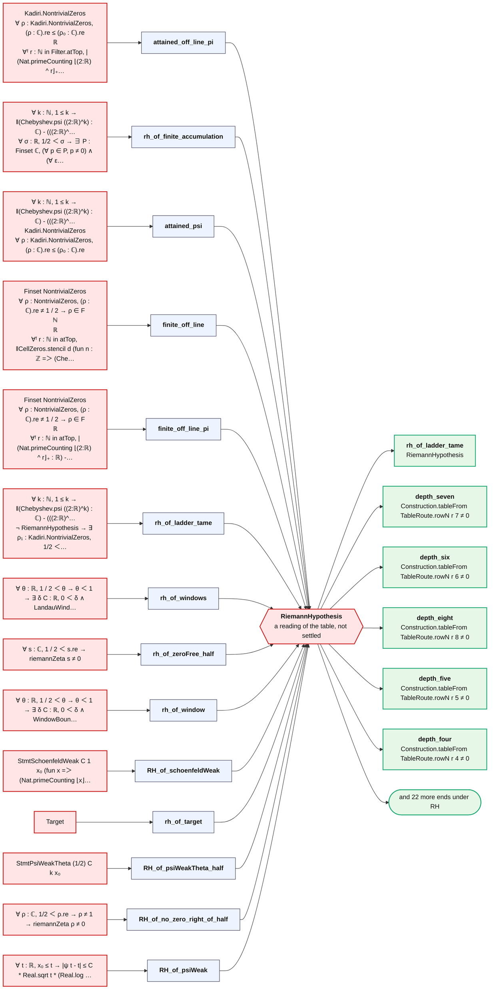

# The road

The table is the source: pure counting of the number line, every cell forced once the row is fixed. `RiemannHypothesis` is a reading of it. This page shows what is closed, what is open, and where that reading sits. Generated with the rest of the map; the joints are read from `SECTIONS.md`, everything else from Lean.

- **Theorems Lean has checked:** 3173.
- **Theorems that prove `RiemannHypothesis` with no hypothesis:** 0. It is open.
- **Theorems that prove it from a hypothesis:** 14. Each hypothesis is a red box: prove one and the line closes.
- **Theorems that restate it (`RiemannHypothesis ↔ …`):** 13.
- **Theorems that assume it:** 70, arriving at 28 ends.

## Statements about the count that settle `RiemannHypothesis`

| theorem | the hypothesis it needs (open) | why (its docstring) |
|---|---|---|
| [`AttainedPi.attained_off_line_pi`](./lean_stage3/AttainedPi.md#AttainedPi-attained_off_line_pi) | ρ₀ : Kadiri.NontrivialZeros; hmax : ∀ ρ : Kadiri.NontrivialZeros, (ρ : ℂ).re ≤ (ρ₀ : ℂ).re; C : ℝ; hrows : ∀ᶠ r : ℕ in Filter.atTop, \|(Nat.primeCounting ⌊(2:ℝ) ^ r⌋₊ : ℝ) - Stage3.Li ((2:ℝ) ^ r)\| ≤ C * (r : ℝ) ^ 2 * Real.sqrt 2 ^ r | The largest real part attained, and the count of primes of square-root size at the doublings: then the Riemann hypothesis holds. Let `ρ₀` have the largest real part among the zeros of ζ. If the count of primes at `2^r` stays within `C·r²·√2^r` of `Li` from some row on, the Riemann hypothesis holds. |
| [`FilterAccum.rh_of_finite_accumulation`](./lean_stage3/FilterAccum.md#FilterAccum-rh_of_finite_accumulation) | hH : ∀ k : ℕ, 1 ≤ k → ‖(Chebyshev.psi ((2:ℝ)^k) : ℂ) - (((2:ℝ)^k : ℝ) : ℂ)‖ ≤ C * (k:ℝ)^2 * Real.sqrt 2 ^ k; hfin : ∀ σ : ℝ, 1/2 &lt; σ → ∃ P : Finset ℂ, (∀ p ∈ P, p ≠ 0) ∧ (∀ ε : ℝ, 0 &lt; ε → {z : ℂ \| ∃ ρ : Kadiri.NontrivialZeros, σ ≤ (ρ : ℂ).re ∧ (2:ℂ) ^ (ρ : ℂ) = z ∧ ∀ p ∈ P, ε ≤ ‖z - p‖}.Finite) ∧ (∀ ρ : Kadiri.NontrivialZeros, σ &lt; (ρ : ℂ).re → (2:ℂ) ^ (ρ : ℂ) ∉ P) | Finitely many accumulation points on every line right of `1/2`, and the ladder of `ψ` of square-root size: then the Riemann hypothesis holds. Let `\|ψ(2^k) − 2^k\| ≤ C·k²·√2^k` for every `k ≥ 1`. Suppose that for every `σ &gt; 1/2` the modes `2^ρ` of the zeros with real part at least `σ` accumulate only … |
| [`FilterAttained.attained_psi`](./lean_stage3/FilterAttained.md#FilterAttained-attained_psi) | hH : ∀ k : ℕ, 1 ≤ k → ‖(Chebyshev.psi ((2:ℝ)^k) : ℂ) - (((2:ℝ)^k : ℝ) : ℂ)‖ ≤ C * (k:ℝ)^2 * Real.sqrt 2 ^ k; ρ₀ : Kadiri.NontrivialZeros; hmax : ∀ ρ : Kadiri.NontrivialZeros, (ρ : ℂ).re ≤ (ρ₀ : ℂ).re | The largest real part attained, and the ladder of `ψ` of square-root size: then the Riemann hypothesis holds. Let `ρ₀` have the largest real part among the zeros of ζ. If `\|ψ(2^k) − 2^k\| ≤ C·k²·√2^k` for every `k ≥ 1`, the Riemann hypothesis holds. It is `filter_attained_false` with no filter: `q = … |
| [`FiniteOffLine.finite_off_line`](./lean_stage3/FiniteOffLine.md#FiniteOffLine-finite_off_line) | F : Finset NontrivialZeros; hF : ∀ ρ : NontrivialZeros, (ρ : ℂ).re ≠ 1 / 2 → ρ ∈ F; d : ℕ; C : ℝ; hcells : ∀ᶠ r : ℕ in atTop, ‖CellZeros.stencil d (fun n : ℤ =&gt; (Chebyshev.psi ((2:ℝ) ^ n) : ℂ)) (r : ℤ) - (2:ℂ) ^ (r : ℤ) * (1 - (2:ℂ)⁻¹) ^ d‖ ≤ C * (r : ℝ) ^ 2 * Real.sqrt 2 ^ r | Finitely many zeros off the line, and cells of square-root size on the one ladder: then no zero is off the line. Let a finite set hold every zero of ζ off the line. If at one depth the cells of the log-weighted prime count on the table's own ladder stay within `C·r²·√2^r` of their main term, the Rie… |
| [`FiniteOffLinePi.finite_off_line_pi`](./lean_stage3/FiniteOffLinePi.md#FiniteOffLinePi-finite_off_line_pi) | F : Finset NontrivialZeros; hF : ∀ ρ : NontrivialZeros, (ρ : ℂ).re ≠ 1 / 2 → ρ ∈ F; C : ℝ; hrows : ∀ᶠ r : ℕ in atTop, \|(Nat.primeCounting ⌊(2:ℝ) ^ r⌋₊ : ℝ) - Stage3.Li ((2:ℝ) ^ r)\| ≤ C * (r : ℝ) ^ 2 * Real.sqrt 2 ^ r | Finitely many zeros off the line, and the count of primes of square-root size at the doublings: then no zero is off the line. Let a finite set hold every zero of ζ off the line. If the count of primes at `2^r` stays within `C·r²·√2^r` of `Li` from some row on, the Riemann hypothesis holds. |
| [`LadderAssembly.rh_of_ladder_tame`](./lean_stage3/LadderAssembly.md#LadderAssembly-rh_of_ladder_tame) | hH : ∀ k : ℕ, 1 ≤ k → ‖(Chebyshev.psi ((2:ℝ)^k) : ℂ) - (((2:ℝ)^k : ℝ) : ℂ)‖ ≤ C * (k:ℝ)^2 * Real.sqrt 2 ^ k; htame : ¬ RiemannHypothesis → ∃ ρ₁ : Kadiri.NontrivialZeros, 1/2 &lt; (ρ₁:ℂ).re ∧ (∀ ρ : Kadiri.NontrivialZeros, (ρ:ℂ).re ≤ (ρ₁:ℂ).re) ∧ ∃ σ₀ ε : ℝ, 1/2 &lt; σ₀ ∧ σ₀ &lt; (ρ₁:ℂ).re ∧ 0 &lt; ε ∧ ∀ ρ : Kadiri.NontrivialZeros, σ₀ ≤ (ρ:ℂ).re → (2:ℂ)^(-(ρ:ℂ)) ≠ (2:ℂ)^(-(ρ₁:ℂ)) → ε ≤ ‖(2:ℂ)^(-(ρ:ℂ)) - (2:ℂ)^… | The ladder route, assembled. Under the ladder bound `\|ψ(2^k) − 2^k\| ≤ C·k²·√2^k` for `k ≥ 1`, if every failure of the Riemann hypothesis has a tame top — a zero `ρ₁` with `1/2 &lt; Re ρ₁`, every real part at most `Re ρ₁`, and `σ₀ ∈ (1/2, Re ρ₁)`, `ε &gt; 0` with every mode of real part `≥ σ₀` other than `… |
| [`LandauCriterion.rh_of_windows`](./lean_stage3/LandauCriterion.md#LandauCriterion-rh_of_windows) | hW : ∀ θ : ℝ, 1 / 2 &lt; θ → θ &lt; 1 → ∃ δ C : ℝ, 0 &lt; δ ∧ LandauWindow.WindowBound θ δ C | Conditional: if for every `θ` in `(1/2, 1)` there are `δ &gt; 0` and `C` with the window bound `WindowBound θ δ C`, then `RiemannHypothesis` holds. The window bound is a hypothesis of this statement. |
| [`LandauWindow.rh_of_zeroFree_half`](./lean_stage3/LandauWindow.md#LandauWindow-rh_of_zeroFree_half) | h : ∀ s : ℂ, 1 / 2 &lt; s.re → riemannZeta s ≠ 0 | From a zero-free half-plane to the Riemann hypothesis. |
| [`LandauWindow.rh_of_window`](./lean_stage3/LandauWindow.md#LandauWindow-rh_of_window) | hW : ∀ θ : ℝ, 1 / 2 &lt; θ → θ &lt; 1 → ∃ δ C : ℝ, 0 &lt; δ ∧ WindowBound θ δ C | The window bound gives the Riemann hypothesis, given the criterion. |
| [`PiToPsi.RH_of_schoenfeldWeak`](./lean_stage3/PiToPsi.md#PiToPsi-RH_of_schoenfeldWeak) | h : StmtSchoenfeldWeak C 1 x₀ (fun x =&gt; (Nat.primeCounting ⌊x⌋₊ : ℝ)) Stage3.Li | The square-root bound on the count gives the Riemann hypothesis. |
| [`Stage3.rh_of_target`](./lean_stage3/Target.md#Stage3-rh_of_target) | h : Target | The target gives the Riemann hypothesis. |
| [`Stage3.RH_of_psiWeakTheta_half`](./lean_stage3/ThetaConverse.md#Stage3-RH_of_psiWeakTheta_half) | h : StmtPsiWeakTheta (1/2) C k x₀ | The weld at `θ = 1/2`: `VonKoch.RH_of_psiWeak`'s statement through the dial, via `Abscissa`'s `StmtZeroFreeRight (1/2)` and V5's reflection. |
| [`VonKoch.RH_of_no_zero_right_of_half`](./lean_stage3/VonKochScaffold.md#VonKoch-RH_of_no_zero_right_of_half) | h : ∀ ρ : ℂ, 1/2 &lt; ρ.re → ρ ≠ 1 → riemannZeta ρ ≠ 0 | V5 — reflection. No zeros right of the line forces every nontrivial zero onto it: a zero at `re &lt; 1/2` inside the strip reflects through `riemannZeta_one_sub` to one at `re &gt; 1/2`. |
| [`VonKoch.RH_of_psiWeak`](./lean_stage3/VonKochScaffold.md#VonKoch-RH_of_psiWeak) | hbound : ∀ t : ℝ, x₀ ≤ t → \|ψ t - t\| ≤ C * Real.sqrt t * (Real.log t) ^ 3 | B1 — the converse, assembled from V1–V5. |

## The same statement in other coordinates

| theorem | says |
|---|---|
| [`Transform.riemannHypothesis_iff_zeros_inversion_fixed`](./lean/Transform.md#Transform-riemannHypothesis_iff_zeros_inversion_fixed) | RiemannHypothesis ↔ ∀ (s : ℂ), riemannZeta s = 0 → ¬(∃ n : ℕ, s = -2 * (n + 1)) → s ≠ 1 → ‖(b : ℂ) ^ (-(1 : ℂ)) / (b : ℂ) ^ (-s)‖ = ‖(b : ℂ) ^ (-s)‖ |
| [`Transform.riemannHypothesis_iff_zeros_on_middle_circle`](./lean/Transform.md#Transform-riemannHypothesis_iff_zeros_on_middle_circle) | RiemannHypothesis ↔ ∀ (s : ℂ), riemannZeta s = 0 → ¬(∃ n : ℕ, s = -2 * (n + 1)) → s ≠ 1 → ‖(b : ℂ) ^ (-s)‖ = b ^ (-(1 : ℝ) / 2) |
| [`Transform.riemannHypothesis_iff_pair_collapses`](./lean/Transform.md#Transform-riemannHypothesis_iff_pair_collapses) | RiemannHypothesis ↔ ∀ (s : ℂ), riemannZeta s = 0 → ¬(∃ n : ℕ, s = -2 * (n + 1)) → s ≠ 1 → ‖(b : ℂ) ^ (-s)‖ = ‖(b : ℂ) ^ (-(1 - s))‖ |
| [`CellResidual.RH_iff_cells`](./lean_stage3/CellResidual.md#CellResidual-RH_iff_cells) | RiemannHypothesis ↔ ∃ (C : ℝ) (r₀ : ℤ), CellsSqrt C r₀ |
| [`ClosedLoopJoin.rh_iff_re_half`](./lean_stage3/ClosedLoopJoin.md#ClosedLoopJoin-rh_iff_re_half) | RiemannHypothesis ↔ ∀ ρ : NontrivialZeros, (ρ : ℂ).re = 1 / 2 |
| [`ClosedLoopJoin.rh_iff_force_zero`](./lean_stage3/ClosedLoopJoin.md#ClosedLoopJoin-rh_iff_force_zero) | RiemannHypothesis ↔ ∀ ρ : NontrivialZeros, restoringForce (ρ : ℂ).re = 0 |
| [`ClosedLoopJoin.rh_iff_handshake`](./lean_stage3/ClosedLoopJoin.md#ClosedLoopJoin-rh_iff_handshake) | RiemannHypothesis ↔ ∀ ρ : NontrivialZeros, isHermitianHandshake (ρ : ℂ).re |
| [`Defect.rh_iff_defect_zero`](./lean_stage3/Defect.md#Defect-rh_iff_defect_zero) | RiemannHypothesis ↔ ∀ T : ℝ, defect T = 0 |
| [`LineCount.rh_iff_line_count`](./lean_stage3/LineCount.md#LineCount-rh_iff_line_count) | RiemannHypothesis ↔ ∀ T : ℝ, lineCount T = allCount T |
| [`PiToPsi.RH_iff_schoenfeldWeak`](./lean_stage3/PiToPsi.md#PiToPsi-RH_iff_schoenfeldWeak) | RiemannHypothesis ↔ ∃ C x₀ : ℝ, StmtSchoenfeldWeak C 1 x₀ (fun x =&gt; (Nat.primeCounting ⌊x⌋₊ : ℝ)) Stage3.Li |
| [`SpiralLink.rh_iff_spiralLink`](./lean_stage3/SpiralLink.md#SpiralLink-rh_iff_spiralLink) | RiemannHypothesis ↔ SpiralLink |
| [`SpiralLink.rh_iff_one_at_each_height`](./lean_stage3/SpiralLink.md#SpiralLink-rh_iff_one_at_each_height) | RiemannHypothesis ↔ OneAtEachHeight |
| [`VonKoch.RH_iff_psiWeak`](./lean_stage3/VonKochScaffold.md#VonKoch-RH_iff_psiWeak) | RiemannHypothesis ↔ ∃ C &gt; 0, ∃ x₀ : ℝ, Stage3.StmtPsiWeak C 3 x₀ |

## How the table's cells behave under `RiemannHypothesis`

The ends among the theorems that assume it. "Behind it" links the whole line.

| theorem | proves | behind it |
|---|---|---|
| [`LadderAssembly.rh_of_ladder_tame`](./lean_stage3/LadderAssembly.md#LadderAssembly-rh_of_ladder_tame) | RiemannHypothesis | [551](./chains/LadderAssembly-rh_of_ladder_tame.md) |
| [`TableDepths.depth_seven`](./lean_stage3/TableDepths.md#TableDepths-depth_seven) | Construction.tableFrom TableRoute.rowN r 7 ≠ 0 | [418](./chains/TableDepths-depth_seven.md) |
| [`TableDepths.depth_six`](./lean_stage3/TableDepths.md#TableDepths-depth_six) | Construction.tableFrom TableRoute.rowN r 6 ≠ 0 | [418](./chains/TableDepths-depth_six.md) |
| [`TableDepths.depth_eight`](./lean_stage3/TableDepths.md#TableDepths-depth_eight) | Construction.tableFrom TableRoute.rowN r 8 ≠ 0 | [417](./chains/TableDepths-depth_eight.md) |
| [`TableDepths.depth_five`](./lean_stage3/TableDepths.md#TableDepths-depth_five) | Construction.tableFrom TableRoute.rowN r 5 ≠ 0 | [417](./chains/TableDepths-depth_five.md) |
| [`TableDepths.depth_four`](./lean_stage3/TableDepths.md#TableDepths-depth_four) | Construction.tableFrom TableRoute.rowN r 4 ≠ 0 | [417](./chains/TableDepths-depth_four.md) |
| [`TableDepths.depth_one`](./lean_stage3/TableDepths.md#TableDepths-depth_one) | Construction.tableFrom TableRoute.rowN r 1 ≠ 0 | [417](./chains/TableDepths-depth_one.md) |
| [`TableDepths.depth_three`](./lean_stage3/TableDepths.md#TableDepths-depth_three) | Construction.tableFrom TableRoute.rowN r 3 ≠ 0 | [417](./chains/TableDepths-depth_three.md) |
| [`TableDepths.depth_two`](./lean_stage3/TableDepths.md#TableDepths-depth_two) | Construction.tableFrom TableRoute.rowN r 2 ≠ 0 | [417](./chains/TableDepths-depth_two.md) |
| [`TableRoute.cell_ne_zero_of_RH`](./lean_stage3/TableRoute.md#TableRoute-cell_ne_zero_of_RH) | Construction.tableFrom rowN r 6 ≠ 0 | [416](./chains/TableRoute-cell_ne_zero_of_RH.md) |
| [`CellResidual.table_cell_resid`](./lean_stage3/CellResidual.md#CellResidual-table_cell_resid) | ∃ (C : ℝ) (r₀ : ℤ), ∀ (d : ℕ) (r : ℤ), r₀ + ((d + 1 : ℕ) : ℤ) ≤ r → \|((Construction.tableFrom TableRoute.rowN r d : ℤ) : ℝ) - stencilR (d + 1) (fun m : ℤ =&gt; Stage3.Li ((2 : ℝ) ^ (m : ℝ))) r\| ≤ C * cel… | 402 |
| [`RouteGate.relErrWindow_route`](./lean_stage3/RouteGate.md#RouteGate-relErrWindow_route) | ∃ c₁ c₃ c₄ : ℝ, 0 ≤ c₁ ∧ 0 ≤ c₃ ∧ 0 ≤ c₄ ∧ ∀ x₀ : ℝ, 16 ≤ x₀ → ∀ (r : ℤ) (n : ℕ), x₀ ^ 2 ≤ (2 : ℝ) ^ ((r : ℝ) - n) → JointDialGate.StmtRelErrWindow (fun m : ℤ =&gt; (Nat.primeCounting ⌊(2 : ℝ) ^ (m : ℝ)⌋… | [302](./chains/RouteGate-relErrWindow_route.md) |
| [`Stage3.schoenfeldWeak_floor_of_RH`](./lean_stage3/AssemblyFloor.md#Stage3-schoenfeldWeak_floor_of_RH) | ∃ c₁ c₂ : ℝ, 0 ≤ c₁ ∧ 0 ≤ c₂ ∧ ∀ x₀ : ℝ, 16 ≤ x₀ → StmtSchoenfeldWeak (3 * floorConst c₁ c₂ 112 0 698 weightedZeroHeightBucket x₀ + 13) 1 (max (x₀ ^ 2) 9) (fun x =&gt; (Nat.primeCounting ⌊x⌋₊ : ℝ)) Li | [284](./chains/Stage3-schoenfeldWeak_floor_of_RH.md) |
| [`Stage3.schoenfeldWeak_of_RH_half`](./lean_stage3/ThetaPi.md#Stage3-schoenfeldWeak_of_RH_half) | ∃ C &gt; 0, ∃ x₀ : ℝ, StmtSchoenfeldWeak C 2 x₀ (fun x =&gt; (Nat.primeCounting ⌊x⌋₊ : ℝ)) Li | [88](./chains/Stage3-schoenfeldWeak_of_RH_half.md) |
| [`Stage3.stmtPsiWeak_of_RH_half`](./lean_stage3/ThetaPsi.md#Stage3-stmtPsiWeak_of_RH_half) | ∃ C &gt; 0, ∃ x₀ : ℝ, Stage3.StmtPsiWeak C 3 x₀ | [71](./chains/Stage3-stmtPsiWeak_of_RH_half.md) |
| [`RHPull.stmtPsiWeak_of_RH`](./lean_stage3/LineBound.md#RHPull-stmtPsiWeak_of_RH) | ∃ C &gt; 0, ∃ x₀ : ℝ, Stage3.StmtPsiWeak C 3 x₀ | 66 |
| [`RHPull.smoothedChebyshev_sqrt_bound`](./lean_stage3/LineBound.md#RHPull-smoothedChebyshev_sqrt_bound) | ‖SmoothedChebyshev ν ε X - mellin (fun x ↦ (Smooth1 ν ε x : ℂ)) 1 * X‖ ≤ B₁ + B₉ + (22200 * Real.exp 1 * C / ε) * Real.sqrt X * (Real.log X) ^ 2 + (1 / (2 * Real.pi)) * (1 / 2) * ((1996 * Real.log (84… | [46](./chains/RHPull-smoothedChebyshev_sqrt_bound.md) |
| [`WindowsOfRH.windows_of_rh`](./lean_stage3/WindowsOfRH.md#WindowsOfRH-windows_of_rh) | ∀ θ : ℝ, 1 / 2 &lt; θ → θ &lt; 1 → ∃ δ C : ℝ, 0 &lt; δ ∧ LandauWindow.WindowBound θ δ C | 45 |
| [`Stage3.I37_sqrt_log3_half`](./lean_stage3/ThetaPull.md#Stage3-I37_sqrt_log3_half) | ‖I₃₇ ν ε T X (RHPull.σRH X)‖ ≤ (66600 * Real.exp 1 * B / Real.pi) * Real.sqrt X * (Real.log X) ^ 3 | [44](./chains/Stage3-I37_sqrt_log3_half.md) |
| [`RHPull.smoothedChebyshev_sub_main_norm_le`](./lean_stage3/LineBound.md#RHPull-smoothedChebyshev_sub_main_norm_le) | ‖SmoothedChebyshev ν ε X - mellin (fun x ↦ (Smooth1 ν ε x : ℂ)) 1 * X‖ ≤ B₁ + B₉ + (1 / (2 * Real.pi)) * (2 * T) * (11100 * (Real.log X) ^ 2 * M₃₇ * X ^ (σRH X)) + (1 / (2 * Real.pi)) * (1 / 2) * ((19… | [41](./chains/RHPull-smoothedChebyshev_sub_main_norm_le.md) |
| [`Stage3.logDerivZeta_line_half`](./lean_stage3/ThetaLine.md#Stage3-logDerivZeta_line_half) | ‖deriv ζ (((1/2 + 1/Real.log X : ℝ)) + I * (t : ℂ)) / ζ (((1/2 + 1/Real.log X : ℝ)) + I * (t : ℂ))‖ ≤ 11100 * (Real.log X) ^ 2 | [31](./chains/Stage3-logDerivZeta_line_half.md) |
| [`Stage3.psiWeak_of_RH_EF_NT`](./lean_stage3/Assembly.md#Stage3-psiWeak_of_RH_EF_NT) | StmtPsiWeak (9 * c₁ + c₂ + 28 + 16 * b₁ + 16 * b₂ + 8 * b₃ + 4 * W) 2 (max x₁ 16) | [20](./chains/Stage3-psiWeak_of_RH_EF_NT.md) |
| [`Stage3.logDerivZeta_crude_half`](./lean_stage3/Abscissa.md#Stage3-logDerivZeta_crude_half) | ‖deriv ζ ((σ₁ : ℂ) + I * (t : ℂ)) / ζ ((σ₁ : ℂ) + I * (t : ℂ))‖ ≤ 1996 * Real.log (84 * t) + (29 * Real.log t + 129) / (σ₁ - 1/2) | 19 |
| [`Slice3.logDerivZeta_sq_at_t`](./lean_stage3/LineBound.md#Slice3-logDerivZeta_sq_at_t) | ‖deriv ζ (((1/2 + 1/Real.log t : ℝ)) + I * (t : ℂ)) / ζ (((1/2 + 1/Real.log t : ℝ)) + I * (t : ℂ))‖ ≤ 21600 * (Real.log t) ^ 2 | 15 |
| [`StencilWeil.zeroForm_stencilTest_nonneg_of_RH`](./lean_stage3/StencilWeil.md#StencilWeil-zeroForm_stencilTest_nonneg_of_RH) | 0 ≤ (zeroForm (stencilTest d φ)).re | 9 |
| [`WeilDetect.weilPositive_of_RH`](./lean_stage3/WeilDetect.md#WeilDetect-weilPositive_of_RH) | StmtWeilPositive L | 7 |
| [`Stage3.norm_zeroPartialSum_le`](./lean_stage3/Assembly.md#Stage3-norm_zeroPartialSum_le) | ‖zeroPartialSum x ((2 : ℝ) ^ (K + 1))‖ ≤ 2 * Real.sqrt x * (2 * \|riemannZeta.N ((2 : ℝ) ^ (K + 1))\| + weightedZeroHeightBucket) | 5 |
| [`Slice4.zetaE_ne_zero_of_RH`](./lean_stage3/LineBound.md#Slice4-zetaE_ne_zero_of_RH) | zetaE s ≠ 0 | 4 |

## Named statements

Every definition named `Stmt…`: a statement the repo set as a target. Open: no theorem concludes it. From a hypothesis: a theorem concludes it, given something. Proved: a theorem concludes it outright, at the parameters shown beside it.

| statement | status | by | used as a hypothesis in |
|---|---|---|---|
| [`Diagonal.StmtDiagMain`](./lean_stage3/Diagonal.md#Diagonal-StmtDiagMain) | **OPEN** | — | 1 |
| [`FloorLong.StmtDiagErr`](./lean_stage3/FloorLongErr.md#FloorLong-StmtDiagErr) | **OPEN** | — | 1 |
| [`Schoenfeld.StmtSchoenfeld`](./lean/Schoenfeld.md#Schoenfeld-StmtSchoenfeld) | **OPEN** | — | 2 |
| [`Stage3.StmtExplicitFormula`](./lean_stage3/Assembly.md#Stage3-StmtExplicitFormula) | **OPEN** | — | 0 |
| [`Stage3.StmtExplicitFormulaPoly`](./lean_stage3/Assembly.md#Stage3-StmtExplicitFormulaPoly) | **OPEN** | — | 2 |
| [`Stage3.StmtPsiWeakTheta`](./lean_stage3/ThetaPi.md#Stage3-StmtPsiWeakTheta) | **OPEN** | — | 9 |
| [`Stage3.StmtSFromLocal`](./lean_stage3/ArgCrude.md#Stage3-StmtSFromLocal) | **OPEN** | — | 5 |
| [`Stage3.StmtSchoenfeld`](./lean_stage3/Statement.md#Stage3-StmtSchoenfeld) | **OPEN** | — | 1 |
| [`SwapX.StmtXStirling`](./lean_stage3/SwapX.md#SwapX-StmtXStirling) | **OPEN** | — | 2 |
| [`TwistedMoment.StmtLemma3`](./lean_stage3/TwistedMoment.md#TwistedMoment-StmtLemma3) | **OPEN** | — | 0 |
| [`TwistedMoment.StmtOffDiag`](./lean_stage3/TwistedMoment.md#TwistedMoment-StmtOffDiag) | **OPEN** | — | 1 |
| [`TwistedMoment.StmtX`](./lean_stage3/TwistedMoment.md#TwistedMoment-StmtX) | **OPEN** | — | 3 |
| [`WeilBridgeLeaf.StmtWeilBridge`](./lean_stage3/WeilBridgeLeaf.md#WeilBridgeLeaf-StmtWeilBridge) | **OPEN** | — | 2 |
| [`WeilDetect.StmtDetect`](./lean_stage3/WeilDetect.md#WeilDetect-StmtDetect) | **OPEN** | — | 1 |
| [`WeilPowerAssembly.StmtDetectGap`](./lean_stage3/WeilPowerAssembly.md#WeilPowerAssembly-StmtDetectGap) | **OPEN** | — | 0 |
| [`WeilPowerCount.StmtShortCount`](./lean_stage3/WeilPowerCount.md#WeilPowerCount-StmtShortCount) | **OPEN** | — | 2 |
| [`ApproxFE.StmtShift`](./lean_stage3/ApproxFE.md#ApproxFE-StmtShift) | from a hypothesis | [`ApproxShift.stmtShift_holds`](./lean_stage3/ApproxShift.md#ApproxShift-stmtShift_holds) ⊢ StmtShift α β t c | 1 |
| [`Chain.StmtA1`](./lean/Chain.md#Chain-StmtA1) | from a hypothesis | [`Chain.A1`](./lean/Chain.md#Chain-A1) ⊢ StmtA1 b ρ | 4 |
| [`Chain.StmtA4`](./lean/Chain.md#Chain-StmtA4) | from a hypothesis | [`Chain.A4`](./lean/Chain.md#Chain-A4) ⊢ StmtA4 b ρ [`Chain.A4_of_A1`](./lean/Chain.md#Chain-A4_of_A1) ⊢ StmtA4 b ρ | 3 |
| [`Chain.StmtB4`](./lean/Chain.md#Chain-StmtB4) | from a hypothesis | [`Chain.B4`](./lean/Chain.md#Chain-B4) ⊢ StmtB4 b N | 1 |
| [`Chain.StmtB5`](./lean/Chain.md#Chain-StmtB5) | from a hypothesis | [`Chain.B5`](./lean/Chain.md#Chain-B5) ⊢ StmtB5 b N | 0 |
| [`Chain.StmtC1`](./lean/Chain.md#Chain-StmtC1) | from a hypothesis | [`Chain.C1`](./lean/Chain.md#Chain-C1) ⊢ StmtC1 b | 1 |
| [`Chain.StmtC2`](./lean/Chain.md#Chain-StmtC2) | from a hypothesis | [`Chain.C2`](./lean/Chain.md#Chain-C2) ⊢ StmtC2 b [`Chain.C2_of_C1`](./lean/Chain.md#Chain-C2_of_C1) ⊢ StmtC2 b | 2 |
| [`Chain.StmtC3`](./lean/Chain.md#Chain-StmtC3) | from a hypothesis | [`Chain.C3`](./lean/Chain.md#Chain-C3) ⊢ StmtC3 b [`Chain.C3_of_A4_C2`](./lean/Chain.md#Chain-C3_of_A4_C2) ⊢ StmtC3 b | 0 |
| [`Chain.StmtC3lower`](./lean/Chain.md#Chain-StmtC3lower) | from a hypothesis | [`Chain.C3lower`](./lean/Chain.md#Chain-C3lower) ⊢ StmtC3lower b [`Chain.C3lower_of_A4_C2`](./lean/Chain.md#Chain-C3lower_of_A4_C2) ⊢ StmtC3lower b | 0 |
| [`DiagMain.StmtMuSmooth`](./lean_stage3/DiagMain.md#DiagMain-StmtMuSmooth) | from a hypothesis | [`SdiagLead.stmtMuSmooth_holds`](./lean_stage3/SdiagLeadSmooth.md#SdiagLead-stmtMuSmooth_holds) ⊢ StmtMuSmooth P κ | 0 |
| [`DiagMain.StmtSdiagLead`](./lean_stage3/DiagMain.md#DiagMain-StmtSdiagLead) | from a hypothesis | [`SdiagLead.stmtSdiagLead_holds`](./lean_stage3/SdiagLead.md#SdiagLead-stmtSdiagLead_holds) ⊢ StmtSdiagLead P θ R κ [`SdiagLead.stmtSdiagLead_of_steps`](./lean_stage3/SdiagLeadCore.md#SdiagLead-stmtSdiagLead_of_steps) ⊢ StmtSdiagLead P θ R κ | 1 |
| [`DiagMainStmt.StmtDiagMainO`](./lean_stage3/DiagMainStmt.md#DiagMainStmt-StmtDiagMainO) | from a hypothesis | [`Arith.stmtDiagMainO_holds'`](./lean_stage3/Arith.md#Arith-stmtDiagMainO_holds-) ⊢ StmtDiagMainO P θ R κ [`DiagMain.stmtDiagMainO_of_lead`](./lean_stage3/DiagMain.md#DiagMain-stmtDiagMainO_of_lead) ⊢ StmtDiagMainO P θ R κ [`FloorLong.mainO_long`](./lean_stage3/FloorLongErr.md#FloorLong-mainO_long) ⊢ StmtDiagMainO P θ R κ [`SdiagLead.stmtDiagMainO_holds`](./lean_stage3/SdiagLead.md#SdiagLead-stmtDiagMainO_holds) ⊢ StmtDiagMainO P θ R κ | 3 |
| [`DiagonalO.StmtDiagO`](./lean_stage3/DiagonalO.md#DiagonalO-StmtDiagO) | from a hypothesis | [`DiagonalO.stmtDiagO_of_mainO`](./lean_stage3/DiagonalO.md#DiagonalO-stmtDiagO_of_mainO) ⊢ StmtDiagO P θ R κ [`FloorLong.diagO_of_err`](./lean_stage3/FloorLongErr.md#FloorLong-diagO_of_err) ⊢ StmtDiagO P θ R κ | 1 |
| [`DiagonalO.StmtLemma3resO`](./lean_stage3/DiagonalO.md#DiagonalO-StmtLemma3resO) | from a hypothesis | [`DiagonalO.lemma3_resO_of_mainO_X`](./lean_stage3/DiagonalO.md#DiagonalO-lemma3_resO_of_mainO_X) ⊢ StmtLemma3resO P θ R κ [`DiagonalO.lemma3_resO_of_parts`](./lean_stage3/DiagonalO.md#DiagonalO-lemma3_resO_of_parts) ⊢ StmtLemma3resO P θ R κ [`FloorLong.lemma3_of_long`](./lean_stage3/FloorLongErr.md#FloorLong-lemma3_of_long) ⊢ StmtLemma3resO P θ R κ [`Lemma3.lemma3_resO_holds`](./lean_stage3/Lemma3.md#Lemma3-lemma3_resO_holds) ⊢ StmtLemma3resO P θ R κ | 1 |
| [`FloorLong.StmtLongErr`](./lean_stage3/FloorLongErr.md#FloorLong-StmtLongErr) | from a hypothesis | [`FloorLong.longErr_of_lt_half`](./lean_stage3/FloorLongErr.md#FloorLong-longErr_of_lt_half) ⊢ StmtLongErr P θ R | 2 |
| [`JointDialGate.StmtRelErrWindow`](./lean_stage3/JointDialGate.md#JointDialGate-StmtRelErrWindow) | from a hypothesis | [`JointDialGate.powerSaving_relErr`](./lean_stage3/JointDialGate.md#JointDialGate-powerSaving_relErr) ⊢ StmtRelErrWindow f L r n (A * (2 : ℝ) ^ (((r : ℝ) - n) * (θ - 1))) [`JointDialGate.relErrWindow_of_theta`](./lean_stage3/JointDialGate.md#JointDialGate-relErrWindow_of_theta) ⊢ StmtRelErrWindow f L r n (C / (2 * (θ' - θ) / (2 * ((k : ℝ) + 1))) ^ k * (2 : ℝ) ^ (((r : … [`JointFloorGate.weakWindow_relErr`](./lean_stage3/JointFloorGate.md#JointFloorGate-weakWindow_relErr) ⊢ JointDialGate.StmtRelErrWindow f L r n (C * (Real.log 2 * r) ^ k * (2 : ℝ) ^ (-(((r : ℝ) -… [`RouteNum.relErrWindow_route_num`](./lean_stage3/RouteNum.md#RouteNum-relErrWindow_route_num) ⊢ JointDialGate.StmtRelErrWindow (fun m : ℤ =&gt; (Nat.primeCounting ⌊(2 : ℝ) ^ (m : ℝ)⌋₊ : ℝ))… | 0 |
| [`Nonvanishing.StmtSchoenfeldWindow`](./lean/Nonvanishing.md#Nonvanishing-StmtSchoenfeldWindow) | from a hypothesis | [`Schoenfeld.window_of_global`](./lean/Schoenfeld.md#Schoenfeld-window_of_global) ⊢ Nonvanishing.StmtSchoenfeldWindow f L r n | 6 |
| [`OffDiagClose.StmtOffDiagAll`](./lean_stage3/OffDiagClose.md#OffDiagClose-StmtOffDiagAll) | from a hypothesis | [`OffDiagClose.stmtOffDiag_holds`](./lean_stage3/OffDiagClose.md#OffDiagClose-stmtOffDiag_holds) ⊢ StmtOffDiagAll P θ R κ | 2 |
| [`Operator.StmtMollMeanO`](./lean_stage3/Operator.md#Operator-StmtMollMeanO) | from a hypothesis | [`Operator.stmtMollMeanO_holds`](./lean_stage3/Operator.md#Operator-stmtMollMeanO_holds) ⊢ StmtMollMeanO P θ R | 1 |
| [`RelativeGate.StmtRelErrWindow`](./lean/RelativeGate.md#RelativeGate-StmtRelErrWindow) | from a hypothesis | [`RelativeGate.powerSaving_relErr`](./lean/RelativeGate.md#RelativeGate-powerSaving_relErr) ⊢ StmtRelErrWindow f L r n (A * (2 : ℝ) ^ (((r : ℝ) - n) * (θ - 1))) [`RelativeGate.schoenfeldWindow_relErr`](./lean/RelativeGate.md#RelativeGate-schoenfeldWindow_relErr) ⊢ StmtRelErrWindow f L r n ((Real.log 2 * r / (8 * Real.pi)) * (2 : ℝ) ^ (-((r : ℝ) - n) / 2… | 7 |
| [`SdiagLead.StmtAdApprox`](./lean_stage3/SdiagLeadCore.md#SdiagLead-StmtAdApprox) | from a hypothesis | [`SdiagLead.stmtAdApprox_of_arith`](./lean_stage3/SdiagLeadAd.md#SdiagLead-stmtAdApprox_of_arith) ⊢ StmtAdApprox P A | 2 |
| [`SdiagLead.StmtDsum`](./lean_stage3/SdiagLeadCore.md#SdiagLead-StmtDsum) | from a hypothesis | [`SdiagLead.stmtDsum_of_arith`](./lean_stage3/SdiagLeadDsum.md#SdiagLead-stmtDsum_of_arith) ⊢ StmtDsum P A | 2 |
| [`Stage3.StmtBacklundArg`](./lean_stage3/RvMCrude.md#Stage3-StmtBacklundArg) | from a hypothesis | [`Stage3.argCrude_of_pieces`](./lean_stage3/ArgCrude.md#Stage3-argCrude_of_pieces) ⊢ StmtBacklundArg θ (a * A₁) (a * A₃ + b) [`Stage3.backlundArg_of_identity`](./lean_stage3/ArgCrude.md#Stage3-backlundArg_of_identity) ⊢ StmtBacklundArg θ B₁ B₃ [`Stage3.backlundArg_of_sFromLocal`](./lean_stage3/ArgIdentity.md#Stage3-backlundArg_of_sFromLocal) ⊢ StmtBacklundArg phaseTheta (a * A₁) (a * A₃ + b) | 1 |
| [`Stage3.StmtPsiWeak`](./lean_stage3/PsiToPi.md#Stage3-StmtPsiWeak) | from a hypothesis | [`Stage3.psiWeak_of_RH_EF_NT`](./lean_stage3/Assembly.md#Stage3-psiWeak_of_RH_EF_NT) ⊢ StmtPsiWeak (9 * c₁ + c₂ + 28 + 16 * b₁ + 16 * b₂ + 8 * b₃ + 4 * W) 2 (max x₁ 16) [`Stage3.psiWeak_floor`](./lean_stage3/AssemblyFloor.md#Stage3-psiWeak_floor) ⊢ StmtPsiWeak (floorConst c₁ c₂ b₁ b₂ b₃ W x₀) 2 x₀ [`Stage3.psiWeak_floor_split`](./lean_stage3/GlueFloor.md#Stage3-psiWeak_floor_split) ⊢ StmtPsiWeak (floorConstSplit c₁ c₃ c₄ b₁ b₂ b₃ W x₀) 2 x₀ | 3 |
| [`Stage3.StmtSchoenfeldWeak`](./lean_stage3/Statement.md#Stage3-StmtSchoenfeldWeak) | from a hypothesis | [`CellResidual.weak_nonneg`](./lean_stage3/CellResidual.md#CellResidual-weak_nonneg) ⊢ StmtSchoenfeldWeak (max C 0) 1 (max x₀ 2) (fun x =&gt; (Nat.primeCounting ⌊x⌋₊ : ℝ)) Stage3.L… [`Slice8.schoenfeldWeak_of_psiWeak_three`](./lean_stage3/LineBound.md#Slice8-schoenfeldWeak_of_psiWeak_three) ⊢ Stage3.StmtSchoenfeldWeak (3 * C + 13) 2 (max (x₀ ^ 2) 9) (fun x =&gt; (Nat.primeCounting ⌊x⌋… [`Stage3.schoenfeldWeak_of_psiWeak`](./lean_stage3/PsiToPi.md#Stage3-schoenfeldWeak_of_psiWeak) ⊢ StmtSchoenfeldWeak (3 * C + 13) (k - 1) (max (x₀ ^ 2) 9) (fun x =&gt; (Nat.primeCounting ⌊x⌋₊… [`Stage3.schoenfeldWeak_route_num`](./lean_stage3/RouteNum.md#Stage3-schoenfeldWeak_route_num) ⊢ StmtSchoenfeldWeak (routeConst x₀) 1 (max (x₀ ^ 2) 9) (fun x =&gt; (Nat.primeCounting ⌊x⌋₊ : … | 9 |
| [`Stage3.StmtSchoenfeldWeakTheta`](./lean_stage3/ThetaPi.md#Stage3-StmtSchoenfeldWeakTheta) | from a hypothesis | [`Stage3.schoenfeldWeakTheta_of_psiWeakTheta`](./lean_stage3/ThetaPi.md#Stage3-schoenfeldWeakTheta_of_psiWeakTheta) ⊢ StmtSchoenfeldWeakTheta θ (3 * C + 13) (k - 1) (max (x₀ ^ 2) 9) (fun x =&gt; (Nat.primeCounti… | 2 |
| [`Stage3.StmtSchoenfeldWindow`](./lean_stage3/Statement.md#Stage3-StmtSchoenfeldWindow) | from a hypothesis | [`Stage3.window_of_global`](./lean_stage3/Statement.md#Stage3-window_of_global) ⊢ StmtSchoenfeldWindow f L r n | 0 |
| [`Stage3.StmtWeakWindow`](./lean_stage3/Statement.md#Stage3-StmtWeakWindow) | from a hypothesis | [`Stage3.weakWindow_of_global`](./lean_stage3/Statement.md#Stage3-weakWindow_of_global) ⊢ StmtWeakWindow C k f L r n | 1 |
| [`SwapX.StmtXAll`](./lean_stage3/SwapX.md#SwapX-StmtXAll) | from a hypothesis | [`SwapX.stmtXAll_of`](./lean_stage3/SwapX.md#SwapX-stmtXAll_of) ⊢ StmtXAll P θ R κ | 1 |
| [`TwistedMoment.StmtDiag`](./lean_stage3/TwistedMoment.md#TwistedMoment-StmtDiag) | from a hypothesis | [`Diagonal.stmtDiag_of_main`](./lean_stage3/Diagonal.md#Diagonal-stmtDiag_of_main) ⊢ StmtDiag P θ R κ | 2 |
| [`TwistedMoment.StmtLemma3res`](./lean_stage3/TwistedMoment.md#TwistedMoment-StmtLemma3res) | from a hypothesis | [`TwistedMoment.lemma3_res_of_parts`](./lean_stage3/TwistedMoment.md#TwistedMoment-lemma3_res_of_parts) ⊢ StmtLemma3res P θ R κ | 0 |
| [`WeilDetect.StmtWeilPositive`](./lean_stage3/WeilDetect.md#WeilDetect-StmtWeilPositive) | from a hypothesis | [`WeilDetect.weilPositive_of_RH`](./lean_stage3/WeilDetect.md#WeilDetect-weilPositive_of_RH) ⊢ StmtWeilPositive L | 1 |
| [`Bridge.StmtWeilBridge`](./lean_bridge/WeilBridge.md#Bridge-StmtWeilBridge) | proved | [`Bridge.stmtWeilBridge_holds`](./lean_bridge/WeilBridge.md#Bridge-stmtWeilBridge_holds) ⊢ StmtWeilBridge | 0 |
| [`Chain.StmtA2`](./lean/Chain.md#Chain-StmtA2) | proved | [`Chain.A2`](./lean/Chain.md#Chain-A2) ⊢ StmtA2 | 0 |
| [`Chain.StmtA3`](./lean/Chain.md#Chain-StmtA3) | proved | [`Chain.A3`](./lean/Chain.md#Chain-A3) ⊢ StmtA3 | 0 |
| [`LandauWindow.StmtLandauWindow`](./lean_stage3/LandauWindow.md#LandauWindow-StmtLandauWindow) | proved | [`LandauCriterion.stmtLandauWindow`](./lean_stage3/LandauCriterion.md#LandauCriterion-stmtLandauWindow) ⊢ LandauWindow.StmtLandauWindow | 2 |
| [`SdiagLead.StmtArith`](./lean_stage3/SdiagLead.md#SdiagLead-StmtArith) | proved | [`Arith.stmtArith_holds`](./lean_stage3/Arith.md#Arith-stmtArith_holds) ⊢ StmtArith | 2 |
| [`SdiagLead.StmtDivLog`](./lean_stage3/SdiagLeadDsum.md#SdiagLead-StmtDivLog) | proved | [`Arith.divLog`](./lean_stage3/Arith.md#Arith-divLog) ⊢ StmtDivLog | 1 |
| [`SdiagLead.StmtGmuLog`](./lean_stage3/SdiagLeadDsum.md#SdiagLead-StmtGmuLog) | proved | [`Arith.gmuLog`](./lean_stage3/Arith.md#Arith-gmuLog) ⊢ StmtGmuLog | 2 |
| [`SdiagLead.StmtMeanSig3`](./lean_stage3/SdiagLeadAd.md#SdiagLead-StmtMeanSig3) | proved | [`Arith.meanSig3`](./lean_stage3/Arith.md#Arith-meanSig3) ⊢ StmtMeanSig3 | 1 |
| [`SdiagLead.StmtSdmLe`](./lean_stage3/SdiagLeadAd.md#SdiagLead-StmtSdmLe) | proved | [`Arith.sdmLe`](./lean_stage3/ArithBase.md#Arith-sdmLe) ⊢ StmtSdmLe | 7 |
| [`SdiagLead.StmtTailAvg`](./lean_stage3/SdiagLeadAd.md#SdiagLead-StmtTailAvg) | proved | [`Arith.tailAvg`](./lean_stage3/ArithTail.md#Arith-tailAvg) ⊢ StmtTailAvg | 1 |
| [`SdiagLead.StmtTailFixed`](./lean_stage3/SdiagLeadAd.md#SdiagLead-StmtTailFixed) | proved | [`Arith.tailFixed`](./lean_stage3/ArithTail.md#Arith-tailFixed) ⊢ StmtTailFixed | 1 |
| [`Stage3.StmtArgIdentity`](./lean_stage3/ArgCrude.md#Stage3-StmtArgIdentity) | proved | [`Stage3.stmtArgIdentity_holds`](./lean_stage3/ArgIdentity.md#Stage3-stmtArgIdentity_holds) ⊢ StmtArgIdentity phaseTheta argS | 3 |
| [`Stage3.StmtBacklundPhase`](./lean_stage3/RvMCrude.md#Stage3-StmtBacklundPhase) | proved | [`Stage3.backlundPhase_holds`](./lean_stage3/Stirling.md#Stage3-backlundPhase_holds) ⊢ StmtBacklundPhase phaseTheta 97 98 | 2 |
| [`Stage3.StmtDigammaLog`](./lean_stage3/Stirling.md#Stage3-StmtDigammaLog) | proved | [`Stage3.stmtDigammaLog_holds`](./lean_stage3/Stirling.md#Stage3-stmtDigammaLog_holds) ⊢ StmtDigammaLog 97 | 1 |
| [`Stage3.StmtExplicitFormulaSplit`](./lean_stage3/GlueFloor.md#Stage3-StmtExplicitFormulaSplit) | proved | [`Stage3.stmtEF_split_num`](./lean_stage3/RouteNum.md#Stage3-stmtEF_split_num) ⊢ StmtExplicitFormulaSplit Glue.c1n Glue.c3n Glue.c4n 16 | 1 |
| [`Stage3.StmtLocalCount`](./lean_stage3/ArgCrude.md#Stage3-StmtLocalCount) | proved | [`Stage3.localCount_holds`](./lean_stage3/JensenCount.md#Stage3-localCount_holds) ⊢ StmtLocalCount zetaLocalCount 15 73 | 4 |
| [`Stage3.StmtSCrude`](./lean_stage3/ArgCrude.md#Stage3-StmtSCrude) | proved | [`ArgCount.sCrude_holds`](./lean_stage3/ArgCount.md#ArgCount-sCrude_holds) ⊢ Stage3.StmtSCrude Stage3.argS 15 600 | 1 |
| [`Stage3.StmtZeroFreeRight`](./lean_stage3/Abscissa.md#Stage3-StmtZeroFreeRight) | proved | [`Stage3.zeroFreeRight_one`](./lean_stage3/Abscissa.md#Stage3-zeroFreeRight_one) ⊢ StmtZeroFreeRight 1 [`Stage3.zeroFreeRight_one_of_chebyshev`](./lean_stage3/ThetaConverse.md#Stage3-zeroFreeRight_one_of_chebyshev) ⊢ StmtZeroFreeRight 1 | 20 |
| [`Stirling.StmtXStirlingRel`](./lean_stage3/StirlingX.md#Stirling-StmtXStirlingRel) | proved | [`Stirling.stmtXStirlingRel_holds`](./lean_stage3/StirlingX.md#Stirling-stmtXStirlingRel_holds) ⊢ StmtXStirlingRel | 1 |

## Joints

From `SECTIONS.md`, open ones first.

| section | joint | what it joins | status |
|---|---|---|---|
| One object | 10 | the zeros read back from the cells | **OPEN** — as below. First piece (unit 0429, `Stage3/AliasClass.alias_weight_ne_zero`): on the one ladder the zeros with the same `2^ρ` fold into one mode whose weight is never zero, so the ladder folds heights … |
| The joints | 10 | the rows → all `x` | **OPEN** — for one ladder, and it is the obstruction in joint 9: on any ladder of fixed ratio the zeros' heights fold onto the whole circle. Every ladder at once is every `y` (`joints.md`, 9d): a bound on all ra… |
| One object | T1 | the cell as a sum over the zeros: the stencil of `ψ(2^·)` is `2^(r−d)` minus `Σ m·(1 − 2^(−ρ))^d·2^(rρ)/ρ` over the zeros below a height, with a stated error | SEALED — no RH (units 0425, 0426): `Stage3/CellZeros.cell_eq_zero_sum`, and `CellModes.cell_eq_modeSum` in the table tree's `Sym`, `mode`, `modeSum`; unit 0440, `CellBdiff.cell_eq_modeSum_bdiff`: the same on t… |
| One object | T2 | the same in the integer table: from the log-weighted count `ψ` to the count `π`, zero by zero | SEALED — as an identity (unit 0442): `Stage3/PiZeros.pi_eq_zero_sum`, `table_cell_eq_zero_sum`: the table's cell less the smooth cell is minus the sum over the zeros below any height of each zero's part under … |
| One object | T3 | the height taken to infinity: the tail of the zero sum inside the error | SEALED — along the rows (unit 0441): `Stage3/CellRows.cell_eq_zero_sum_rows`, `cell_tail_tendsto`: with the height `2^(r−d)` at row `r` the cell and its zero sum differ by a constant times `r²`, which over `√2… |
| One object | T4 | the stencil as a test function in Weil's form, joining section F | SEALED — (unit 0433): `Stage3/StencilWeil.zeroForm_stencilTest`: each zero enters the form on the stencil with the symbol at the zero times the symbol at its mirror point, to the depth; `restoringForce_eq`: th… |
| One object | T5 | the Riemann hypothesis as the size of the cells: RH holds exactly when every cell's residual, on every dyadic ladder `a·2^r` with `1 ≤ a ≤ 2`, stays at square-root size | SEALED — (units 0427, 0428): `Stage3/CellResidual.RH_iff_cells`; on the table's own ladder the forward direction is `table_cell_resid`, and its converse there is joint 10 |
| One object | W1 | why the number line has zeros: the prime content read at `N, N/2, N/3, …` adds to the logarithms of the integers, and a wobble `x^ρ` leaves that sum bounded, after its smooth term, exactly when `ζ(ρ) = 0` | SEALED — (unit 0434): `Stage3/WobbleCount.count_identity`, `invisible_iff`. It says which wobbles are possible; it does not place their real parts |
| One object | S1 | the mirror pair as a rectangle: a mode at base `b` and its mirror multiply to `b`, so one side gives the other at every scale; the square, both sides `√b`, is the line | SEALED — (unit 0437): `Stage3/MirrorArea.mirror_area`, `square_iff`, `long_side_of_off_line`, `restoringForce_eq_log_ratio`. The same rectangle is in `lean/Transform.zmap_pair_product` and `pair_collapses_iff_… |
| One object | B1 | the deep zero, inverted, and the band: a cell over its total is its share; prime share and composite share add to one, so the composite table is `x ↦ 1 − x`; at (20,6) the shares are 0 and 1, the outer and inner circles of `Transform`'s band | SEALED — (unit 0438): `lean/DeepZeroBand.share_mirror`, `deep_zero_on_outer_circle`, `deep_zero_inverse_on_inner_circle`, `share_pair_product`, `share_on_middle_circle_iff`. A share is made from the table; its… |
| The joints | 1 | G → D: `WindowBound θ δ C → StmtZeroFreeRight θ` | SEALED — (unit 0400, `JointWindowDial.zeroFreeRight_of_window`; with it `schoenfeldWeakTheta_of_window`, the window bound carried to `\|π − Li\| ≤ C·x^θ·log²x`) |
| The joints | 2 | D inside: zero-free at `θ` → `\|π − Li\| ≤ C·x^θ·log²x` | SEALED — (`schoenfeldWeakTheta_of_zeroFree`). Joint 1 composes with it; checked the same day |
| The joints | 3 | D → the dyadic rows at exponent `θ` | SEALED — (unit 0402, `JointDialGate.thetaWindow_of_global`) |
| The joints | 4 | the logarithm into the exponent | SEALED — (unit 0402, `JointDialGate.log_absorbed`): `C·x^θ·(log x)^k ≤ A·x^θ'` for any `θ' &gt; θ`, `x ≥ 1` |
| The joints | 5 | D (v4.32) → C (v4.28): `StmtRelErrWindow` | WELD — in `check_weld.py` (ten welds); `powerSaving_relErr` reproved in Stage 3, and `relErrWindow_of_window` carries a window bound on `G` to the gate's statement on the rows of `π` and `Li` (unit 0402) |
| The joints | 6 | C inside: `StmtRelErrWindow` and the gap → cell `≠ 0` | SEALED — in `lean/`, with the main-term floor discharged (unit 0403, `RelativeLi.tableFrom_ne_zero_of_relErr_li`; `tableFrom_ne_zero_of_powerSaving` is the statement joint 5 reaches). The smooth interpolant is… |
| The joints | 7 | D ↔ C at the RH shape: `StmtSchoenfeldWindow`, `StmtSchoenfeld` | WELD — in `check_weld.py`; Stage 3 reproves `window_of_global` on its side |
| The joints | 8 | F → zeta23: `StmtWeilBridge` and five definitions | WELD — in `check_weld.py`; proved in `lean_bridge` |
| The joints | 9 | B ↔ D: the table of `G` and the zeros | FORWARD — on the transform: SEALED (unit 0401, `JointSymbol`): differencing `G` along the doublings `d` times multiplies its transform by the symbol `(1 − 2^(−s))^d`, and each zero's pole is reweighted by the s… |
