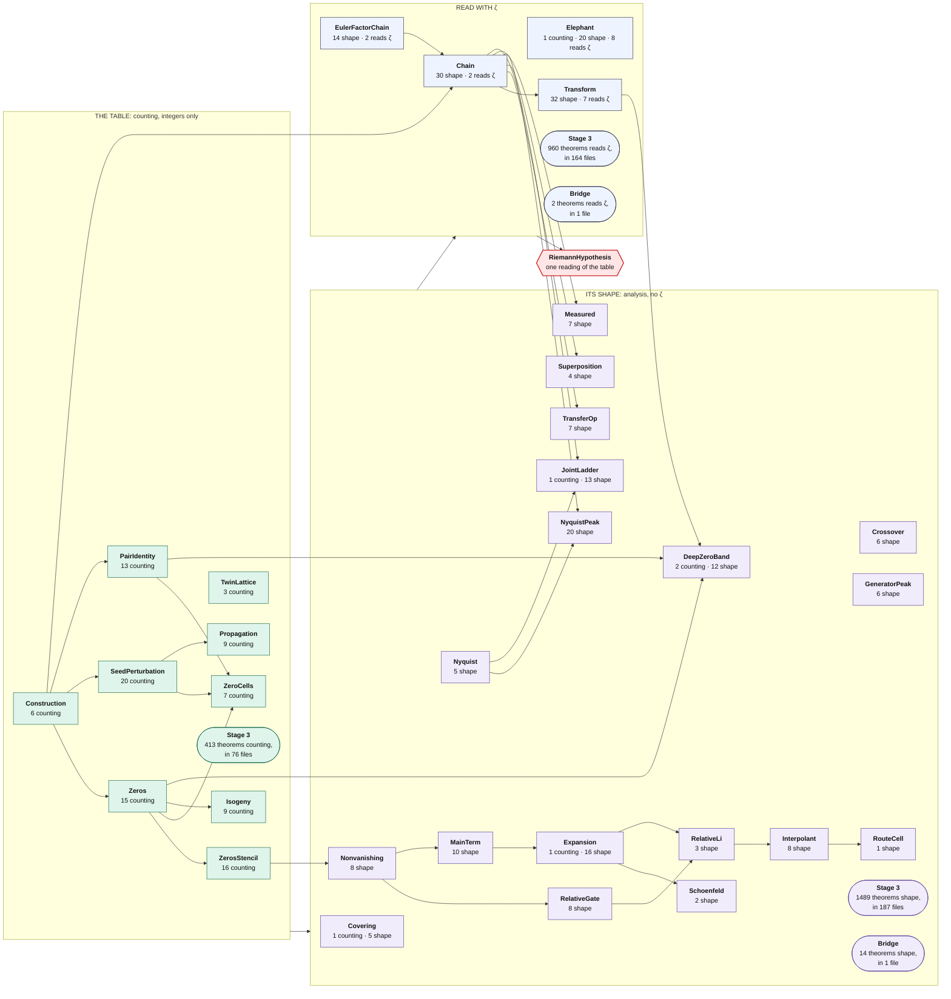

# The table first

The table is the number line's own rate of change, counted at the doublings: how many primes each doubling adds, how that changes from one doubling to the next, and the change of the change. Nothing else goes in. Everything else in the three trees is built on it or is a reading of it.

Three layers, decided by Lean's record of each proof and everything beneath it (`utilities/lean_dump/Dump.lean` holds the lists; the test errs upward):

- **Counting** (green), 517 theorems. Integers only. No analysis and no ζ anywhere in the statement, the proof, or anything they rest on.
- **Shape** (violet), 1740 theorems. Real or complex analysis, with no ζ: the symbol of the difference, the modes, the size of the smooth part.
- **Reads ζ** (blue), 981 theorems. The zeta function, its zeros, or the Riemann hypothesis enter, in it or beneath it.

A file sits in the highest layer any of its theorems reaches; its box says how many of each it holds. Arrows between files are imports, indirect ones left out.

| tree | counting | shape | reads ζ |
|---|---|---|---|
| `lean/` | 104 | 237 | 19 |
| `lean_stage3/` | 413 | 1489 | 960 |
| `lean_bridge/` | 0 | 14 | 2 |

## Every counting theorem

The ground floor: what is proved about the table with integers alone.

### [`Construction`](./lean/Construction.md) — 6

Construction — the table has no free parameter, so the zeros were not placed. `Zeros.lean` records that nothing predicts WHERE the four exact zeros are. That is true and stays true. This file proves the complementary thing, which is what makes them structural rather than arbitrary:

- [`Construction.tableFrom_isTableOf`](./lean/Construction.md#Construction-tableFrom_isTableOf) — `` IsTableOf N (tableFrom N) `` `tableFrom` satisfies its own recurrence.
- [`Construction.unique_of_isTableOf`](./lean/Construction.md#Construction-unique_of_isTableOf) — `` ∀ r d, f r d = tableFrom N r d `` Uniqueness. Any function satisfying the recurrence with the same depth-0 row IS the table. There is no choice at any cell — fix the row and the entire table, to every depth, is determined.
- [`Construction.eq_of_same_row`](./lean/Construction.md#Construction-eq_of_same_row) — `` ∀ r d, f r d = g r d `` Two tables over the same row agree everywhere.
- [`Construction.zero_determined_by_row`](./lean/Construction.md#Construction-zero_determined_by_row) — `` tableFrom N r d = tableFrom M r d `` A zero is determined by the row. If two counting functions agree on the window a cell reads, that cell is the same for both — in particular one vanishes exactly when the other does. Nothing outside the window can move it, and nothing inside the construction c
- [`Construction.tableFrom_add`](./lean/Construction.md#Construction-tableFrom_add) — `` tableFrom (fun x => N x + M x) r d = tableFrom N r d + tableFrom M r d `` Differencing is linear, at every depth. The operator carries no parameter to tune — this is what forces Pascal's weights rather than selecting them.
- [`Construction.tableFrom_smul`](./lean/Construction.md#Construction-tableFrom_smul) — `` tableFrom (fun x => c * N x) r d = c * tableFrom N r d `` Scalars pass through the table: the table of `c·N` is `c` times the table of `N`. The other half of linearity, beside `tableFrom_add`.

### [`Covering`](./lean/Covering.md) — 1

Covering — why 25 of 36 primes contribute, and why the set skips 13. THE MEASUREMENT (results/O37_weil_form_on_stencil_run1.log): with b = 2, N = 7, W = 0.05, K = 2, the mollified Weil form has 36 primes inside its support and exactly 25 contribute:

- [`Covering.bench_selects`](./lean/Covering.md#Covering-bench_selects) — `` measured_contributing < measured_in_support `` And it does select: 25 of 36, not all.

### [`DeepZeroBand`](./lean/DeepZeroBand.md) — 2

DeepZeroBand — the deep zero, inverted, and the band between the two. Joins three things already in this tree:

- [`DeepZeroBand.composite_cell_20_6`](./lean/DeepZeroBand.md#DeepZeroBand-composite_cell_20_6) — `` tableFrom compRow 20 6 = 8192 `` The inverse of the deep zero. The composite cell at (20,6) is the whole total, `2^13`, computed.
- [`DeepZeroBand.deep_cell_15_6`](./lean/DeepZeroBand.md#DeepZeroBand-deep_cell_15_6) — `` tableFrom Zeros.dyadicRow 15 6 = -112 `` A differenced cell can be negative: (15,6) is `−112`, computed.

### [`Elephant`](./lean/Elephant.md) — 1

# Elephant.lean — the one object, derived from nothing Standalone. This file imports Mathlib and imports no module of this development. It defines

- [`Elephant.primeTable_eq_stencil`](./lean/Elephant.md#Elephant-primeTable_eq_stencil) — `` ((fwdDiff (1 : ℕ))^[d] (primeRow b)) r = ∑ k ∈ Finset.range (d + 1), ((-1 : ℤ) ^ (d - k) * d.choose k) • primeRow b (r + k • 1) `` The `d`-fold forward difference of the prime row `n ↦ π(bⁿ)` at `r` equals the alternating binomial stencil `∑ k ≤ d, (−1)^(d−k)·C(d,k)·π(b^(r+k))`.

### [`Expansion`](./lean/Expansion.md) — 1

Expansion — stage 2b: the derivative of 2^x/x, explicitly, and its floor. `MainTerm.lean` reduced O67's main-term hypothesis to `hD`: a floor on the `(d+1)`-th derivative of the li-interpolant on the window — equivalently, on the `d`-th derivative of `2^x/x`. This module supplies both halves:

- [`Expansion.choose_factorial_step`](./lean/Expansion.md#Expansion-choose_factorial_step) — `` d.choose (j + 1) * (j + 1).factorial = d.choose j * j.factorial * (d - j) `` The choose-ratio identity, in ℕ where it is clean: `C(d,j+1)·(j+1)! = C(d,j)·j!·(d−j)`.

### [`Isogeny`](./lean/Isogeny.md) — 9

Isogeny — what the isogeny does to the row. `Transform.tau_ratio_of_meet` proves that two ladders which meet have rationally related modular parameters: `bⁿ = cᵐ → τ(b)/τ(c) = n/m`. That is a statement about the tori `ℂ*/b^ℤ`, and the torus knows only `b`. No prime enters it.

- [`Isogeny.rowOf_eq_rowN`](./lean/Isogeny.md#Isogeny-rowOf_eq_rowN) — `` rowOf P b r = rowN (fun n => P (b ^ n)) 1 r `` The bridge: composing `P` with `b^·` turns one into the other.
- [`Isogeny.telescope`](./lean/Isogeny.md#Isogeny-telescope) — `` ∑ j ∈ range k, (g (m + j + 1) - g (m + j)) = g (m + k) - g m `` Telescoping over `Finset.range`. Stated for an arbitrary `g : ℕ → ℤ` because that is all the identity below needs.
- [`Isogeny.rowN_eq_blockSum`](./lean/Isogeny.md#Isogeny-rowN_eq_blockSum) — `` rowN Q k r = ∑ j ∈ range k, rowN Q 1 (k * r + j) `` The isogeny on the row. Passing from a ladder to its `k`-th power sums the row in blocks of `k`. Holds for any `Q`; no arithmetic input is used.
- [`Isogeny.row_two_eq_pair`](./lean/Isogeny.md#Isogeny-row_two_eq_pair) — `` rowN Q 2 r = rowN Q 1 (2 * r) + rowN Q 1 (2 * r + 1) `` Base 4's row is base 2's row summed in pairs.
- [`Isogeny.row_three_eq_triple`](./lean/Isogeny.md#Isogeny-row_three_eq_triple) — `` rowN Q 3 r = rowN Q 1 (3 * r) + rowN Q 1 (3 * r + 1) + rowN Q 1 (3 * r + 2) `` Base 8's row is base 2's row summed in triples.
- [`Isogeny.rowN_comp`](./lean/Isogeny.md#Isogeny-rowN_comp) — `` rowN Q (k * l) r = rowN (fun n => Q (k * n)) l r `` Decimation composes. Reading a ladder at `k` and then at `l` is reading it at `k*l` — so `{2,4,8}` is a chain and not three separate relations.
- [`Isogeny.dyadicRow_eq_rowN`](./lean/Isogeny.md#Isogeny-dyadicRow_eq_rowN) — `` Zeros.dyadicRow ((r : ℤ) + 1) = rowN Zeros.pi2 1 r `` The weld to the measured row. `Zeros.dyadicRow` indexes from the top over `ℤ` and is windowed to `1 ≤ r ≤ 20`; inside that window it is `rowN Zeros.pi2 1` shifted by one.
- [`Isogeny.measured_row_four`](./lean/Isogeny.md#Isogeny-measured_row_four) — `` (List.range 10).map (rowN Zeros.pi2 2) = [2, 4, 12, 36, 118, 392, 1336, 4642, 16458, 59025] `` The measured base-4 row, from the 21 pinned values and nothing else. These are the numbers `row_two_eq_pair` says are base 2's row summed in pairs.
- [`Isogeny.measured_row_eight`](./lean/Isogeny.md#Isogeny-measured_row_eight) — `` (List.range 6).map (rowN Zeros.pi2 3) = [4, 14, 79, 467, 2948, 19488] `` The measured base-8 row, same 21 values read at decimation 3.

### [`JointLadder`](./lean/JointLadder.md) — 1

JointLadder — the joint `{2^m 3^n}` grid has NO aliases, and its difference operator carries two Euler factors.

- [`JointLadder.two_pow_ne_three_pow`](./lean/JointLadder.md#JointLadder-two_pow_ne_three_pow) — `` (2 : ℕ) ^ l ≠ 3 ^ k `` Parity kills it. A positive power of two is never a power of three: `2 ∣ 2^l` while `2 ∤ 3^k`.

### [`PairIdentity`](./lean/PairIdentity.md) — 13

PairIdentity — the complementary pair, and why base two is singular. Encodes statement **I1** of `papers/Euler-Factor-Chain.md` § I ("The complementary pair"):

- [`PairIdentity.backward_difference_pow`](./lean/PairIdentity.md#PairIdentity-backward_difference_pow) — `` b ^ (r + 1) - b ^ r = (b - 1) * b ^ r `` The same step inside ℤ, where the table lives: `(1 − b⁻¹)·b^(r) = (b−1)·b^(r−1)`. One backward difference of a geometric row multiplies it by `b − 1` and drops the exponent by one.
- [`PairIdentity.tableFrom_of_geometric`](./lean/PairIdentity.md#PairIdentity-tableFrom_of_geometric) — `` tableFrom G r d = (b - 1) ^ d * G (r - d) `` The collapse. If the row steps by `b` across the window a cell reads, then `d` backward differences leave `(b−1)^d` times the bottom entry of that window. Iterating `backward_difference_pow`; the whole index difficulty is that each difference moves the window
- [`PairIdentity.tableFrom_add_window`](./lean/PairIdentity.md#PairIdentity-tableFrom_add_window) — `` tableFrom P r d + tableFrom C r d = tableFrom T r d `` Linearity, localised. If two rows partition a third across the window a cell reads, the two tables sum to the third table at that cell. `Construction.tableFrom_add` gives that the table of a sum is the sum of tables; `Construction.zero_determined_by_row` give
- [`PairIdentity.pair_identity`](./lean/PairIdentity.md#PairIdentity-pair_identity) — `` tableFrom P r d + tableFrom C r d = (b - 1) ^ (d + 1) * b ^ e `` I1, the pair identity. Let `P` and `C` be any two rows that partition each rung: at rung `r − k` the two counts sum to `(b−1)·b^(r−k−1)`, the number of integers the rung holds. Then at every cell the differenced arms sum to
- [`PairIdentity.composite_of_prime_zero`](./lean/PairIdentity.md#PairIdentity-composite_of_prime_zero) — `` tableFrom C r d = (b - 1) ^ (d + 1) * b ^ e `` I5, the pole. Where the prime arm vanishes the composite arm carries the whole total — it has nowhere else to go. This is the identity read at a zero, and it is the only sense in which a zero says anything about the composite side.
- [`PairIdentity.coeff_eq_one_iff_base_two`](./lean/PairIdentity.md#PairIdentity-coeff_eq_one_iff_base_two) — `` (b - 1) ^ (d + 1) = 1 ↔ b = 2 `` The corollary. For integer `b ≥ 2`, the coefficient `(b−1)^(d+1)` is `1` exactly when `b = 2`. Every other base carries a factor strictly greater than one, at every depth.
- [`PairIdentity.total_eq_pow_iff_base_two`](./lean/PairIdentity.md#PairIdentity-total_eq_pow_iff_base_two) — `` (b - 1) ^ (d + 1) * b ^ e = b ^ e ↔ b = 2 `` The corollary, in the identity's own terms. The cell total is a bare power of the base — no `(b−1)` factor anywhere — exactly in base two. So base two is the only grid on which a vanished prime arm leaves the composite arm sitting on a power of the base itsel
- [`PairIdentity.base_three_carries_factor`](./lean/PairIdentity.md#PairIdentity-base_three_carries_factor) — `` ((3 : ℤ) - 1) ^ (d + 1) * 3 ^ e = 2 ^ (d + 1) * 3 ^ e `` Base three does carry the factor: the total at `(r,d)` is `2^(d+1)·3^(r−1−d)`, never a bare power of three.
- [`PairIdentity.base_four_carries_factor`](./lean/PairIdentity.md#PairIdentity-base_four_carries_factor) — `` ((4 : ℤ) - 1) ^ (d + 1) * 4 ^ e = 3 ^ (d + 1) * 4 ^ e `` Base four likewise: `3^(d+1)·4^(r−1−d)`.
- [`PairIdentity.exponent_const_on_diagonal`](./lean/PairIdentity.md#PairIdentity-exponent_const_on_diagonal) — `` e₁ = e₂ `` Along a diagonal the pair identity's exponent is fixed. `hdiag` is `r − d` constant; `h₁` and `h₂` are the index convention, which pins `e = r − 1 − d`.
- [`PairIdentity.total_const_on_diagonal`](./lean/PairIdentity.md#PairIdentity-total_const_on_diagonal) — `` (∀ d₁ d₂ : ℕ, (b - 1) ^ (d₁ + 1) * b ^ e = (b - 1) ^ (d₂ + 1) * b ^ e) ↔ b = 2 `` The diagonal is the trend's own level set, and only at `b = 2`. Fix a diagonal — equivalently, fix `e` — and ask whether the cell total is the same at every depth along it. It is, exactly in base two.
- [`PairIdentity.measured_composite_matches_pair_identity`](./lean/PairIdentity.md#PairIdentity-measured_composite_matches_pair_identity) — `` zero_cells.map (fun c => ((2 : ℤ) - 1) ^ (c.2 + 1) * 2 ^ (c.1 - 1 - c.2)) = measured_composite_at_zeros `` The falsifier. Evaluating `(b−1)^(d+1)·b^(r−1−d)` at `b = 2` and the four measured zero cells reproduces the measured composite arm exactly. The formula is derived above from the partition alone; the four values were measured. They agree.
- [`PairIdentity.composite_at_zero_20_6`](./lean/PairIdentity.md#PairIdentity-composite_at_zero_20_6) — `` tableFrom C 20 6 = 8192 `` The deep zero, stated through the identity rather than through arithmetic. Given that the prime arm vanishes at `(20,6)` — which is measured, not proved — the partition forces the composite arm to be `8192`, which is what § E2 records.

### [`Propagation`](./lean/Propagation.md) — 9

Propagation — the recurrence as transport: the light cone, and the propagator. `papers/Depth-as-Time.md` reads depth as time. Take that literally: with `d` as time and `r` as space, the recurrence

- [`Propagation.pasc_zero`](./lean/Propagation.md#Propagation-pasc_zero) — `` pasc n 0 = 1 `` The left edge of the triangle is all ones.
- [`Propagation.pasc_succ`](./lean/Propagation.md#Propagation-pasc_succ) — `` pasc (n + 1) (k + 1) = pasc n k + pasc n (k + 1) `` Pascal's identity — definitional, because `pasc` is defined by it.
- [`Propagation.pasc_eq_zero`](./lean/Propagation.md#Propagation-pasc_eq_zero) — `` pasc n k = 0 `` Above the diagonal the binomial vanishes.
- [`Propagation.pasc_pos`](./lean/Propagation.md#Propagation-pasc_pos) — `` 0 < pasc n k `` On and below the diagonal it is positive — this is what "no lacunae" rests on: the propagator never vanishes inside its cone.
- [`Propagation.outside_cone_zero`](./lean/Propagation.md#Propagation-outside_cone_zero) — `` tableFrom (deltaRow s) r d = 0 `` Outside the forward cone, nothing. A source at `s` does not reach a cell whose window `[r−d, r]` misses `s` — the range of influence is bounded by speed 1. Downstream (`r < s`) and past the cone's left edge (`s < r−d`) the cell is zero.
- [`Propagation.propagator`](./lean/Propagation.md#Propagation-propagator) — `` tableFrom (deltaRow s) (s + (k : ℤ)) d = (-1) ^ k * pasc d k `` Inside the cone, the propagator. At offset `k ≤ d` from the source the cell is exactly `(−1)^k · C(d,k)`: the Green's function of the evolution is the alternating binomial row — the stencil, read as a propagator.
- [`Propagation.neg_one_pow`](./lean/Propagation.md#Propagation-neg_one_pow) — `` ((-1 : ℤ)) ^ m = 1 ∨ ((-1 : ℤ)) ^ m = -1 `` `(−1)^m` is `1` or `−1`. Stated here because core carries no pow lemmas.
- [`Propagation.cone_filled`](./lean/Propagation.md#Propagation-cone_filled) — `` tableFrom (deltaRow s) (s + (k : ℤ)) d ≠ 0 `` No lacunae. Strictly inside the forward cone the disturbance is felt at EVERY cell — the propagator never vanishes there. Discrete 1+1 transport fills its cone, where the 3+1 wave equation would leave the interior silent.
- [`Propagation.flux_form`](./lean/Propagation.md#Propagation-flux_form) — `` tableFrom N r (d + 1) + tableFrom N (r - 1) d = tableFrom N r d `` The flux form. The recurrence rearranged as a conservation step: what the cell holds at time `d+1` plus what flowed left is what it held at `d`. Definitional — recorded so the transport reading has its conservation law stated. The interval form (a sum at time

### [`SeedPerturbation`](./lean/SeedPerturbation.md) — 20

SeedPerturbation — changing the seed convention cannot reach a deep cell. THE QUESTION. The dyadic tables in `imported/lattice_mapper/` are built on a seed convention: the primes 2 and 3 are treated as lattice rather than counted as primes. That is a choice. If a different choice moved the zeros, the zeros would be artefacts of bookkeeping. So: which cells can a change of convention reach?

- [`SeedPerturbation.tableFrom_zero`](./lean/SeedPerturbation.md#SeedPerturbation-tableFrom_zero) — `` tableFrom (fun _ : ℤ => (0 : ℤ)) r d = 0 `` The zero row builds the zero table.
- [`SeedPerturbation.tableFrom_sub`](./lean/SeedPerturbation.md#SeedPerturbation-tableFrom_sub) — `` tableFrom (fun x => N x - e x) r d = tableFrom N r d - tableFrom e r d `` Linearity, in the form the convention change needs. Replacing the depth-0 row `N` by `N − e` subtracts `tableFrom e` from every cell of the table, at every depth.
- [`SeedPerturbation.tableFrom_eq_zero_of_vanishing_above`](./lean/SeedPerturbation.md#SeedPerturbation-tableFrom_eq_zero_of_vanishing_above) — `` tableFrom e r d = 0 `` The excess table vanishes past the excess. If `e` is zero on every rung strictly above `R`, then every cell whose window bottom `r − d` clears `R` reads only zeros, so the cell is zero.
- [`SeedPerturbation.cell_eq_of_seed_perturbation`](./lean/SeedPerturbation.md#SeedPerturbation-cell_eq_of_seed_perturbation) — `` tableFrom (fun x => N x - e x) r d = tableFrom N r d `` The claim. Changing the seed convention replaces the depth-0 row `N` by `N − e`. If `e` vanishes on every rung strictly above `R`, then every cell at `(r,d)` with `r − d > R` is IDENTICAL under both conventions.
- [`SeedPerturbation.zero_stable_of_seed_perturbation`](./lean/SeedPerturbation.md#SeedPerturbation-zero_stable_of_seed_perturbation) — `` tableFrom (fun x => N x - e x) r d = 0 `` The corollary. A zero at `(r,d)` with `r − d > R` is a zero under both conventions. The seed convention cannot have put it there and cannot take it away.
- [`SeedPerturbation.zero_iff_of_seed_perturbation`](./lean/SeedPerturbation.md#SeedPerturbation-zero_iff_of_seed_perturbation) — `` tableFrom (fun x => N x - e x) r d = 0 ↔ tableFrom N r d = 0 `` The same statement as an equivalence, which is the honest form: past the excess, the two conventions have the same zero set. Neither direction is a weaker claim than the other.
- [`SeedPerturbation.tableFrom_at_boundary`](./lean/SeedPerturbation.md#SeedPerturbation-tableFrom_at_boundary) — `` tableFrom e r d = (-1) ^ d * e R `` The boundary cell, exactly. When the window bottom sits on `R` itself, `d` backward differences leave `(−1)^d · e R` — the whole excess, signed. Every higher entry of the window is already zero, so the bottom entry is all there is.
- [`SeedPerturbation.boundary_can_move`](./lean/SeedPerturbation.md#SeedPerturbation-boundary_can_move) — `` tableFrom e r d ≠ 0 `` `r − d > R` cannot be relaxed to `r − d ≥ R`. Take `R` to be the largest rung where `e` is non-zero, which is what `R_e` means. Then every cell with `r − d = R` moves, by exactly `±e R`. The strict inequality is not slack in the proof; it is the boundary.
- [`SeedPerturbation.cell_ne_at_boundary`](./lean/SeedPerturbation.md#SeedPerturbation-cell_ne_at_boundary) — `` tableFrom (fun x => N x - e x) r d ≠ tableFrom N r d `` The same fact said about the two conventions rather than about `e`: at the boundary the cell genuinely differs.
- [`SeedPerturbation.window_bottoms_correct`](./lean/SeedPerturbation.md#SeedPerturbation-window_bottoms_correct) — `` zero_cells.map (fun c => (c.1 : ℤ) - (c.2 : ℤ)) = zero_window_bottoms `` The window bottoms `r − d` of the four zeros are `1, 3, 5, 14`, computed rather than transcribed.
- [`SeedPerturbation.protected_at_R_two`](./lean/SeedPerturbation.md#SeedPerturbation-protected_at_R_two) — `` zero_cells.map (fun c => decide (2 < (c.1 : ℤ) - (c.2 : ℤ))) = [false, true, true, true] `` Which zeros the theorem protects when 2 and 3 are the excluded primes. `R_e = 2`, so `(2,1)` is unprotected and the other three are fixed. This is the prediction, stated before looking at any perturbed table.
- [`SeedPerturbation.protected_at_R_three`](./lean/SeedPerturbation.md#SeedPerturbation-protected_at_R_three) — `` zero_cells.map (fun c => decide (3 < (c.1 : ℤ) - (c.2 : ℤ))) = [false, false, true, true] `` And when the excess reaches rung 3 — which `silence46` does, since 6 sits in `(4,8]`. Now `(4,1)` falls to the boundary as well.
- [`SeedPerturbation.silence46_vanishes_above_three`](./lean/SeedPerturbation.md#SeedPerturbation-silence46_vanishes_above_three) — `` ∀ s : ℤ, 3 < s → silence46_excess s = 0 `` The `silence46` excess is confined to rungs 2 and 3 — the hypothesis `cell_eq_of_seed_perturbation` needs, at `R_e = 3`.
- [`SeedPerturbation.silence46_alive_at_three`](./lean/SeedPerturbation.md#SeedPerturbation-silence46_alive_at_three) — `` silence46_excess 3 ≠ 0 `` And rung 3 genuinely carries excess, so `boundary_can_move` has its `e R ≠ 0`.
- [`SeedPerturbation.measured_silence46_matches_shift`](./lean/SeedPerturbation.md#SeedPerturbation-measured_silence46_matches_shift) — `` [4 - tableFrom silence46_excess 4 1, 16 - tableFrom silence46_excess 8 3, 8192 - tableFrom silence46_excess 20 6] = measured_composite_silence46 `` The falsifier. Subtracting `tableFrom silence46_excess` from the three measured base cells reproduces the three measured silenced cells exactly — including the one that MOVED. `(4,1)` sits at `r − d = 3 = R_e`, and the shift `tableFrom e 4 1 = −1` carries 4 t
- [`SeedPerturbation.silence46_deep_cells_fixed`](./lean/SeedPerturbation.md#SeedPerturbation-silence46_deep_cells_fixed) — `` tableFrom (fun x => N x - silence46_excess x) 8 3 = tableFrom N 8 3 ∧ tableFrom (fun x => N x - silence46_excess x) 20 6 = tableFrom N 20 6 `` The two deep cells are protected by the theorem, not by arithmetic luck: `8 − 3 = 5 > 3` and `20 − 6 = 14 > 3`, so `cell_eq_of_seed_perturbation` applies and no computation is needed.
- [`SeedPerturbation.silence46_cell_4_1_moves`](./lean/SeedPerturbation.md#SeedPerturbation-silence46_cell_4_1_moves) — `` tableFrom (fun x => N x - silence46_excess x) 4 1 ≠ tableFrom N 4 1 `` And `(4,1)` is not protected, for the reason the theorem gives rather than by inspection: `4 − 1 = 3 = R_e`, so `boundary_can_move` fires.
- [`SeedPerturbation.emptied_vanishes_above_two`](./lean/SeedPerturbation.md#SeedPerturbation-emptied_vanishes_above_two) — `` ∀ s : ℤ, 2 < s → emptied_excess s = 0 `` The emptied variant's excess is confined to rungs 1 and 2 — `R_e = 2`, the same profile as excluding the primes 2 and 3.
- [`SeedPerturbation.measured_emptied_matches_shift`](./lean/SeedPerturbation.md#SeedPerturbation-measured_emptied_matches_shift) — `` [1 - tableFrom emptied_excess 2 1, 4 - tableFrom emptied_excess 4 1, 16 - tableFrom emptied_excess 8 3, 8192 - tableFrom emptied_excess 20 6] = measur… `` The second falsifier, at `R_e = 2`. The three cells the theorem protects are unmoved in the file, and the one it does not protect — `(2,1)`, window bottom `1` — moved from 1 to 0, by exactly the predicted shift `tableFrom e 2 1 = e 2 − e 1 = 1`.
- [`SeedPerturbation.emptied_protected_cells_fixed`](./lean/SeedPerturbation.md#SeedPerturbation-emptied_protected_cells_fixed) — `` tableFrom (fun x => N x - emptied_excess x) 4 1 = tableFrom N 4 1 ∧ tableFrom (fun x => N x - emptied_excess x) 8 3 = tableFrom N 8 3 ∧ tableFrom (fun… `` The three protected cells, again by theorem rather than by computation: `4 − 1 = 3 > 2`, `8 − 3 = 5 > 2`, `20 − 6 = 14 > 2`.

### [`TwinLattice`](./lean/TwinLattice.md) — 3

TwinLattice — a twin pair is a lattice site, not a coincidence of spacing. Every twin pair above 3 is `(6k − 1, 6k + 1)`. The single integer between them is `6k`. So a twin pair is not two primes that happen to sit two apart: it is a site on the `2·3` lattice with primes on both shoulders, and counting twins is counting doubly-flanked lattice sites.

- [`TwinLattice.twin_lower_mod_six`](./lean/TwinLattice.md#TwinLattice-twin_lower_mod_six) — `` p % 6 = 5 `` The lattice. Every twin pair above 3 has its lower member at `6k − 1`. `3 < p` is not decoration: `(3,5)` is the one exception, and `three_five_exceptional` below exhibits it rather than leaving it implied.
- [`TwinLattice.twin_pocket`](./lean/TwinLattice.md#TwinLattice-twin_pocket) — `` (p + 1) % 6 = 0 `` The pocket. The single integer between a twin pair is a multiple of 6. That is the site; the pair is what is attached to it.
- [`TwinLattice.three_five_exceptional`](./lean/TwinLattice.md#TwinLattice-three_five_exceptional) — `` (3 : ℕ).Prime ∧ (5 : ℕ).Prime ∧ (3 + 1) % 6 ≠ 0 `` `(3,5)` is the exception, exhibited rather than assumed. Its pocket is 4, which is not on the lattice. It is also the first twin pair, so the lattice reading begins at `(5,7)`.

### [`ZeroCells`](./lean/ZeroCells.md) — 7

ZeroCells — the four zeros are one object with four names, and the kernel now says so.

- [`ZeroCells.construction_eq`](./lean/ZeroCells.md#ZeroCells-construction_eq) — `` Construction.measured_zeros = Zeros.measured_zeros `` The construction module's list is the computed one. `rfl`, and that is what makes it a check: edit either list and this stops compiling.
- [`ZeroCells.seedPerturbation_eq`](./lean/ZeroCells.md#ZeroCells-seedPerturbation_eq) — `` SeedPerturbation.zero_cells = Zeros.measured_zeros `` The seed-perturbation module's list is the computed one. It was re-read independently from `imported/lattice_mapper/32bit/dyadic_difference_table_32.csv`, so this equality is also a statement that the imported table and `pi2n_cache` agree at those four cells.
- [`ZeroCells.pairIdentity_eq`](./lean/ZeroCells.md#ZeroCells-pairIdentity_eq) — `` PairIdentity.zero_cells = Zeros.measured_zeros `` The pair-identity module's list is the computed one.
- [`ZeroCells.construction_all_vanish`](./lean/ZeroCells.md#ZeroCells-construction_all_vanish) — `` ∀ c ∈ Construction.measured_zeros, Construction.tableFrom Zeros.dyadicRow (c.1 : ℤ) c.2 = 0 `` Every cell `Construction.measured_zeros` names vanishes — now derived, not transcribed.
- [`ZeroCells.seedPerturbation_all_vanish`](./lean/ZeroCells.md#ZeroCells-seedPerturbation_all_vanish) — `` ∀ c ∈ SeedPerturbation.zero_cells, Construction.tableFrom Zeros.dyadicRow (c.1 : ℤ) c.2 = 0 `` Every cell `SeedPerturbation.zero_cells` names vanishes.
- [`ZeroCells.pairIdentity_all_vanish`](./lean/ZeroCells.md#ZeroCells-pairIdentity_all_vanish) — `` ∀ c ∈ PairIdentity.zero_cells, Construction.tableFrom Zeros.dyadicRow (c.1 : ℤ) c.2 = 0 `` Every cell `PairIdentity.zero_cells` names vanishes.
- [`ZeroCells.all_four_have_length_four`](./lean/ZeroCells.md#ZeroCells-all_four_have_length_four) — `` Construction.measured_zeros.length = 4 ∧ SeedPerturbation.zero_cells.length = 4 ∧ PairIdentity.zero_cells.length = 4 ∧ Zeros.measured_zeros.length = 4 `` All four names, one length. The "exactly four" of the papers is now a property of a single object rather than of four lists that happen to agree.

### [`Zeros`](./lean/Zeros.md) — 15

Zeros — what is provable about the four exact zeros, and what is not. THE MEASUREMENT (results/O16_run2.log): over r <= 62, d <= 61 the dyadic prime difference table has exactly four exact zeros — (2,1), (4,1), (8,3), (20,6) — and no others. The centered table has none at all.

- [`Zeros.tableFrom_isTable`](./lean/Zeros.md#Zeros-tableFrom_isTable) — `` IsTable (Construction.tableFrom N) `` The bench's table is one. The hypothesis of `zero_iff_repeat` now has a witness: it is the second conjunct of `Construction.tableFrom_isTableOf`, which itself depends on no axioms.
- [`Zeros.zero_iff_repeat`](./lean/Zeros.md#Zeros-zero_iff_repeat) — `` f r (d + 1) = 0 ↔ f r d = f (r - 1) d `` A zero is exactly a repeat one depth up. This is definitional, and it is the only characterisation of a zero the chain supplies.
- [`Zeros.neg_below_zero`](./lean/Zeros.md#Zeros-neg_below_zero) — `` Construction.tableFrom N r (d + 1) = -Construction.tableFrom N (r - 1) d `` A zero puts its left neighbour, negated, directly beneath it. With the cell above vanishing, the recurrence has nothing to subtract from.
- [`Zeros.pair_shares_diagonal`](./lean/Zeros.md#Zeros-pair_shares_diagonal) — `` (r - 1) - (d : ℤ) = r - ((d + 1 : ℕ) : ℤ) `` And those two cells share a diagonal. The left neighbour sits at `(r-1, d)` and the copy at `(r, d+1)`, and `r - d` is the same for both. So every zero places a `±v` pair as adjacent cells on the diagonal one in -- `±343` at `(20,6)`, `±5` at `(8,3)`, both me
- [`Zeros.window_shared_of_composite_exponent`](./lean/Zeros.md#Zeros-window_shared_of_composite_exponent) — `` (4 : ℕ) ^ 2 = 2 ^ 4 `` The (8,3) window is shared. Depth 3 spans `2^4 = 4^2`, so base 4 reaches it at depth 1. Against `Zeros.window_exclusive_of_prime_exponent`, which puts base 2 alone in the (20,6) window, the two deep zeros are different kinds of object.
- [`Zeros.zero_2_1`](./lean/Zeros.md#Zeros-zero_2_1) — `` Construction.tableFrom dyadicRow 2 1 = 0 `` `(2,1)` vanishes: `1·1 − 1·1 = 0`, computed by the kernel from `pi2`.
- [`Zeros.zero_4_1`](./lean/Zeros.md#Zeros-zero_4_1) — `` Construction.tableFrom dyadicRow 4 1 = 0 `` `(4,1)` vanishes: `1·2 − 1·2 = 0`.
- [`Zeros.zero_8_3`](./lean/Zeros.md#Zeros-zero_8_3) — `` Construction.tableFrom dyadicRow 8 3 = 0 `` `(8,3)` vanishes: `23 − 3·13 + 3·7 − 5 = 0`, four values of `π`.
- [`Zeros.zero_20_6`](./lean/Zeros.md#Zeros-zero_20_6) — `` Construction.tableFrom dyadicRow 20 6 = 0 `` `(20,6)` vanishes: the depth-6 stencil on seven values of `π`, spanning `2^13` to `2^20`. The deep zero, computed.
- [`Zeros.measured_zeros_all_vanish`](./lean/Zeros.md#Zeros-measured_zeros_all_vanish) — `` ∀ c ∈ measured_zeros, Construction.tableFrom dyadicRow (c.1 : ℤ) c.2 = 0 `` The list's own claim, as a theorem. Every cell `measured_zeros` names vanishes on the dyadic row.
- [`Zeros.nonzero_7_3`](./lean/Zeros.md#Zeros-nonzero_7_3) — `` Construction.tableFrom dyadicRow 7 3 = 5 `` A non-zero neighbour, so the check can fail.
- [`Zeros.nonzero_19_6`](./lean/Zeros.md#Zeros-nonzero_19_6) — `` Construction.tableFrom dyadicRow 19 6 = 343 `` The `+343` of `papers/The-Fold.md` § C3, the partner of the `−343` that a zero at `(20,6)` forces onto `(20,7)`.
- [`Zeros.four_zeros_only`](./lean/Zeros.md#Zeros-four_zeros_only) — `` measured_zeros.length = 4 `` Four zeros in 1953 cells. Recorded, not derived.
- [`Zeros.zero_at_20_6_of_repeat`](./lean/Zeros.md#Zeros-zero_at_20_6_of_repeat) — `` Construction.tableFrom N 20 6 = 0 `` The measured repeat gives the deep zero, through the theorem. `O27` reads `d5` at `r = 19` and `r = 20` as both 623; `zero_iff_repeat` turns that into `(20,6) = 0` without computing anything. The measurement is the input and the vanishing is the output, which
- [`Zeros.zero_at_8_3_of_repeat`](./lean/Zeros.md#Zeros-zero_at_8_3_of_repeat) — `` Construction.tableFrom N 8 3 = 0 `` The same for the other deep zero, where the repeated value is 4.

### [`ZerosStencil`](./lean/ZerosStencil.md) — 16

ZerosStencil — the Mathlib-dependent half of `Zeros.lean`. Split out of `Zeros.lean` on 2026-08-26. The classification is by axiom pin, not by subject: these are exactly the fifteen theorems whose `#print axioms` carries `Classical.choice`, and every one of them acquires it from Mathlib — `Finset.range` and the alternating-sum lemmas for the stencil family, `Nat.factorization` and `Nat.dvd_prime_pow` for the four ladder results. Notes entries 59, 66 and 187 are the record; 66 predicted this exact list two weeks bef…

- [`Zeros.tableFrom_eq_fwdDiff`](./lean/ZerosStencil.md#Zeros-tableFrom_eq_fwdDiff) — `` Construction.tableFrom N r d = (-1 : ℤ) ^ d * (fwdDiff (-1 : ℤ))^[d] N r `` The table's `d`-fold backward difference is `(-1)^d` times Mathlib's `d`-fold forward difference at step `-1`. The bridge exists so that `tableFrom_eq_stencil` can borrow Mathlib's binomial theorem rather than redo the index bookkeeping.
- [`Zeros.tableFrom_eq_stencil`](./lean/ZerosStencil.md#Zeros-tableFrom_eq_stencil) — `` Construction.tableFrom N r d = stencil d (fun k => N (r - k)) `` The operator IS Pascal. The cell at `(r,d)` — `d` backward differences of the row — equals the alternating binomial stencil of order `d` applied to the `d+1` row values in its window.
- [`Zeros.stencil_add`](./lean/ZerosStencil.md#Zeros-stencil_add) — `` stencil N (fun k => g k + h k) = stencil N g + stencil N h `` The stencil is linear in the sampled values. So a zero is a single linear equation on the `N+1` values of `pi` inside its window — one condition, hence codimension one. Nothing here says when it is satisfied.
- [`Zeros.stencil_smul`](./lean/ZerosStencil.md#Zeros-stencil_smul) — `` stencil N (fun k => c * g k) = c * stencil N g `` And scalars pass through — linearity's other half, beside `stencil_add`.
- [`Zeros.stencil_annihilates_const`](./lean/ZerosStencil.md#Zeros-stencil_annihilates_const) — `` stencil N (fun _ => c) = 0 `` The stencil's positive and negative arms carry equal total weight. For `N = 7` each arm sums to 64: the balance is exact by construction, not by anything about the primes.
- [`Zeros.stencil_eq_wings`](./lean/ZerosStencil.md#Zeros-stencil_eq_wings) — `` stencil N g = wingPlus N g - wingMinus N g `` The fold is an identity, not a test. `cell = wing⁺ − wing⁻`, always.
- [`Zeros.stencil_eq_zero_iff_wings`](./lean/ZerosStencil.md#Zeros-stencil_eq_zero_iff_wings) — `` stencil N g = 0 ↔ wingPlus N g = wingMinus N g `` A zero is where the wings balance.
- [`Zeros.tableFrom_eq_zero_iff_wings`](./lean/ZerosStencil.md#Zeros-tableFrom_eq_zero_iff_wings) — `` Construction.tableFrom N r d = 0 ↔ wingPlus d (fun k => N (r - k)) = wingMinus d (fun k => N (r - k)) `` The cell, folded. Through `tableFrom_eq_stencil`: the table's cell at `(r,d)` vanishes exactly when the two wings of its window balance.
- [`Zeros.repeat_iff_wings`](./lean/ZerosStencil.md#Zeros-repeat_iff_wings) — `` Construction.tableFrom N r d = Construction.tableFrom N (r - 1) d ↔ wingPlus (d + 1) (fun k => N (r - k)) = wingMinus (d + 1) (fun k => N (r - k)) `` Two readings of one fact. `zero_iff_repeat` says a cell vanishes iff the row repeats at the depth below. This says it vanishes iff the wings balance. The repeat reading and the fold reading are the same statement, and until now nothing in the tree connected t
- [`Zeros.stencil_weights_antisymm`](./lean/ZerosStencil.md#Zeros-stencil_weights_antisymm) — `` ((-1 : ℤ)) ^ (N - k) * (N.choose (N - k)) = -(((-1 : ℤ)) ^ k * (N.choose k)) `` The stencil is antisymmetric when its order is odd. Reflecting an index about the midpoint negates its weight, because `(N-k) + k = N` is odd and so the two indices have opposite parity.
- [`Zeros.stencil_arms_eq`](./lean/ZerosStencil.md#Zeros-stencil_arms_eq) — `` (∑ k ∈ Finset.range (N + 1), (1 + (-1 : ℤ) ^ k) * (N.choose k)) = ∑ k ∈ Finset.range (N + 1), (1 - (-1 : ℤ) ^ k) * (N.choose k) `` The two arms weigh the same. `stencil_annihilates_const` says the signed weights cancel; written as two sums, that is the positive-index arm equalling the negative-index arm. `(1 + (-1)^k)` is twice the indicator of even `k` and `(1 - (-1)^k)` twice the indic
- [`Zeros.stencil_arm_doubled`](./lean/ZerosStencil.md#Zeros-stencil_arm_doubled) — `` (∑ k ∈ Finset.range (N + 1), (1 + (-1 : ℤ) ^ k) * (N.choose k)) = 2 ^ N `` And each arm is `2^(N-1)`. Doubled, an arm is the whole row, `2^N`. With `stencil_arms_eq` that fixes both at half the row -- 64 and 64 at `N = 7`, 8 and 8 at `N = 4`, which is what `The-Fold.md` § B1 reports.
- [`Zeros.window_exclusive_of_prime_exponent`](./lean/ZerosStencil.md#Zeros-window_exclusive_of_prime_exponent) — `` b = 2 ∧ k = 7 `` The (20,6) window is base-2 exclusive. Depth 6 spans a ratio of `2^7`. Since 7 is prime, no integer base `b >= 2` reaches that window at any integer depth `k >= 2`. Base 2 at depth 6 is the only way to look through it.
- [`Zeros.base_of_meets_two`](./lean/ZerosStencil.md#Zeros-base_of_meets_two) — `` ∃ i, b = 2 ^ i `` Only powers of two reach a dyadic window. If any positive power of `b` equals a power of 2, then `b` is itself a power of 2. So the ladders meeting base 2 are exactly `2, 4, 8, 16, …` and no others -- which is the general form of `window_exclusive_of_prime_ex
- [`Zeros.factorization_proportional`](./lean/ZerosStencil.md#Zeros-factorization_proportional) — `` n * b.factorization p = m * c.factorization p `` Two ladders that meet have proportional exponents. If some power of `b` equals some power of `c`, then at every prime the two exponents stand in the ratio `m : n`. This is the "shared lineage" of `Commensurate-Ladders.md` § A2 in exact form -- not that `b` an
- [`Zeros.primeFactors_eq_of_meets`](./lean/ZerosStencil.md#Zeros-primeFactors_eq_of_meets) — `` b.primeFactors = c.primeFactors `` And they are built from the same primes. Proportionality with both exponents nonzero forces the supports to agree, so ladders that meet are made of one prime set. Bases 2 and 3 meet nowhere above `x = 1` for exactly this reason -- there is no common ancestor 

### [`ApproxBounds`](./lean_stage3/ApproxBounds.md) — 10

# ApproxBounds — block S12 of `lean_stage3/design/stencil.md`, piece 2a, the sizes. 2026-11-25.

- [`ApproxBounds.fY_nonneg`](./lean_stage3/ApproxBounds.md#ApproxBounds-fY_nonneg) — `` 0 ≤ fY Y u ``
- [`ApproxBounds.fY_anti`](./lean_stage3/ApproxBounds.md#ApproxBounds-fY_anti) — `` fY Y b ≤ fY Y a ``
- [`ApproxBounds.fY_le_inv`](./lean_stage3/ApproxBounds.md#ApproxBounds-fY_le_inv) — `` fY Y u ≤ 1 / u ``
- [`ApproxBounds.norm_GammaSeq`](./lean_stage3/ApproxBounds.md#ApproxBounds-norm_GammaSeq) — `` ‖GammaSeq s n‖ = ‖(n : ℂ) ^ s‖ * (n.factorial : ℝ) / ∏ j ∈ Finset.range (n + 1), ‖s + j‖ ``
- [`ApproxBounds.re_one_sub_uA`](./lean_stage3/ApproxBounds.md#ApproxBounds-re_one_sub_uA) — `` (1 - uA α t).re = 1 / 2 - α.re ``
- [`ApproxBounds.im_one_sub_uA`](./lean_stage3/ApproxBounds.md#ApproxBounds-im_one_sub_uA) — `` (1 - uA α t).im = -(α.im + t) ``
- [`ApproxBounds.re_one_sub_vB`](./lean_stage3/ApproxBounds.md#ApproxBounds-re_one_sub_vB) — `` (1 - vB β t).re = 1 / 2 - β.re ``
- [`ApproxBounds.im_one_sub_vB`](./lean_stage3/ApproxBounds.md#ApproxBounds-im_one_sub_vB) — `` (1 - vB β t).im = -(β.im - t) ``
- [`ApproxBounds.Q_le`](./lean_stage3/ApproxBounds.md#ApproxBounds-Q_le) — `` (n ^ 2 + A) / n ^ 2 ≤ (A + 1) * (1 + 1 / n ^ 2) ``
- [`ApproxBounds.rect_tendsto_ab`](./lean_stage3/ApproxBounds.md#ApproxBounds-rect_tendsto_ab) — `` Tendsto (fun T : ℝ => RectangleIntegral f (↑a - I * T) (↑b + I * T)) atTop (𝓝 (VerticalIntegral f b - VerticalIntegral f a)) `` PNT+'s `RectangleIntegral_tendsTo_VerticalIntegral` for `[a, b]` (ApproxShift's `rect_tendsto` is the case `[−c, c]`).

### [`ApproxDeriv`](./lean_stage3/ApproxDeriv.md) — 6

# ApproxDeriv — block S12 of `lean_stage3/design/stencil.md`, piece 2b-i, the derivatives of V. 2026-11-25.

- [`ApproxDeriv.hasDerivAt_line`](./lean_stage3/ApproxDeriv.md#ApproxDeriv-hasDerivAt_line) — `` HasDerivAt (fun t : ℝ => w₀ + (t : ℂ) * e) e t `` A real line in `ℂ`: `t ↦ w₀ + t e` has derivative `e`.
- [`ApproxDeriv.hasSum_tel`](./lean_stage3/ApproxDeriv.md#ApproxDeriv-hasSum_tel) — `` HasSum (tel b) (1 / b) ``
- [`ApproxDeriv.sq_le_tel`](./lean_stage3/ApproxDeriv.md#ApproxDeriv-sq_le_tel) — `` 1 / ((n : ℝ) + b) ^ 2 ≤ (1 + 1 / b) * tel b n ``
- [`ApproxDeriv.hasDerivAt_tau_line`](./lean_stage3/ApproxDeriv.md#ApproxDeriv-hasDerivAt_tau_line) — `` HasDerivAt (fun t : ℝ => tau h (w₀ + t * e) n) (e * tau' h (w₀ + t * e) n) t ``
- [`ApproxDeriv.b_facts`](./lean_stage3/ApproxDeriv.md#ApproxDeriv-b_facts) — `` t * (1 / (1 / 20 + t / 5)) ≤ 5 ∧ 1 + 1 / (1 / 20 + t / 5) ≤ 6 ``
- [`ApproxDeriv.deriv_eq_of_eq_Ici`](./lean_stage3/ApproxDeriv.md#ApproxDeriv-deriv_eq_of_eq_Ici) — `` f' = g' `` Two functions differentiable at `t` that agree on `[t, ∞)` have the same derivative.

### [`ApproxDerivAll`](./lean_stage3/ApproxDerivAll.md) — 11

# ApproxDerivAll — block S12 of `lean_stage3/design/stencil.md`, all orders. 2026-11-25.

- [`ApproxDerivAll.ibp_iter_chain`](./lean_stage3/ApproxDerivAll.md#ApproxDerivAll-ibp_iter_chain) — `` ∀ F : ℕ → ℝ → ℂ, (∀ k < j, ∀ t, HasDerivAt (F k) (F (k + 1) t) t) → IntervalIntegrable (F j) volume a b → (∀ k < j, F k a = 0) → (∀ k < j, F k b = 0) … `` `j` integrations by parts against `e_λ(t) = e^(−iλt)`, for a chain `F 0, F 1, …, F j` with `F (k+1)` the derivative of `F k` and `F k` vanishing at `a`, `b` for `k < j`.
- [`ApproxDerivAll.ibp_iter`](./lean_stage3/ApproxDerivAll.md#ApproxDerivAll-ibp_iter) — `` ∫ t in a..b, F t * eL l t = (1 / ((l : ℂ) * I)) ^ j * ∫ t in a..b, iteratedDeriv j F t * eL l t `` `j` integrations by parts. For `F` of class `Cʲ` with `F, F', …, F^(j−1)` vanishing at `a` and `b`, and `λ ≠ 0`: `∫_a^b F e_λ = (1/(iλ))^j ∫_a^b F^(j) e_λ`, `e_λ(t) = e^(−iλt)`.
- [`ApproxDerivAll.tauK_zero`](./lean_stage3/ApproxDerivAll.md#ApproxDerivAll-tauK_zero) — `` tauK 0 h w n = tau h w n ``
- [`ApproxDerivAll.hasDerivAt_tauK_line`](./lean_stage3/ApproxDerivAll.md#ApproxDerivAll-hasDerivAt_tauK_line) — `` HasDerivAt (fun t : ℝ => tauK k h (w₀ + t * e) n) (e * tauK (k + 1) h (w₀ + t * e) n) t ``
- [`ApproxDerivAll.Dc_nonneg`](./lean_stage3/ApproxDerivAll.md#ApproxDerivAll-Dc_nonneg) — `` 0 ≤ Dc k ``
- [`ApproxDerivAll.Dk_nonneg`](./lean_stage3/ApproxDerivAll.md#ApproxDerivAll-Dk_nonneg) — `` 0 ≤ Dk k ``
- [`ApproxDerivAll.pow_key`](./lean_stage3/ApproxDerivAll.md#ApproxDerivAll-pow_key) — `` (a * q) ^ i * a * q ^ (J - i + 1) ≤ (a * q) ^ (J + 1) ``
- [`ApproxDerivAll.leib_bound`](./lean_stage3/ApproxDerivAll.md#ApproxDerivAll-leib_bound) — `` ∃ M : ℝ, 0 ≤ M ∧ ∀ (H d : ℕ → ℂ) (G a q : ℝ), 1 ≤ a → 0 ≤ q → ‖H 0‖ ≤ G → (∀ j, H (j + 1) = ∑ i ∈ Finset.range (j + 1), (j.choose i : ℂ) * H i * d (j … `` The algebra of the induction: if `H (j+1) = Σ C(j,i) H i d(j−i)` and `‖d m‖ ≤ D m a q^(m+1)`, then `‖H i‖ ≤ ‖H 0‖-bound · M (aq)^i`, with `M` depending on `D` and the order only.
- [`ApproxDerivAll.cont_xpow`](./lean_stage3/ApproxDerivAll.md#ApproxDerivAll-cont_xpow) — `` Continuous fun y : ℝ => (x : ℂ) ^ (-((σ : ℂ) + y * I)) ``
- [`ApproxDerivAll.VYk_zero`](./lean_stage3/ApproxDerivAll.md#ApproxDerivAll-VYk_zero) — `` VYk α β 0 c x t = VY α β c x t ``
- [`ApproxDerivAll.norm_IYk_le`](./lean_stage3/ApproxDerivAll.md#ApproxDerivAll-norm_IYk_le) — `` ‖IYk α β x j t s‖ ≤ ‖KY α β t s * (x : ℂ) ^ (-s)‖ * B ``

### [`ApproxFE`](./lean_stage3/ApproxFE.md) — 16

# ApproxFE — block S12 of `lean_stage3/design/stencil.md`, piece 1. 2026-11-25. Young's Lemma 4 (arXiv 1002.4403, §4): the approximate functional equation for `ζ(1/2+α+it)·ζ(1/2+β−it)` with the smoothing `G(s) = e^(s²)·p(s)`, `p(s) = ((α+β)² − (2s)²)/(α+β)²`.

- [`ApproxFE.uA_re`](./lean_stage3/ApproxFE.md#ApproxFE-uA_re) — `` (uA α t).re = 1 / 2 + α.re ``
- [`ApproxFE.vB_re`](./lean_stage3/ApproxFE.md#ApproxFE-vB_re) — `` (vB β t).re = 1 / 2 + β.re ``
- [`ApproxFE.uA_im`](./lean_stage3/ApproxFE.md#ApproxFE-uA_im) — `` (uA α t).im = α.im + t ``
- [`ApproxFE.vB_im`](./lean_stage3/ApproxFE.md#ApproxFE-vB_im) — `` (vB β t).im = β.im - t ``
- [`ApproxFE.Gammaℝ_uA_ne`](./lean_stage3/ApproxFE.md#ApproxFE-Gamma-_uA_ne) — `` Gammaℝ (uA α t) ≠ 0 `` `Gammaℝ (uA α t) ≠ 0` once `Re α > −1/2`.
- [`ApproxFE.Gammaℝ_vB_ne`](./lean_stage3/ApproxFE.md#ApproxFE-Gamma-_vB_ne) — `` Gammaℝ (vB β t) ≠ 0 `` `Gammaℝ (vB β t) ≠ 0` once `Re β > −1/2`.
- [`ApproxFE.ratio_aux`](./lean_stage3/ApproxFE.md#ApproxFE-ratio_aux) — `` P ^ a * A * (P ^ b * B) / (P ^ c * C * (P ^ d * D)) = P ^ k * (A * B) / (C * D) `` A ratio of four `π`-powers times Gamma values.
- [`ApproxFE.differentiableAt_Gammaℝ`](./lean_stage3/ApproxFE.md#ApproxFE-differentiableAt_Gamma-) — `` DifferentiableAt ℂ Gammaℝ s `` `Gammaℝ` is differentiable wherever it does not vanish.
- [`ApproxFE.norm_succ_cpow`](./lean_stage3/ApproxFE.md#ApproxFE-norm_succ_cpow) — `` ‖((m : ℂ) + 1) ^ z‖ = ((m : ℝ) + 1) ^ z.re `` The norm of a shifted natural power.
- [`ApproxFE.KY_differentiableAt`](./lean_stage3/ApproxFE.md#ApproxFE-KY_differentiableAt) — `` DifferentiableAt ℂ (KY α β t) s `` The kernel is differentiable at `s ≠ 0` where `Gammaℝ(u+s), Gammaℝ(v+s) ≠ 0`.
- [`ApproxFE.GY_neg`](./lean_stage3/ApproxFE.md#ApproxFE-GY_neg) — `` GY α β (-s) = GY α β s `` `G` is even.
- [`ApproxFE.GY_swap`](./lean_stage3/ApproxFE.md#ApproxFE-GY_swap) — `` GY (-β) (-α) s = GY α β s `` `G` for `(−β,−α)` is `G` for `(α,β)`.
- [`ApproxFE.uA_neg`](./lean_stage3/ApproxFE.md#ApproxFE-uA_neg) — `` uA (-β) t = 1 - vB β t `` The swap `(α,β) ↦ (−β,−α)` sends `u` to `1 − v`.
- [`ApproxFE.vB_neg`](./lean_stage3/ApproxFE.md#ApproxFE-vB_neg) — `` vB (-α) t = 1 - uA α t `` The swap `(α,β) ↦ (−β,−α)` sends `v` to `1 − u`.
- [`ApproxFE.GY_zero`](./lean_stage3/ApproxFE.md#ApproxFE-GY_zero) — `` GY α β 0 = 1 `` `G(0) = 1` once `α + β ≠ 0`.
- [`ApproxFE.gY_zero`](./lean_stage3/ApproxFE.md#ApproxFE-gY_zero) — `` gY α β t 0 = 1 `` `g(0,t) = 1` once `Gammaℝ u, Gammaℝ v ≠ 0`.

### [`ApproxShift`](./lean_stage3/ApproxShift.md) — 8

# ApproxShift — block S12 of `lean_stage3/design/stencil.md`, the contour shift. 2026-11-25.

- [`ApproxShift.Gammaℝ_ne_of_im`](./lean_stage3/ApproxShift.md#ApproxShift-Gamma-_ne_of_im) — `` Gammaℝ w ≠ 0 `` `Gammaℝ w ≠ 0` off the real axis.
- [`ApproxShift.abs_le_add_abs`](./lean_stage3/ApproxShift.md#ApproxShift-abs_le_add_abs) — `` |y| ≤ |a + y| + |a| `` `|y| ≤ |a + y| + |a|`.
- [`ApproxShift.Lam_differentiableAt`](./lean_stage3/ApproxShift.md#ApproxShift-Lam_differentiableAt) — `` DifferentiableAt ℂ (fun s => completedRiemannZeta (w + s)) s ``
- [`ApproxShift.Lam0_analyticAt`](./lean_stage3/ApproxShift.md#ApproxShift-Lam0_analyticAt) — `` AnalyticAt ℂ (fun s => completedRiemannZeta₀ (w + s)) p ``
- [`ApproxShift.GY_analyticAt`](./lean_stage3/ApproxShift.md#ApproxShift-GY_analyticAt) — `` AnalyticAt ℂ (GY α β) p ``
- [`ApproxShift.FL_differentiableAt`](./lean_stage3/ApproxShift.md#ApproxShift-FL_differentiableAt) — `` DifferentiableAt ℂ (FL α β t) s ``
- [`ApproxShift.ne_of_re_ne`](./lean_stage3/ApproxShift.md#ApproxShift-ne_of_re_ne) — `` z ≠ w `` `z ≠ w` from their real parts.
- [`ApproxShift.rect_tendsto`](./lean_stage3/ApproxShift.md#ApproxShift-rect_tendsto) — `` Tendsto (fun T : ℝ => RectangleIntegral f (↑(-c) - I * T) (↑c + I * T)) atTop (𝓝 (VerticalIntegral f c - VerticalIntegral f (-c))) `` PNT+'s `RectangleIntegral_tendsTo_VerticalIntegral` (in `PerronFormula`, not built at the pin), re-proved here for `[−c, c]`.

### [`Arith`](./lean_stage3/Arith.md) — 6

# Stage3.Arith — S12 (`design/stencil.md` § S12), `SdiagLead.StmtArith` proved, and `StmtDiagMainO`. 2026-11-25.

- [`Arith.rsAF_apply`](./lean_stage3/Arith.md#Arith-rsAF_apply) — `` rsAF a = 1 / √(a : ℝ) ``
- [`Arith.f_ne`](./lean_stage3/Arith.md#Arith-f_ne) — `` Squarefree k ∧ m ≠ 0 ∧ m.primeFactors ⊆ k.primeFactors ``
- [`Arith.f_val`](./lean_stage3/Arith.md#Arith-f_val) — `` ((μ k : ℤ) : ℝ) ^ 2 / k * (((chiAF k m : ℤ) : ℝ) / m) = 1 / ((k * m : ℕ) : ℝ) ``
- [`Arith.rad_mul_of`](./lean_stage3/Arith.md#Arith-rad_mul_of) — `` rad' (k * m) = k ``
- [`Arith.sum_sdm_eq`](./lean_stage3/Arith.md#Arith-sum_sdm_eq) — `` ∑ k ∈ Icc 1 M, ((μ k : ℤ) : ℝ) ^ 2 / k * Sdm k (M / k) = ∑ n ∈ Icc 1 M, (1 : ℝ) / n `` The bijection `n ↦ (rad n, n/rad n)`: `Σ_{k ≤ M} (μ²(k)/k) S_k(M/k) = Σ_{n ≤ M} 1/n`.
- [`Arith.gmu_eq`](./lean_stage3/Arith.md#Arith-gmu_eq) — `` gmu k = ((μ k : ℤ) : ℝ) ^ 2 / k * Sdm k X + ((μ k : ℤ) : ℝ) ^ 2 / k * Tl k X ``

### [`ArithBase`](./lean_stage3/ArithBase.md) — 18

# Stage3.ArithBase — S12 (`design/stencil.md` § S12), the arithmetic tools for `StmtArith`. 2026-11-25.

- [`Arith.sig_eq_prod`](./lean_stage3/ArithBase.md#Arith-sig_eq_prod) — `` sig d = ∏ p ∈ d.primeFactors, sp p ``
- [`Arith.sig_mul`](./lean_stage3/ArithBase.md#Arith-sig_mul) — `` sig (m * n) = sig m * sig n ``
- [`Arith.sp_eq`](./lean_stage3/ArithBase.md#Arith-sp_eq) — `` sp p = (p : ℝ) / ((p : ℝ) - 1) ``
- [`Arith.sp_bounds`](./lean_stage3/ArithBase.md#Arith-sp_bounds) — `` 1 ≤ sp p ∧ sp p ≤ 2 ∧ sp p - 1 ≤ 2 / p ``
- [`Arith.sig_ge_one`](./lean_stage3/ArithBase.md#Arith-sig_ge_one) — `` 1 ≤ sig d ``
- [`Arith.sig_nonneg`](./lean_stage3/ArithBase.md#Arith-sig_nonneg) — `` 0 ≤ sig d ``
- [`Arith.sig_pf`](./lean_stage3/ArithBase.md#Arith-sig_pf) — `` sig m = sig n ``
- [`Arith.musq_of_sq`](./lean_stage3/ArithBase.md#Arith-musq_of_sq) — `` ((μ a : ℤ) : ℝ) ^ 2 = 1 ``
- [`Arith.musq_of_not`](./lean_stage3/ArithBase.md#Arith-musq_of_not) — `` ((μ a : ℤ) : ℝ) ^ 2 = 0 ``
- [`Arith.musq_mul`](./lean_stage3/ArithBase.md#Arith-musq_mul) — `` ((μ (m * n) : ℤ) : ℝ) ^ 2 = ((μ m : ℤ) : ℝ) ^ 2 * ((μ n : ℤ) : ℝ) ^ 2 ``
- [`Arith.musq_nonneg`](./lean_stage3/ArithBase.md#Arith-musq_nonneg) — `` 0 ≤ ((μ a : ℤ) : ℝ) ^ 2 ``
- [`Arith.prod_pf_mul`](./lean_stage3/ArithBase.md#Arith-prod_pf_mul) — `` ∏ p ∈ (m * n).primeFactors, x p = (∏ p ∈ m.primeFactors, x p) * ∏ p ∈ n.primeFactors, x p ``
- [`Arith.zs_nonneg`](./lean_stage3/ArithBase.md#Arith-zs_nonneg) — `` 0 ≤ zs ``
- [`Arith.sum_primes_le_zs`](./lean_stage3/ArithBase.md#Arith-sum_primes_le_zs) — `` ∑ p ∈ N.primesBelow, e p ≤ c * zs ``
- [`Arith.G_eq_sum`](./lean_stage3/ArithBase.md#Arith-G_eq_sum) — `` G b = ∑ a ∈ b.divisors, hA a ``
- [`Arith.prod_le_G`](./lean_stage3/ArithBase.md#Arith-prod_le_G) — `` ∏ p ∈ b.primeFactors, y p ≤ G b `` A product over the primes of a squarefree `b` with factors `≤ 1 + x(p)` is `≤ G(b)`.
- [`Arith.hA_hasSum`](./lean_stage3/ArithBase.md#Arith-hA_hasSum) — `` HasSum (fun k => hA (p ^ k) / ((p ^ k : ℕ) : ℝ)) (1 + xg p / p) ``
- [`Arith.filter_all`](./lean_stage3/ArithBase.md#Arith-filter_all) — `` (Icc 1 M).filter (fun b => M < b * (M + 1)) = Icc 1 M ``

### [`ArithTail`](./lean_stage3/ArithTail.md) — 13

# Stage3.ArithTail — S12 (`design/stencil.md` § S12), the two tails `StmtTailFixed`, `StmtTailAvg`. 2026-11-25.

- [`Arith.rad_pos`](./lean_stage3/ArithTail.md#Arith-rad_pos) — `` 0 < rad' m ``
- [`Arith.rad_pf`](./lean_stage3/ArithTail.md#Arith-rad_pf) — `` (rad' m).primeFactors = m.primeFactors ``
- [`Arith.rad_mul`](./lean_stage3/ArithTail.md#Arith-rad_mul) — `` rad' (m * n) = rad' m * rad' n ``
- [`Arith.rad_prime_pow`](./lean_stage3/ArithTail.md#Arith-rad_prime_pow) — `` rad' (p ^ k) = p ``
- [`Arith.rad_dvd`](./lean_stage3/ArithTail.md#Arith-rad_dvd) — `` rad' m ∣ m ``
- [`Arith.rad_squarefree`](./lean_stage3/ArithTail.md#Arith-rad_squarefree) — `` Squarefree (rad' n) ``
- [`Arith.sig_prime_pow`](./lean_stage3/ArithTail.md#Arith-sig_prime_pow) — `` sig (p ^ k) = sp p ``
- [`Arith.sp_nonneg`](./lean_stage3/ArithTail.md#Arith-sp_nonneg) — `` 0 ≤ sp p ``
- [`Arith.fV_nonneg`](./lean_stage3/ArithTail.md#Arith-fV_nonneg) — `` 0 ≤ fV m ``
- [`Arith.fV_one`](./lean_stage3/ArithTail.md#Arith-fV_one) — `` fV 1 = 1 ``
- [`Arith.tailF_le`](./lean_stage3/ArithTail.md#Arith-tailF_le) — `` tailF d X m ≤ (if P ∧ m.primeFactors ⊆ d.primeFactors then (1 : ℝ) else 0) / m ``
- [`Arith.tailF_zero`](./lean_stage3/ArithTail.md#Arith-tailF_zero) — `` tailF d X 0 = 0 ``
- [`Arith.w_nonneg`](./lean_stage3/ArithTail.md#Arith-w_nonneg) — `` 0 ≤ ((μ d : ℤ) : ℝ) ^ 2 * sig d ^ 2 / d `` The weight `μ²σ²/d` is nonnegative.

### [`BandJoin`](./lean_stage3/BandJoin.md) — 2

BandJoin — block J5 of `lean_stage3/design/closedloop.md`. 2026-11-23. The band of the deep zero and the strip of the zeros, under one map.

- [`BandJoin.bandR_zero`](./lean_stage3/BandJoin.md#BandJoin-bandR_zero) — `` bandR 0 = 1 `` Share `0`, the deep zero, is on the outer circle.
- [`BandJoin.bandR_middle_iff`](./lean_stage3/BandJoin.md#BandJoin-bandR_middle_iff) — `` bandR x = bandR (1 / 2) ↔ x = 1 / 2 `` The middle circle is reached exactly at one half.

### [`ClosedLoopChain`](./lean_stage3/ClosedLoopChain.md) — 13

ClosedLoopChain — block J3 of `lean_stage3/design/closedloop.md`. 2026-11-23. The rest of Julian's closed loop (`lean_primebeat/PrimeBeat/primebeat_closed_loop.lean`, Parts I, III, IV, V, VI) restated word for word in Stage 3 and joined, link by link, to the table and its mirror. Unit 0476 joined Parts VII, VIII, XI.

- [`ClosedLoopChain.derive_joseph`](./lean_stage3/ClosedLoopChain.md#ClosedLoopChain-derive_joseph) — `` hf.J = 1 / 3 `` The support is one third.
- [`ClosedLoopChain.derive_mary`](./lean_stage3/ClosedLoopChain.md#ClosedLoopChain-derive_mary) — `` hf.M = 2 / 3 `` The condition is two thirds.
- [`ClosedLoopChain.derive_critical_line`](./lean_stage3/ClosedLoopChain.md#ClosedLoopChain-derive_critical_line) — `` (hf.J + hf.M) / 2 = 1 / 2 `` The critical line is the midpoint of the two.
- [`ClosedLoopChain.holyFamily_is_mirror_pair`](./lean_stage3/ClosedLoopChain.md#ClosedLoopChain-holyFamily_is_mirror_pair) — `` hf.M = 1 - hf.J `` JOIN. The two members of the Holy Family are a point and its mirror: the condition is one less the support.
- [`ClosedLoopChain.holyFamily_force`](./lean_stage3/ClosedLoopChain.md#ClosedLoopChain-holyFamily_force) — `` restoringForce hf.J = 5 / 6 ∧ restoringForce hf.M = 5 / 6 `` JOIN. The restoring force is the same at the support and at the condition: both are one sixth from one half.
- [`ClosedLoopChain.structural_ignition`](./lean_stage3/ClosedLoopChain.md#ClosedLoopChain-structural_ignition) — `` Midpoint n = (2 ^ n : ℚ) - 1 / 2 `` The midpoint of the `n`-th doubling is `2^n − 1/2`.
- [`ClosedLoopChain.ignition_energy_is_half`](./lean_stage3/ClosedLoopChain.md#ClosedLoopChain-ignition_energy_is_half) — `` Midpoint n - ((2 ^ n : ℚ) - 1) = 1 / 2 `` The offset from the integer below is one half at every doubling.
- [`ClosedLoopChain.floor_midpoint`](./lean_stage3/ClosedLoopChain.md#ClosedLoopChain-floor_midpoint) — `` ⌊((Midpoint n : ℚ) : ℝ)⌋₊ = 2 ^ n - 1 `` The integer part of the midpoint of the `n`-th doubling is `2^n − 1`.
- [`ClosedLoopChain.row_at_midpoint`](./lean_stage3/ClosedLoopChain.md#ClosedLoopChain-row_at_midpoint) — `` Nat.primeCounting ⌊((Midpoint n : ℚ) : ℝ)⌋₊ = Nat.primeCounting (2 ^ n) `` JOIN. From the second doubling on, the count of primes up to the midpoint is the table's row: the count of primes up to `2^n`.
- [`ClosedLoopChain.boundary_is_two`](./lean_stage3/ClosedLoopChain.md#ClosedLoopChain-boundary_is_two) — `` B = 2 `` The boundary constant is two.
- [`ClosedLoopChain.midpoint_base_is_unique`](./lean_stage3/ClosedLoopChain.md#ClosedLoopChain-midpoint_base_is_unique) — `` B = 2 `` The base of the midpoint recurrence is two.
- [`ClosedLoopChain.sextic_lattice`](./lean_stage3/ClosedLoopChain.md#ClosedLoopChain-sextic_lattice) — `` p % 6 = 1 ∨ p % 6 = 5 `` A prime above three is one or five modulo six.
- [`ClosedLoopChain.generalized_weight`](./lean_stage3/ClosedLoopChain.md#ClosedLoopChain-generalized_weight) — `` (p : ℝ) ^ (-σ) = primeWeight p σ `` JOIN. The weight of a prime in the general Beat is the handshake's weight.

### [`ClosedLoopJoin`](./lean_stage3/ClosedLoopJoin.md) — 2

ClosedLoopJoin — block J1 of `lean_stage3/design/closedloop.md`: the join between `lean_primebeat` and Stage 3. 2026-11-23.

- [`ClosedLoopJoin.force_eq`](./lean_stage3/ClosedLoopJoin.md#ClosedLoopJoin-force_eq) — `` restoringForce σ = 5 * |σ - 1 / 2| `` The closed loop's force is five times the distance from one half.
- [`ClosedLoopJoin.force_eq_zero_iff`](./lean_stage3/ClosedLoopJoin.md#ClosedLoopJoin-force_eq_zero_iff) — `` restoringForce σ = 0 ↔ σ = 1 / 2 `` The closed loop's force is zero exactly at one half.

### [`CompositeSplit`](./lean_stage3/CompositeSplit.md) — 6

CompositeSplit — block R10 of `lean_stage3/design/runs.md`. 2026-11-23. The composite table has no signs. The sieve's sum counts a composite once for every set of small primes dividing it and corrects with the Pascal signs. Each composite has exactly one least prime. Counted under its least prime, every composite is counted once, and every part is a positive count. The part of a prime `p` is the same table at the scale `N/p`: the numbers up to `N/p` that no prime below `p` divides.

- [`CompositeSplit.least_prime_fiber`](./lean_stage3/CompositeSplit.md#CompositeSplit-least_prime_fiber) — `` (Icc 2 N).filter (fun n => n.minFac = p) = ((Icc 1 (N / p)).filter (fun m => ∀ q : ℕ, q.Prime → q < p → ¬ q ∣ m)).image (fun m => p * m) `` The numbers from `2` to `N` whose least prime is `p` are `p` times the numbers up to `N/p` that no prime below `p` divides.
- [`CompositeSplit.card_least_prime`](./lean_stage3/CompositeSplit.md#CompositeSplit-card_least_prime) — `` ((Icc 2 N).filter (fun n => n.minFac = p)).card = rough N p `` The part of a prime. The count of the numbers from `2` to `N` with least prime `p` is the table's count at the scale `N/p`.
- [`CompositeSplit.minFac_mem_smallPrimes`](./lean_stage3/CompositeSplit.md#CompositeSplit-minFac_mem_smallPrimes) — `` n.minFac ∈ smallPrimes N `` A composite up to `N` has its least prime among the primes up to `√N`.
- [`CompositeSplit.composites_by_least_prime`](./lean_stage3/CompositeSplit.md#CompositeSplit-composites_by_least_prime) — `` ((Icc 2 N).filter (fun n => ¬ n.Prime)).card = ∑ p ∈ smallPrimes N, ((Icc 2 N).filter (fun n => ¬ n.Prime ∧ n.minFac = p)).card `` Every composite once, under its least prime. No signs.
- [`CompositeSplit.composite_part`](./lean_stage3/CompositeSplit.md#CompositeSplit-composite_part) — `` ((Icc 2 N).filter (fun n => ¬ n.Prime ∧ n.minFac = p)).card + 1 = rough N p `` A prime's part of the composites, with the prime itself put back, is the table's count at the scale `N/p`.
- [`CompositeSplit.composites_no_signs`](./lean_stage3/CompositeSplit.md#CompositeSplit-composites_no_signs) — `` ((Icc 2 N).filter (fun n => ¬ n.Prime)).card + (smallPrimes N).card = ∑ p ∈ smallPrimes N, rough N p `` The composite table, no signs. The composites up to `N`, with one for each prime up to `√N`, are the sum over those primes of the table's count at the scale `N/p`. Every term is a count.

### [`Compression`](./lean_stage3/Compression.md) — 3

Compression — block R11 of `lean_stage3/design/runs.md`. 2026-11-23. The primes as the compression of the composites. The combinations of the primes up to `√N` never repeat and do not fill the numbers up to `N`. What they leave is exactly the new primes, each with its multiples, and no number is counted twice: a number up to `N` has at most one prime factor above `√N`.

- [`Compression.unique_new_prime`](./lean_stage3/Compression.md#Compression-unique_new_prime) — `` p = q `` No number is claimed twice. A number up to `N` has at most one prime factor above `√N`.
- [`Compression.nonSmooth_eq_biUnion`](./lean_stage3/Compression.md#Compression-nonSmooth_eq_biUnion) — `` (Icc 1 N).filter (fun n => ¬ ∀ p : ℕ, p.Prime → p ∣ n → p ≤ Nat.sqrt N) = (newPrimes N).biUnion (fun p => (Icc 1 N).filter (fun n => p ∣ n)) `` The numbers that are not combinations of the primes so far are the multiples of the new primes.
- [`Compression.compression`](./lean_stage3/Compression.md#Compression-compression) — `` N = smooth N + ∑ p ∈ newPrimes N, N / p `` The compression. The numbers up to `N` are the combinations of the primes up to `√N`, and for each new prime its multiples up to `N`, with nothing counted twice.

### [`ConreyCount`](./lean_stage3/ConreyCount.md) — 1

ConreyCount — block S13 of `lean_stage3/design/stencil.md`, B4 step 1: Conrey's identity and Levinson's count for a general `Q`. 2026-11-25.

- [`ConreyCount.StmtVDisc.mono`](./lean_stage3/ConreyCount.md#ConreyCount-StmtVDisc-mono) — `` StmtVDisc Q L T M' `` A disc bound with a larger constant.

### [`ConreyCountIdentity`](./lean_stage3/ConreyCountIdentity.md) — 4

ConreyCountIdentity — block S13 of `lean_stage3/design/stencil.md`, B4 step 1, Conrey's identity. 2026-11-25.

- [`ConreyCount.iteratedDeriv_xi_one_sub`](./lean_stage3/ConreyCountIdentity.md#ConreyCount-iteratedDeriv_xi_one_sub) — `` iteratedDeriv k completedRiemannZeta (1 - s) = (-1 : ℂ) ^ k * iteratedDeriv k completedRiemannZeta s `` The parity of the derivatives of `Λ`. `Λ^{(k)}(1 − s) = (−1)^k Λ^{(k)}(s)` for every `s ∈ ℂ`.
- [`ConreyCount.conrey_identity`](./lean_stage3/ConreyCountIdentity.md#ConreyCount-conrey_identity) — `` OperatorQ.W Q L s + OperatorQ.W Q L (1 - s) = 2 * ((Q.eval (1/2 : ℝ) : ℝ) : ℂ) * completedRiemannZeta s `` Conrey's identity at `m = 0`. For `Q′(x) = Q′(1 − x)`: `W(s) + W(1 − s) = 2·Q(1/2)·Λ(s)` for every `s`.
- [`ConreyCount.sym_of_add_const`](./lean_stage3/ConreyCountIdentity.md#ConreyCount-sym_of_add_const) — `` ∀ x : ℝ, Q.derivative.eval x = Q.derivative.eval (1 - x) `` Conrey's hypothesis `Q(x) + Q(1 − x) = K` gives the symmetry of `Q′`.
- [`ConreyCount.conrey_identity_K`](./lean_stage3/ConreyCountIdentity.md#ConreyCount-conrey_identity_K) — `` OperatorQ.W Q L s + OperatorQ.W Q L (1 - s) = (K : ℂ) * completedRiemannZeta s `` Conrey's identity in his form. For `Q(x) + Q(1 − x) = K`: `W(s) + W(1 − s) = K·Λ(s)` for every `s` (and `K = 2·Q(1/2)`).

### [`ConreyCountLine`](./lean_stage3/ConreyCountLine.md) — 5

ConreyCountLine — block S13 of `lean_stage3/design/stencil.md`, B4 step 1, the line function. 2026-11-25.

- [`ConreyCount.analyticAt_W`](./lean_stage3/ConreyCountLine.md#ConreyCount-analyticAt_W) — `` AnalyticAt ℂ (OperatorQ.W Q L) s `` `W` is analytic off `{0, 1}`.
- [`ConreyCount.analyticAt_Gammaℝ'`](./lean_stage3/ConreyCountLine.md#ConreyCount-analyticAt_Gamma--) — `` AnalyticAt ℂ Gammaℝ s `` `Gammaℝ` is analytic where it does not vanish.
- [`ConreyCount.analyticAt_V`](./lean_stage3/ConreyCountLine.md#ConreyCount-analyticAt_V) — `` AnalyticAt ℂ (V Q L) s `` `V` is analytic where `W` is and `Gammaℝ ≠ 0`.
- [`ConreyCount.Gammaℝ_ne_of_im`](./lean_stage3/ConreyCountLine.md#ConreyCount-Gamma-_ne_of_im) — `` Gammaℝ w ≠ 0 `` `Gammaℝ` has no zero off the real axis.
- [`ConreyCount.W_eq_gammaR_mul_V`](./lean_stage3/ConreyCountLine.md#ConreyCount-W_eq_gammaR_mul_V) — `` OperatorQ.W Q L s = Gammaℝ s * V Q L s `` `W = Gammaℝ · V` where `Gammaℝ ≠ 0`.

### [`CountEuler`](./lean_stage3/CountEuler.md) — 2

CountEuler — block N3-E of `lean_stage3/design/countmodes.md`, from its section "After the independent check". 2026-11-23.

- [`CountEuler.binom_shift`](./lean_stage3/CountEuler.md#CountEuler-binom_shift) — `` ∑ j ∈ Finset.range (m + 1), (m.choose j : ℂ) * (-c) ^ (m - j) * ζ ^ (j + 1) = ζ * (ζ - c) ^ m `` The binomial identity of the transform. For any `ζ`, `c` and `m`, `Σ_{j≤m} C(m,j)·(−c)^(m−j)·ζ^(j+1) = ζ·(ζ − c)^m`.
- [`CountEuler.lor_nonneg`](./lean_stage3/CountEuler.md#CountEuler-lor_nonneg) — `` 0 ≤ lor w s `` The Cauchy weight is nonnegative.

### [`DiagMain`](./lean_stage3/DiagMain.md) — 1

# Stage3.DiagMain — block S12 of `lean_stage3/design/stencil.md`, the diagonal's main term, little-o (Young's Lemma 7): the reduction and the Möbius input. 2026-11-25.

- [`DiagMain.final_real`](./lean_stage3/DiagMain.md#DiagMain-final_real) — `` Cz * (CI / lm + e / L) + κ * e ≤ ε `` The real arithmetic closing the reduction: the three pieces are each `≤ ε/3`.

### [`DiagMainMu`](./lean_stage3/DiagMainMu.md) — 8

# Stage3.DiagMainMu — the log-weighted Möbius sum, `Σ_{n ≤ N} μ(n)/n · log(N/n) → 1`

- [`DiagMain.sum_range_succ_eq_Ioc`](./lean_stage3/DiagMainMu.md#DiagMain-sum_range_succ_eq_Ioc) — `` ∑ n ∈ range (t + 1), g n = ∑ n ∈ Ioc 0 t, g n ``
- [`DiagMain.mMu_tendsto`](./lean_stage3/DiagMainMu.md#DiagMain-mMu_tendsto) — `` Tendsto mMu atTop (𝓝 0) `` `m(N) → 0`, from `mu_pnt_alt`.
- [`DiagMain.sum_divisors_mu`](./lean_stage3/DiagMainMu.md#DiagMain-sum_divisors_mu) — `` ∑ d ∈ n.divisors, (μ d : ℝ) = if n = 1 then 1 else 0 `` `Σ_{d | n} μ(d) = [n = 1]`, over `ℝ`.
- [`DiagMain.mobius_harmonic`](./lean_stage3/DiagMainMu.md#DiagMain-mobius_harmonic) — `` ∑ n ∈ Ioc 0 N, (μ n : ℝ) / n * (harmonic (N / n) : ℝ) = 1 `` `Σ_{n ≤ N} μ(n)/n · H(⌊N/n⌋) = 1`, `N ≥ 1`.
- [`DiagMain.div_bounds`](./lean_stage3/DiagMainMu.md#DiagMain-div_bounds) — `` ((N / n : ℕ) : ℝ) ≤ (N : ℝ) / n ∧ (N : ℝ) / n < ((N / n : ℕ) : ℝ) + 1 `` `⌊N/n⌋ ≤ N/n < ⌊N/n⌋ + 1` over `ℝ`, `n ≥ 1`.
- [`DiagMain.harmonic_mono`](./lean_stage3/DiagMainMu.md#DiagMain-harmonic_mono) — `` Monotone (fun k : ℕ => (harmonic k : ℝ)) ``
- [`DiagMain.one_le_harmonic`](./lean_stage3/DiagMainMu.md#DiagMain-one_le_harmonic) — `` (1 : ℝ) ≤ harmonic k ``
- [`DiagMain.abel_ineq`](./lean_stage3/DiagMainMu.md#DiagMain-abel_ineq) — `` |∑ n ∈ Ioc a b, c n * f n| ≤ B * f (a + 1) `` For `f` antitone and nonnegative on `(a, b]`, `|Σ_{a<n≤b} c_n f_n| ≤ B f_{a+1}`, where `B` bounds every partial sum `|Σ_{a<n≤t} c_n|`, `t ≤ b`.

### [`Diagonal`](./lean_stage3/Diagonal.md) — 15

# Diagonal — block S12 of `lean_stage3/design/stencil.md`, the diagonal. 2026-11-25.

- [`Diagonal.gcd_facts`](./lean_stage3/Diagonal.md#Diagonal-gcd_facts) — `` 0 < Nat.gcd h k ∧ h = Nat.gcd h k * (h / Nat.gcd h k) ∧ k = Nat.gcd h k * (k / Nat.gcd h k) ∧ 1 ≤ h / Nat.gcd h k ∧ 1 ≤ k / Nat.gcd h k ∧ h / Nat.gcd … ``
- [`Diagonal.diag_reindex`](./lean_stage3/Diagonal.md#Diagonal-diag_reindex) — `` ∑' p : ℕ × ℕ, (if h * (p.1 + 1) = k * (p.2 + 1) then F (p.1 + 1) (p.2 + 1) else 0) = ∑' l : ℕ, F (k / Nat.gcd h k * (l + 1)) (h / Nat.gcd h k * (l + 1… `` The constraint `hm = kn`. With `d = (h,k)`, `h = dh'`, `k = dk'`, `(h',k') = 1`, the solutions are exactly `m = k'ℓ`, `n = h'ℓ`, `ℓ ≥ 1`.
- [`Diagonal.ncpow_mul`](./lean_stage3/Diagonal.md#Diagonal-ncpow_mul) — `` ((m * n : ℕ) : ℂ) ^ z = (m : ℂ) ^ z * (n : ℂ) ^ z ``
- [`Diagonal.ell_term`](./lean_stage3/Diagonal.md#Diagonal-ell_term) — `` ((A * (l + 1) : ℕ) : ℂ) ^ (-(1 / 2 + α)) * ((B * (l + 1) : ℕ) : ℂ) ^ (-(1 / 2 + β)) * (K * ((((A * (l + 1) : ℕ) : ℝ) * ((B * (l + 1) : ℕ) : ℝ) : ℝ) : … `` One term of the `ℓ`-sum: `(k'ℓ)^(−1/2−α) (h'ℓ)^(−1/2−β) K (k'h'ℓ²)^(−s) = K k'^(−1/2−α−s) h'^(−1/2−β−s) ℓ^(−(1+α+β+2s))`.
- [`Diagonal.pos_xl`](./lean_stage3/Diagonal.md#Diagonal-pos_xl) — `` 0 < ((A * (l + 1) : ℕ) : ℝ) * ((B * (l + 1) : ℕ) : ℝ) ``
- [`Diagonal.norm_cpow_nat`](./lean_stage3/Diagonal.md#Diagonal-norm_cpow_nat) — `` ‖(n : ℂ) ^ z‖ = (n : ℝ) ^ z.re ``
- [`Diagonal.re_line`](./lean_stage3/Diagonal.md#Diagonal-re_line) — `` (-(x + ((σ : ℂ) + y * I))).re = -(x.re + σ) ``
- [`Diagonal.Rhk_norm`](./lean_stage3/Diagonal.md#Diagonal-Rhk_norm) — `` ‖Rhk α β h k (σ + y * I)‖ = ((k / Nat.gcd h k : ℕ) : ℝ) ^ (-(1 / 2 + α.re + σ)) * ((h / Nat.gcd h k : ℕ) : ℝ) ^ (-(1 / 2 + β.re + σ)) ``
- [`Diagonal.SB_nonneg`](./lean_stage3/Diagonal.md#Diagonal-SB_nonneg) — `` 0 ≤ SB M a σ₀ α β σ ``
- [`Diagonal.Rhk_differentiable`](./lean_stage3/Diagonal.md#Diagonal-Rhk_differentiable) — `` Differentiable ℂ (Rhk α β h k) ``
- [`Diagonal.Sdiag_differentiable`](./lean_stage3/Diagonal.md#Diagonal-Sdiag_differentiable) — `` Differentiable ℂ (Sdiag M a σ₀ α β) ``
- [`Diagonal.re_w`](./lean_stage3/Diagonal.md#Diagonal-re_w) — `` (1 + α + β + 2 * ((σ : ℂ) + y * I)).re = 1 + α.re + β.re + 2 * σ ``
- [`Diagonal.im_w`](./lean_stage3/Diagonal.md#Diagonal-im_w) — `` (1 + α + β + 2 * ((σ : ℂ) + y * I)).im = α.im + β.im + 2 * y ``
- [`Diagonal.vi_sum`](./lean_stage3/Diagonal.md#Diagonal-vi_sum) — `` ∑ i ∈ s, VerticalIntegral' (f i) σ = VerticalIntegral' (fun z => ∑ i ∈ s, f i z) σ ``
- [`Diagonal.Kz_nonneg`](./lean_stage3/Diagonal.md#Diagonal-Kz_nonneg) — `` 0 ≤ Kz α β c ``

### [`DiagonalO`](./lean_stage3/DiagonalO.md) — 1

# DiagonalO — block S12 of `lean_stage3/design/stencil.md`, the diagonal and Lemma 3 with the main term carried as o(1). 2026-11-25.

- [`DiagonalO.T_le_errO`](./lean_stage3/DiagonalO.md#DiagonalO-T_le_errO) — `` T ≤ errO W `` `T ≤ errO W` for `T ≥ 0`.

### [`DigammaBoundIdentity`](./lean_stage3/DigammaBoundIdentity.md) — 3

DigammaBoundIdentity — block S13 of `lean_stage3/design/stencil.md`, B4 step 2, the shift identity for `V`. 2026-11-25.

- [`DigammaBound.poly_shift`](./lean_stage3/DigammaBoundIdentity.md#DigammaBound-poly_shift) — `` (∑ k ∈ Finset.range (Q.natDegree + 1), C ((taylor (1/2 : ℝ) Q).coeff k * (-1 / L) ^ k) * (X + C (L / 2)) ^ k) = ∑ j ∈ Finset.range (Q.natDegree + 1), … `` The shift of the polynomial. With `b_k` the Taylor coefficients of `Q` at `1/2`: `Σ_k b_k (−1/L)^k (X + L/2)^k = Σ_j Q_j (−1/L)^j X^j`.
- [`DigammaBound.poly_shift_coeff`](./lean_stage3/DigammaBoundIdentity.md#DigammaBound-poly_shift_coeff) — `` ∑ k ∈ Finset.range (Q.natDegree + 1), (taylor (1/2 : ℝ) Q).coeff k * (-1 / L) ^ k * ((X + C (L / 2)) ^ k).coeff i = Q.coeff i * (-1 / L) ^ i `` The coefficients of the shifted polynomial.
- [`DigammaBound.iteratedDeriv_E`](./lean_stage3/DigammaBoundIdentity.md#DigammaBound-iteratedDeriv_E) — `` iteratedDeriv m (fun z => cexp (a * (z - w))) w = a ^ m `` The iterated derivatives of `e^{a(z − w)}` at `w`.

### [`DigammaBoundSize`](./lean_stage3/DigammaBoundSize.md) — 2

DigammaBoundSize — block S13 of `lean_stage3/design/stencil.md`, B4 step 2, the sizes of `H_w` and of `V`. 2026-11-25.

- [`DigammaBound.mul_le_of_abs`](./lean_stage3/DigammaBoundSize.md#DigammaBound-mul_le_of_abs) — `` a * b ≤ A * B `` A product of two bounded reals.
- [`DigammaBound.KQ_nonneg`](./lean_stage3/DigammaBoundSize.md#DigammaBound-KQ_nonneg) — `` 0 ≤ KQ Q ``

### [`Doubling`](./lean_stage3/Doubling.md) — 2

Doubling — block R15 of `lean_stage3/design/runs.md`. 2026-11-24. The self-bound at `N` less twice the self-bound at `⌊N/2⌋`. The even scales `N/(2j)` are the scales of `⌊N/2⌋`, so the difference keeps the odd scales and subtracts the even ones: an alternating sum of the staircase, equal to `log N! − 2·log ⌊N/2⌋!`. By Stirling that is `N log 2` up to `O(log N)`, and the alternating sum of `N/k` is `N log 2` up to `N` times the tail of the alternating harmonic series, at most `1`. The alternating residuals add up to…

- [`Doubling.neg_one_pow_succ_eq`](./lean_stage3/Doubling.md#Doubling-neg_one_pow_succ_eq) — `` (-1 : ℝ) ^ (k + 1) = if 2 ∣ k then -1 else 1 `` The sign `(−1)^(k+1)` read off the parity of `k`.
- [`Doubling.alt_even`](./lean_stage3/Doubling.md#Doubling-alt_even) — `` ∑ k ∈ Icc 1 (2 * m), (-1 : ℝ) ^ (k + 1) / (k : ℝ) = ∑ k ∈ Icc 1 (2 * m), 1 / (k : ℝ) - ∑ k ∈ Icc 1 m, 1 / (k : ℝ) `` The alternating sum up to `2m` is the harmonic sum from `m+1` to `2m`.

### [`FilterAccum`](./lean_stage3/FilterAccum.md) — 5

FilterAccum — block S3 of `lean_stage3/design/stencil.md`, in its corrected form (the section "After the independent check"). 2026-11-23.

- [`FilterAccum.eval_qP`](./lean_stage3/FilterAccum.md#FilterAccum-eval_qP) — `` (qP P).eval w = ∏ p ∈ P, (w - p⁻¹) `` The filter's value at `w` is the product of `w − 1/p` over the points of `P`.
- [`FilterAccum.L_pos`](./lean_stage3/FilterAccum.md#FilterAccum-L_pos) — `` 0 < L P `` The bound `L` is positive.
- [`FilterAccum.norm_xiz_near_le`](./lean_stage3/FilterAccum.md#FilterAccum-norm_xiz_near_le) — `` ‖xiz (qP P) b z‖ ≤ 2 ^ b * (ε * L P) `` A mode near a point of `P` has a small rate. For a mode `z` with `1 ≤ |z| ≤ 2` and a point `p₀` of `P` with `|z − p₀| ≤ ε`, the rate under the filter of `P` is at most `2^b·(ε·L)`.
- [`FilterAccum.eval_qP_ne_zero`](./lean_stage3/FilterAccum.md#FilterAccum-eval_qP_ne_zero) — `` (qP P).eval z⁻¹ ≠ 0 `` A mode outside `P` is not a zero of the filter. For `z` outside `P`, `q(1/z) ≠ 0`.
- [`FilterAccum.exists_b`](./lean_stage3/FilterAccum.md#FilterAccum-exists_b) — `` ∃ b : ℕ, q.natDegree < b ∧ W < c * r ^ b `` A large enough `b`. For `c > 0` and `r > 1` there is `b` above the degree of `q` with `W < c·r^b`.

### [`FilterLadder`](./lean_stage3/FilterLadder.md) — 11

FilterLadder — block S1 of `lean_stage3/design/stencil.md`. 2026-11-23. The filtered ladder. Put `a_k = ψ(2^k) − 2^k`. A polynomial `q` acts on the ladder by `Σ_j q_j·a_{n−j}`, and on a mode `z^n` as multiplication by `q(1/z)`. With the weighted norm `‖q‖_W = Σ_j |q_j|·2^(−j/2)`, which is submultiplicative, the filter `q^m` with `m·deg q < n` reads only rows `≥ 1`. If the ladder is of square-root size, `|a_k| ≤ C·k²·√2^k`, then the explicit formula at `x = 2^k` and the one height `2^n` for every `k ≤ n` writes the …

- [`FilterLadder.Wb_eq_range`](./lean_stage3/FilterLadder.md#FilterLadder-Wb_eq_range) — `` Wb t q = ∑ j ∈ range N, ‖q.coeff j‖ * t ^ j `` The weighted size is the same sum over any range longer than the degree.
- [`FilterLadder.Wb_nonneg`](./lean_stage3/FilterLadder.md#FilterLadder-Wb_nonneg) — `` 0 ≤ Wb t q `` The weighted size is nonnegative at a nonnegative weight.
- [`FilterLadder.coeff_posPoly`](./lean_stage3/FilterLadder.md#FilterLadder-coeff_posPoly) — `` (posPoly q).coeff i = ‖q.coeff i‖ `` Each coefficient of `posPoly q` is the size of the same coefficient of `q`.
- [`FilterLadder.Wb_eq_eval`](./lean_stage3/FilterLadder.md#FilterLadder-Wb_eq_eval) — `` Wb t q = (posPoly q).eval t `` The weighted size is the value of `posPoly q` at the weight.
- [`FilterLadder.natDegree_posPoly_le`](./lean_stage3/FilterLadder.md#FilterLadder-natDegree_posPoly_le) — `` (posPoly q).natDegree ≤ q.natDegree `` The degree of `posPoly q` is at most that of `q`.
- [`FilterLadder.Wb_mul_le`](./lean_stage3/FilterLadder.md#FilterLadder-Wb_mul_le) — `` Wb t (p * q) ≤ Wb t p * Wb t q `` The weighted size is submultiplicative. At a nonnegative weight, `Wb t (p·q) ≤ Wb t p · Wb t q`: each coefficient of the product is at most the same coefficient of `posPoly p · posPoly q`, whose value at `t` is the product.
- [`FilterLadder.Wb_one`](./lean_stage3/FilterLadder.md#FilterLadder-Wb_one) — `` Wb t (1 : Polynomial ℂ) = 1 `` The weighted size of the constant `1` is `1`.
- [`FilterLadder.Wb_pow_le`](./lean_stage3/FilterLadder.md#FilterLadder-Wb_pow_le) — `` Wb t (q ^ m) ≤ Wb t q ^ m `` The weighted size of a power is at most the power of the weighted size.
- [`FilterLadder.norm_eval_le_Wb`](./lean_stage3/FilterLadder.md#FilterLadder-norm_eval_le_Wb) — `` ‖q.eval u‖ ≤ Wb ‖u‖ q `` The value of a polynomial at `u` has size at most its weighted size at `|u|`.
- [`FilterLadder.Wb_mono`](./lean_stage3/FilterLadder.md#FilterLadder-Wb_mono) — `` Wb t q ≤ Wb t' q `` The weighted size grows with the weight.
- [`FilterLadder.filter_mode`](./lean_stage3/FilterLadder.md#FilterLadder-filter_mode) — `` ∑ j ∈ range (N + 1), (q ^ m).coeff j * z ^ (n - j) = z ^ n * (q.eval z⁻¹) ^ m `` Fact (iii) of block S1: the filter on a mode. If `(q^m)` has degree at most `N ≤ n` and `z ≠ 0`, then `Σ_{j≤N} (q^m)_j·z^(n−j) = z^n·q(1/z)^m`.

### [`FloorConstDeriv`](./lean_stage3/FloorConstDeriv.md) — 10

# FloorConstDeriv — block S12 of `lean_stage3/design/stencil.md`, piece 5a, the closed form: the partials of `c(α,β)`. 2026-11-25.

- [`FloorConst.hasDerivAt_gx`](./lean_stage3/FloorConstDeriv.md#FloorConst-hasDerivAt_gx) — `` HasDerivAt (fun x => gF A B C ℓ x y) (gx A C ℓ x y) x ``
- [`FloorConst.hasDerivAt_gy`](./lean_stage3/FloorConstDeriv.md#FloorConst-hasDerivAt_gy) — `` HasDerivAt (fun y => gF A B C ℓ x y) (gy A C ℓ x y) y ``
- [`FloorConst.hasDerivAt_gxy`](./lean_stage3/FloorConstDeriv.md#FloorConst-hasDerivAt_gxy) — `` HasDerivAt (fun y => gx A C ℓ x y) (gxy A C ℓ x y) y ``
- [`FloorConst.hasDerivAt_EFx`](./lean_stage3/FloorConstDeriv.md#FloorConst-hasDerivAt_EFx) — `` HasDerivAt (fun x => EF lam x y) (-lam * EF lam x y) x ``
- [`FloorConst.hasDerivAt_EFy`](./lean_stage3/FloorConstDeriv.md#FloorConst-hasDerivAt_EFy) — `` HasDerivAt (fun y => EF lam x y) (-lam * EF lam x y) y ``
- [`FloorConst.hasDerivAt_Hx`](./lean_stage3/FloorConstDeriv.md#FloorConst-hasDerivAt_Hx) — `` HasDerivAt (fun x => HF A B C ℓ lam x y) (Hx A B C ℓ lam x y) x ``
- [`FloorConst.hasDerivAt_Hy`](./lean_stage3/FloorConstDeriv.md#FloorConst-hasDerivAt_Hy) — `` HasDerivAt (fun y => HF A B C ℓ lam x y) (Hy A B C ℓ lam x y) y ``
- [`FloorConst.hasDerivAt_Hxy`](./lean_stage3/FloorConstDeriv.md#FloorConst-hasDerivAt_Hxy) — `` HasDerivAt (fun y => Hx A B C ℓ lam x y) (Hxy A B C ℓ lam x y) y ``
- [`FloorConst.nhds_ne_x`](./lean_stage3/FloorConstDeriv.md#FloorConst-nhds_ne_x) — `` ∀ᶠ x' in 𝓝 x, x' + y ≠ 0 ``
- [`FloorConst.nhds_ne_y`](./lean_stage3/FloorConstDeriv.md#FloorConst-nhds_ne_y) — `` ∀ᶠ y' in 𝓝 y, x + y' ≠ 0 ``

### [`FloorConstLimit`](./lean_stage3/FloorConstLimit.md) — 3

# FloorConstLimit — block S12 of `lean_stage3/design/stencil.md`, piece 5a, the closed form: Levinson's constant. 2026-11-25.

- [`FloorConst.Ar_X`](./lean_stage3/FloorConstLimit.md#FloorConst-Ar_X) — `` Ar Polynomial.X = 1 ``
- [`FloorConst.Br_X`](./lean_stage3/FloorConstLimit.md#FloorConst-Br_X) — `` Br Polynomial.X = 1 / 2 ``
- [`FloorConst.Cr_X`](./lean_stage3/FloorConstLimit.md#FloorConst-Cr_X) — `` Cr Polynomial.X = 1 / 3 ``

### [`FloorStepCont`](./lean_stage3/FloorStepCont.md) — 1

# FloorStepCont — block S12 of `lean_stage3/design/stencil.md`, piece 5b, one height: continuity in `σ`. 2026-11-25.

- [`FloorStep.continuous_molli`](./lean_stage3/FloorStepCont.md#FloorStep-continuous_molli) — `` Continuous (LevinsonMollEdge.molli M β) ``

### [`FloorStepSize`](./lean_stage3/FloorStepSize.md) — 2

# FloorStepSize — block S12 of `lean_stage3/design/stencil.md`, piece 5b, one height: the sizes. 2026-11-25.

- [`FloorStep.tail_le`](./lean_stage3/FloorStepSize.md#FloorStep-tail_le) — `` LevinsonMollEdge.tailDelta M B X ≤ τ `` `tailDelta ≤ τ` once `2^X = A T` with `64 (B + 1) ≤ A τ`, `M ≤ T`.
- [`FloorStep.XMB_le`](./lean_stage3/FloorStepSize.md#FloorStep-XMB_le) — `` 32 * M * B ≤ (2 : ℝ) ^ X `` `32 M B ≤ 2^X` under the same choice.

### [`FloorSumTele`](./lean_stage3/FloorSumTele.md) — 2

# FloorSumTele — block S12 of `lean_stage3/design/stencil.md`, piece 5c, the sum: the telescoping over halvings. 2026-11-25.

- [`FloorSum.half_pow_succ`](./lean_stage3/FloorSumTele.md#FloorSum-half_pow_succ) — `` T / 2 / 2 ^ n = T / 2 ^ (n + 1) ``
- [`FloorSum.exists_halving`](./lean_stage3/FloorSumTele.md#FloorSum-exists_halving) — `` ∃ n : ℕ, T₁ ≤ T / 2 ^ n ∧ T / 2 ^ (n + 1) < T₁ `` The bottom of the halvings.

### [`HalfSieve`](./lean_stage3/HalfSieve.md) — 3

HalfSieve — block R6 of `lean_stage3/design/runs.md`. 2026-11-23. The half of the closed loop, carried into the sieve.

- [`HalfSieve.two_mem_smallPrimes`](./lean_stage3/HalfSieve.md#HalfSieve-two_mem_smallPrimes) — `` 2 ∈ smallPrimes N `` From `N = 4` on the prime `2` is among the sieve's primes.
- [`HalfSieve.half_cancels`](./lean_stage3/HalfSieve.md#HalfSieve-half_cancels) — `` ∑ T ∈ (smallPrimes N).powerset, (-1 : ℚ) ^ T.card = 0 `` The signs of the sieve add to nothing. Over all the sieve's terms the signs `(−1)^|T|` sum to zero: the alternating sum of a Pascal row.
- [`HalfSieve.netRounding_centered`](./lean_stage3/HalfSieve.md#HalfSieve-netRounding_centered) — `` netRounding N = ∑ T ∈ (smallPrimes N).powerset, (-1 : ℚ) ^ T.card * (Int.fract ((N : ℚ) / ((∏ p ∈ T, p : ℕ) : ℚ)) - 1 / 2) `` The roundings measured from one half. The half of every rounding cancels identically in the sieve's sum.

### [`HardyZ`](./lean_stage3/HardyZ.md) — 1

HardyZ — block S10 of `lean_stage3/design/stencil.md`, steps 1 and 2. 2026-11-24.

- [`HardyZ.re_line`](./lean_stage3/HardyZ.md#HardyZ-re_line) — `` ((1 / 2 : ℂ) + t * I).re = 1 / 2 `` The point `1/2 + t i` of the critical line has real part one half.

### [`HolyChannel`](./lean_stage3/HolyChannel.md) — 1

HolyChannel — block J9 of `lean_stage3/design/closedloop.md`. 2026-11-23. Julian's Holy Family is an uneven mirror pair: support `J = 1/3`, condition `M = 2/3`, adding to one, the condition the mirror of the support. Every prime carries that pair as its residual and never resolves it. The zero is the channel the residual passes through: it sits at the pair's midpoint and is never a member. Two facing mirrors cannot tell A from B exactly when they are one mirror; a zero is its own mirror exactly at the midpoint.

- [`HolyChannel.midpoint_half`](./lean_stage3/HolyChannel.md#HolyChannel-midpoint_half) — `` (hf.J + hf.M) / 2 = 1 / 2 `` The midpoint of any Holy Family is one half.

### [`LeftSmooth`](./lean_stage3/LeftSmooth.md) — 1

LeftSmooth — blocks F2c, F2 and F3 of `lean_stage3/design/leftedge.md`. 2026-11-23.

- [`LeftSmooth.dgTerm_nonneg`](./lean_stage3/LeftSmooth.md#LeftSmooth-dgTerm_nonneg) — `` 0 ≤ dgTerm n `` Each weight `1/((n+1)(n+5/4))` is nonnegative.

### [`LevinsonAvoid`](./lean_stage3/LevinsonAvoid.md) — 1

LevinsonAvoid — block S11 of `lean_stage3/design/stencil.md`, avoidance. 2026-11-25.

- [`LevinsonAvoid.mem_rect_of`](./lean_stage3/LevinsonAvoid.md#LevinsonAvoid-mem_rect_of) — `` ((x : ℂ) + y * I) ∈ Rectangle z w `` A point `x + y i` with `x`, `y` between the corners' parts lies in the rectangle.

### [`LevinsonLine`](./lean_stage3/LevinsonLine.md) — 1

LevinsonLine — block S11 of `lean_stage3/design/stencil.md`, step 1a. 2026-11-24.

- [`LevinsonLine.differentiableAt_Gammaℝ`](./lean_stage3/LevinsonLine.md#LevinsonLine-differentiableAt_Gamma-) — `` DifferentiableAt ℂ Gammaℝ s `` `Gammaℝ` is differentiable right of zero.

### [`LevinsonMollEdge`](./lean_stage3/LevinsonMollEdge.md) — 3

LevinsonMollEdge — block S11 of `lean_stage3/design/stencil.md`, the mollifier's edge terms. 2026-11-24.

- [`LevinsonMollEdge.molli_differentiable`](./lean_stage3/LevinsonMollEdge.md#LevinsonMollEdge-molli_differentiable) — `` Differentiable ℂ (molli M β) `` The mollifier is entire.
- [`LevinsonMollEdge.tailDelta_le_half`](./lean_stage3/LevinsonMollEdge.md#LevinsonMollEdge-tailDelta_le_half) — `` tailDelta M B X ≤ 1 / 2 `` `δ(X) ≤ 1/2` once `32 M B ≤ 2^X`.
- [`LevinsonMollEdge.hasDerivAt_line_comp`](./lean_stage3/LevinsonMollEdge.md#LevinsonMollEdge-hasDerivAt_line_comp) — `` HasDerivAt (fun y : ℝ => f (↑X + ↑y * I)) (deriv f (↑X + ↑t * I) * I) t `` The line `Re s = X` as a path, and its derivative `i`.

### [`LevinsonMultiple`](./lean_stage3/LevinsonMultiple.md) — 10

LevinsonMultiple — block S11 of `lean_stage3/design/stencil.md`, removing `hsimple` by counting. 2026-11-25.

- [`LevinsonMultiple.analyticOrderAt_sub_self`](./lean_stage3/LevinsonMultiple.md#LevinsonMultiple-analyticOrderAt_sub_self) — `` analyticOrderAt (fun z : ℂ => z - ρ) ρ = 1 `` `s − ρ` has order one at `ρ`.
- [`LevinsonMultiple.polyP_analyticAt`](./lean_stage3/LevinsonMultiple.md#LevinsonMultiple-polyP_analyticAt) — `` AnalyticAt ℂ (polyP D n) z `` `P` is analytic everywhere.
- [`LevinsonMultiple.polyP_ne_zero`](./lean_stage3/LevinsonMultiple.md#LevinsonMultiple-polyP_ne_zero) — `` polyP D n z ≠ 0 `` `P` is nonzero off `D`.
- [`LevinsonMultiple.polyP_order`](./lean_stage3/LevinsonMultiple.md#LevinsonMultiple-polyP_order) — `` analyticOrderAt (polyP D n) ρ = n ρ `` `P` has order `n ρ` at `ρ ∈ D`.
- [`LevinsonMultiple.logDeriv_polyP`](./lean_stage3/LevinsonMultiple.md#LevinsonMultiple-logDeriv_polyP) — `` logDeriv (polyP D n) z = ∑ ρ ∈ D, (n ρ : ℂ) * (1 / (z - ρ)) `` The logarithmic derivative of `P` off `D`.
- [`LevinsonMultiple.divisor_eq_of_mul`](./lean_stage3/LevinsonMultiple.md#LevinsonMultiple-divisor_eq_of_mul) — `` MeromorphicOn.divisor G U p = MeromorphicOn.divisor H U p `` Dividing by a factor nonzero at `p` leaves the divisor at `p` unchanged.
- [`LevinsonMultiple.integral_logDeriv_mul`](./lean_stage3/LevinsonMultiple.md#LevinsonMultiple-integral_logDeriv_mul) — `` (∫ u in u₁..u₂, logDeriv (fun s => P s * H s) (q u)) = (∫ u in u₁..u₂, logDeriv P (q u)) + ∫ u in u₁..u₂, logDeriv H (q u) `` The split of `∫ logDeriv (P · H)` along a path where both are analytic and nonzero.
- [`LevinsonMultiple.integral_logDeriv_polyP`](./lean_stage3/LevinsonMultiple.md#LevinsonMultiple-integral_logDeriv_polyP) — `` (∫ u in u₁..u₂, logDeriv (polyP D n) (q u)) = ∑ ρ ∈ D, (n ρ : ℂ) * ∫ u in u₁..u₂, 1 / (q u - ρ) `` Along a path missing `D`, `∫ logDeriv P` is the weighted sum of `∫ 1/(q − ρ)`.
- [`LevinsonMultiple.natCast_mul_im'`](./lean_stage3/LevinsonMultiple.md#LevinsonMultiple-natCast_mul_im-) — `` ((m : ℂ) * w).im = m * w.im `` `Im (m w) = m Im w`.
- [`LevinsonMultiple.natCast_mul_re'`](./lean_stage3/LevinsonMultiple.md#LevinsonMultiple-natCast_mul_re-) — `` ((m : ℂ) * w).re = m * w.re `` `Re (m w) = m Re w`.

### [`LevinsonRight`](./lean_stage3/LevinsonRight.md) — 1

LevinsonRight — block S11 of `lean_stage3/design/stencil.md`, steps 2–4. 2026-11-24.

- [`LevinsonRight.divisor_nonneg_real`](./lean_stage3/LevinsonRight.md#LevinsonRight-divisor_nonneg_real) — `` (0 : ℝ) ≤ ((MeromorphicOn.divisor f U p : ℤ) : ℝ) `` The divisor of an analytic function, read in `ℝ`, is nonnegative.

### [`LevinsonSize`](./lean_stage3/LevinsonSize.md) — 2

LevinsonSize — block S11 of `lean_stage3/design/stencil.md`, step 1d (i), (iii). 2026-11-24.

- [`LevinsonSize.hasDerivAt_three_comp`](./lean_stage3/LevinsonSize.md#LevinsonSize-hasDerivAt_three_comp) — `` HasDerivAt (fun y : ℝ => f (3 + y * I)) (deriv f (3 + t * I) * I) t `` The line `Re s = 3` as a path, and its derivative `i`.
- [`LevinsonSize.continuous_three`](./lean_stage3/LevinsonSize.md#LevinsonSize-continuous_three) — `` Continuous (fun t : ℝ => (3 + t * I : ℂ)) ``

### [`LevinsonTurn`](./lean_stage3/LevinsonTurn.md) — 4

LevinsonTurn — block S11 of `lean_stage3/design/stencil.md`, step 1c. 2026-11-24.

- [`LevinsonTurn.int_valued_const`](./lean_stage3/LevinsonTurn.md#LevinsonTurn-int_valued_const) — `` d b = 0 `` A continuous function on `[a, b]` with integer values, zero at `a`, is zero at `b`.
- [`LevinsonTurn.hasDerivAt_line_comp`](./lean_stage3/LevinsonTurn.md#LevinsonTurn-hasDerivAt_line_comp) — `` HasDerivAt (fun y : ℝ => f (1/2 + y * I)) (deriv f (1/2 + t * I) * I) t `` The critical line as a path, and its derivative `i`.
- [`LevinsonTurn.continuous_line`](./lean_stage3/LevinsonTurn.md#LevinsonTurn-continuous_line) — `` Continuous (fun t : ℝ => (1/2 + t * I : ℂ)) ``
- [`LevinsonTurn.continuousOn_logDeriv_line`](./lean_stage3/LevinsonTurn.md#LevinsonTurn-continuousOn_logDeriv_line) — `` ContinuousOn (fun t : ℝ => logDeriv f (1/2 + t * I)) S `` Along the line, `logDeriv f` is continuous where `f` is analytic and nonzero.

### [`LevinsonWindow`](./lean_stage3/LevinsonWindow.md) — 2

LevinsonWindow — block S11 of `lean_stage3/design/stencil.md`, the assembled window theorem. 2026-11-25.

- [`LevinsonWindow.border_cases`](./lean_stage3/LevinsonWindow.md#LevinsonWindow-border_cases) — `` (p.im = z.im ∧ p.re ∈ Icc z.re w.re) ∨ (p.re = z.re ∧ p.im ∈ Icc z.im w.im) ∨ (p.im = w.im ∧ p.re ∈ Icc z.re w.re) ∨ (p.re = w.re ∧ p.im ∈ Icc z.im w.… `` A border point lies on one of the four edges.
- [`LevinsonWindow.tailDelta_nonneg`](./lean_stage3/LevinsonWindow.md#LevinsonWindow-tailDelta_nonneg) — `` 0 ≤ LevinsonMollEdge.tailDelta M B X `` `tailDelta` is nonnegative.

### [`LineCount`](./lean_stage3/LineCount.md) — 1

LineCount — block S10 of `lean_stage3/design/stencil.md`, step 3. 2026-11-24. The count up to height `T` is a finite sum of `riemannZeta.order` over the nontrivial zeros with `0 < Im ρ ≤ T` (the set is finite by `Kadiri.nontrivialZeros_abs_im_lt_finite`); the line count is the same sum over the zeros with `Re ρ = 1/2`. No continuous phase `θ` and no `S(T)` are defined.

- [`LineCount.mem_zerosUpTo`](./lean_stage3/LineCount.md#LineCount-mem_zerosUpTo) — `` ρ ∈ zerosUpTo T ↔ 0 < (ρ : ℂ).im ∧ (ρ : ℂ).im ≤ T ``

### [`Littlewood`](./lean_stage3/Littlewood.md) — 13

Littlewood — block S10 of `lean_stage3/design/stencil.md`, step 4a. 2026-11-24. Littlewood's lemma on a rectangle, with no branch of arg anywhere. The argument principle (PNT+ `rectangleIntegral_logDeriv_eq_sum_meromorphicOrderAt`) is applied on `[σ, b] × [c, d]` for every `σ` whose vertical line misses the zeros, its imaginary part is integrated over `σ ∈ [a, b]`, and the order of integration on the left edge's term is swapped by Fubini. Along a horizontal line the real part of `logDeriv f` is the `x`-derivative o…

- [`Littlewood.corner_mem`](./lean_stage3/Littlewood.md#Littlewood-corner_mem) — `` z ∈ Rectangle z w ``
- [`Littlewood.corner_mem_border`](./lean_stage3/Littlewood.md#Littlewood-corner_mem_border) — `` z ∈ RectangleBorder z w ``
- [`Littlewood.mem_support_divisor`](./lean_stage3/Littlewood.md#Littlewood-mem_support_divisor) — `` p ∈ (MeromorphicOn.divisor f U).support ↔ p ∈ U ∧ f p = 0 ``
- [`Littlewood.divisor_eq`](./lean_stage3/Littlewood.md#Littlewood-divisor_eq) — `` MeromorphicOn.divisor f U p = MeromorphicOn.divisor f (Rectangle z w) p ``
- [`Littlewood.ite_eq_indicator`](./lean_stage3/Littlewood.md#Littlewood-ite_eq_indicator) — `` (fun σ : ℝ => if σ < β then m else 0) = (Iio β).indicator (fun _ => m) ``
- [`Littlewood.intervalIntegrable_ite`](./lean_stage3/Littlewood.md#Littlewood-intervalIntegrable_ite) — `` IntervalIntegrable (fun σ : ℝ => if σ < β then m else 0) volume u v ``
- [`Littlewood.continuousAt_logDeriv`](./lean_stage3/Littlewood.md#Littlewood-continuousAt_logDeriv) — `` ContinuousAt (logDeriv f) s ``
- [`Littlewood.continuousOn_logDeriv_comp`](./lean_stage3/Littlewood.md#Littlewood-continuousOn_logDeriv_comp) — `` ContinuousOn (fun x => logDeriv f (γ x)) S ``
- [`Littlewood.horiz_mem`](./lean_stage3/Littlewood.md#Littlewood-horiz_mem) — `` (↑x + ↑t * I : ℂ) ∈ Rectangle z w ``
- [`Littlewood.bottom_mem_border`](./lean_stage3/Littlewood.md#Littlewood-bottom_mem_border) — `` (↑x + ↑z.im * I : ℂ) ∈ RectangleBorder z w ``
- [`Littlewood.top_mem_border`](./lean_stage3/Littlewood.md#Littlewood-top_mem_border) — `` (↑x + ↑w.im * I : ℂ) ∈ RectangleBorder z w ``
- [`Littlewood.left_mem_border`](./lean_stage3/Littlewood.md#Littlewood-left_mem_border) — `` (↑z.re + ↑t * I : ℂ) ∈ RectangleBorder z w ``
- [`Littlewood.right_mem_border`](./lean_stage3/Littlewood.md#Littlewood-right_mem_border) — `` (↑w.re + ↑t * I : ℂ) ∈ RectangleBorder z w ``

### [`Mollified`](./lean_stage3/Mollified.md) — 5

Mollified — block C2 of `lean_stage3/design/carlson.md`. 2026-11-23. The product of the finite sum `P_N(s) = Σ_{n ≤ N} n^{-s}` with the short Möbius sum `M_X(s) = Σ_{d < X} μ(d)·d^{-s}` is a finite Dirichlet sum `Σ_n c_n·n^{-s}` with `c_n = Σ_{d | n, d < X, n/d ≤ N} μ(d)`. For `1 < n < X`, `n ≤ N` the coefficient vanishes and `c_1 = 1`. Each `|c_n|` is at most the number of divisors of `n` below `X`. The square of that count is at most the number of triples `(g, a, b)` below `X` with `g·a·b | n` (send a pair of div…

- [`Mollified.coef_one`](./lean_stage3/Mollified.md#Mollified-coef_one) — `` coef X N 1 = 1 `` The coefficient of `1^(−s)` is `1` once `1 < X` and `1 ≤ N`.
- [`Mollified.coef_eq_zero`](./lean_stage3/Mollified.md#Mollified-coef_eq_zero) — `` coef X N n = 0 `` For `1 < n < X` with `n ≤ N` every divisor of `n` is allowed, so the coefficient is the full Möbius divisor sum, which is `0`.
- [`Mollified.abs_coef_le`](./lean_stage3/Mollified.md#Mollified-abs_coef_le) — `` |coef X N n| ≤ tauBelow X n `` The coefficient is at most the number of divisors of `n` below `X` in absolute value.
- [`Mollified.card_Icc_dvd`](./lean_stage3/Mollified.md#Mollified-card_Icc_dvd) — `` ((Icc 1 Y).filter (k ∣ ·)).card = Y / k `` Exactly `Y / k` of the naturals in `[1, Y]` are multiples of `k`.
- [`Mollified.tauBelow_sq_le`](./lean_stage3/Mollified.md#Mollified-tauBelow_sq_le) — `` tauBelow X n ^ 2 ≤ ((triples X).filter (fun t => t.1 * t.2.1 * t.2.2 ∣ n)).card `` The square of the number of divisors of `n` below `X` is at most the number of triples `(g, a, b)` in `[1, X)³` with `g·a·b` dividing `n`.

### [`NoHoles`](./lean_stage3/NoHoles.md) — 4

NoHoles — block R13 of `lean_stage3/design/runs.md`. 2026-11-24. The staircase at `N` read back from the logarithms of the integers alone. Möbius inversion over the scales `N/k` undoes the self-bound of `Stage3.SelfBound`, so `ψ(N)` is a signed sum of the log-sums up to `N/k`. Each log-sum is `M log M − M` up to an error of size `log M + 1`, which splits `ψ(N)` into a smooth part and an error part.

- [`NoHoles.sum_divisors_moebius`](./lean_stage3/NoHoles.md#NoHoles-sum_divisors_moebius) — `` ∑ i ∈ m.divisors, ((moebius i : ℤ) : ℝ) = if m = 1 then 1 else 0 `` The Möbius function sums to `[m = 1]` over the divisors of `m`.
- [`NoHoles.multiples_eq_image`](./lean_stage3/NoHoles.md#NoHoles-multiples_eq_image) — `` (Icc 1 N).filter (fun m => k ∣ m) = (Icc 1 (N / k)).image (fun j => k * j) `` The multiples of `k` up to `N`, as the image of `j ↦ k·j` on `1..N/k`.
- [`NoHoles.moebius_floor_inversion`](./lean_stage3/NoHoles.md#NoHoles-moebius_floor_inversion) — `` ∑ k ∈ Icc 1 N, ((moebius k : ℤ) : ℝ) * ∑ j ∈ Icc 1 (N / k), f (N / k / j) = f N `` Möbius inversion over the floors.
- [`NoHoles.psi_floor`](./lean_stage3/NoHoles.md#NoHoles-psi_floor) — `` Chebyshev.psi ((N : ℝ) / (k : ℝ)) = Chebyshev.psi ((N / k : ℕ) : ℝ) `` The staircase depends on the floor of its argument.

### [`OffDiagClose`](./lean_stage3/OffDiagClose.md) — 6

# OffDiagClose — block S12 of `lean_stage3/design/stencil.md`, the window and the off-diagonal. 2026-11-25.

- [`OffDiagClose.wsum_nonneg`](./lean_stage3/OffDiagClose.md#OffDiagClose-wsum_nonneg) — `` 0 ≤ wsum W j ``
- [`OffDiagClose.Cj_le_wsum`](./lean_stage3/OffDiagClose.md#OffDiagClose-Cj_le_wsum) — `` W.Cj i ≤ wsum W j ``
- [`OffDiagClose.iteratedDeriv_ofReal_comp`](./lean_stage3/OffDiagClose.md#OffDiagClose-iteratedDeriv_ofReal_comp) — `` iteratedDeriv k (fun t => (f t : ℂ)) = fun t => ((iteratedDeriv k f t : ℝ) : ℂ) `` `∂ᵏ (t ↦ (f t : ℂ)) = (∂ᵏ f : ℂ)` for smooth real `f`.
- [`OffDiagClose.Fw_iter_zero_out`](./lean_stage3/OffDiagClose.md#OffDiagClose-Fw_iter_zero_out) — `` iteratedDeriv k (Fw W.toWeight α β c x) t = 0 `` Off the support every derivative of `F = wV` vanishes.
- [`OffDiagClose.major6_nonneg`](./lean_stage3/OffDiagClose.md#OffDiagClose-major6_nonneg) — `` 0 ≤ major6 p ``
- [`OffDiagClose.r_choice`](./lean_stage3/OffDiagClose.md#OffDiagClose-r_choice) — `` 2 ≤ ((⌈2 / (1 - 2 * θ)⌉₊ : ℕ) : ℝ) * (1 - 2 * θ) `` The number of integrations by parts: `r = ⌈2/(1 − 2θ)⌉₊`, so `r(1 − 2θ) ≥ 2`.

### [`OperatorCY`](./lean_stage3/OperatorCY.md) — 2

# OperatorCY — block S12 of `lean_stage3/design/stencil.md`, piece 3, the operator: `c(α,β)` is analytic. 2026-11-25.

- [`Operator.afst`](./lean_stage3/OperatorCY.md#Operator-afst) — `` AnalyticAt ℂ (fun p : ℂ × ℂ => p.1) q ``
- [`Operator.asnd`](./lean_stage3/OperatorCY.md#Operator-asnd) — `` AnalyticAt ℂ (fun p : ℂ × ℂ => p.2) q ``

### [`OperatorCauchy`](./lean_stage3/OperatorCauchy.md) — 3

# OperatorCauchy — block S12 of `lean_stage3/design/stencil.md`, piece 3, the operator: Cauchy's estimate. 2026-11-25.

- [`Operator.cauchy_bounds`](./lean_stage3/OperatorCauchy.md#Operator-cauchy_bounds) — `` ‖F α₀ β₀‖ ≤ S ∧ ‖pa F α₀ β₀‖ ≤ S / ρ ∧ ‖pb F α₀ β₀‖ ≤ S / ρ ∧ ‖pab F α₀ β₀‖ ≤ S / ρ / ρ `` Cauchy's estimate, one variable at a time, on the closed polydisc of radius `ρ`.
- [`Operator.Dop_sub_mul`](./lean_stage3/OperatorCauchy.md#Operator-Dop_sub_mul) — `` Dop L (fun x y => A x y - B x y * c) α₀ β₀ = Dop L A α₀ β₀ - Dop L B α₀ β₀ * c `` `D` is linear: `D (A − B·c) = D A − (D B)·c`, given the partials it uses.
- [`Operator.analytic_partials`](./lean_stage3/OperatorCauchy.md#Operator-analytic_partials) — `` (∀ p ∈ U, DifferentiableAt ℂ (fun x => f (x, p.2)) p.1) ∧ (∀ p ∈ U, DifferentiableAt ℂ (fun y => f (p.1, y)) p.2) ∧ (∀ p ∈ U, DifferentiableAt ℂ (fun … `` Partials of an analytic function of two variables. For `f` analytic on an open `U ⊆ ℂ × ℂ`: at every point of `U` the partials in each variable exist, and the partial in the first variable is differentiable in the second.

### [`OperatorInt`](./lean_stage3/OperatorInt.md) — 3

# OperatorInt — block S12 of `lean_stage3/design/stencil.md`, piece 3, the operator: the mean as `D` of the moment. 2026-11-25.

- [`Operator.hasDerivAt_setInt`](./lean_stage3/OperatorInt.md#Operator-hasDerivAt_setInt) — `` HasDerivAt (fun x => ∫ t in Set.Icc a b, f (x + c t) * k t) (∫ t in Set.Icc a b, deriv f (x₀ + c t) * k t) x₀ `` Differentiation under a compact integral.
- [`Operator.Jfg_set`](./lean_stage3/OperatorInt.md#Operator-Jfg_set) — `` Jfg f g W M a σ₀ α β = ∫ t in Set.Icc (T / 4) (2 * T), (W.w t : ℂ) * (f (uA α t) * g (vB β t)) * (msq M a σ₀ t : ℂ) ``
- [`Operator.norm_le_of_ball`](./lean_stage3/OperatorInt.md#Operator-norm_le_of_ball) — `` ‖x‖ ≤ ‖x₀‖ + δ ``

### [`OperatorQ`](./lean_stage3/OperatorQ.md) — 5

OperatorQ — block S13 of `lean_stage3/design/stencil.md`, B4, the operator with a general Q. 2026-11-25.

- [`OperatorQ.isOpen_domXi`](./lean_stage3/OperatorQ.md#OperatorQ-isOpen_domXi) — `` IsOpen domXi ``
- [`OperatorQ.analyticOnNhd_xi`](./lean_stage3/OperatorQ.md#OperatorQ-analyticOnNhd_xi) — `` AnalyticOnNhd ℂ completedRiemannZeta domXi ``
- [`OperatorQ.coeff_comp_neg_X`](./lean_stage3/OperatorQ.md#OperatorQ-coeff_comp_neg_X) — `` (p.comp (-X)).coeff n = (-1) ^ n * p.coeff n `` The coefficients of `p.comp (−X)` are those of `p` times `(−1)^n`.
- [`OperatorQ.taylor_coeff_even_eq_zero`](./lean_stage3/OperatorQ.md#OperatorQ-taylor_coeff_even_eq_zero) — `` (taylor (1/2 : ℝ) Q).coeff k = 0 `` Target 4. `Q'(x) = Q'(1 − x)` makes the even Taylor coefficients of `Q` at `1/2` vanish past the zeroth.
- [`OperatorQ.cubic_sym`](./lean_stage3/OperatorQ.md#OperatorQ-cubic_sym) — `` Qcubic.eval 0 = 1 ∧ (∀ x : ℝ, Qcubic.derivative.eval x = Qcubic.derivative.eval (1 - x)) ∧ Qcubic.eval (1/2) = 3/4 `` Target 7. The hypotheses hold for a nonlinear `Q`: `Qcubic` has `Q(0) = 1`, `Q'(x) = Q'(1 − x)` and `Q(1/2) = 3/4`.

### [`PerfectFit`](./lean_stage3/PerfectFit.md) — 1

PerfectFit — block R14 of `lean_stage3/design/runs.md`. 2026-11-24. Julian, 2026-11-24: the harmonic of the integers absorbs the primes' signs as a perfect fit. For the counts it is exact: at every `N`, the counts `⌊N/k⌋` of the integers with nothing missing, signed by `μ(k)`, add up to exactly one.

- [`PerfectFit.perfect_fit`](./lean_stage3/PerfectFit.md#PerfectFit-perfect_fit) — `` ∑ k ∈ Icc 1 N, ((moebius k : ℤ) : ℝ) * ((N / k : ℕ) : ℝ) = 1 `` The perfect fit. The counts of the integers at every scale, signed by the Möbius function, add up to exactly one.

### [`PiFixedRow`](./lean_stage3/PiFixedRow.md) — 2

PiFixedRow — block F4 of `lean_stage3/design/leftedge.md`. 2026-11-23. The integer count at a fixed `x` with the height of the zero sum taken to infinity. `PiZeros.pi_eq_zero_sum` is an identity at every height; what has to be bounded free of the height is `tr (efRem T) x`, the passage of the explicit formula's remainder. Above `16` the explicit formula at every height does it. On `[2, 16]` each zero is integrated by parts in `t`, which gains a factor `1/|ρ+1|`, and the zeros weighted by `m/|ρ|²` have a sum bounded…

- [`PiFixedRow.sum_sq_div_pow_eq`](./lean_stage3/PiFixedRow.md#PiFixedRow-sum_sq_div_pow_eq) — `` ∑ j ∈ range n, ((2:ℝ) ^ j)⁻¹ * ((j:ℝ) + 2) ^ 2 + (2 * (n:ℝ) ^ 2 + 12 * n + 22) * ((2:ℝ) ^ n)⁻¹ = 22 `` The closed form behind `Σ_j (j+2)²/2^j ≤ 22`: the partial sum plus a vanishing tail is exactly `22`.
- [`PiFixedRow.sum_sq_div_pow_le`](./lean_stage3/PiFixedRow.md#PiFixedRow-sum_sq_div_pow_le) — `` ∑ j ∈ range n, ((2:ℝ) ^ j)⁻¹ * ((j:ℝ) + 2) ^ 2 ≤ 22 `` The partial sums of `(j+2)²/2^j` are at most `22`.

### [`Readings`](./lean_stage3/Readings.md) — 10

Readings — block J10 of `lean_stage3/design/closedloop.md`. 2026-11-23. The runs and readings of the day, each in its exact form.

- [`Readings.net_is_sum_of_steps`](./lean_stage3/Readings.md#Readings-net_is_sum_of_steps) — `` ∑ d ∈ D, f d = ∑ p ∈ P, ∑ d ∈ D.filter (fun d => g d = p), f d `` The net is the sum of the steps. Assign every term of the sieve to a prime (its largest prime factor, in unit 0499); the net rounding is the sum over the primes of each prime's step.
- [`Readings.five_sixths_midpoint`](./lean_stage3/Readings.md#Readings-five_sixths_midpoint) — `` ((2 : ℝ) / 3 + 1) / 2 = 5 / 6 `` Five sixths is the midpoint of two thirds and the whole.
- [`Readings.five_sixths_step`](./lean_stage3/Readings.md#Readings-five_sixths_step) — `` (5 : ℝ) / 6 - 2 / 3 = 1 / 6 ∧ 1 - (5 : ℝ) / 6 = 1 / 6 `` From two thirds to five sixths is one sixth, the mirror of five sixths.
- [`Readings.force_at_family`](./lean_stage3/Readings.md#Readings-force_at_family) — `` restoringForce hf.J = 5 / 6 ∧ restoringForce hf.M = 5 / 6 `` The force at the Holy Family. The closed loop's restoring force at the support and at the condition is five sixths.
- [`Readings.paper_lemma_zero`](./lean_stage3/Readings.md#Readings-paper_lemma_zero) — `` |(2.5 : ℝ) - (6 * ε + 0.5)| = 0 ↔ ε = 1 / 3 `` The printed Lemma 5.4. The mismatch `|2.5 − (6ε + 0.5)|` is zero exactly at `ε = 1/3`, which is `σ = 5/6`.
- [`Readings.lattice_opens`](./lean_stage3/Readings.md#Readings-lattice_opens) — `` Nat.Prime 5 ∧ 5 % 6 = 5 ∧ Nat.Prime 7 ∧ 7 % 6 = 1 `` The lattice opens. Five and seven are prime, the first of the two classes modulo six past the scaffold of two and three.
- [`Readings.paper_mid_rec`](./lean_stage3/Readings.md#Readings-paper_mid_rec) — `` paperMid (k + 1) = 2 * paperMid k + 1 / 2 `` The paper's recurrence. From the regime `[2, 3]` on, each midpoint is twice the one before plus one half: `2.5, 5.5, 11.5, 23.5, …`.
- [`Readings.paper_mid_values`](./lean_stage3/Readings.md#Readings-paper_mid_values) — `` paperMid 1 = 5 / 2 ∧ paperMid 2 = 11 / 2 `` The regime `[2, 3]` has midpoint five halves, and `[4, 7]` eleven halves.
- [`Readings.paper_first_mid`](./lean_stage3/Readings.md#Readings-paper_first_mid) — `` 2 * (1 / 2 : ℚ) + 1 / 2 ≠ paperMid 1 `` The first regime. The paper's `[0, 1]` with midpoint one half does not obey the recurrence into `[2, 3]`: twice one half plus one half is not five halves.
- [`Readings.offset_fixed`](./lean_stage3/Readings.md#Readings-offset_fixed) — `` Midpoint n - ((2 ^ n : ℚ) - 1) = 1 / 2 `` The offset is fixed. At every doubling the midpoint stands one half above the integer below; the statement has no zero in it.

### [`ResidueRoute`](./lean_stage3/ResidueRoute.md) — 3

ResidueRoute — block S4 of `lean_stage3/design/stencil.md`. 2026-11-24. The residue route, from the section "After the independent check". Under the ladder bound `H`, `|ψ(2^k) − 2^k| ≤ C·k²·√2^k` for `k ≥ 1`, fix `1/2 < σ₀ < Θ ≤ 1` with `Θ` an upper bound for the real parts of the zeros. The tail-rate exponent `θ' < 1` of `CountReduction.tail_rate` at `σ₀` gives `E = max σ₀ (Θ − (1 − θ')) < Θ`. For every `σ ≥ E` (the design's `σ ∈ (Θ − 5δ², Θ)`):

- [`ResidueRoute.isClosed_K`](./lean_stage3/ResidueRoute.md#ResidueRoute-isClosed_K) — `` IsClosed (K σ) `` `K` is closed.
- [`ResidueRoute.um_mem_K`](./lean_stage3/ResidueRoute.md#ResidueRoute-um_mem_K) — `` um ρ ∈ K σ `` The mode of a zero right of `σ` lies in `K`.
- [`ResidueRoute.fibre_term`](./lean_stage3/ResidueRoute.md#ResidueRoute-fibre_term) — `` a * (c / (z * a)) = c * z⁻¹ `` An identity for the fibre term: `a·(c/(z·a)) = c·z⁻¹`.

### [`Saddle`](./lean_stage3/Saddle.md) — 3

Saddle — block J7 of `lean_stage3/design/closedloop.md`. 2026-11-23. The table as stretch-and-fold, and a zero off the line as a saddle.

- [`Saddle.fold_fract`](./lean_stage3/Saddle.md#Saddle-fold_fract) — `` Int.fract (2 * x) = if Int.fract x < 1 / 2 then 2 * Int.fract x else 2 * Int.fract x - 1 `` The baker's fold. Doubling a number doubles its fractional part and folds it back into the unit.
- [`Saddle.fold_rounding`](./lean_stage3/Saddle.md#Saddle-fold_rounding) — `` Int.fract (2 * (N : ℝ) / (d : ℝ)) = if Int.fract ((N : ℝ) / (d : ℝ)) < 1 / 2 then 2 * Int.fract ((N : ℝ) / (d : ℝ)) else 2 * Int.fract ((N : ℝ) / (d :… `` One row down. The rounding of `2N/d` is the rounding of `N/d`, doubled and folded.
- [`Saddle.fold_mirror`](./lean_stage3/Saddle.md#Saddle-fold_mirror) — `` Int.fract (2 * (1 - x)) = 1 - Int.fract (2 * x) `` The fold commutes with the mirror. Away from the fold's own edge, the fold of the mirror image is the mirror image of the fold.

### [`SdiagLeadAd`](./lean_stage3/SdiagLeadAd.md) — 13

# Stage3.SdiagLeadAd — layer (2), the per-`d` step on average, from four arithmetic facts. 2026-11-25.

- [`SdiagLead.chi_cases`](./lean_stage3/SdiagLeadAd.md#SdiagLead-chi_cases) — `` ((chiAF d m : ℤ) : ℝ) = 0 ∨ ((chiAF d m : ℤ) : ℝ) = 1 ``
- [`SdiagLead.chi_nonneg`](./lean_stage3/SdiagLeadAd.md#SdiagLead-chi_nonneg) — `` 0 ≤ ((chiAF d m : ℤ) : ℝ) ``
- [`SdiagLead.chi_le_one`](./lean_stage3/SdiagLeadAd.md#SdiagLead-chi_le_one) — `` ((chiAF d m : ℤ) : ℝ) ≤ 1 ``
- [`SdiagLead.chi_term_nonneg`](./lean_stage3/SdiagLeadAd.md#SdiagLead-chi_term_nonneg) — `` 0 ≤ ((chiAF d m : ℤ) : ℝ) / m ``
- [`SdiagLead.Sdm_mono`](./lean_stage3/SdiagLeadAd.md#SdiagLead-Sdm_mono) — `` Sdm d X ≤ Sdm d X' ``
- [`SdiagLead.Tl_nonneg`](./lean_stage3/SdiagLeadAd.md#SdiagLead-Tl_nonneg) — `` 0 ≤ Tl d X ``
- [`SdiagLead.Tl_anti`](./lean_stage3/SdiagLeadAd.md#SdiagLead-Tl_anti) — `` Tl d X' ≤ Tl d X ``
- [`SdiagLead.sum_above_le`](./lean_stage3/SdiagLeadAd.md#SdiagLead-sum_above_le) — `` ∑ m ∈ Ioc 0 N, (if m ≤ K then (0 : ℝ) else ((chiAF d m : ℤ) : ℝ) / m) ≤ Tl d K `` `Σ_{m ≤ N, m > K, m ∈ ⟨d⟩} 1/m ≤ T_d(K)`.
- [`SdiagLead.poly_sup`](./lean_stage3/SdiagLeadAd.md#SdiagLead-poly_sup) — `` ∃ B : ℝ, 0 ≤ B ∧ ∀ u ∈ Set.Icc (0 : ℝ) 1, |p.eval u| ≤ B `` Sup bounds for `|P|`, `|P′|`, `|P″|` on `[0, 1]`.
- [`SdiagLead.sum_div_le_Sdm`](./lean_stage3/SdiagLeadAd.md#SdiagLead-sum_div_le_Sdm) — `` ∑ a ∈ d.divisors, (1 : ℝ) / a ≤ Sdm d d `` `Σ_{a | d} 1/a ≤ S_d(d)`.
- [`SdiagLead.sig_nonneg`](./lean_stage3/SdiagLeadAd.md#SdiagLead-sig_nonneg) — `` 0 ≤ sig d ``
- [`SdiagLead.Sdm_nonneg`](./lean_stage3/SdiagLeadAd.md#SdiagLead-Sdm_nonneg) — `` 0 ≤ Sdm d X ``
- [`SdiagLead.norm_chi_mul`](./lean_stage3/SdiagLeadAd.md#SdiagLead-norm_chi_mul) — `` ‖((chiAF d m : ℤ) : ℂ) * z‖ = ((chiAF d m : ℤ) : ℝ) * ‖z‖ ``

### [`SdiagLeadCop`](./lean_stage3/SdiagLeadCop.md) — 9

# Stage3.SdiagLeadCop — the coprimality step, exact. 2026-11-25. Step 3 of the route in `Stage3/DiagMain.lean`'s docstring, the exact part: `μ(dn) = μ(d) μ(n) 1_{(n,d)=1}` (`mu_mul_eq`), `μ·1_{(·,d)=1} = 1_{⟨d⟩} * μ` with `⟨d⟩ = {m : primes of m ⊆ primes of d}` (`copAF_eq`), and the weighted hyperbola swap (`sum_conv_weight`) give

- [`SdiagLead.chiAF_apply`](./lean_stage3/SdiagLeadCop.md#SdiagLead-chiAF_apply) — `` chiAF d m = if m ≠ 0 ∧ m.primeFactors ⊆ d.primeFactors then 1 else 0 ``
- [`SdiagLead.copAF_apply`](./lean_stage3/SdiagLeadCop.md#SdiagLead-copAF_apply) — `` copAF d n = if n.Coprime d then μ n else 0 ``
- [`SdiagLead.chiAF_mult`](./lean_stage3/SdiagLeadCop.md#SdiagLead-chiAF_mult) — `` (chiAF d).IsMultiplicative ``
- [`SdiagLead.copAF_mult`](./lean_stage3/SdiagLeadCop.md#SdiagLead-copAF_mult) — `` (copAF d).IsMultiplicative ``
- [`SdiagLead.mu_mul_eq`](./lean_stage3/SdiagLeadCop.md#SdiagLead-mu_mul_eq) — `` μ (d * n) = μ d * copAF d n `` `μ(dn) = μ(d) μ(n) 1_{(n,d)=1}`.
- [`SdiagLead.chiAF_prime_pow`](./lean_stage3/SdiagLeadCop.md#SdiagLead-chiAF_prime_pow) — `` chiAF d (p ^ i) = if p ∣ d then 1 else 0 ``
- [`SdiagLead.mul_prime_pow`](./lean_stage3/SdiagLeadCop.md#SdiagLead-mul_prime_pow) — `` (f * g) (p ^ i) = ∑ j ∈ range (i + 1), f (p ^ j) * g (p ^ (i - j)) `` `(f * g)(p^i) = Σ_{j ≤ i} f(p^j) g(p^{i−j})`.
- [`SdiagLead.copAF_eq`](./lean_stage3/SdiagLeadCop.md#SdiagLead-copAF_eq) — `` copAF d = chiAF d * μ `` `μ·1_{(·,d)=1} = 1_{⟨d⟩} * μ`.
- [`SdiagLead.sum_conv_weight`](./lean_stage3/SdiagLeadCop.md#SdiagLead-sum_conv_weight) — `` ∑ n ∈ Ioc 0 N, (((f * g) n : ℤ) : ℂ) * w n = ∑ m ∈ Ioc 0 N, ((f m : ℤ) : ℂ) * ∑ k ∈ Ioc 0 (N / m), ((g k : ℤ) : ℂ) * w (m * k) `` The weighted hyperbola swap: `Σ_{n ≤ N} (f*g)(n) w(n) = Σ_{m ≤ N} f(m) Σ_{k ≤ N/m} g(k) w(mk)`.

### [`SdiagLeadDsum`](./lean_stage3/SdiagLeadDsum.md) — 5

# Stage3.SdiagLeadDsum — layer (3), the `d`-sum, from two arithmetic facts. 2026-11-25.

- [`SdiagLead.sum_mu_div`](./lean_stage3/SdiagLeadDsum.md#SdiagLead-sum_mu_div) — `` ∑ a ∈ d.divisors, ((μ a : ℤ) : ℝ) / a = (Nat.totient d : ℝ) / d `` `Σ_{a | d} μ(a)/a = φ(d)/d`.
- [`SdiagLead.totient_pos'`](./lean_stage3/SdiagLeadDsum.md#SdiagLead-totient_pos-) — `` (0 : ℝ) < Nat.totient d ``
- [`SdiagLead.gmu_nonneg`](./lean_stage3/SdiagLeadDsum.md#SdiagLead-gmu_nonneg) — `` 0 ≤ gmu d ``
- [`SdiagLead.Fg_hasDerivAt`](./lean_stage3/SdiagLeadDsum.md#SdiagLead-Fg_hasDerivAt) — `` HasDerivAt (Fg P lM γ) (Fg P.derivative lM γ u) u ``
- [`SdiagLead.Fg_continuous`](./lean_stage3/SdiagLeadDsum.md#SdiagLead-Fg_continuous) — `` Continuous (Fg P lM γ) ``

### [`SdiagLeadSmooth`](./lean_stage3/SdiagLeadSmooth.md) — 6

# Stage3.SdiagLeadSmooth — the smooth Möbius sum to `o(1/log M)`, real `x`. 2026-11-25.

- [`SdiagLead.Gp_hasDerivAt`](./lean_stage3/SdiagLeadSmooth.md#SdiagLead-Gp_hasDerivAt) — `` HasDerivAt (Gp p β lM) (β * Gp p β lM u + (lM : ℂ)⁻¹ * Gp p.derivative β lM u) u ``
- [`SdiagLead.Gp_continuous`](./lean_stage3/SdiagLeadSmooth.md#SdiagLead-Gp_continuous) — `` Continuous (Gp p β lM) ``
- [`SdiagLead.G1_hasDerivAt`](./lean_stage3/SdiagLeadSmooth.md#SdiagLead-G1_hasDerivAt) — `` HasDerivAt (G1 P β lM) (G2 P β lM u) u ``
- [`SdiagLead.G2_continuous`](./lean_stage3/SdiagLeadSmooth.md#SdiagLead-G2_continuous) — `` Continuous (G2 P β lM) ``
- [`SdiagLead.G1_continuous`](./lean_stage3/SdiagLeadSmooth.md#SdiagLead-G1_continuous) — `` Continuous (G1 P β lM) ``
- [`SdiagLead.Gp_zero`](./lean_stage3/SdiagLeadSmooth.md#SdiagLead-Gp_zero) — `` Gp P β lM 0 = 0 ``

### [`SdiagLeadSwap`](./lean_stage3/SdiagLeadSwap.md) — 4

# Stage3.SdiagLeadSwap — the exact reduction of `Sdiag` through `d | (h,k)`. 2026-11-25.

- [`SdiagLead.Jz_sum`](./lean_stage3/SdiagLeadSwap.md#SdiagLead-Jz_sum) — `` ∑ d ∈ n.divisors, Jz z d = (n : ℂ) ^ z ``
- [`SdiagLead.natcpow_ne`](./lean_stage3/SdiagLeadSwap.md#SdiagLead-natcpow_ne) — `` (n : ℂ) ≠ 0 ``
- [`SdiagLead.gcd_swap`](./lean_stage3/SdiagLeadSwap.md#SdiagLead-gcd_swap) — `` ∑ h ∈ Icc 1 M, ∑ k ∈ Icc 1 M, F h * G k * ∑ d ∈ (Nat.gcd h k).divisors, J d = ∑ d ∈ Icc 1 M, J d * (∑ h ∈ (Icc 1 M).filter (d ∣ ·), F h) * (∑ k ∈ (Icc… `` The swap: `Σ_{h,k} F_h G_k Σ_{d|(h,k)} J_d = Σ_{d ≤ M} J_d (Σ_{d|h} F_h)(Σ_{d|k} G_k)`.
- [`SdiagLead.sum_dvd_reindex`](./lean_stage3/SdiagLeadSwap.md#SdiagLead-sum_dvd_reindex) — `` ∑ h ∈ (Icc 1 M).filter (d ∣ ·), F h = ∑ n ∈ Icc 1 (M / d), F (d * n) `` `Σ_{h ≤ M, d | h} F_h = Σ_{n ≤ M/d} F_{dn}`.

### [`SelfBound`](./lean_stage3/SelfBound.md) — 2

SelfBound — block R7 of `lean_stage3/design/runs.md`. 2026-11-23. The number line bounded by itself. Every integer's logarithm is the sum of the steps at its divisors, so the staircase of the steps, read at `N`, `N/2`, `N/3`, …, adds up to the logarithms of the integers up to `N`, exactly, at every `N`. An excess of the staircase at one of these scales is paid back at the others.

- [`SelfBound.psi_scale`](./lean_stage3/SelfBound.md#SelfBound-psi_scale) — `` Chebyshev.psi ((N : ℝ) / (k : ℝ)) = ∑ d ∈ Icc 1 N, if d * k ≤ N then vonMangoldt d else 0 `` The staircase at the scale `N/k`, as a sum over the steps up to `N`.
- [`SelfBound.card_scales`](./lean_stage3/SelfBound.md#SelfBound-card_scales) — `` ((Icc 1 N).filter fun k => d * k ≤ N).card = N / d `` The number of `k` from `1` to `N` with `d·k ≤ N` is `⌊N/d⌋`.

### [`ShareLink`](./lean_stage3/ShareLink.md) — 2

ShareLink — block J6 of `lean_stage3/design/closedloop.md`. 2026-11-23. The table flipped inside out. A cell's total `T` splits two ways. The primes and the composites split it by adding: `P + C = T`. A zero and its mirror split it by multiplying: their modes have sizes `T^β` and `T^(1−β)`, whose product is `T`. On the multiplying side the table is one line, the exponent from `0` to `1`, and the real part of a zero is the share of the total its mode takes there. The two meet in the middle exactly at one half, where…

- [`ShareLink.add_shares_add`](./lean_stage3/ShareLink.md#ShareLink-add_shares_add) — `` P / T + C / T = 1 `` The adding split. Two parts of a total have shares that add to one.
- [`ShareLink.swap_flips_residual`](./lean_stage3/ShareLink.md#ShareLink-swap_flips_residual) — `` C = (T - S) - R `` The swap moves no mode. If the prime cell is a smooth part plus a residual, the composite cell is the rest of the total less the same residual.

### [`SieveExact`](./lean_stage3/SieveExact.md) — 18

# Stage3.SieveExact — the sieve of Legendre, exactly Block R2 of `lean_stage3/design/runs.md` ("The sieve, exactly"). An exploratory run (unit 0475) checked on rows 10..24 that the number of primes up to `2^r` is given exactly by the sieve of Legendre from the primes up to `2^(r/2)`. This module proves that identity for every `N`, with nothing computed.

- [`SieveExact.prime_of_mem_smallPrimes`](./lean_stage3/SieveExact.md#SieveExact-prime_of_mem_smallPrimes) — `` p.Prime `` Every member of `smallPrimes N` is prime.
- [`SieveExact.forall_dvd_iff_prod_dvd`](./lean_stage3/SieveExact.md#SieveExact-forall_dvd_iff_prod_dvd) — `` (∀ p ∈ T, p ∣ n) ↔ (∏ p ∈ T, p) ∣ n `` For a set of primes, all of them divide `n` exactly when their product does.
- [`SieveExact.card_filter_not_dvd`](./lean_stage3/SieveExact.md#SieveExact-card_filter_not_dvd) — `` ((A.filter (fun n => ∀ p ∈ s, ¬ p ∣ n)).card : ℤ) = ∑ T ∈ s.powerset, (-1 : ℤ) ^ T.card * ((A.filter (fun n => (∏ p ∈ T, p) ∣ n)).card : ℤ) `` Inclusion and exclusion over any finite set `A`: the members of `A` that no prime of `s` divides, counted as an alternating sum of the members that the products of subsets of `s` divide.
- [`SieveExact.card_multiples`](./lean_stage3/SieveExact.md#SieveExact-card_multiples) — `` ((Finset.Icc 1 N).filter (fun n => d ∣ n)).card = N / d `` The multiples of `d` in `[1, N]` number `N / d`.
- [`SieveExact.sieve_sum`](./lean_stage3/SieveExact.md#SieveExact-sieve_sum) — `` ((survivors N).card : ℤ) = ∑ T ∈ (smallPrimes N).powerset, (-1 : ℤ) ^ T.card * ((N / ∏ p ∈ T, p : ℕ) : ℤ) `` Inclusion and exclusion: the survivors of the sieve number the alternating sum, over the sets `T` of primes up to `√N`, of `⌊N / ∏ T⌋`.
- [`SieveExact.survivors_eq`](./lean_stage3/SieveExact.md#SieveExact-survivors_eq) — `` survivors N = insert 1 ((Finset.Icc 1 N).filter (fun n => Nat.Prime n ∧ Nat.sqrt N < n)) `` For `2 ≤ N`, the survivors of the sieve are `1` and the primes above `√N` up to `N`.
- [`SieveExact.card_survivors`](./lean_stage3/SieveExact.md#SieveExact-card_survivors) — `` (survivors N).card + Nat.primeCounting (Nat.sqrt N) = 1 + Nat.primeCounting N `` For `2 ≤ N`, the survivors together with the primes up to `√N` number one more than the primes up to `N`.
- [`SieveExact.pi_by_sieve`](./lean_stage3/SieveExact.md#SieveExact-pi_by_sieve) — `` (Nat.primeCounting N : ℤ) = (Nat.primeCounting (Nat.sqrt N) : ℤ) - 1 + ∑ T ∈ (smallPrimes N).powerset, (-1 : ℤ) ^ T.card * ((N / ∏ p ∈ T, p : ℕ) : ℤ) `` For `2 ≤ N`, the number of primes up to `N` from the primes up to `√N` alone: `π(N) = π(√N) - 1 + Σ_T (-1)^|T| ⌊N / ∏ T⌋`.
- [`SieveExact.row_by_sieve`](./lean_stage3/SieveExact.md#SieveExact-row_by_sieve) — `` (Nat.primeCounting (2 ^ r) : ℤ) = (Nat.primeCounting (Nat.sqrt (2 ^ r)) : ℤ) - 1 + ∑ T ∈ (smallPrimes (2 ^ r)).powerset, (-1 : ℤ) ^ T.card * ((2 ^ r /… `` The ladder: `pi_by_sieve` at `N = 2 ^ r`, the table's row `r`.
- [`SieveExact.sieve_by_level`](./lean_stage3/SieveExact.md#SieveExact-sieve_by_level) — `` ∑ T ∈ (smallPrimes N).powerset, (-1 : ℤ) ^ T.card * ((N / ∏ p ∈ T, p : ℕ) : ℤ) = ∑ k ∈ Finset.range ((smallPrimes N).card + 1), ∑ T ∈ (smallPrimes N).… `` The sieve's sum arranged by level: the sets `T` grouped by their size `k`.
- [`SieveExact.sieve_by_level_sign`](./lean_stage3/SieveExact.md#SieveExact-sieve_by_level_sign) — `` ∑ T ∈ (smallPrimes N).powerset, (-1 : ℤ) ^ T.card * ((N / ∏ p ∈ T, p : ℕ) : ℤ) = ∑ k ∈ Finset.range ((smallPrimes N).card + 1), (-1 : ℤ) ^ k * ∑ T ∈ (… `` The sum by level with the sign of each level pulled out: level `k` carries `(-1)^k`.
- [`SieveExact.level_card`](./lean_stage3/SieveExact.md#SieveExact-level_card) — `` ((smallPrimes N).powersetCard k).card = ((smallPrimes N).card).choose k `` The number of terms at level `k` is a binomial coefficient: a row of Pascal.
- [`SieveExact.natDiv_eq_sub_fract`](./lean_stage3/SieveExact.md#SieveExact-natDiv_eq_sub_fract) — `` ((n / d : ℕ) : ℚ) = (n : ℚ) / (d : ℚ) - Int.fract ((n : ℚ) / (d : ℚ)) `` A natural quotient is the exact fraction less its fractional part.
- [`SieveExact.sieve_split`](./lean_stage3/SieveExact.md#SieveExact-sieve_split) — `` ((survivors N).card : ℚ) = smoothPart N - netRounding N `` The survivors' count is the exact-fraction part less the net of the roundings.
- [`SieveExact.smoothPart_eq_prod`](./lean_stage3/SieveExact.md#SieveExact-smoothPart_eq_prod) — `` smoothPart N = (N : ℚ) * ∏ p ∈ smallPrimes N, (1 - 1 / (p : ℚ)) `` The exact-fraction part is `N` times the product of `1 - 1/p` over the primes up to `√N`.
- [`SieveExact.abs_netRounding_le`](./lean_stage3/SieveExact.md#SieveExact-abs_netRounding_le) — `` |netRounding N| ≤ roundingMass N `` The net of the roundings is at most their mass in size.
- [`SieveExact.roundingMass_nonneg`](./lean_stage3/SieveExact.md#SieveExact-roundingMass_nonneg) — `` 0 ≤ roundingMass N `` The rounding mass is nonnegative.
- [`SieveExact.netRounding_eq`](./lean_stage3/SieveExact.md#SieveExact-netRounding_eq) — `` netRounding N = (N : ℚ) * ∏ p ∈ smallPrimes N, (1 - 1 / (p : ℚ)) - (1 + (Nat.primeCounting N : ℚ) - (Nat.primeCounting (Nat.sqrt N) : ℚ)) `` The net of the roundings, exactly. For `N ≥ 2` the net rounding is the closed product less the count the sieve produces: `N·Π(1 − 1/p)` over the primes up to `√N`, less `1 + π(N) − π(√N)`.

### [`SieveIdem`](./lean_stage3/SieveIdem.md) — 8

SieveIdem — block R12 of `lean_stage3/design/runs.md`. 2026-11-23. Julian, 2026-11-23: the settling happens one slot at a time because of idempotence; every step is the same `f`, and it scales at any `x`.

- [`SieveIdem.sieveStep_idem`](./lean_stage3/SieveIdem.md#SieveIdem-sieveStep_idem) — `` sieveStep p (sieveStep p A) = sieveStep p A `` Idempotent. A step done twice is done once.
- [`SieveIdem.sieveStep_comm`](./lean_stage3/SieveIdem.md#SieveIdem-sieveStep_comm) — `` sieveStep p (sieveStep q A) = sieveStep q (sieveStep p A) `` Order-free. Two primes' steps give the same set in either order.
- [`SieveIdem.mem_sieveStep`](./lean_stage3/SieveIdem.md#SieveIdem-mem_sieveStep) — `` m ∈ sieveStep p A ↔ m ∈ A ∧ ¬ p ∣ m `` No size in the rule. A number survives a step exactly when it was there and the prime does not divide it, at every size.
- [`SieveIdem.sieveBelow_idem`](./lean_stage3/SieveIdem.md#SieveIdem-sieveBelow_idem) — `` sieveBelow p (sieveBelow p A) = sieveBelow p A `` The whole sieve below `p` is idempotent too.
- [`SieveIdem.sieveBelow_succ`](./lean_stage3/SieveIdem.md#SieveIdem-sieveBelow_succ) — `` sieveBelow (p + 1) A = sieveStep p (sieveBelow p A) `` One slot at a time. Past a prime `p`, the sieve grows by exactly `p`'s step.
- [`SieveIdem.sieveBelow_succ_of_not_prime`](./lean_stage3/SieveIdem.md#SieveIdem-sieveBelow_succ_of_not_prime) — `` sieveBelow (p + 1) A = sieveBelow p A `` Past a number that is not prime, the sieve does not change.
- [`SieveIdem.rough_eq_card`](./lean_stage3/SieveIdem.md#SieveIdem-rough_eq_card) — `` CompositeSplit.rough N p = (sieveBelow p (Icc 1 (N / p))).card `` JOIN. The counts of `CompositeSplit.rough` are the sieve below `p` of the numbers up to `N/p`.
- [`SieveIdem.settles_on_prime`](./lean_stage3/SieveIdem.md#SieveIdem-settles_on_prime) — `` m.Prime `` It settles on a prime. A number from two up that no prime below it divides is prime: the first slot no earlier prime reaches.

### [`SieveResidual`](./lean_stage3/SieveResidual.md) — 2

SieveResidual — block R3 of `lean_stage3/design/runs.md`. 2026-11-23. The roundings of the sieve and the residual of the table are tied exactly.

- [`SieveResidual.cast_netRounding`](./lean_stage3/SieveResidual.md#SieveResidual-cast_netRounding) — `` ((netRounding N : ℚ) : ℝ) = (N : ℝ) * ∏ p ∈ smallPrimes N, (1 - 1 / (p : ℝ)) - (1 + (Nat.primeCounting N : ℝ) - (Nat.primeCounting (Nat.sqrt N) : ℝ)) `` The net rounding, as a real number, is the product less the count the sieve produces.
- [`SieveResidual.sqrt_two_pow`](./lean_stage3/SieveResidual.md#SieveResidual-sqrt_two_pow) — `` Nat.sqrt (2 ^ (2 * m)) = 2 ^ m `` The square root of an even power of two is the power of half the exponent.

### [`StepsBelow`](./lean_stage3/StepsBelow.md) — 11

StepsBelow — block R9 of `lean_stage3/design/runs.md`, the turned steps. 2026-11-23.

- [`StepsBelow.coef_zero`](./lean_stage3/StepsBelow.md#StepsBelow-coef_zero) — `` coef s 0 = 0 ``
- [`StepsBelow.tent_nonneg`](./lean_stage3/StepsBelow.md#StepsBelow-tent_nonneg) — `` 0 ≤ tent n x ``
- [`StepsBelow.tent_eq_zero`](./lean_stage3/StepsBelow.md#StepsBelow-tent_eq_zero) — `` tent n x = 0 ``
- [`StepsBelow.tent_eq`](./lean_stage3/StepsBelow.md#StepsBelow-tent_eq) — `` tent n x = x - n ``
- [`StepsBelow.lt_floor_succ`](./lean_stage3/StepsBelow.md#StepsBelow-lt_floor_succ) — `` x < ((⌊x⌋₊ + 1 : ℕ) : ℝ) ``
- [`StepsBelow.Bk_continuous`](./lean_stage3/StepsBelow.md#StepsBelow-Bk_continuous) — `` Continuous (Bk s K) ``
- [`StepsBelow.natC_ne_zero`](./lean_stage3/StepsBelow.md#StepsBelow-natC_ne_zero) — `` (N:ℂ) ≠ 0 ``
- [`StepsBelow.Rtr_bot`](./lean_stage3/StepsBelow.md#StepsBelow-Rtr_bot) — `` Rtr s =O[𝓝[>] 0] (fun x : ℝ => x ^ (-b)) ``
- [`StepsBelow.re_lt_one`](./lean_stage3/StepsBelow.md#StepsBelow-re_lt_one) — `` (-w - 1).re < -1 ∧ (-w - 2).re < -1 ``
- [`StepsBelow.tsum_terms`](./lean_stage3/StepsBelow.md#StepsBelow-tsum_terms) — `` ∑' n : ℕ, coef s n * (tent n x : ℂ) * (x:ℂ) ^ (-w - 2) = B s x * (x:ℂ) ^ (-w - 2) ``
- [`StepsBelow.D_integral_eq_mellin`](./lean_stage3/StepsBelow.md#StepsBelow-D_integral_eq_mellin) — `` ∫ x in Ioi (1:ℝ), D s x * (x:ℂ) ^ (-w - 2) = mellin (Rtr s) (-w - 1) ``

### [`StepsPeak`](./lean_stage3/StepsPeak.md) — 2

StepsPeak — block R5 of `lean_stage3/design/runs.md`. 2026-11-23. The first size of unit 0472: the turned steps up to a cutoff `N`, with the ramp `1 − n/N`, stand at height `m·log N` at a zero of order `m`.

- [`StepsPeak.uIcc_sub`](./lean_stage3/StepsPeak.md#StepsPeak-uIcc_sub) — `` Set.uIcc (2:ℝ) N ⊆ Set.Ioi 0 ``
- [`StepsPeak.h0_not_mem`](./lean_stage3/StepsPeak.md#StepsPeak-h0_not_mem) — `` (0:ℝ) ∉ Set.uIcc (2:ℝ) N ``

### [`StirlingLog`](./lean_stage3/StirlingLog.md) — 1

# StirlingLog — block S12 of `lean_stage3/design/stencil.md`, the Γ-shift with its phase. 2026-11-25.

- [`Stirling.sum_inv_sq_le`](./lean_stage3/StirlingLog.md#Stirling-sum_inv_sq_le) — `` ∑ m ∈ Finset.range N, 1 / ((m : ℝ) + Y) ^ 2 ≤ 3 / Y - 3 / ((N : ℝ) + Y) `` `Σ_{m<N} 1/(m+Y)² ≤ 3/Y − 3/(N+Y)` for `Y ≥ 1/2`.

### [`StirlingX`](./lean_stage3/StirlingX.md) — 4

# StirlingX — block S12 of `lean_stage3/design/stencil.md`, Stirling with the phase for `X_{α,β,t}`. 2026-11-25.

- [`Stirling.wp_re`](./lean_stage3/StirlingX.md#Stirling-wp_re) — `` (wp t).re = 1 / 4 ``
- [`Stirling.wp_im`](./lean_stage3/StirlingX.md#Stirling-wp_im) — `` (wp t).im = t / 2 ``
- [`Stirling.wm_re`](./lean_stage3/StirlingX.md#Stirling-wm_re) — `` (wm t).re = 1 / 4 ``
- [`Stirling.wm_im`](./lean_stage3/StirlingX.md#Stirling-wm_im) — `` (wm t).im = -(t / 2) ``

### [`SwapX`](./lean_stage3/SwapX.md) — 8

# SwapX — block S12 of `lean_stage3/design/stencil.md`, Part 5 of the twisted moment, the X-term. 2026-11-25.

- [`SwapX.lin_hasDerivAt`](./lean_stage3/SwapX.md#SwapX-lin_hasDerivAt) — `` HasDerivAt (fun t => b * ℓ (c * F t)) (b * ℓ (c * F')) t ``
- [`SwapX.twC_nonneg`](./lean_stage3/SwapX.md#SwapX-twC_nonneg) — `` 0 ≤ twC C j ``
- [`SwapX.twC_mono`](./lean_stage3/SwapX.md#SwapX-twC_mono) — `` twC C j ≤ twC C' j ``
- [`SwapX.etaX_pos`](./lean_stage3/SwapX.md#SwapX-etaX_pos) — `` 0 < etaX θ ``
- [`SwapX.etaX_le`](./lean_stage3/SwapX.md#SwapX-etaX_le) — `` etaX θ ≤ 1 / 16 ``
- [`SwapX.lin_comb`](./lean_stage3/SwapX.md#SwapX-lin_comb) — `` Integrable F ∧ ∫ t, F t = k * ((2 * (∫ t, fu t) - ∫ t, f t) + I * (2 * (∫ t, fv t) - ∫ t, f t)) `` Linearity: `∫ k((2f_u − f) + i(2f_v − f)) = k((2∫f_u − ∫f) + i(2∫f_v − ∫f))`.
- [`SwapX.le_twC`](./lean_stage3/SwapX.md#SwapX-le_twC) — `` C j ≤ twC C j ``
- [`SwapX.split_eq`](./lean_stage3/SwapX.md#SwapX-split_eq) — `` (∫ t, f2 t) - Tp * (∫ t, f t) = (∫ t, E t) + Tp * ∫ t, F t `` The split `I_X − T^z I₁ = ∫ w (X − T^z g) S₁ |ψ|² + T^z ∫ w (g − 1) S₁ |ψ|²`.

### [`TwistedMoment`](./lean_stage3/TwistedMoment.md) — 29

# TwistedMoment — block S12 of `lean_stage3/design/stencil.md`, piece 2b-ii, the twisted moment. 2026-11-25.

- [`TwistedMoment.Weight.differentiable`](./lean_stage3/TwistedMoment.md#TwistedMoment-Weight-differentiable) — `` Differentiable ℝ W.w ``
- [`TwistedMoment.Weight.smooth1`](./lean_stage3/TwistedMoment.md#TwistedMoment-Weight-smooth1) — `` ContDiff ℝ ∞ (deriv W.w) ``
- [`TwistedMoment.Weight.differentiable1`](./lean_stage3/TwistedMoment.md#TwistedMoment-Weight-differentiable1) — `` Differentiable ℝ (deriv W.w) ``
- [`TwistedMoment.Weight.hasDerivAt1`](./lean_stage3/TwistedMoment.md#TwistedMoment-Weight-hasDerivAt1) — `` HasDerivAt W.w (deriv W.w t) t ``
- [`TwistedMoment.Weight.hasDerivAt2`](./lean_stage3/TwistedMoment.md#TwistedMoment-Weight-hasDerivAt2) — `` HasDerivAt (deriv W.w) (deriv (deriv W.w) t) t ``
- [`TwistedMoment.Weight.cont`](./lean_stage3/TwistedMoment.md#TwistedMoment-Weight-cont) — `` Continuous W.w ``
- [`TwistedMoment.Weight.cont1`](./lean_stage3/TwistedMoment.md#TwistedMoment-Weight-cont1) — `` Continuous (deriv W.w) ``
- [`TwistedMoment.Weight.cont2`](./lean_stage3/TwistedMoment.md#TwistedMoment-Weight-cont2) — `` Continuous (deriv (deriv W.w)) ``
- [`TwistedMoment.Weight.deriv_zero_on`](./lean_stage3/TwistedMoment.md#TwistedMoment-Weight-deriv_zero_on) — `` ∀ s ∈ U, deriv f s = 0 `` A function vanishing on an open set has derivative zero there.
- [`TwistedMoment.Weight.zero_out`](./lean_stage3/TwistedMoment.md#TwistedMoment-Weight-zero_out) — `` W.w t = 0 ∧ deriv W.w t = 0 ∧ deriv (deriv W.w) t = 0 ``
- [`TwistedMoment.Weight.abs_le_one`](./lean_stage3/TwistedMoment.md#TwistedMoment-Weight-abs_le_one) — `` |W.w t| ≤ 1 ``
- [`TwistedMoment.continuous_eL`](./lean_stage3/TwistedMoment.md#TwistedMoment-continuous_eL) — `` Continuous (eL l) ``
- [`TwistedMoment.eL_hasDerivAt`](./lean_stage3/TwistedMoment.md#TwistedMoment-eL_hasDerivAt) — `` HasDerivAt (eL l) (eL l t * (-(l : ℂ) * I)) t ``
- [`TwistedMoment.norm_eL`](./lean_stage3/TwistedMoment.md#TwistedMoment-norm_eL) — `` ‖eL l t‖ = 1 ``
- [`TwistedMoment.ibp_once`](./lean_stage3/TwistedMoment.md#TwistedMoment-ibp_once) — `` ∫ t in a..b, F t * eL l t = (1 / ((l : ℂ) * I)) * ∫ t in a..b, F1 t * eL l t `` One integration by parts: `∫_a^b F e_λ = (1/(iλ)) ∫_a^b F' e_λ` when `F(a) = F(b) = 0`.
- [`TwistedMoment.ibp_twice`](./lean_stage3/TwistedMoment.md#TwistedMoment-ibp_twice) — `` ∫ t in a..b, F t * eL l t = -(1 / (l : ℂ) ^ 2) * ∫ t in a..b, F2 t * eL l t `` Two integrations by parts: `∫_a^b F e_λ = −(1/λ²) ∫_a^b F'' e_λ` when `F` and `F'` vanish at `a` and `b`.
- [`TwistedMoment.Fw_zero_out`](./lean_stage3/TwistedMoment.md#TwistedMoment-Fw_zero_out) — `` Fw W α β c x t = 0 ∧ Fw1 W α β c x t = 0 ∧ Fw2 W α β c x t = 0 ``
- [`TwistedMoment.inv_t_le`](./lean_stage3/TwistedMoment.md#TwistedMoment-inv_t_le) — `` t⁻¹ ≤ 4 * (T / L)⁻¹ `` `t⁻¹ ≤ 4Δ⁻¹` on the support, `Δ = T/L ≤ T`.
- [`TwistedMoment.msq_nonneg`](./lean_stage3/TwistedMoment.md#TwistedMoment-msq_nonneg) — `` 0 ≤ msq M a σ₀ t ``
- [`TwistedMoment.continuous_msq`](./lean_stage3/TwistedMoment.md#TwistedMoment-continuous_msq) — `` Continuous (msq M a σ₀) ``
- [`TwistedMoment.continuous_uA`](./lean_stage3/TwistedMoment.md#TwistedMoment-continuous_uA) — `` Continuous fun t : ℝ => uA α t ``
- [`TwistedMoment.continuous_vB`](./lean_stage3/TwistedMoment.md#TwistedMoment-continuous_vB) — `` Continuous fun t : ℝ => vB β t ``
- [`TwistedMoment.integrable_of_Icc`](./lean_stage3/TwistedMoment.md#TwistedMoment-integrable_of_Icc) — `` Integrable f `` A function that vanishes off `[a, b]` and is continuous on it is integrable.
- [`TwistedMoment.w_zero_mul`](./lean_stage3/TwistedMoment.md#TwistedMoment-w_zero_mul) — `` (W.w t : ℂ) * F * G = 0 `` The `I` integrand vanishes off the support.
- [`TwistedMoment.resY_term_cAt`](./lean_stage3/TwistedMoment.md#TwistedMoment-resY_term_cAt) — `` ContinuousAt (fun t => GY α β (f t) / d t * completedRiemannZeta (g t)) t `` One term of `resY`, continuous in `t` where its pieces are defined.
- [`TwistedMoment.ne_zero_of_re_pos`](./lean_stage3/TwistedMoment.md#TwistedMoment-ne_zero_of_re_pos) — `` z ≠ 0 ``
- [`TwistedMoment.ne_of_im_ne`](./lean_stage3/TwistedMoment.md#TwistedMoment-ne_of_im_ne) — `` z ≠ w ``
- [`TwistedMoment.continuous_Ehk`](./lean_stage3/TwistedMoment.md#TwistedMoment-continuous_Ehk) — `` Continuous (Ehk σ₀ h k) ``
- [`TwistedMoment.offTerm_nonneg`](./lean_stage3/TwistedMoment.md#TwistedMoment-offTerm_nonneg) — `` 0 ≤ offTerm T p ``

### [`UnsmoothWin`](./lean_stage3/UnsmoothWin.md) — 3

# UnsmoothWin — block S12 of `lean_stage3/design/stencil.md`, piece 4, unsmoothing: the near window. 2026-11-25.

- [`Unsmooth.what0_le_of_zero`](./lean_stage3/UnsmoothWin.md#Unsmooth-what0_le_of_zero) — `` what0 W ≤ hi - lo `` `ŵ(0) ≤ hi − lo` for a weight vanishing off `[lo, hi]`.
- [`Unsmooth.w_compact`](./lean_stage3/UnsmoothWin.md#Unsmooth-w_compact) — `` HasCompactSupport W.w `` `w` has compact support.
- [`Unsmooth.integral_le_of_one`](./lean_stage3/UnsmoothWin.md#Unsmooth-integral_le_of_one) — `` ∫ t in a..b, f t ≤ ∫ t, W.w t * f t `` The sharp integral under the smooth one: `∫_a^b f ≤ ∫ w f` for `f ≥ 0` continuous and `w = 1` on `[a, b]`.

### [`WeilPowerClean`](./lean_stage3/WeilPowerClean.md) — 1

WeilPowerClean — the clean shell. Rung 5, eighteenth slice; worksheet § 13 block 13h. 2026-09-07.

- [`WeilPowerClean.exists_unblocked`](./lean_stage3/WeilPowerClean.md#WeilPowerClean-exists_unblocked) — `` ∃ k, k < K ∧ ∀ j ∈ S, k ∉ B j `` More shells than the members can block leaves one shell in no member's blocking set.

### [`WindowsOfRH`](./lean_stage3/WindowsOfRH.md) — 2

WindowsOfRH — block R16 of `lean_stage3/design/runs.md`. 2026-11-24. The reverse of `LandauCriterion.rh_of_windows`, built in steps. This file holds steps S2 and S4 of the design.

- [`WindowsOfRH.sum_vonMangoldt_div`](./lean_stage3/WindowsOfRH.md#WindowsOfRH-sum_vonMangoldt_div) — `` ∑ n ∈ Ioc 0 ⌊y⌋₊, Λ n / (n : ℝ) = ψ y / y + ∫ t in Set.Ioc 1 y, ψ t / t ^ 2 `` Abel summation. For `y ≥ 1`, `Σ_{n≤y} Λ(n)/n = ψ(y)/y + ∫_{(1,y]} ψ(t)/t²`.
- [`WindowsOfRH.E_div_measurable`](./lean_stage3/WindowsOfRH.md#WindowsOfRH-E_div_measurable) — `` Measurable (fun t : ℝ => E t / t ^ 2) ``

