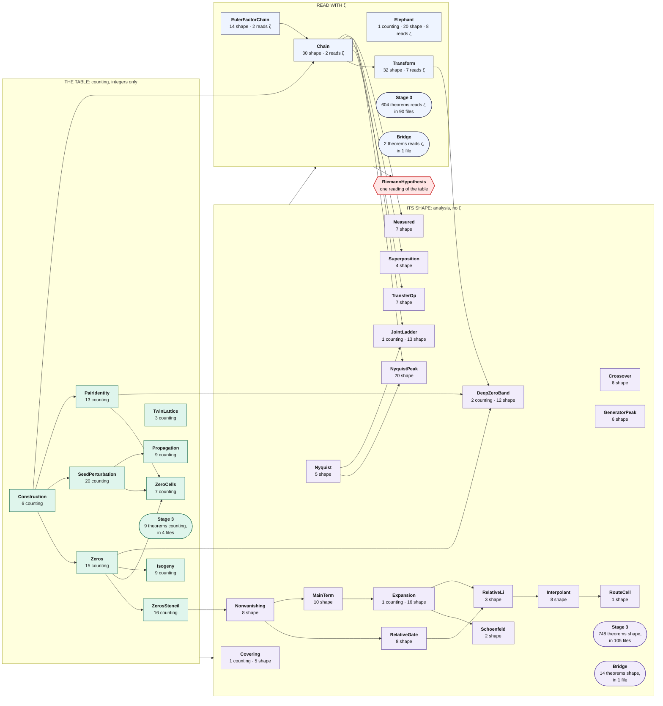

# The table first

The table is the number line's own rate of change, counted at the doublings: how many primes each doubling adds, how that changes from one doubling to the next, and the change of the change. Nothing else goes in. Everything else in the three trees is built on it or is a reading of it.

Three layers, decided by Lean's record of each proof and everything beneath it (`utilities/lean_dump/Dump.lean` holds the lists; the test errs upward):

- **Counting** (green), 113 theorems. Integers only. No analysis and no ζ anywhere in the statement, the proof, or anything they rest on.
- **Shape** (violet), 999 theorems. Real or complex analysis, with no ζ: the symbol of the difference, the modes, the size of the smooth part.
- **Reads ζ** (blue), 625 theorems. The zeta function, its zeros, or the Riemann hypothesis enter, in it or beneath it.

A file sits in the highest layer any of its theorems reaches; its box says how many of each it holds. Arrows between files are imports, indirect ones left out.

| tree | counting | shape | reads ζ |
|---|---|---|---|
| `lean/` | 104 | 237 | 19 |
| `lean_stage3/` | 9 | 748 | 604 |
| `lean_bridge/` | 0 | 14 | 2 |

## Every counting theorem

The ground floor: what is proved about the table with integers alone.

### [`Construction`](./lean/Construction.md) — 6

Construction — the table has no free parameter, so the zeros were not placed. `Zeros.lean` records that nothing predicts WHERE the four exact zeros are. That is true and stays true. This file proves the complementary thing, which is what makes them structural rather than arbitrary:

- [`Construction.tableFrom_isTableOf`](./lean/Construction.md#Construction-tableFrom_isTableOf) — `` IsTableOf N (tableFrom N) `` `tableFrom` satisfies its own recurrence.
- [`Construction.unique_of_isTableOf`](./lean/Construction.md#Construction-unique_of_isTableOf) — `` ∀ r d, f r d = tableFrom N r d `` Uniqueness. Any function satisfying the recurrence with the same depth-0 row IS the table. There is no choice at any cell — fix the row and the entire table, to every depth, is determined.
- [`Construction.eq_of_same_row`](./lean/Construction.md#Construction-eq_of_same_row) — `` ∀ r d, f r d = g r d `` Two tables over the same row agree everywhere.
- [`Construction.zero_determined_by_row`](./lean/Construction.md#Construction-zero_determined_by_row) — `` tableFrom N r d = tableFrom M r d `` A zero is determined by the row. If two counting functions agree on the window a cell reads, that cell is the same for both — in particular one vanishes exactly when the other does. Nothing outside the window can move it, and nothing inside the construction c
- [`Construction.tableFrom_add`](./lean/Construction.md#Construction-tableFrom_add) — `` tableFrom (fun x => N x + M x) r d = tableFrom N r d + tableFrom M r d `` Differencing is linear, at every depth. The operator carries no parameter to tune — this is what forces Pascal's weights rather than selecting them.
- [`Construction.tableFrom_smul`](./lean/Construction.md#Construction-tableFrom_smul) — `` tableFrom (fun x => c * N x) r d = c * tableFrom N r d `` Scalars pass through the table: the table of `c·N` is `c` times the table of `N`. The other half of linearity, beside `tableFrom_add`.

### [`Covering`](./lean/Covering.md) — 1

Covering — why 25 of 36 primes contribute, and why the set skips 13. THE MEASUREMENT (results/O37_weil_form_on_stencil_run1.log): with b = 2, N = 7, W = 0.05, K = 2, the mollified Weil form has 36 primes inside its support and exactly 25 contribute:

- [`Covering.bench_selects`](./lean/Covering.md#Covering-bench_selects) — `` measured_contributing < measured_in_support `` And it does select: 25 of 36, not all.

### [`DeepZeroBand`](./lean/DeepZeroBand.md) — 2

DeepZeroBand — the deep zero, inverted, and the band between the two. Joins three things already in this tree:

- [`DeepZeroBand.composite_cell_20_6`](./lean/DeepZeroBand.md#DeepZeroBand-composite_cell_20_6) — `` tableFrom compRow 20 6 = 8192 `` The inverse of the deep zero. The composite cell at (20,6) is the whole total, `2^13`, computed.
- [`DeepZeroBand.deep_cell_15_6`](./lean/DeepZeroBand.md#DeepZeroBand-deep_cell_15_6) — `` tableFrom Zeros.dyadicRow 15 6 = -112 `` A differenced cell can be negative: (15,6) is `−112`, computed.

### [`Elephant`](./lean/Elephant.md) — 1

# Elephant.lean — the one object, derived from nothing Standalone. This file imports Mathlib and imports no module of this development. It defines

- [`Elephant.primeTable_eq_stencil`](./lean/Elephant.md#Elephant-primeTable_eq_stencil) — `` ((fwdDiff (1 : ℕ))^[d] (primeRow b)) r = ∑ k ∈ Finset.range (d + 1), ((-1 : ℤ) ^ (d - k) * d.choose k) • primeRow b (r + k • 1) `` The `d`-fold forward difference of the prime row `n ↦ π(bⁿ)` at `r` equals the alternating binomial stencil `∑ k ≤ d, (−1)^(d−k)·C(d,k)·π(b^(r+k))`.

### [`Expansion`](./lean/Expansion.md) — 1

Expansion — stage 2b: the derivative of 2^x/x, explicitly, and its floor. `MainTerm.lean` reduced O67's main-term hypothesis to `hD`: a floor on the `(d+1)`-th derivative of the li-interpolant on the window — equivalently, on the `d`-th derivative of `2^x/x`. This module supplies both halves:

- [`Expansion.choose_factorial_step`](./lean/Expansion.md#Expansion-choose_factorial_step) — `` d.choose (j + 1) * (j + 1).factorial = d.choose j * j.factorial * (d - j) `` The choose-ratio identity, in ℕ where it is clean: `C(d,j+1)·(j+1)! = C(d,j)·j!·(d−j)`.

### [`Isogeny`](./lean/Isogeny.md) — 9

Isogeny — what the isogeny does to the row. `Transform.tau_ratio_of_meet` proves that two ladders which meet have rationally related modular parameters: `bⁿ = cᵐ → τ(b)/τ(c) = n/m`. That is a statement about the tori `ℂ*/b^ℤ`, and the torus knows only `b`. No prime enters it.

- [`Isogeny.rowOf_eq_rowN`](./lean/Isogeny.md#Isogeny-rowOf_eq_rowN) — `` rowOf P b r = rowN (fun n => P (b ^ n)) 1 r `` The bridge: composing `P` with `b^·` turns one into the other.
- [`Isogeny.telescope`](./lean/Isogeny.md#Isogeny-telescope) — `` ∑ j ∈ range k, (g (m + j + 1) - g (m + j)) = g (m + k) - g m `` Telescoping over `Finset.range`. Stated for an arbitrary `g : ℕ → ℤ` because that is all the identity below needs.
- [`Isogeny.rowN_eq_blockSum`](./lean/Isogeny.md#Isogeny-rowN_eq_blockSum) — `` rowN Q k r = ∑ j ∈ range k, rowN Q 1 (k * r + j) `` The isogeny on the row. Passing from a ladder to its `k`-th power sums the row in blocks of `k`. Holds for any `Q`; no arithmetic input is used.
- [`Isogeny.row_two_eq_pair`](./lean/Isogeny.md#Isogeny-row_two_eq_pair) — `` rowN Q 2 r = rowN Q 1 (2 * r) + rowN Q 1 (2 * r + 1) `` Base 4's row is base 2's row summed in pairs.
- [`Isogeny.row_three_eq_triple`](./lean/Isogeny.md#Isogeny-row_three_eq_triple) — `` rowN Q 3 r = rowN Q 1 (3 * r) + rowN Q 1 (3 * r + 1) + rowN Q 1 (3 * r + 2) `` Base 8's row is base 2's row summed in triples.
- [`Isogeny.rowN_comp`](./lean/Isogeny.md#Isogeny-rowN_comp) — `` rowN Q (k * l) r = rowN (fun n => Q (k * n)) l r `` Decimation composes. Reading a ladder at `k` and then at `l` is reading it at `k*l` — so `{2,4,8}` is a chain and not three separate relations.
- [`Isogeny.dyadicRow_eq_rowN`](./lean/Isogeny.md#Isogeny-dyadicRow_eq_rowN) — `` Zeros.dyadicRow ((r : ℤ) + 1) = rowN Zeros.pi2 1 r `` The weld to the measured row. `Zeros.dyadicRow` indexes from the top over `ℤ` and is windowed to `1 ≤ r ≤ 20`; inside that window it is `rowN Zeros.pi2 1` shifted by one.
- [`Isogeny.measured_row_four`](./lean/Isogeny.md#Isogeny-measured_row_four) — `` (List.range 10).map (rowN Zeros.pi2 2) = [2, 4, 12, 36, 118, 392, 1336, 4642, 16458, 59025] `` The measured base-4 row, from the 21 pinned values and nothing else. These are the numbers `row_two_eq_pair` says are base 2's row summed in pairs.
- [`Isogeny.measured_row_eight`](./lean/Isogeny.md#Isogeny-measured_row_eight) — `` (List.range 6).map (rowN Zeros.pi2 3) = [4, 14, 79, 467, 2948, 19488] `` The measured base-8 row, same 21 values read at decimation 3.

### [`JointLadder`](./lean/JointLadder.md) — 1

JointLadder — the joint `{2^m 3^n}` grid has NO aliases, and its difference operator carries two Euler factors.

- [`JointLadder.two_pow_ne_three_pow`](./lean/JointLadder.md#JointLadder-two_pow_ne_three_pow) — `` (2 : ℕ) ^ l ≠ 3 ^ k `` Parity kills it. A positive power of two is never a power of three: `2 ∣ 2^l` while `2 ∤ 3^k`.

### [`PairIdentity`](./lean/PairIdentity.md) — 13

PairIdentity — the complementary pair, and why base two is singular. Encodes statement **I1** of `papers/Euler-Factor-Chain.md` § I ("The complementary pair"):

- [`PairIdentity.backward_difference_pow`](./lean/PairIdentity.md#PairIdentity-backward_difference_pow) — `` b ^ (r + 1) - b ^ r = (b - 1) * b ^ r `` The same step inside ℤ, where the table lives: `(1 − b⁻¹)·b^(r) = (b−1)·b^(r−1)`. One backward difference of a geometric row multiplies it by `b − 1` and drops the exponent by one.
- [`PairIdentity.tableFrom_of_geometric`](./lean/PairIdentity.md#PairIdentity-tableFrom_of_geometric) — `` tableFrom G r d = (b - 1) ^ d * G (r - d) `` The collapse. If the row steps by `b` across the window a cell reads, then `d` backward differences leave `(b−1)^d` times the bottom entry of that window. Iterating `backward_difference_pow`; the whole index difficulty is that each difference moves the window
- [`PairIdentity.tableFrom_add_window`](./lean/PairIdentity.md#PairIdentity-tableFrom_add_window) — `` tableFrom P r d + tableFrom C r d = tableFrom T r d `` Linearity, localised. If two rows partition a third across the window a cell reads, the two tables sum to the third table at that cell. `Construction.tableFrom_add` gives that the table of a sum is the sum of tables; `Construction.zero_determined_by_row` give
- [`PairIdentity.pair_identity`](./lean/PairIdentity.md#PairIdentity-pair_identity) — `` tableFrom P r d + tableFrom C r d = (b - 1) ^ (d + 1) * b ^ e `` I1, the pair identity. Let `P` and `C` be any two rows that partition each rung: at rung `r − k` the two counts sum to `(b−1)·b^(r−k−1)`, the number of integers the rung holds. Then at every cell the differenced arms sum to
- [`PairIdentity.composite_of_prime_zero`](./lean/PairIdentity.md#PairIdentity-composite_of_prime_zero) — `` tableFrom C r d = (b - 1) ^ (d + 1) * b ^ e `` I5, the pole. Where the prime arm vanishes the composite arm carries the whole total — it has nowhere else to go. This is the identity read at a zero, and it is the only sense in which a zero says anything about the composite side.
- [`PairIdentity.coeff_eq_one_iff_base_two`](./lean/PairIdentity.md#PairIdentity-coeff_eq_one_iff_base_two) — `` (b - 1) ^ (d + 1) = 1 ↔ b = 2 `` The corollary. For integer `b ≥ 2`, the coefficient `(b−1)^(d+1)` is `1` exactly when `b = 2`. Every other base carries a factor strictly greater than one, at every depth.
- [`PairIdentity.total_eq_pow_iff_base_two`](./lean/PairIdentity.md#PairIdentity-total_eq_pow_iff_base_two) — `` (b - 1) ^ (d + 1) * b ^ e = b ^ e ↔ b = 2 `` The corollary, in the identity's own terms. The cell total is a bare power of the base — no `(b−1)` factor anywhere — exactly in base two. So base two is the only grid on which a vanished prime arm leaves the composite arm sitting on a power of the base itsel
- [`PairIdentity.base_three_carries_factor`](./lean/PairIdentity.md#PairIdentity-base_three_carries_factor) — `` ((3 : ℤ) - 1) ^ (d + 1) * 3 ^ e = 2 ^ (d + 1) * 3 ^ e `` Base three does carry the factor: the total at `(r,d)` is `2^(d+1)·3^(r−1−d)`, never a bare power of three.
- [`PairIdentity.base_four_carries_factor`](./lean/PairIdentity.md#PairIdentity-base_four_carries_factor) — `` ((4 : ℤ) - 1) ^ (d + 1) * 4 ^ e = 3 ^ (d + 1) * 4 ^ e `` Base four likewise: `3^(d+1)·4^(r−1−d)`.
- [`PairIdentity.exponent_const_on_diagonal`](./lean/PairIdentity.md#PairIdentity-exponent_const_on_diagonal) — `` e₁ = e₂ `` Along a diagonal the pair identity's exponent is fixed. `hdiag` is `r − d` constant; `h₁` and `h₂` are the index convention, which pins `e = r − 1 − d`.
- [`PairIdentity.total_const_on_diagonal`](./lean/PairIdentity.md#PairIdentity-total_const_on_diagonal) — `` (∀ d₁ d₂ : ℕ, (b - 1) ^ (d₁ + 1) * b ^ e = (b - 1) ^ (d₂ + 1) * b ^ e) ↔ b = 2 `` The diagonal is the trend's own level set, and only at `b = 2`. Fix a diagonal — equivalently, fix `e` — and ask whether the cell total is the same at every depth along it. It is, exactly in base two.
- [`PairIdentity.measured_composite_matches_pair_identity`](./lean/PairIdentity.md#PairIdentity-measured_composite_matches_pair_identity) — `` zero_cells.map (fun c => ((2 : ℤ) - 1) ^ (c.2 + 1) * 2 ^ (c.1 - 1 - c.2)) = measured_composite_at_zeros `` The falsifier. Evaluating `(b−1)^(d+1)·b^(r−1−d)` at `b = 2` and the four measured zero cells reproduces the measured composite arm exactly. The formula is derived above from the partition alone; the four values were measured. They agree.
- [`PairIdentity.composite_at_zero_20_6`](./lean/PairIdentity.md#PairIdentity-composite_at_zero_20_6) — `` tableFrom C 20 6 = 8192 `` The deep zero, stated through the identity rather than through arithmetic. Given that the prime arm vanishes at `(20,6)` — which is measured, not proved — the partition forces the composite arm to be `8192`, which is what § E2 records.

### [`Propagation`](./lean/Propagation.md) — 9

Propagation — the recurrence as transport: the light cone, and the propagator. `papers/Depth-as-Time.md` reads depth as time. Take that literally: with `d` as time and `r` as space, the recurrence

- [`Propagation.pasc_zero`](./lean/Propagation.md#Propagation-pasc_zero) — `` pasc n 0 = 1 `` The left edge of the triangle is all ones.
- [`Propagation.pasc_succ`](./lean/Propagation.md#Propagation-pasc_succ) — `` pasc (n + 1) (k + 1) = pasc n k + pasc n (k + 1) `` Pascal's identity — definitional, because `pasc` is defined by it.
- [`Propagation.pasc_eq_zero`](./lean/Propagation.md#Propagation-pasc_eq_zero) — `` pasc n k = 0 `` Above the diagonal the binomial vanishes.
- [`Propagation.pasc_pos`](./lean/Propagation.md#Propagation-pasc_pos) — `` 0 < pasc n k `` On and below the diagonal it is positive — this is what "no lacunae" rests on: the propagator never vanishes inside its cone.
- [`Propagation.outside_cone_zero`](./lean/Propagation.md#Propagation-outside_cone_zero) — `` tableFrom (deltaRow s) r d = 0 `` Outside the forward cone, nothing. A source at `s` does not reach a cell whose window `[r−d, r]` misses `s` — the range of influence is bounded by speed 1. Downstream (`r < s`) and past the cone's left edge (`s < r−d`) the cell is zero.
- [`Propagation.propagator`](./lean/Propagation.md#Propagation-propagator) — `` tableFrom (deltaRow s) (s + (k : ℤ)) d = (-1) ^ k * pasc d k `` Inside the cone, the propagator. At offset `k ≤ d` from the source the cell is exactly `(−1)^k · C(d,k)`: the Green's function of the evolution is the alternating binomial row — the stencil, read as a propagator.
- [`Propagation.neg_one_pow`](./lean/Propagation.md#Propagation-neg_one_pow) — `` ((-1 : ℤ)) ^ m = 1 ∨ ((-1 : ℤ)) ^ m = -1 `` `(−1)^m` is `1` or `−1`. Stated here because core carries no pow lemmas.
- [`Propagation.cone_filled`](./lean/Propagation.md#Propagation-cone_filled) — `` tableFrom (deltaRow s) (s + (k : ℤ)) d ≠ 0 `` No lacunae. Strictly inside the forward cone the disturbance is felt at EVERY cell — the propagator never vanishes there. Discrete 1+1 transport fills its cone, where the 3+1 wave equation would leave the interior silent.
- [`Propagation.flux_form`](./lean/Propagation.md#Propagation-flux_form) — `` tableFrom N r (d + 1) + tableFrom N (r - 1) d = tableFrom N r d `` The flux form. The recurrence rearranged as a conservation step: what the cell holds at time `d+1` plus what flowed left is what it held at `d`. Definitional — recorded so the transport reading has its conservation law stated. The interval form (a sum at time

### [`SeedPerturbation`](./lean/SeedPerturbation.md) — 20

SeedPerturbation — changing the seed convention cannot reach a deep cell. THE QUESTION. The dyadic tables in `imported/lattice_mapper/` are built on a seed convention: the primes 2 and 3 are treated as lattice rather than counted as primes. That is a choice. If a different choice moved the zeros, the zeros would be artefacts of bookkeeping. So: which cells can a change of convention reach?

- [`SeedPerturbation.tableFrom_zero`](./lean/SeedPerturbation.md#SeedPerturbation-tableFrom_zero) — `` tableFrom (fun _ : ℤ => (0 : ℤ)) r d = 0 `` The zero row builds the zero table.
- [`SeedPerturbation.tableFrom_sub`](./lean/SeedPerturbation.md#SeedPerturbation-tableFrom_sub) — `` tableFrom (fun x => N x - e x) r d = tableFrom N r d - tableFrom e r d `` Linearity, in the form the convention change needs. Replacing the depth-0 row `N` by `N − e` subtracts `tableFrom e` from every cell of the table, at every depth.
- [`SeedPerturbation.tableFrom_eq_zero_of_vanishing_above`](./lean/SeedPerturbation.md#SeedPerturbation-tableFrom_eq_zero_of_vanishing_above) — `` tableFrom e r d = 0 `` The excess table vanishes past the excess. If `e` is zero on every rung strictly above `R`, then every cell whose window bottom `r − d` clears `R` reads only zeros, so the cell is zero.
- [`SeedPerturbation.cell_eq_of_seed_perturbation`](./lean/SeedPerturbation.md#SeedPerturbation-cell_eq_of_seed_perturbation) — `` tableFrom (fun x => N x - e x) r d = tableFrom N r d `` The claim. Changing the seed convention replaces the depth-0 row `N` by `N − e`. If `e` vanishes on every rung strictly above `R`, then every cell at `(r,d)` with `r − d > R` is IDENTICAL under both conventions.
- [`SeedPerturbation.zero_stable_of_seed_perturbation`](./lean/SeedPerturbation.md#SeedPerturbation-zero_stable_of_seed_perturbation) — `` tableFrom (fun x => N x - e x) r d = 0 `` The corollary. A zero at `(r,d)` with `r − d > R` is a zero under both conventions. The seed convention cannot have put it there and cannot take it away.
- [`SeedPerturbation.zero_iff_of_seed_perturbation`](./lean/SeedPerturbation.md#SeedPerturbation-zero_iff_of_seed_perturbation) — `` tableFrom (fun x => N x - e x) r d = 0 ↔ tableFrom N r d = 0 `` The same statement as an equivalence, which is the honest form: past the excess, the two conventions have the same zero set. Neither direction is a weaker claim than the other.
- [`SeedPerturbation.tableFrom_at_boundary`](./lean/SeedPerturbation.md#SeedPerturbation-tableFrom_at_boundary) — `` tableFrom e r d = (-1) ^ d * e R `` The boundary cell, exactly. When the window bottom sits on `R` itself, `d` backward differences leave `(−1)^d · e R` — the whole excess, signed. Every higher entry of the window is already zero, so the bottom entry is all there is.
- [`SeedPerturbation.boundary_can_move`](./lean/SeedPerturbation.md#SeedPerturbation-boundary_can_move) — `` tableFrom e r d ≠ 0 `` `r − d > R` cannot be relaxed to `r − d ≥ R`. Take `R` to be the largest rung where `e` is non-zero, which is what `R_e` means. Then every cell with `r − d = R` moves, by exactly `±e R`. The strict inequality is not slack in the proof; it is the boundary.
- [`SeedPerturbation.cell_ne_at_boundary`](./lean/SeedPerturbation.md#SeedPerturbation-cell_ne_at_boundary) — `` tableFrom (fun x => N x - e x) r d ≠ tableFrom N r d `` The same fact said about the two conventions rather than about `e`: at the boundary the cell genuinely differs.
- [`SeedPerturbation.window_bottoms_correct`](./lean/SeedPerturbation.md#SeedPerturbation-window_bottoms_correct) — `` zero_cells.map (fun c => (c.1 : ℤ) - (c.2 : ℤ)) = zero_window_bottoms `` The window bottoms `r − d` of the four zeros are `1, 3, 5, 14`, computed rather than transcribed.
- [`SeedPerturbation.protected_at_R_two`](./lean/SeedPerturbation.md#SeedPerturbation-protected_at_R_two) — `` zero_cells.map (fun c => decide (2 < (c.1 : ℤ) - (c.2 : ℤ))) = [false, true, true, true] `` Which zeros the theorem protects when 2 and 3 are the excluded primes. `R_e = 2`, so `(2,1)` is unprotected and the other three are fixed. This is the prediction, stated before looking at any perturbed table.
- [`SeedPerturbation.protected_at_R_three`](./lean/SeedPerturbation.md#SeedPerturbation-protected_at_R_three) — `` zero_cells.map (fun c => decide (3 < (c.1 : ℤ) - (c.2 : ℤ))) = [false, false, true, true] `` And when the excess reaches rung 3 — which `silence46` does, since 6 sits in `(4,8]`. Now `(4,1)` falls to the boundary as well.
- [`SeedPerturbation.silence46_vanishes_above_three`](./lean/SeedPerturbation.md#SeedPerturbation-silence46_vanishes_above_three) — `` ∀ s : ℤ, 3 < s → silence46_excess s = 0 `` The `silence46` excess is confined to rungs 2 and 3 — the hypothesis `cell_eq_of_seed_perturbation` needs, at `R_e = 3`.
- [`SeedPerturbation.silence46_alive_at_three`](./lean/SeedPerturbation.md#SeedPerturbation-silence46_alive_at_three) — `` silence46_excess 3 ≠ 0 `` And rung 3 genuinely carries excess, so `boundary_can_move` has its `e R ≠ 0`.
- [`SeedPerturbation.measured_silence46_matches_shift`](./lean/SeedPerturbation.md#SeedPerturbation-measured_silence46_matches_shift) — `` [4 - tableFrom silence46_excess 4 1, 16 - tableFrom silence46_excess 8 3, 8192 - tableFrom silence46_excess 20 6] = measured_composite_silence46 `` The falsifier. Subtracting `tableFrom silence46_excess` from the three measured base cells reproduces the three measured silenced cells exactly — including the one that MOVED. `(4,1)` sits at `r − d = 3 = R_e`, and the shift `tableFrom e 4 1 = −1` carries 4 t
- [`SeedPerturbation.silence46_deep_cells_fixed`](./lean/SeedPerturbation.md#SeedPerturbation-silence46_deep_cells_fixed) — `` tableFrom (fun x => N x - silence46_excess x) 8 3 = tableFrom N 8 3 ∧ tableFrom (fun x => N x - silence46_excess x) 20 6 = tableFrom N 20 6 `` The two deep cells are protected by the theorem, not by arithmetic luck: `8 − 3 = 5 > 3` and `20 − 6 = 14 > 3`, so `cell_eq_of_seed_perturbation` applies and no computation is needed.
- [`SeedPerturbation.silence46_cell_4_1_moves`](./lean/SeedPerturbation.md#SeedPerturbation-silence46_cell_4_1_moves) — `` tableFrom (fun x => N x - silence46_excess x) 4 1 ≠ tableFrom N 4 1 `` And `(4,1)` is not protected, for the reason the theorem gives rather than by inspection: `4 − 1 = 3 = R_e`, so `boundary_can_move` fires.
- [`SeedPerturbation.emptied_vanishes_above_two`](./lean/SeedPerturbation.md#SeedPerturbation-emptied_vanishes_above_two) — `` ∀ s : ℤ, 2 < s → emptied_excess s = 0 `` The emptied variant's excess is confined to rungs 1 and 2 — `R_e = 2`, the same profile as excluding the primes 2 and 3.
- [`SeedPerturbation.measured_emptied_matches_shift`](./lean/SeedPerturbation.md#SeedPerturbation-measured_emptied_matches_shift) — `` [1 - tableFrom emptied_excess 2 1, 4 - tableFrom emptied_excess 4 1, 16 - tableFrom emptied_excess 8 3, 8192 - tableFrom emptied_excess 20 6] = measur… `` The second falsifier, at `R_e = 2`. The three cells the theorem protects are unmoved in the file, and the one it does not protect — `(2,1)`, window bottom `1` — moved from 1 to 0, by exactly the predicted shift `tableFrom e 2 1 = e 2 − e 1 = 1`.
- [`SeedPerturbation.emptied_protected_cells_fixed`](./lean/SeedPerturbation.md#SeedPerturbation-emptied_protected_cells_fixed) — `` tableFrom (fun x => N x - emptied_excess x) 4 1 = tableFrom N 4 1 ∧ tableFrom (fun x => N x - emptied_excess x) 8 3 = tableFrom N 8 3 ∧ tableFrom (fun… `` The three protected cells, again by theorem rather than by computation: `4 − 1 = 3 > 2`, `8 − 3 = 5 > 2`, `20 − 6 = 14 > 2`.

### [`TwinLattice`](./lean/TwinLattice.md) — 3

TwinLattice — a twin pair is a lattice site, not a coincidence of spacing. Every twin pair above 3 is `(6k − 1, 6k + 1)`. The single integer between them is `6k`. So a twin pair is not two primes that happen to sit two apart: it is a site on the `2·3` lattice with primes on both shoulders, and counting twins is counting doubly-flanked lattice sites.

- [`TwinLattice.twin_lower_mod_six`](./lean/TwinLattice.md#TwinLattice-twin_lower_mod_six) — `` p % 6 = 5 `` The lattice. Every twin pair above 3 has its lower member at `6k − 1`. `3 < p` is not decoration: `(3,5)` is the one exception, and `three_five_exceptional` below exhibits it rather than leaving it implied.
- [`TwinLattice.twin_pocket`](./lean/TwinLattice.md#TwinLattice-twin_pocket) — `` (p + 1) % 6 = 0 `` The pocket. The single integer between a twin pair is a multiple of 6. That is the site; the pair is what is attached to it.
- [`TwinLattice.three_five_exceptional`](./lean/TwinLattice.md#TwinLattice-three_five_exceptional) — `` (3 : ℕ).Prime ∧ (5 : ℕ).Prime ∧ (3 + 1) % 6 ≠ 0 `` `(3,5)` is the exception, exhibited rather than assumed. Its pocket is 4, which is not on the lattice. It is also the first twin pair, so the lattice reading begins at `(5,7)`.

### [`ZeroCells`](./lean/ZeroCells.md) — 7

ZeroCells — the four zeros are one object with four names, and the kernel now says so.

- [`ZeroCells.construction_eq`](./lean/ZeroCells.md#ZeroCells-construction_eq) — `` Construction.measured_zeros = Zeros.measured_zeros `` The construction module's list is the computed one. `rfl`, and that is what makes it a check: edit either list and this stops compiling.
- [`ZeroCells.seedPerturbation_eq`](./lean/ZeroCells.md#ZeroCells-seedPerturbation_eq) — `` SeedPerturbation.zero_cells = Zeros.measured_zeros `` The seed-perturbation module's list is the computed one. It was re-read independently from `imported/lattice_mapper/32bit/dyadic_difference_table_32.csv`, so this equality is also a statement that the imported table and `pi2n_cache` agree at those four cells.
- [`ZeroCells.pairIdentity_eq`](./lean/ZeroCells.md#ZeroCells-pairIdentity_eq) — `` PairIdentity.zero_cells = Zeros.measured_zeros `` The pair-identity module's list is the computed one.
- [`ZeroCells.construction_all_vanish`](./lean/ZeroCells.md#ZeroCells-construction_all_vanish) — `` ∀ c ∈ Construction.measured_zeros, Construction.tableFrom Zeros.dyadicRow (c.1 : ℤ) c.2 = 0 `` Every cell `Construction.measured_zeros` names vanishes — now derived, not transcribed.
- [`ZeroCells.seedPerturbation_all_vanish`](./lean/ZeroCells.md#ZeroCells-seedPerturbation_all_vanish) — `` ∀ c ∈ SeedPerturbation.zero_cells, Construction.tableFrom Zeros.dyadicRow (c.1 : ℤ) c.2 = 0 `` Every cell `SeedPerturbation.zero_cells` names vanishes.
- [`ZeroCells.pairIdentity_all_vanish`](./lean/ZeroCells.md#ZeroCells-pairIdentity_all_vanish) — `` ∀ c ∈ PairIdentity.zero_cells, Construction.tableFrom Zeros.dyadicRow (c.1 : ℤ) c.2 = 0 `` Every cell `PairIdentity.zero_cells` names vanishes.
- [`ZeroCells.all_four_have_length_four`](./lean/ZeroCells.md#ZeroCells-all_four_have_length_four) — `` Construction.measured_zeros.length = 4 ∧ SeedPerturbation.zero_cells.length = 4 ∧ PairIdentity.zero_cells.length = 4 ∧ Zeros.measured_zeros.length = 4 `` All four names, one length. The "exactly four" of the papers is now a property of a single object rather than of four lists that happen to agree.

### [`Zeros`](./lean/Zeros.md) — 15

Zeros — what is provable about the four exact zeros, and what is not. THE MEASUREMENT (results/O16_run2.log): over r <= 62, d <= 61 the dyadic prime difference table has exactly four exact zeros — (2,1), (4,1), (8,3), (20,6) — and no others. The centered table has none at all.

- [`Zeros.tableFrom_isTable`](./lean/Zeros.md#Zeros-tableFrom_isTable) — `` IsTable (Construction.tableFrom N) `` The bench's table is one. The hypothesis of `zero_iff_repeat` now has a witness: it is the second conjunct of `Construction.tableFrom_isTableOf`, which itself depends on no axioms.
- [`Zeros.zero_iff_repeat`](./lean/Zeros.md#Zeros-zero_iff_repeat) — `` f r (d + 1) = 0 ↔ f r d = f (r - 1) d `` A zero is exactly a repeat one depth up. This is definitional, and it is the only characterisation of a zero the chain supplies.
- [`Zeros.neg_below_zero`](./lean/Zeros.md#Zeros-neg_below_zero) — `` Construction.tableFrom N r (d + 1) = -Construction.tableFrom N (r - 1) d `` A zero puts its left neighbour, negated, directly beneath it. With the cell above vanishing, the recurrence has nothing to subtract from.
- [`Zeros.pair_shares_diagonal`](./lean/Zeros.md#Zeros-pair_shares_diagonal) — `` (r - 1) - (d : ℤ) = r - ((d + 1 : ℕ) : ℤ) `` And those two cells share a diagonal. The left neighbour sits at `(r-1, d)` and the copy at `(r, d+1)`, and `r - d` is the same for both. So every zero places a `±v` pair as adjacent cells on the diagonal one in -- `±343` at `(20,6)`, `±5` at `(8,3)`, both me
- [`Zeros.window_shared_of_composite_exponent`](./lean/Zeros.md#Zeros-window_shared_of_composite_exponent) — `` (4 : ℕ) ^ 2 = 2 ^ 4 `` The (8,3) window is shared. Depth 3 spans `2^4 = 4^2`, so base 4 reaches it at depth 1. Against `Zeros.window_exclusive_of_prime_exponent`, which puts base 2 alone in the (20,6) window, the two deep zeros are different kinds of object.
- [`Zeros.zero_2_1`](./lean/Zeros.md#Zeros-zero_2_1) — `` Construction.tableFrom dyadicRow 2 1 = 0 `` `(2,1)` vanishes: `1·1 − 1·1 = 0`, computed by the kernel from `pi2`.
- [`Zeros.zero_4_1`](./lean/Zeros.md#Zeros-zero_4_1) — `` Construction.tableFrom dyadicRow 4 1 = 0 `` `(4,1)` vanishes: `1·2 − 1·2 = 0`.
- [`Zeros.zero_8_3`](./lean/Zeros.md#Zeros-zero_8_3) — `` Construction.tableFrom dyadicRow 8 3 = 0 `` `(8,3)` vanishes: `23 − 3·13 + 3·7 − 5 = 0`, four values of `π`.
- [`Zeros.zero_20_6`](./lean/Zeros.md#Zeros-zero_20_6) — `` Construction.tableFrom dyadicRow 20 6 = 0 `` `(20,6)` vanishes: the depth-6 stencil on seven values of `π`, spanning `2^13` to `2^20`. The deep zero, computed.
- [`Zeros.measured_zeros_all_vanish`](./lean/Zeros.md#Zeros-measured_zeros_all_vanish) — `` ∀ c ∈ measured_zeros, Construction.tableFrom dyadicRow (c.1 : ℤ) c.2 = 0 `` The list's own claim, as a theorem. Every cell `measured_zeros` names vanishes on the dyadic row.
- [`Zeros.nonzero_7_3`](./lean/Zeros.md#Zeros-nonzero_7_3) — `` Construction.tableFrom dyadicRow 7 3 = 5 `` A non-zero neighbour, so the check can fail.
- [`Zeros.nonzero_19_6`](./lean/Zeros.md#Zeros-nonzero_19_6) — `` Construction.tableFrom dyadicRow 19 6 = 343 `` The `+343` of `papers/The-Fold.md` § C3, the partner of the `−343` that a zero at `(20,6)` forces onto `(20,7)`.
- [`Zeros.four_zeros_only`](./lean/Zeros.md#Zeros-four_zeros_only) — `` measured_zeros.length = 4 `` Four zeros in 1953 cells. Recorded, not derived.
- [`Zeros.zero_at_20_6_of_repeat`](./lean/Zeros.md#Zeros-zero_at_20_6_of_repeat) — `` Construction.tableFrom N 20 6 = 0 `` The measured repeat gives the deep zero, through the theorem. `O27` reads `d5` at `r = 19` and `r = 20` as both 623; `zero_iff_repeat` turns that into `(20,6) = 0` without computing anything. The measurement is the input and the vanishing is the output, which
- [`Zeros.zero_at_8_3_of_repeat`](./lean/Zeros.md#Zeros-zero_at_8_3_of_repeat) — `` Construction.tableFrom N 8 3 = 0 `` The same for the other deep zero, where the repeated value is 4.

### [`ZerosStencil`](./lean/ZerosStencil.md) — 16

ZerosStencil — the Mathlib-dependent half of `Zeros.lean`. Split out of `Zeros.lean` on 2026-08-26. The classification is by axiom pin, not by subject: these are exactly the fifteen theorems whose `#print axioms` carries `Classical.choice`, and every one of them acquires it from Mathlib — `Finset.range` and the alternating-sum lemmas for the stencil family, `Nat.factorization` and `Nat.dvd_prime_pow` for the four ladder results. Notes entries 59, 66 and 187 are the record; 66 predicted this exact list two weeks bef…

- [`Zeros.tableFrom_eq_fwdDiff`](./lean/ZerosStencil.md#Zeros-tableFrom_eq_fwdDiff) — `` Construction.tableFrom N r d = (-1 : ℤ) ^ d * (fwdDiff (-1 : ℤ))^[d] N r `` The table's `d`-fold backward difference is `(-1)^d` times Mathlib's `d`-fold forward difference at step `-1`. The bridge exists so that `tableFrom_eq_stencil` can borrow Mathlib's binomial theorem rather than redo the index bookkeeping.
- [`Zeros.tableFrom_eq_stencil`](./lean/ZerosStencil.md#Zeros-tableFrom_eq_stencil) — `` Construction.tableFrom N r d = stencil d (fun k => N (r - k)) `` The operator IS Pascal. The cell at `(r,d)` — `d` backward differences of the row — equals the alternating binomial stencil of order `d` applied to the `d+1` row values in its window.
- [`Zeros.stencil_add`](./lean/ZerosStencil.md#Zeros-stencil_add) — `` stencil N (fun k => g k + h k) = stencil N g + stencil N h `` The stencil is linear in the sampled values. So a zero is a single linear equation on the `N+1` values of `pi` inside its window — one condition, hence codimension one. Nothing here says when it is satisfied.
- [`Zeros.stencil_smul`](./lean/ZerosStencil.md#Zeros-stencil_smul) — `` stencil N (fun k => c * g k) = c * stencil N g `` And scalars pass through — linearity's other half, beside `stencil_add`.
- [`Zeros.stencil_annihilates_const`](./lean/ZerosStencil.md#Zeros-stencil_annihilates_const) — `` stencil N (fun _ => c) = 0 `` The stencil's positive and negative arms carry equal total weight. For `N = 7` each arm sums to 64: the balance is exact by construction, not by anything about the primes.
- [`Zeros.stencil_eq_wings`](./lean/ZerosStencil.md#Zeros-stencil_eq_wings) — `` stencil N g = wingPlus N g - wingMinus N g `` The fold is an identity, not a test. `cell = wing⁺ − wing⁻`, always.
- [`Zeros.stencil_eq_zero_iff_wings`](./lean/ZerosStencil.md#Zeros-stencil_eq_zero_iff_wings) — `` stencil N g = 0 ↔ wingPlus N g = wingMinus N g `` A zero is where the wings balance.
- [`Zeros.tableFrom_eq_zero_iff_wings`](./lean/ZerosStencil.md#Zeros-tableFrom_eq_zero_iff_wings) — `` Construction.tableFrom N r d = 0 ↔ wingPlus d (fun k => N (r - k)) = wingMinus d (fun k => N (r - k)) `` The cell, folded. Through `tableFrom_eq_stencil`: the table's cell at `(r,d)` vanishes exactly when the two wings of its window balance.
- [`Zeros.repeat_iff_wings`](./lean/ZerosStencil.md#Zeros-repeat_iff_wings) — `` Construction.tableFrom N r d = Construction.tableFrom N (r - 1) d ↔ wingPlus (d + 1) (fun k => N (r - k)) = wingMinus (d + 1) (fun k => N (r - k)) `` Two readings of one fact. `zero_iff_repeat` says a cell vanishes iff the row repeats at the depth below. This says it vanishes iff the wings balance. The repeat reading and the fold reading are the same statement, and until now nothing in the tree connected t
- [`Zeros.stencil_weights_antisymm`](./lean/ZerosStencil.md#Zeros-stencil_weights_antisymm) — `` ((-1 : ℤ)) ^ (N - k) * (N.choose (N - k)) = -(((-1 : ℤ)) ^ k * (N.choose k)) `` The stencil is antisymmetric when its order is odd. Reflecting an index about the midpoint negates its weight, because `(N-k) + k = N` is odd and so the two indices have opposite parity.
- [`Zeros.stencil_arms_eq`](./lean/ZerosStencil.md#Zeros-stencil_arms_eq) — `` (∑ k ∈ Finset.range (N + 1), (1 + (-1 : ℤ) ^ k) * (N.choose k)) = ∑ k ∈ Finset.range (N + 1), (1 - (-1 : ℤ) ^ k) * (N.choose k) `` The two arms weigh the same. `stencil_annihilates_const` says the signed weights cancel; written as two sums, that is the positive-index arm equalling the negative-index arm. `(1 + (-1)^k)` is twice the indicator of even `k` and `(1 - (-1)^k)` twice the indic
- [`Zeros.stencil_arm_doubled`](./lean/ZerosStencil.md#Zeros-stencil_arm_doubled) — `` (∑ k ∈ Finset.range (N + 1), (1 + (-1 : ℤ) ^ k) * (N.choose k)) = 2 ^ N `` And each arm is `2^(N-1)`. Doubled, an arm is the whole row, `2^N`. With `stencil_arms_eq` that fixes both at half the row -- 64 and 64 at `N = 7`, 8 and 8 at `N = 4`, which is what `The-Fold.md` § B1 reports.
- [`Zeros.window_exclusive_of_prime_exponent`](./lean/ZerosStencil.md#Zeros-window_exclusive_of_prime_exponent) — `` b = 2 ∧ k = 7 `` The (20,6) window is base-2 exclusive. Depth 6 spans a ratio of `2^7`. Since 7 is prime, no integer base `b >= 2` reaches that window at any integer depth `k >= 2`. Base 2 at depth 6 is the only way to look through it.
- [`Zeros.base_of_meets_two`](./lean/ZerosStencil.md#Zeros-base_of_meets_two) — `` ∃ i, b = 2 ^ i `` Only powers of two reach a dyadic window. If any positive power of `b` equals a power of 2, then `b` is itself a power of 2. So the ladders meeting base 2 are exactly `2, 4, 8, 16, …` and no others -- which is the general form of `window_exclusive_of_prime_ex
- [`Zeros.factorization_proportional`](./lean/ZerosStencil.md#Zeros-factorization_proportional) — `` n * b.factorization p = m * c.factorization p `` Two ladders that meet have proportional exponents. If some power of `b` equals some power of `c`, then at every prime the two exponents stand in the ratio `m : n`. This is the "shared lineage" of `Commensurate-Ladders.md` § A2 in exact form -- not that `b` an
- [`Zeros.primeFactors_eq_of_meets`](./lean/ZerosStencil.md#Zeros-primeFactors_eq_of_meets) — `` b.primeFactors = c.primeFactors `` And they are built from the same primes. Proportionality with both exponents nonzero forces the supports to agree, so ladders that meet are made of one prime set. Bases 2 and 3 meet nowhere above `x = 1` for exactly this reason -- there is no common ancestor 

### [`LeftSmooth`](./lean_stage3/LeftSmooth.md) — 1

LeftSmooth — blocks F2c, F2 and F3 of `lean_stage3/design/leftedge.md`. 2026-11-23.

- [`LeftSmooth.dgTerm_nonneg`](./lean_stage3/LeftSmooth.md#LeftSmooth-dgTerm_nonneg) — `` 0 ≤ dgTerm n `` Each weight `1/((n+1)(n+5/4))` is nonnegative.

### [`Mollified`](./lean_stage3/Mollified.md) — 5

Mollified — block C2 of `lean_stage3/design/carlson.md`. 2026-11-23. The product of the finite sum `P_N(s) = Σ_{n ≤ N} n^{-s}` with the short Möbius sum `M_X(s) = Σ_{d < X} μ(d)·d^{-s}` is a finite Dirichlet sum `Σ_n c_n·n^{-s}` with `c_n = Σ_{d | n, d < X, n/d ≤ N} μ(d)`. For `1 < n < X`, `n ≤ N` the coefficient vanishes and `c_1 = 1`. Each `|c_n|` is at most the number of divisors of `n` below `X`. The square of that count is at most the number of triples `(g, a, b)` below `X` with `g·a·b | n` (send a pair of div…

- [`Mollified.coef_one`](./lean_stage3/Mollified.md#Mollified-coef_one) — `` coef X N 1 = 1 `` The coefficient of `1^(−s)` is `1` once `1 < X` and `1 ≤ N`.
- [`Mollified.coef_eq_zero`](./lean_stage3/Mollified.md#Mollified-coef_eq_zero) — `` coef X N n = 0 `` For `1 < n < X` with `n ≤ N` every divisor of `n` is allowed, so the coefficient is the full Möbius divisor sum, which is `0`.
- [`Mollified.abs_coef_le`](./lean_stage3/Mollified.md#Mollified-abs_coef_le) — `` |coef X N n| ≤ tauBelow X n `` The coefficient is at most the number of divisors of `n` below `X` in absolute value.
- [`Mollified.card_Icc_dvd`](./lean_stage3/Mollified.md#Mollified-card_Icc_dvd) — `` ((Icc 1 Y).filter (k ∣ ·)).card = Y / k `` Exactly `Y / k` of the naturals in `[1, Y]` are multiples of `k`.
- [`Mollified.tauBelow_sq_le`](./lean_stage3/Mollified.md#Mollified-tauBelow_sq_le) — `` tauBelow X n ^ 2 ≤ ((triples X).filter (fun t => t.1 * t.2.1 * t.2.2 ∣ n)).card `` The square of the number of divisors of `n` below `X` is at most the number of triples `(g, a, b)` in `[1, X)³` with `g·a·b` dividing `n`.

### [`PiFixedRow`](./lean_stage3/PiFixedRow.md) — 2

PiFixedRow — block F4 of `lean_stage3/design/leftedge.md`. 2026-11-23. The integer count at a fixed `x` with the height of the zero sum taken to infinity. `PiZeros.pi_eq_zero_sum` is an identity at every height; what has to be bounded free of the height is `tr (efRem T) x`, the passage of the explicit formula's remainder. Above `16` the explicit formula at every height does it. On `[2, 16]` each zero is integrated by parts in `t`, which gains a factor `1/|ρ+1|`, and the zeros weighted by `m/|ρ|²` have a sum bounded…

- [`PiFixedRow.sum_sq_div_pow_eq`](./lean_stage3/PiFixedRow.md#PiFixedRow-sum_sq_div_pow_eq) — `` ∑ j ∈ range n, ((2:ℝ) ^ j)⁻¹ * ((j:ℝ) + 2) ^ 2 + (2 * (n:ℝ) ^ 2 + 12 * n + 22) * ((2:ℝ) ^ n)⁻¹ = 22 `` The closed form behind `Σ_j (j+2)²/2^j ≤ 22`: the partial sum plus a vanishing tail is exactly `22`.
- [`PiFixedRow.sum_sq_div_pow_le`](./lean_stage3/PiFixedRow.md#PiFixedRow-sum_sq_div_pow_le) — `` ∑ j ∈ range n, ((2:ℝ) ^ j)⁻¹ * ((j:ℝ) + 2) ^ 2 ≤ 22 `` The partial sums of `(j+2)²/2^j` are at most `22`.

### [`WeilPowerClean`](./lean_stage3/WeilPowerClean.md) — 1

WeilPowerClean — the clean shell. Rung 5, eighteenth slice; worksheet § 13 block 13h. 2026-09-07.

- [`WeilPowerClean.exists_unblocked`](./lean_stage3/WeilPowerClean.md#WeilPowerClean-exists_unblocked) — `` ∃ k, k < K ∧ ∀ j ∈ S, k ∉ B j `` More shells than the members can block leaves one shell in no member's blocking set.

