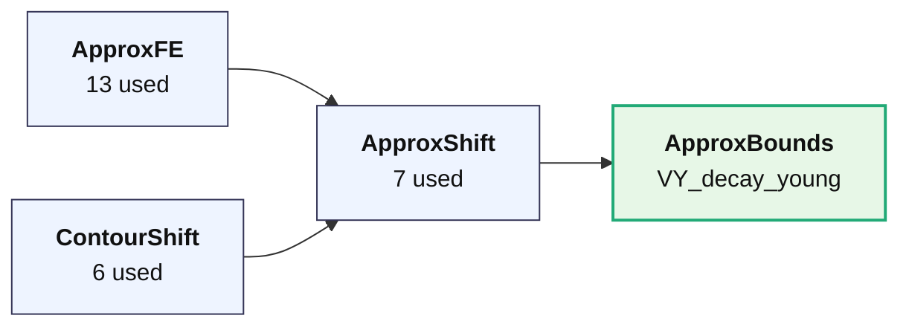

# What `ApproxBounds.VY_decay_young` rests on

[`ApproxBounds.VY_decay_young`](../lean_stage3/ApproxBounds.md#ApproxBounds-VY_decay_young) in `lean_stage3/Stage3/ApproxBounds.lean`, line 1281.

**Why.** Target 3 in Young's form, the `j = 0` case of (4.3) with the direction the integral gives: `‖V_{α,β}(x,t)‖ ≤ C_A (1 + ‖α+β‖^(−2)) (1 + x/t)^(−A)` for every `A > 0`, every `x > 0`, every line `c > 0`, uniformly in `‖α‖, ‖β‖ ≤ 1/10` with `α + β ≠ 0`, `t ≥ 1`. For `x ≤ t` it is the residue `1` plus the line `−1/4` (`VY_residue`); for `x ≥ t`, `VY_decay`.

**Proves**

```lean
∃ C : ℝ, 0 ≤ C ∧ ∀ α β : ℂ, ‖α‖ ≤ 1 / 10 → ‖β‖ ≤ 1 / 10 → α + β ≠ 0 → ∀ t : ℝ, 1 ≤ t → ∀ x : ℝ, 0 < x → ∀ c : ℝ, 0 < c → ‖VY α β c x t‖ ≤ C * (1 + 1 / ‖α + β‖ ^ 2) * (1 + x / t) ^ (-A)
```

**Needs** (its hypotheses)

  - `` hA : 0 < A ``

Behind it: 41 theorems and 10 definitions in 4 files. Every one is listed below; Lean recorded each step.

## The files it passes through



An arrow A → B reads "B uses something proved or defined in A"; indirect arrows are left out. Green: the theorem itself. Yellow: a file in the other tree. The number is how many of that file's declarations are on the way.

## Every declaration on the way

Files in dependency order. ★ marks what the theorem's own proof uses directly.

### [`ApproxFE`](../lean_stage3/ApproxFE.md) — 13

- [`ApproxFE.uA`](../lean_stage3/ApproxFE.md#ApproxFE-uA) — *def*
- [`ApproxFE.vB`](../lean_stage3/ApproxFE.md#ApproxFE-vB) — *def*
- [`ApproxFE.GY`](../lean_stage3/ApproxFE.md#ApproxFE-GY) — *def*
- [`ApproxFE.gY`](../lean_stage3/ApproxFE.md#ApproxFE-gY) — *def*
- [`ApproxFE.KY`](../lean_stage3/ApproxFE.md#ApproxFE-KY) — *def*
- ★ [`ApproxFE.VY`](../lean_stage3/ApproxFE.md#ApproxFE-VY) — *def*
- [`ApproxFE.uA_re`](../lean_stage3/ApproxFE.md#ApproxFE-uA_re) — `` (uA α t).re = 1 / 2 + α.re ``
- [`ApproxFE.vB_re`](../lean_stage3/ApproxFE.md#ApproxFE-vB_re) — `` (vB β t).re = 1 / 2 + β.re ``
- [`ApproxFE.uA_im`](../lean_stage3/ApproxFE.md#ApproxFE-uA_im) — `` (uA α t).im = α.im + t ``
- [`ApproxFE.vB_im`](../lean_stage3/ApproxFE.md#ApproxFE-vB_im) — `` (vB β t).im = β.im - t ``
- [`ApproxFE.KY_differentiableAt`](../lean_stage3/ApproxFE.md#ApproxFE-KY_differentiableAt) — `` DifferentiableAt ℂ (KY α β t) s ``
- [`ApproxFE.GY_zero`](../lean_stage3/ApproxFE.md#ApproxFE-GY_zero) — `` GY α β 0 = 1 ``
- [`ApproxFE.gY_zero`](../lean_stage3/ApproxFE.md#ApproxFE-gY_zero) — `` gY α β t 0 = 1 ``

### [`ContourShift`](../lean_stage3/ContourShift.md) — 6

- [`ContourShift.borderIntegrable_sum_poles`](../lean_stage3/ContourShift.md#ContourShift-borderIntegrable_sum_poles) — `` RectangleBorderIntegrable (fun s ↦ ∑ p ∈ P, A p / (s - p)) z w ``
- [`ContourShift.rectangleIntegral_sum_poles`](../lean_stage3/ContourShift.md#ContourShift-rectangleIntegral_sum_poles) — `` RectangleIntegral' (fun s ↦ ∑ p ∈ P, A p / (s - p)) z w = ∑ p ∈ P, A p ``
- [`ContourShift.residue_rectangle_multi`](../lean_stage3/ContourShift.md#ContourShift-residue_rectangle_multi) — `` RectangleIntegral' f z w = ∑ p ∈ P, A p ``
- [`ContourShift.residue_rectangle_of_local`](../lean_stage3/ContourShift.md#ContourShift-residue_rectangle_of_local) — `` RectangleIntegral' f z w = ∑ p ∈ P, A p ``
- [`ContourShift.analyticAt_dslope`](../lean_stage3/ContourShift.md#ContourShift-analyticAt_dslope) — `` AnalyticAt ℂ (dslope f p) p ``
- [`ContourShift.div_sub_eq_dslope`](../lean_stage3/ContourShift.md#ContourShift-div_sub_eq_dslope) — `` f s / (s - p) = f p / (s - p) + dslope f p s ``

### [`ApproxShift`](../lean_stage3/ApproxShift.md) — 7

- [`ApproxShift.GY_norm_le`](../lean_stage3/ApproxShift.md#ApproxShift-GY_norm_le) — `` ‖GY α β s‖ ≤ Real.exp (c ^ 2 - s.im ^ 2) * ((‖α + β‖ ^ 2 + 4 * c ^ 2 + 4) / ‖α + β‖ ^ 2 * (1 + s.im ^ 2)) ``
- [`ApproxShift.gauss_atTop`](../lean_stage3/ApproxShift.md#ApproxShift-gauss_atTop) — `` Tendsto (fun y : ℝ => Real.exp (-(1 / 2) * y ^ 2)) atTop (𝓝 0) ``
- [`ApproxShift.gauss_atBot`](../lean_stage3/ApproxShift.md#ApproxShift-gauss_atBot) — `` Tendsto (fun y : ℝ => Real.exp (-(1 / 2) * y ^ 2)) atBot (𝓝 0) ``
- [`ApproxShift.GY_analyticAt`](../lean_stage3/ApproxShift.md#ApproxShift-GY_analyticAt) — `` AnalyticAt ℂ (GY α β) p ``
- [`ApproxShift.local_simple`](../lean_stage3/ApproxShift.md#ApproxShift-local_simple) — `` ∃ h : ℂ → ℂ, AnalyticAt ℂ h p ∧ ∀ᶠ s in 𝓝[≠] p, f s = h s + A / (s - p) ``
- [`ApproxShift.rect_mem_nhds`](../lean_stage3/ApproxShift.md#ApproxShift-rect_mem_nhds) — `` Rectangle (↑(-c) - I * ↑T) (↑c + I * ↑T) ∈ 𝓝 p ``
- [`ApproxShift.rect_tendsto`](../lean_stage3/ApproxShift.md#ApproxShift-rect_tendsto) — `` Tendsto (fun T : ℝ => RectangleIntegral f (↑(-c) - I * T) (↑c + I * T)) atTop (𝓝 (VerticalIntegral f c - VerticalIntegral f (-c))) ``

### [`ApproxBounds`](../lean_stage3/ApproxBounds.md) — 25

- [`ApproxBounds.lY`](../lean_stage3/ApproxBounds.md#ApproxBounds-lY) — *def*
- [`ApproxBounds.lY_neg`](../lean_stage3/ApproxBounds.md#ApproxBounds-lY_neg) — `` lY (-Y) = lY Y ``
- [`ApproxBounds.gModel`](../lean_stage3/ApproxBounds.md#ApproxBounds-gModel) — *def*
- [`ApproxBounds.gErr`](../lean_stage3/ApproxBounds.md#ApproxBounds-gErr) — *def*
- [`ApproxBounds.gRModel`](../lean_stage3/ApproxBounds.md#ApproxBounds-gRModel) — *def*
- [`ApproxBounds.gErr_nonneg`](../lean_stage3/ApproxBounds.md#ApproxBounds-gErr_nonneg) — `` 0 ≤ gErr r ``
- [`ApproxBounds.const_bound`](../lean_stage3/ApproxBounds.md#ApproxBounds-const_bound) — `` ∃ K : ℝ, 0 ≤ K ∧ ∀ r : ℝ, lo ≤ r → r ≤ hi → |Real.log (Real.Gamma r)| ≤ K ∧ gErr r ≤ K ``
- [`ApproxBounds.lY_near`](../lean_stage3/ApproxBounds.md#ApproxBounds-lY_near) — `` |lY Y - Real.log (t / 2)| ≤ 3 ``
- [`ApproxBounds.log_div_two_pi`](../lean_stage3/ApproxBounds.md#ApproxBounds-log_div_two_pi) — `` Real.log (t / (2 * Real.pi)) = Real.log (t / 2) - Real.log Real.pi ``
- [`ApproxBounds.lY_lip`](../lean_stage3/ApproxBounds.md#ApproxBounds-lY_lip) — `` |lY (Y + h) - lY Y| ≤ |h| ``
- [`ApproxBounds.gR_shift`](../lean_stage3/ApproxBounds.md#ApproxBounds-gR_shift) — `` Real.log ‖Gammaℝ (w + (σ + y * I))‖ - Real.log ‖Gammaℝ w‖ ≤ σ / 2 * (Real.log (t / 2) - Real.log Real.pi) + 2 * K + 2 * K' + 3 * |σ| / 2 + (Real.pi / 4 + |σ| / … ``
- [`ApproxBounds.gY_bound`](../lean_stage3/ApproxBounds.md#ApproxBounds-gY_bound) — `` ∃ C : ℝ, 0 ≤ C ∧ ∀ α β : ℂ, ‖α‖ ≤ 1 / 10 → ‖β‖ ≤ 1 / 10 → ∀ t : ℝ, 1 ≤ t → ∀ σ y : ℝ, σ₀ ≤ σ → σ ≤ σ₁ → ‖gY α β t (σ + y * I)‖ ≤ C * (t / (2 * Real.pi)) ^ σ * R… ``
- [`ApproxBounds.gauss_absorb`](../lean_stage3/ApproxBounds.md#ApproxBounds-gauss_absorb) — `` Real.exp (-y ^ 2) * (1 + y ^ 2) * Real.exp (B * |y|) ≤ 4 * Real.exp (B ^ 2) * Real.exp (-(1 / 2) * y ^ 2) ``
- [`ApproxBounds.Q_le`](../lean_stage3/ApproxBounds.md#ApproxBounds-Q_le) — `` (n ^ 2 + A) / n ^ 2 ≤ (A + 1) * (1 + 1 / n ^ 2) ``
- [`ApproxBounds.integrand_bound`](../lean_stage3/ApproxBounds.md#ApproxBounds-integrand_bound) — `` ∃ C : ℝ, 0 ≤ C ∧ ∀ α β : ℂ, ‖α‖ ≤ 1 / 10 → ‖β‖ ≤ 1 / 10 → ∀ t : ℝ, 1 ≤ t → ∀ x : ℝ, 0 < x → ∀ σ y : ℝ, σ₀ ≤ σ → σ ≤ σ₁ → δ ≤ ‖(σ : ℂ) + y * I‖ → ‖KY α β t (σ + … ``
- [`ApproxBounds.norm_VY_le`](../lean_stage3/ApproxBounds.md#ApproxBounds-norm_VY_le) — `` ‖VY α β σ x t‖ ≤ 1 / (2 * Real.pi) * ∫ y : ℝ, ‖KY α β t (σ + y * I) * (x : ℂ) ^ (-((σ : ℂ) + y * I))‖ ``
- ★ [`ApproxBounds.VY_line_bound`](../lean_stage3/ApproxBounds.md#ApproxBounds-VY_line_bound) — `` ∃ C : ℝ, 0 ≤ C ∧ ∀ α β : ℂ, ‖α‖ ≤ 1 / 10 → ‖β‖ ≤ 1 / 10 → ∀ t : ℝ, 1 ≤ t → ∀ x : ℝ, 0 < x → ‖VY α β σ x t‖ ≤ C * (1 + 1 / ‖α + β‖ ^ 2) * ((t / (2 * Real.pi)) ^ … ``
- [`ApproxBounds.integrand_differentiableAt`](../lean_stage3/ApproxBounds.md#ApproxBounds-integrand_differentiableAt) — `` DifferentiableAt ℂ (fun s => KY α β t s * (x : ℂ) ^ (-s)) s ``
- [`ApproxBounds.rpow_le_ends`](../lean_stage3/ApproxBounds.md#ApproxBounds-rpow_le_ends) — `` b ^ σ ≤ b ^ σ₀ + b ^ σ₁ ``
- [`ApproxBounds.rect_tendsto_ab`](../lean_stage3/ApproxBounds.md#ApproxBounds-rect_tendsto_ab) — `` Tendsto (fun T : ℝ => RectangleIntegral f (↑a - I * T) (↑b + I * T)) atTop (𝓝 (VerticalIntegral f b - VerticalIntegral f a)) ``
- ★ [`ApproxBounds.VY_line_eq`](../lean_stage3/ApproxBounds.md#ApproxBounds-VY_line_eq) — `` VY α β c x t = VY α β c' x t ``
- ★ [`ApproxBounds.VY_decay`](../lean_stage3/ApproxBounds.md#ApproxBounds-VY_decay) — `` ∃ C : ℝ, 0 ≤ C ∧ ∀ α β : ℂ, ‖α‖ ≤ 1 / 10 → ‖β‖ ≤ 1 / 10 → ∀ t : ℝ, 1 ≤ t → ∀ x : ℝ, 0 < x → ∀ c : ℝ, 0 < c → ‖VY α β c x t‖ ≤ C * (1 + 1 / ‖α + β‖ ^ 2) * (t / x… ``
- [`ApproxBounds.integrand_differentiableAt'`](../lean_stage3/ApproxBounds.md#ApproxBounds-integrand_differentiableAt-) — `` DifferentiableAt ℂ (fun s => KY α β t s * (x : ℂ) ^ (-s)) s ``
- ★ [`ApproxBounds.VY_residue`](../lean_stage3/ApproxBounds.md#ApproxBounds-VY_residue) — `` VY α β (1 / 4) x t - VY α β (-(1 / 4)) x t = 1 ``
- ★ [`ApproxBounds.rpow_quarter_le`](../lean_stage3/ApproxBounds.md#ApproxBounds-rpow_quarter_le) — `` b ^ (1 / 4 : ℝ) ≤ 1 + b ``

