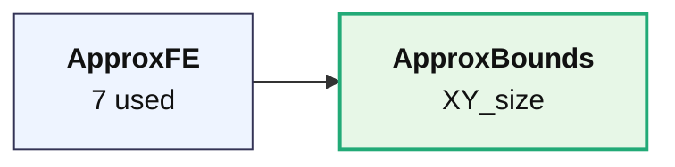

# What `ApproxBounds.XY_size` rests on

[`ApproxBounds.XY_size`](../lean_stage3/ApproxBounds.md#ApproxBounds-XY_size) in `lean_stage3/Stage3/ApproxBounds.lean`, line 654.

**Why.** Target 1, Young's (4.2) in the bound form, both sides: for `‖α‖, ‖β‖ ≤ 1/10` and `t ≥ 1`, `‖X_{α,β,t}‖ ≤ C (t/2π)^(−Re(α+β))` and `(t/2π)^(−Re(α+β)) ≤ C ‖X_{α,β,t}‖`, with one `C`.

**Proves**

```lean
∃ C : ℝ, 0 < C ∧ ∀ α β : ℂ, ‖α‖ ≤ 1 / 10 → ‖β‖ ≤ 1 / 10 → ∀ t : ℝ, 1 ≤ t → ‖XY α β t‖ ≤ C * (t / (2 * Real.pi)) ^ (-(α + β).re) ∧ (t / (2 * Real.pi)) ^ (-(α + β).re) ≤ C * ‖XY α β t‖
```

Behind it: 15 theorems and 7 definitions in 2 files. Every one is listed below; Lean recorded each step.

## The files it passes through



An arrow A → B reads "B uses something proved or defined in A"; indirect arrows are left out. Green: the theorem itself. Yellow: a file in the other tree. The number is how many of that file's declarations are on the way.

## Every declaration on the way

Files in dependency order. ★ marks what the theorem's own proof uses directly.

### [`ApproxFE`](../lean_stage3/ApproxFE.md) — 7

- ★ [`ApproxFE.uA`](../lean_stage3/ApproxFE.md#ApproxFE-uA) — *def*
- ★ [`ApproxFE.vB`](../lean_stage3/ApproxFE.md#ApproxFE-vB) — *def*
- ★ [`ApproxFE.XY`](../lean_stage3/ApproxFE.md#ApproxFE-XY) — *def*
- ★ [`ApproxFE.uA_re`](../lean_stage3/ApproxFE.md#ApproxFE-uA_re) — `` (uA α t).re = 1 / 2 + α.re ``
- ★ [`ApproxFE.vB_re`](../lean_stage3/ApproxFE.md#ApproxFE-vB_re) — `` (vB β t).re = 1 / 2 + β.re ``
- [`ApproxFE.uA_im`](../lean_stage3/ApproxFE.md#ApproxFE-uA_im) — `` (uA α t).im = α.im + t ``
- [`ApproxFE.vB_im`](../lean_stage3/ApproxFE.md#ApproxFE-vB_im) — `` (vB β t).im = β.im - t ``

### [`ApproxBounds`](../lean_stage3/ApproxBounds.md) — 15

- [`ApproxBounds.lY`](../lean_stage3/ApproxBounds.md#ApproxBounds-lY) — *def*
- [`ApproxBounds.lY_neg`](../lean_stage3/ApproxBounds.md#ApproxBounds-lY_neg) — `` lY (-Y) = lY Y ``
- [`ApproxBounds.gModel`](../lean_stage3/ApproxBounds.md#ApproxBounds-gModel) — *def*
- [`ApproxBounds.gErr`](../lean_stage3/ApproxBounds.md#ApproxBounds-gErr) — *def*
- [`ApproxBounds.gRModel`](../lean_stage3/ApproxBounds.md#ApproxBounds-gRModel) — *def*
- [`ApproxBounds.gErr_nonneg`](../lean_stage3/ApproxBounds.md#ApproxBounds-gErr_nonneg) — `` 0 ≤ gErr r ``
- [`ApproxBounds.const_bound`](../lean_stage3/ApproxBounds.md#ApproxBounds-const_bound) — `` ∃ K : ℝ, 0 ≤ K ∧ ∀ r : ℝ, lo ≤ r → r ≤ hi → |Real.log (Real.Gamma r)| ≤ K ∧ gErr r ≤ K ``
- [`ApproxBounds.lY_near`](../lean_stage3/ApproxBounds.md#ApproxBounds-lY_near) — `` |lY Y - Real.log (t / 2)| ≤ 3 ``
- ★ [`ApproxBounds.re_one_sub_uA`](../lean_stage3/ApproxBounds.md#ApproxBounds-re_one_sub_uA) — `` (1 - uA α t).re = 1 / 2 - α.re ``
- [`ApproxBounds.im_one_sub_uA`](../lean_stage3/ApproxBounds.md#ApproxBounds-im_one_sub_uA) — `` (1 - uA α t).im = -(α.im + t) ``
- ★ [`ApproxBounds.re_one_sub_vB`](../lean_stage3/ApproxBounds.md#ApproxBounds-re_one_sub_vB) — `` (1 - vB β t).re = 1 / 2 - β.re ``
- [`ApproxBounds.im_one_sub_vB`](../lean_stage3/ApproxBounds.md#ApproxBounds-im_one_sub_vB) — `` (1 - vB β t).im = -(β.im - t) ``
- [`ApproxBounds.gRModel_reflect`](../lean_stage3/ApproxBounds.md#ApproxBounds-gRModel_reflect) — `` gRModel w' - gRModel w = a * Real.log Real.pi + Real.log (Real.Gamma ((1 / 2 - a) / 2)) - Real.log (Real.Gamma ((1 / 2 + a) / 2)) - a * lY (Y / 2) ``
- ★ [`ApproxBounds.XY_log`](../lean_stage3/ApproxBounds.md#ApproxBounds-XY_log) — `` ∃ K : ℝ, 0 ≤ K ∧ ∀ α β : ℂ, ‖α‖ ≤ 1 / 10 → ‖β‖ ≤ 1 / 10 → ∀ t : ℝ, 1 ≤ t → |Real.log ‖XY α β t‖ - (α + β).re * (Real.log Real.pi - Real.log (t / 2))| ≤ K ``
- ★ [`ApproxBounds.log_div_two_pi`](../lean_stage3/ApproxBounds.md#ApproxBounds-log_div_two_pi) — `` Real.log (t / (2 * Real.pi)) = Real.log (t / 2) - Real.log Real.pi ``

