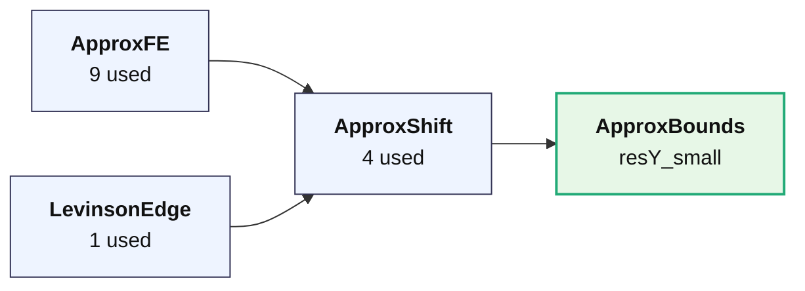

# What `ApproxBounds.resY_small` rests on

[`ApproxBounds.resY_small`](../lean_stage3/ApproxBounds.md#ApproxBounds-resY_small) in `lean_stage3/Stage3/ApproxBounds.lean`, line 1612.

**Why.** Target 2: `‖resY α β t‖ ≤ C (1 + ‖α+β‖^(−2)) e^(−t²/2)` for `‖α‖, ‖β‖ ≤ 1/10`, `t ≥ 1`. The Gaussian `G` at the four poles, height `≈ t`, beats the `Λ` values (polynomial, `ApproxShift.Lambda_bound`) and `1/‖Gammaℝ(u) Gammaℝ(v)‖ ≪ e^((π/2+1)t)`.

**Proves**

```lean
∃ C : ℝ, 0 ≤ C ∧ ∀ α β : ℂ, ‖α‖ ≤ 1 / 10 → ‖β‖ ≤ 1 / 10 → ∀ t : ℝ, 1 ≤ t → ‖resY α β t‖ ≤ C * (1 + 1 / ‖α + β‖ ^ 2) * Real.exp (-(t ^ 2 / 2))
```

Behind it: 23 theorems and 8 definitions in 4 files. Every one is listed below; Lean recorded each step.

## The files it passes through



An arrow A → B reads "B uses something proved or defined in A"; indirect arrows are left out. Green: the theorem itself. Yellow: a file in the other tree. The number is how many of that file's declarations are on the way.

## Every declaration on the way

Files in dependency order. ★ marks what the theorem's own proof uses directly.

### [`ApproxFE`](../lean_stage3/ApproxFE.md) — 9

- ★ [`ApproxFE.uA`](../lean_stage3/ApproxFE.md#ApproxFE-uA) — *def*
- ★ [`ApproxFE.vB`](../lean_stage3/ApproxFE.md#ApproxFE-vB) — *def*
- ★ [`ApproxFE.GY`](../lean_stage3/ApproxFE.md#ApproxFE-GY) — *def*
- [`ApproxFE.uA_re`](../lean_stage3/ApproxFE.md#ApproxFE-uA_re) — `` (uA α t).re = 1 / 2 + α.re ``
- [`ApproxFE.vB_re`](../lean_stage3/ApproxFE.md#ApproxFE-vB_re) — `` (vB β t).re = 1 / 2 + β.re ``
- [`ApproxFE.uA_im`](../lean_stage3/ApproxFE.md#ApproxFE-uA_im) — `` (uA α t).im = α.im + t ``
- [`ApproxFE.vB_im`](../lean_stage3/ApproxFE.md#ApproxFE-vB_im) — `` (vB β t).im = β.im - t ``
- [`ApproxFE.gamma_mul_zeta`](../lean_stage3/ApproxFE.md#ApproxFE-gamma_mul_zeta) — `` Gammaℝ w * riemannZeta w = completedRiemannZeta w ``
- ★ [`ApproxFE.resY`](../lean_stage3/ApproxFE.md#ApproxFE-resY) — *def*

### [`LevinsonEdge`](../lean_stage3/LevinsonEdge.md) — 1

- [`LevinsonEdge.zeta_norm_le`](../lean_stage3/LevinsonEdge.md#LevinsonEdge-zeta_norm_le) — `` ‖riemannZeta u‖ ≤ 2 + 4 * ‖u‖ ``

### [`ApproxShift`](../lean_stage3/ApproxShift.md) — 4

- [`ApproxShift.zeta_norm_le_abs`](../lean_stage3/ApproxShift.md#ApproxShift-zeta_norm_le_abs) — `` ‖riemannZeta w‖ ≤ 2 + 4 * ‖w‖ ``
- [`ApproxShift.gammaR_bound`](../lean_stage3/ApproxShift.md#ApproxShift-gammaR_bound) — `` ∃ M : ℝ, 0 ≤ M ∧ ∀ w : ℂ, 1 / 2 ≤ w.re → w.re ≤ R → ‖Gammaℝ w‖ ≤ M ``
- ★ [`ApproxShift.Lambda_bound`](../lean_stage3/ApproxShift.md#ApproxShift-Lambda_bound) — `` ∃ M : ℝ, 0 ≤ M ∧ ∀ w : ℂ, |w.re| ≤ R → 1 ≤ |w.im| → ‖completedRiemannZeta w‖ ≤ M * (6 + 4 * ‖w‖) ``
- [`ApproxShift.GY_norm_le`](../lean_stage3/ApproxShift.md#ApproxShift-GY_norm_le) — `` ‖GY α β s‖ ≤ Real.exp (c ^ 2 - s.im ^ 2) * ((‖α + β‖ ^ 2 + 4 * c ^ 2 + 4) / ‖α + β‖ ^ 2 * (1 + s.im ^ 2)) ``

### [`ApproxBounds`](../lean_stage3/ApproxBounds.md) — 17

- [`ApproxBounds.lY`](../lean_stage3/ApproxBounds.md#ApproxBounds-lY) — *def*
- [`ApproxBounds.lY_nonneg`](../lean_stage3/ApproxBounds.md#ApproxBounds-lY_nonneg) — `` 0 ≤ lY Y ``
- [`ApproxBounds.gModel`](../lean_stage3/ApproxBounds.md#ApproxBounds-gModel) — *def*
- [`ApproxBounds.gErr`](../lean_stage3/ApproxBounds.md#ApproxBounds-gErr) — *def*
- [`ApproxBounds.gRModel`](../lean_stage3/ApproxBounds.md#ApproxBounds-gRModel) — *def*
- [`ApproxBounds.gErr_nonneg`](../lean_stage3/ApproxBounds.md#ApproxBounds-gErr_nonneg) — `` 0 ≤ gErr r ``
- ★ [`ApproxBounds.const_bound`](../lean_stage3/ApproxBounds.md#ApproxBounds-const_bound) — `` ∃ K : ℝ, 0 ≤ K ∧ ∀ r : ℝ, lo ≤ r → r ≤ hi → |Real.log (Real.Gamma r)| ≤ K ∧ gErr r ≤ K ``
- [`ApproxBounds.Q_le`](../lean_stage3/ApproxBounds.md#ApproxBounds-Q_le) — `` (n ^ 2 + A) / n ^ 2 ≤ (A + 1) * (1 + 1 / n ^ 2) ``
- [`ApproxBounds.lY_le_abs`](../lean_stage3/ApproxBounds.md#ApproxBounds-lY_le_abs) — `` lY Y ≤ |Y| ``
- [`ApproxBounds.gR_lower`](../lean_stage3/ApproxBounds.md#ApproxBounds-gR_lower) — `` -(2 * K + |Real.log (Real.Gamma (1 / 2))|) - (Real.pi / 2 + 1) * |Y₀| ≤ Real.log ‖Gammaℝ w‖ ``
- [`ApproxBounds.resY_term`](../lean_stage3/ApproxBounds.md#ApproxBounds-resY_term) — `` ‖GY α β s / d * completedRiemannZeta w‖ ≤ Real.exp (1 - (t - 1 / 10) ^ 2) * (9 * (1 + 1 / ‖α + β‖ ^ 2) * (1 + (t + 1 / 10) ^ 2)) * (5 / 2) * (M * (14 + 8 * t)) ``
- ★ [`ApproxBounds.poly_exp_bound`](../lean_stage3/ApproxBounds.md#ApproxBounds-poly_exp_bound) — `` Real.exp (1 - (t - 1 / 10) ^ 2) * (1 + (t + 1 / 10) ^ 2) * (14 + 8 * t) * Real.exp ((Real.pi / 2 + 1) * (t + 1 / 10)) ≤ 14 * Real.exp ((Real.pi / 2 + 5) ^ 2 / 2… ``
- ★ [`ApproxBounds.resY_T1`](../lean_stage3/ApproxBounds.md#ApproxBounds-resY_T1) — `` ‖GY α β (1 - uA α t) / (1 - uA α t) * completedRiemannZeta (vB β t + 1 - uA α t)‖ ≤ Real.exp (1 - (t - 1 / 10) ^ 2) * (9 * (1 + 1 / ‖α + β‖ ^ 2) * (1 + (t + 1 /… ``
- ★ [`ApproxBounds.resY_T2`](../lean_stage3/ApproxBounds.md#ApproxBounds-resY_T2) — `` ‖GY α β (-uA α t) / uA α t * completedRiemannZeta (vB β t - uA α t)‖ ≤ Real.exp (1 - (t - 1 / 10) ^ 2) * (9 * (1 + 1 / ‖α + β‖ ^ 2) * (1 + (t + 1 / 10) ^ 2)) * … ``
- ★ [`ApproxBounds.resY_T3`](../lean_stage3/ApproxBounds.md#ApproxBounds-resY_T3) — `` ‖GY α β (1 - vB β t) / (1 - vB β t) * completedRiemannZeta (uA α t + 1 - vB β t)‖ ≤ Real.exp (1 - (t - 1 / 10) ^ 2) * (9 * (1 + 1 / ‖α + β‖ ^ 2) * (1 + (t + 1 /… ``
- ★ [`ApproxBounds.resY_T4`](../lean_stage3/ApproxBounds.md#ApproxBounds-resY_T4) — `` ‖GY α β (-vB β t) / vB β t * completedRiemannZeta (uA α t - vB β t)‖ ≤ Real.exp (1 - (t - 1 / 10) ^ 2) * (9 * (1 + 1 / ‖α + β‖ ^ 2) * (1 + (t + 1 / 10) ^ 2)) * … ``
- ★ [`ApproxBounds.resY_den`](../lean_stage3/ApproxBounds.md#ApproxBounds-resY_den) — `` Real.exp (-(2 * (2 * K + |Real.log (Real.Gamma (1 / 2))|)) - (Real.pi / 2 + 1) * (t + 1 / 10)) ≤ ‖Gammaℝ (uA α t) * Gammaℝ (vB β t)‖ ``

