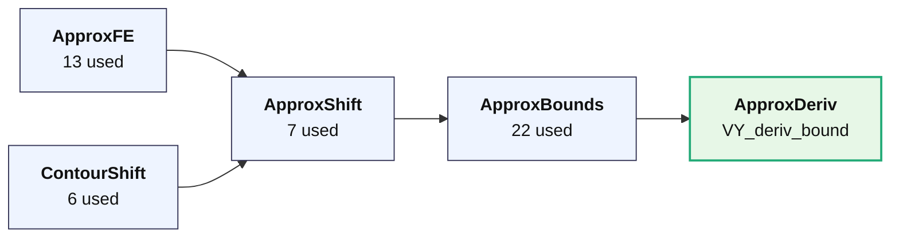

# What `ApproxDeriv.VY_deriv_bound` rests on

[`ApproxDeriv.VY_deriv_bound`](../lean_stage3/ApproxDeriv.md#ApproxDeriv-VY_deriv_bound) in `lean_stage3/Stage3/ApproxDeriv.lean`, line 1216.

**Why.** Young's (4.3) for `j = 1, 2`. For every `A > 0` there is `C` with `‖t^j ∂_t^j V_{α,β}(x,t)‖ ≤ C (1 + ‖α+β‖^(−2)) (1 + x/t)^(−A)`, `j = 1, 2`, uniformly in `‖α‖, ‖β‖ ≤ 1/10` with `α + β ≠ 0`, `t ≥ 1`, `x > 0`, and the line `c > 0` of `V`.

**Proves**

```lean
∃ C : ℝ, 0 ≤ C ∧ ∀ α β : ℂ, ‖α‖ ≤ 1 / 10 → ‖β‖ ≤ 1 / 10 → α + β ≠ 0 → ∀ t : ℝ, 1 ≤ t → ∀ x : ℝ, 0 < x → ∀ c : ℝ, 0 < c → ∀ j : ℕ, 1 ≤ j → j ≤ 2 → ‖(t : ℂ) ^ j * iteratedDeriv j (fun t => VY α β c x t) t‖ ≤ C * (1 + 1 / ‖α + β‖ ^ 2) * (1 + x / t) ^ (-A)
```

**Needs** (its hypotheses)

  - `` hA : 0 < A ``

Behind it: 84 theorems and 18 definitions in 5 files. Every one is listed below; Lean recorded each step.

## The files it passes through



An arrow A → B reads "B uses something proved or defined in A"; indirect arrows are left out. Green: the theorem itself. Yellow: a file in the other tree. The number is how many of that file's declarations are on the way.

## Every declaration on the way

Files in dependency order. ★ marks what the theorem's own proof uses directly.

### [`ApproxFE`](../lean_stage3/ApproxFE.md) — 13

- [`ApproxFE.uA`](../lean_stage3/ApproxFE.md#ApproxFE-uA) — *def*
- [`ApproxFE.vB`](../lean_stage3/ApproxFE.md#ApproxFE-vB) — *def*
- [`ApproxFE.GY`](../lean_stage3/ApproxFE.md#ApproxFE-GY) — *def*
- [`ApproxFE.gY`](../lean_stage3/ApproxFE.md#ApproxFE-gY) — *def*
- [`ApproxFE.KY`](../lean_stage3/ApproxFE.md#ApproxFE-KY) — *def*
- ★ [`ApproxFE.VY`](../lean_stage3/ApproxFE.md#ApproxFE-VY) — *def*
- [`ApproxFE.uA_re`](../lean_stage3/ApproxFE.md#ApproxFE-uA_re) — `` (uA α t).re = 1 / 2 + α.re ``
- [`ApproxFE.vB_re`](../lean_stage3/ApproxFE.md#ApproxFE-vB_re) — `` (vB β t).re = 1 / 2 + β.re ``
- [`ApproxFE.uA_im`](../lean_stage3/ApproxFE.md#ApproxFE-uA_im) — `` (uA α t).im = α.im + t ``
- [`ApproxFE.vB_im`](../lean_stage3/ApproxFE.md#ApproxFE-vB_im) — `` (vB β t).im = β.im - t ``
- [`ApproxFE.KY_differentiableAt`](../lean_stage3/ApproxFE.md#ApproxFE-KY_differentiableAt) — `` DifferentiableAt ℂ (KY α β t) s ``
- [`ApproxFE.GY_zero`](../lean_stage3/ApproxFE.md#ApproxFE-GY_zero) — `` GY α β 0 = 1 ``
- [`ApproxFE.gY_zero`](../lean_stage3/ApproxFE.md#ApproxFE-gY_zero) — `` gY α β t 0 = 1 ``

### [`ContourShift`](../lean_stage3/ContourShift.md) — 6

- [`ContourShift.borderIntegrable_sum_poles`](../lean_stage3/ContourShift.md#ContourShift-borderIntegrable_sum_poles) — `` RectangleBorderIntegrable (fun s ↦ ∑ p ∈ P, A p / (s - p)) z w ``
- [`ContourShift.rectangleIntegral_sum_poles`](../lean_stage3/ContourShift.md#ContourShift-rectangleIntegral_sum_poles) — `` RectangleIntegral' (fun s ↦ ∑ p ∈ P, A p / (s - p)) z w = ∑ p ∈ P, A p ``
- [`ContourShift.residue_rectangle_multi`](../lean_stage3/ContourShift.md#ContourShift-residue_rectangle_multi) — `` RectangleIntegral' f z w = ∑ p ∈ P, A p ``
- [`ContourShift.residue_rectangle_of_local`](../lean_stage3/ContourShift.md#ContourShift-residue_rectangle_of_local) — `` RectangleIntegral' f z w = ∑ p ∈ P, A p ``
- [`ContourShift.analyticAt_dslope`](../lean_stage3/ContourShift.md#ContourShift-analyticAt_dslope) — `` AnalyticAt ℂ (dslope f p) p ``
- [`ContourShift.div_sub_eq_dslope`](../lean_stage3/ContourShift.md#ContourShift-div_sub_eq_dslope) — `` f s / (s - p) = f p / (s - p) + dslope f p s ``

### [`ApproxShift`](../lean_stage3/ApproxShift.md) — 7

- [`ApproxShift.GY_norm_le`](../lean_stage3/ApproxShift.md#ApproxShift-GY_norm_le) — `` ‖GY α β s‖ ≤ Real.exp (c ^ 2 - s.im ^ 2) * ((‖α + β‖ ^ 2 + 4 * c ^ 2 + 4) / ‖α + β‖ ^ 2 * (1 + s.im ^ 2)) ``
- [`ApproxShift.gauss_atTop`](../lean_stage3/ApproxShift.md#ApproxShift-gauss_atTop) — `` Tendsto (fun y : ℝ => Real.exp (-(1 / 2) * y ^ 2)) atTop (𝓝 0) ``
- [`ApproxShift.gauss_atBot`](../lean_stage3/ApproxShift.md#ApproxShift-gauss_atBot) — `` Tendsto (fun y : ℝ => Real.exp (-(1 / 2) * y ^ 2)) atBot (𝓝 0) ``
- [`ApproxShift.GY_analyticAt`](../lean_stage3/ApproxShift.md#ApproxShift-GY_analyticAt) — `` AnalyticAt ℂ (GY α β) p ``
- [`ApproxShift.local_simple`](../lean_stage3/ApproxShift.md#ApproxShift-local_simple) — `` ∃ h : ℂ → ℂ, AnalyticAt ℂ h p ∧ ∀ᶠ s in 𝓝[≠] p, f s = h s + A / (s - p) ``
- [`ApproxShift.rect_mem_nhds`](../lean_stage3/ApproxShift.md#ApproxShift-rect_mem_nhds) — `` Rectangle (↑(-c) - I * ↑T) (↑c + I * ↑T) ∈ 𝓝 p ``
- [`ApproxShift.rect_tendsto`](../lean_stage3/ApproxShift.md#ApproxShift-rect_tendsto) — `` Tendsto (fun T : ℝ => RectangleIntegral f (↑(-c) - I * T) (↑c + I * T)) atTop (𝓝 (VerticalIntegral f c - VerticalIntegral f (-c))) ``

### [`ApproxBounds`](../lean_stage3/ApproxBounds.md) — 22

- [`ApproxBounds.lY`](../lean_stage3/ApproxBounds.md#ApproxBounds-lY) — *def*
- [`ApproxBounds.lY_neg`](../lean_stage3/ApproxBounds.md#ApproxBounds-lY_neg) — `` lY (-Y) = lY Y ``
- [`ApproxBounds.gModel`](../lean_stage3/ApproxBounds.md#ApproxBounds-gModel) — *def*
- [`ApproxBounds.gErr`](../lean_stage3/ApproxBounds.md#ApproxBounds-gErr) — *def*
- [`ApproxBounds.gRModel`](../lean_stage3/ApproxBounds.md#ApproxBounds-gRModel) — *def*
- [`ApproxBounds.gErr_nonneg`](../lean_stage3/ApproxBounds.md#ApproxBounds-gErr_nonneg) — `` 0 ≤ gErr r ``
- [`ApproxBounds.const_bound`](../lean_stage3/ApproxBounds.md#ApproxBounds-const_bound) — `` ∃ K : ℝ, 0 ≤ K ∧ ∀ r : ℝ, lo ≤ r → r ≤ hi → |Real.log (Real.Gamma r)| ≤ K ∧ gErr r ≤ K ``
- [`ApproxBounds.lY_near`](../lean_stage3/ApproxBounds.md#ApproxBounds-lY_near) — `` |lY Y - Real.log (t / 2)| ≤ 3 ``
- [`ApproxBounds.log_div_two_pi`](../lean_stage3/ApproxBounds.md#ApproxBounds-log_div_two_pi) — `` Real.log (t / (2 * Real.pi)) = Real.log (t / 2) - Real.log Real.pi ``
- [`ApproxBounds.lY_lip`](../lean_stage3/ApproxBounds.md#ApproxBounds-lY_lip) — `` |lY (Y + h) - lY Y| ≤ |h| ``
- [`ApproxBounds.gR_shift`](../lean_stage3/ApproxBounds.md#ApproxBounds-gR_shift) — `` Real.log ‖Gammaℝ (w + (σ + y * I))‖ - Real.log ‖Gammaℝ w‖ ≤ σ / 2 * (Real.log (t / 2) - Real.log Real.pi) + 2 * K + 2 * K' + 3 * |σ| / 2 + (Real.pi / 4 + |σ| / … ``
- [`ApproxBounds.gY_bound`](../lean_stage3/ApproxBounds.md#ApproxBounds-gY_bound) — `` ∃ C : ℝ, 0 ≤ C ∧ ∀ α β : ℂ, ‖α‖ ≤ 1 / 10 → ‖β‖ ≤ 1 / 10 → ∀ t : ℝ, 1 ≤ t → ∀ σ y : ℝ, σ₀ ≤ σ → σ ≤ σ₁ → ‖gY α β t (σ + y * I)‖ ≤ C * (t / (2 * Real.pi)) ^ σ * R… ``
- [`ApproxBounds.gauss_absorb`](../lean_stage3/ApproxBounds.md#ApproxBounds-gauss_absorb) — `` Real.exp (-y ^ 2) * (1 + y ^ 2) * Real.exp (B * |y|) ≤ 4 * Real.exp (B ^ 2) * Real.exp (-(1 / 2) * y ^ 2) ``
- [`ApproxBounds.Q_le`](../lean_stage3/ApproxBounds.md#ApproxBounds-Q_le) — `` (n ^ 2 + A) / n ^ 2 ≤ (A + 1) * (1 + 1 / n ^ 2) ``
- [`ApproxBounds.integrand_bound`](../lean_stage3/ApproxBounds.md#ApproxBounds-integrand_bound) — `` ∃ C : ℝ, 0 ≤ C ∧ ∀ α β : ℂ, ‖α‖ ≤ 1 / 10 → ‖β‖ ≤ 1 / 10 → ∀ t : ℝ, 1 ≤ t → ∀ x : ℝ, 0 < x → ∀ σ y : ℝ, σ₀ ≤ σ → σ ≤ σ₁ → δ ≤ ‖(σ : ℂ) + y * I‖ → ‖KY α β t (σ + … ``
- [`ApproxBounds.integrand_differentiableAt`](../lean_stage3/ApproxBounds.md#ApproxBounds-integrand_differentiableAt) — `` DifferentiableAt ℂ (fun s => KY α β t s * (x : ℂ) ^ (-s)) s ``
- [`ApproxBounds.rpow_le_ends`](../lean_stage3/ApproxBounds.md#ApproxBounds-rpow_le_ends) — `` b ^ σ ≤ b ^ σ₀ + b ^ σ₁ ``
- [`ApproxBounds.rect_tendsto_ab`](../lean_stage3/ApproxBounds.md#ApproxBounds-rect_tendsto_ab) — `` Tendsto (fun T : ℝ => RectangleIntegral f (↑a - I * T) (↑b + I * T)) atTop (𝓝 (VerticalIntegral f b - VerticalIntegral f a)) ``
- [`ApproxBounds.VY_line_eq`](../lean_stage3/ApproxBounds.md#ApproxBounds-VY_line_eq) — `` VY α β c x t = VY α β c' x t ``
- [`ApproxBounds.integrand_differentiableAt'`](../lean_stage3/ApproxBounds.md#ApproxBounds-integrand_differentiableAt-) — `` DifferentiableAt ℂ (fun s => KY α β t s * (x : ℂ) ^ (-s)) s ``
- [`ApproxBounds.VY_residue`](../lean_stage3/ApproxBounds.md#ApproxBounds-VY_residue) — `` VY α β (1 / 4) x t - VY α β (-(1 / 4)) x t = 1 ``
- [`ApproxBounds.rpow_quarter_le`](../lean_stage3/ApproxBounds.md#ApproxBounds-rpow_quarter_le) — `` b ^ (1 / 4 : ℝ) ≤ 1 + b ``

### [`ApproxDeriv`](../lean_stage3/ApproxDeriv.md) — 54

- [`ApproxDeriv.psiR`](../lean_stage3/ApproxDeriv.md#ApproxDeriv-psiR) — *def*
- [`ApproxDeriv.ne_neg_nat_of_re_pos`](../lean_stage3/ApproxDeriv.md#ApproxDeriv-ne_neg_nat_of_re_pos) — `` z ≠ -(m : ℂ) ``
- [`ApproxDeriv.hasDerivAt_line`](../lean_stage3/ApproxDeriv.md#ApproxDeriv-hasDerivAt_line) — `` HasDerivAt (fun t : ℝ => w₀ + (t : ℂ) * e) e t ``
- [`ApproxDeriv.dY`](../lean_stage3/ApproxDeriv.md#ApproxDeriv-dY) — *def*
- [`ApproxDeriv.re_conds`](../lean_stage3/ApproxDeriv.md#ApproxDeriv-re_conds) — `` 1 / 20 ≤ (uA α t / 2).re ∧ 1 / 20 ≤ (uA α t / 2 + s / 2).re ∧ 1 / 20 ≤ (vB β t / 2).re ∧ 1 / 20 ≤ (vB β t / 2 + s / 2).re ``
- [`ApproxDeriv.gY_hasDerivAt`](../lean_stage3/ApproxDeriv.md#ApproxDeriv-gY_hasDerivAt) — `` HasDerivAt (fun t => gY α β t s) (gY α β t s * dY α β t s) t ``
- [`ApproxDeriv.tau`](../lean_stage3/ApproxDeriv.md#ApproxDeriv-tau) — *def*
- [`ApproxDeriv.tau'`](../lean_stage3/ApproxDeriv.md#ApproxDeriv-tau-) — *def*
- [`ApproxDeriv.hasSum_tau`](../lean_stage3/ApproxDeriv.md#ApproxDeriv-hasSum_tau) — `` HasSum (tau h w) (digamma (w + h) - digamma w) ``
- [`ApproxDeriv.norm_nat_add_ge`](../lean_stage3/ApproxDeriv.md#ApproxDeriv-norm_nat_add_ge) — `` ((n : ℝ) + a + Y) / 2 ≤ ‖(n : ℂ) + z‖ ``
- [`ApproxDeriv.norm_tau_le`](../lean_stage3/ApproxDeriv.md#ApproxDeriv-norm_tau_le) — `` ‖tau h w n‖ ≤ 4 * ‖h‖ * (1 / ((n : ℝ) + (a + Y)) ^ 2) ``
- [`ApproxDeriv.norm_tau'_le`](../lean_stage3/ApproxDeriv.md#ApproxDeriv-norm_tau-_le) — `` ‖tau' h w n‖ ≤ 16 * ‖h‖ / (a + Y) * (1 / ((n : ℝ) + (a + Y)) ^ 2) ``
- [`ApproxDeriv.tel`](../lean_stage3/ApproxDeriv.md#ApproxDeriv-tel) — *def*
- [`ApproxDeriv.hasSum_tel`](../lean_stage3/ApproxDeriv.md#ApproxDeriv-hasSum_tel) — `` HasSum (tel b) (1 / b) ``
- [`ApproxDeriv.sq_le_tel`](../lean_stage3/ApproxDeriv.md#ApproxDeriv-sq_le_tel) — `` 1 / ((n : ℝ) + b) ^ 2 ≤ (1 + 1 / b) * tel b n ``
- [`ApproxDeriv.nat_add_ne`](../lean_stage3/ApproxDeriv.md#ApproxDeriv-nat_add_ne) — `` (n : ℂ) + z ≠ 0 ``
- [`ApproxDeriv.dY_hasSum`](../lean_stage3/ApproxDeriv.md#ApproxDeriv-dY_hasSum) — `` HasSum (fun n => I / 2 * (tau (s / 2) (uA α t / 2) n - tau (s / 2) (vB β t / 2) n)) (dY α β t s) ``
- [`ApproxDeriv.norm_I_half`](../lean_stage3/ApproxDeriv.md#ApproxDeriv-norm_I_half) — `` ‖I / 2‖ = 1 / 2 ``
- [`ApproxDeriv.norm_dterm_le`](../lean_stage3/ApproxDeriv.md#ApproxDeriv-norm_dterm_le) — `` ‖I / 2 * (tau (s / 2) (uA α t / 2) n - tau (s / 2) (vB β t / 2) n)‖ ≤ 4 * ‖s / 2‖ * (1 + 1 / (1 / 20 + Y)) * tel (1 / 20 + Y) n ``
- [`ApproxDeriv.norm_dY_le`](../lean_stage3/ApproxDeriv.md#ApproxDeriv-norm_dY_le) — `` ‖dY α β t s‖ ≤ 4 * ‖s / 2‖ * (1 + 1 / (1 / 20 + Y)) * (1 / (1 / 20 + Y)) ``
- [`ApproxDeriv.d2Y`](../lean_stage3/ApproxDeriv.md#ApproxDeriv-d2Y) — *def*
- [`ApproxDeriv.norm_d2term_le`](../lean_stage3/ApproxDeriv.md#ApproxDeriv-norm_d2term_le) — `` ‖-(1 / 4) * (tau' (s / 2) (uA α t / 2) n + tau' (s / 2) (vB β t / 2) n)‖ ≤ 8 * ‖s / 2‖ / (1 / 20 + Y) * (1 + 1 / (1 / 20 + Y)) * tel (1 / 20 + Y) n ``
- [`ApproxDeriv.summable_d2term`](../lean_stage3/ApproxDeriv.md#ApproxDeriv-summable_d2term) — `` Summable fun n => -(1 / 4) * (tau' (s / 2) (uA α t / 2) n + tau' (s / 2) (vB β t / 2) n) ``
- [`ApproxDeriv.norm_d2Y_le`](../lean_stage3/ApproxDeriv.md#ApproxDeriv-norm_d2Y_le) — `` ‖d2Y α β t s‖ ≤ 8 * ‖s / 2‖ / (1 / 20 + Y) * (1 + 1 / (1 / 20 + Y)) * (1 / (1 / 20 + Y)) ``
- [`ApproxDeriv.hasDerivAt_tau_line`](../lean_stage3/ApproxDeriv.md#ApproxDeriv-hasDerivAt_tau_line) — `` HasDerivAt (fun t : ℝ => tau h (w₀ + t * e) n) (e * tau' h (w₀ + t * e) n) t ``
- [`ApproxDeriv.dY_hasDerivAt`](../lean_stage3/ApproxDeriv.md#ApproxDeriv-dY_hasDerivAt) — `` HasDerivAt (fun t => dY α β t s) (d2Y α β t s) t ``
- [`ApproxDeriv.poly_gauss`](../lean_stage3/ApproxDeriv.md#ApproxDeriv-poly_gauss) — `` (1 + |y|) ^ k * Real.exp (-(1 / 2) * y ^ 2) ≤ (k.factorial : ℝ) * Real.exp 2 * Real.exp (-(1 / 4) * y ^ 2) ``
- [`ApproxDeriv.gauss_loc`](../lean_stage3/ApproxDeriv.md#ApproxDeriv-gauss_loc) — `` Real.exp (-y ^ 2) * (1 + y ^ 2) * (1 + |y|) ^ k ≤ ((k + 2).factorial : ℝ) * Real.exp 2 * Real.exp (-(1 / 4) * y ^ 2) ``
- [`ApproxDeriv.norm_half_le`](../lean_stage3/ApproxDeriv.md#ApproxDeriv-norm_half_le) — `` ‖((σ : ℂ) + y * I) / 2‖ ≤ (1 + |σ|) * (1 + |y|) ``
- [`ApproxDeriv.dY_crude`](../lean_stage3/ApproxDeriv.md#ApproxDeriv-dY_crude) — `` ‖dY α β t (σ + y * I)‖ ≤ 1680 * (1 + |σ|) * (1 + |y|) ``
- [`ApproxDeriv.d2Y_crude`](../lean_stage3/ApproxDeriv.md#ApproxDeriv-d2Y_crude) — `` ‖d2Y α β t (σ + y * I)‖ ≤ 67200 * (1 + |σ|) * (1 + |y|) ``
- [`ApproxDeriv.KY_local`](../lean_stage3/ApproxDeriv.md#ApproxDeriv-KY_local) — `` ∃ C : ℝ, 0 ≤ C ∧ ∀ t ∈ Metric.closedBall t₀ 1, ∀ y : ℝ, ‖KY α β t (σ + y * I)‖ ≤ C * (Real.exp (-y ^ 2) * (1 + y ^ 2)) ``
- [`ApproxDeriv.cont_F`](../lean_stage3/ApproxDeriv.md#ApproxDeriv-cont_F) — `` Continuous fun y : ℝ => KY α β t (σ + y * I) * (x : ℂ) ^ (-((σ : ℂ) + y * I)) ``
- [`ApproxDeriv.re_half_pos`](../lean_stage3/ApproxDeriv.md#ApproxDeriv-re_half_pos) — `` 0 < ((uA α t + ((σ : ℂ) + y * I)) / 2).re ∧ 0 < ((vB β t + ((σ : ℂ) + y * I)) / 2).re ``
- [`ApproxDeriv.cont_dY`](../lean_stage3/ApproxDeriv.md#ApproxDeriv-cont_dY) — `` Continuous fun y : ℝ => dY α β t (σ + y * I) ``
- [`ApproxDeriv.meas_d2Y`](../lean_stage3/ApproxDeriv.md#ApproxDeriv-meas_d2Y) — `` AEStronglyMeasurable (fun y : ℝ => d2Y α β t (σ + y * I)) volume ``
- [`ApproxDeriv.VY1`](../lean_stage3/ApproxDeriv.md#ApproxDeriv-VY1) — *def*
- [`ApproxDeriv.VY2`](../lean_stage3/ApproxDeriv.md#ApproxDeriv-VY2) — *def*
- [`ApproxDeriv.norm_F_local`](../lean_stage3/ApproxDeriv.md#ApproxDeriv-norm_F_local) — `` ‖KY α β t (σ + y * I) * (x : ℂ) ^ (-((σ : ℂ) + y * I))‖ ≤ C * x ^ (-σ) * (Real.exp (-y ^ 2) * (1 + y ^ 2)) ``
- [`ApproxDeriv.F_hasDerivAt`](../lean_stage3/ApproxDeriv.md#ApproxDeriv-F_hasDerivAt) — `` HasDerivAt (fun t => KY α β t s * (x : ℂ) ^ (-s)) (KY α β t s * (x : ℂ) ^ (-s) * dY α β t s) t ``
- [`ApproxDeriv.VY_hasDerivAt`](../lean_stage3/ApproxDeriv.md#ApproxDeriv-VY_hasDerivAt) — `` HasDerivAt (fun t => VY α β σ x t) (VY1 α β σ x t₀) t₀ ``
- [`ApproxDeriv.VY1_hasDerivAt`](../lean_stage3/ApproxDeriv.md#ApproxDeriv-VY1_hasDerivAt) — `` HasDerivAt (fun t => VY1 α β σ x t) (VY2 α β σ x t₀) t₀ ``
- [`ApproxDeriv.im_conds`](../lean_stage3/ApproxDeriv.md#ApproxDeriv-im_conds) — `` t / 5 ≤ |(uA α t / 2).im| ∧ t / 5 ≤ |(uA α t / 2 + ((σ : ℂ) + y * I) / 2).im| ∧ t / 5 ≤ |(vB β t / 2).im| ∧ t / 5 ≤ |(vB β t / 2 + ((σ : ℂ) + y * I) / 2).im| ``
- [`ApproxDeriv.b_facts`](../lean_stage3/ApproxDeriv.md#ApproxDeriv-b_facts) — `` t * (1 / (1 / 20 + t / 5)) ≤ 5 ∧ 1 + 1 / (1 / 20 + t / 5) ≤ 6 ``
- [`ApproxDeriv.dY_bound`](../lean_stage3/ApproxDeriv.md#ApproxDeriv-dY_bound) — `` t * ‖dY α β t (σ + y * I)‖ ≤ 3360 * (1 + |σ|) * (1 + |y|) ^ 2 ``
- [`ApproxDeriv.d2Y_bound`](../lean_stage3/ApproxDeriv.md#ApproxDeriv-d2Y_bound) — `` t ^ 2 * ‖d2Y α β t (σ + y * I)‖ ≤ 268800 * (1 + |σ|) * (1 + |y|) ^ 3 ``
- [`ApproxDeriv.d12_bound`](../lean_stage3/ApproxDeriv.md#ApproxDeriv-d12_bound) — `` t ^ 2 * ‖dY α β t (σ + y * I) * dY α β t (σ + y * I) + d2Y α β t (σ + y * I)‖ ≤ ((3360 * (1 + |σ|)) ^ 2 + 268800 * (1 + |σ|)) * (1 + |y|) ^ 4 ``
- [`ApproxDeriv.norm_VI_le`](../lean_stage3/ApproxDeriv.md#ApproxDeriv-norm_VI_le) — `` ‖VerticalIntegral' f σ‖ ≤ 1 / (2 * Real.pi) * ∫ y : ℝ, ‖f (σ + y * I)‖ ``
- [`ApproxDeriv.VI_gauss`](../lean_stage3/ApproxDeriv.md#ApproxDeriv-VI_gauss) — `` ‖VerticalIntegral' f σ‖ ≤ 1 / (2 * Real.pi) * (B * Real.sqrt (Real.pi / (1 / 4))) ``
- ★ [`ApproxDeriv.VYj_line_bound`](../lean_stage3/ApproxDeriv.md#ApproxDeriv-VYj_line_bound) — `` ∃ C : ℝ, 0 ≤ C ∧ ∀ α β : ℂ, ‖α‖ ≤ 1 / 10 → ‖β‖ ≤ 1 / 10 → ∀ t : ℝ, 1 ≤ t → ∀ x : ℝ, 0 < x → ‖(t : ℂ) ^ 1 * VY1 α β σ x t‖ ≤ C * (1 + 1 / ‖α + β‖ ^ 2) * ((t / (2… ``
- ★ [`ApproxDeriv.assemble`](../lean_stage3/ApproxDeriv.md#ApproxDeriv-assemble) — `` z ≤ (8 * Cm * 2 ^ A + Ca * 2 ^ A) * N * (1 + x / t) ^ (-A) ``
- [`ApproxDeriv.deriv_eq_of_eq_Ici`](../lean_stage3/ApproxDeriv.md#ApproxDeriv-deriv_eq_of_eq_Ici) — `` f' = g' ``
- ★ [`ApproxDeriv.VYj_lines`](../lean_stage3/ApproxDeriv.md#ApproxDeriv-VYj_lines) — `` VY1 α β c x t = VY1 α β A x t ∧ VY1 α β c x t = VY1 α β (-(1 / 4)) x t ∧ VY2 α β c x t = VY2 α β A x t ∧ VY2 α β c x t = VY2 α β (-(1 / 4)) x t ``
- ★ [`ApproxDeriv.iteratedDeriv_VY`](../lean_stage3/ApproxDeriv.md#ApproxDeriv-iteratedDeriv_VY) — `` iteratedDeriv 1 (fun t => VY α β c x t) = (fun t => VY1 α β c x t) ∧ iteratedDeriv 2 (fun t => VY α β c x t) = (fun t => VY2 α β c x t) ``

