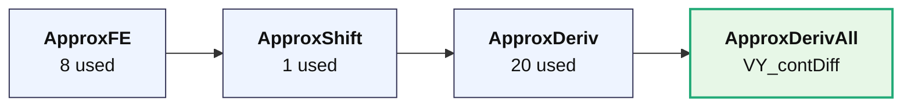

# What `ApproxDerivAll.VY_contDiff` rests on

[`ApproxDerivAll.VY_contDiff`](../lean_stage3/ApproxDerivAll.md#ApproxDerivAll-VY_contDiff) in `lean_stage3/Stage3/ApproxDerivAll.lean`, line 903.

**Why.** `t ↦ V_{α,β}(x,t)` is smooth, on every line `c > 0`.

**Proves**

```lean
ContDiff ℝ ∞ (fun t => VY α β c x t)
```

**Needs** (its hypotheses)

  - `` hα : ‖α‖ ≤ 1 / 10 ``
  - `` hβ : ‖β‖ ≤ 1 / 10 ``
  - `` hx : 0 < x ``
  - `` hc : 0 < c ``

Behind it: 52 theorems and 16 definitions in 4 files. Every one is listed below; Lean recorded each step.

## The files it passes through



An arrow A → B reads "B uses something proved or defined in A"; indirect arrows are left out. Green: the theorem itself. Yellow: a file in the other tree. The number is how many of that file's declarations are on the way.

## Every declaration on the way

Files in dependency order. ★ marks what the theorem's own proof uses directly.

### [`ApproxFE`](../lean_stage3/ApproxFE.md) — 8

- [`ApproxFE.uA`](../lean_stage3/ApproxFE.md#ApproxFE-uA) — *def*
- [`ApproxFE.vB`](../lean_stage3/ApproxFE.md#ApproxFE-vB) — *def*
- [`ApproxFE.GY`](../lean_stage3/ApproxFE.md#ApproxFE-GY) — *def*
- [`ApproxFE.gY`](../lean_stage3/ApproxFE.md#ApproxFE-gY) — *def*
- [`ApproxFE.KY`](../lean_stage3/ApproxFE.md#ApproxFE-KY) — *def*
- ★ [`ApproxFE.VY`](../lean_stage3/ApproxFE.md#ApproxFE-VY) — *def*
- [`ApproxFE.uA_re`](../lean_stage3/ApproxFE.md#ApproxFE-uA_re) — `` (uA α t).re = 1 / 2 + α.re ``
- [`ApproxFE.vB_re`](../lean_stage3/ApproxFE.md#ApproxFE-vB_re) — `` (vB β t).re = 1 / 2 + β.re ``

### [`ApproxShift`](../lean_stage3/ApproxShift.md) — 1

- [`ApproxShift.GY_norm_le`](../lean_stage3/ApproxShift.md#ApproxShift-GY_norm_le) — `` ‖GY α β s‖ ≤ Real.exp (c ^ 2 - s.im ^ 2) * ((‖α + β‖ ^ 2 + 4 * c ^ 2 + 4) / ‖α + β‖ ^ 2 * (1 + s.im ^ 2)) ``

### [`ApproxDeriv`](../lean_stage3/ApproxDeriv.md) — 20

- [`ApproxDeriv.psiR`](../lean_stage3/ApproxDeriv.md#ApproxDeriv-psiR) — *def*
- [`ApproxDeriv.ne_neg_nat_of_re_pos`](../lean_stage3/ApproxDeriv.md#ApproxDeriv-ne_neg_nat_of_re_pos) — `` z ≠ -(m : ℂ) ``
- [`ApproxDeriv.hasDerivAt_line`](../lean_stage3/ApproxDeriv.md#ApproxDeriv-hasDerivAt_line) — `` HasDerivAt (fun t : ℝ => w₀ + (t : ℂ) * e) e t ``
- [`ApproxDeriv.dY`](../lean_stage3/ApproxDeriv.md#ApproxDeriv-dY) — *def*
- [`ApproxDeriv.re_conds`](../lean_stage3/ApproxDeriv.md#ApproxDeriv-re_conds) — `` 1 / 20 ≤ (uA α t / 2).re ∧ 1 / 20 ≤ (uA α t / 2 + s / 2).re ∧ 1 / 20 ≤ (vB β t / 2).re ∧ 1 / 20 ≤ (vB β t / 2 + s / 2).re ``
- [`ApproxDeriv.gY_hasDerivAt`](../lean_stage3/ApproxDeriv.md#ApproxDeriv-gY_hasDerivAt) — `` HasDerivAt (fun t => gY α β t s) (gY α β t s * dY α β t s) t ``
- [`ApproxDeriv.tau`](../lean_stage3/ApproxDeriv.md#ApproxDeriv-tau) — *def*
- [`ApproxDeriv.hasSum_tau`](../lean_stage3/ApproxDeriv.md#ApproxDeriv-hasSum_tau) — `` HasSum (tau h w) (digamma (w + h) - digamma w) ``
- [`ApproxDeriv.norm_nat_add_ge`](../lean_stage3/ApproxDeriv.md#ApproxDeriv-norm_nat_add_ge) — `` ((n : ℝ) + a + Y) / 2 ≤ ‖(n : ℂ) + z‖ ``
- [`ApproxDeriv.tel`](../lean_stage3/ApproxDeriv.md#ApproxDeriv-tel) — *def*
- [`ApproxDeriv.hasSum_tel`](../lean_stage3/ApproxDeriv.md#ApproxDeriv-hasSum_tel) — `` HasSum (tel b) (1 / b) ``
- [`ApproxDeriv.sq_le_tel`](../lean_stage3/ApproxDeriv.md#ApproxDeriv-sq_le_tel) — `` 1 / ((n : ℝ) + b) ^ 2 ≤ (1 + 1 / b) * tel b n ``
- [`ApproxDeriv.nat_add_ne`](../lean_stage3/ApproxDeriv.md#ApproxDeriv-nat_add_ne) — `` (n : ℂ) + z ≠ 0 ``
- [`ApproxDeriv.dY_hasSum`](../lean_stage3/ApproxDeriv.md#ApproxDeriv-dY_hasSum) — `` HasSum (fun n => I / 2 * (tau (s / 2) (uA α t / 2) n - tau (s / 2) (vB β t / 2) n)) (dY α β t s) ``
- [`ApproxDeriv.norm_I_half`](../lean_stage3/ApproxDeriv.md#ApproxDeriv-norm_I_half) — `` ‖I / 2‖ = 1 / 2 ``
- [`ApproxDeriv.poly_gauss`](../lean_stage3/ApproxDeriv.md#ApproxDeriv-poly_gauss) — `` (1 + |y|) ^ k * Real.exp (-(1 / 2) * y ^ 2) ≤ (k.factorial : ℝ) * Real.exp 2 * Real.exp (-(1 / 4) * y ^ 2) ``
- [`ApproxDeriv.gauss_loc`](../lean_stage3/ApproxDeriv.md#ApproxDeriv-gauss_loc) — `` Real.exp (-y ^ 2) * (1 + y ^ 2) * (1 + |y|) ^ k ≤ ((k + 2).factorial : ℝ) * Real.exp 2 * Real.exp (-(1 / 4) * y ^ 2) ``
- [`ApproxDeriv.norm_half_le`](../lean_stage3/ApproxDeriv.md#ApproxDeriv-norm_half_le) — `` ‖((σ : ℂ) + y * I) / 2‖ ≤ (1 + |σ|) * (1 + |y|) ``
- [`ApproxDeriv.KY_local`](../lean_stage3/ApproxDeriv.md#ApproxDeriv-KY_local) — `` ∃ C : ℝ, 0 ≤ C ∧ ∀ t ∈ Metric.closedBall t₀ 1, ∀ y : ℝ, ‖KY α β t (σ + y * I)‖ ≤ C * (Real.exp (-y ^ 2) * (1 + y ^ 2)) ``
- [`ApproxDeriv.norm_F_local`](../lean_stage3/ApproxDeriv.md#ApproxDeriv-norm_F_local) — `` ‖KY α β t (σ + y * I) * (x : ℂ) ^ (-((σ : ℂ) + y * I))‖ ≤ C * x ^ (-σ) * (Real.exp (-y ^ 2) * (1 + y ^ 2)) ``

### [`ApproxDerivAll`](../lean_stage3/ApproxDerivAll.md) — 39

- [`ApproxDerivAll.tauK`](../lean_stage3/ApproxDerivAll.md#ApproxDerivAll-tauK) — *def*
- [`ApproxDerivAll.tauK_zero`](../lean_stage3/ApproxDerivAll.md#ApproxDerivAll-tauK_zero) — `` tauK 0 h w n = tau h w n ``
- [`ApproxDerivAll.hasDerivAt_tauK_line`](../lean_stage3/ApproxDerivAll.md#ApproxDerivAll-hasDerivAt_tauK_line) — `` HasDerivAt (fun t : ℝ => tauK k h (w₀ + t * e) n) (e * tauK (k + 1) h (w₀ + t * e) n) t ``
- [`ApproxDerivAll.norm_tauK_le`](../lean_stage3/ApproxDerivAll.md#ApproxDerivAll-norm_tauK_le) — `` ‖tauK k h w n‖ ≤ ((k + 1).factorial : ℝ) * ‖h‖ * 2 ^ (k + 2) * (1 / (a + Y)) ^ k * (1 / ((n : ℝ) + (a + Y)) ^ 2) ``
- [`ApproxDerivAll.dYterm`](../lean_stage3/ApproxDerivAll.md#ApproxDerivAll-dYterm) — *def*
- [`ApproxDerivAll.dYk`](../lean_stage3/ApproxDerivAll.md#ApproxDerivAll-dYk) — *def*
- [`ApproxDerivAll.dYk_zero`](../lean_stage3/ApproxDerivAll.md#ApproxDerivAll-dYk_zero) — `` dYk α β 0 t s = dY α β t s ``
- [`ApproxDerivAll.norm_pow_I_half`](../lean_stage3/ApproxDerivAll.md#ApproxDerivAll-norm_pow_I_half) — `` ‖(I / 2) ^ k‖ = (1 / 2) ^ k ``
- [`ApproxDerivAll.norm_pow_neg_I_half`](../lean_stage3/ApproxDerivAll.md#ApproxDerivAll-norm_pow_neg_I_half) — `` ‖(-(I / 2)) ^ k‖ = (1 / 2) ^ k ``
- [`ApproxDerivAll.norm_dYterm_le`](../lean_stage3/ApproxDerivAll.md#ApproxDerivAll-norm_dYterm_le) — `` ‖dYterm α β k t s n‖ ≤ 4 * ((k + 1).factorial : ℝ) * ‖s / 2‖ * (1 / (1 / 20 + Y)) ^ k * (1 + 1 / (1 / 20 + Y)) * tel (1 / 20 + Y) n ``
- [`ApproxDerivAll.summable_dYterm`](../lean_stage3/ApproxDerivAll.md#ApproxDerivAll-summable_dYterm) — `` Summable (dYterm α β k t s) ``
- [`ApproxDerivAll.norm_dYk_le`](../lean_stage3/ApproxDerivAll.md#ApproxDerivAll-norm_dYk_le) — `` ‖dYk α β k t s‖ ≤ 4 * ((k + 1).factorial : ℝ) * ‖s / 2‖ * (1 / (1 / 20 + Y)) ^ k * (1 + 1 / (1 / 20 + Y)) * (1 / (1 / 20 + Y)) ``
- [`ApproxDerivAll.dYk_hasDerivAt`](../lean_stage3/ApproxDerivAll.md#ApproxDerivAll-dYk_hasDerivAt) — `` HasDerivAt (fun t => dYk α β k t s) (dYk α β (k + 1) t s) t ``
- [`ApproxDerivAll.dYk_contDiff`](../lean_stage3/ApproxDerivAll.md#ApproxDerivAll-dYk_contDiff) — `` ∀ k : ℕ, ContDiff ℝ n (fun t => dYk α β k t s) ``
- [`ApproxDerivAll.iteratedDeriv_dY`](../lean_stage3/ApproxDerivAll.md#ApproxDerivAll-iteratedDeriv_dY) — `` iteratedDeriv k (fun t => dY α β t s) = fun t => dYk α β k t s ``
- [`ApproxDerivAll.dY_contDiff`](../lean_stage3/ApproxDerivAll.md#ApproxDerivAll-dY_contDiff) — `` ContDiff ℝ ∞ (fun t => dY α β t s) ``
- [`ApproxDerivAll.Dc`](../lean_stage3/ApproxDerivAll.md#ApproxDerivAll-Dc) — *def*
- [`ApproxDerivAll.Dc_nonneg`](../lean_stage3/ApproxDerivAll.md#ApproxDerivAll-Dc_nonneg) — `` 0 ≤ Dc k ``
- [`ApproxDerivAll.dYk_crude`](../lean_stage3/ApproxDerivAll.md#ApproxDerivAll-dYk_crude) — `` ‖dYk α β k t (σ + y * I)‖ ≤ Dc k * ((1 + |σ|) * (1 + |y|)) ``
- [`ApproxDerivAll.pow_key`](../lean_stage3/ApproxDerivAll.md#ApproxDerivAll-pow_key) — `` (a * q) ^ i * a * q ^ (J - i + 1) ≤ (a * q) ^ (J + 1) ``
- [`ApproxDerivAll.leib_bound`](../lean_stage3/ApproxDerivAll.md#ApproxDerivAll-leib_bound) — `` ∃ M : ℝ, 0 ≤ M ∧ ∀ (H d : ℕ → ℂ) (G a q : ℝ), 1 ≤ a → 0 ≤ q → ‖H 0‖ ≤ G → (∀ j, H (j + 1) = ∑ i ∈ Finset.range (j + 1), (j.choose i : ℂ) * H i * d (j - i)) → (∀… ``
- [`ApproxDerivAll.gY_contDiff`](../lean_stage3/ApproxDerivAll.md#ApproxDerivAll-gY_contDiff) — `` ContDiff ℝ n (fun t => gY α β t s) ``
- [`ApproxDerivAll.gY_contDiff_top`](../lean_stage3/ApproxDerivAll.md#ApproxDerivAll-gY_contDiff_top) — `` ContDiff ℝ ∞ (fun t => gY α β t s) ``
- [`ApproxDerivAll.gY_iter_succ`](../lean_stage3/ApproxDerivAll.md#ApproxDerivAll-gY_iter_succ) — `` iteratedDeriv (j + 1) (fun t => gY α β t s) t = ∑ i ∈ Finset.range (j + 1), (j.choose i : ℂ) * iteratedDeriv i (fun t => gY α β t s) t * dYk α β (j - i) t s ``
- [`ApproxDerivAll.gY_iter_crude`](../lean_stage3/ApproxDerivAll.md#ApproxDerivAll-gY_iter_crude) — `` ∃ R : ℝ, 0 ≤ R ∧ ∀ α β : ℂ, ‖α‖ ≤ 1 / 10 → ‖β‖ ≤ 1 / 10 → ∀ t y : ℝ, ‖iteratedDeriv j (fun t => gY α β t (σ + y * I)) t‖ ≤ ‖gY α β t (σ + y * I)‖ * R * ((1 + |σ… ``
- [`ApproxDerivAll.cont_gY`](../lean_stage3/ApproxDerivAll.md#ApproxDerivAll-cont_gY) — `` Continuous fun y : ℝ => gY α β t (σ + y * I) ``
- [`ApproxDerivAll.cont_pre`](../lean_stage3/ApproxDerivAll.md#ApproxDerivAll-cont_pre) — `` Continuous fun y : ℝ => GY α β ((σ : ℂ) + y * I) / ((σ : ℂ) + y * I) ``
- [`ApproxDerivAll.cont_xpow`](../lean_stage3/ApproxDerivAll.md#ApproxDerivAll-cont_xpow) — `` Continuous fun y : ℝ => (x : ℂ) ^ (-((σ : ℂ) + y * I)) ``
- [`ApproxDerivAll.meas_dYk`](../lean_stage3/ApproxDerivAll.md#ApproxDerivAll-meas_dYk) — `` AEStronglyMeasurable (fun y : ℝ => dYk α β k t (σ + y * I)) volume ``
- [`ApproxDerivAll.meas_gY_iter`](../lean_stage3/ApproxDerivAll.md#ApproxDerivAll-meas_gY_iter) — `` ∀ i ≤ J, AEStronglyMeasurable (fun y : ℝ => iteratedDeriv i (fun t => gY α β t (σ + y * I)) t) volume ``
- [`ApproxDerivAll.IYk`](../lean_stage3/ApproxDerivAll.md#ApproxDerivAll-IYk) — *def*
- [`ApproxDerivAll.VYk`](../lean_stage3/ApproxDerivAll.md#ApproxDerivAll-VYk) — *def*
- [`ApproxDerivAll.VYk_zero`](../lean_stage3/ApproxDerivAll.md#ApproxDerivAll-VYk_zero) — `` VYk α β 0 c x t = VY α β c x t ``
- [`ApproxDerivAll.IYk_hasDerivAt`](../lean_stage3/ApproxDerivAll.md#ApproxDerivAll-IYk_hasDerivAt) — `` HasDerivAt (fun t => IYk α β x j t s) (IYk α β x (j + 1) t s) t ``
- [`ApproxDerivAll.norm_IYk_le`](../lean_stage3/ApproxDerivAll.md#ApproxDerivAll-norm_IYk_le) — `` ‖IYk α β x j t s‖ ≤ ‖KY α β t s * (x : ℂ) ^ (-s)‖ * B ``
- [`ApproxDerivAll.meas_IYk`](../lean_stage3/ApproxDerivAll.md#ApproxDerivAll-meas_IYk) — `` AEStronglyMeasurable (fun y : ℝ => IYk α β x j t (σ + y * I)) volume ``
- [`ApproxDerivAll.IYk_local`](../lean_stage3/ApproxDerivAll.md#ApproxDerivAll-IYk_local) — `` ∃ K : ℝ, 0 ≤ K ∧ ∀ t ∈ Metric.closedBall t₀ 1, ∀ y : ℝ, ‖IYk α β x j t (σ + y * I)‖ ≤ K * Real.exp (-(1 / 4) * y ^ 2) ``
- ★ [`ApproxDerivAll.VYk_hasDerivAt`](../lean_stage3/ApproxDerivAll.md#ApproxDerivAll-VYk_hasDerivAt) — `` HasDerivAt (fun t => VYk α β j σ x t) (VYk α β (j + 1) σ x t₀) t₀ ``
- ★ [`ApproxDerivAll.iteratedDeriv_VY_all`](../lean_stage3/ApproxDerivAll.md#ApproxDerivAll-iteratedDeriv_VY_all) — `` iteratedDeriv j (fun t => VY α β c x t) = fun t => VYk α β j c x t ``

