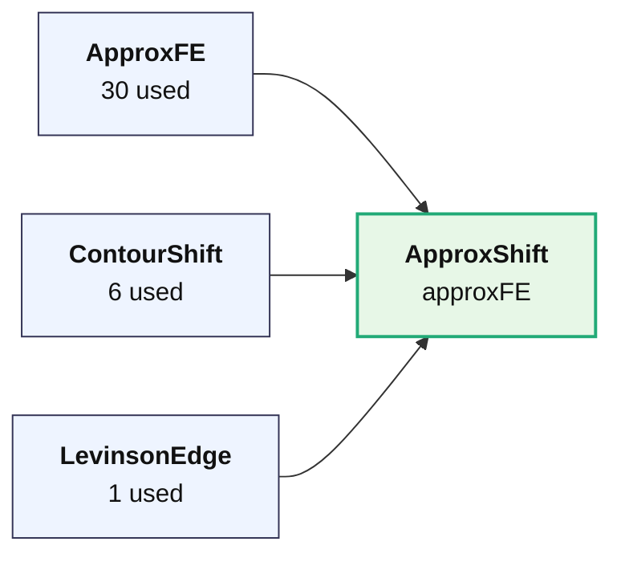

# What `ApproxShift.approxFE` rests on

[`ApproxShift.approxFE`](../lean_stage3/ApproxShift.md#ApproxShift-approxFE) in `lean_stage3/Stage3/ApproxShift.lean`, line 775.

**Why.** Target 3. Young's Lemma 4, exact, with the shift discharged: for `−1/2 < Re α, Re β < 1/2`, `c > 1/2 + |Re α|, 1/2 + |Re β|`, `α + β ≠ 0` and `u ≠ v`, `ζ(u) ζ(v) = Σ_{m,n} m^(−u) n^(−v) V_{α,β}(mn,t) + X_{α,β,t} Σ_{m,n} m^(−1/2+β−it) n^(−1/2+α+it) V_{−β,−α}(mn,t) − resY`.

**Proves**

```lean
riemannZeta (uA α t) * riemannZeta (vB β t) = (∑' p : ℕ × ℕ, ((p.1 : ℂ) + 1) ^ (-uA α t) * ((p.2 : ℂ) + 1) ^ (-vB β t) * VY α β c (((p.1 : ℝ) + 1) * ((p.2 : ℝ) + 1)) t) + XY α β t * (∑' p : ℕ × ℕ, ((p.1 : ℂ) + 1) ^ (-uA (-β) t) * ((p.2 : ℂ) + 1) ^ (-vB (-α) t) * VY (-β) (-α) c (((p.1 : ℝ) + 1) * ((p.2 : ℝ) + 1)) t) - resY α β t
```

**Needs** (its hypotheses)

  - `` hα : α.re < 1 / 2 ``
  - `` hβ : β.re < 1 / 2 ``
  - `` hα' : -(1 / 2) < α.re ``
  - `` hβ' : -(1 / 2) < β.re ``
  - `` hcα : 1 / 2 + |α.re| < c ``
  - `` hcβ : 1 / 2 + |β.re| < c ``
  - `` hαβ : α + β ≠ 0 ``
  - `` huv : uA α t ≠ vB β t ``

Behind it: 52 theorems and 13 definitions in 4 files. Every one is listed below; Lean recorded each step.

## The files it passes through



An arrow A → B reads "B uses something proved or defined in A"; indirect arrows are left out. Green: the theorem itself. Yellow: a file in the other tree. The number is how many of that file's declarations are on the way.

## Every declaration on the way

Files in dependency order. ★ marks what the theorem's own proof uses directly.

### [`ApproxFE`](../lean_stage3/ApproxFE.md) — 30

- ★ [`ApproxFE.uA`](../lean_stage3/ApproxFE.md#ApproxFE-uA) — *def*
- ★ [`ApproxFE.vB`](../lean_stage3/ApproxFE.md#ApproxFE-vB) — *def*
- ★ [`ApproxFE.XY`](../lean_stage3/ApproxFE.md#ApproxFE-XY) — *def*
- [`ApproxFE.GY`](../lean_stage3/ApproxFE.md#ApproxFE-GY) — *def*
- [`ApproxFE.gY`](../lean_stage3/ApproxFE.md#ApproxFE-gY) — *def*
- [`ApproxFE.KY`](../lean_stage3/ApproxFE.md#ApproxFE-KY) — *def*
- ★ [`ApproxFE.VY`](../lean_stage3/ApproxFE.md#ApproxFE-VY) — *def*
- [`ApproxFE.FY`](../lean_stage3/ApproxFE.md#ApproxFE-FY) — *def*
- [`ApproxFE.uA_re`](../lean_stage3/ApproxFE.md#ApproxFE-uA_re) — `` (uA α t).re = 1 / 2 + α.re ``
- [`ApproxFE.vB_re`](../lean_stage3/ApproxFE.md#ApproxFE-vB_re) — `` (vB β t).re = 1 / 2 + β.re ``
- [`ApproxFE.norm_succ_cpow`](../lean_stage3/ApproxFE.md#ApproxFE-norm_succ_cpow) — `` ‖((m : ℂ) + 1) ^ z‖ = ((m : ℝ) + 1) ^ z.re ``
- [`ApproxFE.summable_succ_rpow`](../lean_stage3/ApproxFE.md#ApproxFE-summable_succ_rpow) — `` Summable fun m : ℕ => ((m : ℝ) + 1) ^ r ``
- [`ApproxFE.summable_zeta_norm`](../lean_stage3/ApproxFE.md#ApproxFE-summable_zeta_norm) — `` Summable fun n : ℕ => ‖1 / ((n : ℂ) + 1) ^ w‖ ``
- [`ApproxFE.KY_bound`](../lean_stage3/ApproxFE.md#ApproxFE-KY_bound) — `` ∃ C : ℝ, 0 ≤ C ∧ ∀ y : ℝ, ‖KY α β t (c + y * I)‖ ≤ C * Real.exp (-(1 / 2) * y ^ 2) ``
- [`ApproxFE.KY_differentiableAt`](../lean_stage3/ApproxFE.md#ApproxFE-KY_differentiableAt) — `` DifferentiableAt ℂ (KY α β t) s ``
- [`ApproxFE.KY_continuous_line`](../lean_stage3/ApproxFE.md#ApproxFE-KY_continuous_line) — `` Continuous fun y : ℝ => KY α β t (c + y * I) ``
- [`ApproxFE.tsum_pointwise`](../lean_stage3/ApproxFE.md#ApproxFE-tsum_pointwise) — `` ∑' p : ℕ × ℕ, ((p.1 : ℂ) + 1) ^ (-u) * ((p.2 : ℂ) + 1) ^ (-v) * (K * ((((p.1 : ℝ) + 1) * ((p.2 : ℝ) + 1) : ℝ) : ℂ) ^ (-s)) = K * (riemannZeta (u + s) * riemannZ… ``
- [`ApproxFE.mellin_double_sum`](../lean_stage3/ApproxFE.md#ApproxFE-mellin_double_sum) — `` ∑' p : ℕ × ℕ, ((p.1 : ℂ) + 1) ^ (-uA α t) * ((p.2 : ℂ) + 1) ^ (-vB β t) * VY α β c (((p.1 : ℝ) + 1) * ((p.2 : ℝ) + 1)) t = VerticalIntegral' (FY α β t) c ``
- [`ApproxFE.GY_neg`](../lean_stage3/ApproxFE.md#ApproxFE-GY_neg) — `` GY α β (-s) = GY α β s ``
- [`ApproxFE.GY_swap`](../lean_stage3/ApproxFE.md#ApproxFE-GY_swap) — `` GY (-β) (-α) s = GY α β s ``
- [`ApproxFE.uA_neg`](../lean_stage3/ApproxFE.md#ApproxFE-uA_neg) — `` uA (-β) t = 1 - vB β t ``
- [`ApproxFE.vB_neg`](../lean_stage3/ApproxFE.md#ApproxFE-vB_neg) — `` vB (-α) t = 1 - uA α t ``
- [`ApproxFE.gamma_mul_zeta`](../lean_stage3/ApproxFE.md#ApproxFE-gamma_mul_zeta) — `` Gammaℝ w * riemannZeta w = completedRiemannZeta w ``
- [`ApproxFE.FY_reflect`](../lean_stage3/ApproxFE.md#ApproxFE-FY_reflect) — `` FY α β t (-s) = -(XY α β t * FY (-β) (-α) t s) ``
- [`ApproxFE.gamma_ne_off`](../lean_stage3/ApproxFE.md#ApproxFE-gamma_ne_off) — `` Gammaℝ (w + -((c : ℂ) + y * I)) ≠ 0 ``
- [`ApproxFE.vertInt_reflect`](../lean_stage3/ApproxFE.md#ApproxFE-vertInt_reflect) — `` VerticalIntegral' (FY α β t) (-c) = -(XY α β t * VerticalIntegral' (FY (-β) (-α) t) c) ``
- [`ApproxFE.GY_zero`](../lean_stage3/ApproxFE.md#ApproxFE-GY_zero) — `` GY α β 0 = 1 ``
- ★ [`ApproxFE.resY`](../lean_stage3/ApproxFE.md#ApproxFE-resY) — *def*
- [`ApproxFE.StmtShift`](../lean_stage3/ApproxFE.md#ApproxFE-StmtShift) — *def*
- ★ [`ApproxFE.approxFE_of_shift`](../lean_stage3/ApproxFE.md#ApproxFE-approxFE_of_shift) — `` riemannZeta (uA α t) * riemannZeta (vB β t) = (∑' p : ℕ × ℕ, ((p.1 : ℂ) + 1) ^ (-uA α t) * ((p.2 : ℂ) + 1) ^ (-vB β t) * VY α β c (((p.1 : ℝ) + 1) * ((p.2 : ℝ) … ``

### [`ContourShift`](../lean_stage3/ContourShift.md) — 6

- [`ContourShift.borderIntegrable_sum_poles`](../lean_stage3/ContourShift.md#ContourShift-borderIntegrable_sum_poles) — `` RectangleBorderIntegrable (fun s ↦ ∑ p ∈ P, A p / (s - p)) z w ``
- [`ContourShift.rectangleIntegral_sum_poles`](../lean_stage3/ContourShift.md#ContourShift-rectangleIntegral_sum_poles) — `` RectangleIntegral' (fun s ↦ ∑ p ∈ P, A p / (s - p)) z w = ∑ p ∈ P, A p ``
- [`ContourShift.residue_rectangle_multi`](../lean_stage3/ContourShift.md#ContourShift-residue_rectangle_multi) — `` RectangleIntegral' f z w = ∑ p ∈ P, A p ``
- [`ContourShift.residue_rectangle_of_local`](../lean_stage3/ContourShift.md#ContourShift-residue_rectangle_of_local) — `` RectangleIntegral' f z w = ∑ p ∈ P, A p ``
- [`ContourShift.analyticAt_dslope`](../lean_stage3/ContourShift.md#ContourShift-analyticAt_dslope) — `` AnalyticAt ℂ (dslope f p) p ``
- [`ContourShift.div_sub_eq_dslope`](../lean_stage3/ContourShift.md#ContourShift-div_sub_eq_dslope) — `` f s / (s - p) = f p / (s - p) + dslope f p s ``

### [`LevinsonEdge`](../lean_stage3/LevinsonEdge.md) — 1

- [`LevinsonEdge.zeta_norm_le`](../lean_stage3/LevinsonEdge.md#LevinsonEdge-zeta_norm_le) — `` ‖riemannZeta u‖ ≤ 2 + 4 * ‖u‖ ``

### [`ApproxShift`](../lean_stage3/ApproxShift.md) — 28

- [`ApproxShift.zeta_norm_le_abs`](../lean_stage3/ApproxShift.md#ApproxShift-zeta_norm_le_abs) — `` ‖riemannZeta w‖ ≤ 2 + 4 * ‖w‖ ``
- [`ApproxShift.gammaR_bound`](../lean_stage3/ApproxShift.md#ApproxShift-gammaR_bound) — `` ∃ M : ℝ, 0 ≤ M ∧ ∀ w : ℂ, 1 / 2 ≤ w.re → w.re ≤ R → ‖Gammaℝ w‖ ≤ M ``
- [`ApproxShift.Lambda_bound`](../lean_stage3/ApproxShift.md#ApproxShift-Lambda_bound) — `` ∃ M : ℝ, 0 ≤ M ∧ ∀ w : ℂ, |w.re| ≤ R → 1 ≤ |w.im| → ‖completedRiemannZeta w‖ ≤ M * (6 + 4 * ‖w‖) ``
- [`ApproxShift.GY_norm_le`](../lean_stage3/ApproxShift.md#ApproxShift-GY_norm_le) — `` ‖GY α β s‖ ≤ Real.exp (c ^ 2 - s.im ^ 2) * ((‖α + β‖ ^ 2 + 4 * c ^ 2 + 4) / ‖α + β‖ ^ 2 * (1 + s.im ^ 2)) ``
- [`ApproxShift.poly_gauss`](../lean_stage3/ApproxShift.md#ApproxShift-poly_gauss) — `` (1 + y ^ 2) ^ 3 * Real.exp (-y ^ 2) ≤ 216 * Real.exp (-(1 / 2) * y ^ 2) ``
- [`ApproxShift.FL`](../lean_stage3/ApproxShift.md#ApproxShift-FL) — *def*
- [`ApproxShift.FY_eq_FL`](../lean_stage3/ApproxShift.md#ApproxShift-FY_eq_FL) — `` FY α β t s = FL α β t s ``
- [`ApproxShift.abs_le_add_abs`](../lean_stage3/ApproxShift.md#ApproxShift-abs_le_add_abs) — `` |y| ≤ |a + y| + |a| ``
- [`ApproxShift.FL_bound`](../lean_stage3/ApproxShift.md#ApproxShift-FL_bound) — `` ∃ C Y₀ : ℝ, 0 ≤ C ∧ 1 ≤ Y₀ ∧ ∀ s : ℂ, |s.re| ≤ c → Y₀ ≤ |s.im| → ‖FL α β t s‖ ≤ C * Real.exp (-(1 / 2) * s.im ^ 2) ``
- [`ApproxShift.gauss_atTop`](../lean_stage3/ApproxShift.md#ApproxShift-gauss_atTop) — `` Tendsto (fun y : ℝ => Real.exp (-(1 / 2) * y ^ 2)) atTop (𝓝 0) ``
- [`ApproxShift.gauss_atBot`](../lean_stage3/ApproxShift.md#ApproxShift-gauss_atBot) — `` Tendsto (fun y : ℝ => Real.exp (-(1 / 2) * y ^ 2)) atBot (𝓝 0) ``
- [`ApproxShift.FL_horiz_tendsto`](../lean_stage3/ApproxShift.md#ApproxShift-FL_horiz_tendsto) — `` Tendsto (fun y : ℝ => ∫ x : ℝ in (-c)..c, FL α β t (x + y * I)) atTop (𝓝 0) ∧ Tendsto (fun y : ℝ => ∫ x : ℝ in (-c)..c, FL α β t (x + y * I)) atBot (𝓝 0) ``
- [`ApproxShift.FL_line_integrable`](../lean_stage3/ApproxShift.md#ApproxShift-FL_line_integrable) — `` Integrable fun y : ℝ => FL α β t (σ + y * I) ``
- [`ApproxShift.vertInt_FY_eq_FL`](../lean_stage3/ApproxShift.md#ApproxShift-vertInt_FY_eq_FL) — `` VerticalIntegral' (FY α β t) σ = VerticalIntegral' (FL α β t) σ ``
- [`ApproxShift.Lam_differentiableAt`](../lean_stage3/ApproxShift.md#ApproxShift-Lam_differentiableAt) — `` DifferentiableAt ℂ (fun s => completedRiemannZeta (w + s)) s ``
- [`ApproxShift.Lam_analyticAt`](../lean_stage3/ApproxShift.md#ApproxShift-Lam_analyticAt) — `` AnalyticAt ℂ (fun s => completedRiemannZeta (w + s)) p ``
- [`ApproxShift.Lam0_analyticAt`](../lean_stage3/ApproxShift.md#ApproxShift-Lam0_analyticAt) — `` AnalyticAt ℂ (fun s => completedRiemannZeta₀ (w + s)) p ``
- [`ApproxShift.GY_analyticAt`](../lean_stage3/ApproxShift.md#ApproxShift-GY_analyticAt) — `` AnalyticAt ℂ (GY α β) p ``
- [`ApproxShift.FL_differentiableAt`](../lean_stage3/ApproxShift.md#ApproxShift-FL_differentiableAt) — `` DifferentiableAt ℂ (FL α β t) s ``
- [`ApproxShift.local_simple`](../lean_stage3/ApproxShift.md#ApproxShift-local_simple) — `` ∃ h : ℂ → ℂ, AnalyticAt ℂ h p ∧ ∀ᶠ s in 𝓝[≠] p, f s = h s + A / (s - p) ``
- [`ApproxShift.local_zero`](../lean_stage3/ApproxShift.md#ApproxShift-local_zero) — `` ∃ h : ℂ → ℂ, AnalyticAt ℂ h 0 ∧ ∀ᶠ s in 𝓝[≠] 0, FL α β t s = h s + riemannZeta (uA α t) * riemannZeta (vB β t) / (s - 0) ``
- [`ApproxShift.local_pole_one`](../lean_stage3/ApproxShift.md#ApproxShift-local_pole_one) — `` ∃ h : ℂ → ℂ, AnalyticAt ℂ h (1 - w₁) ∧ ∀ᶠ s in 𝓝[≠] (1 - w₁), F s = h s + g (1 - w₁) / (1 - w₁) * completedRiemannZeta (w₂ + 1 - w₁) / D / (s - (1 - w₁)) ``
- [`ApproxShift.local_pole_neg`](../lean_stage3/ApproxShift.md#ApproxShift-local_pole_neg) — `` ∃ h : ℂ → ℂ, AnalyticAt ℂ h (-w₁) ∧ ∀ᶠ s in 𝓝[≠] (-w₁), F s = h s + g (-w₁) / w₁ * completedRiemannZeta (w₂ - w₁) / D / (s - -w₁) ``
- [`ApproxShift.rect_mem_nhds`](../lean_stage3/ApproxShift.md#ApproxShift-rect_mem_nhds) — `` Rectangle (↑(-c) - I * ↑T) (↑c + I * ↑T) ∈ 𝓝 p ``
- [`ApproxShift.rect_tendsto`](../lean_stage3/ApproxShift.md#ApproxShift-rect_tendsto) — `` Tendsto (fun T : ℝ => RectangleIntegral f (↑(-c) - I * T) (↑c + I * T)) atTop (𝓝 (VerticalIntegral f c - VerticalIntegral f (-c))) ``
- [`ApproxShift.poles`](../lean_stage3/ApproxShift.md#ApproxShift-poles) — *def*
- [`ApproxShift.resA`](../lean_stage3/ApproxShift.md#ApproxShift-resA) — *def*
- ★ [`ApproxShift.stmtShift_holds`](../lean_stage3/ApproxShift.md#ApproxShift-stmtShift_holds) — `` StmtShift α β t c ``

