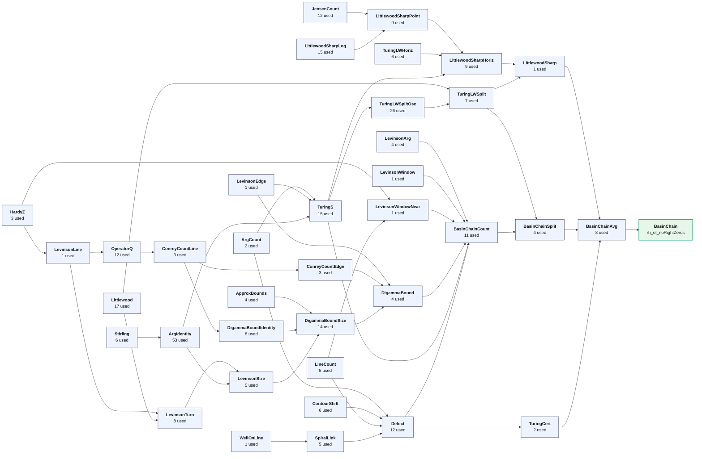

# What `BasinChain.rh_of_noRightZeros` rests on

[`BasinChain.rh_of_noRightZeros`](../lean_stage3/BasinChain.md#BasinChain-rh_of_noRightZeros) in `lean_stage3/Stage3/BasinChain.lean`, line 114.

**Why.** RH from no right zeros, with the lower side of `J` and the base as named hypotheses.

**Proves**

```lean
RiemannHypothesis
```

**Needs** (its hypotheses)

  - `` hQ : ∀ x : ℝ, Q.derivative.eval x = Q.derivative.eval (1 - x) ``
  - `` hQh : Q.eval (1/2) ≠ 0 ``
  - `` hQ0 : Q.eval 0 = 1 ``
  - `` hNR : StmtNoRightZeros Q T₀ ``
  - `` hLow : StmtVHorizLower Q a₂ b₂ T₀' ``
  - `` ha₂ : 0 ≤ a₂ ``
  - `` hbase : StmtNoFiniteDefect ``

Behind it: 259 theorems and 48 definitions in 38 files. Every one is listed below; Lean recorded each step.

## The files it passes through



An arrow A → B reads "B uses something proved or defined in A"; indirect arrows are left out. Green: the theorem itself. Yellow: a file in the other tree. The number is how many of that file's declarations are on the way.

## Every declaration on the way

Files in dependency order. ★ marks what the theorem's own proof uses directly.

### [`ApproxBounds`](../lean_stage3/ApproxBounds.md) — 4

- [`ApproxBounds.lY`](../lean_stage3/ApproxBounds.md#ApproxBounds-lY) — *def*
- [`ApproxBounds.gModel`](../lean_stage3/ApproxBounds.md#ApproxBounds-gModel) — *def*
- [`ApproxBounds.gErr`](../lean_stage3/ApproxBounds.md#ApproxBounds-gErr) — *def*
- [`ApproxBounds.gRModel`](../lean_stage3/ApproxBounds.md#ApproxBounds-gRModel) — *def*

### [`ArgCount`](../lean_stage3/ArgCount.md) — 2

- [`ArgCount.N_eq_sum`](../lean_stage3/ArgCount.md#ArgCount-N_eq_sum) — `` riemannZeta.N T = ∑ z ∈ (Kadiri.zeroes_rect_univ_positive_height_finite T).toFinset, (1 : ℝ) * (riemannZeta.order z : ℝ) ``
- [`ArgCount.N_mono`](../lean_stage3/ArgCount.md#ArgCount-N_mono) — `` riemannZeta.N T ≤ riemannZeta.N T' ``

### [`ContourShift`](../lean_stage3/ContourShift.md) — 6

- [`ContourShift.zeta_analyticAt`](../lean_stage3/ContourShift.md#ContourShift-zeta_analyticAt) — `` AnalyticAt ℂ riemannZeta ρ ``
- [`ContourShift.zeta_order_ne_top`](../lean_stage3/ContourShift.md#ContourShift-zeta_order_ne_top) — `` analyticOrderAt riemannZeta ρ ≠ ⊤ ``
- [`ContourShift.order_bridge`](../lean_stage3/ContourShift.md#ContourShift-order_bridge) — `` ((riemannZeta.order ρ : ℤ) : ℂ) = ((analyticOrderNatAt riemannZeta ρ : ℕ) : ℂ) ``
- [`ContourShift.analyticAt_conj_conj`](../lean_stage3/ContourShift.md#ContourShift-analyticAt_conj_conj) — `` AnalyticAt ℂ (fun w ↦ (starRingEnd ℂ) (g ((starRingEnd ℂ) w))) ((starRingEnd ℂ) p) ``
- [`ContourShift.zeta_order_conj`](../lean_stage3/ContourShift.md#ContourShift-zeta_order_conj) — `` analyticOrderNatAt riemannZeta ((starRingEnd ℂ) ρ) = analyticOrderNatAt riemannZeta ρ ``
- [`ContourShift.zeta_order_reflect`](../lean_stage3/ContourShift.md#ContourShift-zeta_order_reflect) — `` analyticOrderNatAt riemannZeta (1 - (starRingEnd ℂ) ρ) = analyticOrderNatAt riemannZeta ρ ``

### [`HardyZ`](../lean_stage3/HardyZ.md) — 3

- [`HardyZ.completedRiemannZeta_conj_of_re_pos`](../lean_stage3/HardyZ.md#HardyZ-completedRiemannZeta_conj_of_re_pos) — `` completedRiemannZeta (conj s) = conj (completedRiemannZeta s) ``
- [`HardyZ.re_line`](../lean_stage3/HardyZ.md#HardyZ-re_line) — `` ((1 / 2 : ℂ) + t * I).re = 1 / 2 ``
- [`HardyZ.xi_line_real`](../lean_stage3/HardyZ.md#HardyZ-xi_line_real) — `` (completedRiemannZeta (1/2 + t * Complex.I)).im = 0 ``

### [`JensenCount`](../lean_stage3/JensenCount.md) — 12

- [`Stage3.zeta_centre_lower`](../lean_stage3/JensenCount.md#Stage3-zeta_centre_lower) — `` (1 : ℝ) / 3 ≤ ‖ζ (2 + Complex.I * T)‖ ``
- [`Stage3.zeta_disk_upper`](../lean_stage3/JensenCount.md#Stage3-zeta_disk_upper) — `` ‖ζ w‖ ≤ 28 * T ``
- [`Stage3.zeta_centre_ne_zero`](../lean_stage3/JensenCount.md#Stage3-zeta_centre_ne_zero) — `` ζ (2 + Complex.I * (T : ℂ)) ≠ 0 ``
- [`Stage3.pole_away`](../lean_stage3/JensenCount.md#Stage3-pole_away) — `` 2 * z + (2 + Complex.I * (T : ℂ)) ≠ 1 ``
- [`Stage3.pole_away_centre`](../lean_stage3/JensenCount.md#Stage3-pole_away_centre) — `` v ≠ 1 ``
- [`Stage3.zetaWindowTwo_finite`](../lean_stage3/JensenCount.md#Stage3-zetaWindowTwo_finite) — `` {ρ : ℂ | ζ ρ = 0 ∧ ‖ρ - (2 + Complex.I * (T : ℂ))‖ ≤ 2}.Finite ``
- [`Stage3.jensenF`](../lean_stage3/JensenCount.md#Stage3-jensenF) — *def*
- [`Stage3.zeta_comp_analytic`](../lean_stage3/JensenCount.md#Stage3-zeta_comp_analytic) — `` AnalyticAt ℂ (fun z : ℂ => ζ (2 * z + (2 + Complex.I * (T : ℂ)))) w ``
- [`Stage3.jensenF_analytic`](../lean_stage3/JensenCount.md#Stage3-jensenF_analytic) — `` AnalyticOnNhd ℂ (jensenF T) (Metric.closedBall (0 : ℂ) 1) ``
- [`Stage3.jensenF_zero_eq_one`](../lean_stage3/JensenCount.md#Stage3-jensenF_zero_eq_one) — `` jensenF T 0 = 1 ``
- [`Stage3.jensenF_zeros_finite`](../lean_stage3/JensenCount.md#Stage3-jensenF_zeros_finite) — `` (SetOfZeros 1 (jensenF T)).Finite ``
- [`Stage3.jensenF_bound`](../lean_stage3/JensenCount.md#Stage3-jensenF_bound) — `` ‖jensenF T z‖ ≤ 84 * T ``

### [`LevinsonArg`](../lean_stage3/LevinsonArg.md) — 4

- [`LevinsonArg.exists_log_lift`](../lean_stage3/LevinsonArg.md#LevinsonArg-exists_log_lift) — `` ∃ L : ℝ → ℂ, ContinuousOn L (Set.Icc a b) ∧ ∀ t ∈ Set.Icc a b, Complex.exp (L t) = F t ``
- [`LevinsonArg.exists_arg_lift`](../lean_stage3/LevinsonArg.md#LevinsonArg-exists_arg_lift) — `` ∃ φ : ℝ → ℝ, ContinuousOn φ (Set.Icc a b) ∧ ∀ t ∈ Set.Icc a b, F t = ‖F t‖ * Complex.exp (φ t * Complex.I) ``
- [`LevinsonArg.crossings_of_le`](../lean_stage3/LevinsonArg.md#LevinsonArg-crossings_of_le) — `` ∃ t : Fin k → ℝ, StrictMono t ∧ (∀ i, t i ∈ Set.Icc a b) ∧ ∀ i, Real.cos (φ (t i)) = 0 ``
- [`LevinsonArg.crossings_of_arg`](../lean_stage3/LevinsonArg.md#LevinsonArg-crossings_of_arg) — `` ∃ t : Fin k → ℝ, StrictMono t ∧ (∀ i, t i ∈ Set.Icc a b) ∧ ∀ i, Real.cos (φ (t i)) = 0 ``

### [`LevinsonEdge`](../lean_stage3/LevinsonEdge.md) — 1

- [`LevinsonEdge.zeta_norm_le`](../lean_stage3/LevinsonEdge.md#LevinsonEdge-zeta_norm_le) — `` ‖riemannZeta u‖ ≤ 2 + 4 * ‖u‖ ``

### [`LevinsonLine`](../lean_stage3/LevinsonLine.md) — 1

- [`LevinsonLine.line_facts`](../lean_stage3/LevinsonLine.md#LevinsonLine-line_facts) — `` ((1/2 : ℂ) + t * I) ≠ 0 ∧ ((1/2 : ℂ) + t * I) ≠ 1 ∧ 0 < ((1/2 : ℂ) + t * I).re ``

### [`LevinsonWindow`](../lean_stage3/LevinsonWindow.md) — 1

- [`LevinsonWindow.border_cases`](../lean_stage3/LevinsonWindow.md#LevinsonWindow-border_cases) — `` (p.im = z.im ∧ p.re ∈ Icc z.re w.re) ∨ (p.re = z.re ∧ p.im ∈ Icc z.im w.im) ∨ (p.im = w.im ∧ p.re ∈ Icc z.re w.re) ∨ (p.re = w.re ∧ p.im ∈ Icc z.im w.im) ``

### [`LineCount`](../lean_stage3/LineCount.md) — 5

- [`LineCount.zerosUpTo`](../lean_stage3/LineCount.md#LineCount-zerosUpTo) — *def*
- [`LineCount.allCount`](../lean_stage3/LineCount.md#LineCount-allCount) — *def*
- [`LineCount.lineCount`](../lean_stage3/LineCount.md#LineCount-lineCount) — *def*
- [`LineCount.mem_zerosUpTo`](../lean_stage3/LineCount.md#LineCount-mem_zerosUpTo) — `` ρ ∈ zerosUpTo T ↔ 0 < (ρ : ℂ).im ∧ (ρ : ℂ).im ≤ T ``
- [`LineCount.lineCount_le_allCount`](../lean_stage3/LineCount.md#LineCount-lineCount_le_allCount) — `` lineCount T ≤ allCount T ``

### [`LevinsonWindowNear`](../lean_stage3/LevinsonWindowNear.md) — 1

- [`LevinsonWindowNear.sum_order_le_lineCount_sub`](../lean_stage3/LevinsonWindowNear.md#LevinsonWindowNear-sum_order_le_lineCount_sub) — `` ∑ γ ∈ E, riemannZeta.order (1/2 + γ * I) ≤ lineCount b - lineCount a ``

### [`Littlewood`](../lean_stage3/Littlewood.md) — 17

- [`Littlewood.corner_mem`](../lean_stage3/Littlewood.md#Littlewood-corner_mem) — `` z ∈ Rectangle z w ``
- [`Littlewood.corner_mem_border`](../lean_stage3/Littlewood.md#Littlewood-corner_mem_border) — `` z ∈ RectangleBorder z w ``
- [`Littlewood.order_ne_top`](../lean_stage3/Littlewood.md#Littlewood-order_ne_top) — `` ∀ p ∈ Rectangle z w, meromorphicOrderAt f p ≠ ⊤ ``
- [`Littlewood.mem_support_divisor`](../lean_stage3/Littlewood.md#Littlewood-mem_support_divisor) — `` p ∈ (MeromorphicOn.divisor f U).support ↔ p ∈ U ∧ f p = 0 ``
- [`Littlewood.divisor_eq`](../lean_stage3/Littlewood.md#Littlewood-divisor_eq) — `` MeromorphicOn.divisor f U p = MeromorphicOn.divisor f (Rectangle z w) p ``
- [`Littlewood.support_interior`](../lean_stage3/Littlewood.md#Littlewood-support_interior) — `` z.re < p.re ∧ p.re < w.re ∧ z.im < p.im ∧ p.im < w.im ``
- [`Littlewood.countRight`](../lean_stage3/Littlewood.md#Littlewood-countRight) — *def*
- [`Littlewood.rectIntegral_eq_count`](../lean_stage3/Littlewood.md#Littlewood-rectIntegral_eq_count) — `` RectangleIntegral (logDeriv f) (↑σ + ↑z.im * I) w = 2 * Real.pi * I * (countRight f z w σ : ℂ) ``
- [`Littlewood.two_pi_count_eq`](../lean_stage3/Littlewood.md#Littlewood-two_pi_count_eq) — `` 2 * Real.pi * countRight f z w σ = (∫ x in σ..w.re, logDeriv f (↑x + ↑z.im * I)).im - (∫ x in σ..w.re, logDeriv f (↑x + ↑w.im * I)).im + (∫ t in z.im..w.im, log… ``
- [`Littlewood.locallyIntegrable_inv_norm_sub`](../lean_stage3/Littlewood.md#Littlewood-locallyIntegrable_inv_norm_sub) — `` LocallyIntegrable (fun s : ℂ => ‖s - x‖⁻¹) volume ``
- [`Littlewood.integrableAtFilter_logDeriv`](../lean_stage3/Littlewood.md#Littlewood-integrableAtFilter_logDeriv) — `` IntegrableAtFilter (logDeriv f) (𝓝[K] p) volume ``
- [`Littlewood.integrableOn_logDeriv`](../lean_stage3/Littlewood.md#Littlewood-integrableOn_logDeriv) — `` IntegrableOn (logDeriv f) (Rectangle z w) volume ``
- [`Littlewood.integrableOn_logDeriv_prod`](../lean_stage3/Littlewood.md#Littlewood-integrableOn_logDeriv_prod) — `` IntegrableOn (fun q : ℝ × ℝ => logDeriv f (↑q.1 + ↑q.2 * I)) ([[z.re, w.re]] ×ˢ [[z.im, w.im]]) volume ``
- [`Littlewood.hasDerivAt_log_norm`](../lean_stage3/Littlewood.md#Littlewood-hasDerivAt_log_norm) — `` HasDerivAt (fun y => Real.log ‖g y‖) (g' / g x).re x ``
- [`Littlewood.continuousAt_logDeriv`](../lean_stage3/Littlewood.md#Littlewood-continuousAt_logDeriv) — `` ContinuousAt (logDeriv f) s ``
- [`Littlewood.continuousOn_logDeriv_comp`](../lean_stage3/Littlewood.md#Littlewood-continuousOn_logDeriv_comp) — `` ContinuousOn (fun x => logDeriv f (γ x)) S ``
- [`Littlewood.horiz_mem`](../lean_stage3/Littlewood.md#Littlewood-horiz_mem) — `` (↑x + ↑t * I : ℂ) ∈ Rectangle z w ``

### [`LevinsonTurn`](../lean_stage3/LevinsonTurn.md) — 8

- [`LevinsonTurn.int_valued_const`](../lean_stage3/LevinsonTurn.md#LevinsonTurn-int_valued_const) — `` d b = 0 ``
- [`LevinsonTurn.lift_turn_eq_integral`](../lean_stage3/LevinsonTurn.md#LevinsonTurn-lift_turn_eq_integral) — `` φ b - φ a = (∫ t in a..b, F' t / F t).im ``
- [`LevinsonTurn.hasDerivAt_line_comp`](../lean_stage3/LevinsonTurn.md#LevinsonTurn-hasDerivAt_line_comp) — `` HasDerivAt (fun y : ℝ => f (1/2 + y * I)) (deriv f (1/2 + t * I) * I) t ``
- [`LevinsonTurn.continuous_line`](../lean_stage3/LevinsonTurn.md#LevinsonTurn-continuous_line) — `` Continuous (fun t : ℝ => (1/2 + t * I : ℂ)) ``
- [`LevinsonTurn.line_turn_eq_integral`](../lean_stage3/LevinsonTurn.md#LevinsonTurn-line_turn_eq_integral) — `` φ b - φ a = (∫ t in a..b, logDeriv f (1/2 + t * I)).re ``
- [`LevinsonTurn.continuousOn_logDeriv_line`](../lean_stage3/LevinsonTurn.md#LevinsonTurn-continuousOn_logDeriv_line) — `` ContinuousOn (fun t : ℝ => logDeriv f (1/2 + t * I)) S ``
- [`LevinsonTurn.turn_split`](../lean_stage3/LevinsonTurn.md#LevinsonTurn-turn_split) — `` (∫ t in a..b, logDeriv (fun s => Gammaℝ s * G s) (1/2 + t * I)).re = (∫ t in a..b, logDeriv Gammaℝ (1/2 + t * I)).re + (∫ t in a..b, logDeriv G (1/2 + t * I)).r… ``
- [`LevinsonTurn.G_turn_eq`](../lean_stage3/LevinsonTurn.md#LevinsonTurn-G_turn_eq) — `` (∫ t in a..b, logDeriv G (1/2 + t * I)).re = -(2 * Real.pi * Littlewood.countRight G ((1/2 : ℂ) + a * I) ((X : ℂ) + b * I) (1/2)) + (∫ x in (1/2 : ℝ)..X, logDer… ``

### [`LittlewoodSharpLog`](../lean_stage3/LittlewoodSharpLog.md) — 15

- [`LittlewoodSharp.mul_log_ge_tangent`](../lean_stage3/LittlewoodSharpLog.md#LittlewoodSharp-mul_log_ge_tangent) — `` x * Real.log c + x - c ≤ x * Real.log x ``
- [`LittlewoodSharp.sharp_of_nonneg`](../lean_stage3/LittlewoodSharpLog.md#LittlewoodSharp-sharp_of_nonneg) — `` (b - a) * Real.log ((b - a) / 2) ≤ b * Real.log b - a * Real.log a ``
- [`LittlewoodSharp.mul_log_sub_ge_sharp`](../lean_stage3/LittlewoodSharpLog.md#LittlewoodSharp-mul_log_sub_ge_sharp) — `` (b - a) * Real.log ((b - a) / 2) ≤ b * Real.log b - a * Real.log a ``
- [`LittlewoodSharp.intervalIntegrable_log_sub`](../lean_stage3/LittlewoodSharpLog.md#LittlewoodSharp-intervalIntegrable_log_sub) — `` IntervalIntegrable (fun x : ℝ => Real.log (x - β)) volume (1 / 2) 2 ``
- [`LittlewoodSharp.integral_log_sub_ge_sharp`](../lean_stage3/LittlewoodSharpLog.md#LittlewoodSharp-integral_log_sub_ge_sharp) — `` -((3 / 2) * (1 + Real.log (4 / 3))) ≤ ∫ x in (1 / 2 : ℝ)..2, Real.log (x - β) ``
- [`LittlewoodSharp.log43_le`](../lean_stage3/LittlewoodSharpLog.md#LittlewoodSharp-log43_le) — `` Real.log (4 / 3) ≤ 1 / 3 ``
- [`LittlewoodSharp.integral_log_sub_ge_two`](../lean_stage3/LittlewoodSharpLog.md#LittlewoodSharp-integral_log_sub_ge_two) — `` -2 ≤ ∫ x in (1 / 2 : ℝ)..2, Real.log (x - β) ``
- [`LittlewoodSharp.bcw`](../lean_stage3/LittlewoodSharpLog.md#LittlewoodSharp-bcw) — *def*
- [`LittlewoodSharp.integral_bcw`](../lean_stage3/LittlewoodSharpLog.md#LittlewoodSharp-integral_bcw) — `` ∫ x in (1 / 2 : ℝ)..2, bcw x = (25 / 16) * Real.log 25 - 3 / 2 ``
- [`LittlewoodSharp.exp2_ge`](../lean_stage3/LittlewoodSharpLog.md#LittlewoodSharp-exp2_ge) — `` (7389 / 1000 : ℝ) ≤ Real.exp 1 * Real.exp 1 ``
- [`LittlewoodSharp.log25_le`](../lean_stage3/LittlewoodSharpLog.md#LittlewoodSharp-log25_le) — `` Real.log 25 ≤ 13 / 4 ``
- [`LittlewoodSharp.log84_le'`](../lean_stage3/LittlewoodSharpLog.md#LittlewoodSharp-log84_le-) — `` Real.log 84 ≤ 89 / 20 ``
- [`LittlewoodSharp.log3_le'`](../lean_stage3/LittlewoodSharpLog.md#LittlewoodSharp-log3_le-) — `` Real.log 3 ≤ 11 / 10 ``
- [`LittlewoodSharp.log2516_le`](../lean_stage3/LittlewoodSharpLog.md#LittlewoodSharp-log2516_le) — `` Real.log (25 / 16) ≤ 1 / 2 ``
- [`LittlewoodSharp.log65_ge`](../lean_stage3/LittlewoodSharpLog.md#LittlewoodSharp-log65_ge) — `` (9 / 50 : ℝ) ≤ Real.log (6 / 5) ``

### [`LittlewoodSharpPoint`](../lean_stage3/LittlewoodSharpPoint.md) — 9

- [`LittlewoodSharp.h2532`](../lean_stage3/LittlewoodSharpPoint.md#LittlewoodSharp-h2532) — `` (25 : ℝ) / 32 < 1 ``
- [`LittlewoodSharp.zeroSet`](../lean_stage3/LittlewoodSharpPoint.md#LittlewoodSharp-zeroSet) — *def*
- [`LittlewoodSharp.zeroMass`](../lean_stage3/LittlewoodSharpPoint.md#LittlewoodSharp-zeroMass) — *def*
- [`LittlewoodSharp.log84T_pos`](../lean_stage3/LittlewoodSharpPoint.md#LittlewoodSharp-log84T_pos) — `` 0 < Real.log (84 * T) ``
- [`LittlewoodSharp.zeroMass_le`](../lean_stage3/LittlewoodSharpPoint.md#LittlewoodSharp-zeroMass_le) — `` zeroMass hT ≤ 50 / 9 * Real.log (84 * T) ``
- [`LittlewoodSharp.log_blaschke_ge`](../lean_stage3/LittlewoodSharpPoint.md#LittlewoodSharp-log_blaschke_ge) — `` -(2 * Real.log (84 * T) * ‖z‖ / (25 / 32 - ‖z‖)) ≤ Real.log ‖BlaschkeB (25 / 32) (15 / 16) (jensenF T) z‖ ``
- [`LittlewoodSharp.norm_numer_le`](../lean_stage3/LittlewoodSharpPoint.md#LittlewoodSharp-norm_numer_le) — `` ‖((15 / 16 : ℝ) : ℂ) - z * (starRingEnd ℂ) ρ / ((15 / 16 : ℝ) : ℂ)‖ ≤ 25 / 16 ``
- [`LittlewoodSharp.norm_blaschke_mul_le`](../lean_stage3/LittlewoodSharpPoint.md#LittlewoodSharp-norm_blaschke_mul_le) — `` ‖BlaschkeB (25 / 32) (15 / 16) (jensenF T) z‖ * ∏ ρ ∈ zeroSet hT, ‖z - ρ‖ ^ analyticOrderNatAt (jensenF T) ρ ≤ ‖jensenF T z‖ * (25 / 16) ^ (∑ ρ ∈ zeroSet hT, an… ``
- [`LittlewoodSharp.log_jensenF_ge`](../lean_stage3/LittlewoodSharpPoint.md#LittlewoodSharp-log_jensenF_ge) — `` -(2 * Real.log (84 * T) * ‖z‖ / (25 / 32 - ‖z‖)) - zeroMass hT * Real.log (25 / 16) + ∑ ρ ∈ zeroSet hT, (analyticOrderNatAt (jensenF T) ρ : ℝ) * Real.log ‖z - ρ… ``

### [`OperatorQ`](../lean_stage3/OperatorQ.md) — 12

- [`OperatorQ.domXi`](../lean_stage3/OperatorQ.md#OperatorQ-domXi) — *def*
- [`OperatorQ.line_mem`](../lean_stage3/OperatorQ.md#OperatorQ-line_mem) — `` ((1/2 : ℂ) + t * I) ∈ domXi ``
- [`OperatorQ.differentiableAt_iteratedDeriv`](../lean_stage3/OperatorQ.md#OperatorQ-differentiableAt_iteratedDeriv) — `` DifferentiableAt ℂ (iteratedDeriv k completedRiemannZeta) ((1/2 : ℂ) + t * I) ``
- [`OperatorQ.im_I_mul_deriv`](../lean_stage3/OperatorQ.md#OperatorQ-im_I_mul_deriv) — `` (I * deriv F ((1/2 : ℂ) + t * I)).im = 0 ``
- [`OperatorQ.im_I_pow_iteratedDeriv`](../lean_stage3/OperatorQ.md#OperatorQ-im_I_pow_iteratedDeriv) — `` (I ^ k * iteratedDeriv k completedRiemannZeta ((1/2 : ℂ) + t * I)).im = 0 ``
- [`OperatorQ.re_iteratedDeriv_odd`](../lean_stage3/OperatorQ.md#OperatorQ-re_iteratedDeriv_odd) — `` (iteratedDeriv k completedRiemannZeta ((1/2 : ℂ) + t * I)).re = 0 ``
- [`OperatorQ.re_sum_line`](../lean_stage3/OperatorQ.md#OperatorQ-re_sum_line) — `` (∑ k ∈ Finset.range (n + 1), (a k : ℂ) * iteratedDeriv k completedRiemannZeta ((1/2 : ℂ) + t * I)).re = a 0 * (completedRiemannZeta ((1/2 : ℂ) + t * I)).re ``
- [`OperatorQ.coeff_comp_neg_X`](../lean_stage3/OperatorQ.md#OperatorQ-coeff_comp_neg_X) — `` (p.comp (-X)).coeff n = (-1) ^ n * p.coeff n ``
- [`OperatorQ.taylor_coeff_even_eq_zero`](../lean_stage3/OperatorQ.md#OperatorQ-taylor_coeff_even_eq_zero) — `` (taylor (1/2 : ℝ) Q).coeff k = 0 ``
- [`OperatorQ.W`](../lean_stage3/OperatorQ.md#OperatorQ-W) — *def*
- [`OperatorQ.re_W_line`](../lean_stage3/OperatorQ.md#OperatorQ-re_W_line) — `` (W Q L ((1/2 : ℂ) + t * I)).re = Q.eval (1/2) * (completedRiemannZeta ((1/2 : ℂ) + t * I)).re ``
- [`OperatorQ.zeta_line_zero_iff_W`](../lean_stage3/OperatorQ.md#OperatorQ-zeta_line_zero_iff_W) — `` riemannZeta ((1/2 : ℂ) + t * I) = 0 ↔ (W Q L ((1/2 : ℂ) + t * I)).re = 0 ``

### [`ConreyCountLine`](../lean_stage3/ConreyCountLine.md) — 3

- [`ConreyCount.V`](../lean_stage3/ConreyCountLine.md#ConreyCount-V) — *def*
- [`ConreyCount.analyticAt_W`](../lean_stage3/ConreyCountLine.md#ConreyCount-analyticAt_W) — `` AnalyticAt ℂ (OperatorQ.W Q L) s ``
- [`ConreyCount.analyticAt_V`](../lean_stage3/ConreyCountLine.md#ConreyCount-analyticAt_V) — `` AnalyticAt ℂ (V Q L) s ``

### [`ConreyCountEdge`](../lean_stage3/ConreyCountEdge.md) — 3

- [`ConreyCount.StmtVDisc`](../lean_stage3/ConreyCountEdge.md#ConreyCount-StmtVDisc) — *def*
- [`ConreyCount.StmtVEdges`](../lean_stage3/ConreyCountEdge.md#ConreyCount-StmtVEdges) — *def*
- [`ConreyCount.analyticAt_V_upper`](../lean_stage3/ConreyCountEdge.md#ConreyCount-analyticAt_V_upper) — `` AnalyticAt ℂ (V Q L) w ``

### [`DigammaBoundIdentity`](../lean_stage3/DigammaBoundIdentity.md) — 8

- [`DigammaBound.H`](../lean_stage3/DigammaBoundIdentity.md#DigammaBound-H) — *def*
- [`DigammaBound.poly_shift`](../lean_stage3/DigammaBoundIdentity.md#DigammaBound-poly_shift) — `` (∑ k ∈ Finset.range (Q.natDegree + 1), C ((taylor (1/2 : ℝ) Q).coeff k * (-1 / L) ^ k) * (X + C (L / 2)) ^ k) = ∑ j ∈ Finset.range (Q.natDegree + 1), C (Q.coeff… ``
- [`DigammaBound.poly_shift_coeff`](../lean_stage3/DigammaBoundIdentity.md#DigammaBound-poly_shift_coeff) — `` ∑ k ∈ Finset.range (Q.natDegree + 1), (taylor (1/2 : ℝ) Q).coeff k * (-1 / L) ^ k * ((X + C (L / 2)) ^ k).coeff i = Q.coeff i * (-1 / L) ^ i ``
- [`DigammaBound.differentiableAt_H`](../lean_stage3/DigammaBoundIdentity.md#DigammaBound-differentiableAt_H) — `` DifferentiableAt ℂ (H L w) z ``
- [`DigammaBound.analyticAt_H`](../lean_stage3/DigammaBoundIdentity.md#DigammaBound-analyticAt_H) — `` AnalyticAt ℂ (H L w) z ``
- [`DigammaBound.iteratedDeriv_E`](../lean_stage3/DigammaBoundIdentity.md#DigammaBound-iteratedDeriv_E) — `` iteratedDeriv m (fun z => cexp (a * (z - w))) w = a ^ m ``
- [`DigammaBound.xi_eventually_eq`](../lean_stage3/DigammaBoundIdentity.md#DigammaBound-xi_eventually_eq) — `` completedRiemannZeta =ᶠ[𝓝 w] fun z => Gammaℝ w * (H L w z * cexp (((L / 2 : ℝ) : ℂ) * (z - w))) ``
- [`DigammaBound.V_eq_sum_H`](../lean_stage3/DigammaBoundIdentity.md#DigammaBound-V_eq_sum_H) — `` ConreyCount.V Q L w = ∑ j ∈ Finset.range (Q.natDegree + 1), ((Q.coeff j * (-1 / L) ^ j : ℝ) : ℂ) * iteratedDeriv j (H L w) w ``

### [`Stirling`](../lean_stage3/Stirling.md) — 6

- [`Stage3.phasePoint`](../lean_stage3/Stirling.md#Stage3-phasePoint) — *def*
- [`Stage3.phaseTheta`](../lean_stage3/Stirling.md#Stage3-phaseTheta) — *def*
- [`Stage3.continuous_phasePoint`](../lean_stage3/Stirling.md#Stage3-continuous_phasePoint) — `` Continuous phasePoint ``
- [`Stage3.intervalIntegrable_phasePoint`](../lean_stage3/Stirling.md#Stage3-intervalIntegrable_phasePoint) — `` IntervalIntegrable phasePoint MeasureTheory.volume a b ``
- [`Stage3.zq`](../lean_stage3/Stirling.md#Stage3-zq) — *def*
- [`Stage3.phasePoint_eq`](../lean_stage3/Stirling.md#Stage3-phasePoint_eq) — `` phasePoint t = (Complex.digamma (zq t)).re ``

### [`ArgIdentity`](../lean_stage3/ArgIdentity.md) — 53

- [`Stage3.xi`](../lean_stage3/ArgIdentity.md#Stage3-xi) — *def*
- [`Stage3.differentiable_xi`](../lean_stage3/ArgIdentity.md#Stage3-differentiable_xi) — `` Differentiable ℂ xi ``
- [`Stage3.xi_zero`](../lean_stage3/ArgIdentity.md#Stage3-xi_zero) — `` xi 0 = 1 ``
- [`Stage3.xi_one`](../lean_stage3/ArgIdentity.md#Stage3-xi_one) — `` xi 1 = 1 ``
- [`Stage3.xi_eq_completed`](../lean_stage3/ArgIdentity.md#Stage3-xi_eq_completed) — `` xi s = s * (s - 1) * completedRiemannZeta s ``
- [`Stage3.xi_one_sub`](../lean_stage3/ArgIdentity.md#Stage3-xi_one_sub) — `` xi (1 - s) = xi s ``
- [`Stage3.gammaR_conj`](../lean_stage3/ArgIdentity.md#Stage3-gammaR_conj) — `` Gammaℝ (conj s) = conj (Gammaℝ s) ``
- [`Stage3.completed_eq_gammaR_mul_zeta`](../lean_stage3/ArgIdentity.md#Stage3-completed_eq_gammaR_mul_zeta) — `` completedRiemannZeta s = Gammaℝ s * riemannZeta s ``
- [`Stage3.completedZeta₀_conj`](../lean_stage3/ArgIdentity.md#Stage3-completedZeta-_conj) — `` completedRiemannZeta₀ (conj s) = conj (completedRiemannZeta₀ s) ``
- [`Stage3.xi_conj`](../lean_stage3/ArgIdentity.md#Stage3-xi_conj) — `` xi (conj s) = conj (xi s) ``
- [`Stage3.zeta_re_neg_of_real_mem_Ioo`](../lean_stage3/ArgIdentity.md#Stage3-zeta_re_neg_of_real_mem_Ioo) — `` (riemannZeta (σ : ℂ)).re < 0 ``
- [`Stage3.zeta_ne_zero_of_real_mem_Ioo`](../lean_stage3/ArgIdentity.md#Stage3-zeta_ne_zero_of_real_mem_Ioo) — `` riemannZeta (σ : ℂ) ≠ 0 ``
- [`Stage3.completed_eq_gammaR_mul_zeta'`](../lean_stage3/ArgIdentity.md#Stage3-completed_eq_gammaR_mul_zeta-) — `` completedRiemannZeta s = Gammaℝ s * riemannZeta s ``
- [`Stage3.xi_eq_prod`](../lean_stage3/ArgIdentity.md#Stage3-xi_eq_prod) — `` xi s = s * (s - 1) * Gammaℝ s * riemannZeta s ``
- [`Stage3.xi_ne_zero_of_one_le_re`](../lean_stage3/ArgIdentity.md#Stage3-xi_ne_zero_of_one_le_re) — `` xi s ≠ 0 ``
- [`Stage3.xi_ne_zero_of_re_nonpos`](../lean_stage3/ArgIdentity.md#Stage3-xi_ne_zero_of_re_nonpos) — `` xi s ≠ 0 ``
- [`Stage3.xi_ne_zero_of_real`](../lean_stage3/ArgIdentity.md#Stage3-xi_ne_zero_of_real) — `` xi (σ : ℂ) ≠ 0 ``
- [`Stage3.xi_eq_zero_iff`](../lean_stage3/ArgIdentity.md#Stage3-xi_eq_zero_iff) — `` xi s = 0 ↔ riemannZeta s = 0 ∧ 0 < s.re ∧ s.re < 1 ``
- [`Stage3.meromorphicOrderAt_xi_eq_zeta`](../lean_stage3/ArgIdentity.md#Stage3-meromorphicOrderAt_xi_eq_zeta) — `` meromorphicOrderAt xi ρ = meromorphicOrderAt riemannZeta ρ ``
- [`Stage3.xi_analyticAt`](../lean_stage3/ArgIdentity.md#Stage3-xi_analyticAt) — `` AnalyticAt ℂ xi s ``
- [`Stage3.xi_meromorphicOrderAt_ne_top`](../lean_stage3/ArgIdentity.md#Stage3-xi_meromorphicOrderAt_ne_top) — `` meromorphicOrderAt xi p ≠ ⊤ ``
- [`Stage3.logDeriv_xi_meromorphicAt`](../lean_stage3/ArgIdentity.md#Stage3-logDeriv_xi_meromorphicAt) — `` MeromorphicAt (logDeriv xi) s ``
- [`Stage3.N_eq_sum`](../lean_stage3/ArgIdentity.md#Stage3-N_eq_sum) — `` riemannZeta.N T = ∑ ρ ∈ (Kadiri.zeroes_rect_univ_positive_height_finite T).toFinset, (riemannZeta.order ρ : ℝ) ``
- [`Stage3.xi_divisor_support_eq`](../lean_stage3/ArgIdentity.md#Stage3-xi_divisor_support_eq) — `` (MeromorphicOn.divisor xi (Rectangle (-1 : ℂ) (2 + Complex.I * T))).support = riemannZeta.zeroes_rect (Set.univ : Set ℝ) (Set.Ioo 0 T) ``
- [`Stage3.rectangleIntegral_logDeriv_xi_eq_N`](../lean_stage3/ArgIdentity.md#Stage3-rectangleIntegral_logDeriv_xi_eq_N) — `` RectangleIntegral' (logDeriv xi) (-1 : ℂ) (2 + Complex.I * T) = ((riemannZeta.N T : ℝ) : ℂ) ``
- [`Stage3.logDeriv_xi_one_sub`](../lean_stage3/ArgIdentity.md#Stage3-logDeriv_xi_one_sub) — `` logDeriv xi (1 - s) = -logDeriv xi s ``
- [`Stage3.logDeriv_xi_conj`](../lean_stage3/ArgIdentity.md#Stage3-logDeriv_xi_conj) — `` logDeriv xi (conj s) = conj (logDeriv xi s) ``
- [`Stage3.logDeriv_xi_continuousAt`](../lean_stage3/ArgIdentity.md#Stage3-logDeriv_xi_continuousAt) — `` ContinuousAt (logDeriv xi) p ``
- [`Stage3.xi_ne_zero_on_good_top`](../lean_stage3/ArgIdentity.md#Stage3-xi_ne_zero_on_good_top) — `` xi ((x : ℂ) + T * Complex.I) ≠ 0 ``
- [`Stage3.pi_mul_N_eq`](../lean_stage3/ArgIdentity.md#Stage3-pi_mul_N_eq) — `` Real.pi * riemannZeta.N T = (∫ t in (0:ℝ)..T, logDeriv xi (2 + (t : ℂ) * Complex.I)).re - (∫ x in (1/2:ℝ)..2, logDeriv xi ((x : ℂ) + T * Complex.I)).im ``
- [`Stage3.logDeriv_congr_of_eventuallyEq`](../lean_stage3/ArgIdentity.md#Stage3-logDeriv_congr_of_eventuallyEq) — `` logDeriv f x = logDeriv g x ``
- [`Stage3.gammaR_eq_exp_mul`](../lean_stage3/ArgIdentity.md#Stage3-gammaR_eq_exp_mul) — `` Gammaℝ s = Complex.exp (-(Real.log Real.pi : ℂ) / 2 * s) * Complex.Gamma (s / 2) ``
- [`Stage3.differentiableAt_gammaR`](../lean_stage3/ArgIdentity.md#Stage3-differentiableAt_gammaR) — `` DifferentiableAt ℂ Gammaℝ s ``
- [`Stage3.logDeriv_gammaR`](../lean_stage3/ArgIdentity.md#Stage3-logDeriv_gammaR) — `` logDeriv Gammaℝ s = -(Real.log Real.pi : ℂ) / 2 + Complex.digamma (s / 2) / 2 ``
- [`Stage3.logDeriv_xi_split`](../lean_stage3/ArgIdentity.md#Stage3-logDeriv_xi_split) — `` logDeriv xi s = 1 / s + 1 / (s - 1) + logDeriv Gammaℝ s + logDeriv riemannZeta s ``
- [`Stage3.intervalIntegral_re`](../lean_stage3/ArgIdentity.md#Stage3-intervalIntegral_re) — `` (∫ t in a..b, f t).re = ∫ t in a..b, (f t).re ``
- [`Stage3.logDeriv_gammaR_conj`](../lean_stage3/ArgIdentity.md#Stage3-logDeriv_gammaR_conj) — `` logDeriv Gammaℝ (conj s) = conj (logDeriv Gammaℝ s) ``
- [`Stage3.logDeriv_gammaR_im_eq_zero`](../lean_stage3/ArgIdentity.md#Stage3-logDeriv_gammaR_im_eq_zero) — `` (logDeriv Gammaℝ ((x : ℝ) : ℂ)).im = 0 ``
- [`Stage3.integral_inv_vertical`](../lean_stage3/ArgIdentity.md#Stage3-integral_inv_vertical) — `` (∫ t in (0:ℝ)..T, ((c : ℂ) + t * Complex.I)⁻¹) = -Complex.I * (Complex.log ((c : ℂ) + T * Complex.I) - Complex.log (c : ℂ)) ``
- [`Stage3.integral_inv_horizontal`](../lean_stage3/ArgIdentity.md#Stage3-integral_inv_horizontal) — `` (∫ x in a..b, (((x : ℂ) - d) + T * Complex.I)⁻¹) = Complex.log (((b : ℂ) - d) + T * Complex.I) - Complex.log (((a : ℂ) - d) + T * Complex.I) ``
- [`Stage3.arg_sum_eq_pi`](../lean_stage3/ArgIdentity.md#Stage3-arg_sum_eq_pi) — `` Complex.arg ((1/2 : ℝ) + T * Complex.I) + Complex.arg ((-(1/2) : ℝ) + T * Complex.I) = Real.pi ``
- [`Stage3.elemLD`](../lean_stage3/ArgIdentity.md#Stage3-elemLD) — *def*
- [`Stage3.elem_fold_eq_pi`](../lean_stage3/ArgIdentity.md#Stage3-elem_fold_eq_pi) — `` (∫ t in (0:ℝ)..T, elemLD (2 + (t : ℂ) * Complex.I)).re - (∫ x in (1/2:ℝ)..2, elemLD ((x : ℂ) + T * Complex.I)).im = Real.pi ``
- [`Stage3.logDeriv_gammaR_analyticAt`](../lean_stage3/ArgIdentity.md#Stage3-logDeriv_gammaR_analyticAt) — `` AnalyticAt ℂ (logDeriv Gammaℝ) z ``
- [`Stage3.logDeriv_gammaR_continuousAt`](../lean_stage3/ArgIdentity.md#Stage3-logDeriv_gammaR_continuousAt) — `` ContinuousAt (logDeriv Gammaℝ) z ``
- [`Stage3.logDeriv_gammaR_holo`](../lean_stage3/ArgIdentity.md#Stage3-logDeriv_gammaR_holo) — `` HolomorphicOn (logDeriv Gammaℝ) {s : ℂ | 0 < s.re} ``
- [`Stage3.logDeriv_gammaR_comp_continuous`](../lean_stage3/ArgIdentity.md#Stage3-logDeriv_gammaR_comp_continuous) — `` Continuous fun x : ℝ => logDeriv Gammaℝ (g x) ``
- [`Stage3.gammaR_fold_eq_phaseTheta`](../lean_stage3/ArgIdentity.md#Stage3-gammaR_fold_eq_phaseTheta) — `` (∫ t in (0:ℝ)..T, logDeriv Gammaℝ (2 + (t : ℂ) * Complex.I)).re - (∫ x in (1/2:ℝ)..2, logDeriv Gammaℝ ((x : ℂ) + T * Complex.I)).im = phaseTheta T ``
- [`Stage3.argS`](../lean_stage3/ArgIdentity.md#Stage3-argS) — *def*
- [`Stage3.logDeriv_zeta_analyticAt`](../lean_stage3/ArgIdentity.md#Stage3-logDeriv_zeta_analyticAt) — `` AnalyticAt ℂ (logDeriv riemannZeta) z ``
- [`Stage3.logDeriv_zeta_continuousAt`](../lean_stage3/ArgIdentity.md#Stage3-logDeriv_zeta_continuousAt) — `` ContinuousAt (logDeriv riemannZeta) z ``
- [`Stage3.zetaArgContour`](../lean_stage3/ArgIdentity.md#Stage3-zetaArgContour) — *def*
- [`Stage3.argS_eq_zetaArgContour`](../lean_stage3/ArgIdentity.md#Stage3-argS_eq_zetaArgContour) — `` argS T = zetaArgContour T ``

### [`LevinsonSize`](../lean_stage3/LevinsonSize.md) — 5

- [`LevinsonSize.deriv_zeta_eq_LSeries`](../lean_stage3/LevinsonSize.md#LevinsonSize-deriv_zeta_eq_LSeries) — `` deriv riemannZeta s = -LSeries (LSeries.logMul 1) s ``
- [`LevinsonSize.norm_G_sub_one_le`](../lean_stage3/LevinsonSize.md#LevinsonSize-norm_G_sub_one_le) — `` ‖riemannZeta s + c * deriv riemannZeta s - 1‖ ≤ Real.pi ^ 2 / 6 - 1 ``
- [`LevinsonSize.hasDerivAt_three_comp`](../lean_stage3/LevinsonSize.md#LevinsonSize-hasDerivAt_three_comp) — `` HasDerivAt (fun y : ℝ => f (3 + y * I)) (deriv f (3 + t * I) * I) t ``
- [`LevinsonSize.re_logDeriv_gammaR_line`](../lean_stage3/LevinsonSize.md#LevinsonSize-re_logDeriv_gammaR_line) — `` (logDeriv Gammaℝ (1/2 + y * I)).re = -(Real.log Real.pi) / 2 + Stage3.phasePoint y / 2 ``
- [`LevinsonSize.gamma_part_eq`](../lean_stage3/LevinsonSize.md#LevinsonSize-gamma_part_eq) — `` (∫ t in a..b, logDeriv Gammaℝ (1/2 + t * I)).re = Stage3.phaseTheta b - Stage3.phaseTheta a ``

### [`DigammaBoundSize`](../lean_stage3/DigammaBoundSize.md) — 14

- [`DigammaBound.lY_bounds`](../lean_stage3/DigammaBoundSize.md#DigammaBound-lY_bounds) — `` Real.log T - 3 ≤ ApproxBounds.lY (y / 2) ∧ ApproxBounds.lY (y / 2) ≤ Real.log T + 1 ``
- [`DigammaBound.gErr_le`](../lean_stage3/DigammaBoundSize.md#DigammaBound-gErr_le) — `` ApproxBounds.gErr r ≤ 58 ``
- [`DigammaBound.logGamma_bound`](../lean_stage3/DigammaBoundSize.md#DigammaBound-logGamma_bound) — `` ∃ C : ℝ, ∀ r ∈ Set.Icc (1 / 8 : ℝ) (7 / 2), |Real.log (Real.Gamma r)| ≤ C ``
- [`DigammaBound.mul_le_of_abs`](../lean_stage3/DigammaBoundSize.md#DigammaBound-mul_le_of_abs) — `` a * b ≤ A * B ``
- [`DigammaBound.gamma_ratio`](../lean_stage3/DigammaBoundSize.md#DigammaBound-gamma_ratio) — `` ∃ B : ℝ, 0 < B ∧ ∀ T : ℝ, 16 ≤ T → ∀ z w : ℂ, 1 / 4 ≤ z.re → z.re ≤ 7 → 1 / 4 ≤ w.re → w.re ≤ 7 → T / 8 ≤ z.im → z.im ≤ 3 * T → T / 8 ≤ w.im → w.im ≤ 3 * T → |z… ``
- [`DigammaBound.norm_H`](../lean_stage3/DigammaBoundSize.md#DigammaBound-norm_H) — `` ‖H L w z‖ = ‖riemannZeta z‖ * (‖Gammaℝ z‖ / ‖Gammaℝ w‖ * Real.exp (-(L / 2) * (z.re - w.re))) ``
- [`DigammaBound.H_self`](../lean_stage3/DigammaBoundSize.md#DigammaBound-H_self) — `` H L w w = riemannZeta w ``
- [`DigammaBound.KQ`](../lean_stage3/DigammaBoundSize.md#DigammaBound-KQ) — *def*
- [`DigammaBound.KQ_nonneg`](../lean_stage3/DigammaBoundSize.md#DigammaBound-KQ_nonneg) — `` 0 ≤ KQ Q ``
- [`DigammaBound.term_le`](../lean_stage3/DigammaBoundSize.md#DigammaBound-term_le) — `` ‖((Q.coeff j * (-1 / L) ^ j : ℝ) : ℂ) * iteratedDeriv j (H L w) w‖ ≤ |Q.coeff j| * (j.factorial : ℝ) * M / (L * R) ^ j ``
- [`DigammaBound.V_norm_le`](../lean_stage3/DigammaBoundSize.md#DigammaBound-V_norm_le) — `` ‖ConreyCount.V Q L w‖ ≤ KQ Q * M ``
- [`DigammaBound.V_sub_le`](../lean_stage3/DigammaBoundSize.md#DigammaBound-V_sub_le) — `` ‖ConreyCount.V Q L w - (Q.coeff 0 : ℂ) * riemannZeta w‖ ≤ KQ Q * M / (L * R) ``
- [`DigammaBound.zeta_norm_le_two`](../lean_stage3/DigammaBoundSize.md#DigammaBound-zeta_norm_le_two) — `` ‖riemannZeta z‖ ≤ Real.pi ^ 2 / 6 ``
- [`DigammaBound.re_zeta_three_ge`](../lean_stage3/DigammaBoundSize.md#DigammaBound-re_zeta_three_ge) — `` 2 - Real.pi ^ 2 / 6 ≤ (riemannZeta (3 + t * I)).re ``

### [`DigammaBound`](../lean_stage3/DigammaBound.md) — 4

- [`DigammaBound.re_im_close`](../lean_stage3/DigammaBound.md#DigammaBound-re_im_close) — `` |z.re - w.re| ≤ r ∧ |z.im - w.im| ≤ r ``
- [`DigammaBound.right_edge_ge`](../lean_stage3/DigammaBound.md#DigammaBound-right_edge_ge) — `` 1 / 3 ≤ (ConreyCount.V Q (Real.log T) (3 + t * I)).re ``
- [`DigammaBound.disc_le`](../lean_stage3/DigammaBound.md#DigammaBound-disc_le) — `` ConreyCount.StmtVDisc Q (Real.log T) t (5 * KQ Q * B * t) ``
- [`DigammaBound.stmtVEdges_holds`](../lean_stage3/DigammaBound.md#DigammaBound-stmtVEdges_holds) — `` ∃ A T₀ : ℝ, 0 < A ∧ ∀ T ≥ T₀, ConreyCount.StmtVEdges Q T A ``

### [`TuringLWHoriz`](../lean_stage3/TuringLWHoriz.md) — 6

- [`TuringLW.zx`](../lean_stage3/TuringLWHoriz.md#TuringLW-zx) — *def*
- [`TuringLW.beta`](../lean_stage3/TuringLWHoriz.md#TuringLW-beta) — *def*
- [`TuringLW.zx_arg`](../lean_stage3/TuringLWHoriz.md#TuringLW-zx_arg) — `` 2 * zx x + (2 + Complex.I * (t : ℂ)) = (x : ℂ) + (t : ℂ) * Complex.I ``
- [`TuringLW.norm_zx`](../lean_stage3/TuringLWHoriz.md#TuringLW-norm_zx) — `` ‖zx x‖ ≤ 3 / 4 ``
- [`TuringLW.log_sub_le`](../lean_stage3/TuringLWHoriz.md#TuringLW-log_sub_le) — `` Real.log (x - beta ρ) - Real.log 2 ≤ Real.log ‖zx x - ρ‖ ``
- [`TuringLW.intervalIntegrable_sum'`](../lean_stage3/TuringLWHoriz.md#TuringLW-intervalIntegrable_sum-) — `` IntervalIntegrable (fun x => ∑ i ∈ s, f i x) volume a b ``

### [`TuringS`](../lean_stage3/TuringS.md) — 15

- [`Turing.S`](../lean_stage3/TuringS.md#Turing-S) — *def*
- [`Turing.S₁`](../lean_stage3/TuringS.md#Turing-S-) — *def*
- [`Turing.F`](../lean_stage3/TuringS.md#Turing-F) — *def*
- [`Turing.StmtLittlewood`](../lean_stage3/TuringS.md#Turing-StmtLittlewood) — *def*
- [`Turing.StmtSplit`](../lean_stage3/TuringS.md#Turing-StmtSplit) — *def*
- [`Turing.StmtOsc`](../lean_stage3/TuringS.md#Turing-StmtOsc) — *def*
- [`Turing.StmtHorizUpper`](../lean_stage3/TuringS.md#Turing-StmtHorizUpper) — *def*
- [`Turing.StmtHorizLower`](../lean_stage3/TuringS.md#Turing-StmtHorizLower) — *def*
- [`Turing.S_eq_argS`](../lean_stage3/TuringS.md#Turing-S_eq_argS) — `` S t = Stage3.argS t ``
- [`Turing.continuous_phaseTheta`](../lean_stage3/TuringS.md#Turing-continuous_phaseTheta) — `` Continuous Stage3.phaseTheta ``
- [`Turing.intervalIntegrable_S`](../lean_stage3/TuringS.md#Turing-intervalIntegrable_S) — `` IntervalIntegrable S volume a b ``
- [`Turing.S₁_sub`](../lean_stage3/TuringS.md#Turing-S-_sub) — `` S₁ t₂ - S₁ t₁ = ∫ t in t₁..t₂, S t ``
- [`Turing.log_zeta_le`](../lean_stage3/TuringS.md#Turing-log_zeta_le) — `` Real.log ‖riemannZeta ((x : ℂ) + (t : ℂ) * Complex.I)‖ ≤ Real.log 9 + Real.log t ``
- [`Turing.horizUpper_holds`](../lean_stage3/TuringS.md#Turing-horizUpper_holds) — `` StmtHorizUpper (3 / 2) ((3 / 2) * Real.log 9) ``
- [`Turing.littlewood_of_pieces`](../lean_stage3/TuringS.md#Turing-littlewood_of_pieces) — `` StmtLittlewood ((3 / 2 + a₂) / Real.pi) ((c₀ + (3 / 2) * Real.log 9 + b₂) / Real.pi) 2 ``

### [`LittlewoodSharpHoriz`](../lean_stage3/LittlewoodSharpHoriz.md) — 9

- [`LittlewoodSharp.gLow`](../lean_stage3/LittlewoodSharpHoriz.md#LittlewoodSharp-gLow) — *def*
- [`LittlewoodSharp.norm_zx_eq`](../lean_stage3/LittlewoodSharpHoriz.md#LittlewoodSharp-norm_zx_eq) — `` ‖TuringLW.zx x‖ = (2 - x) / 2 ``
- [`LittlewoodSharp.bc_eq`](../lean_stage3/LittlewoodSharpHoriz.md#LittlewoodSharp-bc_eq) — `` 2 * M * ‖TuringLW.zx x‖ / (25 / 32 - ‖TuringLW.zx x‖) = 2 * M * bcw x ``
- [`LittlewoodSharp.log_zeta_ge`](../lean_stage3/LittlewoodSharpHoriz.md#LittlewoodSharp-log_zeta_ge) — `` gLow ht x ≤ Real.log ‖riemannZeta ((x : ℂ) + (t : ℂ) * Complex.I)‖ ``
- [`LittlewoodSharp.intervalIntegrable_term`](../lean_stage3/LittlewoodSharpHoriz.md#LittlewoodSharp-intervalIntegrable_term) — `` IntervalIntegrable (fun x => (analyticOrderNatAt (jensenF t) ρ : ℝ) * (Real.log (x - TuringLW.beta ρ) - Real.log 2)) volume (1 / 2) 2 ``
- [`LittlewoodSharp.intervalIntegrable_sumTerm`](../lean_stage3/LittlewoodSharpHoriz.md#LittlewoodSharp-intervalIntegrable_sumTerm) — `` IntervalIntegrable (fun x => ∑ ρ ∈ zeroSet ht, (analyticOrderNatAt (jensenF t) ρ : ℝ) * (Real.log (x - TuringLW.beta ρ) - Real.log 2)) volume (1 / 2) 2 ``
- [`LittlewoodSharp.intervalIntegrable_gLow`](../lean_stage3/LittlewoodSharpHoriz.md#LittlewoodSharp-intervalIntegrable_gLow) — `` IntervalIntegrable (gLow ht) volume (1 / 2) 2 ``
- [`LittlewoodSharp.integral_g_ge`](../lean_stage3/LittlewoodSharpHoriz.md#LittlewoodSharp-integral_g_ge) — `` -(113 / 4 * Real.log t + 128) ≤ ∫ x in (1 / 2 : ℝ)..2, gLow ht x ``
- [`LittlewoodSharp.horizLower_sharp`](../lean_stage3/LittlewoodSharpHoriz.md#LittlewoodSharp-horizLower_sharp) — `` Turing.StmtHorizLower (113 / 4) 128 ``

### [`TuringLWSplitOsc`](../lean_stage3/TuringLWSplitOsc.md) — 26

- [`TuringLW.vm`](../lean_stage3/TuringLWSplitOsc.md#TuringLW-vm) — *def*
- [`TuringLW.E`](../lean_stage3/TuringLWSplitOsc.md#TuringLW-E) — *def*
- [`TuringLW.H`](../lean_stage3/TuringLWSplitOsc.md#TuringLW-H) — *def*
- [`TuringLW.vm_nonneg`](../lean_stage3/TuringLWSplitOsc.md#TuringLW-vm_nonneg) — `` 0 ≤ vm n ``
- [`TuringLW.vm_le_log`](../lean_stage3/TuringLWSplitOsc.md#TuringLW-vm_le_log) — `` vm n ≤ Real.log n ``
- [`TuringLW.vm_eq_zero_of_log`](../lean_stage3/TuringLWSplitOsc.md#TuringLW-vm_eq_zero_of_log) — `` vm n = 0 ``
- [`TuringLW.vm_div_log_mul`](../lean_stage3/TuringLWSplitOsc.md#TuringLW-vm_div_log_mul) — `` vm n / Real.log n * Real.log n = vm n ``
- [`TuringLW.vm_div_log_nonneg`](../lean_stage3/TuringLWSplitOsc.md#TuringLW-vm_div_log_nonneg) — `` 0 ≤ vm n / Real.log n ``
- [`TuringLW.vm_div_log_le_one`](../lean_stage3/TuringLWSplitOsc.md#TuringLW-vm_div_log_le_one) — `` vm n / Real.log n ≤ 1 ``
- [`TuringLW.vm_div_log_sq_nonneg`](../lean_stage3/TuringLWSplitOsc.md#TuringLW-vm_div_log_sq_nonneg) — `` 0 ≤ vm n / Real.log n ^ 2 ``
- [`TuringLW.vm_div_log_sq_le`](../lean_stage3/TuringLWSplitOsc.md#TuringLW-vm_div_log_sq_le) — `` vm n / Real.log n ^ 2 ≤ 1 / Real.log 2 ``
- [`TuringLW.hasDerivAt_E`](../lean_stage3/TuringLWSplitOsc.md#TuringLW-hasDerivAt_E) — `` HasDerivAt (E n) (-(I * (Real.log n : ℂ)) * E n t) t ``
- [`TuringLW.norm_E`](../lean_stage3/TuringLWSplitOsc.md#TuringLW-norm_E) — `` ‖E n t‖ = Real.exp (-2 * Real.log n) ``
- [`TuringLW.E_zero`](../lean_stage3/TuringLWSplitOsc.md#TuringLW-E_zero) — `` E n 0 = ((Real.exp (-2 * Real.log n) : ℝ) : ℂ) ``
- [`TuringLW.term_eq`](../lean_stage3/TuringLWSplitOsc.md#TuringLW-term_eq) — `` LSeries.term (fun n => ((ArithmeticFunction.vonMangoldt n : ℝ) : ℂ)) (2 + (t : ℂ) * I) n = (vm n : ℂ) * E n t ``
- [`TuringLW.summable_v`](../lean_stage3/TuringLWSplitOsc.md#TuringLW-summable_v) — `` Summable fun n : ℕ => Real.exp (-2 * Real.log n) ``
- [`TuringLW.summable_u`](../lean_stage3/TuringLWSplitOsc.md#TuringLW-summable_u) — `` Summable fun n : ℕ => vm n * Real.exp (-2 * Real.log n) ``
- [`TuringLW.logDeriv_eq_tsum`](../lean_stage3/TuringLWSplitOsc.md#TuringLW-logDeriv_eq_tsum) — `` logDeriv riemannZeta (2 + (t : ℂ) * I) = ∑' n : ℕ, -(vm n : ℂ) * E n t ``
- [`TuringLW.hasDerivAt_H`](../lean_stage3/TuringLWSplitOsc.md#TuringLW-hasDerivAt_H) — `` HasDerivAt H (∑' n : ℕ, -(vm n : ℂ) * E n t) t ``
- [`TuringLW.re_H_zero`](../lean_stage3/TuringLWSplitOsc.md#TuringLW-re_H_zero) — `` (H 0).re = 0 ``
- [`TuringLW.F_eq_re_H`](../lean_stage3/TuringLWSplitOsc.md#TuringLW-F_eq_re_H) — `` Turing.F t = (H t).re ``
- [`TuringLW.integral_F`](../lean_stage3/TuringLWSplitOsc.md#TuringLW-integral_F) — `` ∫ t in t₁..t₂, Turing.F t = (Ψ t₂).re - (Ψ t₁).re ``
- [`TuringLW.coeff_le_w`](../lean_stage3/TuringLWSplitOsc.md#TuringLW-coeff_le_w) — `` vm n / Real.log n ^ 2 * Real.exp (-2 * Real.log n) ≤ (1 / Real.log 2) * (1 / (n : ℝ) ^ 2 - if n = 1 then 1 else 0) ``
- [`TuringLW.stmtOsc_explicit`](../lean_stage3/TuringLWSplitOsc.md#TuringLW-stmtOsc_explicit) — `` Turing.StmtOsc (2 * (Real.pi ^ 2 / 6 - 1) / Real.log 2) ``
- [`TuringLW.c₀_le_two`](../lean_stage3/TuringLWSplitOsc.md#TuringLW-c-_le_two) — `` 2 * (Real.pi ^ 2 / 6 - 1) / Real.log 2 ≤ 2 ``
- [`TuringLW.stmtOsc_holds`](../lean_stage3/TuringLWSplitOsc.md#TuringLW-stmtOsc_holds) — `` Turing.StmtOsc 2 ``

### [`TuringLWSplit`](../lean_stage3/TuringLWSplit.md) — 7

- [`TuringLW.order_ne_top_of`](../lean_stage3/TuringLWSplit.md#TuringLW-order_ne_top_of) — `` ∀ p ∈ Rectangle z w, meromorphicOrderAt f p ≠ ⊤ ``
- [`TuringLW.far_mem`](../lean_stage3/TuringLWSplit.md#TuringLW-far_mem) — `` w ∈ Rectangle z w ``
- [`TuringLW.zeta_analyticOnNhd`](../lean_stage3/TuringLWSplit.md#TuringLW-zeta_analyticOnNhd) — `` AnalyticOnNhd ℂ riemannZeta (Rectangle z w) ``
- [`TuringLW.integral_im_logDeriv_vertical`](../lean_stage3/TuringLWSplit.md#TuringLW-integral_im_logDeriv_vertical) — `` ∫ t in z.im..w.im, (logDeriv f (↑x + ↑t * I)).im = Real.log ‖f (↑x + ↑z.im * I)‖ - Real.log ‖f (↑x + ↑w.im * I)‖ ``
- [`TuringLW.intervalIntegrable_log_zeta`](../lean_stage3/TuringLWSplit.md#TuringLW-intervalIntegrable_log_zeta) — `` IntervalIntegrable (fun x : ℝ => Real.log ‖riemannZeta ((x : ℂ) + (t : ℂ) * I)‖) volume a b ``
- [`TuringLW.stmtSplit_holds`](../lean_stage3/TuringLWSplit.md#TuringLW-stmtSplit_holds) — `` Turing.StmtSplit ``
- [`TuringLW.littlewood_of_lower`](../lean_stage3/TuringLWSplit.md#TuringLW-littlewood_of_lower) — `` Turing.StmtLittlewood ((3 / 2 + a₂) / Real.pi) ((2 + (3 / 2) * Real.log 9 + b₂) / Real.pi) 2 ``

### [`LittlewoodSharp`](../lean_stage3/LittlewoodSharp.md) — 1

- [`LittlewoodSharp.littlewood_sharp`](../lean_stage3/LittlewoodSharp.md#LittlewoodSharp-littlewood_sharp) — `` Turing.StmtLittlewood ((3 / 2 + 113 / 4) / Real.pi) ((2 + (3 / 2) * Real.log 9 + 128) / Real.pi) 2 ``

### [`WeilOnLine`](../lean_stage3/WeilOnLine.md) — 1

- [`WeilOnLine.conj_mem`](../lean_stage3/WeilOnLine.md#WeilOnLine-conj_mem) — `` (starRingEnd ℂ) (ρ : ℂ) ∈ Kadiri.NontrivialZeros ``

### [`SpiralLink`](../lean_stage3/SpiralLink.md) — 5

- [`SpiralLink.mirror_mem`](../lean_stage3/SpiralLink.md#SpiralLink-mirror_mem) — `` (1 - (starRingEnd ℂ) (ρ : ℂ)) ∈ NontrivialZeros ``
- [`SpiralLink.mirrorZ`](../lean_stage3/SpiralLink.md#SpiralLink-mirrorZ) — *def*
- [`SpiralLink.mirrorZ_im`](../lean_stage3/SpiralLink.md#SpiralLink-mirrorZ_im) — `` ((mirrorZ ρ : NontrivialZeros) : ℂ).im = (ρ : ℂ).im ``
- [`SpiralLink.mirrorZ_re`](../lean_stage3/SpiralLink.md#SpiralLink-mirrorZ_re) — `` ((mirrorZ ρ : NontrivialZeros) : ℂ).re = 1 - (ρ : ℂ).re ``
- [`SpiralLink.mirrorZ_eq_iff`](../lean_stage3/SpiralLink.md#SpiralLink-mirrorZ_eq_iff) — `` mirrorZ ρ = ρ ↔ (ρ : ℂ).re = 1 / 2 ``

### [`Defect`](../lean_stage3/Defect.md) — 12

- [`Defect.defect`](../lean_stage3/Defect.md#Defect-defect) — *def*
- [`Defect.offCount`](../lean_stage3/Defect.md#Defect-offCount) — *def*
- [`Defect.defect_eq_offCount`](../lean_stage3/Defect.md#Defect-defect_eq_offCount) — `` defect T = offCount T ``
- [`Defect.defect_nonneg`](../lean_stage3/Defect.md#Defect-defect_nonneg) — `` 0 ≤ defect T ``
- [`Defect.N_eq_sum_lt`](../lean_stage3/Defect.md#Defect-N_eq_sum_lt) — `` riemannZeta.N T = ∑ ρ ∈ (zerosUpTo T).filter (fun ρ : NontrivialZeros => (ρ : ℂ).im < T), ((riemannZeta.order (ρ : ℂ) : ℤ) : ℝ) ``
- [`Defect.allCount_cast`](../lean_stage3/Defect.md#Defect-allCount_cast) — `` (allCount T : ℝ) = ∑ ρ ∈ zerosUpTo T, ((riemannZeta.order (ρ : ℂ) : ℤ) : ℝ) ``
- [`Defect.N_eq_allCount_of_no_zero_at`](../lean_stage3/Defect.md#Defect-N_eq_allCount_of_no_zero_at) — `` riemannZeta.N T = (allCount T : ℝ) ``
- [`Defect.mirrorZ_order`](../lean_stage3/Defect.md#Defect-mirrorZ_order) — `` riemannZeta.order ((SpiralLink.mirrorZ ρ : NontrivialZeros) : ℂ) = riemannZeta.order (ρ : ℂ) ``
- [`Defect.mirrorZ_mirrorZ`](../lean_stage3/Defect.md#Defect-mirrorZ_mirrorZ) — `` SpiralLink.mirrorZ (SpiralLink.mirrorZ ρ) = ρ ``
- [`Defect.offLine_pair`](../lean_stage3/Defect.md#Defect-offLine_pair) — `` SpiralLink.mirrorZ ρ ∈ (zerosUpTo T).filter (fun ρ : NontrivialZeros => ¬ (ρ : ℂ).re = 1 / 2) ∧ SpiralLink.mirrorZ ρ ≠ ρ ∧ ((SpiralLink.mirrorZ ρ : NontrivialZe… ``
- [`Defect.offCount_eq_two_mul`](../lean_stage3/Defect.md#Defect-offCount_eq_two_mul) — `` offCount T = 2 * ∑ ρ ∈ ((zerosUpTo T).filter (fun ρ : NontrivialZeros => ¬ (ρ : ℂ).re = 1 / 2)).filter (fun ρ : NontrivialZeros => (ρ : ℂ).re < 1 / 2), riemannZ… ``
- [`Defect.defect_even`](../lean_stage3/Defect.md#Defect-defect_even) — `` Even (defect T) ``

### [`BasinChainCount`](../lean_stage3/BasinChainCount.md) — 11

- ★ [`BasinChain.StmtNoRightZeros`](../lean_stage3/BasinChainCount.md#BasinChain-StmtNoRightZeros) — *def*
- [`BasinChain.hEdge`](../lean_stage3/BasinChainCount.md#BasinChain-hEdge) — *def*
- [`BasinChain.count_exact`](../lean_stage3/BasinChainCount.md#BasinChain-count_exact) — `` ((Stage3.phaseTheta b - Stage3.phaseTheta a) + ((∫ x in (1/2:ℝ)..3, logDeriv (V Q L) (↑x + ↑a * I)).im - (∫ x in (1/2:ℝ)..3, logDeriv (V Q L) (↑x + ↑b * I)).im … ``
- [`BasinChain.abs_arg_le_arcsin`](../lean_stage3/BasinChainCount.md#BasinChain-abs_arg_le_arcsin) — `` |Complex.arg w| ≤ Real.arcsin r ``
- [`BasinChain.right_edge_le_arcsin`](../lean_stage3/BasinChainCount.md#BasinChain-right_edge_le_arcsin) — `` |(∫ t in a..b, logDeriv G (3 + t * I)).re| ≤ 2 * Real.arcsin r ``
- [`BasinChain.V_near_one`](../lean_stage3/BasinChainCount.md#BasinChain-V_near_one) — `` ‖V Q (Real.log T) (3 + t * I) - 1‖ ≤ Real.pi ^ 2 / 6 - 1 + 1 / 100 ``
- [`BasinChain.r0_lt_one`](../lean_stage3/BasinChainCount.md#BasinChain-r0_lt_one) — `` Real.pi ^ 2 / 6 - 1 + 1 / 100 < 1 ``
- [`BasinChain.V_line_ne`](../lean_stage3/BasinChainCount.md#BasinChain-V_line_ne) — `` V Q L ((1/2 : ℂ) + t * I) ≠ 0 ``
- [`BasinChain.zeta_line_ne_of_good`](../lean_stage3/BasinChainCount.md#BasinChain-zeta_line_ne_of_good) — `` riemannZeta ((1/2 : ℂ) + t * I) ≠ 0 ``
- [`BasinChain.increment_lt`](../lean_stage3/BasinChainCount.md#BasinChain-increment_lt) — `` (Defect.defect b : ℝ) - (Defect.defect a : ℝ) < (Turing.S b + hEdge Q L b / Real.pi) - (Turing.S a + hEdge Q L a / Real.pi) + 1 + 2 * Real.arcsin r / Real.pi ``
- [`BasinChain.increment_window`](../lean_stage3/BasinChainCount.md#BasinChain-increment_window) — `` ∃ T₁ : ℝ, 200 ≤ T₁ ∧ ∀ {T a b : ℝ}, T₁ ≤ T → T / 4 ≤ a → a < b → b ≤ 2 * T → (∀ s : ℂ, 1/2 < s.re → s.re ≤ 3 → a ≤ s.im → s.im ≤ b → V Q (Real.log T) s ≠ 0) → (… ``

### [`BasinChainSplit`](../lean_stage3/BasinChainSplit.md) — 4

- [`BasinChain.split_logDeriv`](../lean_stage3/BasinChainSplit.md#BasinChain-split_logDeriv) — `` IntervalIntegrable (fun t : ℝ => (∫ x in x₁..x₂, logDeriv f (↑x + ↑t * I)).im) volume t₁ t₂ ∧ ∫ t in t₁..t₂, (∫ x in x₁..x₂, logDeriv f (↑x + ↑t * I)).im = (∫ x… ``
- [`BasinChain.intervalIntegrable_log_V`](../lean_stage3/BasinChainSplit.md#BasinChain-intervalIntegrable_log_V) — `` IntervalIntegrable (fun x : ℝ => Real.log ‖V Q L ((x : ℂ) + (t : ℂ) * I)‖) volume a b ``
- [`BasinChain.logJ`](../lean_stage3/BasinChainSplit.md#BasinChain-logJ) — *def*
- [`BasinChain.split_V`](../lean_stage3/BasinChainSplit.md#BasinChain-split_V) — `` IntervalIntegrable (fun t => hEdge Q L t) volume t₁ t₂ ∧ ∫ t in t₁..t₂, hEdge Q L t = logJ Q L t₁ - logJ Q L t₂ ``

### [`TuringCert`](../lean_stage3/TuringCert.md) — 2

- [`Turing.defect_mono`](../lean_stage3/TuringCert.md#Turing-defect_mono) — `` defect T ≤ defect T' ``
- ★ [`Turing.defect_zero_below`](../lean_stage3/TuringCert.md#Turing-defect_zero_below) — `` ∀ T ≤ T₁, defect T = 0 ``

### [`BasinChainAvg`](../lean_stage3/BasinChainAvg.md) — 8

- ★ [`BasinChain.StmtVHorizLower`](../lean_stage3/BasinChainAvg.md#BasinChain-StmtVHorizLower) — *def*
- [`BasinChain.logJ_le`](../lean_stage3/BasinChainAvg.md#BasinChain-logJ_le) — `` logJ Q L t ≤ (5 / 2) * Real.log M ``
- [`BasinChain.avg_double`](../lean_stage3/BasinChainAvg.md#BasinChain-avg_double) — `` X ≤ ((∫ b in B..B + h, f b) - ∫ a in A..A + h, g a) / h + c ``
- [`BasinChain.err_eventually`](../lean_stage3/BasinChainAvg.md#BasinChain-err_eventually) — `` ∃ T₃ : ℝ, ∀ T : ℝ, T₃ ≤ T → 4 * α * (Real.log T ^ 1 / (1 * T + 0)) + 4 * (α * Real.log 2 + β) / T < m ``
- [`BasinChain.c0_lt_two`](../lean_stage3/BasinChainAvg.md#BasinChain-c0_lt_two) — `` 1 + 2 * Real.arcsin (Real.pi ^ 2 / 6 - 1 + 1 / 100) / Real.pi < 2 ``
- [`BasinChain.good_of_notMem`](../lean_stage3/BasinChainAvg.md#BasinChain-good_of_notMem) — `` ∀ ρ : NontrivialZeros, (ρ : ℂ).im ≠ a ``
- [`BasinChain.increment_avg`](../lean_stage3/BasinChainAvg.md#BasinChain-increment_avg) — `` ∃ A T₁ : ℝ, 0 < A ∧ 200 ≤ T₁ ∧ ∀ T : ℝ, T₁ ≤ T → ((Defect.defect T : ℝ) - (Defect.defect (3 * T / 4) : ℝ)) ≤ 4 * ((2 * ((3 / 2 + 113 / 4) / Real.pi) + (5 + 2 * … ``
- [`BasinChain.defect_step`](../lean_stage3/BasinChainAvg.md#BasinChain-defect_step) — `` ∃ T₂ : ℝ, 0 < T₂ ∧ ∀ T : ℝ, T₂ ≤ T → Defect.defect T = Defect.defect (3 * T / 4) ``

### [`BasinChain`](../lean_stage3/BasinChain.md) — 3

- ★ [`BasinChain.StmtNoFiniteDefect`](../lean_stage3/BasinChain.md#BasinChain-StmtNoFiniteDefect) — *def*
- [`BasinChain.const_of_step`](../lean_stage3/BasinChain.md#BasinChain-const_of_step) — `` ∀ T : ℝ, T₂ ≤ T → Defect.defect T = Defect.defect T₂ ``
- ★ [`BasinChain.defect_eventually_const`](../lean_stage3/BasinChain.md#BasinChain-defect_eventually_const) — `` ∃ T₂ : ℝ, ∀ T : ℝ, T₂ ≤ T → Defect.defect T = Defect.defect T₂ ``

