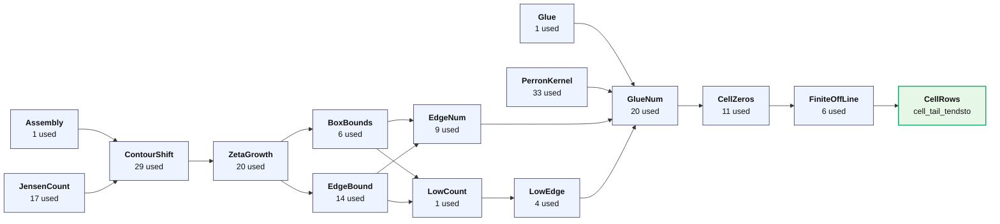

# What `CellRows.cell_tail_tendsto` rests on

[`CellRows.cell_tail_tendsto`](../lean_stage3/CellRows.md#CellRows-cell_tail_tendsto) in `lean_stage3/Stage3/CellRows.lean`, line 44.

**Why.** The tail of the zero sum is inside the error. With the height `2^(r−d)` at row `r`, the distance between the cell and its zero sum, over `√2^r`, tends to zero.

**Proves**

```lean
Tendsto (fun r : ℕ => ‖CellZeros.stencil d (fun n : ℤ => (Chebyshev.psi ((2:ℝ) ^ n) : ℂ)) (r : ℤ) - (2:ℂ) ^ (r : ℤ) * (1 - (2:ℂ)⁻¹) ^ d + ∑ ρ ∈ ZF ((2:ℝ) ^ (r - d)), term d (r : ℤ) ρ‖ / Real.sqrt 2 ^ r) atTop (𝓝 0)
```

**Needs** (its hypotheses)

  - `` d : ℕ ``

Behind it: 148 theorems and 25 definitions in 15 files. Every one is listed below; Lean recorded each step.

## The files it passes through



An arrow A → B reads "B uses something proved or defined in A"; indirect arrows are left out. Green: the theorem itself. Yellow: a file in the other tree. The number is how many of that file's declarations are on the way.

## Every declaration on the way

Files in dependency order. ★ marks what the theorem's own proof uses directly.

### [`Assembly`](../lean_stage3/Assembly.md) — 1

- [`Stage3.zeroPartialSum`](../lean_stage3/Assembly.md#Stage3-zeroPartialSum) — *def*

### [`Glue`](../lean_stage3/Glue.md) — 1

- [`Glue.Gf`](../lean_stage3/Glue.md#Glue-Gf) — *def*

### [`JensenCount`](../lean_stage3/JensenCount.md) — 17

- [`Stage3.zeta_centre_lower`](../lean_stage3/JensenCount.md#Stage3-zeta_centre_lower) — `` (1 : ℝ) / 3 ≤ ‖ζ (2 + Complex.I * T)‖ ``
- [`Stage3.zeta_disk_upper`](../lean_stage3/JensenCount.md#Stage3-zeta_disk_upper) — `` ‖ζ w‖ ≤ 28 * T ``
- [`Stage3.zeta_centre_ne_zero`](../lean_stage3/JensenCount.md#Stage3-zeta_centre_ne_zero) — `` ζ (2 + Complex.I * (T : ℂ)) ≠ 0 ``
- [`Stage3.pole_away`](../lean_stage3/JensenCount.md#Stage3-pole_away) — `` 2 * z + (2 + Complex.I * (T : ℂ)) ≠ 1 ``
- [`Stage3.pole_away_centre`](../lean_stage3/JensenCount.md#Stage3-pole_away_centre) — `` v ≠ 1 ``
- [`Stage3.zetaWindowTwo_finite`](../lean_stage3/JensenCount.md#Stage3-zetaWindowTwo_finite) — `` {ρ : ℂ | ζ ρ = 0 ∧ ‖ρ - (2 + Complex.I * (T : ℂ))‖ ≤ 2}.Finite ``
- [`Stage3.zetaWindow`](../lean_stage3/JensenCount.md#Stage3-zetaWindow) — *def*
- [`Stage3.zetaWindow_finite`](../lean_stage3/JensenCount.md#Stage3-zetaWindow_finite) — `` (zetaWindow T).Finite ``
- [`Stage3.jensenF`](../lean_stage3/JensenCount.md#Stage3-jensenF) — *def*
- [`Stage3.zeta_comp_analytic`](../lean_stage3/JensenCount.md#Stage3-zeta_comp_analytic) — `` AnalyticAt ℂ (fun z : ℂ => ζ (2 * z + (2 + Complex.I * (T : ℂ)))) w ``
- [`Stage3.jensenF_analytic`](../lean_stage3/JensenCount.md#Stage3-jensenF_analytic) — `` AnalyticOnNhd ℂ (jensenF T) (Metric.closedBall (0 : ℂ) 1) ``
- [`Stage3.jensenF_zero_eq_one`](../lean_stage3/JensenCount.md#Stage3-jensenF_zero_eq_one) — `` jensenF T 0 = 1 ``
- [`Stage3.jensenF_zeros_finite`](../lean_stage3/JensenCount.md#Stage3-jensenF_zeros_finite) — `` (SetOfZeros 1 (jensenF T)).Finite ``
- [`Stage3.jensenF_bound`](../lean_stage3/JensenCount.md#Stage3-jensenF_bound) — `` ‖jensenF T z‖ ≤ 84 * T ``
- [`Stage3.analyticOrderNatAt_fun_comp_affine`](../lean_stage3/JensenCount.md#Stage3-analyticOrderNatAt_fun_comp_affine) — `` analyticOrderNatAt (fun w : ℂ => g (a * w + b)) z = analyticOrderNatAt g (a * z + b) ``
- [`Stage3.jensenF_order`](../lean_stage3/JensenCount.md#Stage3-jensenF_order) — `` analyticOrderNatAt (jensenF T) w = analyticOrderNatAt ζ (2 * w + (2 + Complex.I * (T : ℂ))) ``
- [`Stage3.zeta_local_zero_count`](../lean_stage3/JensenCount.md#Stage3-zeta_local_zero_count) — `` ∑ ρ ∈ (zetaWindow_finite hT).toFinset, (analyticOrderNatAt ζ ρ : ℝ) ≤ 15 * Real.log T + 73 ``

### [`ContourShift`](../lean_stage3/ContourShift.md) — 29

- [`ContourShift.zeroGap`](../lean_stage3/ContourShift.md#ContourShift-zeroGap) — *def*
- [`ContourShift.zeroGap_pos`](../lean_stage3/ContourShift.md#ContourShift-zeroGap_pos) — `` 0 < zeroGap T ``
- [`ContourShift.zeroGap_le`](../lean_stage3/ContourShift.md#ContourShift-zeroGap_le) — `` zeroGap T ≤ 9/10 ``
- [`ContourShift.zeta_analyticAt`](../lean_stage3/ContourShift.md#ContourShift-zeta_analyticAt) — `` AnalyticAt ℂ riemannZeta ρ ``
- [`ContourShift.one_le_zeta_order`](../lean_stage3/ContourShift.md#ContourShift-one_le_zeta_order) — `` 1 ≤ analyticOrderNatAt riemannZeta ρ ``
- [`ContourShift.partner_zero`](../lean_stage3/ContourShift.md#ContourShift-partner_zero) — `` ∃ ρ' : ℂ, riemannZeta ρ' = 0 ∧ ρ'.im = ρ.im ∧ 1/2 ≤ ρ'.re ∧ ρ'.re < 1 ``
- [`ContourShift.mem_zetaWindow`](../lean_stage3/ContourShift.md#ContourShift-mem_zetaWindow) — `` ρ ∈ Stage3.zetaWindow T₀ ``
- [`ContourShift.goodT_exists`](../lean_stage3/ContourShift.md#ContourShift-goodT_exists) — `` ∃ T' ∈ Set.Icc T (T+1), ∀ ρ : ℂ, riemannZeta ρ = 0 → 0 < ρ.re → zeroGap T ≤ |ρ.im - T'| ``
- [`ContourShift.borderIntegrable_sum_poles`](../lean_stage3/ContourShift.md#ContourShift-borderIntegrable_sum_poles) — `` RectangleBorderIntegrable (fun s ↦ ∑ p ∈ P, A p / (s - p)) z w ``
- [`ContourShift.rectangleIntegral_sum_poles`](../lean_stage3/ContourShift.md#ContourShift-rectangleIntegral_sum_poles) — `` RectangleIntegral' (fun s ↦ ∑ p ∈ P, A p / (s - p)) z w = ∑ p ∈ P, A p ``
- [`ContourShift.residue_rectangle_multi`](../lean_stage3/ContourShift.md#ContourShift-residue_rectangle_multi) — `` RectangleIntegral' f z w = ∑ p ∈ P, A p ``
- [`ContourShift.residue_rectangle_of_local`](../lean_stage3/ContourShift.md#ContourShift-residue_rectangle_of_local) — `` RectangleIntegral' f z w = ∑ p ∈ P, A p ``
- [`ContourShift.analyticAt_dslope`](../lean_stage3/ContourShift.md#ContourShift-analyticAt_dslope) — `` AnalyticAt ℂ (dslope f p) p ``
- [`ContourShift.div_sub_eq_dslope`](../lean_stage3/ContourShift.md#ContourShift-div_sub_eq_dslope) — `` f s / (s - p) = f p / (s - p) + dslope f p s ``
- [`ContourShift.zeta_local_data`](../lean_stage3/ContourShift.md#ContourShift-zeta_local_data) — `` ∃ h : ℂ → ℂ, AnalyticAt ℂ h p ∧ ∀ᶠ s in nhdsWithin p {p}ᶜ, - deriv riemannZeta s / riemannZeta s * ((x:ℝ):ℂ) ^ s / s = h s + (-(n:ℂ) * ((x:ℝ):ℂ) ^ p / p) / (s -… ``
- [`ContourShift.zeta_order_ne_top`](../lean_stage3/ContourShift.md#ContourShift-zeta_order_ne_top) — `` analyticOrderAt riemannZeta ρ ≠ ⊤ ``
- [`ContourShift.zeta_local_data_zero`](../lean_stage3/ContourShift.md#ContourShift-zeta_local_data_zero) — `` ∃ h : ℂ → ℂ, AnalyticAt ℂ h ρ ∧ ∀ᶠ s in nhdsWithin ρ {ρ}ᶜ, - deriv riemannZeta s / riemannZeta s * ((x:ℝ):ℂ) ^ s / s = h s + (-(analyticOrderNatAt riemannZeta ρ… ``
- [`ContourShift.zeta_local_data_one`](../lean_stage3/ContourShift.md#ContourShift-zeta_local_data_one) — `` ∃ h : ℂ → ℂ, AnalyticAt ℂ h 1 ∧ ∀ᶠ s in nhdsWithin 1 {1}ᶜ, - deriv riemannZeta s / riemannZeta s * ((x:ℝ):ℂ) ^ s / s = h s + ((x:ℝ):ℂ) / (s - 1) ``
- [`ContourShift.zeta_local_data_origin`](../lean_stage3/ContourShift.md#ContourShift-zeta_local_data_origin) — `` ∃ h : ℂ → ℂ, AnalyticAt ℂ h 0 ∧ ∀ᶠ s in nhdsWithin 0 {0}ᶜ, - deriv riemannZeta s / riemannZeta s * ((x:ℝ):ℂ) ^ s / s = h s + (- deriv riemannZeta 0 / riemannZet… ``
- [`ContourShift.zeta_ne_zero_of_re_mem`](../lean_stage3/ContourShift.md#ContourShift-zeta_ne_zero_of_re_mem) — `` riemannZeta w ≠ 0 ``
- [`ContourShift.sq_mul_zeta_analyticAt_one`](../lean_stage3/ContourShift.md#ContourShift-sq_mul_zeta_analyticAt_one) — `` AnalyticAt ℂ (fun s ↦ (s - 1)^2 * riemannZeta s) 1 ``
- [`ContourShift.zeta_meromorphicOn`](../lean_stage3/ContourShift.md#ContourShift-zeta_meromorphicOn) — `` MeromorphicOn riemannZeta U ``
- [`ContourShift.zeta_zeros_rectangle_finite`](../lean_stage3/ContourShift.md#ContourShift-zeta_zeros_rectangle_finite) — `` {ρ : ℂ | riemannZeta ρ = 0 ∧ ρ ∈ Rectangle z w}.Finite ``
- [`ContourShift.order_bridge`](../lean_stage3/ContourShift.md#ContourShift-order_bridge) — `` ((riemannZeta.order ρ : ℤ) : ℂ) = ((analyticOrderNatAt riemannZeta ρ : ℕ) : ℂ) ``
- [`ContourShift.zeroPartialSum_eq_sum`](../lean_stage3/ContourShift.md#ContourShift-zeroPartialSum_eq_sum) — `` Stage3.zeroPartialSum x T' = ∑ p ∈ ZF, ((analyticOrderNatAt riemannZeta p : ℂ) * ((x : ℂ) ^ p / p)) ``
- [`ContourShift.analyticAt_conj_conj`](../lean_stage3/ContourShift.md#ContourShift-analyticAt_conj_conj) — `` AnalyticAt ℂ (fun w ↦ (starRingEnd ℂ) (g ((starRingEnd ℂ) w))) ((starRingEnd ℂ) p) ``
- [`ContourShift.zeta_order_conj`](../lean_stage3/ContourShift.md#ContourShift-zeta_order_conj) — `` analyticOrderNatAt riemannZeta ((starRingEnd ℂ) ρ) = analyticOrderNatAt riemannZeta ρ ``
- [`ContourShift.zeta_order_reflect`](../lean_stage3/ContourShift.md#ContourShift-zeta_order_reflect) — `` analyticOrderNatAt riemannZeta (1 - (starRingEnd ℂ) ρ) = analyticOrderNatAt riemannZeta ρ ``
- [`ContourShift.residue_identity`](../lean_stage3/ContourShift.md#ContourShift-residue_identity) — `` RectangleIntegral' (fun s : ℂ ↦ (- deriv riemannZeta s / riemannZeta s) * ((x:ℝ):ℂ) ^ s / s) (((-1/4 : ℝ):ℂ) - Complex.I * T') (((1 + 1/Real.log x : ℝ):ℂ) + Com… ``

### [`PerronKernel`](../lean_stage3/PerronKernel.md) — 33

- [`PerronKernel.perronI`](../lean_stage3/PerronKernel.md#PerronKernel-perronI) — *def*
- [`PerronKernel.perronδ`](../lean_stage3/PerronKernel.md#PerronKernel-perron-) — *def*
- [`PerronKernel.perronI_eq_VIntegral'`](../lean_stage3/PerronKernel.md#PerronKernel-perronI_eq_VIntegral-) — `` perronI y c T = VIntegral' (fun s : ℂ ↦ (y : ℂ) ^ s / s) c (-T) T ``
- [`PerronKernel.kernel_holo`](../lean_stage3/PerronKernel.md#PerronKernel-kernel_holo) — `` HolomorphicOn (fun s : ℂ ↦ (y : ℂ) ^ s / s) {s : ℂ | 0 < s.re} ``
- [`PerronKernel.rect_subset_right`](../lean_stage3/PerronKernel.md#PerronKernel-rect_subset_right) — `` Rectangle ((c : ℂ) - Complex.I * T) ((X : ℂ) + Complex.I * T) ⊆ {s : ℂ | 0 < s.re} ``
- [`PerronKernel.perron_kernel_coarse_lt`](../lean_stage3/PerronKernel.md#PerronKernel-perron_kernel_coarse_lt) — `` ‖perronI y c T - perronδ y‖ ≤ y ^ c ``
- [`PerronKernel.horiz_bound`](../lean_stage3/PerronKernel.md#PerronKernel-horiz_bound) — `` ‖∫ σ in a..b, (y : ℂ) ^ ((σ : ℂ) + (T' : ℂ) * Complex.I) / ((σ : ℂ) + (T' : ℂ) * Complex.I)‖ ≤ max (y ^ a) (y ^ b) / (|T'| * |Real.log y|) ``
- [`PerronKernel.perron_kernel_decay_lt`](../lean_stage3/PerronKernel.md#PerronKernel-perron_kernel_decay_lt) — `` ‖perronI y c T - perronδ y‖ ≤ y ^ c / (T * |Real.log y|) ``
- [`PerronKernel.dslope_kernel_diff`](../lean_stage3/PerronKernel.md#PerronKernel-dslope_kernel_diff) — `` Differentiable ℂ (dslope (fun s : ℂ ↦ (y : ℂ) ^ s) 0) ``
- [`PerronKernel.rect_residue`](../lean_stage3/PerronKernel.md#PerronKernel-rect_residue) — `` RectangleIntegral' (fun s : ℂ ↦ (y : ℂ) ^ s / s) (-(X:ℂ) - Complex.I * T) ((c:ℂ) + Complex.I * T) = 1 ``
- [`PerronKernel.perron_kernel_decay_gt`](../lean_stage3/PerronKernel.md#PerronKernel-perron_kernel_decay_gt) — `` ‖perronI y c T - perronδ y‖ ≤ y ^ c / (T * |Real.log y|) ``
- [`PerronKernel.perron_kernel_decay`](../lean_stage3/PerronKernel.md#PerronKernel-perron_kernel_decay) — `` ‖perronI y c T - perronδ y‖ ≤ y ^ c / (T * |Real.log y|) ``
- [`PerronKernel.coarse_gt_ineq`](../lean_stage3/PerronKernel.md#PerronKernel-coarse_gt_ineq) — `` v * Real.exp u + Real.pi - Real.arctan (v / u) ≤ Real.pi * Real.exp u ``
- [`PerronKernel.seg_inv_integral`](../lean_stage3/PerronKernel.md#PerronKernel-seg_inv_integral) — `` (∫ t in (-T)..T, ((c : ℂ) + Complex.I * t)⁻¹ * Complex.I) = 2 * Real.arctan (T / c) * Complex.I ``
- [`PerronKernel.cpow_sub_one_bound`](../lean_stage3/PerronKernel.md#PerronKernel-cpow_sub_one_bound) — `` ‖(y : ℂ) ^ s - 1‖ ≤ ‖s‖ * Real.log y * y ^ s.re ``
- [`PerronKernel.perron_kernel_coarse_gt`](../lean_stage3/PerronKernel.md#PerronKernel-perron_kernel_coarse_gt) — `` ‖perronI y c T - perronδ y‖ ≤ y ^ c ``
- [`PerronKernel.perron_kernel_coarse`](../lean_stage3/PerronKernel.md#PerronKernel-perron_kernel_coarse) — `` ‖perronI y c T - perronδ y‖ ≤ y ^ c ``
- [`PerronKernel.perron_kernel_truncated`](../lean_stage3/PerronKernel.md#PerronKernel-perron_kernel_truncated) — `` ‖perronI y c T - perronδ y‖ ≤ y ^ c * min 1 (1 / (T * |Real.log y|)) ``
- [`PerronKernel.one_sub_two_neg_rpow`](../lean_stage3/PerronKernel.md#PerronKernel-one_sub_two_neg_rpow) — `` δ / 5 ≤ 1 - (2:ℝ) ^ (-δ) ``
- [`PerronKernel.vonMangoldt_rpow_partial`](../lean_stage3/PerronKernel.md#PerronKernel-vonMangoldt_rpow_partial) — `` ∑ n ∈ s, ArithmeticFunction.vonMangoldt n * (n : ℝ) ^ (-c) ≤ 2 * (Real.log 4 + 4) / (1 - (2:ℝ) ^ (1 - c)) ``
- [`PerronKernel.vonMangoldt_rpow_tsum`](../lean_stage3/PerronKernel.md#PerronKernel-vonMangoldt_rpow_tsum) — `` ∑' n : ℕ, ArithmeticFunction.vonMangoldt n * (n : ℝ) ^ (-c) ≤ 2 * (Real.log 4 + 4) / (1 - (2:ℝ) ^ (1 - c)) ``
- [`PerronKernel.vonMangoldt_rpow_summable`](../lean_stage3/PerronKernel.md#PerronKernel-vonMangoldt_rpow_summable) — `` Summable (fun n : ℕ ↦ ArithmeticFunction.vonMangoldt n * (n : ℝ) ^ (-c)) ``
- [`PerronKernel.far_terms_sum`](../lean_stage3/PerronKernel.md#PerronKernel-far_terms_sum) — `` (∑' n : ℕ, if 1/2 ≤ |Real.log (x / n)| then ArithmeticFunction.vonMangoldt n * (x / n) ^ (1 + 1/Real.log x) / (T * |Real.log (x / n)|) else 0) ≤ 300 * x * Real.… ``
- [`PerronKernel.abs_sub_one_le_two_abs_log`](../lean_stage3/PerronKernel.md#PerronKernel-abs_sub_one_le_two_abs_log) — `` |t - 1| / 2 ≤ |Real.log t| ``
- [`PerronKernel.near_diagonal_sum`](../lean_stage3/PerronKernel.md#PerronKernel-near_diagonal_sum) — `` (∑' n : ℕ, if 0 < |Real.log (x / n)| ∧ |Real.log (x / n)| < 1/2 then ArithmeticFunction.vonMangoldt n * min 1 (1/(T * |Real.log (x / n)|)) else 0) ≤ 100 * x * R… ``
- [`PerronKernel.perronI_one_norm`](../lean_stage3/PerronKernel.md#PerronKernel-perronI_one_norm) — `` ‖perronI 1 c T‖ ≤ 1/2 ``
- [`PerronKernel.kernel_sum_bound`](../lean_stage3/PerronKernel.md#PerronKernel-kernel_sum_bound) — `` ‖(∑' n : ℕ, (ArithmeticFunction.vonMangoldt n : ℂ) * (perronI (x/n) (1 + 1/Real.log x) T - perronδ (x/n)))‖ ≤ 600 * x * Real.log (x * T) ^ 2 / T + 12 * Real.log… ``
- [`PerronKernel.delta_sum_close`](../lean_stage3/PerronKernel.md#PerronKernel-delta_sum_close) — `` ‖(Chebyshev.psi x : ℂ) - ∑' n : ℕ, (ArithmeticFunction.vonMangoldt n : ℂ) * perronδ (x / n)‖ ≤ Real.log x ``
- [`PerronKernel.kernel_diff_summable`](../lean_stage3/PerronKernel.md#PerronKernel-kernel_diff_summable) — `` Summable (fun n : ℕ ↦ (ArithmeticFunction.vonMangoldt n : ℂ) * (perronI (x/n) (1 + 1/Real.log x) T - perronδ (x/n))) ``
- [`PerronKernel.perron_to_psi`](../lean_stage3/PerronKernel.md#PerronKernel-perron_to_psi) — `` ‖(Chebyshev.psi x : ℂ) - ∑' n : ℕ, (ArithmeticFunction.vonMangoldt n : ℂ) * perronI (x/n) (1 + 1/Real.log x) T‖ ≤ 600 * x * Real.log (x * T) ^ 2 / T + 13 * Real… ``
- [`PerronKernel.tsum_vonMangoldt_div_cpow`](../lean_stage3/PerronKernel.md#PerronKernel-tsum_vonMangoldt_div_cpow) — `` (∑' n : ℕ, (ArithmeticFunction.vonMangoldt n : ℂ) * ((x / n : ℝ) : ℂ) ^ s) = (- deriv riemannZeta s / riemannZeta s) * ((x:ℝ):ℂ) ^ s ``
- [`PerronKernel.perron_sum_eq_integral`](../lean_stage3/PerronKernel.md#PerronKernel-perron_sum_eq_integral) — `` (∑' n : ℕ, (ArithmeticFunction.vonMangoldt n : ℂ) * perronI (x/n) (1 + 1/Real.log x) T) = (2 * (Real.pi:ℂ) * Complex.I)⁻¹ * ∫ t in (-T)..T, (- deriv riemannZeta… ``
- [`PerronKernel.explicit_formula_perron`](../lean_stage3/PerronKernel.md#PerronKernel-explicit_formula_perron) — `` ‖(Chebyshev.psi x : ℂ) - (2 * (Real.pi:ℂ) * Complex.I)⁻¹ * ∫ t in (-T)..T, (- deriv riemannZeta (((1 + 1/Real.log x : ℝ):ℂ) + Complex.I * t) / riemannZeta (((1 … ``

### [`ZetaGrowth`](../lean_stage3/ZetaGrowth.md) — 20

- [`ZetaGrowth.emA`](../lean_stage3/ZetaGrowth.md#ZetaGrowth-emA) — *def*
- [`ZetaGrowth.emA_nonneg`](../lean_stage3/ZetaGrowth.md#ZetaGrowth-emA_nonneg) — `` 0 ≤ emA x ``
- [`ZetaGrowth.emA_le`](../lean_stage3/ZetaGrowth.md#ZetaGrowth-emA_le) — `` emA x ≤ 1/8 ``
- [`ZetaGrowth.emA_natCast`](../lean_stage3/ZetaGrowth.md#ZetaGrowth-emA_natCast) — `` emA n = 0 ``
- [`ZetaGrowth.emA_eq_poly`](../lean_stage3/ZetaGrowth.md#ZetaGrowth-emA_eq_poly) — `` emA x = ((x - n) - (x - n)^2)/2 ``
- [`ZetaGrowth.integrable_emA_tail`](../lean_stage3/ZetaGrowth.md#ZetaGrowth-integrable_emA_tail) — `` IntegrableOn (fun x : ℝ ↦ (emA x : ℂ) * (x : ℂ) ^ (-(s+2))) (Ioi (N:ℝ)) ``
- [`ZetaGrowth.interval_ibp`](../lean_stage3/ZetaGrowth.md#ZetaGrowth-interval_ibp) — `` ∫ x in (n:ℝ)..((n:ℝ)+1), ((⌊x⌋ : ℂ) + 1/2 - (x:ℂ)) * (x:ℂ) ^ (-(s+1)) = (s+1) * ∫ x in (n:ℝ)..((n:ℝ)+1), (emA x : ℂ) * (x:ℂ) ^ (-(s+2)) ``
- [`ZetaGrowth.tail_ibp`](../lean_stage3/ZetaGrowth.md#ZetaGrowth-tail_ibp) — `` ∫ x in Ioi (N:ℝ), ((⌊x⌋ : ℂ) + 1/2 - (x:ℂ)) * (x:ℂ) ^ (-(s+1)) = (s+1) * ∫ x in Ioi (N:ℝ), (emA x : ℂ) * (x:ℂ) ^ (-(s+2)) ``
- [`ZetaGrowth.zeta1`](../lean_stage3/ZetaGrowth.md#ZetaGrowth-zeta1) — *def*
- [`ZetaGrowth.zeta1_eq_zeta`](../lean_stage3/ZetaGrowth.md#ZetaGrowth-zeta1_eq_zeta) — `` zeta1 N s = riemannZeta s ``
- [`ZetaGrowth.tail_differentiableAt`](../lean_stage3/ZetaGrowth.md#ZetaGrowth-tail_differentiableAt) — `` DifferentiableAt ℂ (fun w : ℂ ↦ ∫ x in Ioi (N:ℝ), (emA x : ℂ) * (x:ℂ) ^ (-(w+2))) z ``
- [`ZetaGrowth.stripRegion`](../lean_stage3/ZetaGrowth.md#ZetaGrowth-stripRegion) — *def*
- [`ZetaGrowth.isOpen_stripRegion`](../lean_stage3/ZetaGrowth.md#ZetaGrowth-isOpen_stripRegion) — `` IsOpen stripRegion ``
- [`ZetaGrowth.preconnected_stripRegion`](../lean_stage3/ZetaGrowth.md#ZetaGrowth-preconnected_stripRegion) — `` IsPreconnected stripRegion ``
- [`ZetaGrowth.zeta1_analyticOnNhd`](../lean_stage3/ZetaGrowth.md#ZetaGrowth-zeta1_analyticOnNhd) — `` AnalyticOnNhd ℂ (zeta1 N) stripRegion ``
- [`ZetaGrowth.zeta1_eq_zeta_strip`](../lean_stage3/ZetaGrowth.md#ZetaGrowth-zeta1_eq_zeta_strip) — `` Set.EqOn (zeta1 N) riemannZeta stripRegion ``
- [`ZetaGrowth.tail_norm_le`](../lean_stage3/ZetaGrowth.md#ZetaGrowth-tail_norm_le) — `` ‖∫ x in Ioi (N:ℝ), (emA x : ℂ) * (x:ℂ) ^ (-(s+2))‖ ≤ (1/4) * (N:ℝ) ^ (-s.re - 1) ``
- [`ZetaGrowth.sum_norm_le`](../lean_stage3/ZetaGrowth.md#ZetaGrowth-sum_norm_le) — `` ‖∑ n ∈ Finset.range N, 1 / ((n:ℂ) + 1) ^ s‖ ≤ (N:ℝ) * (N:ℝ) ^ ((1:ℝ)/2) ``
- [`ZetaGrowth.zeta_growth_strip`](../lean_stage3/ZetaGrowth.md#ZetaGrowth-zeta_growth_strip) — `` ‖riemannZeta s‖ ≤ 15 * |s.im| ^ 2 ``
- [`ZetaGrowth.sq_mul_zeta_analytic`](../lean_stage3/ZetaGrowth.md#ZetaGrowth-sq_mul_zeta_analytic) — `` AnalyticAt ℂ (fun z : ℂ ↦ (z - 1)^2 * riemannZeta z) s ``

### [`BoxBounds`](../lean_stage3/BoxBounds.md) — 6

- [`BoxBounds.norm_le_of_sq`](../lean_stage3/BoxBounds.md#BoxBounds-norm_le_of_sq) — `` ‖z‖ ≤ c ``
- [`BoxBounds.sq_zeta_box`](../lean_stage3/BoxBounds.md#BoxBounds-sq_zeta_box) — `` ‖(s - 1) ^ 2 * riemannZeta s‖ ≤ 135 ``
- [`BoxBounds.sq_zeta_band_explicit`](../lean_stage3/BoxBounds.md#BoxBounds-sq_zeta_band_explicit) — `` ‖(s - 1) ^ 2 * riemannZeta s‖ ≤ 135 * (2 + |s.im|) ^ 4 ``
- [`BoxBounds.norm_zeta_three_halves_le`](../lean_stage3/BoxBounds.md#BoxBounds-norm_zeta_three_halves_le) — `` ‖riemannZeta (3 / 2)‖ ≤ 7 / 2 ``
- [`BoxBounds.one_le_norm_zeta_three`](../lean_stage3/BoxBounds.md#BoxBounds-one_le_norm_zeta_three) — `` 1 ≤ ‖riemannZeta 3‖ ``
- [`BoxBounds.zeta_ratio_ge`](../lean_stage3/BoxBounds.md#BoxBounds-zeta_ratio_ge) — `` 2 / 7 ≤ ‖riemannZeta 3 / riemannZeta (3 / 2)‖ ``

### [`EdgeBound`](../lean_stage3/EdgeBound.md) — 14

- [`EdgeBound.c0`](../lean_stage3/EdgeBound.md#EdgeBound-c0) — *def*
- [`EdgeBound.gz`](../lean_stage3/EdgeBound.md#EdgeBound-gz) — *def*
- [`EdgeBound.gz_analytic`](../lean_stage3/EdgeBound.md#EdgeBound-gz_analytic) — `` AnalyticAt ℂ gz s ``
- [`EdgeBound.c0_im`](../lean_stage3/EdgeBound.md#EdgeBound-c0_im) — `` (c0 T').im = T' ``
- [`EdgeBound.c0_re`](../lean_stage3/EdgeBound.md#EdgeBound-c0_re) — `` (c0 T').re = 3/2 ``
- [`EdgeBound.gz_lower`](../lean_stage3/EdgeBound.md#EdgeBound-gz_lower) — `` 4 * ‖riemannZeta 3 / riemannZeta (3/2)‖ ≤ ‖gz (c0 T')‖ ``
- [`EdgeBound.zeta_ratio_pos`](../lean_stage3/EdgeBound.md#EdgeBound-zeta_ratio_pos) — `` (0:ℝ) < ‖riemannZeta 3 / riemannZeta (3/2)‖ ``
- [`EdgeBound.gz_c0_ne`](../lean_stage3/EdgeBound.md#EdgeBound-gz_c0_ne) — `` gz (c0 T') ≠ 0 ``
- [`EdgeBound.gz_zero_cases`](../lean_stage3/EdgeBound.md#EdgeBound-gz_zero_cases) — `` w = 1 ∨ riemannZeta w = 0 ``
- [`EdgeBound.gz_zeros_ball_finite`](../lean_stage3/EdgeBound.md#EdgeBound-gz_zeros_ball_finite) — `` {w : ℂ | gz w = 0 ∧ ‖w - c0 T'‖ ≤ ρ}.Finite ``
- [`EdgeBound.gz_order_eq`](../lean_stage3/EdgeBound.md#EdgeBound-gz_order_eq) — `` analyticOrderNatAt gz w = analyticOrderNatAt riemannZeta w ``
- [`EdgeBound.ball_zero_shape`](../lean_stage3/EdgeBound.md#EdgeBound-ball_zero_shape) — `` riemannZeta w = 0 ∧ (0 < w.re ∧ w.re < 1) ∧ |w.im - T'| ≤ 46/25 ``
- [`EdgeBound.gz_logderiv`](../lean_stage3/EdgeBound.md#EdgeBound-gz_logderiv) — `` deriv gz u / gz u = 2/(u - 1) + deriv riemannZeta u / riemannZeta u ``
- [`EdgeBound.deriv_zeta_conj`](../lean_stage3/EdgeBound.md#EdgeBound-deriv_zeta_conj) — `` deriv riemannZeta ((starRingEnd ℂ) s) = (starRingEnd ℂ) (deriv riemannZeta s) ``

### [`EdgeNum`](../lean_stage3/EdgeNum.md) — 9

- [`EdgeBound.C1n`](../lean_stage3/EdgeNum.md#EdgeBound-C1n) — *def*
- [`EdgeBound.C1n_pos`](../lean_stage3/EdgeNum.md#EdgeBound-C1n_pos) — `` 0 < C1n ``
- [`EdgeBound.gz_partial_fraction_num`](../lean_stage3/EdgeNum.md#EdgeBound-gz_partial_fraction_num) — `` ∀ T' : ℝ, 2 ≤ T' → ∀ u : ℂ, u.im = T' → -1/4 ≤ u.re → u.re ≤ 2 → gz u ≠ 0 → ‖deriv gz u / gz u - ∑ w ∈ (gz_zeros_ball_finite T' (by norm_num : (0:ℝ) ≤ 46/25)).t… ``
- [`EdgeBound.C2n`](../lean_stage3/EdgeNum.md#EdgeBound-C2n) — *def*
- [`EdgeBound.C2n_pos`](../lean_stage3/EdgeNum.md#EdgeBound-C2n_pos) — `` 0 < C2n ``
- [`EdgeBound.ball_order_sum_le_num`](../lean_stage3/EdgeNum.md#EdgeBound-ball_order_sum_le_num) — `` ∀ T' : ℝ, 2 ≤ T' → (∑ w ∈ (gz_zeros_ball_finite T' (by norm_num : (0:ℝ) ≤ 46/25)).toFinset, (analyticOrderNatAt gz w : ℝ)) ≤ C2n * Real.log T' ``
- [`EdgeBound.Cen`](../lean_stage3/EdgeNum.md#EdgeBound-Cen) — *def*
- [`EdgeBound.Cen_pos`](../lean_stage3/EdgeNum.md#EdgeBound-Cen_pos) — `` 0 < Cen ``
- [`EdgeBound.edge_bound_core_num`](../lean_stage3/EdgeNum.md#EdgeBound-edge_bound_core_num) — `` ∀ t : ℝ, 2 ≤ t → ∀ u : ℂ, u.im = t → -1/4 ≤ u.re → u.re ≤ 2 → riemannZeta u ≠ 0 → ∀ δ : ℝ, 0 < δ → δ ≤ 1 → (∀ w ∈ (gz_zeros_ball_finite t (by norm_num : (0:ℝ) ≤… ``

### [`LowCount`](../lean_stage3/LowCount.md) — 1

- [`EdgeBound.gz_c0_lower`](../lean_stage3/LowCount.md#EdgeBound-gz_c0_lower) — `` 1 / 14 ≤ ‖gz (c0 T')‖ ``

### [`LowEdge`](../lean_stage3/LowEdge.md) — 4

- [`EdgeBound.low_ball_count_wide`](../lean_stage3/LowEdge.md#EdgeBound-low_ball_count_wide) — `` (∑ w ∈ (gz_zeros_ball_finite T' (by norm_num : (0 : ℝ) ≤ 46 / 25)).toFinset, (analyticOrderNatAt gz w : ℝ)) ≤ 250 ``
- [`EdgeBound.gz_partial_fraction_low`](../lean_stage3/LowEdge.md#EdgeBound-gz_partial_fraction_low) — `` ‖deriv gz u / gz u - ∑ w ∈ (gz_zeros_ball_finite T' (by norm_num : (0:ℝ) ≤ 46/25)).toFinset, (analyticOrderNatAt gz w : ℂ) / (u - w)‖ ≤ 1617537 ``
- [`EdgeBound.logDerivZeta_low_edge`](../lean_stage3/LowEdge.md#EdgeBound-logDerivZeta_low_edge) — `` ‖deriv riemannZeta u / riemannZeta u‖ ≤ 1620000 ``
- [`EdgeBound.logDerivZeta_short_segment`](../lean_stage3/LowEdge.md#EdgeBound-logDerivZeta_short_segment) — `` ‖deriv riemannZeta (((-1/4 : ℝ):ℂ) + t * Complex.I) / riemannZeta (((-1/4 : ℝ):ℂ) + t * Complex.I)‖ ≤ 1620000 ``

### [`GlueNum`](../lean_stage3/GlueNum.md) — 20

- [`Glue.Csn`](../lean_stage3/GlueNum.md#Glue-Csn) — *def*
- [`Glue.Csn_pos`](../lean_stage3/GlueNum.md#Glue-Csn_pos) — `` 0 < Csn ``
- [`Glue.Cpn`](../lean_stage3/GlueNum.md#Glue-Cpn) — *def*
- [`Glue.Cpn_pos`](../lean_stage3/GlueNum.md#Glue-Cpn_pos) — `` 0 < Cpn ``
- [`Glue.Chn`](../lean_stage3/GlueNum.md#Glue-Chn) — *def*
- [`Glue.Chn_pos`](../lean_stage3/GlueNum.md#Glue-Chn_pos) — `` 0 < Chn ``
- [`Glue.Dln`](../lean_stage3/GlueNum.md#Glue-Dln) — *def*
- [`Glue.Dln_pos`](../lean_stage3/GlueNum.md#Glue-Dln_pos) — `` 0 < Dln ``
- ★ [`Glue.c1n`](../lean_stage3/GlueNum.md#Glue-c1n) — *def*
- ★ [`Glue.c3n`](../lean_stage3/GlueNum.md#Glue-c3n) — *def*
- ★ [`Glue.c4n`](../lean_stage3/GlueNum.md#Glue-c4n) — *def*
- [`Glue.c1n_nonneg`](../lean_stage3/GlueNum.md#Glue-c1n_nonneg) — `` 0 ≤ c1n ``
- [`Glue.c3n_nonneg`](../lean_stage3/GlueNum.md#Glue-c3n_nonneg) — `` 0 ≤ c3n ``
- [`Glue.c4n_nonneg`](../lean_stage3/GlueNum.md#Glue-c4n_nonneg) — `` 0 ≤ c4n ``
- [`Glue.band_order_sum_le_num`](../lean_stage3/GlueNum.md#Glue-band_order_sum_le_num) — `` ∀ T : ℝ, 2 ≤ T → ∀ F : Finset ℂ, (∀ ρ ∈ F, riemannZeta ρ = 0 ∧ (0 < ρ.re ∧ ρ.re < 1) ∧ T ≤ |ρ.im| ∧ |ρ.im| ≤ T + 1) → (∑ ρ ∈ F, (analyticOrderNatAt riemannZeta … ``
- [`Glue.zeroPartialSum_swap_num`](../lean_stage3/GlueNum.md#Glue-zeroPartialSum_swap_num) — `` ∀ x T T' : ℝ, 16 ≤ x → 2 ≤ T → T ≤ T' → T' ≤ T + 1 → ‖Stage3.zeroPartialSum x T' - Stage3.zeroPartialSum x T‖ ≤ Csn * x * Real.log T / T ``
- [`Glue.zeta_logderiv_good_bound_num`](../lean_stage3/GlueNum.md#Glue-zeta_logderiv_good_bound_num) — `` ∀ T T' : ℝ, 2 ≤ T → T' ∈ Set.Icc T (T+1) → (∀ ρ : ℂ, riemannZeta ρ = 0 → 0 < ρ.re → ContourShift.zeroGap T ≤ |ρ.im - T'|) → ∀ u : ℂ, |u.im| = T' → -1/4 ≤ u.re →… ``
- [`Glue.edge_horizontal_bound_num`](../lean_stage3/GlueNum.md#Glue-edge_horizontal_bound_num) — `` ∀ x T T' : ℝ, 16 ≤ x → 2 ≤ T → T' ∈ Set.Icc T (T+1) → (∀ ρ : ℂ, riemannZeta ρ = 0 → 0 < ρ.re → ContourShift.zeroGap T ≤ |ρ.im - T'|) → ∀ y : ℝ, |y| = T' → ‖HInt… ``
- [`Glue.edge_left_sharp_num`](../lean_stage3/GlueNum.md#Glue-edge_left_sharp_num) — `` ∀ x T' : ℝ, 16 ≤ x → 2 ≤ T' → T' ≤ 2*x^2 → ‖VIntegral (Gf x) (-1/4) (-T') T'‖ ≤ 72 * Dln * ((Real.log x)^2 * x ^ (-(1:ℝ)/4)) ``
- [`Glue.explicit_formula_split_num`](../lean_stage3/GlueNum.md#Glue-explicit_formula_split_num) — `` ∀ x T : ℝ, 16 ≤ x → 2 ≤ T → T ≤ x^2 → ‖(Chebyshev.psi x : ℂ) - (x:ℂ) + Stage3.zeroPartialSum x T‖ ≤ c1n * x * Real.log (x*T)^2 / T + c3n * Real.log x + c4n * ((… ``

### [`CellZeros`](../lean_stage3/CellZeros.md) — 11

- ★ [`CellZeros.stencil`](../lean_stage3/CellZeros.md#CellZeros-stencil) — *def*
- [`CellZeros.stencil_add`](../lean_stage3/CellZeros.md#CellZeros-stencil_add) — `` stencil d (fun n => a n + b n) r = stencil d a r + stencil d b r ``
- [`CellZeros.stencil_sub`](../lean_stage3/CellZeros.md#CellZeros-stencil_sub) — `` stencil d (fun n => a n - b n) r = stencil d a r - stencil d b r ``
- [`CellZeros.stencil_const_mul`](../lean_stage3/CellZeros.md#CellZeros-stencil_const_mul) — `` stencil d (fun n => c * a n) r = c * stencil d a r ``
- [`CellZeros.stencil_sum`](../lean_stage3/CellZeros.md#CellZeros-stencil_sum) — `` stencil d (fun n => ∑ i ∈ s, f i n) r = ∑ i ∈ s, stencil d (f i) r ``
- [`CellZeros.stencil_mode`](../lean_stage3/CellZeros.md#CellZeros-stencil_mode) — `` stencil d (fun n : ℤ => w ^ n) r = w ^ r * (1 - w⁻¹) ^ d ``
- [`CellZeros.norm_stencil_le`](../lean_stage3/CellZeros.md#CellZeros-norm_stencil_le) — `` ‖stencil d a r‖ ≤ ∑ j ∈ range (d + 1), (d.choose j : ℝ) * B j ``
- [`CellZeros.cpow_two_zpow`](../lean_stage3/CellZeros.md#CellZeros-cpow_two_zpow) — `` (((2:ℝ) ^ n : ℝ) : ℂ) ^ ρ = ((2:ℂ) ^ ρ) ^ n ``
- [`CellZeros.two_cpow_ne_zero`](../lean_stage3/CellZeros.md#CellZeros-two_cpow_ne_zero) — `` (2:ℂ) ^ ρ ≠ 0 ``
- [`CellZeros.stencil_zeroPartialSum`](../lean_stage3/CellZeros.md#CellZeros-stencil_zeroPartialSum) — `` stencil d (fun n : ℤ => Stage3.zeroPartialSum ((2:ℝ) ^ n) T) r = ∑' ρ : {ρ : Kadiri.NontrivialZeros // |(ρ : ℂ).im| < T}, ((riemannZeta.order ((ρ : Kadiri.Nontr… ``
- [`CellZeros.cell_eq_zero_sum`](../lean_stage3/CellZeros.md#CellZeros-cell_eq_zero_sum) — `` ‖stencil d (fun n : ℤ => (Chebyshev.psi ((2:ℝ) ^ n) : ℂ)) r - (2:ℂ) ^ r * (1 - (2:ℂ)⁻¹) ^ d + ∑' ρ : {ρ : Kadiri.NontrivialZeros // |(ρ : ℂ).im| < T}, ((riemann… ``

### [`FiniteOffLine`](../lean_stage3/FiniteOffLine.md) — 6

- ★ [`FiniteOffLine.ZF`](../lean_stage3/FiniteOffLine.md#FiniteOffLine-ZF) — *def*
- [`FiniteOffLine.mem_ZF`](../lean_stage3/FiniteOffLine.md#FiniteOffLine-mem_ZF) — `` ρ ∈ ZF T ↔ |(ρ : ℂ).im| < T ``
- [`FiniteOffLine.tsum_sub_eq_sum`](../lean_stage3/FiniteOffLine.md#FiniteOffLine-tsum_sub_eq_sum) — `` ∑' σ : {ρ : NontrivialZeros // |(ρ : ℂ).im| < T}, f σ.1 = ∑ ρ ∈ ZF T, f ρ ``
- ★ [`FiniteOffLine.term`](../lean_stage3/FiniteOffLine.md#FiniteOffLine-term) — *def*
- [`FiniteOffLine.cell_zero_sum_finset`](../lean_stage3/FiniteOffLine.md#FiniteOffLine-cell_zero_sum_finset) — `` ‖CellZeros.stencil d (fun n : ℤ => (Chebyshev.psi ((2:ℝ) ^ n) : ℂ)) r - (2:ℂ) ^ r * (1 - (2:ℂ)⁻¹) ^ d + ∑ ρ ∈ ZF T, term d r ρ‖ ≤ ∑ j ∈ range (d + 1), (d.choose… ``
- [`FiniteOffLine.err_le`](../lean_stage3/FiniteOffLine.md#FiniteOffLine-err_le) — `` ∑ j ∈ range (d + 1), (d.choose j : ℝ) * (Glue.c1n * (2:ℝ) ^ ((r : ℤ) - (j : ℤ)) * Real.log ((2:ℝ) ^ ((r : ℤ) - (j : ℤ)) * (2:ℝ) ^ (K + 1)) ^ 2 / (2:ℝ) ^ (K + 1)… ``

### [`CellRows`](../lean_stage3/CellRows.md) — 1

- ★ [`CellRows.cell_eq_zero_sum_rows`](../lean_stage3/CellRows.md#CellRows-cell_eq_zero_sum_rows) — `` ‖CellZeros.stencil d (fun n : ℤ => (Chebyshev.psi ((2:ℝ) ^ n) : ℂ)) (r : ℤ) - (2:ℂ) ^ (r : ℤ) * (1 - (2:ℂ)⁻¹) ^ d + ∑ ρ ∈ ZF ((2:ℝ) ^ (K + 1)), term d (r : ℤ) ρ… ``

