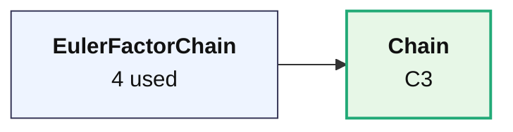

# What `Chain.C3` rests on

[`Chain.C3`](../lean/Chain.md#Chain-C3) in `lean/Chain.lean`, line 280.

**Why.** C3, now unconditional. Same arrow as `C3_of_A4_C2`, with `A4` and `C2` supplied. No mode's depth-`N` gain escapes the bound, with nothing assumed.

**Proves**

```lean
StmtC3 b
```

**Needs** (its hypotheses)

  - `` hb : 0 < b ``

Behind it: 11 theorems and 9 definitions in 2 files. Every one is listed below; Lean recorded each step.

## The files it passes through



An arrow A → B reads "B uses something proved or defined in A"; indirect arrows are left out. Green: the theorem itself. Yellow: a file in the other tree. The number is how many of that file's declarations are on the way.

## Every declaration on the way

Files in dependency order. ★ marks what the theorem's own proof uses directly.

### [`EulerFactorChain`](../lean/EulerFactorChain.md) — 4

- [`EulerFactorChain.sym`](../lean/EulerFactorChain.md#EulerFactorChain-sym) — *def*
- [`EulerFactorChain.symbol_of_backward_difference`](../lean/EulerFactorChain.md#EulerFactorChain-symbol_of_backward_difference) — `` (b : ℂ) ^ (r * ρ) - (b : ℂ) ^ ((r - 1) * ρ) = sym b ρ * (b : ℂ) ^ (r * ρ) ``
- [`EulerFactorChain.cpow_rect_on_critical_line`](../lean/EulerFactorChain.md#EulerFactorChain-cpow_rect_on_critical_line) — `` (b : ℂ) ^ (-((1 : ℂ)/2 + γ * I)) = ((b ^ (-(1:ℝ)/2) * Real.cos (γ * Real.log b) : ℝ) : ℂ) + ((-(b ^ (-(1:ℝ)/2) * Real.sin (γ * Real.log b)) : ℝ) : ℂ) * I ``
- [`EulerFactorChain.gain_sq_on_critical_line`](../lean/EulerFactorChain.md#EulerFactorChain-gain_sq_on_critical_line) — `` ‖1 - (b : ℂ) ^ (-((1 : ℂ)/2 + γ * I))‖ ^ 2 = 1 - 2 * b ^ (-(1:ℝ)/2) * Real.cos (γ * Real.log b) + b ^ (-(1:ℝ)) ``

### [`Chain`](../lean/Chain.md) — 16

- [`Chain.Sym`](../lean/Chain.md#Chain-Sym) — *def*
- [`Chain.mode`](../lean/Chain.md#Chain-mode) — *def*
- [`Chain.bdiff`](../lean/Chain.md#Chain-bdiff) — *def*
- [`Chain.StmtA1`](../lean/Chain.md#Chain-StmtA1) — *def*
- [`Chain.StmtA4`](../lean/Chain.md#Chain-StmtA4) — *def*
- [`Chain.StmtC1`](../lean/Chain.md#Chain-StmtC1) — *def*
- [`Chain.StmtC2`](../lean/Chain.md#Chain-StmtC2) — *def*
- ★ [`Chain.StmtC3`](../lean/Chain.md#Chain-StmtC3) — *def*
- [`Chain.bdiff_smul`](../lean/Chain.md#Chain-bdiff_smul) — `` bdiff (fun r => k * f r) = fun r => k * bdiff f r ``
- [`Chain.A4_of_A1`](../lean/Chain.md#Chain-A4_of_A1) — `` StmtA4 b ρ ``
- [`Chain.C2_of_C1`](../lean/Chain.md#Chain-C2_of_C1) — `` StmtC2 b ``
- ★ [`Chain.C3_of_A4_C2`](../lean/Chain.md#Chain-C3_of_A4_C2) — `` StmtC3 b ``
- [`Chain.C1`](../lean/Chain.md#Chain-C1) — `` StmtC1 b ``
- ★ [`Chain.C2`](../lean/Chain.md#Chain-C2) — `` StmtC2 b ``
- [`Chain.A1`](../lean/Chain.md#Chain-A1) — `` StmtA1 b ρ ``
- ★ [`Chain.A4`](../lean/Chain.md#Chain-A4) — `` StmtA4 b ρ ``

