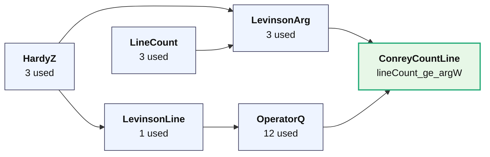

# What `ConreyCount.lineCount_ge_argW` rests on

[`ConreyCount.lineCount_ge_argW`](../lean_stage3/ConreyCountLine.md#ConreyCount-lineCount_ge_argW) in `lean_stage3/Stage3/ConreyCountLine.lean`, line 108.

**Why.** The crossings of `W`. If a continuous argument `φ` of `W` along `[1/2 + a i, 1/2 + b i]` moves by at least `kπ`, and `Q(1/2) ≠ 0`, then at least `k` zeros of `ζ` lie on the line up to height `T ≥ b`, with multiplicity.

**Proves**

```lean
(k : ℤ) ≤ lineCount T
```

**Needs** (its hypotheses)

  - `` hQ : ∀ x : ℝ, Q.derivative.eval x = Q.derivative.eval (1 - x) ``
  - `` hQh : Q.eval (1/2) ≠ 0 ``
  - `` ha : 0 < a ``
  - `` hab : a ≤ b ``
  - `` hbT : b ≤ T ``
  - `` hφc : ContinuousOn φ (Set.Icc a b) ``
  - `` hφ : ∀ t ∈ Set.Icc a b, lineW Q L t = ‖lineW Q L t‖ * Complex.exp (φ t * Complex.I) ``
  - `` hk : (k : ℝ) * Real.pi ≤ |φ b - φ a| ``

Behind it: 18 theorems and 5 definitions in 6 files. Every one is listed below; Lean recorded each step.

## The files it passes through



An arrow A → B reads "B uses something proved or defined in A"; indirect arrows are left out. Green: the theorem itself. Yellow: a file in the other tree. The number is how many of that file's declarations are on the way.

## Every declaration on the way

Files in dependency order. ★ marks what the theorem's own proof uses directly.

### [`HardyZ`](../lean_stage3/HardyZ.md) — 3

- [`HardyZ.completedRiemannZeta_conj_of_re_pos`](../lean_stage3/HardyZ.md#HardyZ-completedRiemannZeta_conj_of_re_pos) — `` completedRiemannZeta (conj s) = conj (completedRiemannZeta s) ``
- [`HardyZ.re_line`](../lean_stage3/HardyZ.md#HardyZ-re_line) — `` ((1 / 2 : ℂ) + t * I).re = 1 / 2 ``
- [`HardyZ.xi_line_real`](../lean_stage3/HardyZ.md#HardyZ-xi_line_real) — `` (completedRiemannZeta (1/2 + t * Complex.I)).im = 0 ``

### [`LevinsonLine`](../lean_stage3/LevinsonLine.md) — 1

- [`LevinsonLine.line_facts`](../lean_stage3/LevinsonLine.md#LevinsonLine-line_facts) — `` ((1/2 : ℂ) + t * I) ≠ 0 ∧ ((1/2 : ℂ) + t * I) ≠ 1 ∧ 0 < ((1/2 : ℂ) + t * I).re ``

### [`LineCount`](../lean_stage3/LineCount.md) — 3

- [`LineCount.zerosUpTo`](../lean_stage3/LineCount.md#LineCount-zerosUpTo) — *def*
- ★ [`LineCount.lineCount`](../lean_stage3/LineCount.md#LineCount-lineCount) — *def*
- [`LineCount.mem_zerosUpTo`](../lean_stage3/LineCount.md#LineCount-mem_zerosUpTo) — `` ρ ∈ zerosUpTo T ↔ 0 < (ρ : ℂ).im ∧ (ρ : ℂ).im ≤ T ``

### [`LevinsonArg`](../lean_stage3/LevinsonArg.md) — 3

- [`LevinsonArg.crossings_of_le`](../lean_stage3/LevinsonArg.md#LevinsonArg-crossings_of_le) — `` ∃ t : Fin k → ℝ, StrictMono t ∧ (∀ i, t i ∈ Set.Icc a b) ∧ ∀ i, Real.cos (φ (t i)) = 0 ``
- ★ [`LevinsonArg.crossings_of_arg`](../lean_stage3/LevinsonArg.md#LevinsonArg-crossings_of_arg) — `` ∃ t : Fin k → ℝ, StrictMono t ∧ (∀ i, t i ∈ Set.Icc a b) ∧ ∀ i, Real.cos (φ (t i)) = 0 ``
- ★ [`LevinsonArg.distinct_line_zeros_le_lineCount`](../lean_stage3/LevinsonArg.md#LevinsonArg-distinct_line_zeros_le_lineCount) — `` (k : ℤ) ≤ lineCount T ``

### [`OperatorQ`](../lean_stage3/OperatorQ.md) — 12

- [`OperatorQ.domXi`](../lean_stage3/OperatorQ.md#OperatorQ-domXi) — *def*
- [`OperatorQ.line_mem`](../lean_stage3/OperatorQ.md#OperatorQ-line_mem) — `` ((1/2 : ℂ) + t * I) ∈ domXi ``
- [`OperatorQ.differentiableAt_iteratedDeriv`](../lean_stage3/OperatorQ.md#OperatorQ-differentiableAt_iteratedDeriv) — `` DifferentiableAt ℂ (iteratedDeriv k completedRiemannZeta) ((1/2 : ℂ) + t * I) ``
- [`OperatorQ.im_I_mul_deriv`](../lean_stage3/OperatorQ.md#OperatorQ-im_I_mul_deriv) — `` (I * deriv F ((1/2 : ℂ) + t * I)).im = 0 ``
- [`OperatorQ.im_I_pow_iteratedDeriv`](../lean_stage3/OperatorQ.md#OperatorQ-im_I_pow_iteratedDeriv) — `` (I ^ k * iteratedDeriv k completedRiemannZeta ((1/2 : ℂ) + t * I)).im = 0 ``
- [`OperatorQ.re_iteratedDeriv_odd`](../lean_stage3/OperatorQ.md#OperatorQ-re_iteratedDeriv_odd) — `` (iteratedDeriv k completedRiemannZeta ((1/2 : ℂ) + t * I)).re = 0 ``
- [`OperatorQ.re_sum_line`](../lean_stage3/OperatorQ.md#OperatorQ-re_sum_line) — `` (∑ k ∈ Finset.range (n + 1), (a k : ℂ) * iteratedDeriv k completedRiemannZeta ((1/2 : ℂ) + t * I)).re = a 0 * (completedRiemannZeta ((1/2 : ℂ) + t * I)).re ``
- [`OperatorQ.coeff_comp_neg_X`](../lean_stage3/OperatorQ.md#OperatorQ-coeff_comp_neg_X) — `` (p.comp (-X)).coeff n = (-1) ^ n * p.coeff n ``
- [`OperatorQ.taylor_coeff_even_eq_zero`](../lean_stage3/OperatorQ.md#OperatorQ-taylor_coeff_even_eq_zero) — `` (taylor (1/2 : ℝ) Q).coeff k = 0 ``
- [`OperatorQ.W`](../lean_stage3/OperatorQ.md#OperatorQ-W) — *def*
- [`OperatorQ.re_W_line`](../lean_stage3/OperatorQ.md#OperatorQ-re_W_line) — `` (W Q L ((1/2 : ℂ) + t * I)).re = Q.eval (1/2) * (completedRiemannZeta ((1/2 : ℂ) + t * I)).re ``
- ★ [`OperatorQ.zeta_line_zero_iff_W`](../lean_stage3/OperatorQ.md#OperatorQ-zeta_line_zero_iff_W) — `` riemannZeta ((1/2 : ℂ) + t * I) = 0 ↔ (W Q L ((1/2 : ℂ) + t * I)).re = 0 ``

### [`ConreyCountLine`](../lean_stage3/ConreyCountLine.md) — 1

- ★ [`ConreyCount.lineW`](../lean_stage3/ConreyCountLine.md#ConreyCount-lineW) — *def*

