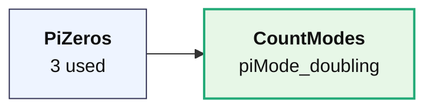

# What `CountModes.piMode_doubling` rests on

[`CountModes.piMode_doubling`](../lean_stage3/CountModes.md#CountModes-piMode_doubling) in `lean_stage3/Stage3/CountModes.lean`, line 433.

**Why.** One zero's part on the count's ladder is a segment plus a constant. For a nontrivial zero and `1 ≤ k`, `piMode ρ (2^k) = J_k(ρ·log 2) + cst ρ`.

**Proves**

```lean
PiZeros.piMode (ρ:ℂ) ((2:ℝ)^k) = J k ((ρ:ℂ) * Real.log 2) + cst ρ
```

**Needs** (its hypotheses)

  - `` ρ : NontrivialZeros ``
  - `` hk : 1 ≤ k ``

Behind it: 21 theorems and 5 definitions in 2 files. Every one is listed below; Lean recorded each step.

## The files it passes through



An arrow A → B reads "B uses something proved or defined in A"; indirect arrows are left out. Green: the theorem itself. Yellow: a file in the other tree. The number is how many of that file's declarations are on the way.

## Every declaration on the way

Files in dependency order. ★ marks what the theorem's own proof uses directly.

### [`PiZeros`](../lean_stage3/PiZeros.md) — 3

- [`PiZeros.wt`](../lean_stage3/PiZeros.md#PiZeros-wt) — *def*
- [`PiZeros.tr`](../lean_stage3/PiZeros.md#PiZeros-tr) — *def*
- ★ [`PiZeros.piMode`](../lean_stage3/PiZeros.md#PiZeros-piMode) — *def*

### [`CountModes`](../lean_stage3/CountModes.md) — 23

- [`CountModes.norm_tail_le`](../lean_stage3/CountModes.md#CountModes-norm_tail_le) — `` ‖∫ x in Set.Ioi ((1 : ℕ) : ℝ), ((⌊x⌋ : ℂ) + 1 / 2 - (x : ℂ)) / (x : ℂ) ^ ((b : ℂ) + 1)‖ ≤ 1 / (2 * b) ``
- [`CountModes.riemannZeta_ne_zero_of_Ioo`](../lean_stage3/CountModes.md#CountModes-riemannZeta_ne_zero_of_Ioo) — `` riemannZeta (b : ℂ) ≠ 0 ``
- [`CountModes.im_ne_zero`](../lean_stage3/CountModes.md#CountModes-im_ne_zero) — `` (ρ : ℂ).im ≠ 0 ``
- ★ [`CountModes.J`](../lean_stage3/CountModes.md#CountModes-J) — *def*
- [`CountModes.sub_ofReal_ne_zero`](../lean_stage3/CountModes.md#CountModes-sub_ofReal_ne_zero) — `` w - (s : ℂ) ≠ 0 ``
- [`CountModes.continuous_integrand`](../lean_stage3/CountModes.md#CountModes-continuous_integrand) — `` Continuous (fun s : ℝ => Complex.exp ((k:ℂ) * (w - s)) / (w - s)) ``
- [`CountModes.norm_integrand_le`](../lean_stage3/CountModes.md#CountModes-norm_integrand_le) — `` ‖Complex.exp ((k:ℂ) * (w - s)) / (w - s)‖ ≤ Real.exp (k * w.re) / |w.im| * Real.exp (-k * s) ``
- [`CountModes.integrable_J`](../lean_stage3/CountModes.md#CountModes-integrable_J) — `` IntegrableOn (fun s : ℝ => Complex.exp ((k:ℂ) * (w - s)) / (w - s)) (Set.Ioi 0) ``
- [`CountModes.integrand_sub`](../lean_stage3/CountModes.md#CountModes-integrand_sub) — `` Complex.exp ((k:ℂ) * (w - s)) / (w - s) - Complex.exp (((1:ℕ):ℂ) * (w - s)) / (w - s) = ∫ v in (1:ℝ)..(k:ℝ), Complex.exp ((w - s) * v) ``
- [`CountModes.integral_inner`](../lean_stage3/CountModes.md#CountModes-integral_inner) — `` ∫ s in Set.Ioi (0:ℝ), Complex.exp ((w - s) * v) = Complex.exp ((v:ℂ) * w) / (v:ℂ) ``
- [`CountModes.integrable_prod`](../lean_stage3/CountModes.md#CountModes-integrable_prod) — `` Integrable (Function.uncurry fun (s v : ℝ) => Complex.exp ((w - s) * v)) ((volume.restrict (Set.Ioi (0:ℝ))).prod (volume.restrict (Set.Ioc (1:ℝ) k))) ``
- ★ [`CountModes.J_sub`](../lean_stage3/CountModes.md#CountModes-J_sub) — `` J k w - J 1 w = ∫ v in (1:ℝ)..(k:ℝ), Complex.exp ((v:ℂ) * w) / (v:ℂ) ``
- [`CountModes.cpow_two_rpow`](../lean_stage3/CountModes.md#CountModes-cpow_two_rpow) — `` (((2:ℝ) ^ v : ℝ) : ℂ) ^ ρ = Complex.exp ((v:ℂ) * (ρ * (Real.log 2 : ℂ))) ``
- [`CountModes.term1_eq`](../lean_stage3/CountModes.md#CountModes-term1_eq) — `` (((2:ℝ) ^ v : ℝ) : ℂ) ^ ρ / ρ / (Real.log ((2:ℝ) ^ v) : ℂ) = Complex.exp ((v:ℂ) * (ρ * (Real.log 2 : ℂ))) / ((v:ℂ) * (ρ * (Real.log 2 : ℂ))) ``
- [`CountModes.continuousOn_integrand`](../lean_stage3/CountModes.md#CountModes-continuousOn_integrand) — `` ContinuousOn (fun t : ℝ => (t : ℂ) ^ ρ / ρ * PiZeros.wt t) (Set.Ioi 1) ``
- [`CountModes.hasDerivAt_ipart`](../lean_stage3/CountModes.md#CountModes-hasDerivAt_ipart) — `` HasDerivAt (fun u => ∫ t in (2:ℝ)..u, (t : ℂ) ^ ρ / ρ * PiZeros.wt t) ((y : ℂ) ^ ρ / ρ * PiZeros.wt y) y ``
- [`CountModes.hasDerivAt_term1`](../lean_stage3/CountModes.md#CountModes-hasDerivAt_term1) — `` HasDerivAt (fun u : ℝ => Complex.exp ((u:ℂ) * w) / ((u:ℂ) * w)) ((Complex.exp ((v:ℂ) * w) * w * ((v:ℂ) * w) - Complex.exp ((v:ℂ) * w) * w) / ((v:ℂ) * w) ^ 2) v ``
- [`CountModes.hasDerivAt_piMode_two_rpow`](../lean_stage3/CountModes.md#CountModes-hasDerivAt_piMode_two_rpow) — `` HasDerivAt (fun u : ℝ => PiZeros.piMode ρ ((2:ℝ) ^ u)) (Complex.exp ((v:ℂ) * (ρ * (Real.log 2 : ℂ))) / (v:ℂ)) v ``
- [`CountModes.piMode_doubling_sub_of`](../lean_stage3/CountModes.md#CountModes-piMode_doubling_sub_of) — `` PiZeros.piMode ρ ((2:ℝ) ^ k) - PiZeros.piMode ρ 2 = ∫ v in (1:ℝ)..(k:ℝ), Complex.exp ((v:ℂ) * (ρ * Real.log 2)) / (v:ℂ) ``
- ★ [`CountModes.piMode_doubling_sub`](../lean_stage3/CountModes.md#CountModes-piMode_doubling_sub) — `` PiZeros.piMode (ρ:ℂ) ((2:ℝ) ^ k) - PiZeros.piMode (ρ:ℂ) 2 = ∫ v in (1:ℝ)..(k:ℝ), Complex.exp ((v:ℂ) * ((ρ:ℂ) * Real.log 2)) / (v:ℂ) ``
- [`CountModes.im_w`](../lean_stage3/CountModes.md#CountModes-im_w) — `` (ρ * (Real.log 2 : ℂ)).im = ρ.im * Real.log 2 ``
- ★ [`CountModes.w_im_ne_zero`](../lean_stage3/CountModes.md#CountModes-w_im_ne_zero) — `` ((ρ:ℂ) * (Real.log 2 : ℂ)).im ≠ 0 ``
- ★ [`CountModes.cst`](../lean_stage3/CountModes.md#CountModes-cst) — *def*

