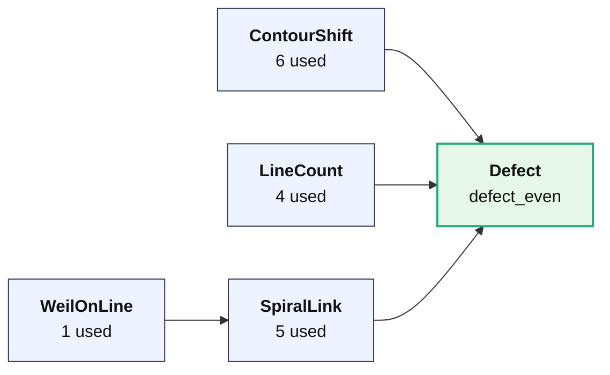

# What `Defect.defect_even` rests on

[`Defect.defect_even`](../lean_stage3/Defect.md#Defect-defect_even) in `lean_stage3/Stage3/Defect.lean`, line 291.

**Why.** The defect is even.

**Proves**

```lean
Even (defect T)
```

**Needs** (its hypotheses)

  - `` T : ℝ ``

Behind it: 17 theorems and 6 definitions in 5 files. Every one is listed below; Lean recorded each step.

## The files it passes through



An arrow A → B reads "B uses something proved or defined in A"; indirect arrows are left out. Green: the theorem itself. Yellow: a file in the other tree. The number is how many of that file's declarations are on the way.

## Every declaration on the way

Files in dependency order. ★ marks what the theorem's own proof uses directly.

### [`ContourShift`](../lean_stage3/ContourShift.md) — 6

- [`ContourShift.zeta_analyticAt`](../lean_stage3/ContourShift.md#ContourShift-zeta_analyticAt) — `` AnalyticAt ℂ riemannZeta ρ ``
- [`ContourShift.zeta_order_ne_top`](../lean_stage3/ContourShift.md#ContourShift-zeta_order_ne_top) — `` analyticOrderAt riemannZeta ρ ≠ ⊤ ``
- [`ContourShift.order_bridge`](../lean_stage3/ContourShift.md#ContourShift-order_bridge) — `` ((riemannZeta.order ρ : ℤ) : ℂ) = ((analyticOrderNatAt riemannZeta ρ : ℕ) : ℂ) ``
- [`ContourShift.analyticAt_conj_conj`](../lean_stage3/ContourShift.md#ContourShift-analyticAt_conj_conj) — `` AnalyticAt ℂ (fun w ↦ (starRingEnd ℂ) (g ((starRingEnd ℂ) w))) ((starRingEnd ℂ) p) ``
- [`ContourShift.zeta_order_conj`](../lean_stage3/ContourShift.md#ContourShift-zeta_order_conj) — `` analyticOrderNatAt riemannZeta ((starRingEnd ℂ) ρ) = analyticOrderNatAt riemannZeta ρ ``
- [`ContourShift.zeta_order_reflect`](../lean_stage3/ContourShift.md#ContourShift-zeta_order_reflect) — `` analyticOrderNatAt riemannZeta (1 - (starRingEnd ℂ) ρ) = analyticOrderNatAt riemannZeta ρ ``

### [`LineCount`](../lean_stage3/LineCount.md) — 4

- [`LineCount.zerosUpTo`](../lean_stage3/LineCount.md#LineCount-zerosUpTo) — *def*
- [`LineCount.allCount`](../lean_stage3/LineCount.md#LineCount-allCount) — *def*
- [`LineCount.lineCount`](../lean_stage3/LineCount.md#LineCount-lineCount) — *def*
- [`LineCount.mem_zerosUpTo`](../lean_stage3/LineCount.md#LineCount-mem_zerosUpTo) — `` ρ ∈ zerosUpTo T ↔ 0 < (ρ : ℂ).im ∧ (ρ : ℂ).im ≤ T ``

### [`WeilOnLine`](../lean_stage3/WeilOnLine.md) — 1

- [`WeilOnLine.conj_mem`](../lean_stage3/WeilOnLine.md#WeilOnLine-conj_mem) — `` (starRingEnd ℂ) (ρ : ℂ) ∈ Kadiri.NontrivialZeros ``

### [`SpiralLink`](../lean_stage3/SpiralLink.md) — 5

- [`SpiralLink.mirror_mem`](../lean_stage3/SpiralLink.md#SpiralLink-mirror_mem) — `` (1 - (starRingEnd ℂ) (ρ : ℂ)) ∈ NontrivialZeros ``
- [`SpiralLink.mirrorZ`](../lean_stage3/SpiralLink.md#SpiralLink-mirrorZ) — *def*
- [`SpiralLink.mirrorZ_im`](../lean_stage3/SpiralLink.md#SpiralLink-mirrorZ_im) — `` ((mirrorZ ρ : NontrivialZeros) : ℂ).im = (ρ : ℂ).im ``
- [`SpiralLink.mirrorZ_re`](../lean_stage3/SpiralLink.md#SpiralLink-mirrorZ_re) — `` ((mirrorZ ρ : NontrivialZeros) : ℂ).re = 1 - (ρ : ℂ).re ``
- [`SpiralLink.mirrorZ_eq_iff`](../lean_stage3/SpiralLink.md#SpiralLink-mirrorZ_eq_iff) — `` mirrorZ ρ = ρ ↔ (ρ : ℂ).re = 1 / 2 ``

### [`Defect`](../lean_stage3/Defect.md) — 7

- ★ [`Defect.defect`](../lean_stage3/Defect.md#Defect-defect) — *def*
- [`Defect.offCount`](../lean_stage3/Defect.md#Defect-offCount) — *def*
- ★ [`Defect.defect_eq_offCount`](../lean_stage3/Defect.md#Defect-defect_eq_offCount) — `` defect T = offCount T ``
- [`Defect.mirrorZ_order`](../lean_stage3/Defect.md#Defect-mirrorZ_order) — `` riemannZeta.order ((SpiralLink.mirrorZ ρ : NontrivialZeros) : ℂ) = riemannZeta.order (ρ : ℂ) ``
- [`Defect.mirrorZ_mirrorZ`](../lean_stage3/Defect.md#Defect-mirrorZ_mirrorZ) — `` SpiralLink.mirrorZ (SpiralLink.mirrorZ ρ) = ρ ``
- [`Defect.offLine_pair`](../lean_stage3/Defect.md#Defect-offLine_pair) — `` SpiralLink.mirrorZ ρ ∈ (zerosUpTo T).filter (fun ρ : NontrivialZeros => ¬ (ρ : ℂ).re = 1 / 2) ∧ SpiralLink.mirrorZ ρ ≠ ρ ∧ ((SpiralLink.mirrorZ ρ : NontrivialZe… ``
- ★ [`Defect.offCount_eq_two_mul`](../lean_stage3/Defect.md#Defect-offCount_eq_two_mul) — `` offCount T = 2 * ∑ ρ ∈ ((zerosUpTo T).filter (fun ρ : NontrivialZeros => ¬ (ρ : ℂ).re = 1 / 2)).filter (fun ρ : NontrivialZeros => (ρ : ℂ).re < 1 / 2), riemannZ… ``

