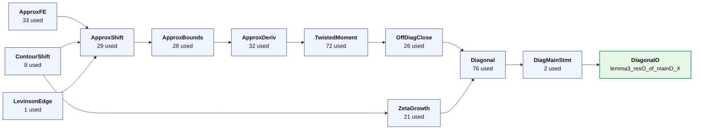

# What `DiagonalO.lemma3_resO_of_mainO_X` rests on

[`DiagonalO.lemma3_resO_of_mainO_X`](../lean_stage3/DiagonalO.md#DiagonalO-lemma3_resO_of_mainO_X) in `lean_stage3/Stage3/DiagonalO.lean`, line 225.

**Why.** Lemma 3 up to `I_res`, `o(T)`, from the main term and the X-term: the diagonal by `stmtDiagO_of_mainO`, the off-diagonal by `stmtOffDiag_holds`, for `θ < 1/2`, `κ > 0`.

**Proves**

```lean
StmtLemma3resO P θ R κ
```

**Needs** (its hypotheses)

  - `` P : Polynomial ℝ ``
  - `` hθ : θ < 1 / 2 ``
  - `` R : ℝ ``
  - `` hκ : 0 < κ ``
  - `` hmain : StmtDiagMainO P θ R κ ``
  - `` hX : StmtX P θ R κ ``

Behind it: 263 theorems and 73 definitions in 12 files. Every one is listed below; Lean recorded each step.

## The files it passes through



An arrow A → B reads "B uses something proved or defined in A"; indirect arrows are left out. Green: the theorem itself. Yellow: a file in the other tree. The number is how many of that file's declarations are on the way.

## Every declaration on the way

Files in dependency order. ★ marks what the theorem's own proof uses directly.

### [`ApproxFE`](../lean_stage3/ApproxFE.md) — 33

- [`ApproxFE.uA`](../lean_stage3/ApproxFE.md#ApproxFE-uA) — *def*
- [`ApproxFE.vB`](../lean_stage3/ApproxFE.md#ApproxFE-vB) — *def*
- [`ApproxFE.XY`](../lean_stage3/ApproxFE.md#ApproxFE-XY) — *def*
- [`ApproxFE.GY`](../lean_stage3/ApproxFE.md#ApproxFE-GY) — *def*
- [`ApproxFE.gY`](../lean_stage3/ApproxFE.md#ApproxFE-gY) — *def*
- [`ApproxFE.KY`](../lean_stage3/ApproxFE.md#ApproxFE-KY) — *def*
- [`ApproxFE.VY`](../lean_stage3/ApproxFE.md#ApproxFE-VY) — *def*
- [`ApproxFE.FY`](../lean_stage3/ApproxFE.md#ApproxFE-FY) — *def*
- [`ApproxFE.uA_re`](../lean_stage3/ApproxFE.md#ApproxFE-uA_re) — `` (uA α t).re = 1 / 2 + α.re ``
- [`ApproxFE.vB_re`](../lean_stage3/ApproxFE.md#ApproxFE-vB_re) — `` (vB β t).re = 1 / 2 + β.re ``
- [`ApproxFE.uA_im`](../lean_stage3/ApproxFE.md#ApproxFE-uA_im) — `` (uA α t).im = α.im + t ``
- [`ApproxFE.vB_im`](../lean_stage3/ApproxFE.md#ApproxFE-vB_im) — `` (vB β t).im = β.im - t ``
- [`ApproxFE.norm_succ_cpow`](../lean_stage3/ApproxFE.md#ApproxFE-norm_succ_cpow) — `` ‖((m : ℂ) + 1) ^ z‖ = ((m : ℝ) + 1) ^ z.re ``
- [`ApproxFE.summable_succ_rpow`](../lean_stage3/ApproxFE.md#ApproxFE-summable_succ_rpow) — `` Summable fun m : ℕ => ((m : ℝ) + 1) ^ r ``
- [`ApproxFE.summable_zeta_norm`](../lean_stage3/ApproxFE.md#ApproxFE-summable_zeta_norm) — `` Summable fun n : ℕ => ‖1 / ((n : ℂ) + 1) ^ w‖ ``
- [`ApproxFE.KY_bound`](../lean_stage3/ApproxFE.md#ApproxFE-KY_bound) — `` ∃ C : ℝ, 0 ≤ C ∧ ∀ y : ℝ, ‖KY α β t (c + y * I)‖ ≤ C * Real.exp (-(1 / 2) * y ^ 2) ``
- [`ApproxFE.KY_differentiableAt`](../lean_stage3/ApproxFE.md#ApproxFE-KY_differentiableAt) — `` DifferentiableAt ℂ (KY α β t) s ``
- [`ApproxFE.KY_continuous_line`](../lean_stage3/ApproxFE.md#ApproxFE-KY_continuous_line) — `` Continuous fun y : ℝ => KY α β t (c + y * I) ``
- [`ApproxFE.tsum_pointwise`](../lean_stage3/ApproxFE.md#ApproxFE-tsum_pointwise) — `` ∑' p : ℕ × ℕ, ((p.1 : ℂ) + 1) ^ (-u) * ((p.2 : ℂ) + 1) ^ (-v) * (K * ((((p.1 : ℝ) + 1) * ((p.2 : ℝ) + 1) : ℝ) : ℂ) ^ (-s)) = K * (riemannZeta (u + s) * riemannZ… ``
- [`ApproxFE.mellin_double_sum`](../lean_stage3/ApproxFE.md#ApproxFE-mellin_double_sum) — `` ∑' p : ℕ × ℕ, ((p.1 : ℂ) + 1) ^ (-uA α t) * ((p.2 : ℂ) + 1) ^ (-vB β t) * VY α β c (((p.1 : ℝ) + 1) * ((p.2 : ℝ) + 1)) t = VerticalIntegral' (FY α β t) c ``
- [`ApproxFE.GY_neg`](../lean_stage3/ApproxFE.md#ApproxFE-GY_neg) — `` GY α β (-s) = GY α β s ``
- [`ApproxFE.GY_swap`](../lean_stage3/ApproxFE.md#ApproxFE-GY_swap) — `` GY (-β) (-α) s = GY α β s ``
- [`ApproxFE.uA_neg`](../lean_stage3/ApproxFE.md#ApproxFE-uA_neg) — `` uA (-β) t = 1 - vB β t ``
- [`ApproxFE.vB_neg`](../lean_stage3/ApproxFE.md#ApproxFE-vB_neg) — `` vB (-α) t = 1 - uA α t ``
- [`ApproxFE.gamma_mul_zeta`](../lean_stage3/ApproxFE.md#ApproxFE-gamma_mul_zeta) — `` Gammaℝ w * riemannZeta w = completedRiemannZeta w ``
- [`ApproxFE.FY_reflect`](../lean_stage3/ApproxFE.md#ApproxFE-FY_reflect) — `` FY α β t (-s) = -(XY α β t * FY (-β) (-α) t s) ``
- [`ApproxFE.gamma_ne_off`](../lean_stage3/ApproxFE.md#ApproxFE-gamma_ne_off) — `` Gammaℝ (w + -((c : ℂ) + y * I)) ≠ 0 ``
- [`ApproxFE.vertInt_reflect`](../lean_stage3/ApproxFE.md#ApproxFE-vertInt_reflect) — `` VerticalIntegral' (FY α β t) (-c) = -(XY α β t * VerticalIntegral' (FY (-β) (-α) t) c) ``
- [`ApproxFE.GY_zero`](../lean_stage3/ApproxFE.md#ApproxFE-GY_zero) — `` GY α β 0 = 1 ``
- [`ApproxFE.gY_zero`](../lean_stage3/ApproxFE.md#ApproxFE-gY_zero) — `` gY α β t 0 = 1 ``
- [`ApproxFE.resY`](../lean_stage3/ApproxFE.md#ApproxFE-resY) — *def*
- [`ApproxFE.StmtShift`](../lean_stage3/ApproxFE.md#ApproxFE-StmtShift) — *def*
- [`ApproxFE.approxFE_of_shift`](../lean_stage3/ApproxFE.md#ApproxFE-approxFE_of_shift) — `` riemannZeta (uA α t) * riemannZeta (vB β t) = (∑' p : ℕ × ℕ, ((p.1 : ℂ) + 1) ^ (-uA α t) * ((p.2 : ℂ) + 1) ^ (-vB β t) * VY α β c (((p.1 : ℝ) + 1) * ((p.2 : ℝ) … ``

### [`ContourShift`](../lean_stage3/ContourShift.md) — 8

- [`ContourShift.zeta_analyticAt`](../lean_stage3/ContourShift.md#ContourShift-zeta_analyticAt) — `` AnalyticAt ℂ riemannZeta ρ ``
- [`ContourShift.borderIntegrable_sum_poles`](../lean_stage3/ContourShift.md#ContourShift-borderIntegrable_sum_poles) — `` RectangleBorderIntegrable (fun s ↦ ∑ p ∈ P, A p / (s - p)) z w ``
- [`ContourShift.rectangleIntegral_sum_poles`](../lean_stage3/ContourShift.md#ContourShift-rectangleIntegral_sum_poles) — `` RectangleIntegral' (fun s ↦ ∑ p ∈ P, A p / (s - p)) z w = ∑ p ∈ P, A p ``
- [`ContourShift.residue_rectangle_multi`](../lean_stage3/ContourShift.md#ContourShift-residue_rectangle_multi) — `` RectangleIntegral' f z w = ∑ p ∈ P, A p ``
- [`ContourShift.residue_rectangle_of_local`](../lean_stage3/ContourShift.md#ContourShift-residue_rectangle_of_local) — `` RectangleIntegral' f z w = ∑ p ∈ P, A p ``
- [`ContourShift.analyticAt_dslope`](../lean_stage3/ContourShift.md#ContourShift-analyticAt_dslope) — `` AnalyticAt ℂ (dslope f p) p ``
- [`ContourShift.div_sub_eq_dslope`](../lean_stage3/ContourShift.md#ContourShift-div_sub_eq_dslope) — `` f s / (s - p) = f p / (s - p) + dslope f p s ``
- [`ContourShift.sq_mul_zeta_analyticAt_one`](../lean_stage3/ContourShift.md#ContourShift-sq_mul_zeta_analyticAt_one) — `` AnalyticAt ℂ (fun s ↦ (s - 1)^2 * riemannZeta s) 1 ``

### [`LevinsonEdge`](../lean_stage3/LevinsonEdge.md) — 1

- [`LevinsonEdge.zeta_norm_le`](../lean_stage3/LevinsonEdge.md#LevinsonEdge-zeta_norm_le) — `` ‖riemannZeta u‖ ≤ 2 + 4 * ‖u‖ ``

### [`ApproxShift`](../lean_stage3/ApproxShift.md) — 29

- [`ApproxShift.zeta_norm_le_abs`](../lean_stage3/ApproxShift.md#ApproxShift-zeta_norm_le_abs) — `` ‖riemannZeta w‖ ≤ 2 + 4 * ‖w‖ ``
- [`ApproxShift.gammaR_bound`](../lean_stage3/ApproxShift.md#ApproxShift-gammaR_bound) — `` ∃ M : ℝ, 0 ≤ M ∧ ∀ w : ℂ, 1 / 2 ≤ w.re → w.re ≤ R → ‖Gammaℝ w‖ ≤ M ``
- [`ApproxShift.Lambda_bound`](../lean_stage3/ApproxShift.md#ApproxShift-Lambda_bound) — `` ∃ M : ℝ, 0 ≤ M ∧ ∀ w : ℂ, |w.re| ≤ R → 1 ≤ |w.im| → ‖completedRiemannZeta w‖ ≤ M * (6 + 4 * ‖w‖) ``
- [`ApproxShift.GY_norm_le`](../lean_stage3/ApproxShift.md#ApproxShift-GY_norm_le) — `` ‖GY α β s‖ ≤ Real.exp (c ^ 2 - s.im ^ 2) * ((‖α + β‖ ^ 2 + 4 * c ^ 2 + 4) / ‖α + β‖ ^ 2 * (1 + s.im ^ 2)) ``
- [`ApproxShift.poly_gauss`](../lean_stage3/ApproxShift.md#ApproxShift-poly_gauss) — `` (1 + y ^ 2) ^ 3 * Real.exp (-y ^ 2) ≤ 216 * Real.exp (-(1 / 2) * y ^ 2) ``
- [`ApproxShift.FL`](../lean_stage3/ApproxShift.md#ApproxShift-FL) — *def*
- [`ApproxShift.FY_eq_FL`](../lean_stage3/ApproxShift.md#ApproxShift-FY_eq_FL) — `` FY α β t s = FL α β t s ``
- [`ApproxShift.abs_le_add_abs`](../lean_stage3/ApproxShift.md#ApproxShift-abs_le_add_abs) — `` |y| ≤ |a + y| + |a| ``
- [`ApproxShift.FL_bound`](../lean_stage3/ApproxShift.md#ApproxShift-FL_bound) — `` ∃ C Y₀ : ℝ, 0 ≤ C ∧ 1 ≤ Y₀ ∧ ∀ s : ℂ, |s.re| ≤ c → Y₀ ≤ |s.im| → ‖FL α β t s‖ ≤ C * Real.exp (-(1 / 2) * s.im ^ 2) ``
- [`ApproxShift.gauss_atTop`](../lean_stage3/ApproxShift.md#ApproxShift-gauss_atTop) — `` Tendsto (fun y : ℝ => Real.exp (-(1 / 2) * y ^ 2)) atTop (𝓝 0) ``
- [`ApproxShift.gauss_atBot`](../lean_stage3/ApproxShift.md#ApproxShift-gauss_atBot) — `` Tendsto (fun y : ℝ => Real.exp (-(1 / 2) * y ^ 2)) atBot (𝓝 0) ``
- [`ApproxShift.FL_horiz_tendsto`](../lean_stage3/ApproxShift.md#ApproxShift-FL_horiz_tendsto) — `` Tendsto (fun y : ℝ => ∫ x : ℝ in (-c)..c, FL α β t (x + y * I)) atTop (𝓝 0) ∧ Tendsto (fun y : ℝ => ∫ x : ℝ in (-c)..c, FL α β t (x + y * I)) atBot (𝓝 0) ``
- [`ApproxShift.FL_line_integrable`](../lean_stage3/ApproxShift.md#ApproxShift-FL_line_integrable) — `` Integrable fun y : ℝ => FL α β t (σ + y * I) ``
- [`ApproxShift.vertInt_FY_eq_FL`](../lean_stage3/ApproxShift.md#ApproxShift-vertInt_FY_eq_FL) — `` VerticalIntegral' (FY α β t) σ = VerticalIntegral' (FL α β t) σ ``
- [`ApproxShift.Lam_differentiableAt`](../lean_stage3/ApproxShift.md#ApproxShift-Lam_differentiableAt) — `` DifferentiableAt ℂ (fun s => completedRiemannZeta (w + s)) s ``
- [`ApproxShift.Lam_analyticAt`](../lean_stage3/ApproxShift.md#ApproxShift-Lam_analyticAt) — `` AnalyticAt ℂ (fun s => completedRiemannZeta (w + s)) p ``
- [`ApproxShift.Lam0_analyticAt`](../lean_stage3/ApproxShift.md#ApproxShift-Lam0_analyticAt) — `` AnalyticAt ℂ (fun s => completedRiemannZeta₀ (w + s)) p ``
- [`ApproxShift.GY_analyticAt`](../lean_stage3/ApproxShift.md#ApproxShift-GY_analyticAt) — `` AnalyticAt ℂ (GY α β) p ``
- [`ApproxShift.FL_differentiableAt`](../lean_stage3/ApproxShift.md#ApproxShift-FL_differentiableAt) — `` DifferentiableAt ℂ (FL α β t) s ``
- [`ApproxShift.local_simple`](../lean_stage3/ApproxShift.md#ApproxShift-local_simple) — `` ∃ h : ℂ → ℂ, AnalyticAt ℂ h p ∧ ∀ᶠ s in 𝓝[≠] p, f s = h s + A / (s - p) ``
- [`ApproxShift.local_zero`](../lean_stage3/ApproxShift.md#ApproxShift-local_zero) — `` ∃ h : ℂ → ℂ, AnalyticAt ℂ h 0 ∧ ∀ᶠ s in 𝓝[≠] 0, FL α β t s = h s + riemannZeta (uA α t) * riemannZeta (vB β t) / (s - 0) ``
- [`ApproxShift.local_pole_one`](../lean_stage3/ApproxShift.md#ApproxShift-local_pole_one) — `` ∃ h : ℂ → ℂ, AnalyticAt ℂ h (1 - w₁) ∧ ∀ᶠ s in 𝓝[≠] (1 - w₁), F s = h s + g (1 - w₁) / (1 - w₁) * completedRiemannZeta (w₂ + 1 - w₁) / D / (s - (1 - w₁)) ``
- [`ApproxShift.local_pole_neg`](../lean_stage3/ApproxShift.md#ApproxShift-local_pole_neg) — `` ∃ h : ℂ → ℂ, AnalyticAt ℂ h (-w₁) ∧ ∀ᶠ s in 𝓝[≠] (-w₁), F s = h s + g (-w₁) / w₁ * completedRiemannZeta (w₂ - w₁) / D / (s - -w₁) ``
- [`ApproxShift.rect_mem_nhds`](../lean_stage3/ApproxShift.md#ApproxShift-rect_mem_nhds) — `` Rectangle (↑(-c) - I * ↑T) (↑c + I * ↑T) ∈ 𝓝 p ``
- [`ApproxShift.rect_tendsto`](../lean_stage3/ApproxShift.md#ApproxShift-rect_tendsto) — `` Tendsto (fun T : ℝ => RectangleIntegral f (↑(-c) - I * T) (↑c + I * T)) atTop (𝓝 (VerticalIntegral f c - VerticalIntegral f (-c))) ``
- [`ApproxShift.poles`](../lean_stage3/ApproxShift.md#ApproxShift-poles) — *def*
- [`ApproxShift.resA`](../lean_stage3/ApproxShift.md#ApproxShift-resA) — *def*
- [`ApproxShift.stmtShift_holds`](../lean_stage3/ApproxShift.md#ApproxShift-stmtShift_holds) — `` StmtShift α β t c ``
- [`ApproxShift.approxFE`](../lean_stage3/ApproxShift.md#ApproxShift-approxFE) — `` riemannZeta (uA α t) * riemannZeta (vB β t) = (∑' p : ℕ × ℕ, ((p.1 : ℂ) + 1) ^ (-uA α t) * ((p.2 : ℂ) + 1) ^ (-vB β t) * VY α β c (((p.1 : ℝ) + 1) * ((p.2 : ℝ) … ``

### [`ApproxBounds`](../lean_stage3/ApproxBounds.md) — 28

- [`ApproxBounds.lY`](../lean_stage3/ApproxBounds.md#ApproxBounds-lY) — *def*
- [`ApproxBounds.lY_neg`](../lean_stage3/ApproxBounds.md#ApproxBounds-lY_neg) — `` lY (-Y) = lY Y ``
- [`ApproxBounds.gModel`](../lean_stage3/ApproxBounds.md#ApproxBounds-gModel) — *def*
- [`ApproxBounds.gErr`](../lean_stage3/ApproxBounds.md#ApproxBounds-gErr) — *def*
- [`ApproxBounds.gRModel`](../lean_stage3/ApproxBounds.md#ApproxBounds-gRModel) — *def*
- [`ApproxBounds.gErr_nonneg`](../lean_stage3/ApproxBounds.md#ApproxBounds-gErr_nonneg) — `` 0 ≤ gErr r ``
- [`ApproxBounds.const_bound`](../lean_stage3/ApproxBounds.md#ApproxBounds-const_bound) — `` ∃ K : ℝ, 0 ≤ K ∧ ∀ r : ℝ, lo ≤ r → r ≤ hi → |Real.log (Real.Gamma r)| ≤ K ∧ gErr r ≤ K ``
- [`ApproxBounds.lY_near`](../lean_stage3/ApproxBounds.md#ApproxBounds-lY_near) — `` |lY Y - Real.log (t / 2)| ≤ 3 ``
- [`ApproxBounds.re_one_sub_uA`](../lean_stage3/ApproxBounds.md#ApproxBounds-re_one_sub_uA) — `` (1 - uA α t).re = 1 / 2 - α.re ``
- [`ApproxBounds.re_one_sub_vB`](../lean_stage3/ApproxBounds.md#ApproxBounds-re_one_sub_vB) — `` (1 - vB β t).re = 1 / 2 - β.re ``
- [`ApproxBounds.log_div_two_pi`](../lean_stage3/ApproxBounds.md#ApproxBounds-log_div_two_pi) — `` Real.log (t / (2 * Real.pi)) = Real.log (t / 2) - Real.log Real.pi ``
- [`ApproxBounds.lY_lip`](../lean_stage3/ApproxBounds.md#ApproxBounds-lY_lip) — `` |lY (Y + h) - lY Y| ≤ |h| ``
- [`ApproxBounds.gR_shift`](../lean_stage3/ApproxBounds.md#ApproxBounds-gR_shift) — `` Real.log ‖Gammaℝ (w + (σ + y * I))‖ - Real.log ‖Gammaℝ w‖ ≤ σ / 2 * (Real.log (t / 2) - Real.log Real.pi) + 2 * K + 2 * K' + 3 * |σ| / 2 + (Real.pi / 4 + |σ| / … ``
- [`ApproxBounds.gY_bound`](../lean_stage3/ApproxBounds.md#ApproxBounds-gY_bound) — `` ∃ C : ℝ, 0 ≤ C ∧ ∀ α β : ℂ, ‖α‖ ≤ 1 / 10 → ‖β‖ ≤ 1 / 10 → ∀ t : ℝ, 1 ≤ t → ∀ σ y : ℝ, σ₀ ≤ σ → σ ≤ σ₁ → ‖gY α β t (σ + y * I)‖ ≤ C * (t / (2 * Real.pi)) ^ σ * R… ``
- [`ApproxBounds.gauss_absorb`](../lean_stage3/ApproxBounds.md#ApproxBounds-gauss_absorb) — `` Real.exp (-y ^ 2) * (1 + y ^ 2) * Real.exp (B * |y|) ≤ 4 * Real.exp (B ^ 2) * Real.exp (-(1 / 2) * y ^ 2) ``
- [`ApproxBounds.Q_le`](../lean_stage3/ApproxBounds.md#ApproxBounds-Q_le) — `` (n ^ 2 + A) / n ^ 2 ≤ (A + 1) * (1 + 1 / n ^ 2) ``
- [`ApproxBounds.integrand_bound`](../lean_stage3/ApproxBounds.md#ApproxBounds-integrand_bound) — `` ∃ C : ℝ, 0 ≤ C ∧ ∀ α β : ℂ, ‖α‖ ≤ 1 / 10 → ‖β‖ ≤ 1 / 10 → ∀ t : ℝ, 1 ≤ t → ∀ x : ℝ, 0 < x → ∀ σ y : ℝ, σ₀ ≤ σ → σ ≤ σ₁ → δ ≤ ‖(σ : ℂ) + y * I‖ → ‖KY α β t (σ + … ``
- [`ApproxBounds.norm_VY_le`](../lean_stage3/ApproxBounds.md#ApproxBounds-norm_VY_le) — `` ‖VY α β σ x t‖ ≤ 1 / (2 * Real.pi) * ∫ y : ℝ, ‖KY α β t (σ + y * I) * (x : ℂ) ^ (-((σ : ℂ) + y * I))‖ ``
- [`ApproxBounds.VY_line_bound`](../lean_stage3/ApproxBounds.md#ApproxBounds-VY_line_bound) — `` ∃ C : ℝ, 0 ≤ C ∧ ∀ α β : ℂ, ‖α‖ ≤ 1 / 10 → ‖β‖ ≤ 1 / 10 → ∀ t : ℝ, 1 ≤ t → ∀ x : ℝ, 0 < x → ‖VY α β σ x t‖ ≤ C * (1 + 1 / ‖α + β‖ ^ 2) * ((t / (2 * Real.pi)) ^ … ``
- [`ApproxBounds.integrand_differentiableAt`](../lean_stage3/ApproxBounds.md#ApproxBounds-integrand_differentiableAt) — `` DifferentiableAt ℂ (fun s => KY α β t s * (x : ℂ) ^ (-s)) s ``
- [`ApproxBounds.rpow_le_ends`](../lean_stage3/ApproxBounds.md#ApproxBounds-rpow_le_ends) — `` b ^ σ ≤ b ^ σ₀ + b ^ σ₁ ``
- [`ApproxBounds.rect_tendsto_ab`](../lean_stage3/ApproxBounds.md#ApproxBounds-rect_tendsto_ab) — `` Tendsto (fun T : ℝ => RectangleIntegral f (↑a - I * T) (↑b + I * T)) atTop (𝓝 (VerticalIntegral f b - VerticalIntegral f a)) ``
- [`ApproxBounds.VY_line_eq`](../lean_stage3/ApproxBounds.md#ApproxBounds-VY_line_eq) — `` VY α β c x t = VY α β c' x t ``
- [`ApproxBounds.VY_decay`](../lean_stage3/ApproxBounds.md#ApproxBounds-VY_decay) — `` ∃ C : ℝ, 0 ≤ C ∧ ∀ α β : ℂ, ‖α‖ ≤ 1 / 10 → ‖β‖ ≤ 1 / 10 → ∀ t : ℝ, 1 ≤ t → ∀ x : ℝ, 0 < x → ∀ c : ℝ, 0 < c → ‖VY α β c x t‖ ≤ C * (1 + 1 / ‖α + β‖ ^ 2) * (t / x… ``
- [`ApproxBounds.integrand_differentiableAt'`](../lean_stage3/ApproxBounds.md#ApproxBounds-integrand_differentiableAt-) — `` DifferentiableAt ℂ (fun s => KY α β t s * (x : ℂ) ^ (-s)) s ``
- [`ApproxBounds.VY_residue`](../lean_stage3/ApproxBounds.md#ApproxBounds-VY_residue) — `` VY α β (1 / 4) x t - VY α β (-(1 / 4)) x t = 1 ``
- [`ApproxBounds.rpow_quarter_le`](../lean_stage3/ApproxBounds.md#ApproxBounds-rpow_quarter_le) — `` b ^ (1 / 4 : ℝ) ≤ 1 + b ``
- [`ApproxBounds.VY_decay_young`](../lean_stage3/ApproxBounds.md#ApproxBounds-VY_decay_young) — `` ∃ C : ℝ, 0 ≤ C ∧ ∀ α β : ℂ, ‖α‖ ≤ 1 / 10 → ‖β‖ ≤ 1 / 10 → α + β ≠ 0 → ∀ t : ℝ, 1 ≤ t → ∀ x : ℝ, 0 < x → ∀ c : ℝ, 0 < c → ‖VY α β c x t‖ ≤ C * (1 + 1 / ‖α + β‖ ^… ``

### [`ApproxDeriv`](../lean_stage3/ApproxDeriv.md) — 32

- [`ApproxDeriv.psiR`](../lean_stage3/ApproxDeriv.md#ApproxDeriv-psiR) — *def*
- [`ApproxDeriv.ne_neg_nat_of_re_pos`](../lean_stage3/ApproxDeriv.md#ApproxDeriv-ne_neg_nat_of_re_pos) — `` z ≠ -(m : ℂ) ``
- [`ApproxDeriv.hasDerivAt_line`](../lean_stage3/ApproxDeriv.md#ApproxDeriv-hasDerivAt_line) — `` HasDerivAt (fun t : ℝ => w₀ + (t : ℂ) * e) e t ``
- [`ApproxDeriv.dY`](../lean_stage3/ApproxDeriv.md#ApproxDeriv-dY) — *def*
- [`ApproxDeriv.re_conds`](../lean_stage3/ApproxDeriv.md#ApproxDeriv-re_conds) — `` 1 / 20 ≤ (uA α t / 2).re ∧ 1 / 20 ≤ (uA α t / 2 + s / 2).re ∧ 1 / 20 ≤ (vB β t / 2).re ∧ 1 / 20 ≤ (vB β t / 2 + s / 2).re ``
- [`ApproxDeriv.gY_hasDerivAt`](../lean_stage3/ApproxDeriv.md#ApproxDeriv-gY_hasDerivAt) — `` HasDerivAt (fun t => gY α β t s) (gY α β t s * dY α β t s) t ``
- [`ApproxDeriv.tau`](../lean_stage3/ApproxDeriv.md#ApproxDeriv-tau) — *def*
- [`ApproxDeriv.tau'`](../lean_stage3/ApproxDeriv.md#ApproxDeriv-tau-) — *def*
- [`ApproxDeriv.hasSum_tau`](../lean_stage3/ApproxDeriv.md#ApproxDeriv-hasSum_tau) — `` HasSum (tau h w) (digamma (w + h) - digamma w) ``
- [`ApproxDeriv.norm_nat_add_ge`](../lean_stage3/ApproxDeriv.md#ApproxDeriv-norm_nat_add_ge) — `` ((n : ℝ) + a + Y) / 2 ≤ ‖(n : ℂ) + z‖ ``
- [`ApproxDeriv.norm_tau_le`](../lean_stage3/ApproxDeriv.md#ApproxDeriv-norm_tau_le) — `` ‖tau h w n‖ ≤ 4 * ‖h‖ * (1 / ((n : ℝ) + (a + Y)) ^ 2) ``
- [`ApproxDeriv.tel`](../lean_stage3/ApproxDeriv.md#ApproxDeriv-tel) — *def*
- [`ApproxDeriv.hasSum_tel`](../lean_stage3/ApproxDeriv.md#ApproxDeriv-hasSum_tel) — `` HasSum (tel b) (1 / b) ``
- [`ApproxDeriv.sq_le_tel`](../lean_stage3/ApproxDeriv.md#ApproxDeriv-sq_le_tel) — `` 1 / ((n : ℝ) + b) ^ 2 ≤ (1 + 1 / b) * tel b n ``
- [`ApproxDeriv.dY_hasSum`](../lean_stage3/ApproxDeriv.md#ApproxDeriv-dY_hasSum) — `` HasSum (fun n => I / 2 * (tau (s / 2) (uA α t / 2) n - tau (s / 2) (vB β t / 2) n)) (dY α β t s) ``
- [`ApproxDeriv.norm_I_half`](../lean_stage3/ApproxDeriv.md#ApproxDeriv-norm_I_half) — `` ‖I / 2‖ = 1 / 2 ``
- [`ApproxDeriv.norm_dterm_le`](../lean_stage3/ApproxDeriv.md#ApproxDeriv-norm_dterm_le) — `` ‖I / 2 * (tau (s / 2) (uA α t / 2) n - tau (s / 2) (vB β t / 2) n)‖ ≤ 4 * ‖s / 2‖ * (1 + 1 / (1 / 20 + Y)) * tel (1 / 20 + Y) n ``
- [`ApproxDeriv.norm_dY_le`](../lean_stage3/ApproxDeriv.md#ApproxDeriv-norm_dY_le) — `` ‖dY α β t s‖ ≤ 4 * ‖s / 2‖ * (1 + 1 / (1 / 20 + Y)) * (1 / (1 / 20 + Y)) ``
- [`ApproxDeriv.d2Y`](../lean_stage3/ApproxDeriv.md#ApproxDeriv-d2Y) — *def*
- [`ApproxDeriv.poly_gauss`](../lean_stage3/ApproxDeriv.md#ApproxDeriv-poly_gauss) — `` (1 + |y|) ^ k * Real.exp (-(1 / 2) * y ^ 2) ≤ (k.factorial : ℝ) * Real.exp 2 * Real.exp (-(1 / 4) * y ^ 2) ``
- [`ApproxDeriv.gauss_loc`](../lean_stage3/ApproxDeriv.md#ApproxDeriv-gauss_loc) — `` Real.exp (-y ^ 2) * (1 + y ^ 2) * (1 + |y|) ^ k ≤ ((k + 2).factorial : ℝ) * Real.exp 2 * Real.exp (-(1 / 4) * y ^ 2) ``
- [`ApproxDeriv.norm_half_le`](../lean_stage3/ApproxDeriv.md#ApproxDeriv-norm_half_le) — `` ‖((σ : ℂ) + y * I) / 2‖ ≤ (1 + |σ|) * (1 + |y|) ``
- [`ApproxDeriv.dY_crude`](../lean_stage3/ApproxDeriv.md#ApproxDeriv-dY_crude) — `` ‖dY α β t (σ + y * I)‖ ≤ 1680 * (1 + |σ|) * (1 + |y|) ``
- [`ApproxDeriv.KY_local`](../lean_stage3/ApproxDeriv.md#ApproxDeriv-KY_local) — `` ∃ C : ℝ, 0 ≤ C ∧ ∀ t ∈ Metric.closedBall t₀ 1, ∀ y : ℝ, ‖KY α β t (σ + y * I)‖ ≤ C * (Real.exp (-y ^ 2) * (1 + y ^ 2)) ``
- [`ApproxDeriv.cont_F`](../lean_stage3/ApproxDeriv.md#ApproxDeriv-cont_F) — `` Continuous fun y : ℝ => KY α β t (σ + y * I) * (x : ℂ) ^ (-((σ : ℂ) + y * I)) ``
- [`ApproxDeriv.re_half_pos`](../lean_stage3/ApproxDeriv.md#ApproxDeriv-re_half_pos) — `` 0 < ((uA α t + ((σ : ℂ) + y * I)) / 2).re ∧ 0 < ((vB β t + ((σ : ℂ) + y * I)) / 2).re ``
- [`ApproxDeriv.cont_dY`](../lean_stage3/ApproxDeriv.md#ApproxDeriv-cont_dY) — `` Continuous fun y : ℝ => dY α β t (σ + y * I) ``
- [`ApproxDeriv.VY1`](../lean_stage3/ApproxDeriv.md#ApproxDeriv-VY1) — *def*
- [`ApproxDeriv.VY2`](../lean_stage3/ApproxDeriv.md#ApproxDeriv-VY2) — *def*
- [`ApproxDeriv.norm_F_local`](../lean_stage3/ApproxDeriv.md#ApproxDeriv-norm_F_local) — `` ‖KY α β t (σ + y * I) * (x : ℂ) ^ (-((σ : ℂ) + y * I))‖ ≤ C * x ^ (-σ) * (Real.exp (-y ^ 2) * (1 + y ^ 2)) ``
- [`ApproxDeriv.F_hasDerivAt`](../lean_stage3/ApproxDeriv.md#ApproxDeriv-F_hasDerivAt) — `` HasDerivAt (fun t => KY α β t s * (x : ℂ) ^ (-s)) (KY α β t s * (x : ℂ) ^ (-s) * dY α β t s) t ``
- [`ApproxDeriv.VY_hasDerivAt`](../lean_stage3/ApproxDeriv.md#ApproxDeriv-VY_hasDerivAt) — `` HasDerivAt (fun t => VY α β σ x t) (VY1 α β σ x t₀) t₀ ``

### [`TwistedMoment`](../lean_stage3/TwistedMoment.md) — 72

- [`TwistedMoment.Weight`](../lean_stage3/TwistedMoment.md#TwistedMoment-Weight) — *structure*
- [`TwistedMoment.what0`](../lean_stage3/TwistedMoment.md#TwistedMoment-what0) — *def*
- [`TwistedMoment.eL`](../lean_stage3/TwistedMoment.md#TwistedMoment-eL) — *def*
- [`TwistedMoment.norm_eL`](../lean_stage3/TwistedMoment.md#TwistedMoment-norm_eL) — `` ‖eL l t‖ = 1 ``
- [`TwistedMoment.Fw`](../lean_stage3/TwistedMoment.md#TwistedMoment-Fw) — *def*
- [`TwistedMoment.Fw1`](../lean_stage3/TwistedMoment.md#TwistedMoment-Fw1) — *def*
- [`TwistedMoment.Fw2`](../lean_stage3/TwistedMoment.md#TwistedMoment-Fw2) — *def*
- [`TwistedMoment.Fw_zero_out`](../lean_stage3/TwistedMoment.md#TwistedMoment-Fw_zero_out) — `` Fw W α β c x t = 0 ∧ Fw1 W α β c x t = 0 ∧ Fw2 W α β c x t = 0 ``
- [`TwistedMoment.continuous_VY`](../lean_stage3/TwistedMoment.md#TwistedMoment-continuous_VY) — `` Continuous fun t => VY α β c x t ``
- [`TwistedMoment.inv_t_le`](../lean_stage3/TwistedMoment.md#TwistedMoment-inv_t_le) — `` t⁻¹ ≤ 4 * (T / L)⁻¹ ``
- [`TwistedMoment.decay_le`](../lean_stage3/TwistedMoment.md#TwistedMoment-decay_le) — `` (1 + x / t) ^ (-A) ≤ (1 + x / (2 * T)) ^ (-A) ``
- [`TwistedMoment.ratio_cpow_eq`](../lean_stage3/TwistedMoment.md#TwistedMoment-ratio_cpow_eq) — `` ((p : ℂ) / (q : ℂ)) ^ (-((t : ℂ) * I)) = eL (Real.log (p / q)) t ``
- [`TwistedMoment.log_ratio_ge`](../lean_stage3/TwistedMoment.md#TwistedMoment-log_ratio_ge) — `` 1 / (2 * (p : ℝ)) ≤ Real.log ((q : ℝ) / p) ``
- [`TwistedMoment.inv_log_sq_le`](../lean_stage3/TwistedMoment.md#TwistedMoment-inv_log_sq_le) — `` ((Real.log ((P : ℝ) / Q)) ^ 2)⁻¹ ≤ 4 * (P : ℝ) * Q ``
- [`TwistedMoment.psi`](../lean_stage3/TwistedMoment.md#TwistedMoment-psi) — *def*
- [`TwistedMoment.msq`](../lean_stage3/TwistedMoment.md#TwistedMoment-msq) — *def*
- [`TwistedMoment.S1`](../lean_stage3/TwistedMoment.md#TwistedMoment-S1) — *def*
- [`TwistedMoment.Imom`](../lean_stage3/TwistedMoment.md#TwistedMoment-Imom) — *def*
- [`TwistedMoment.I1`](../lean_stage3/TwistedMoment.md#TwistedMoment-I1) — *def*
- [`TwistedMoment.IX`](../lean_stage3/TwistedMoment.md#TwistedMoment-IX) — *def*
- [`TwistedMoment.Ires`](../lean_stage3/TwistedMoment.md#TwistedMoment-Ires) — *def*
- [`TwistedMoment.conj_natCast_cpow`](../lean_stage3/TwistedMoment.md#TwistedMoment-conj_natCast_cpow) — `` (starRingEnd ℂ) ((k : ℂ) ^ z) = (k : ℂ) ^ (starRingEnd ℂ z) ``
- [`TwistedMoment.msq_expand`](../lean_stage3/TwistedMoment.md#TwistedMoment-msq_expand) — `` ((msq M a σ₀ t : ℝ) : ℂ) = ∑ h ∈ Finset.Icc 1 M, ∑ k ∈ Finset.Icc 1 M, a h * (starRingEnd ℂ) (a k) * ((h : ℂ) ^ (-((σ₀ : ℂ) + t * I)) * (k : ℂ) ^ (-((σ₀ : ℂ) - … ``
- [`TwistedMoment.continuous_msq`](../lean_stage3/TwistedMoment.md#TwistedMoment-continuous_msq) — `` Continuous (msq M a σ₀) ``
- [`TwistedMoment.re_small`](../lean_stage3/TwistedMoment.md#TwistedMoment-re_small) — `` -(1 / 10) ≤ α.re ∧ α.re ≤ 1 / 10 ``
- [`TwistedMoment.im_small`](../lean_stage3/TwistedMoment.md#TwistedMoment-im_small) — `` -(1 / 10) ≤ α.im ∧ α.im ≤ 1 / 10 ``
- [`TwistedMoment.uA_ne_vB`](../lean_stage3/TwistedMoment.md#TwistedMoment-uA_ne_vB) — `` uA α t ≠ vB β t ``
- [`TwistedMoment.approxFE_small`](../lean_stage3/TwistedMoment.md#TwistedMoment-approxFE_small) — `` riemannZeta (uA α t) * riemannZeta (vB β t) = S1 α β c t + XY α β t * S1 (-β) (-α) c t - resY α β t ``
- [`TwistedMoment.integrand_split`](../lean_stage3/TwistedMoment.md#TwistedMoment-integrand_split) — `` (W.w t : ℂ) * (riemannZeta (uA α t) * riemannZeta (vB β t)) * (msq M a σ₀ t : ℂ) = (W.w t : ℂ) * S1 α β c t * (msq M a σ₀ t : ℂ) + (W.w t : ℂ) * (XY α β t * S1 … ``
- [`TwistedMoment.continuous_uA`](../lean_stage3/TwistedMoment.md#TwistedMoment-continuous_uA) — `` Continuous fun t : ℝ => uA α t ``
- [`TwistedMoment.continuous_vB`](../lean_stage3/TwistedMoment.md#TwistedMoment-continuous_vB) — `` Continuous fun t : ℝ => vB β t ``
- [`TwistedMoment.integrable_of_Icc`](../lean_stage3/TwistedMoment.md#TwistedMoment-integrable_of_Icc) — `` Integrable f ``
- [`TwistedMoment.w_zero_mul`](../lean_stage3/TwistedMoment.md#TwistedMoment-w_zero_mul) — `` (W.w t : ℂ) * F * G = 0 ``
- [`TwistedMoment.integrable_Imom`](../lean_stage3/TwistedMoment.md#TwistedMoment-integrable_Imom) — `` Integrable fun t => (W.w t : ℂ) * (riemannZeta (uA α t) * riemannZeta (vB β t)) * (msq M a σ₀ t : ℂ) ``
- [`TwistedMoment.resY_term_cAt`](../lean_stage3/TwistedMoment.md#TwistedMoment-resY_term_cAt) — `` ContinuousAt (fun t => GY α β (f t) / d t * completedRiemannZeta (g t)) t ``
- [`TwistedMoment.ne_zero_of_re_pos`](../lean_stage3/TwistedMoment.md#TwistedMoment-ne_zero_of_re_pos) — `` z ≠ 0 ``
- [`TwistedMoment.ne_of_im_ne`](../lean_stage3/TwistedMoment.md#TwistedMoment-ne_of_im_ne) — `` z ≠ w ``
- [`TwistedMoment.continuousAt_resY`](../lean_stage3/TwistedMoment.md#TwistedMoment-continuousAt_resY) — `` ContinuousAt (fun t => resY α β t) t ``
- [`TwistedMoment.integrable_Ires`](../lean_stage3/TwistedMoment.md#TwistedMoment-integrable_Ires) — `` Integrable fun t => (W.w t : ℂ) * resY α β t * (msq M a σ₀ t : ℂ) ``
- [`TwistedMoment.summable_major`](../lean_stage3/TwistedMoment.md#TwistedMoment-summable_major) — `` Summable fun p : ℕ × ℕ => ((p.1 : ℝ) + 1) ^ (-(12 / 5) : ℝ) * ((p.2 : ℝ) + 1) ^ (-(12 / 5) : ℝ) ``
- [`TwistedMoment.rpow_combine`](../lean_stage3/TwistedMoment.md#TwistedMoment-rpow_combine) — `` y ^ (-(2 / 5) : ℝ) * y ^ (-2 : ℝ) = y ^ (-(12 / 5) : ℝ) ``
- [`TwistedMoment.S1_term_bound`](../lean_stage3/TwistedMoment.md#TwistedMoment-S1_term_bound) — `` ‖((p.1 : ℂ) + 1) ^ (-uA α t) * ((p.2 : ℂ) + 1) ^ (-vB β t) * VY α β c (((p.1 : ℝ) + 1) * ((p.2 : ℝ) + 1)) t‖ ≤ C * (1 + 1 / ‖α + β‖ ^ 2) * B ^ 2 * (((p.1 : ℝ) +… ``
- [`TwistedMoment.continuousOn_S1`](../lean_stage3/TwistedMoment.md#TwistedMoment-continuousOn_S1) — `` ContinuousOn (fun t => S1 α β c t) (Set.Icc 1 B) ``
- [`TwistedMoment.integrable_I1`](../lean_stage3/TwistedMoment.md#TwistedMoment-integrable_I1) — `` Integrable fun t => (W.w t : ℂ) * S1 α β c t * (msq M a σ₀ t : ℂ) ``
- [`TwistedMoment.I_split`](../lean_stage3/TwistedMoment.md#TwistedMoment-I_split) — `` Imom W M a σ₀ α β = I1 W M a σ₀ α β c + IX W M a σ₀ α β c - Ires W M a σ₀ α β ``
- [`TwistedMoment.norm_integral_le_Icc`](../lean_stage3/TwistedMoment.md#TwistedMoment-norm_integral_le_Icc) — `` ‖∫ t, f t‖ ≤ K * (b - a) ``
- [`TwistedMoment.coefY`](../lean_stage3/TwistedMoment.md#TwistedMoment-coefY) — *def*
- [`TwistedMoment.Jint`](../lean_stage3/TwistedMoment.md#TwistedMoment-Jint) — *def*
- [`TwistedMoment.coef4`](../lean_stage3/TwistedMoment.md#TwistedMoment-coef4) — `` (h : ℂ) ^ (-((σ₀ : ℂ) + t * I)) * (k : ℂ) ^ (-((σ₀ : ℂ) - t * I)) * ((m : ℂ) ^ (-uA α t) * (n : ℂ) ^ (-vB β t)) = ((h : ℂ) ^ (-(σ₀ : ℂ)) * (k : ℂ) ^ (-(σ₀ : ℂ))… ``
- [`TwistedMoment.Ehk`](../lean_stage3/TwistedMoment.md#TwistedMoment-Ehk) — *def*
- [`TwistedMoment.continuous_Ehk`](../lean_stage3/TwistedMoment.md#TwistedMoment-continuous_Ehk) — `` Continuous (Ehk σ₀ h k) ``
- [`TwistedMoment.norm_Ehk`](../lean_stage3/TwistedMoment.md#TwistedMoment-norm_Ehk) — `` ‖Ehk σ₀ h k t‖ = (h : ℝ) ^ (-σ₀) * (k : ℝ) ^ (-σ₀) ``
- [`TwistedMoment.S1term`](../lean_stage3/TwistedMoment.md#TwistedMoment-S1term) — *def*
- [`TwistedMoment.term_integral`](../lean_stage3/TwistedMoment.md#TwistedMoment-term_integral) — `` a h * (starRingEnd ℂ) (a k) * ∫ t, (W.w t : ℂ) * S1term α β c t p * Ehk σ₀ h k t = coefY a σ₀ α β h k (p.1 + 1) (p.2 + 1) * Jint W α β c h k (p.1 + 1) (p.2 + 1) ``
- [`TwistedMoment.continuous_S1term`](../lean_stage3/TwistedMoment.md#TwistedMoment-continuous_S1term) — `` Continuous fun t => S1term α β c t p ``
- [`TwistedMoment.hk_dom`](../lean_stage3/TwistedMoment.md#TwistedMoment-hk_dom) — `` (∀ p : ℕ × ℕ, Integrable fun t => (W.w t : ℂ) * S1term α β c t p * Ehk σ₀ h k t) ∧ Summable fun p : ℕ × ℕ => ∫ t, ‖(W.w t : ℂ) * S1term α β c t p * Ehk σ₀ h k t… ``
- [`TwistedMoment.integral_hk`](../lean_stage3/TwistedMoment.md#TwistedMoment-integral_hk) — `` ∫ t, (W.w t : ℂ) * S1 α β c t * Ehk σ₀ h k t = ∑' p : ℕ × ℕ, ∫ t, (W.w t : ℂ) * S1term α β c t p * Ehk σ₀ h k t ``
- [`TwistedMoment.summable_hk`](../lean_stage3/TwistedMoment.md#TwistedMoment-summable_hk) — `` Summable fun p : ℕ × ℕ => ‖coefY a σ₀ α β h k (p.1 + 1) (p.2 + 1) * Jint W α β c h k (p.1 + 1) (p.2 + 1)‖ ``
- [`TwistedMoment.I1_expand`](../lean_stage3/TwistedMoment.md#TwistedMoment-I1_expand) — `` I1 W M a σ₀ α β c = ∑ h ∈ Finset.Icc 1 M, ∑ k ∈ Finset.Icc 1 M, ∑' p : ℕ × ℕ, coefY a σ₀ α β h k (p.1 + 1) (p.2 + 1) * Jint W α β c h k (p.1 + 1) (p.2 + 1) ``
- [`TwistedMoment.diagSum`](../lean_stage3/TwistedMoment.md#TwistedMoment-diagSum) — *def*
- [`TwistedMoment.offSum`](../lean_stage3/TwistedMoment.md#TwistedMoment-offSum) — *def*
- [`TwistedMoment.Jint_diag`](../lean_stage3/TwistedMoment.md#TwistedMoment-Jint_diag) — `` Jint W α β c h k m n = ∫ t, (W.w t : ℂ) * VY α β c ((m : ℝ) * n) t ``
- [`TwistedMoment.I1_diag_off`](../lean_stage3/TwistedMoment.md#TwistedMoment-I1_diag_off) — `` I1 W M a σ₀ α β c = diagSum W M a σ₀ α β c + offSum W M a σ₀ α β c ``
- [`TwistedMoment.Mof`](../lean_stage3/TwistedMoment.md#TwistedMoment-Mof) — *def*
- [`TwistedMoment.sig0`](../lean_stage3/TwistedMoment.md#TwistedMoment-sig0) — *def*
- [`TwistedMoment.aY`](../lean_stage3/TwistedMoment.md#TwistedMoment-aY) — *def*
- [`TwistedMoment.c1Y`](../lean_stage3/TwistedMoment.md#TwistedMoment-c1Y) — *def*
- [`TwistedMoment.cY`](../lean_stage3/TwistedMoment.md#TwistedMoment-cY) — *def*
- [`TwistedMoment.Regime`](../lean_stage3/TwistedMoment.md#TwistedMoment-Regime) — *def*
- [`TwistedMoment.errY`](../lean_stage3/TwistedMoment.md#TwistedMoment-errY) — *def*
- ★ [`TwistedMoment.StmtX`](../lean_stage3/TwistedMoment.md#TwistedMoment-StmtX) — *def*
- [`TwistedMoment.norm_Tpow_le`](../lean_stage3/TwistedMoment.md#TwistedMoment-norm_Tpow_le) — `` ‖(T : ℂ) ^ (-(α + β))‖ ≤ Real.exp (2 * κ) ``

### [`OffDiagClose`](../lean_stage3/OffDiagClose.md) — 26

- [`OffDiagClose.WeightAll`](../lean_stage3/OffDiagClose.md#OffDiagClose-WeightAll) — *structure*
- [`OffDiagClose.wsum`](../lean_stage3/OffDiagClose.md#OffDiagClose-wsum) — *def*
- [`OffDiagClose.wsum_nonneg`](../lean_stage3/OffDiagClose.md#OffDiagClose-wsum_nonneg) — `` 0 ≤ wsum W j ``
- [`OffDiagClose.Cj_le_wsum`](../lean_stage3/OffDiagClose.md#OffDiagClose-Cj_le_wsum) — `` W.Cj i ≤ wsum W j ``
- [`OffDiagClose.iteratedDeriv_ofReal_comp`](../lean_stage3/OffDiagClose.md#OffDiagClose-iteratedDeriv_ofReal_comp) — `` iteratedDeriv k (fun t => (f t : ℂ)) = fun t => ((iteratedDeriv k f t : ℝ) : ℂ) ``
- [`OffDiagClose.VY_iter_bound0`](../lean_stage3/OffDiagClose.md#OffDiagClose-VY_iter_bound0) — `` ∃ C : ℝ, 0 ≤ C ∧ ∀ α β : ℂ, ‖α‖ ≤ 1 / 10 → ‖β‖ ≤ 1 / 10 → α + β ≠ 0 → ∀ t : ℝ, 1 ≤ t → ∀ x : ℝ, 0 < x → ∀ c : ℝ, 0 < c → ‖(t : ℂ) ^ r * iteratedDeriv r (fun t =… ``
- [`OffDiagClose.VY_iter_on_supp`](../lean_stage3/OffDiagClose.md#OffDiagClose-VY_iter_on_supp) — `` ‖iteratedDeriv r (fun t => VY α β c x t) t‖ ≤ C * (1 + 1 / ‖α + β‖ ^ 2) * (4 * (T / L)⁻¹) ^ r * (1 + x / (2 * T)) ^ (-A) ``
- [`OffDiagClose.Fw_contDiff`](../lean_stage3/OffDiagClose.md#OffDiagClose-Fw_contDiff) — `` ContDiff ℝ ∞ (Fw W.toWeight α β c x) ``
- [`OffDiagClose.Fw_iter_zero_out`](../lean_stage3/OffDiagClose.md#OffDiagClose-Fw_iter_zero_out) — `` iteratedDeriv k (Fw W.toWeight α β c x) t = 0 ``
- [`OffDiagClose.Fw_iter_leibniz`](../lean_stage3/OffDiagClose.md#OffDiagClose-Fw_iter_leibniz) — `` iteratedDeriv j (Fw W.toWeight α β c x) t = ∑ i ∈ Finset.range (j + 1), (j.choose i : ℂ) * ((iteratedDeriv i W.w t : ℝ) : ℂ) * iteratedDeriv (j - i) (fun t => V… ``
- [`OffDiagClose.Fw_iter_bound`](../lean_stage3/OffDiagClose.md#OffDiagClose-Fw_iter_bound) — `` ∃ K : ℝ, 0 ≤ K ∧ ∀ (T L : ℝ) (W : WeightAll T L), 4 ≤ T → 1 ≤ L → ∀ α β : ℂ, ‖α‖ ≤ 1 / 10 → ‖β‖ ≤ 1 / 10 → α + β ≠ 0 → ∀ x : ℝ, 0 < x → ∀ c : ℝ, 0 < c → ∀ t : ℝ… ``
- [`OffDiagClose.offdiag_term_iter`](../lean_stage3/OffDiagClose.md#OffDiagClose-offdiag_term_iter) — `` ∃ K : ℝ, 0 ≤ K ∧ ∀ (T L : ℝ) (W : WeightAll T L), 8 ≤ T → 1 ≤ L → ∀ α β : ℂ, ‖α‖ ≤ 1 / 10 → ‖β‖ ≤ 1 / 10 → α + β ≠ 0 → ∀ x : ℝ, 0 < x → ∀ c : ℝ, 0 < c → ∀ l : ℝ… ``
- [`OffDiagClose.offdiag_term_iter_young`](../lean_stage3/OffDiagClose.md#OffDiagClose-offdiag_term_iter_young) — `` ∃ K : ℝ, 0 ≤ K ∧ ∀ (T L : ℝ) (W : WeightAll T L), 8 ≤ T → 1 ≤ L → ∀ α β : ℂ, ‖α‖ ≤ 1 / 10 → ‖β‖ ≤ 1 / 10 → α + β ≠ 0 → ∀ c : ℝ, 0 < c → ∀ h k m n : ℕ, 1 ≤ h → 1… ``
- [`OffDiagClose.major6`](../lean_stage3/OffDiagClose.md#OffDiagClose-major6) — *def*
- [`OffDiagClose.major6_nonneg`](../lean_stage3/OffDiagClose.md#OffDiagClose-major6_nonneg) — `` 0 ≤ major6 p ``
- [`OffDiagClose.decay_trade`](../lean_stage3/OffDiagClose.md#OffDiagClose-decay_trade) — `` y ^ r * y ^ (-(2 / 5) : ℝ) * (1 + y / (2 * T)) ^ (-((r : ℝ) + 4 / 5)) ≤ (2 * T) ^ ((r : ℝ) + 4 / 5) * y ^ (-(6 / 5) : ℝ) ``
- [`OffDiagClose.off_term_iter_le`](../lean_stage3/OffDiagClose.md#OffDiagClose-off_term_iter_le) — `` ‖coefY a σ₀ α β h k (p.1 + 1) (p.2 + 1) * Jint W.toWeight α β c h k (p.1 + 1) (p.2 + 1)‖ ≤ (K * wsum W (2 * r) * (1 + 1 / ‖α + β‖ ^ 2) * T * ((T / L) ^ (2 * r))… ``
- [`OffDiagClose.offSum_bound_iter`](../lean_stage3/OffDiagClose.md#OffDiagClose-offSum_bound_iter) — `` ∃ K : ℝ, 0 ≤ K ∧ ∀ (T L : ℝ) (W : WeightAll T L), 8 ≤ T → 1 ≤ L → ∀ (M : ℕ) (a : ℕ → ℂ) (σ₀ B : ℝ), 0 ≤ B → (∀ h : ℕ, 1 ≤ h → h ≤ M → ‖a h‖ * (h : ℝ) ^ (-σ₀) ≤ … ``
- [`OffDiagClose.aY_bound`](../lean_stage3/OffDiagClose.md#OffDiagClose-aY_bound) — `` ∃ B : ℝ, 0 ≤ B ∧ ∀ (T θ R : ℝ) (h : ℕ), 1 ≤ h → h ≤ Mof T θ → ‖aY P T θ R h‖ * (h : ℝ) ^ (-sig0 T R) ≤ B ``
- [`OffDiagClose.logpow_le`](../lean_stage3/OffDiagClose.md#OffDiagClose-logpow_le) — `` Real.log T ^ p ≤ (5 * ((p : ℝ) + 1)) ^ p * T ^ (1 / 5 : ℝ) ``
- [`OffDiagClose.Tpow_le`](../lean_stage3/OffDiagClose.md#OffDiagClose-Tpow_le) — `` T * ((T / L) ^ (2 * r))⁻¹ * Mr ^ (2 * r + 2) * (2 * T) ^ ((r : ℝ) + 4 / 5) ≤ (2 : ℝ) ^ ((r : ℝ) + 4 / 5) * L ^ (2 * r) * T ^ (4 / 5 : ℝ) ``
- [`OffDiagClose.final_size`](../lean_stage3/OffDiagClose.md#OffDiagClose-final_size) — `` ∃ C : ℝ, 0 ≤ C ∧ ∀ T : ℝ, Real.exp 1 ≤ T → ∀ Mr : ℝ, 0 ≤ Mr → Mr ≤ T ^ θ → (1 + κ ^ 2 * Real.log T ^ 2) * T * ((T / Real.log T) ^ (2 * r))⁻¹ * Mr ^ (2 * r + 2) … ``
- [`OffDiagClose.StmtOffDiagAll`](../lean_stage3/OffDiagClose.md#OffDiagClose-StmtOffDiagAll) — *def*
- [`OffDiagClose.r_choice`](../lean_stage3/OffDiagClose.md#OffDiagClose-r_choice) — `` 2 ≤ ((⌈2 / (1 - 2 * θ)⌉₊ : ℕ) : ℝ) * (1 - 2 * θ) ``
- [`OffDiagClose.N_le`](../lean_stage3/OffDiagClose.md#OffDiagClose-N_le) — `` 1 + 1 / ‖α + β‖ ^ 2 ≤ 1 + κ ^ 2 * Real.log T ^ 2 ``
- ★ [`OffDiagClose.stmtOffDiag_holds`](../lean_stage3/OffDiagClose.md#OffDiagClose-stmtOffDiag_holds) — `` StmtOffDiagAll P θ R κ ``

### [`ZetaGrowth`](../lean_stage3/ZetaGrowth.md) — 21

- [`ZetaGrowth.emA`](../lean_stage3/ZetaGrowth.md#ZetaGrowth-emA) — *def*
- [`ZetaGrowth.emA_nonneg`](../lean_stage3/ZetaGrowth.md#ZetaGrowth-emA_nonneg) — `` 0 ≤ emA x ``
- [`ZetaGrowth.emA_le`](../lean_stage3/ZetaGrowth.md#ZetaGrowth-emA_le) — `` emA x ≤ 1/8 ``
- [`ZetaGrowth.emA_natCast`](../lean_stage3/ZetaGrowth.md#ZetaGrowth-emA_natCast) — `` emA n = 0 ``
- [`ZetaGrowth.emA_eq_poly`](../lean_stage3/ZetaGrowth.md#ZetaGrowth-emA_eq_poly) — `` emA x = ((x - n) - (x - n)^2)/2 ``
- [`ZetaGrowth.integrable_emA_tail`](../lean_stage3/ZetaGrowth.md#ZetaGrowth-integrable_emA_tail) — `` IntegrableOn (fun x : ℝ ↦ (emA x : ℂ) * (x : ℂ) ^ (-(s+2))) (Ioi (N:ℝ)) ``
- [`ZetaGrowth.interval_ibp`](../lean_stage3/ZetaGrowth.md#ZetaGrowth-interval_ibp) — `` ∫ x in (n:ℝ)..((n:ℝ)+1), ((⌊x⌋ : ℂ) + 1/2 - (x:ℂ)) * (x:ℂ) ^ (-(s+1)) = (s+1) * ∫ x in (n:ℝ)..((n:ℝ)+1), (emA x : ℂ) * (x:ℂ) ^ (-(s+2)) ``
- [`ZetaGrowth.tail_ibp`](../lean_stage3/ZetaGrowth.md#ZetaGrowth-tail_ibp) — `` ∫ x in Ioi (N:ℝ), ((⌊x⌋ : ℂ) + 1/2 - (x:ℂ)) * (x:ℂ) ^ (-(s+1)) = (s+1) * ∫ x in Ioi (N:ℝ), (emA x : ℂ) * (x:ℂ) ^ (-(s+2)) ``
- [`ZetaGrowth.zeta1`](../lean_stage3/ZetaGrowth.md#ZetaGrowth-zeta1) — *def*
- [`ZetaGrowth.zeta1_eq_zeta`](../lean_stage3/ZetaGrowth.md#ZetaGrowth-zeta1_eq_zeta) — `` zeta1 N s = riemannZeta s ``
- [`ZetaGrowth.tail_differentiableAt`](../lean_stage3/ZetaGrowth.md#ZetaGrowth-tail_differentiableAt) — `` DifferentiableAt ℂ (fun w : ℂ ↦ ∫ x in Ioi (N:ℝ), (emA x : ℂ) * (x:ℂ) ^ (-(w+2))) z ``
- [`ZetaGrowth.stripRegion`](../lean_stage3/ZetaGrowth.md#ZetaGrowth-stripRegion) — *def*
- [`ZetaGrowth.isOpen_stripRegion`](../lean_stage3/ZetaGrowth.md#ZetaGrowth-isOpen_stripRegion) — `` IsOpen stripRegion ``
- [`ZetaGrowth.preconnected_stripRegion`](../lean_stage3/ZetaGrowth.md#ZetaGrowth-preconnected_stripRegion) — `` IsPreconnected stripRegion ``
- [`ZetaGrowth.zeta1_analyticOnNhd`](../lean_stage3/ZetaGrowth.md#ZetaGrowth-zeta1_analyticOnNhd) — `` AnalyticOnNhd ℂ (zeta1 N) stripRegion ``
- [`ZetaGrowth.zeta1_eq_zeta_strip`](../lean_stage3/ZetaGrowth.md#ZetaGrowth-zeta1_eq_zeta_strip) — `` Set.EqOn (zeta1 N) riemannZeta stripRegion ``
- [`ZetaGrowth.tail_norm_le`](../lean_stage3/ZetaGrowth.md#ZetaGrowth-tail_norm_le) — `` ‖∫ x in Ioi (N:ℝ), (emA x : ℂ) * (x:ℂ) ^ (-(s+2))‖ ≤ (1/4) * (N:ℝ) ^ (-s.re - 1) ``
- [`ZetaGrowth.sum_norm_le`](../lean_stage3/ZetaGrowth.md#ZetaGrowth-sum_norm_le) — `` ‖∑ n ∈ Finset.range N, 1 / ((n:ℂ) + 1) ^ s‖ ≤ (N:ℝ) * (N:ℝ) ^ ((1:ℝ)/2) ``
- [`ZetaGrowth.zeta_growth_strip`](../lean_stage3/ZetaGrowth.md#ZetaGrowth-zeta_growth_strip) — `` ‖riemannZeta s‖ ≤ 15 * |s.im| ^ 2 ``
- [`ZetaGrowth.sq_mul_zeta_analytic`](../lean_stage3/ZetaGrowth.md#ZetaGrowth-sq_mul_zeta_analytic) — `` AnalyticAt ℂ (fun z : ℂ ↦ (z - 1)^2 * riemannZeta z) s ``
- [`ZetaGrowth.sq_zeta_band_bound`](../lean_stage3/ZetaGrowth.md#ZetaGrowth-sq_zeta_band_bound) — `` ∃ C : ℝ, 0 < C ∧ ∀ s : ℂ, -1/2 ≤ s.re → s.re ≤ 4 → ‖(s - 1)^2 * riemannZeta s‖ ≤ C * (2 + |s.im|) ^ 4 ``

### [`Diagonal`](../lean_stage3/Diagonal.md) — 76

- [`Diagonal.Chk`](../lean_stage3/Diagonal.md#Diagonal-Chk) — *def*
- [`Diagonal.Rhk`](../lean_stage3/Diagonal.md#Diagonal-Rhk) — *def*
- [`Diagonal.Sdiag`](../lean_stage3/Diagonal.md#Diagonal-Sdiag) — *def*
- [`Diagonal.Zd`](../lean_stage3/Diagonal.md#Diagonal-Zd) — *def*
- [`Diagonal.Zhk`](../lean_stage3/Diagonal.md#Diagonal-Zhk) — *def*
- [`Diagonal.SB`](../lean_stage3/Diagonal.md#Diagonal-SB) — *def*
- [`Diagonal.gcd_facts`](../lean_stage3/Diagonal.md#Diagonal-gcd_facts) — `` 0 < Nat.gcd h k ∧ h = Nat.gcd h k * (h / Nat.gcd h k) ∧ k = Nat.gcd h k * (k / Nat.gcd h k) ∧ 1 ≤ h / Nat.gcd h k ∧ 1 ≤ k / Nat.gcd h k ∧ h / Nat.gcd h k ≤ h ∧ … ``
- [`Diagonal.diag_reindex`](../lean_stage3/Diagonal.md#Diagonal-diag_reindex) — `` ∑' p : ℕ × ℕ, (if h * (p.1 + 1) = k * (p.2 + 1) then F (p.1 + 1) (p.2 + 1) else 0) = ∑' l : ℕ, F (k / Nat.gcd h k * (l + 1)) (h / Nat.gcd h k * (l + 1)) ``
- [`Diagonal.ncpow_mul`](../lean_stage3/Diagonal.md#Diagonal-ncpow_mul) — `` ((m * n : ℕ) : ℂ) ^ z = (m : ℂ) ^ z * (n : ℂ) ^ z ``
- [`Diagonal.ell_term`](../lean_stage3/Diagonal.md#Diagonal-ell_term) — `` ((A * (l + 1) : ℕ) : ℂ) ^ (-(1 / 2 + α)) * ((B * (l + 1) : ℕ) : ℂ) ^ (-(1 / 2 + β)) * (K * ((((A * (l + 1) : ℕ) : ℝ) * ((B * (l + 1) : ℕ) : ℝ) : ℝ) : ℂ) ^ (-s))… ``
- [`Diagonal.pos_xl`](../lean_stage3/Diagonal.md#Diagonal-pos_xl) — `` 0 < ((A * (l + 1) : ℕ) : ℝ) * ((B * (l + 1) : ℕ) : ℝ) ``
- [`Diagonal.summable_cf`](../lean_stage3/Diagonal.md#Diagonal-summable_cf) — `` Summable fun l : ℕ => ‖((A * (l + 1) : ℕ) : ℂ) ^ (-(1 / 2 + α)) * ((B * (l + 1) : ℕ) : ℂ) ^ (-(1 / 2 + β))‖ * (((A * (l + 1) : ℕ) : ℝ) * ((B * (l + 1) : ℕ) : ℝ)… ``
- [`Diagonal.ell_sum`](../lean_stage3/Diagonal.md#Diagonal-ell_sum) — `` ∑' l : ℕ, ((A * (l + 1) : ℕ) : ℂ) ^ (-(1 / 2 + α)) * ((B * (l + 1) : ℕ) : ℂ) ^ (-(1 / 2 + β)) * VY α β c (((A * (l + 1) : ℕ) : ℝ) * ((B * (l + 1) : ℕ) : ℝ)) t =… ``
- [`Diagonal.re_small'`](../lean_stage3/Diagonal.md#Diagonal-re_small-) — `` -(1 / 10) ≤ α.re ∧ α.re ≤ 1 / 10 ``
- [`Diagonal.im_small'`](../lean_stage3/Diagonal.md#Diagonal-im_small-) — `` -(1 / 10) ≤ α.im ∧ α.im ≤ 1 / 10 ``
- [`Diagonal.rpow_le_ends'`](../lean_stage3/Diagonal.md#Diagonal-rpow_le_ends-) — `` x ^ σ ≤ a ^ σ + b ^ σ ``
- [`Diagonal.gauss_exp`](../lean_stage3/Diagonal.md#Diagonal-gauss_exp) — `` Real.exp (-(1 / 2) * y ^ 2) * Real.exp (2 * |y|) ≤ Real.exp 4 * Real.exp (-(1 / 4) * y ^ 2) ``
- [`Diagonal.KY_bd`](../lean_stage3/Diagonal.md#Diagonal-KY_bd) — `` ∃ C : ℝ, 0 ≤ C ∧ ∀ α β : ℂ, ‖α‖ ≤ 1 / 10 → ‖β‖ ≤ 1 / 10 → ∀ t : ℝ, 1 ≤ t → ∀ y : ℝ, ‖KY α β t (σ + y * I)‖ ≤ C * (1 + 1 / ‖α + β‖ ^ 2) * (t / (2 * Real.pi)) ^ σ… ``
- [`Diagonal.KY_joint_cont`](../lean_stage3/Diagonal.md#Diagonal-KY_joint_cont) — `` Continuous fun p : ℝ × ℝ => KY α β p.1 (σ + p.2 * I) ``
- [`Diagonal.joint_integrable`](../lean_stage3/Diagonal.md#Diagonal-joint_integrable) — `` Integrable (fun p : ℝ × ℝ => (W.w p.1 : ℂ) * (KY α β p.1 (σ + p.2 * I) * Z (σ + p.2 * I))) (volume.prod volume) ``
- [`Diagonal.wVI_integrable`](../lean_stage3/Diagonal.md#Diagonal-wVI_integrable) — `` Integrable fun t => (W.w t : ℂ) * VerticalIntegral' (fun s => KY α β t s * Z s) σ ``
- [`Diagonal.norm_cpow_nat`](../lean_stage3/Diagonal.md#Diagonal-norm_cpow_nat) — `` ‖(n : ℂ) ^ z‖ = (n : ℝ) ^ z.re ``
- [`Diagonal.re_line`](../lean_stage3/Diagonal.md#Diagonal-re_line) — `` (-(x + ((σ : ℂ) + y * I))).re = -(x.re + σ) ``
- [`Diagonal.Rhk_norm`](../lean_stage3/Diagonal.md#Diagonal-Rhk_norm) — `` ‖Rhk α β h k (σ + y * I)‖ = ((k / Nat.gcd h k : ℕ) : ℝ) ^ (-(1 / 2 + α.re + σ)) * ((h / Nat.gcd h k : ℕ) : ℝ) ^ (-(1 / 2 + β.re + σ)) ``
- [`Diagonal.Rhk_norm_le`](../lean_stage3/Diagonal.md#Diagonal-Rhk_norm_le) — `` ‖Rhk α β h k (σ + y * I)‖ ≤ ((k / Nat.gcd h k : ℕ) : ℝ) ^ (-(1 / 2 + α.re + σ')) * ((h / Nat.gcd h k : ℕ) : ℝ) ^ (-(1 / 2 + β.re + σ')) ``
- [`Diagonal.Sdiag_norm_le`](../lean_stage3/Diagonal.md#Diagonal-Sdiag_norm_le) — `` ‖Sdiag M a σ₀ α β (σ + y * I)‖ ≤ SB M a σ₀ α β σ' ``
- [`Diagonal.SB_nonneg`](../lean_stage3/Diagonal.md#Diagonal-SB_nonneg) — `` 0 ≤ SB M a σ₀ α β σ ``
- [`Diagonal.Rhk_differentiable`](../lean_stage3/Diagonal.md#Diagonal-Rhk_differentiable) — `` Differentiable ℂ (Rhk α β h k) ``
- [`Diagonal.Sdiag_differentiable`](../lean_stage3/Diagonal.md#Diagonal-Sdiag_differentiable) — `` Differentiable ℂ (Sdiag M a σ₀ α β) ``
- [`Diagonal.zeta_dirichlet_bound`](../lean_stage3/Diagonal.md#Diagonal-zeta_dirichlet_bound) — `` ‖riemannZeta w‖ ≤ ∑' n : ℕ, ((n : ℝ) + 1) ^ (-w.re) ``
- [`Diagonal.re_w`](../lean_stage3/Diagonal.md#Diagonal-re_w) — `` (1 + α + β + 2 * ((σ : ℂ) + y * I)).re = 1 + α.re + β.re + 2 * σ ``
- [`Diagonal.im_w`](../lean_stage3/Diagonal.md#Diagonal-im_w) — `` (1 + α + β + 2 * ((σ : ℂ) + y * I)).im = α.im + β.im + 2 * y ``
- [`Diagonal.w_ne_one`](../lean_stage3/Diagonal.md#Diagonal-w_ne_one) — `` 1 + α + β + 2 * ((σ : ℂ) + y * I) ≠ 1 ``
- [`Diagonal.zeta_line_cont`](../lean_stage3/Diagonal.md#Diagonal-zeta_line_cont) — `` Continuous fun y : ℝ => riemannZeta (1 + α + β + 2 * ((σ : ℂ) + y * I)) ``
- [`Diagonal.line_integrable`](../lean_stage3/Diagonal.md#Diagonal-line_integrable) — `` Integrable fun y : ℝ => KY α β t (c + y * I) * Z (c + y * I) ``
- [`Diagonal.vi_sum`](../lean_stage3/Diagonal.md#Diagonal-vi_sum) — `` ∑ i ∈ s, VerticalIntegral' (f i) σ = VerticalIntegral' (fun z => ∑ i ∈ s, f i z) σ ``
- [`Diagonal.Kz`](../lean_stage3/Diagonal.md#Diagonal-Kz) — *def*
- [`Diagonal.zeta_line_le`](../lean_stage3/Diagonal.md#Diagonal-zeta_line_le) — `` ‖riemannZeta (1 + α + β + 2 * ((c : ℂ) + y * I))‖ ≤ Kz α β c ``
- [`Diagonal.Kz_nonneg`](../lean_stage3/Diagonal.md#Diagonal-Kz_nonneg) — `` 0 ≤ Kz α β c ``
- [`Diagonal.Zhk_cont`](../lean_stage3/Diagonal.md#Diagonal-Zhk_cont) — `` Continuous fun y : ℝ => Zhk a σ₀ α β h k (σ + y * I) ``
- [`Diagonal.Zd_cont`](../lean_stage3/Diagonal.md#Diagonal-Zd_cont) — `` Continuous fun y : ℝ => Zd M a σ₀ α β (σ + y * I) ``
- [`Diagonal.Zhk_le`](../lean_stage3/Diagonal.md#Diagonal-Zhk_le) — `` ‖Zhk a σ₀ α β h k (c + y * I)‖ ≤ Kz α β c * (‖Chk a σ₀ h k‖ * (((k / Nat.gcd h k : ℕ) : ℝ) ^ (-(1 / 2 + α.re + c)) * ((h / Nat.gcd h k : ℕ) : ℝ) ^ (-(1 / 2 + β.… ``
- [`Diagonal.le_exp_mul`](../lean_stage3/Diagonal.md#Diagonal-le_exp_mul) — `` K ≤ K * Real.exp (2 * |y|) ``
- [`Diagonal.inner_t`](../lean_stage3/Diagonal.md#Diagonal-inner_t) — `` ∑' l : ℕ, ((A * (l + 1) : ℕ) : ℂ) ^ (-(1 / 2 + α)) * ((B * (l + 1) : ℕ) : ℂ) ^ (-(1 / 2 + β)) * ∫ t, (W.w t : ℂ) * VY α β c (((A * (l + 1) : ℕ) : ℝ) * ((B * (l … ``
- [`Diagonal.inner_hk`](../lean_stage3/Diagonal.md#Diagonal-inner_hk) — `` ∑' p : ℕ × ℕ, (if h * (p.1 + 1) = k * (p.2 + 1) then coefY a σ₀ α β h k (p.1 + 1) (p.2 + 1) * Jint W α β c h k (p.1 + 1) (p.2 + 1) else 0) = ∫ t, (W.w t : ℂ) * … ``
- [`Diagonal.diag_per_t`](../lean_stage3/Diagonal.md#Diagonal-diag_per_t) — `` diagSum W M a σ₀ α β c = ∫ t, (W.w t : ℂ) * VerticalIntegral' (fun s => KY α β t s * Zd M a σ₀ α β s) c ``
- [`Diagonal.zeta_bd`](../lean_stage3/Diagonal.md#Diagonal-zeta_bd) — `` ∃ Cz : ℝ, 0 ≤ Cz ∧ ∀ w : ℂ, -(1 / 2) ≤ w.re → w.re ≤ 4 → 3 / 10 ≤ ‖w - 1‖ → ‖riemannZeta w‖ ≤ Cz * Real.exp |w.im| ``
- [`Diagonal.Ez`](../lean_stage3/Diagonal.md#Diagonal-Ez) — *def*
- [`Diagonal.Ez_eq`](../lean_stage3/Diagonal.md#Diagonal-Ez_eq) — `` Ez w = (w - 1) * riemannZeta w ``
- [`Diagonal.Ez_differentiable`](../lean_stage3/Diagonal.md#Diagonal-Ez_differentiable) — `` Differentiable ℂ Ez ``
- [`Diagonal.Hf`](../lean_stage3/Diagonal.md#Diagonal-Hf) — *def*
- [`Diagonal.Hf_eq`](../lean_stage3/Diagonal.md#Diagonal-Hf_eq) — `` Hf α β t Z s = KY α β t s * (riemannZeta (1 + α + β + 2 * s) * Z s) ``
- [`Diagonal.gY_differentiableAt`](../lean_stage3/Diagonal.md#Diagonal-gY_differentiableAt) — `` DifferentiableAt ℂ (gY α β t) s ``
- [`Diagonal.Kf`](../lean_stage3/Diagonal.md#Diagonal-Kf) — *def*
- [`Diagonal.Kf_differentiableAt`](../lean_stage3/Diagonal.md#Diagonal-Kf_differentiableAt) — `` DifferentiableAt ℂ (Kf α β t Z) s ``
- [`Diagonal.Hf_differentiableAt`](../lean_stage3/Diagonal.md#Diagonal-Hf_differentiableAt) — `` DifferentiableAt ℂ (Hf α β t Z) s ``
- [`Diagonal.Hf_local`](../lean_stage3/Diagonal.md#Diagonal-Hf_local) — `` ∃ h : ℂ → ℂ, AnalyticAt ℂ h 0 ∧ ∀ᶠ s in 𝓝[≠] (0 : ℂ), Hf α β t Z s = h s + riemannZeta (1 + α + β) * Z 0 / (s - 0) ``
- [`Diagonal.orig_bound`](../lean_stage3/Diagonal.md#Diagonal-orig_bound) — `` ∃ C : ℝ, 0 ≤ C ∧ ∀ α β : ℂ, ‖α‖ ≤ 1 / 10 → ‖β‖ ≤ 1 / 10 → ∀ t : ℝ, 1 ≤ t → ∀ (Z : ℂ → ℂ) (KZ : ℝ), ∀ σ y : ℝ, -(1 / 4) ≤ σ → σ ≤ 1 → 1 / 4 ≤ ‖(σ : ℂ) + y * I‖ →… ``
- [`Diagonal.gauss4_atTop`](../lean_stage3/Diagonal.md#Diagonal-gauss4_atTop) — `` Tendsto (fun y : ℝ => Real.exp (-(1 / 4) * y ^ 2)) atTop (𝓝 0) ``
- [`Diagonal.gauss4_atBot`](../lean_stage3/Diagonal.md#Diagonal-gauss4_atBot) — `` Tendsto (fun y : ℝ => Real.exp (-(1 / 4) * y ^ 2)) atBot (𝓝 0) ``
- [`Diagonal.shift_t`](../lean_stage3/Diagonal.md#Diagonal-shift_t) — `` VerticalIntegral' (fun s => KY α β t s * (riemannZeta (1 + α + β + 2 * s) * Z s)) 1 = riemannZeta (1 + α + β) * Z 0 + VerticalIntegral' (fun s => KY α β t s * (… ``
- [`Diagonal.zeta_left`](../lean_stage3/Diagonal.md#Diagonal-zeta_left) — `` ∃ Cz : ℝ, 0 ≤ Cz ∧ ∀ α β : ℂ, ‖α‖ ≤ 1 / 10 → ‖β‖ ≤ 1 / 10 → ∀ y : ℝ, ‖riemannZeta (1 + α + β + 2 * (((-(1 / 4) : ℝ) : ℂ) + y * I))‖ ≤ Cz * Real.exp (2 * |y|) ``
- [`Diagonal.norm_VI_le`](../lean_stage3/Diagonal.md#Diagonal-norm_VI_le) — `` ‖VerticalIntegral' f σ‖ ≤ 1 / (2 * Real.pi) * ∫ y : ℝ, ‖f (σ + y * I)‖ ``
- [`Diagonal.diag_shift`](../lean_stage3/Diagonal.md#Diagonal-diag_shift) — `` diagSum W M a σ₀ α β 1 = (what0 W : ℂ) * (riemannZeta (1 + α + β) * Sdiag M a σ₀ α β 0) + ∫ t, (W.w t : ℂ) * VerticalIntegral' (fun s => KY α β t s * Zd M a σ₀ … ``
- [`Diagonal.shifted_bound`](../lean_stage3/Diagonal.md#Diagonal-shifted_bound) — `` ∃ K0 : ℝ, 0 ≤ K0 ∧ ∀ (T L : ℝ) (W : Weight T L), 4 ≤ T → ∀ (M : ℕ) (a : ℕ → ℂ) (σ₀ : ℝ) (α β : ℂ), ‖α‖ ≤ 1 / 10 → ‖β‖ ≤ 1 / 10 → ‖∫ t, (W.w t : ℂ) * VerticalInt… ``
- [`Diagonal.aY_bound'`](../lean_stage3/Diagonal.md#Diagonal-aY_bound-) — `` ∃ B : ℝ, 0 ≤ B ∧ ∀ (T θ R : ℝ) (h : ℕ), 1 ≤ h → h ≤ Mof T θ → ‖aY P T θ R h‖ * (h : ℝ) ^ (-sig0 T R) ≤ B * (h : ℝ) ^ (-(1 / 2) : ℝ) ``
- [`Diagonal.Chk_norm`](../lean_stage3/Diagonal.md#Diagonal-Chk_norm) — `` ‖Chk a σ₀ h k‖ = (‖a h‖ * (h : ℝ) ^ (-σ₀)) * (‖a k‖ * (k : ℝ) ^ (-σ₀)) ``
- [`Diagonal.pow_shift_le`](../lean_stage3/Diagonal.md#Diagonal-pow_shift_le) — `` (j : ℝ) ^ (-(1 / 2 + x + -(1 / 4))) ≤ Real.exp (κ / 2) * (j : ℝ) ^ (-(1 / 4) : ℝ) ``
- [`Diagonal.harm_le`](../lean_stage3/Diagonal.md#Diagonal-harm_le) — `` ∑ j ∈ Finset.Icc 1 M, ((j : ℝ))⁻¹ ≤ 1 + Real.log M ``
- [`Diagonal.sum34_le`](../lean_stage3/Diagonal.md#Diagonal-sum34_le) — `` ∑ j ∈ Finset.Icc 1 M, (j : ℝ) ^ (-(3 / 4) : ℝ) ≤ (M : ℝ) ^ (1 / 4 : ℝ) * (1 + Real.log M) ``
- [`Diagonal.gcd_term`](../lean_stage3/Diagonal.md#Diagonal-gcd_term) — `` (h : ℝ) ^ (-(1 / 2) : ℝ) * (k : ℝ) ^ (-(1 / 2) : ℝ) * (((k / Nat.gcd h k : ℕ) : ℝ) ^ (-(1 / 4) : ℝ) * ((h / Nat.gcd h k : ℕ) : ℝ) ^ (-(1 / 4) : ℝ)) = ((Nat.gcd … ``
- [`Diagonal.gcd_sum`](../lean_stage3/Diagonal.md#Diagonal-gcd_sum) — `` ∑ h ∈ Finset.Icc 1 M, ∑ k ∈ Finset.Icc 1 M, (h : ℝ) ^ (-(1 / 2) : ℝ) * (k : ℝ) ^ (-(1 / 2) : ℝ) * (((k / Nat.gcd h k : ℕ) : ℝ) ^ (-(1 / 4) : ℝ) * ((h / Nat.gcd … ``
- [`Diagonal.SB_young`](../lean_stage3/Diagonal.md#Diagonal-SB_young) — `` ∃ B : ℝ, 0 ≤ B ∧ ∀ (T θ R κ : ℝ), 1 < T → θ < 1 / 2 → ∀ α β : ℂ, ‖α‖ ≤ κ / Real.log T → ‖β‖ ≤ κ / Real.log T → SB (Mof T θ) (aY P T θ R) (sig0 T R) α β (-(1 / 4… ``
- [`Diagonal.logpow_eps`](../lean_stage3/Diagonal.md#Diagonal-logpow_eps) — `` Real.log T ^ p ≤ (((p : ℝ) + 1) / ε) ^ p * T ^ ε ``
- [`Diagonal.final_size_diag`](../lean_stage3/Diagonal.md#Diagonal-final_size_diag) — `` ∃ C : ℝ, 0 ≤ C ∧ ∀ T : ℝ, Real.exp 1 ≤ T → ∀ M : ℕ, (M : ℝ) ≤ T ^ θ → (1 + κ ^ 2 * Real.log T ^ 2) * T * (T / (8 * Real.pi)) ^ (-(1 / 4) : ℝ) * ((M : ℝ) ^ (1 / … ``
- [`Diagonal.diag_young`](../lean_stage3/Diagonal.md#Diagonal-diag_young) — `` ∃ C T₀ : ℝ, 0 ≤ C ∧ ∀ T : ℝ, T₀ ≤ T → ∀ W : Weight T (Real.log T), ∀ α β : ℂ, Regime κ T α β → ‖diagSum W (Mof T θ) (aY P T θ R) (sig0 T R) α β 1 - (what0 W : ℂ… ``

### [`DiagMainStmt`](../lean_stage3/DiagMainStmt.md) — 2

- ★ [`DiagMainStmt.StmtDiagMainO`](../lean_stage3/DiagMainStmt.md#DiagMainStmt-StmtDiagMainO) — *def*
- [`DiagMainStmt.errO`](../lean_stage3/DiagMainStmt.md#DiagMainStmt-errO) — *def*

### [`DiagonalO`](../lean_stage3/DiagonalO.md) — 8

- [`DiagonalO.small_of_log`](../lean_stage3/DiagonalO.md#DiagonalO-small_of_log) — `` C * (T / Real.log T) ≤ ε * T ``
- [`DiagonalO.errY_absorb`](../lean_stage3/DiagonalO.md#DiagonalO-errY_absorb) — `` K * errY W ≤ ε * errO W ``
- [`DiagonalO.T_le_errO`](../lean_stage3/DiagonalO.md#DiagonalO-T_le_errO) — `` T ≤ errO W ``
- [`DiagonalO.what0_le`](../lean_stage3/DiagonalO.md#DiagonalO-what0_le) — `` ‖(what0 W : ℂ)‖ ≤ 2 * T ``
- [`DiagonalO.StmtDiagO`](../lean_stage3/DiagonalO.md#DiagonalO-StmtDiagO) — *def*
- ★ [`DiagonalO.stmtDiagO_of_mainO`](../lean_stage3/DiagonalO.md#DiagonalO-stmtDiagO_of_mainO) — `` StmtDiagO P θ R κ ``
- ★ [`DiagonalO.StmtLemma3resO`](../lean_stage3/DiagonalO.md#DiagonalO-StmtLemma3resO) — *def*
- ★ [`DiagonalO.lemma3_resO_of_parts`](../lean_stage3/DiagonalO.md#DiagonalO-lemma3_resO_of_parts) — `` StmtLemma3resO P θ R κ ``

