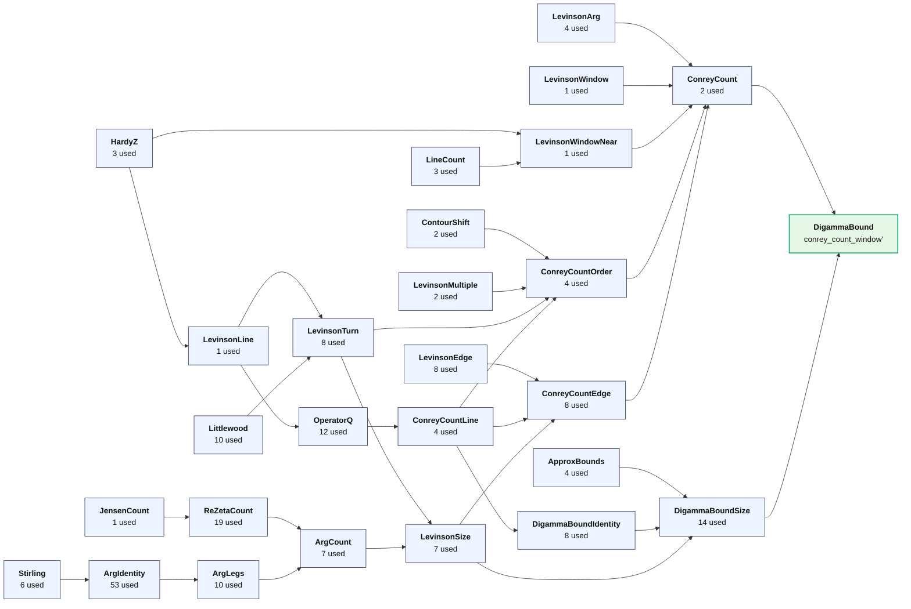

# What `DigammaBound.conrey_count_window'` rests on

[`DigammaBound.conrey_count_window'`](../lean_stage3/DigammaBound.md#DigammaBound-conrey_count_window-) in `lean_stage3/Stage3/DigammaBound.lean`, line 184.

**Why.** The count on a window inside `[T/4, 2T]`, with no size hypothesis. For a real `Q` with `Q′(x) = Q′(1 − x)`, `Q(1/2) ≠ 0` and `Q(0) = 1` there are `A > 0` and `T₀` such that for every `T ≥ T₀`, `T/4 ≤ a`, `4 ≤ a < b ≤ 2T`, and the avoidance hypotheses: `lineCount b − lineCount a ≥ (N b − N a) − 2·countRight V − (72 log b + 42 log(3A) + 154)`.

**Proves**

```lean
∃ A T₀ : ℝ, 0 < A ∧ ∀ {T a b : ℝ}, T₀ ≤ T → T / 4 ≤ a → 4 ≤ a → a < b → b ≤ 2 * T → (∀ x ∈ Icc (1/2 : ℝ) 3, ConreyCount.V Q (Real.log T) (↑x + ↑a * I) ≠ 0) → (∀ x ∈ Icc (1/2 : ℝ) 3, ConreyCount.V Q (Real.log T) (↑x + ↑b * I) ≠ 0) → riemannZeta (1/2 + a * I) ≠ 0 → (riemannZeta.N b - riemannZeta.N a) - 2 * Littlewood.countRight (ConreyCount.V Q (Real.log T)) ((1/2 : ℂ) + a * I) ((3 : ℂ) + b * I) (1/2) - (72 * Real.log b + 42 * Real.log (3 * A) + 154) ≤ (lineCount b : ℝ) - (lineCount a : ℝ)
```

**Needs** (its hypotheses)

  - `` hQ : ∀ x : ℝ, Q.derivative.eval x = Q.derivative.eval (1 - x) ``
  - `` hQh : Q.eval (1/2) ≠ 0 ``
  - `` hQ0 : Q.eval 0 = 1 ``

Behind it: 176 theorems and 30 definitions in 27 files. Every one is listed below; Lean recorded each step.

## The files it passes through



An arrow A → B reads "B uses something proved or defined in A"; indirect arrows are left out. Green: the theorem itself. Yellow: a file in the other tree. The number is how many of that file's declarations are on the way.

## Every declaration on the way

Files in dependency order. ★ marks what the theorem's own proof uses directly.

### [`ApproxBounds`](../lean_stage3/ApproxBounds.md) — 4

- [`ApproxBounds.lY`](../lean_stage3/ApproxBounds.md#ApproxBounds-lY) — *def*
- [`ApproxBounds.gModel`](../lean_stage3/ApproxBounds.md#ApproxBounds-gModel) — *def*
- [`ApproxBounds.gErr`](../lean_stage3/ApproxBounds.md#ApproxBounds-gErr) — *def*
- [`ApproxBounds.gRModel`](../lean_stage3/ApproxBounds.md#ApproxBounds-gRModel) — *def*

### [`ContourShift`](../lean_stage3/ContourShift.md) — 2

- [`ContourShift.zeta_analyticAt`](../lean_stage3/ContourShift.md#ContourShift-zeta_analyticAt) — `` AnalyticAt ℂ riemannZeta ρ ``
- [`ContourShift.zeta_order_ne_top`](../lean_stage3/ContourShift.md#ContourShift-zeta_order_ne_top) — `` analyticOrderAt riemannZeta ρ ≠ ⊤ ``

### [`HardyZ`](../lean_stage3/HardyZ.md) — 3

- [`HardyZ.completedRiemannZeta_conj_of_re_pos`](../lean_stage3/HardyZ.md#HardyZ-completedRiemannZeta_conj_of_re_pos) — `` completedRiemannZeta (conj s) = conj (completedRiemannZeta s) ``
- [`HardyZ.re_line`](../lean_stage3/HardyZ.md#HardyZ-re_line) — `` ((1 / 2 : ℂ) + t * I).re = 1 / 2 ``
- [`HardyZ.xi_line_real`](../lean_stage3/HardyZ.md#HardyZ-xi_line_real) — `` (completedRiemannZeta (1/2 + t * Complex.I)).im = 0 ``

### [`JensenCount`](../lean_stage3/JensenCount.md) — 1

- [`Stage3.zeta_disk_upper`](../lean_stage3/JensenCount.md#Stage3-zeta_disk_upper) — `` ‖ζ w‖ ≤ 28 * T ``

### [`LevinsonArg`](../lean_stage3/LevinsonArg.md) — 4

- [`LevinsonArg.exists_log_lift`](../lean_stage3/LevinsonArg.md#LevinsonArg-exists_log_lift) — `` ∃ L : ℝ → ℂ, ContinuousOn L (Set.Icc a b) ∧ ∀ t ∈ Set.Icc a b, Complex.exp (L t) = F t ``
- [`LevinsonArg.exists_arg_lift`](../lean_stage3/LevinsonArg.md#LevinsonArg-exists_arg_lift) — `` ∃ φ : ℝ → ℝ, ContinuousOn φ (Set.Icc a b) ∧ ∀ t ∈ Set.Icc a b, F t = ‖F t‖ * Complex.exp (φ t * Complex.I) ``
- [`LevinsonArg.crossings_of_le`](../lean_stage3/LevinsonArg.md#LevinsonArg-crossings_of_le) — `` ∃ t : Fin k → ℝ, StrictMono t ∧ (∀ i, t i ∈ Set.Icc a b) ∧ ∀ i, Real.cos (φ (t i)) = 0 ``
- [`LevinsonArg.crossings_of_arg`](../lean_stage3/LevinsonArg.md#LevinsonArg-crossings_of_arg) — `` ∃ t : Fin k → ℝ, StrictMono t ∧ (∀ i, t i ∈ Set.Icc a b) ∧ ∀ i, Real.cos (φ (t i)) = 0 ``

### [`LevinsonEdge`](../lean_stage3/LevinsonEdge.md) — 8

- [`LevinsonEdge.zeta_norm_le`](../lean_stage3/LevinsonEdge.md#LevinsonEdge-zeta_norm_le) — `` ‖riemannZeta u‖ ≤ 2 + 4 * ‖u‖ ``
- [`LevinsonEdge.symm`](../lean_stage3/LevinsonEdge.md#LevinsonEdge-symm) — *def*
- [`LevinsonEdge.model`](../lean_stage3/LevinsonEdge.md#LevinsonEdge-model) — *def*
- [`LevinsonEdge.symm_real`](../lean_stage3/LevinsonEdge.md#LevinsonEdge-symm_real) — `` symm g (x : ℂ) = ((g x).re : ℂ) ``
- [`LevinsonEdge.symm_zero`](../lean_stage3/LevinsonEdge.md#LevinsonEdge-symm_zero) — `` symm g 0 = ((g 0).re : ℂ) ``
- [`LevinsonEdge.symm_differentiableOn`](../lean_stage3/LevinsonEdge.md#LevinsonEdge-symm_differentiableOn) — `` DifferentiableOn ℂ (symm g) (Metric.ball (0 : ℂ) ρ) ``
- [`LevinsonEdge.norm_symm_le`](../lean_stage3/LevinsonEdge.md#LevinsonEdge-norm_symm_le) — `` ‖symm g z‖ ≤ M ``
- [`LevinsonEdge.real_zero_count`](../lean_stage3/LevinsonEdge.md#LevinsonEdge-real_zero_count) — `` ∃ Z : Finset ℝ, (∀ x : ℝ, |x| ≤ 5 / 6 → (g x).re = 0 → x ∈ Z) ∧ (Z.card : ℝ) ≤ 21 * Real.log (M / m) ``

### [`LevinsonLine`](../lean_stage3/LevinsonLine.md) — 1

- [`LevinsonLine.line_facts`](../lean_stage3/LevinsonLine.md#LevinsonLine-line_facts) — `` ((1/2 : ℂ) + t * I) ≠ 0 ∧ ((1/2 : ℂ) + t * I) ≠ 1 ∧ 0 < ((1/2 : ℂ) + t * I).re ``

### [`LevinsonMultiple`](../lean_stage3/LevinsonMultiple.md) — 2

- [`LevinsonMultiple.polyP`](../lean_stage3/LevinsonMultiple.md#LevinsonMultiple-polyP) — *def*
- [`LevinsonMultiple.polyP_line`](../lean_stage3/LevinsonMultiple.md#LevinsonMultiple-polyP_line) — `` polyP D n (1/2 + t * I) = I ^ (∑ ρ ∈ D, n ρ) * ((∏ ρ ∈ D, (t - ρ.im) ^ n ρ : ℝ) : ℂ) ``

### [`LevinsonWindow`](../lean_stage3/LevinsonWindow.md) — 1

- [`LevinsonWindow.border_cases`](../lean_stage3/LevinsonWindow.md#LevinsonWindow-border_cases) — `` (p.im = z.im ∧ p.re ∈ Icc z.re w.re) ∨ (p.re = z.re ∧ p.im ∈ Icc z.im w.im) ∨ (p.im = w.im ∧ p.re ∈ Icc z.re w.re) ∨ (p.re = w.re ∧ p.im ∈ Icc z.im w.im) ``

### [`LineCount`](../lean_stage3/LineCount.md) — 3

- [`LineCount.zerosUpTo`](../lean_stage3/LineCount.md#LineCount-zerosUpTo) — *def*
- ★ [`LineCount.lineCount`](../lean_stage3/LineCount.md#LineCount-lineCount) — *def*
- [`LineCount.mem_zerosUpTo`](../lean_stage3/LineCount.md#LineCount-mem_zerosUpTo) — `` ρ ∈ zerosUpTo T ↔ 0 < (ρ : ℂ).im ∧ (ρ : ℂ).im ≤ T ``

### [`LevinsonWindowNear`](../lean_stage3/LevinsonWindowNear.md) — 1

- [`LevinsonWindowNear.sum_order_le_lineCount_sub`](../lean_stage3/LevinsonWindowNear.md#LevinsonWindowNear-sum_order_le_lineCount_sub) — `` ∑ γ ∈ E, riemannZeta.order (1/2 + γ * I) ≤ lineCount b - lineCount a ``

### [`Littlewood`](../lean_stage3/Littlewood.md) — 10

- [`Littlewood.corner_mem`](../lean_stage3/Littlewood.md#Littlewood-corner_mem) — `` z ∈ Rectangle z w ``
- [`Littlewood.corner_mem_border`](../lean_stage3/Littlewood.md#Littlewood-corner_mem_border) — `` z ∈ RectangleBorder z w ``
- [`Littlewood.order_ne_top`](../lean_stage3/Littlewood.md#Littlewood-order_ne_top) — `` ∀ p ∈ Rectangle z w, meromorphicOrderAt f p ≠ ⊤ ``
- [`Littlewood.mem_support_divisor`](../lean_stage3/Littlewood.md#Littlewood-mem_support_divisor) — `` p ∈ (MeromorphicOn.divisor f U).support ↔ p ∈ U ∧ f p = 0 ``
- [`Littlewood.divisor_eq`](../lean_stage3/Littlewood.md#Littlewood-divisor_eq) — `` MeromorphicOn.divisor f U p = MeromorphicOn.divisor f (Rectangle z w) p ``
- [`Littlewood.support_interior`](../lean_stage3/Littlewood.md#Littlewood-support_interior) — `` z.re < p.re ∧ p.re < w.re ∧ z.im < p.im ∧ p.im < w.im ``
- ★ [`Littlewood.countRight`](../lean_stage3/Littlewood.md#Littlewood-countRight) — *def*
- [`Littlewood.rectIntegral_eq_count`](../lean_stage3/Littlewood.md#Littlewood-rectIntegral_eq_count) — `` RectangleIntegral (logDeriv f) (↑σ + ↑z.im * I) w = 2 * Real.pi * I * (countRight f z w σ : ℂ) ``
- [`Littlewood.two_pi_count_eq`](../lean_stage3/Littlewood.md#Littlewood-two_pi_count_eq) — `` 2 * Real.pi * countRight f z w σ = (∫ x in σ..w.re, logDeriv f (↑x + ↑z.im * I)).im - (∫ x in σ..w.re, logDeriv f (↑x + ↑w.im * I)).im + (∫ t in z.im..w.im, log… ``
- [`Littlewood.continuousAt_logDeriv`](../lean_stage3/Littlewood.md#Littlewood-continuousAt_logDeriv) — `` ContinuousAt (logDeriv f) s ``

### [`LevinsonTurn`](../lean_stage3/LevinsonTurn.md) — 8

- [`LevinsonTurn.int_valued_const`](../lean_stage3/LevinsonTurn.md#LevinsonTurn-int_valued_const) — `` d b = 0 ``
- [`LevinsonTurn.lift_turn_eq_integral`](../lean_stage3/LevinsonTurn.md#LevinsonTurn-lift_turn_eq_integral) — `` φ b - φ a = (∫ t in a..b, F' t / F t).im ``
- [`LevinsonTurn.hasDerivAt_line_comp`](../lean_stage3/LevinsonTurn.md#LevinsonTurn-hasDerivAt_line_comp) — `` HasDerivAt (fun y : ℝ => f (1/2 + y * I)) (deriv f (1/2 + t * I) * I) t ``
- [`LevinsonTurn.continuous_line`](../lean_stage3/LevinsonTurn.md#LevinsonTurn-continuous_line) — `` Continuous (fun t : ℝ => (1/2 + t * I : ℂ)) ``
- [`LevinsonTurn.line_turn_eq_integral`](../lean_stage3/LevinsonTurn.md#LevinsonTurn-line_turn_eq_integral) — `` φ b - φ a = (∫ t in a..b, logDeriv f (1/2 + t * I)).re ``
- [`LevinsonTurn.continuousOn_logDeriv_line`](../lean_stage3/LevinsonTurn.md#LevinsonTurn-continuousOn_logDeriv_line) — `` ContinuousOn (fun t : ℝ => logDeriv f (1/2 + t * I)) S ``
- [`LevinsonTurn.turn_split`](../lean_stage3/LevinsonTurn.md#LevinsonTurn-turn_split) — `` (∫ t in a..b, logDeriv (fun s => Gammaℝ s * G s) (1/2 + t * I)).re = (∫ t in a..b, logDeriv Gammaℝ (1/2 + t * I)).re + (∫ t in a..b, logDeriv G (1/2 + t * I)).r… ``
- [`LevinsonTurn.G_turn_eq`](../lean_stage3/LevinsonTurn.md#LevinsonTurn-G_turn_eq) — `` (∫ t in a..b, logDeriv G (1/2 + t * I)).re = -(2 * Real.pi * Littlewood.countRight G ((1/2 : ℂ) + a * I) ((X : ℂ) + b * I) (1/2)) + (∫ x in (1/2 : ℝ)..X, logDer… ``

### [`OperatorQ`](../lean_stage3/OperatorQ.md) — 12

- [`OperatorQ.domXi`](../lean_stage3/OperatorQ.md#OperatorQ-domXi) — *def*
- [`OperatorQ.line_mem`](../lean_stage3/OperatorQ.md#OperatorQ-line_mem) — `` ((1/2 : ℂ) + t * I) ∈ domXi ``
- [`OperatorQ.differentiableAt_iteratedDeriv`](../lean_stage3/OperatorQ.md#OperatorQ-differentiableAt_iteratedDeriv) — `` DifferentiableAt ℂ (iteratedDeriv k completedRiemannZeta) ((1/2 : ℂ) + t * I) ``
- [`OperatorQ.im_I_mul_deriv`](../lean_stage3/OperatorQ.md#OperatorQ-im_I_mul_deriv) — `` (I * deriv F ((1/2 : ℂ) + t * I)).im = 0 ``
- [`OperatorQ.im_I_pow_iteratedDeriv`](../lean_stage3/OperatorQ.md#OperatorQ-im_I_pow_iteratedDeriv) — `` (I ^ k * iteratedDeriv k completedRiemannZeta ((1/2 : ℂ) + t * I)).im = 0 ``
- [`OperatorQ.re_iteratedDeriv_odd`](../lean_stage3/OperatorQ.md#OperatorQ-re_iteratedDeriv_odd) — `` (iteratedDeriv k completedRiemannZeta ((1/2 : ℂ) + t * I)).re = 0 ``
- [`OperatorQ.re_sum_line`](../lean_stage3/OperatorQ.md#OperatorQ-re_sum_line) — `` (∑ k ∈ Finset.range (n + 1), (a k : ℂ) * iteratedDeriv k completedRiemannZeta ((1/2 : ℂ) + t * I)).re = a 0 * (completedRiemannZeta ((1/2 : ℂ) + t * I)).re ``
- [`OperatorQ.coeff_comp_neg_X`](../lean_stage3/OperatorQ.md#OperatorQ-coeff_comp_neg_X) — `` (p.comp (-X)).coeff n = (-1) ^ n * p.coeff n ``
- [`OperatorQ.taylor_coeff_even_eq_zero`](../lean_stage3/OperatorQ.md#OperatorQ-taylor_coeff_even_eq_zero) — `` (taylor (1/2 : ℝ) Q).coeff k = 0 ``
- [`OperatorQ.W`](../lean_stage3/OperatorQ.md#OperatorQ-W) — *def*
- [`OperatorQ.re_W_line`](../lean_stage3/OperatorQ.md#OperatorQ-re_W_line) — `` (W Q L ((1/2 : ℂ) + t * I)).re = Q.eval (1/2) * (completedRiemannZeta ((1/2 : ℂ) + t * I)).re ``
- [`OperatorQ.zeta_line_zero_iff_W`](../lean_stage3/OperatorQ.md#OperatorQ-zeta_line_zero_iff_W) — `` riemannZeta ((1/2 : ℂ) + t * I) = 0 ↔ (W Q L ((1/2 : ℂ) + t * I)).re = 0 ``

### [`ConreyCountLine`](../lean_stage3/ConreyCountLine.md) — 4

- ★ [`ConreyCount.V`](../lean_stage3/ConreyCountLine.md#ConreyCount-V) — *def*
- [`ConreyCount.analyticAt_W`](../lean_stage3/ConreyCountLine.md#ConreyCount-analyticAt_W) — `` AnalyticAt ℂ (OperatorQ.W Q L) s ``
- [`ConreyCount.analyticAt_V`](../lean_stage3/ConreyCountLine.md#ConreyCount-analyticAt_V) — `` AnalyticAt ℂ (V Q L) s ``
- [`ConreyCount.W_eq_gammaR_mul_V`](../lean_stage3/ConreyCountLine.md#ConreyCount-W_eq_gammaR_mul_V) — `` OperatorQ.W Q L s = Gammaℝ s * V Q L s ``

### [`ConreyCountOrder`](../lean_stage3/ConreyCountOrder.md) — 4

- [`ConreyCount.order_cmp`](../lean_stage3/ConreyCountOrder.md#ConreyCount-order_cmp) — `` n ≤ m ∧ (g γ = 0 → n + 1 ≤ m) ``
- [`ConreyCount.zeta_order_eq`](../lean_stage3/ConreyCountOrder.md#ConreyCount-zeta_order_eq) — `` riemannZeta.order ρ = ((analyticOrderAt riemannZeta ρ).toNat : ℤ) ``
- [`ConreyCount.line_identity`](../lean_stage3/ConreyCountOrder.md#ConreyCount-line_identity) — `` ((Q.eval (1/2 : ℝ) : ℝ) : ℂ) * completedRiemannZeta (1/2 + t * I) = (((∏ ρ ∈ D, (t - ρ.im) ^ n ρ) * (I ^ (∑ ρ ∈ D, n ρ) * (Gammaℝ (1/2 + t * I) * H (1/2 + t * I… ``
- [`ConreyCount.zeta_order_ge_line`](../lean_stage3/ConreyCountOrder.md#ConreyCount-zeta_order_ge_line) — `` (n ρ : ℤ) ≤ riemannZeta.order ρ ∧ ((I ^ (∑ ρ' ∈ D, n ρ') * (Gammaℝ ρ * H ρ)).re = 0 → (n ρ : ℤ) + 1 ≤ riemannZeta.order ρ) ``

### [`DigammaBoundIdentity`](../lean_stage3/DigammaBoundIdentity.md) — 8

- [`DigammaBound.H`](../lean_stage3/DigammaBoundIdentity.md#DigammaBound-H) — *def*
- [`DigammaBound.poly_shift`](../lean_stage3/DigammaBoundIdentity.md#DigammaBound-poly_shift) — `` (∑ k ∈ Finset.range (Q.natDegree + 1), C ((taylor (1/2 : ℝ) Q).coeff k * (-1 / L) ^ k) * (X + C (L / 2)) ^ k) = ∑ j ∈ Finset.range (Q.natDegree + 1), C (Q.coeff… ``
- [`DigammaBound.poly_shift_coeff`](../lean_stage3/DigammaBoundIdentity.md#DigammaBound-poly_shift_coeff) — `` ∑ k ∈ Finset.range (Q.natDegree + 1), (taylor (1/2 : ℝ) Q).coeff k * (-1 / L) ^ k * ((X + C (L / 2)) ^ k).coeff i = Q.coeff i * (-1 / L) ^ i ``
- [`DigammaBound.differentiableAt_H`](../lean_stage3/DigammaBoundIdentity.md#DigammaBound-differentiableAt_H) — `` DifferentiableAt ℂ (H L w) z ``
- [`DigammaBound.analyticAt_H`](../lean_stage3/DigammaBoundIdentity.md#DigammaBound-analyticAt_H) — `` AnalyticAt ℂ (H L w) z ``
- [`DigammaBound.iteratedDeriv_E`](../lean_stage3/DigammaBoundIdentity.md#DigammaBound-iteratedDeriv_E) — `` iteratedDeriv m (fun z => cexp (a * (z - w))) w = a ^ m ``
- [`DigammaBound.xi_eventually_eq`](../lean_stage3/DigammaBoundIdentity.md#DigammaBound-xi_eventually_eq) — `` completedRiemannZeta =ᶠ[𝓝 w] fun z => Gammaℝ w * (H L w z * cexp (((L / 2 : ℝ) : ℂ) * (z - w))) ``
- [`DigammaBound.V_eq_sum_H`](../lean_stage3/DigammaBoundIdentity.md#DigammaBound-V_eq_sum_H) — `` ConreyCount.V Q L w = ∑ j ∈ Finset.range (Q.natDegree + 1), ((Q.coeff j * (-1 / L) ^ j : ℝ) : ℂ) * iteratedDeriv j (H L w) w ``

### [`ReZetaCount`](../lean_stage3/ReZetaCount.md) — 19

- [`ReZetaCount.G`](../lean_stage3/ReZetaCount.md#ReZetaCount-G) — *def*
- [`ReZetaCount.F`](../lean_stage3/ReZetaCount.md#ReZetaCount-F) — *def*
- [`ReZetaCount.reZeroSet`](../lean_stage3/ReZetaCount.md#ReZetaCount-reZeroSet) — *def*
- [`ReZetaCount.norm_zeta_sub_one_le`](../lean_stage3/ReZetaCount.md#ReZetaCount-norm_zeta_sub_one_le) — `` ‖riemannZeta s - 1‖ ≤ Real.pi ^ 2 / 6 - 1 ``
- [`ReZetaCount.re_zeta_two_line_ge`](../lean_stage3/ReZetaCount.md#ReZetaCount-re_zeta_two_line_ge) — `` 2 - Real.pi ^ 2 / 6 ≤ (riemannZeta (2 + (t : ℂ) * Complex.I)).re ``
- [`ReZetaCount.re_zeta_two_line_pos`](../lean_stage3/ReZetaCount.md#ReZetaCount-re_zeta_two_line_pos) — `` 0 < (riemannZeta (2 + (t : ℂ) * Complex.I)).re ``
- [`ReZetaCount.G_zero_eq`](../lean_stage3/ReZetaCount.md#ReZetaCount-G_zero_eq) — `` G T 0 = ((2 * (riemannZeta (2 + Complex.I * (T : ℂ))).re : ℝ) : ℂ) ``
- [`ReZetaCount.G_real`](../lean_stage3/ReZetaCount.md#ReZetaCount-G_real) — `` G T (x : ℂ) = ((2 * (riemannZeta (2 * (x : ℂ) + 2 + Complex.I * (T : ℂ))).re : ℝ) : ℂ) ``
- [`ReZetaCount.G_zero_ne`](../lean_stage3/ReZetaCount.md#ReZetaCount-G_zero_ne) — `` G T 0 ≠ 0 ``
- [`ReZetaCount.F_zero_eq_one`](../lean_stage3/ReZetaCount.md#ReZetaCount-F_zero_eq_one) — `` F T 0 = 1 ``
- [`ReZetaCount.arg_ne_one`](../lean_stage3/ReZetaCount.md#ReZetaCount-arg_ne_one) — `` 2 * z + 2 + Complex.I * (T : ℂ) ≠ 1 ∧ 2 * z + 2 - Complex.I * (T : ℂ) ≠ 1 ``
- [`ReZetaCount.F_analytic`](../lean_stage3/ReZetaCount.md#ReZetaCount-F_analytic) — `` AnalyticOnNhd ℂ (F T) (Metric.closedBall (0 : ℂ) 1) ``
- [`ReZetaCount.F_bound`](../lean_stage3/ReZetaCount.md#ReZetaCount-F_bound) — `` ‖F T z‖ ≤ 80 * T ``
- [`ReZetaCount.F_zeros_finite`](../lean_stage3/ReZetaCount.md#ReZetaCount-F_zeros_finite) — `` (SetOfZeros 1 (F T)).Finite ``
- [`ReZetaCount.F_count_le`](../lean_stage3/ReZetaCount.md#ReZetaCount-F_count_le) — `` ∑ ρ ∈ (finiteSetOfZeros_mono (by norm_num : (7:ℝ)/8 < 1) (F_zeros_finite hT)).toFinset, (analyticOrderNatAt (F T) ρ : ℝ) ≤ 15 * Real.log T + 73 ``
- [`ReZetaCount.reZeroSet_finite`](../lean_stage3/ReZetaCount.md#ReZetaCount-reZeroSet_finite) — `` (reZeroSet T).Finite ``
- [`ReZetaCount.reZeros`](../lean_stage3/ReZetaCount.md#ReZetaCount-reZeros) — *def*
- [`ReZetaCount.mem_reZeros`](../lean_stage3/ReZetaCount.md#ReZetaCount-mem_reZeros) — `` x ∈ reZeros hT ↔ x ∈ Set.Ioo (1/2 : ℝ) 2 ∧ (riemannZeta ((x : ℂ) + T * Complex.I)).re = 0 ``
- [`ReZetaCount.card_reZeros_le`](../lean_stage3/ReZetaCount.md#ReZetaCount-card_reZeros_le) — `` ((reZeros hT).card : ℝ) ≤ 15 * Real.log T + 73 ``

### [`Stirling`](../lean_stage3/Stirling.md) — 6

- [`Stage3.phasePoint`](../lean_stage3/Stirling.md#Stage3-phasePoint) — *def*
- [`Stage3.phaseTheta`](../lean_stage3/Stirling.md#Stage3-phaseTheta) — *def*
- [`Stage3.continuous_phasePoint`](../lean_stage3/Stirling.md#Stage3-continuous_phasePoint) — `` Continuous phasePoint ``
- [`Stage3.intervalIntegrable_phasePoint`](../lean_stage3/Stirling.md#Stage3-intervalIntegrable_phasePoint) — `` IntervalIntegrable phasePoint MeasureTheory.volume a b ``
- [`Stage3.zq`](../lean_stage3/Stirling.md#Stage3-zq) — *def*
- [`Stage3.phasePoint_eq`](../lean_stage3/Stirling.md#Stage3-phasePoint_eq) — `` phasePoint t = (Complex.digamma (zq t)).re ``

### [`ArgIdentity`](../lean_stage3/ArgIdentity.md) — 53

- [`Stage3.xi`](../lean_stage3/ArgIdentity.md#Stage3-xi) — *def*
- [`Stage3.differentiable_xi`](../lean_stage3/ArgIdentity.md#Stage3-differentiable_xi) — `` Differentiable ℂ xi ``
- [`Stage3.xi_zero`](../lean_stage3/ArgIdentity.md#Stage3-xi_zero) — `` xi 0 = 1 ``
- [`Stage3.xi_one`](../lean_stage3/ArgIdentity.md#Stage3-xi_one) — `` xi 1 = 1 ``
- [`Stage3.xi_eq_completed`](../lean_stage3/ArgIdentity.md#Stage3-xi_eq_completed) — `` xi s = s * (s - 1) * completedRiemannZeta s ``
- [`Stage3.xi_one_sub`](../lean_stage3/ArgIdentity.md#Stage3-xi_one_sub) — `` xi (1 - s) = xi s ``
- [`Stage3.gammaR_conj`](../lean_stage3/ArgIdentity.md#Stage3-gammaR_conj) — `` Gammaℝ (conj s) = conj (Gammaℝ s) ``
- [`Stage3.completed_eq_gammaR_mul_zeta`](../lean_stage3/ArgIdentity.md#Stage3-completed_eq_gammaR_mul_zeta) — `` completedRiemannZeta s = Gammaℝ s * riemannZeta s ``
- [`Stage3.completedZeta₀_conj`](../lean_stage3/ArgIdentity.md#Stage3-completedZeta-_conj) — `` completedRiemannZeta₀ (conj s) = conj (completedRiemannZeta₀ s) ``
- [`Stage3.xi_conj`](../lean_stage3/ArgIdentity.md#Stage3-xi_conj) — `` xi (conj s) = conj (xi s) ``
- [`Stage3.zeta_re_neg_of_real_mem_Ioo`](../lean_stage3/ArgIdentity.md#Stage3-zeta_re_neg_of_real_mem_Ioo) — `` (riemannZeta (σ : ℂ)).re < 0 ``
- [`Stage3.zeta_ne_zero_of_real_mem_Ioo`](../lean_stage3/ArgIdentity.md#Stage3-zeta_ne_zero_of_real_mem_Ioo) — `` riemannZeta (σ : ℂ) ≠ 0 ``
- [`Stage3.completed_eq_gammaR_mul_zeta'`](../lean_stage3/ArgIdentity.md#Stage3-completed_eq_gammaR_mul_zeta-) — `` completedRiemannZeta s = Gammaℝ s * riemannZeta s ``
- [`Stage3.xi_eq_prod`](../lean_stage3/ArgIdentity.md#Stage3-xi_eq_prod) — `` xi s = s * (s - 1) * Gammaℝ s * riemannZeta s ``
- [`Stage3.xi_ne_zero_of_one_le_re`](../lean_stage3/ArgIdentity.md#Stage3-xi_ne_zero_of_one_le_re) — `` xi s ≠ 0 ``
- [`Stage3.xi_ne_zero_of_re_nonpos`](../lean_stage3/ArgIdentity.md#Stage3-xi_ne_zero_of_re_nonpos) — `` xi s ≠ 0 ``
- [`Stage3.xi_ne_zero_of_real`](../lean_stage3/ArgIdentity.md#Stage3-xi_ne_zero_of_real) — `` xi (σ : ℂ) ≠ 0 ``
- [`Stage3.xi_eq_zero_iff`](../lean_stage3/ArgIdentity.md#Stage3-xi_eq_zero_iff) — `` xi s = 0 ↔ riemannZeta s = 0 ∧ 0 < s.re ∧ s.re < 1 ``
- [`Stage3.meromorphicOrderAt_xi_eq_zeta`](../lean_stage3/ArgIdentity.md#Stage3-meromorphicOrderAt_xi_eq_zeta) — `` meromorphicOrderAt xi ρ = meromorphicOrderAt riemannZeta ρ ``
- [`Stage3.xi_analyticAt`](../lean_stage3/ArgIdentity.md#Stage3-xi_analyticAt) — `` AnalyticAt ℂ xi s ``
- [`Stage3.xi_meromorphicOrderAt_ne_top`](../lean_stage3/ArgIdentity.md#Stage3-xi_meromorphicOrderAt_ne_top) — `` meromorphicOrderAt xi p ≠ ⊤ ``
- [`Stage3.logDeriv_xi_meromorphicAt`](../lean_stage3/ArgIdentity.md#Stage3-logDeriv_xi_meromorphicAt) — `` MeromorphicAt (logDeriv xi) s ``
- [`Stage3.N_eq_sum`](../lean_stage3/ArgIdentity.md#Stage3-N_eq_sum) — `` riemannZeta.N T = ∑ ρ ∈ (Kadiri.zeroes_rect_univ_positive_height_finite T).toFinset, (riemannZeta.order ρ : ℝ) ``
- [`Stage3.xi_divisor_support_eq`](../lean_stage3/ArgIdentity.md#Stage3-xi_divisor_support_eq) — `` (MeromorphicOn.divisor xi (Rectangle (-1 : ℂ) (2 + Complex.I * T))).support = riemannZeta.zeroes_rect (Set.univ : Set ℝ) (Set.Ioo 0 T) ``
- [`Stage3.rectangleIntegral_logDeriv_xi_eq_N`](../lean_stage3/ArgIdentity.md#Stage3-rectangleIntegral_logDeriv_xi_eq_N) — `` RectangleIntegral' (logDeriv xi) (-1 : ℂ) (2 + Complex.I * T) = ((riemannZeta.N T : ℝ) : ℂ) ``
- [`Stage3.logDeriv_xi_one_sub`](../lean_stage3/ArgIdentity.md#Stage3-logDeriv_xi_one_sub) — `` logDeriv xi (1 - s) = -logDeriv xi s ``
- [`Stage3.logDeriv_xi_conj`](../lean_stage3/ArgIdentity.md#Stage3-logDeriv_xi_conj) — `` logDeriv xi (conj s) = conj (logDeriv xi s) ``
- [`Stage3.logDeriv_xi_continuousAt`](../lean_stage3/ArgIdentity.md#Stage3-logDeriv_xi_continuousAt) — `` ContinuousAt (logDeriv xi) p ``
- [`Stage3.xi_ne_zero_on_good_top`](../lean_stage3/ArgIdentity.md#Stage3-xi_ne_zero_on_good_top) — `` xi ((x : ℂ) + T * Complex.I) ≠ 0 ``
- [`Stage3.pi_mul_N_eq`](../lean_stage3/ArgIdentity.md#Stage3-pi_mul_N_eq) — `` Real.pi * riemannZeta.N T = (∫ t in (0:ℝ)..T, logDeriv xi (2 + (t : ℂ) * Complex.I)).re - (∫ x in (1/2:ℝ)..2, logDeriv xi ((x : ℂ) + T * Complex.I)).im ``
- [`Stage3.logDeriv_congr_of_eventuallyEq`](../lean_stage3/ArgIdentity.md#Stage3-logDeriv_congr_of_eventuallyEq) — `` logDeriv f x = logDeriv g x ``
- [`Stage3.gammaR_eq_exp_mul`](../lean_stage3/ArgIdentity.md#Stage3-gammaR_eq_exp_mul) — `` Gammaℝ s = Complex.exp (-(Real.log Real.pi : ℂ) / 2 * s) * Complex.Gamma (s / 2) ``
- [`Stage3.differentiableAt_gammaR`](../lean_stage3/ArgIdentity.md#Stage3-differentiableAt_gammaR) — `` DifferentiableAt ℂ Gammaℝ s ``
- [`Stage3.logDeriv_gammaR`](../lean_stage3/ArgIdentity.md#Stage3-logDeriv_gammaR) — `` logDeriv Gammaℝ s = -(Real.log Real.pi : ℂ) / 2 + Complex.digamma (s / 2) / 2 ``
- [`Stage3.logDeriv_xi_split`](../lean_stage3/ArgIdentity.md#Stage3-logDeriv_xi_split) — `` logDeriv xi s = 1 / s + 1 / (s - 1) + logDeriv Gammaℝ s + logDeriv riemannZeta s ``
- [`Stage3.intervalIntegral_re`](../lean_stage3/ArgIdentity.md#Stage3-intervalIntegral_re) — `` (∫ t in a..b, f t).re = ∫ t in a..b, (f t).re ``
- [`Stage3.logDeriv_gammaR_conj`](../lean_stage3/ArgIdentity.md#Stage3-logDeriv_gammaR_conj) — `` logDeriv Gammaℝ (conj s) = conj (logDeriv Gammaℝ s) ``
- [`Stage3.logDeriv_gammaR_im_eq_zero`](../lean_stage3/ArgIdentity.md#Stage3-logDeriv_gammaR_im_eq_zero) — `` (logDeriv Gammaℝ ((x : ℝ) : ℂ)).im = 0 ``
- [`Stage3.integral_inv_vertical`](../lean_stage3/ArgIdentity.md#Stage3-integral_inv_vertical) — `` (∫ t in (0:ℝ)..T, ((c : ℂ) + t * Complex.I)⁻¹) = -Complex.I * (Complex.log ((c : ℂ) + T * Complex.I) - Complex.log (c : ℂ)) ``
- [`Stage3.integral_inv_horizontal`](../lean_stage3/ArgIdentity.md#Stage3-integral_inv_horizontal) — `` (∫ x in a..b, (((x : ℂ) - d) + T * Complex.I)⁻¹) = Complex.log (((b : ℂ) - d) + T * Complex.I) - Complex.log (((a : ℂ) - d) + T * Complex.I) ``
- [`Stage3.arg_sum_eq_pi`](../lean_stage3/ArgIdentity.md#Stage3-arg_sum_eq_pi) — `` Complex.arg ((1/2 : ℝ) + T * Complex.I) + Complex.arg ((-(1/2) : ℝ) + T * Complex.I) = Real.pi ``
- [`Stage3.elemLD`](../lean_stage3/ArgIdentity.md#Stage3-elemLD) — *def*
- [`Stage3.elem_fold_eq_pi`](../lean_stage3/ArgIdentity.md#Stage3-elem_fold_eq_pi) — `` (∫ t in (0:ℝ)..T, elemLD (2 + (t : ℂ) * Complex.I)).re - (∫ x in (1/2:ℝ)..2, elemLD ((x : ℂ) + T * Complex.I)).im = Real.pi ``
- [`Stage3.logDeriv_gammaR_analyticAt`](../lean_stage3/ArgIdentity.md#Stage3-logDeriv_gammaR_analyticAt) — `` AnalyticAt ℂ (logDeriv Gammaℝ) z ``
- [`Stage3.logDeriv_gammaR_continuousAt`](../lean_stage3/ArgIdentity.md#Stage3-logDeriv_gammaR_continuousAt) — `` ContinuousAt (logDeriv Gammaℝ) z ``
- [`Stage3.logDeriv_gammaR_holo`](../lean_stage3/ArgIdentity.md#Stage3-logDeriv_gammaR_holo) — `` HolomorphicOn (logDeriv Gammaℝ) {s : ℂ | 0 < s.re} ``
- [`Stage3.logDeriv_gammaR_comp_continuous`](../lean_stage3/ArgIdentity.md#Stage3-logDeriv_gammaR_comp_continuous) — `` Continuous fun x : ℝ => logDeriv Gammaℝ (g x) ``
- [`Stage3.gammaR_fold_eq_phaseTheta`](../lean_stage3/ArgIdentity.md#Stage3-gammaR_fold_eq_phaseTheta) — `` (∫ t in (0:ℝ)..T, logDeriv Gammaℝ (2 + (t : ℂ) * Complex.I)).re - (∫ x in (1/2:ℝ)..2, logDeriv Gammaℝ ((x : ℂ) + T * Complex.I)).im = phaseTheta T ``
- [`Stage3.argS`](../lean_stage3/ArgIdentity.md#Stage3-argS) — *def*
- [`Stage3.logDeriv_zeta_analyticAt`](../lean_stage3/ArgIdentity.md#Stage3-logDeriv_zeta_analyticAt) — `` AnalyticAt ℂ (logDeriv riemannZeta) z ``
- [`Stage3.logDeriv_zeta_continuousAt`](../lean_stage3/ArgIdentity.md#Stage3-logDeriv_zeta_continuousAt) — `` ContinuousAt (logDeriv riemannZeta) z ``
- [`Stage3.zetaArgContour`](../lean_stage3/ArgIdentity.md#Stage3-zetaArgContour) — *def*
- [`Stage3.argS_eq_zetaArgContour`](../lean_stage3/ArgIdentity.md#Stage3-argS_eq_zetaArgContour) — `` argS T = zetaArgContour T ``

### [`ArgLegs`](../lean_stage3/ArgLegs.md) — 10

- [`ArgLegs.abs_arg_sub_le_pi`](../lean_stage3/ArgLegs.md#ArgLegs-abs_arg_sub_le_pi) — `` |z.arg - w.arg| ≤ Real.pi ``
- [`ArgLegs.mem_slitPlane_of_re_nonneg`](../lean_stage3/ArgLegs.md#ArgLegs-mem_slitPlane_of_re_nonneg) — `` z ∈ Complex.slitPlane ``
- [`ArgLegs.integral_logDeriv_eq_log_sub`](../lean_stage3/ArgLegs.md#ArgLegs-integral_logDeriv_eq_log_sub) — `` ∫ x in a..b, g' x / g x = Complex.log (g b) - Complex.log (g a) ``
- [`ArgLegs.im_integral_le_pi_of_re_nonneg`](../lean_stage3/ArgLegs.md#ArgLegs-im_integral_le_pi_of_re_nonneg) — `` |(∫ x in a..b, g' x / g x).im| ≤ Real.pi ``
- [`ArgLegs.im_integral_le_pi_of_re_nonpos`](../lean_stage3/ArgLegs.md#ArgLegs-im_integral_le_pi_of_re_nonpos) — `` |(∫ x in a..b, g' x / g x).im| ≤ Real.pi ``
- [`ArgLegs.re_sign_const`](../lean_stage3/ArgLegs.md#ArgLegs-re_sign_const) — `` (∀ x ∈ Set.Icc a b, 0 ≤ (g x).re) ∨ (∀ x ∈ Set.Icc a b, (g x).re ≤ 0) ``
- [`ArgLegs.segment_im_integral_le`](../lean_stage3/ArgLegs.md#ArgLegs-segment_im_integral_le) — `` |(∫ x in a..b, g' x / g x).im| ≤ Real.pi * ((Z.card : ℝ) + 1) ``
- [`ArgLegs.vertical_leg_le`](../lean_stage3/ArgLegs.md#ArgLegs-vertical_leg_le) — `` |(∫ t in (0:ℝ)..T, logDeriv riemannZeta (2 + (t : ℂ) * Complex.I)).re| ≤ Real.pi / 2 ``
- [`ArgLegs.horizontal_leg_le`](../lean_stage3/ArgLegs.md#ArgLegs-horizontal_leg_le) — `` |(∫ x in (1/2:ℝ)..2, logDeriv riemannZeta ((x : ℂ) + T * Complex.I)).im| ≤ Real.pi * ((Z.card : ℝ) + 1) ``
- [`ArgLegs.zetaArgContour_le`](../lean_stage3/ArgLegs.md#ArgLegs-zetaArgContour_le) — `` |Stage3.zetaArgContour T| ≤ (Z.card : ℝ) + 3 / 2 ``

### [`ArgCount`](../lean_stage3/ArgCount.md) — 7

- [`ArgCount.good`](../lean_stage3/ArgCount.md#ArgCount-good) — *def*
- [`ArgCount.argS_le_of_good`](../lean_stage3/ArgCount.md#ArgCount-argS_le_of_good) — `` |Stage3.argS T| ≤ 15 * Real.log T + 73 + 3 / 2 ``
- [`ArgCount.N_eq_of_no_zero_between`](../lean_stage3/ArgCount.md#ArgCount-N_eq_of_no_zero_between) — `` riemannZeta.N T = riemannZeta.N T₀ ``
- [`ArgCount.exists_good_below`](../lean_stage3/ArgCount.md#ArgCount-exists_good_below) — `` ∃ T : ℝ, a < T ∧ T < T₀ ∧ good T ∧ ∀ ρ : ℂ, riemannZeta ρ = 0 → ρ.im ∈ Set.Ico T T₀ → False ``
- [`ArgCount.phasePoint_bound_near`](../lean_stage3/ArgCount.md#ArgCount-phasePoint_bound_near) — `` ∃ M : ℝ, 0 ≤ M ∧ ∀ t ∈ Set.Icc (T₀ - 1) T₀, |Stage3.phasePoint t| ≤ M ``
- [`ArgCount.phaseTheta_sub_le`](../lean_stage3/ArgCount.md#ArgCount-phaseTheta_sub_le) — `` |Stage3.phaseTheta T₀ - Stage3.phaseTheta T| ≤ (T₀ - T) * (M / 2 + Real.log Real.pi / 2) ``
- [`ArgCount.argS_le_gt_two`](../lean_stage3/ArgCount.md#ArgCount-argS_le_gt_two) — `` |Stage3.argS T| ≤ 15 * Real.log T + 75 ``

### [`LevinsonSize`](../lean_stage3/LevinsonSize.md) — 7

- [`LevinsonSize.deriv_zeta_eq_LSeries`](../lean_stage3/LevinsonSize.md#LevinsonSize-deriv_zeta_eq_LSeries) — `` deriv riemannZeta s = -LSeries (LSeries.logMul 1) s ``
- [`LevinsonSize.norm_G_sub_one_le`](../lean_stage3/LevinsonSize.md#LevinsonSize-norm_G_sub_one_le) — `` ‖riemannZeta s + c * deriv riemannZeta s - 1‖ ≤ Real.pi ^ 2 / 6 - 1 ``
- [`LevinsonSize.hasDerivAt_three_comp`](../lean_stage3/LevinsonSize.md#LevinsonSize-hasDerivAt_three_comp) — `` HasDerivAt (fun y : ℝ => f (3 + y * I)) (deriv f (3 + t * I) * I) t ``
- [`LevinsonSize.re_logDeriv_gammaR_line`](../lean_stage3/LevinsonSize.md#LevinsonSize-re_logDeriv_gammaR_line) — `` (logDeriv Gammaℝ (1/2 + y * I)).re = -(Real.log Real.pi) / 2 + Stage3.phasePoint y / 2 ``
- [`LevinsonSize.gamma_part_eq`](../lean_stage3/LevinsonSize.md#LevinsonSize-gamma_part_eq) — `` (∫ t in a..b, logDeriv Gammaℝ (1/2 + t * I)).re = Stage3.phaseTheta b - Stage3.phaseTheta a ``
- [`LevinsonSize.gamma_part_eq_count`](../lean_stage3/LevinsonSize.md#LevinsonSize-gamma_part_eq_count) — `` (∫ t in a..b, logDeriv Gammaℝ (1/2 + t * I)).re = Real.pi * (riemannZeta.N b - riemannZeta.N a) - Real.pi * (Stage3.argS b - Stage3.argS a) ``
- [`LevinsonSize.gamma_part_count_le_gt_two`](../lean_stage3/LevinsonSize.md#LevinsonSize-gamma_part_count_le_gt_two) — `` |(∫ t in a..b, logDeriv Gammaℝ (1/2 + t * I)).re - Real.pi * (riemannZeta.N b - riemannZeta.N a)| ≤ Real.pi * (30 * Real.log b + 150) ``

### [`ConreyCountEdge`](../lean_stage3/ConreyCountEdge.md) — 8

- [`ConreyCount.StmtVRight`](../lean_stage3/ConreyCountEdge.md#ConreyCount-StmtVRight) — *def*
- [`ConreyCount.StmtVDisc`](../lean_stage3/ConreyCountEdge.md#ConreyCount-StmtVDisc) — *def*
- [`ConreyCount.StmtVEdges`](../lean_stage3/ConreyCountEdge.md#ConreyCount-StmtVEdges) — *def*
- [`ConreyCount.analyticAt_V_upper`](../lean_stage3/ConreyCountEdge.md#ConreyCount-analyticAt_V_upper) — `` AnalyticAt ℂ (V Q L) w ``
- [`ConreyCount.right_edge_le_of_re_pos`](../lean_stage3/ConreyCountEdge.md#ConreyCount-right_edge_le_of_re_pos) — `` |(∫ t in a..b, logDeriv G (3 + t * I)).re| ≤ Real.pi ``
- [`ConreyCount.edge_le_of_bound_upper`](../lean_stage3/ConreyCountEdge.md#ConreyCount-edge_le_of_bound_upper) — `` |(∫ x in (1/2:ℝ)..3, logDeriv G (↑x + ↑T * I)).im| ≤ Real.pi * (21 * Real.log (3 * M) + 1) ``
- [`ConreyCount.V_right_edge_le`](../lean_stage3/ConreyCountEdge.md#ConreyCount-V_right_edge_le) — `` |(∫ t in a..b, logDeriv (V Q L) (3 + t * I)).re| ≤ Real.pi ``
- [`ConreyCount.V_horizontal_edge_le`](../lean_stage3/ConreyCountEdge.md#ConreyCount-V_horizontal_edge_le) — `` |(∫ x in (1/2:ℝ)..3, logDeriv (V Q L) (↑x + ↑T * I)).im| ≤ Real.pi * (21 * Real.log (3 * M) + 1) ``

### [`ConreyCount`](../lean_stage3/ConreyCount.md) — 2

- [`ConreyCount.conrey_count_sub`](../lean_stage3/ConreyCount.md#ConreyCount-conrey_count_sub) — `` (riemannZeta.N b - riemannZeta.N a) - 2 * Littlewood.countRight (V Q L) ((1/2 : ℂ) + a * I) ((3 : ℂ) + b * I) (1/2) - (30 * Real.log b + 42 * Real.log (3 * M) +… ``
- ★ [`ConreyCount.conrey_count_window`](../lean_stage3/ConreyCount.md#ConreyCount-conrey_count_window) — `` (riemannZeta.N b - riemannZeta.N a) - 2 * Littlewood.countRight (V Q (Real.log T)) ((1/2 : ℂ) + a * I) ((3 : ℂ) + b * I) (1/2) - (72 * Real.log b + 42 * Real.lo… ``

### [`DigammaBoundSize`](../lean_stage3/DigammaBoundSize.md) — 14

- [`DigammaBound.lY_bounds`](../lean_stage3/DigammaBoundSize.md#DigammaBound-lY_bounds) — `` Real.log T - 3 ≤ ApproxBounds.lY (y / 2) ∧ ApproxBounds.lY (y / 2) ≤ Real.log T + 1 ``
- [`DigammaBound.gErr_le`](../lean_stage3/DigammaBoundSize.md#DigammaBound-gErr_le) — `` ApproxBounds.gErr r ≤ 58 ``
- [`DigammaBound.logGamma_bound`](../lean_stage3/DigammaBoundSize.md#DigammaBound-logGamma_bound) — `` ∃ C : ℝ, ∀ r ∈ Set.Icc (1 / 8 : ℝ) (7 / 2), |Real.log (Real.Gamma r)| ≤ C ``
- [`DigammaBound.mul_le_of_abs`](../lean_stage3/DigammaBoundSize.md#DigammaBound-mul_le_of_abs) — `` a * b ≤ A * B ``
- [`DigammaBound.gamma_ratio`](../lean_stage3/DigammaBoundSize.md#DigammaBound-gamma_ratio) — `` ∃ B : ℝ, 0 < B ∧ ∀ T : ℝ, 16 ≤ T → ∀ z w : ℂ, 1 / 4 ≤ z.re → z.re ≤ 7 → 1 / 4 ≤ w.re → w.re ≤ 7 → T / 8 ≤ z.im → z.im ≤ 3 * T → T / 8 ≤ w.im → w.im ≤ 3 * T → |z… ``
- [`DigammaBound.norm_H`](../lean_stage3/DigammaBoundSize.md#DigammaBound-norm_H) — `` ‖H L w z‖ = ‖riemannZeta z‖ * (‖Gammaℝ z‖ / ‖Gammaℝ w‖ * Real.exp (-(L / 2) * (z.re - w.re))) ``
- [`DigammaBound.H_self`](../lean_stage3/DigammaBoundSize.md#DigammaBound-H_self) — `` H L w w = riemannZeta w ``
- [`DigammaBound.KQ`](../lean_stage3/DigammaBoundSize.md#DigammaBound-KQ) — *def*
- [`DigammaBound.KQ_nonneg`](../lean_stage3/DigammaBoundSize.md#DigammaBound-KQ_nonneg) — `` 0 ≤ KQ Q ``
- [`DigammaBound.term_le`](../lean_stage3/DigammaBoundSize.md#DigammaBound-term_le) — `` ‖((Q.coeff j * (-1 / L) ^ j : ℝ) : ℂ) * iteratedDeriv j (H L w) w‖ ≤ |Q.coeff j| * (j.factorial : ℝ) * M / (L * R) ^ j ``
- [`DigammaBound.V_norm_le`](../lean_stage3/DigammaBoundSize.md#DigammaBound-V_norm_le) — `` ‖ConreyCount.V Q L w‖ ≤ KQ Q * M ``
- [`DigammaBound.V_sub_le`](../lean_stage3/DigammaBoundSize.md#DigammaBound-V_sub_le) — `` ‖ConreyCount.V Q L w - (Q.coeff 0 : ℂ) * riemannZeta w‖ ≤ KQ Q * M / (L * R) ``
- [`DigammaBound.zeta_norm_le_two`](../lean_stage3/DigammaBoundSize.md#DigammaBound-zeta_norm_le_two) — `` ‖riemannZeta z‖ ≤ Real.pi ^ 2 / 6 ``
- [`DigammaBound.re_zeta_three_ge`](../lean_stage3/DigammaBoundSize.md#DigammaBound-re_zeta_three_ge) — `` 2 - Real.pi ^ 2 / 6 ≤ (riemannZeta (3 + t * I)).re ``

### [`DigammaBound`](../lean_stage3/DigammaBound.md) — 4

- [`DigammaBound.re_im_close`](../lean_stage3/DigammaBound.md#DigammaBound-re_im_close) — `` |z.re - w.re| ≤ r ∧ |z.im - w.im| ≤ r ``
- [`DigammaBound.right_edge_ge`](../lean_stage3/DigammaBound.md#DigammaBound-right_edge_ge) — `` 1 / 3 ≤ (ConreyCount.V Q (Real.log T) (3 + t * I)).re ``
- [`DigammaBound.disc_le`](../lean_stage3/DigammaBound.md#DigammaBound-disc_le) — `` ConreyCount.StmtVDisc Q (Real.log T) t (5 * KQ Q * B * t) ``
- ★ [`DigammaBound.stmtVEdges_holds`](../lean_stage3/DigammaBound.md#DigammaBound-stmtVEdges_holds) — `` ∃ A T₀ : ℝ, 0 < A ∧ ∀ T ≥ T₀, ConreyCount.StmtVEdges Q T A ``

