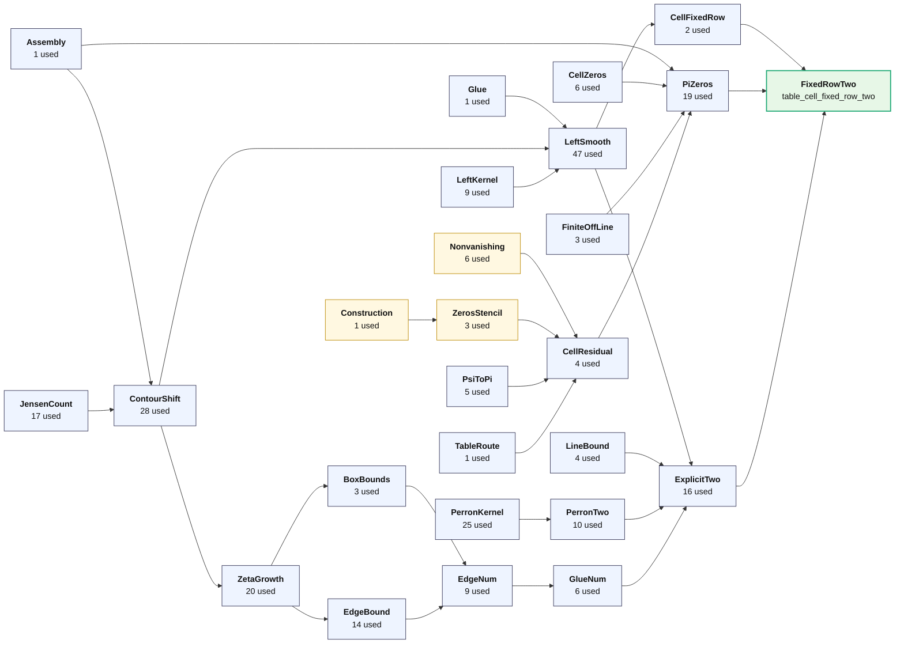

# What `FixedRowTwo.table_cell_fixed_row_two` rests on

[`FixedRowTwo.table_cell_fixed_row_two`](../lean_stage3/FixedRowTwo.md#FixedRowTwo-table_cell_fixed_row_two) in `lean_stage3/Stage3/FixedRowTwo.lean`, line 440.

**Why.** The integer table's cell at a fixed row, the height to infinity, from row `d + 2`. For `d + 2 ≤ r` and every `ε > 0`, for all large heights `T`, the cell `(r, d)` of the table of the prime count along the doublings, less the smooth cell, plus each zero's part below `T` under the stencil, plus the stencil of the higher prime powers, is at most `2^(d+1)·(Api2·(1 + log 2·r)) + ε`.

**Proves**

```lean
∀ ε : ℝ, 0 < ε → ∀ᶠ T : ℝ in Filter.atTop, ‖((((Construction.tableFrom TableRoute.rowN (r : ℤ) d : ℤ) : ℝ) - Nonvanishing.stencilR (d + 1) (fun m : ℤ => Stage3.Li ((2 : ℝ) ^ (m : ℝ))) (r : ℤ) : ℝ) : ℂ) + ∑ ρ ∈ ZF T, ((riemannZeta.order (ρ : ℂ) : ℤ) : ℂ) * CellZeros.stencil (d + 1) (fun m : ℤ => piMode (ρ : ℂ) ((2:ℝ) ^ (m : ℝ))) (r : ℤ) + CellZeros.stencil (d + 1) (fun m : ℤ => tr psiTheta ((2:ℝ) ^ (m : ℝ))) (r : ℤ)‖ ≤ 2 ^ (d + 1) * (Api2 * (1 + Real.log 2 * r)) + ε
```

**Needs** (its hypotheses)

  - `` r : ℕ ``
  - `` d : ℕ ``
  - `` hr : d + 2 ≤ r ``

Behind it: 219 theorems and 50 definitions in 26 files. Every one is listed below; Lean recorded each step.

## The files it passes through



An arrow A → B reads "B uses something proved or defined in A"; indirect arrows are left out. Green: the theorem itself. Yellow: a file in the other tree. The number is how many of that file's declarations are on the way.

## Every declaration on the way

Files in dependency order. ★ marks what the theorem's own proof uses directly.

### [`Construction`](../lean/Construction.md) — 1

- ★ [`Construction.tableFrom`](../lean/Construction.md#Construction-tableFrom) — *def*

### [`Nonvanishing`](../lean/Nonvanishing.md) — 6

- [`Nonvanishing.bdiffZ`](../lean/Nonvanishing.md#Nonvanishing-bdiffZ) — *def*
- ★ [`Nonvanishing.stencilR`](../lean/Nonvanishing.md#Nonvanishing-stencilR) — *def*
- [`Nonvanishing.iter_bdiffZ_eq_fwdDiff`](../lean/Nonvanishing.md#Nonvanishing-iter_bdiffZ_eq_fwdDiff) — `` (bdiffZ^[n]) g r = (-1 : ℝ) ^ n * (fwdDiff (-1 : ℤ))^[n] g r ``
- [`Nonvanishing.iter_bdiffZ_eq_stencilR`](../lean/Nonvanishing.md#Nonvanishing-iter_bdiffZ_eq_stencilR) — `` (bdiffZ^[n]) g r = stencilR n g r ``
- [`Nonvanishing.stencilR_row`](../lean/Nonvanishing.md#Nonvanishing-stencilR_row) — `` stencilR d (bdiffZ g) r = stencilR (d + 1) g r ``
- [`Nonvanishing.stencilR_sub`](../lean/Nonvanishing.md#Nonvanishing-stencilR_sub) — `` stencilR n (fun x => f x - L x) r = stencilR n f r - stencilR n L r ``

### [`ZerosStencil`](../lean/ZerosStencil.md) — 3

- [`Zeros.tableFrom_eq_fwdDiff`](../lean/ZerosStencil.md#Zeros-tableFrom_eq_fwdDiff) — `` Construction.tableFrom N r d = (-1 : ℤ) ^ d * (fwdDiff (-1 : ℤ))^[d] N r ``
- [`Zeros.stencil`](../lean/ZerosStencil.md#Zeros-stencil) — *def*
- [`Zeros.tableFrom_eq_stencil`](../lean/ZerosStencil.md#Zeros-tableFrom_eq_stencil) — `` Construction.tableFrom N r d = stencil d (fun k => N (r - k)) ``

### [`Assembly`](../lean_stage3/Assembly.md) — 1

- [`Stage3.zeroPartialSum`](../lean_stage3/Assembly.md#Stage3-zeroPartialSum) — *def*

### [`CellZeros`](../lean_stage3/CellZeros.md) — 6

- ★ [`CellZeros.stencil`](../lean_stage3/CellZeros.md#CellZeros-stencil) — *def*
- [`CellZeros.stencil_add`](../lean_stage3/CellZeros.md#CellZeros-stencil_add) — `` stencil d (fun n => a n + b n) r = stencil d a r + stencil d b r ``
- [`CellZeros.stencil_sub`](../lean_stage3/CellZeros.md#CellZeros-stencil_sub) — `` stencil d (fun n => a n - b n) r = stencil d a r - stencil d b r ``
- [`CellZeros.stencil_const_mul`](../lean_stage3/CellZeros.md#CellZeros-stencil_const_mul) — `` stencil d (fun n => c * a n) r = c * stencil d a r ``
- [`CellZeros.stencil_sum`](../lean_stage3/CellZeros.md#CellZeros-stencil_sum) — `` stencil d (fun n => ∑ i ∈ s, f i n) r = ∑ i ∈ s, stencil d (f i) r ``
- ★ [`CellZeros.norm_stencil_le`](../lean_stage3/CellZeros.md#CellZeros-norm_stencil_le) — `` ‖stencil d a r‖ ≤ ∑ j ∈ range (d + 1), (d.choose j : ℝ) * B j ``

### [`FiniteOffLine`](../lean_stage3/FiniteOffLine.md) — 3

- ★ [`FiniteOffLine.ZF`](../lean_stage3/FiniteOffLine.md#FiniteOffLine-ZF) — *def*
- [`FiniteOffLine.mem_ZF`](../lean_stage3/FiniteOffLine.md#FiniteOffLine-mem_ZF) — `` ρ ∈ ZF T ↔ |(ρ : ℂ).im| < T ``
- [`FiniteOffLine.tsum_sub_eq_sum`](../lean_stage3/FiniteOffLine.md#FiniteOffLine-tsum_sub_eq_sum) — `` ∑' σ : {ρ : NontrivialZeros // |(ρ : ℂ).im| < T}, f σ.1 = ∑ ρ ∈ ZF T, f ρ ``

### [`Glue`](../lean_stage3/Glue.md) — 1

- [`Glue.Gf`](../lean_stage3/Glue.md#Glue-Gf) — *def*

### [`JensenCount`](../lean_stage3/JensenCount.md) — 17

- [`Stage3.zeta_centre_lower`](../lean_stage3/JensenCount.md#Stage3-zeta_centre_lower) — `` (1 : ℝ) / 3 ≤ ‖ζ (2 + Complex.I * T)‖ ``
- [`Stage3.zeta_disk_upper`](../lean_stage3/JensenCount.md#Stage3-zeta_disk_upper) — `` ‖ζ w‖ ≤ 28 * T ``
- [`Stage3.zeta_centre_ne_zero`](../lean_stage3/JensenCount.md#Stage3-zeta_centre_ne_zero) — `` ζ (2 + Complex.I * (T : ℂ)) ≠ 0 ``
- [`Stage3.pole_away`](../lean_stage3/JensenCount.md#Stage3-pole_away) — `` 2 * z + (2 + Complex.I * (T : ℂ)) ≠ 1 ``
- [`Stage3.pole_away_centre`](../lean_stage3/JensenCount.md#Stage3-pole_away_centre) — `` v ≠ 1 ``
- [`Stage3.zetaWindowTwo_finite`](../lean_stage3/JensenCount.md#Stage3-zetaWindowTwo_finite) — `` {ρ : ℂ | ζ ρ = 0 ∧ ‖ρ - (2 + Complex.I * (T : ℂ))‖ ≤ 2}.Finite ``
- [`Stage3.zetaWindow`](../lean_stage3/JensenCount.md#Stage3-zetaWindow) — *def*
- [`Stage3.zetaWindow_finite`](../lean_stage3/JensenCount.md#Stage3-zetaWindow_finite) — `` (zetaWindow T).Finite ``
- [`Stage3.jensenF`](../lean_stage3/JensenCount.md#Stage3-jensenF) — *def*
- [`Stage3.zeta_comp_analytic`](../lean_stage3/JensenCount.md#Stage3-zeta_comp_analytic) — `` AnalyticAt ℂ (fun z : ℂ => ζ (2 * z + (2 + Complex.I * (T : ℂ)))) w ``
- [`Stage3.jensenF_analytic`](../lean_stage3/JensenCount.md#Stage3-jensenF_analytic) — `` AnalyticOnNhd ℂ (jensenF T) (Metric.closedBall (0 : ℂ) 1) ``
- [`Stage3.jensenF_zero_eq_one`](../lean_stage3/JensenCount.md#Stage3-jensenF_zero_eq_one) — `` jensenF T 0 = 1 ``
- [`Stage3.jensenF_zeros_finite`](../lean_stage3/JensenCount.md#Stage3-jensenF_zeros_finite) — `` (SetOfZeros 1 (jensenF T)).Finite ``
- [`Stage3.jensenF_bound`](../lean_stage3/JensenCount.md#Stage3-jensenF_bound) — `` ‖jensenF T z‖ ≤ 84 * T ``
- [`Stage3.analyticOrderNatAt_fun_comp_affine`](../lean_stage3/JensenCount.md#Stage3-analyticOrderNatAt_fun_comp_affine) — `` analyticOrderNatAt (fun w : ℂ => g (a * w + b)) z = analyticOrderNatAt g (a * z + b) ``
- [`Stage3.jensenF_order`](../lean_stage3/JensenCount.md#Stage3-jensenF_order) — `` analyticOrderNatAt (jensenF T) w = analyticOrderNatAt ζ (2 * w + (2 + Complex.I * (T : ℂ))) ``
- [`Stage3.zeta_local_zero_count`](../lean_stage3/JensenCount.md#Stage3-zeta_local_zero_count) — `` ∑ ρ ∈ (zetaWindow_finite hT).toFinset, (analyticOrderNatAt ζ ρ : ℝ) ≤ 15 * Real.log T + 73 ``

### [`ContourShift`](../lean_stage3/ContourShift.md) — 28

- [`ContourShift.zeroGap`](../lean_stage3/ContourShift.md#ContourShift-zeroGap) — *def*
- [`ContourShift.zeroGap_pos`](../lean_stage3/ContourShift.md#ContourShift-zeroGap_pos) — `` 0 < zeroGap T ``
- [`ContourShift.zeroGap_le`](../lean_stage3/ContourShift.md#ContourShift-zeroGap_le) — `` zeroGap T ≤ 9/10 ``
- [`ContourShift.zeta_analyticAt`](../lean_stage3/ContourShift.md#ContourShift-zeta_analyticAt) — `` AnalyticAt ℂ riemannZeta ρ ``
- [`ContourShift.one_le_zeta_order`](../lean_stage3/ContourShift.md#ContourShift-one_le_zeta_order) — `` 1 ≤ analyticOrderNatAt riemannZeta ρ ``
- [`ContourShift.partner_zero`](../lean_stage3/ContourShift.md#ContourShift-partner_zero) — `` ∃ ρ' : ℂ, riemannZeta ρ' = 0 ∧ ρ'.im = ρ.im ∧ 1/2 ≤ ρ'.re ∧ ρ'.re < 1 ``
- [`ContourShift.mem_zetaWindow`](../lean_stage3/ContourShift.md#ContourShift-mem_zetaWindow) — `` ρ ∈ Stage3.zetaWindow T₀ ``
- [`ContourShift.goodT_exists`](../lean_stage3/ContourShift.md#ContourShift-goodT_exists) — `` ∃ T' ∈ Set.Icc T (T+1), ∀ ρ : ℂ, riemannZeta ρ = 0 → 0 < ρ.re → zeroGap T ≤ |ρ.im - T'| ``
- [`ContourShift.borderIntegrable_sum_poles`](../lean_stage3/ContourShift.md#ContourShift-borderIntegrable_sum_poles) — `` RectangleBorderIntegrable (fun s ↦ ∑ p ∈ P, A p / (s - p)) z w ``
- [`ContourShift.rectangleIntegral_sum_poles`](../lean_stage3/ContourShift.md#ContourShift-rectangleIntegral_sum_poles) — `` RectangleIntegral' (fun s ↦ ∑ p ∈ P, A p / (s - p)) z w = ∑ p ∈ P, A p ``
- [`ContourShift.residue_rectangle_multi`](../lean_stage3/ContourShift.md#ContourShift-residue_rectangle_multi) — `` RectangleIntegral' f z w = ∑ p ∈ P, A p ``
- [`ContourShift.residue_rectangle_of_local`](../lean_stage3/ContourShift.md#ContourShift-residue_rectangle_of_local) — `` RectangleIntegral' f z w = ∑ p ∈ P, A p ``
- [`ContourShift.analyticAt_dslope`](../lean_stage3/ContourShift.md#ContourShift-analyticAt_dslope) — `` AnalyticAt ℂ (dslope f p) p ``
- [`ContourShift.div_sub_eq_dslope`](../lean_stage3/ContourShift.md#ContourShift-div_sub_eq_dslope) — `` f s / (s - p) = f p / (s - p) + dslope f p s ``
- [`ContourShift.zeta_local_data`](../lean_stage3/ContourShift.md#ContourShift-zeta_local_data) — `` ∃ h : ℂ → ℂ, AnalyticAt ℂ h p ∧ ∀ᶠ s in nhdsWithin p {p}ᶜ, - deriv riemannZeta s / riemannZeta s * ((x:ℝ):ℂ) ^ s / s = h s + (-(n:ℂ) * ((x:ℝ):ℂ) ^ p / p) / (s -… ``
- [`ContourShift.zeta_order_ne_top`](../lean_stage3/ContourShift.md#ContourShift-zeta_order_ne_top) — `` analyticOrderAt riemannZeta ρ ≠ ⊤ ``
- [`ContourShift.zeta_local_data_zero`](../lean_stage3/ContourShift.md#ContourShift-zeta_local_data_zero) — `` ∃ h : ℂ → ℂ, AnalyticAt ℂ h ρ ∧ ∀ᶠ s in nhdsWithin ρ {ρ}ᶜ, - deriv riemannZeta s / riemannZeta s * ((x:ℝ):ℂ) ^ s / s = h s + (-(analyticOrderNatAt riemannZeta ρ… ``
- [`ContourShift.zeta_local_data_one`](../lean_stage3/ContourShift.md#ContourShift-zeta_local_data_one) — `` ∃ h : ℂ → ℂ, AnalyticAt ℂ h 1 ∧ ∀ᶠ s in nhdsWithin 1 {1}ᶜ, - deriv riemannZeta s / riemannZeta s * ((x:ℝ):ℂ) ^ s / s = h s + ((x:ℝ):ℂ) / (s - 1) ``
- [`ContourShift.zeta_local_data_origin`](../lean_stage3/ContourShift.md#ContourShift-zeta_local_data_origin) — `` ∃ h : ℂ → ℂ, AnalyticAt ℂ h 0 ∧ ∀ᶠ s in nhdsWithin 0 {0}ᶜ, - deriv riemannZeta s / riemannZeta s * ((x:ℝ):ℂ) ^ s / s = h s + (- deriv riemannZeta 0 / riemannZet… ``
- [`ContourShift.zeta_ne_zero_of_re_mem`](../lean_stage3/ContourShift.md#ContourShift-zeta_ne_zero_of_re_mem) — `` riemannZeta w ≠ 0 ``
- [`ContourShift.sq_mul_zeta_analyticAt_one`](../lean_stage3/ContourShift.md#ContourShift-sq_mul_zeta_analyticAt_one) — `` AnalyticAt ℂ (fun s ↦ (s - 1)^2 * riemannZeta s) 1 ``
- [`ContourShift.zeta_meromorphicOn`](../lean_stage3/ContourShift.md#ContourShift-zeta_meromorphicOn) — `` MeromorphicOn riemannZeta U ``
- [`ContourShift.zeta_zeros_rectangle_finite`](../lean_stage3/ContourShift.md#ContourShift-zeta_zeros_rectangle_finite) — `` {ρ : ℂ | riemannZeta ρ = 0 ∧ ρ ∈ Rectangle z w}.Finite ``
- [`ContourShift.order_bridge`](../lean_stage3/ContourShift.md#ContourShift-order_bridge) — `` ((riemannZeta.order ρ : ℤ) : ℂ) = ((analyticOrderNatAt riemannZeta ρ : ℕ) : ℂ) ``
- [`ContourShift.zeroPartialSum_eq_sum`](../lean_stage3/ContourShift.md#ContourShift-zeroPartialSum_eq_sum) — `` Stage3.zeroPartialSum x T' = ∑ p ∈ ZF, ((analyticOrderNatAt riemannZeta p : ℂ) * ((x : ℂ) ^ p / p)) ``
- [`ContourShift.analyticAt_conj_conj`](../lean_stage3/ContourShift.md#ContourShift-analyticAt_conj_conj) — `` AnalyticAt ℂ (fun w ↦ (starRingEnd ℂ) (g ((starRingEnd ℂ) w))) ((starRingEnd ℂ) p) ``
- [`ContourShift.zeta_order_conj`](../lean_stage3/ContourShift.md#ContourShift-zeta_order_conj) — `` analyticOrderNatAt riemannZeta ((starRingEnd ℂ) ρ) = analyticOrderNatAt riemannZeta ρ ``
- [`ContourShift.zeta_order_reflect`](../lean_stage3/ContourShift.md#ContourShift-zeta_order_reflect) — `` analyticOrderNatAt riemannZeta (1 - (starRingEnd ℂ) ρ) = analyticOrderNatAt riemannZeta ρ ``

### [`LeftKernel`](../lean_stage3/LeftKernel.md) — 9

- [`LeftKernel.cpow_tI`](../lean_stage3/LeftKernel.md#LeftKernel-cpow_tI) — `` (y:ℂ) ^ ((t:ℂ) * Complex.I) = Complex.exp ((Real.log y : ℂ) * ((t:ℂ) * Complex.I)) ``
- [`LeftKernel.norm_exp_tI`](../lean_stage3/LeftKernel.md#LeftKernel-norm_exp_tI) — `` ‖Complex.exp ((L:ℂ) * ((t:ℂ) * Complex.I))‖ = 1 ``
- [`LeftKernel.norm_cpow_tI`](../lean_stage3/LeftKernel.md#LeftKernel-norm_cpow_tI) — `` ‖(y:ℂ) ^ ((t:ℂ) * Complex.I)‖ = 1 ``
- [`LeftKernel.osc_by_parts`](../lean_stage3/LeftKernel.md#LeftKernel-osc_by_parts) — `` ‖∫ t in a..b, ((y:ℂ) ^ ((t:ℂ) * Complex.I)) * h t‖ ≤ (‖h a‖ + ‖h b‖ + ∫ t in a..b, ‖h' t‖) / Real.log y ``
- [`LeftKernel.kernel_bound`](../lean_stage3/LeftKernel.md#LeftKernel-kernel_bound) — `` ‖∫ t in (-T)..T, ((y:ℂ) ^ ((t:ℂ) * Complex.I)) / ((a:ℂ) + (t:ℂ) * Complex.I)‖ ≤ (2 / T + Real.pi / |a|) / Real.log y ``
- [`LeftKernel.vmTerm`](../lean_stage3/LeftKernel.md#LeftKernel-vmTerm) — *def*
- [`LeftKernel.vmTerm_nonneg`](../lean_stage3/LeftKernel.md#LeftKernel-vmTerm_nonneg) — `` 0 ≤ vmTerm n ``
- [`LeftKernel.Bser`](../lean_stage3/LeftKernel.md#LeftKernel-Bser) — *def*
- [`LeftKernel.series_side`](../lean_stage3/LeftKernel.md#LeftKernel-series_side) — `` ‖∫ t in (-T)..T, (deriv riemannZeta ((5/4:ℂ) - (t:ℂ) * Complex.I) / riemannZeta ((5/4:ℂ) - (t:ℂ) * Complex.I)) * ((x:ℂ) ^ (((-1/4 : ℝ):ℂ) + (t:ℂ) * Complex.I)) … ``

### [`LeftSmooth`](../lean_stage3/LeftSmooth.md) — 47

- [`LeftSmooth.arctan_int_le`](../lean_stage3/LeftSmooth.md#LeftSmooth-arctan_int_le) — `` (∫ t in (-T)..T, 1 / (a ^ 2 + t ^ 2)) ≤ Real.pi / a ``
- [`LeftSmooth.kernel_conj`](../lean_stage3/LeftSmooth.md#LeftSmooth-kernel_conj) — `` ‖∫ t in (-T)..T, ((y:ℂ) ^ ((t:ℂ) * Complex.I)) * ((c:ℂ) - (t:ℂ) * Complex.I)⁻¹‖ ≤ (2 + Real.pi) / (c * Real.log y) ``
- [`LeftSmooth.cos_sq_le_norm_cos`](../lean_stage3/LeftSmooth.md#LeftSmooth-cos_sq_le_norm_cos) — `` Real.cos a ^ 2 + b ^ 2 ≤ ‖Complex.cos ((a:ℂ) + (b:ℂ) * Complex.I)‖ ^ 2 ``
- [`LeftSmooth.cos_sq_mul_norm_sin_le`](../lean_stage3/LeftSmooth.md#LeftSmooth-cos_sq_mul_norm_sin_le) — `` Real.cos a ^ 2 * ‖Complex.sin ((a:ℂ) + (b:ℂ) * Complex.I)‖ ^ 2 ≤ ‖Complex.cos ((a:ℂ) + (b:ℂ) * Complex.I)‖ ^ 2 ``
- [`LeftSmooth.Gs`](../lean_stage3/LeftSmooth.md#LeftSmooth-Gs) — *def*
- [`LeftSmooth.logDeriv_sum`](../lean_stage3/LeftSmooth.md#LeftSmooth-logDeriv_sum) — `` riemannZeta (1 - w) ≠ 0 ∧ deriv riemannZeta (1 - w) / riemannZeta (1 - w) + deriv riemannZeta w / riemannZeta w = Gs w ``
- [`LeftSmooth.sL`](../lean_stage3/LeftSmooth.md#LeftSmooth-sL) — *def*
- [`LeftSmooth.wL`](../lean_stage3/LeftSmooth.md#LeftSmooth-wL) — *def*
- [`LeftSmooth.one_sub_wL`](../lean_stage3/LeftSmooth.md#LeftSmooth-one_sub_wL) — `` 1 - wL t = sL t ``
- [`LeftSmooth.wL_re`](../lean_stage3/LeftSmooth.md#LeftSmooth-wL_re) — `` (wL t).re = 5/4 ``
- [`LeftSmooth.norm_sL_sq`](../lean_stage3/LeftSmooth.md#LeftSmooth-norm_sL_sq) — `` ‖sL t‖ ^ 2 = 1/16 + t ^ 2 ``
- [`LeftSmooth.norm_sL_ge`](../lean_stage3/LeftSmooth.md#LeftSmooth-norm_sL_ge) — `` 1/4 ≤ ‖sL t‖ ``
- [`LeftSmooth.sL_ne`](../lean_stage3/LeftSmooth.md#LeftSmooth-sL_ne) — `` sL t ≠ 0 ``
- [`LeftSmooth.arg_wL`](../lean_stage3/LeftSmooth.md#LeftSmooth-arg_wL) — `` (Real.pi:ℂ) * wL t / 2 = ((5 * Real.pi / 8 : ℝ):ℂ) + ((-(Real.pi * t / 2)) : ℝ) * Complex.I ``
- [`LeftSmooth.kc`](../lean_stage3/LeftSmooth.md#LeftSmooth-kc) — *def*
- [`LeftSmooth.kc_pos`](../lean_stage3/LeftSmooth.md#LeftSmooth-kc_pos) — `` 0 < kc ``
- [`LeftSmooth.norm_cos_wL`](../lean_stage3/LeftSmooth.md#LeftSmooth-norm_cos_wL) — `` kc ^ 2 + t ^ 2 ≤ ‖Complex.cos ((Real.pi:ℂ) * wL t / 2)‖ ^ 2 ``
- [`LeftSmooth.cos_wL_ne`](../lean_stage3/LeftSmooth.md#LeftSmooth-cos_wL_ne) — `` Complex.cos ((Real.pi:ℂ) * wL t / 2) ≠ 0 ``
- [`LeftSmooth.norm_tan_wL`](../lean_stage3/LeftSmooth.md#LeftSmooth-norm_tan_wL) — `` ‖Complex.tan ((Real.pi:ℂ) * wL t / 2)‖ ≤ 1 / kc ``
- [`LeftSmooth.hasDerivAt_wL`](../lean_stage3/LeftSmooth.md#LeftSmooth-hasDerivAt_wL) — `` HasDerivAt wL (-Complex.I) t ``
- [`LeftSmooth.hasDerivAt_sL`](../lean_stage3/LeftSmooth.md#LeftSmooth-hasDerivAt_sL) — `` HasDerivAt sL Complex.I t ``
- [`LeftSmooth.continuous_sL`](../lean_stage3/LeftSmooth.md#LeftSmooth-continuous_sL) — `` Continuous sL ``
- [`LeftSmooth.continuous_wL`](../lean_stage3/LeftSmooth.md#LeftSmooth-continuous_wL) — `` Continuous wL ``
- [`LeftSmooth.tanPiece`](../lean_stage3/LeftSmooth.md#LeftSmooth-tanPiece) — *def*
- [`LeftSmooth.tanPiece'`](../lean_stage3/LeftSmooth.md#LeftSmooth-tanPiece-) — *def*
- [`LeftSmooth.hasDerivAt_tanPiece`](../lean_stage3/LeftSmooth.md#LeftSmooth-hasDerivAt_tanPiece) — `` HasDerivAt tanPiece (tanPiece' t) t ``
- [`LeftSmooth.norm_tanPiece'_le`](../lean_stage3/LeftSmooth.md#LeftSmooth-norm_tanPiece-_le) — `` ‖tanPiece' t‖ ≤ 2 * Real.pi * (1 / (kc ^ 2 + t ^ 2)) + (1 / kc) * (1 / ((1/4:ℝ) ^ 2 + t ^ 2)) ``
- [`LeftSmooth.tan_piece`](../lean_stage3/LeftSmooth.md#LeftSmooth-tan_piece) — `` ‖∫ t in (-T)..T, ((y:ℂ) ^ ((t:ℂ) * Complex.I)) * tanPiece t‖ ≤ (8 + 2 * Real.pi ^ 2 + 4 * Real.pi) / (kc * Real.log y) ``
- [`LeftSmooth.dgTerm`](../lean_stage3/LeftSmooth.md#LeftSmooth-dgTerm) — *def*
- [`LeftSmooth.dgTerm_nonneg`](../lean_stage3/LeftSmooth.md#LeftSmooth-dgTerm_nonneg) — `` 0 ≤ dgTerm n ``
- [`LeftSmooth.dgTerm_summable`](../lean_stage3/LeftSmooth.md#LeftSmooth-dgTerm_summable) — `` Summable dgTerm ``
- [`LeftSmooth.continuous_cpow_tI`](../lean_stage3/LeftSmooth.md#LeftSmooth-continuous_cpow_tI) — `` Continuous fun t : ℝ => (y:ℂ) ^ ((t:ℂ) * Complex.I) ``
- [`LeftSmooth.digamma_piece`](../lean_stage3/LeftSmooth.md#LeftSmooth-digamma_piece) — `` ‖∫ t in (-T)..T, ((y:ℂ) ^ ((t:ℂ) * Complex.I)) * ((-Complex.digamma (wL t) - (Real.eulerMascheroniConstant:ℂ)) * (sL t)⁻¹)‖ ≤ (∑' n : ℕ, dgTerm n) * ((2 + Real.… ``
- [`LeftSmooth.continuous_tanPiece`](../lean_stage3/LeftSmooth.md#LeftSmooth-continuous_tanPiece) — `` Continuous tanPiece ``
- [`LeftSmooth.cpow_sL`](../lean_stage3/LeftSmooth.md#LeftSmooth-cpow_sL) — `` (x:ℂ) ^ (sL t) = ((x ^ (-(1:ℝ)/4) : ℝ):ℂ) * (x:ℂ) ^ ((t:ℂ) * Complex.I) ``
- [`LeftSmooth.c0`](../lean_stage3/LeftSmooth.md#LeftSmooth-c0) — *def*
- [`LeftSmooth.Nsm`](../lean_stage3/LeftSmooth.md#LeftSmooth-Nsm) — *def*
- [`LeftSmooth.Nsm_nonneg`](../lean_stage3/LeftSmooth.md#LeftSmooth-Nsm_nonneg) — `` 0 ≤ Nsm ``
- [`LeftSmooth.Bsm`](../lean_stage3/LeftSmooth.md#LeftSmooth-Bsm) — *def*
- [`LeftSmooth.smooth_side`](../lean_stage3/LeftSmooth.md#LeftSmooth-smooth_side) — `` ‖∫ t in (-T)..T, (deriv riemannZeta (((-1/4 : ℝ):ℂ) + (t:ℂ) * Complex.I) / riemannZeta (((-1/4 : ℝ):ℂ) + (t:ℂ) * Complex.I) + deriv riemannZeta ((5/4:ℂ) - (t:ℂ)… ``
- [`LeftSmooth.continuous_logDeriv_path`](../lean_stage3/LeftSmooth.md#LeftSmooth-continuous_logDeriv_path) — `` Continuous fun t => deriv riemannZeta (p t) / riemannZeta (p t) ``
- [`LeftSmooth.zeta_sL_ne`](../lean_stage3/LeftSmooth.md#LeftSmooth-zeta_sL_ne) — `` riemannZeta (sL t) ≠ 0 ``
- [`LeftSmooth.zeta_wL_ne`](../lean_stage3/LeftSmooth.md#LeftSmooth-zeta_wL_ne) — `` riemannZeta (wL t) ≠ 0 ``
- [`LeftSmooth.sL_ne_one`](../lean_stage3/LeftSmooth.md#LeftSmooth-sL_ne_one) — `` sL t ≠ 1 ``
- [`LeftSmooth.wL_ne_one`](../lean_stage3/LeftSmooth.md#LeftSmooth-wL_ne_one) — `` wL t ≠ 1 ``
- [`LeftSmooth.Bleft`](../lean_stage3/LeftSmooth.md#LeftSmooth-Bleft) — *def*
- [`LeftSmooth.left_edge_bound`](../lean_stage3/LeftSmooth.md#LeftSmooth-left_edge_bound) — `` ‖VIntegral (Glue.Gf x) (-1/4) (-T) T‖ ≤ Bleft * x ^ (-(1:ℝ)/4) ``

### [`CellFixedRow`](../lean_stage3/CellFixedRow.md) — 2

- [`CellFixedRow.Bleft_nonneg`](../lean_stage3/CellFixedRow.md#CellFixedRow-Bleft_nonneg) — `` 0 ≤ LeftSmooth.Bleft ``
- [`CellFixedRow.tendsto_log_sq_div`](../lean_stage3/CellFixedRow.md#CellFixedRow-tendsto_log_sq_div) — `` Tendsto (fun T : ℝ => a * c * Real.log (c * T) ^ 2 / T) atTop (𝓝 0) ``

### [`LineBound`](../lean_stage3/LineBound.md) — 4

- [`Slice5.pseries_tail_le`](../lean_stage3/LineBound.md#Slice5-pseries_tail_le) — `` ∑' (n : ℕ), ((n + 1 + 1 : ℕ) : ℝ) ^ (-1 - b) ≤ 1 / b ``
- [`Slice5.pseries_le`](../lean_stage3/LineBound.md#Slice5-pseries_le) — `` ∑' (n : ℕ), ((n : ℝ)) ^ (-1 - b) ≤ 1 + 1 / b ``
- [`Slice5.vonMangoldt_term_le`](../lean_stage3/LineBound.md#Slice5-vonMangoldt_term_le) — `` ‖LSeries.term (fun k : ℕ => ((vonMangoldt k : ℝ) : ℂ)) ((1 + 2 * b : ℝ) : ℂ) n‖ ≤ (1 / b) * ((n : ℝ)) ^ (-1 - b) ``
- [`Slice5.norm_logDerivZeta_of_one_lt_re`](../lean_stage3/LineBound.md#Slice5-norm_logDerivZeta_of_one_lt_re) — `` ‖deriv ζ s / ζ s‖ ≤ 2 / (s.re - 1) + 4 / (s.re - 1) ^ 2 ``

### [`PerronKernel`](../lean_stage3/PerronKernel.md) — 25

- [`PerronKernel.perronI`](../lean_stage3/PerronKernel.md#PerronKernel-perronI) — *def*
- [`PerronKernel.perronδ`](../lean_stage3/PerronKernel.md#PerronKernel-perron-) — *def*
- [`PerronKernel.perronI_eq_VIntegral'`](../lean_stage3/PerronKernel.md#PerronKernel-perronI_eq_VIntegral-) — `` perronI y c T = VIntegral' (fun s : ℂ ↦ (y : ℂ) ^ s / s) c (-T) T ``
- [`PerronKernel.kernel_holo`](../lean_stage3/PerronKernel.md#PerronKernel-kernel_holo) — `` HolomorphicOn (fun s : ℂ ↦ (y : ℂ) ^ s / s) {s : ℂ | 0 < s.re} ``
- [`PerronKernel.rect_subset_right`](../lean_stage3/PerronKernel.md#PerronKernel-rect_subset_right) — `` Rectangle ((c : ℂ) - Complex.I * T) ((X : ℂ) + Complex.I * T) ⊆ {s : ℂ | 0 < s.re} ``
- [`PerronKernel.perron_kernel_coarse_lt`](../lean_stage3/PerronKernel.md#PerronKernel-perron_kernel_coarse_lt) — `` ‖perronI y c T - perronδ y‖ ≤ y ^ c ``
- [`PerronKernel.horiz_bound`](../lean_stage3/PerronKernel.md#PerronKernel-horiz_bound) — `` ‖∫ σ in a..b, (y : ℂ) ^ ((σ : ℂ) + (T' : ℂ) * Complex.I) / ((σ : ℂ) + (T' : ℂ) * Complex.I)‖ ≤ max (y ^ a) (y ^ b) / (|T'| * |Real.log y|) ``
- [`PerronKernel.perron_kernel_decay_lt`](../lean_stage3/PerronKernel.md#PerronKernel-perron_kernel_decay_lt) — `` ‖perronI y c T - perronδ y‖ ≤ y ^ c / (T * |Real.log y|) ``
- [`PerronKernel.dslope_kernel_diff`](../lean_stage3/PerronKernel.md#PerronKernel-dslope_kernel_diff) — `` Differentiable ℂ (dslope (fun s : ℂ ↦ (y : ℂ) ^ s) 0) ``
- [`PerronKernel.rect_residue`](../lean_stage3/PerronKernel.md#PerronKernel-rect_residue) — `` RectangleIntegral' (fun s : ℂ ↦ (y : ℂ) ^ s / s) (-(X:ℂ) - Complex.I * T) ((c:ℂ) + Complex.I * T) = 1 ``
- [`PerronKernel.perron_kernel_decay_gt`](../lean_stage3/PerronKernel.md#PerronKernel-perron_kernel_decay_gt) — `` ‖perronI y c T - perronδ y‖ ≤ y ^ c / (T * |Real.log y|) ``
- [`PerronKernel.perron_kernel_decay`](../lean_stage3/PerronKernel.md#PerronKernel-perron_kernel_decay) — `` ‖perronI y c T - perronδ y‖ ≤ y ^ c / (T * |Real.log y|) ``
- [`PerronKernel.coarse_gt_ineq`](../lean_stage3/PerronKernel.md#PerronKernel-coarse_gt_ineq) — `` v * Real.exp u + Real.pi - Real.arctan (v / u) ≤ Real.pi * Real.exp u ``
- [`PerronKernel.seg_inv_integral`](../lean_stage3/PerronKernel.md#PerronKernel-seg_inv_integral) — `` (∫ t in (-T)..T, ((c : ℂ) + Complex.I * t)⁻¹ * Complex.I) = 2 * Real.arctan (T / c) * Complex.I ``
- [`PerronKernel.cpow_sub_one_bound`](../lean_stage3/PerronKernel.md#PerronKernel-cpow_sub_one_bound) — `` ‖(y : ℂ) ^ s - 1‖ ≤ ‖s‖ * Real.log y * y ^ s.re ``
- [`PerronKernel.perron_kernel_coarse_gt`](../lean_stage3/PerronKernel.md#PerronKernel-perron_kernel_coarse_gt) — `` ‖perronI y c T - perronδ y‖ ≤ y ^ c ``
- [`PerronKernel.perron_kernel_coarse`](../lean_stage3/PerronKernel.md#PerronKernel-perron_kernel_coarse) — `` ‖perronI y c T - perronδ y‖ ≤ y ^ c ``
- [`PerronKernel.perron_kernel_truncated`](../lean_stage3/PerronKernel.md#PerronKernel-perron_kernel_truncated) — `` ‖perronI y c T - perronδ y‖ ≤ y ^ c * min 1 (1 / (T * |Real.log y|)) ``
- [`PerronKernel.one_sub_two_neg_rpow`](../lean_stage3/PerronKernel.md#PerronKernel-one_sub_two_neg_rpow) — `` δ / 5 ≤ 1 - (2:ℝ) ^ (-δ) ``
- [`PerronKernel.vonMangoldt_rpow_partial`](../lean_stage3/PerronKernel.md#PerronKernel-vonMangoldt_rpow_partial) — `` ∑ n ∈ s, ArithmeticFunction.vonMangoldt n * (n : ℝ) ^ (-c) ≤ 2 * (Real.log 4 + 4) / (1 - (2:ℝ) ^ (1 - c)) ``
- [`PerronKernel.vonMangoldt_rpow_tsum`](../lean_stage3/PerronKernel.md#PerronKernel-vonMangoldt_rpow_tsum) — `` ∑' n : ℕ, ArithmeticFunction.vonMangoldt n * (n : ℝ) ^ (-c) ≤ 2 * (Real.log 4 + 4) / (1 - (2:ℝ) ^ (1 - c)) ``
- [`PerronKernel.vonMangoldt_rpow_summable`](../lean_stage3/PerronKernel.md#PerronKernel-vonMangoldt_rpow_summable) — `` Summable (fun n : ℕ ↦ ArithmeticFunction.vonMangoldt n * (n : ℝ) ^ (-c)) ``
- [`PerronKernel.abs_sub_one_le_two_abs_log`](../lean_stage3/PerronKernel.md#PerronKernel-abs_sub_one_le_two_abs_log) — `` |t - 1| / 2 ≤ |Real.log t| ``
- [`PerronKernel.perronI_one_norm`](../lean_stage3/PerronKernel.md#PerronKernel-perronI_one_norm) — `` ‖perronI 1 c T‖ ≤ 1/2 ``
- [`PerronKernel.tsum_vonMangoldt_div_cpow`](../lean_stage3/PerronKernel.md#PerronKernel-tsum_vonMangoldt_div_cpow) — `` (∑' n : ℕ, (ArithmeticFunction.vonMangoldt n : ℂ) * ((x / n : ℝ) : ℂ) ^ s) = (- deriv riemannZeta s / riemannZeta s) * ((x:ℝ):ℂ) ^ s ``

### [`PerronTwo`](../lean_stage3/PerronTwo.md) — 10

- [`PerronTwo.one_sub_two_neg_rpow'`](../lean_stage3/PerronTwo.md#PerronTwo-one_sub_two_neg_rpow-) — `` δ / 5 ≤ 1 - (2:ℝ) ^ (-δ) ``
- [`PerronTwo.inv_log_le_of_two_le`](../lean_stage3/PerronTwo.md#PerronTwo-inv_log_le_of_two_le) — `` 1 / Real.log x ≤ 3/2 ``
- [`PerronTwo.far_terms_sum_two`](../lean_stage3/PerronTwo.md#PerronTwo-far_terms_sum_two) — `` (∑' n : ℕ, if 1/2 ≤ |Real.log (x / n)| then ArithmeticFunction.vonMangoldt n * (x / n) ^ (1 + 1/Real.log x) / (T * |Real.log (x / n)|) else 0) ≤ 300 * x * Real.… ``
- [`PerronTwo.near_diagonal_sum_two`](../lean_stage3/PerronTwo.md#PerronTwo-near_diagonal_sum_two) — `` (∑' n : ℕ, if 0 < |Real.log (x / n)| ∧ |Real.log (x / n)| < 1/2 then ArithmeticFunction.vonMangoldt n * min 1 (1/(T * |Real.log (x / n)|)) else 0) ≤ 100 * x * R… ``
- [`PerronTwo.kernel_sum_bound_two`](../lean_stage3/PerronTwo.md#PerronTwo-kernel_sum_bound_two) — `` ‖(∑' n : ℕ, (ArithmeticFunction.vonMangoldt n : ℂ) * (perronI (x/n) (1 + 1/Real.log x) T - perronδ (x/n)))‖ ≤ 700 * x * Real.log (x * T) ^ 2 / T + 17 * Real.log… ``
- [`PerronTwo.delta_sum_close_two`](../lean_stage3/PerronTwo.md#PerronTwo-delta_sum_close_two) — `` ‖(Chebyshev.psi x : ℂ) - ∑' n : ℕ, (ArithmeticFunction.vonMangoldt n : ℂ) * perronδ (x / n)‖ ≤ Real.log x ``
- [`PerronTwo.kernel_diff_summable_two`](../lean_stage3/PerronTwo.md#PerronTwo-kernel_diff_summable_two) — `` Summable (fun n : ℕ ↦ (ArithmeticFunction.vonMangoldt n : ℂ) * (perronI (x/n) (1 + 1/Real.log x) T - perronδ (x/n))) ``
- [`PerronTwo.perron_to_psi_two`](../lean_stage3/PerronTwo.md#PerronTwo-perron_to_psi_two) — `` ‖(Chebyshev.psi x : ℂ) - ∑' n : ℕ, (ArithmeticFunction.vonMangoldt n : ℂ) * perronI (x/n) (1 + 1/Real.log x) T‖ ≤ 700 * x * Real.log (x * T) ^ 2 / T + 18 * Real… ``
- [`PerronTwo.perron_sum_eq_integral_two`](../lean_stage3/PerronTwo.md#PerronTwo-perron_sum_eq_integral_two) — `` (∑' n : ℕ, (ArithmeticFunction.vonMangoldt n : ℂ) * perronI (x/n) (1 + 1/Real.log x) T) = (2 * (Real.pi:ℂ) * Complex.I)⁻¹ * ∫ t in (-T)..T, (- deriv riemannZeta… ``
- [`PerronTwo.explicit_formula_perron_two`](../lean_stage3/PerronTwo.md#PerronTwo-explicit_formula_perron_two) — `` ‖(Chebyshev.psi x : ℂ) - (2 * (Real.pi:ℂ) * Complex.I)⁻¹ * ∫ t in (-T)..T, (- deriv riemannZeta (((1 + 1/Real.log x : ℝ):ℂ) + Complex.I * t) / riemannZeta (((1 … ``

### [`PsiToPi`](../lean_stage3/PsiToPi.md) — 5

- ★ [`Stage3.Li`](../lean_stage3/PsiToPi.md#Stage3-Li) — *def*
- [`Stage3.continuousOn_inv_log_sq`](../lean_stage3/PsiToPi.md#Stage3-continuousOn_inv_log_sq) — `` ContinuousOn (fun t : ℝ => 1 / Real.log t ^ 2) (Set.uIcc a x) ``
- [`Stage3.continuousOn_inv_mul_log_sq`](../lean_stage3/PsiToPi.md#Stage3-continuousOn_inv_mul_log_sq) — `` ContinuousOn (fun t : ℝ => (t * Real.log t ^ 2)⁻¹) (Set.uIcc a x) ``
- [`Stage3.integrable_theta_term`](../lean_stage3/PsiToPi.md#Stage3-integrable_theta_term) — `` IntervalIntegrable (fun t => θ t / (t * Real.log t ^ 2)) volume a x ``
- [`Stage3.pi_sub_Li_eq`](../lean_stage3/PsiToPi.md#Stage3-pi_sub_Li_eq) — `` (Nat.primeCounting ⌊x⌋₊ : ℝ) - Li x = (θ x - x) / Real.log x + ∫ t in (2 : ℝ)..x, (θ t - t) / (t * Real.log t ^ 2) ``

### [`TableRoute`](../lean_stage3/TableRoute.md) — 1

- ★ [`TableRoute.rowN`](../lean_stage3/TableRoute.md#TableRoute-rowN) — *def*

### [`CellResidual`](../lean_stage3/CellResidual.md) — 4

- [`CellResidual.resid`](../lean_stage3/CellResidual.md#CellResidual-resid) — *def*
- [`CellResidual.cellResid`](../lean_stage3/CellResidual.md#CellResidual-cellResid) — *def*
- [`CellResidual.tableFrom_cast`](../lean_stage3/CellResidual.md#CellResidual-tableFrom_cast) — `` ((Construction.tableFrom N r d : ℤ) : ℝ) = stencilR (d + 1) f r ``
- [`CellResidual.table_cell_eq`](../lean_stage3/CellResidual.md#CellResidual-table_cell_eq) — `` ((Construction.tableFrom TableRoute.rowN r d : ℤ) : ℝ) - stencilR (d + 1) (fun m : ℤ => Stage3.Li ((2 : ℝ) ^ (m : ℝ))) r = cellResid 1 r d ``

### [`PiZeros`](../lean_stage3/PiZeros.md) — 19

- [`PiZeros.wt`](../lean_stage3/PiZeros.md#PiZeros-wt) — *def*
- ★ [`PiZeros.tr`](../lean_stage3/PiZeros.md#PiZeros-tr) — *def*
- [`PiZeros.wt_continuousOn`](../lean_stage3/PiZeros.md#PiZeros-wt_continuousOn) — `` ContinuousOn wt (Set.uIcc 2 x) ``
- [`PiZeros.integrable_mul_wt`](../lean_stage3/PiZeros.md#PiZeros-integrable_mul_wt) — `` IntervalIntegrable (fun t => f t * wt t) volume 2 x ``
- [`PiZeros.tr_sub`](../lean_stage3/PiZeros.md#PiZeros-tr_sub) — `` tr (fun t => f t - g t) x = tr f x - tr g x ``
- [`PiZeros.tr_const_mul`](../lean_stage3/PiZeros.md#PiZeros-tr_const_mul) — `` tr (fun t => c * f t) x = c * tr f x ``
- [`PiZeros.tr_sum`](../lean_stage3/PiZeros.md#PiZeros-tr_sum) — `` tr (fun t => ∑ i ∈ s, f i t) x = ∑ i ∈ s, tr (f i) x ``
- [`PiZeros.pi_sub_Li_eq_tr`](../lean_stage3/PiZeros.md#PiZeros-pi_sub_Li_eq_tr) — `` (((Nat.primeCounting ⌊x⌋₊ : ℝ) - Stage3.Li x : ℝ) : ℂ) = tr (fun t => ((θ t - t : ℝ) : ℂ)) x ``
- ★ [`PiZeros.piMode`](../lean_stage3/PiZeros.md#PiZeros-piMode) — *def*
- ★ [`PiZeros.efRem`](../lean_stage3/PiZeros.md#PiZeros-efRem) — *def*
- ★ [`PiZeros.psiTheta`](../lean_stage3/PiZeros.md#PiZeros-psiTheta) — *def*
- [`PiZeros.zeroPartialSum_eq_sum`](../lean_stage3/PiZeros.md#PiZeros-zeroPartialSum_eq_sum) — `` Stage3.zeroPartialSum t T = ∑ ρ ∈ ZF T, ((riemannZeta.order (ρ : ℂ) : ℤ) : ℂ) * ((t : ℂ) ^ (ρ : ℂ) / (ρ : ℂ)) ``
- [`PiZeros.integrable_ofReal_of_monotone`](../lean_stage3/PiZeros.md#PiZeros-integrable_ofReal_of_monotone) — `` IntervalIntegrable (fun t => ((f t : ℝ) : ℂ)) volume 2 x ``
- [`PiZeros.integrable_cpow`](../lean_stage3/PiZeros.md#PiZeros-integrable_cpow) — `` IntervalIntegrable (fun t : ℝ => (t : ℂ) ^ ρ / ρ) volume 2 x ``
- [`PiZeros.pi_eq_zero_sum`](../lean_stage3/PiZeros.md#PiZeros-pi_eq_zero_sum) — `` (((Nat.primeCounting ⌊x⌋₊ : ℝ) - Stage3.Li x : ℝ) : ℂ) = -∑ ρ ∈ ZF T, ((riemannZeta.order (ρ : ℂ) : ℤ) : ℂ) * piMode (ρ : ℂ) x + tr (efRem T) x - tr psiTheta x ``
- [`PiZeros.stencil_congr`](../lean_stage3/PiZeros.md#PiZeros-stencil_congr) — `` CellZeros.stencil n a r = CellZeros.stencil n b r ``
- [`PiZeros.stencil_neg`](../lean_stage3/PiZeros.md#PiZeros-stencil_neg) — `` CellZeros.stencil n (fun m => -a m) r = -CellZeros.stencil n a r ``
- [`PiZeros.stencilR_cast`](../lean_stage3/PiZeros.md#PiZeros-stencilR_cast) — `` ((Nonvanishing.stencilR n g r : ℝ) : ℂ) = CellZeros.stencil n (fun m => ((g m : ℝ) : ℂ)) r ``
- ★ [`PiZeros.table_cell_eq_zero_sum`](../lean_stage3/PiZeros.md#PiZeros-table_cell_eq_zero_sum) — `` ((((Construction.tableFrom TableRoute.rowN r d : ℤ) : ℝ) - Nonvanishing.stencilR (d + 1) (fun m : ℤ => Stage3.Li ((2 : ℝ) ^ (m : ℝ))) r : ℝ) : ℂ) = -∑ ρ ∈ ZF T,… ``

### [`ZetaGrowth`](../lean_stage3/ZetaGrowth.md) — 20

- [`ZetaGrowth.emA`](../lean_stage3/ZetaGrowth.md#ZetaGrowth-emA) — *def*
- [`ZetaGrowth.emA_nonneg`](../lean_stage3/ZetaGrowth.md#ZetaGrowth-emA_nonneg) — `` 0 ≤ emA x ``
- [`ZetaGrowth.emA_le`](../lean_stage3/ZetaGrowth.md#ZetaGrowth-emA_le) — `` emA x ≤ 1/8 ``
- [`ZetaGrowth.emA_natCast`](../lean_stage3/ZetaGrowth.md#ZetaGrowth-emA_natCast) — `` emA n = 0 ``
- [`ZetaGrowth.emA_eq_poly`](../lean_stage3/ZetaGrowth.md#ZetaGrowth-emA_eq_poly) — `` emA x = ((x - n) - (x - n)^2)/2 ``
- [`ZetaGrowth.integrable_emA_tail`](../lean_stage3/ZetaGrowth.md#ZetaGrowth-integrable_emA_tail) — `` IntegrableOn (fun x : ℝ ↦ (emA x : ℂ) * (x : ℂ) ^ (-(s+2))) (Ioi (N:ℝ)) ``
- [`ZetaGrowth.interval_ibp`](../lean_stage3/ZetaGrowth.md#ZetaGrowth-interval_ibp) — `` ∫ x in (n:ℝ)..((n:ℝ)+1), ((⌊x⌋ : ℂ) + 1/2 - (x:ℂ)) * (x:ℂ) ^ (-(s+1)) = (s+1) * ∫ x in (n:ℝ)..((n:ℝ)+1), (emA x : ℂ) * (x:ℂ) ^ (-(s+2)) ``
- [`ZetaGrowth.tail_ibp`](../lean_stage3/ZetaGrowth.md#ZetaGrowth-tail_ibp) — `` ∫ x in Ioi (N:ℝ), ((⌊x⌋ : ℂ) + 1/2 - (x:ℂ)) * (x:ℂ) ^ (-(s+1)) = (s+1) * ∫ x in Ioi (N:ℝ), (emA x : ℂ) * (x:ℂ) ^ (-(s+2)) ``
- [`ZetaGrowth.zeta1`](../lean_stage3/ZetaGrowth.md#ZetaGrowth-zeta1) — *def*
- [`ZetaGrowth.zeta1_eq_zeta`](../lean_stage3/ZetaGrowth.md#ZetaGrowth-zeta1_eq_zeta) — `` zeta1 N s = riemannZeta s ``
- [`ZetaGrowth.tail_differentiableAt`](../lean_stage3/ZetaGrowth.md#ZetaGrowth-tail_differentiableAt) — `` DifferentiableAt ℂ (fun w : ℂ ↦ ∫ x in Ioi (N:ℝ), (emA x : ℂ) * (x:ℂ) ^ (-(w+2))) z ``
- [`ZetaGrowth.stripRegion`](../lean_stage3/ZetaGrowth.md#ZetaGrowth-stripRegion) — *def*
- [`ZetaGrowth.isOpen_stripRegion`](../lean_stage3/ZetaGrowth.md#ZetaGrowth-isOpen_stripRegion) — `` IsOpen stripRegion ``
- [`ZetaGrowth.preconnected_stripRegion`](../lean_stage3/ZetaGrowth.md#ZetaGrowth-preconnected_stripRegion) — `` IsPreconnected stripRegion ``
- [`ZetaGrowth.zeta1_analyticOnNhd`](../lean_stage3/ZetaGrowth.md#ZetaGrowth-zeta1_analyticOnNhd) — `` AnalyticOnNhd ℂ (zeta1 N) stripRegion ``
- [`ZetaGrowth.zeta1_eq_zeta_strip`](../lean_stage3/ZetaGrowth.md#ZetaGrowth-zeta1_eq_zeta_strip) — `` Set.EqOn (zeta1 N) riemannZeta stripRegion ``
- [`ZetaGrowth.tail_norm_le`](../lean_stage3/ZetaGrowth.md#ZetaGrowth-tail_norm_le) — `` ‖∫ x in Ioi (N:ℝ), (emA x : ℂ) * (x:ℂ) ^ (-(s+2))‖ ≤ (1/4) * (N:ℝ) ^ (-s.re - 1) ``
- [`ZetaGrowth.sum_norm_le`](../lean_stage3/ZetaGrowth.md#ZetaGrowth-sum_norm_le) — `` ‖∑ n ∈ Finset.range N, 1 / ((n:ℂ) + 1) ^ s‖ ≤ (N:ℝ) * (N:ℝ) ^ ((1:ℝ)/2) ``
- [`ZetaGrowth.zeta_growth_strip`](../lean_stage3/ZetaGrowth.md#ZetaGrowth-zeta_growth_strip) — `` ‖riemannZeta s‖ ≤ 15 * |s.im| ^ 2 ``
- [`ZetaGrowth.sq_mul_zeta_analytic`](../lean_stage3/ZetaGrowth.md#ZetaGrowth-sq_mul_zeta_analytic) — `` AnalyticAt ℂ (fun z : ℂ ↦ (z - 1)^2 * riemannZeta z) s ``

### [`BoxBounds`](../lean_stage3/BoxBounds.md) — 3

- [`BoxBounds.norm_le_of_sq`](../lean_stage3/BoxBounds.md#BoxBounds-norm_le_of_sq) — `` ‖z‖ ≤ c ``
- [`BoxBounds.sq_zeta_box`](../lean_stage3/BoxBounds.md#BoxBounds-sq_zeta_box) — `` ‖(s - 1) ^ 2 * riemannZeta s‖ ≤ 135 ``
- [`BoxBounds.sq_zeta_band_explicit`](../lean_stage3/BoxBounds.md#BoxBounds-sq_zeta_band_explicit) — `` ‖(s - 1) ^ 2 * riemannZeta s‖ ≤ 135 * (2 + |s.im|) ^ 4 ``

### [`EdgeBound`](../lean_stage3/EdgeBound.md) — 14

- [`EdgeBound.c0`](../lean_stage3/EdgeBound.md#EdgeBound-c0) — *def*
- [`EdgeBound.gz`](../lean_stage3/EdgeBound.md#EdgeBound-gz) — *def*
- [`EdgeBound.gz_analytic`](../lean_stage3/EdgeBound.md#EdgeBound-gz_analytic) — `` AnalyticAt ℂ gz s ``
- [`EdgeBound.c0_im`](../lean_stage3/EdgeBound.md#EdgeBound-c0_im) — `` (c0 T').im = T' ``
- [`EdgeBound.c0_re`](../lean_stage3/EdgeBound.md#EdgeBound-c0_re) — `` (c0 T').re = 3/2 ``
- [`EdgeBound.gz_lower`](../lean_stage3/EdgeBound.md#EdgeBound-gz_lower) — `` 4 * ‖riemannZeta 3 / riemannZeta (3/2)‖ ≤ ‖gz (c0 T')‖ ``
- [`EdgeBound.zeta_ratio_pos`](../lean_stage3/EdgeBound.md#EdgeBound-zeta_ratio_pos) — `` (0:ℝ) < ‖riemannZeta 3 / riemannZeta (3/2)‖ ``
- [`EdgeBound.gz_c0_ne`](../lean_stage3/EdgeBound.md#EdgeBound-gz_c0_ne) — `` gz (c0 T') ≠ 0 ``
- [`EdgeBound.gz_zero_cases`](../lean_stage3/EdgeBound.md#EdgeBound-gz_zero_cases) — `` w = 1 ∨ riemannZeta w = 0 ``
- [`EdgeBound.gz_zeros_ball_finite`](../lean_stage3/EdgeBound.md#EdgeBound-gz_zeros_ball_finite) — `` {w : ℂ | gz w = 0 ∧ ‖w - c0 T'‖ ≤ ρ}.Finite ``
- [`EdgeBound.gz_order_eq`](../lean_stage3/EdgeBound.md#EdgeBound-gz_order_eq) — `` analyticOrderNatAt gz w = analyticOrderNatAt riemannZeta w ``
- [`EdgeBound.ball_zero_shape`](../lean_stage3/EdgeBound.md#EdgeBound-ball_zero_shape) — `` riemannZeta w = 0 ∧ (0 < w.re ∧ w.re < 1) ∧ |w.im - T'| ≤ 46/25 ``
- [`EdgeBound.gz_logderiv`](../lean_stage3/EdgeBound.md#EdgeBound-gz_logderiv) — `` deriv gz u / gz u = 2/(u - 1) + deriv riemannZeta u / riemannZeta u ``
- [`EdgeBound.deriv_zeta_conj`](../lean_stage3/EdgeBound.md#EdgeBound-deriv_zeta_conj) — `` deriv riemannZeta ((starRingEnd ℂ) s) = (starRingEnd ℂ) (deriv riemannZeta s) ``

### [`EdgeNum`](../lean_stage3/EdgeNum.md) — 9

- [`EdgeBound.C1n`](../lean_stage3/EdgeNum.md#EdgeBound-C1n) — *def*
- [`EdgeBound.C1n_pos`](../lean_stage3/EdgeNum.md#EdgeBound-C1n_pos) — `` 0 < C1n ``
- [`EdgeBound.gz_partial_fraction_num`](../lean_stage3/EdgeNum.md#EdgeBound-gz_partial_fraction_num) — `` ∀ T' : ℝ, 2 ≤ T' → ∀ u : ℂ, u.im = T' → -1/4 ≤ u.re → u.re ≤ 2 → gz u ≠ 0 → ‖deriv gz u / gz u - ∑ w ∈ (gz_zeros_ball_finite T' (by norm_num : (0:ℝ) ≤ 46/25)).t… ``
- [`EdgeBound.C2n`](../lean_stage3/EdgeNum.md#EdgeBound-C2n) — *def*
- [`EdgeBound.C2n_pos`](../lean_stage3/EdgeNum.md#EdgeBound-C2n_pos) — `` 0 < C2n ``
- [`EdgeBound.ball_order_sum_le_num`](../lean_stage3/EdgeNum.md#EdgeBound-ball_order_sum_le_num) — `` ∀ T' : ℝ, 2 ≤ T' → (∑ w ∈ (gz_zeros_ball_finite T' (by norm_num : (0:ℝ) ≤ 46/25)).toFinset, (analyticOrderNatAt gz w : ℝ)) ≤ C2n * Real.log T' ``
- [`EdgeBound.Cen`](../lean_stage3/EdgeNum.md#EdgeBound-Cen) — *def*
- [`EdgeBound.Cen_pos`](../lean_stage3/EdgeNum.md#EdgeBound-Cen_pos) — `` 0 < Cen ``
- [`EdgeBound.edge_bound_core_num`](../lean_stage3/EdgeNum.md#EdgeBound-edge_bound_core_num) — `` ∀ t : ℝ, 2 ≤ t → ∀ u : ℂ, u.im = t → -1/4 ≤ u.re → u.re ≤ 2 → riemannZeta u ≠ 0 → ∀ δ : ℝ, 0 < δ → δ ≤ 1 → (∀ w ∈ (gz_zeros_ball_finite t (by norm_num : (0:ℝ) ≤… ``

### [`GlueNum`](../lean_stage3/GlueNum.md) — 6

- [`Glue.Csn`](../lean_stage3/GlueNum.md#Glue-Csn) — *def*
- [`Glue.Csn_pos`](../lean_stage3/GlueNum.md#Glue-Csn_pos) — `` 0 < Csn ``
- [`Glue.Cpn`](../lean_stage3/GlueNum.md#Glue-Cpn) — *def*
- [`Glue.Cpn_pos`](../lean_stage3/GlueNum.md#Glue-Cpn_pos) — `` 0 < Cpn ``
- [`Glue.band_order_sum_le_num`](../lean_stage3/GlueNum.md#Glue-band_order_sum_le_num) — `` ∀ T : ℝ, 2 ≤ T → ∀ F : Finset ℂ, (∀ ρ ∈ F, riemannZeta ρ = 0 ∧ (0 < ρ.re ∧ ρ.re < 1) ∧ T ≤ |ρ.im| ∧ |ρ.im| ≤ T + 1) → (∑ ρ ∈ F, (analyticOrderNatAt riemannZeta … ``
- [`Glue.zeta_logderiv_good_bound_num`](../lean_stage3/GlueNum.md#Glue-zeta_logderiv_good_bound_num) — `` ∀ T T' : ℝ, 2 ≤ T → T' ∈ Set.Icc T (T+1) → (∀ ρ : ℂ, riemannZeta ρ = 0 → 0 < ρ.re → ContourShift.zeroGap T ≤ |ρ.im - T'|) → ∀ u : ℂ, |u.im| = T' → -1/4 ≤ u.re →… ``

### [`ExplicitTwo`](../lean_stage3/ExplicitTwo.md) — 16

- [`ExplicitTwo.residue_identity_two`](../lean_stage3/ExplicitTwo.md#ExplicitTwo-residue_identity_two) — `` RectangleIntegral' (fun s : ℂ ↦ (- deriv riemannZeta s / riemannZeta s) * ((x:ℝ):ℂ) ^ s / s) (((-1/4 : ℝ):ℂ) - Complex.I * T') (((1 + 1/Real.log x : ℝ):ℂ) + Com… ``
- [`ExplicitTwo.zeroPartialSum_swap_two`](../lean_stage3/ExplicitTwo.md#ExplicitTwo-zeroPartialSum_swap_two) — `` ∀ x T T' : ℝ, 1 ≤ x → 2 ≤ T → T ≤ T' → T' ≤ T + 1 → ‖Stage3.zeroPartialSum x T' - Stage3.zeroPartialSum x T‖ ≤ Glue.Csn * x * Real.log T / T ``
- [`ExplicitTwo.logDeriv_re_ge_two`](../lean_stage3/ExplicitTwo.md#ExplicitTwo-logDeriv_re_ge_two) — `` ‖deriv riemannZeta u / riemannZeta u‖ ≤ 6 ``
- [`ExplicitTwo.Cpn_ge`](../lean_stage3/ExplicitTwo.md#ExplicitTwo-Cpn_ge) — `` (360:ℝ) ≤ Glue.Cpn ``
- [`ExplicitTwo.logDeriv_good_ext`](../lean_stage3/ExplicitTwo.md#ExplicitTwo-logDeriv_good_ext) — `` ∀ T T' : ℝ, 2 ≤ T → T' ∈ Set.Icc T (T+1) → (∀ ρ : ℂ, riemannZeta ρ = 0 → 0 < ρ.re → ContourShift.zeroGap T ≤ |ρ.im - T'|) → ∀ u : ℂ, |u.im| = T' → -1/4 ≤ u.re →… ``
- [`ExplicitTwo.Cht`](../lean_stage3/ExplicitTwo.md#ExplicitTwo-Cht) — *def*
- [`ExplicitTwo.Cht_pos`](../lean_stage3/ExplicitTwo.md#ExplicitTwo-Cht_pos) — `` 0 < Cht ``
- [`ExplicitTwo.edge_horizontal_bound_two`](../lean_stage3/ExplicitTwo.md#ExplicitTwo-edge_horizontal_bound_two) — `` ∀ x T T' : ℝ, 2 ≤ x → 2 ≤ T → T' ∈ Set.Icc T (T+1) → (∀ ρ : ℂ, riemannZeta ρ = 0 → 0 < ρ.re → ContourShift.zeroGap T ≤ |ρ.im - T'|) → ∀ y : ℝ, |y| = T' → ‖HInte… ``
- [`ExplicitTwo.c1t`](../lean_stage3/ExplicitTwo.md#ExplicitTwo-c1t) — *def*
- [`ExplicitTwo.c3t`](../lean_stage3/ExplicitTwo.md#ExplicitTwo-c3t) — *def*
- [`ExplicitTwo.explicit_formula_left_two`](../lean_stage3/ExplicitTwo.md#ExplicitTwo-explicit_formula_left_two) — `` ∃ T' : ℝ, T ≤ T' ∧ T' ≤ T + 1 ∧ ‖(Chebyshev.psi x : ℂ) - (x:ℂ) + Stage3.zeroPartialSum x T‖ ≤ c1t * x * Real.log (x*T)^2 / T + c3t * Real.log x + ‖VIntegral (Gl… ``
- [`ExplicitTwo.series_side_two`](../lean_stage3/ExplicitTwo.md#ExplicitTwo-series_side_two) — `` ‖∫ t in (-T)..T, (deriv riemannZeta ((5/4:ℂ) - (t:ℂ) * Complex.I) / riemannZeta ((5/4:ℂ) - (t:ℂ) * Complex.I)) * ((x:ℂ) ^ (((-1/4 : ℝ):ℂ) + (t:ℂ) * Complex.I)) … ``
- [`ExplicitTwo.smooth_side_two`](../lean_stage3/ExplicitTwo.md#ExplicitTwo-smooth_side_two) — `` ‖∫ t in (-T)..T, (deriv riemannZeta (((-1/4 : ℝ):ℂ) + (t:ℂ) * Complex.I) / riemannZeta (((-1/4 : ℝ):ℂ) + (t:ℂ) * Complex.I) + deriv riemannZeta ((5/4:ℂ) - (t:ℂ)… ``
- [`ExplicitTwo.Bleft2`](../lean_stage3/ExplicitTwo.md#ExplicitTwo-Bleft2) — *def*
- [`ExplicitTwo.left_edge_bound_two`](../lean_stage3/ExplicitTwo.md#ExplicitTwo-left_edge_bound_two) — `` ‖VIntegral (Glue.Gf x) (-1/4) (-T) T‖ ≤ Bleft2 * x ^ (-(1:ℝ)/4) ``
- [`ExplicitTwo.explicit_formula_all_two`](../lean_stage3/ExplicitTwo.md#ExplicitTwo-explicit_formula_all_two) — `` ‖(Chebyshev.psi x : ℂ) - (x:ℂ) + Stage3.zeroPartialSum x T‖ ≤ c1t * x * Real.log (x*T)^2 / T + c3t * Real.log x + Bleft2 * x ^ (-(1:ℝ)/4) ``

### [`FixedRowTwo`](../lean_stage3/FixedRowTwo.md) — 9

- [`FixedRowTwo.c1t_nonneg`](../lean_stage3/FixedRowTwo.md#FixedRowTwo-c1t_nonneg) — `` 0 ≤ ExplicitTwo.c1t ``
- [`FixedRowTwo.c3t_nonneg`](../lean_stage3/FixedRowTwo.md#FixedRowTwo-c3t_nonneg) — `` 0 ≤ ExplicitTwo.c3t ``
- [`FixedRowTwo.Bleft2_nonneg`](../lean_stage3/FixedRowTwo.md#FixedRowTwo-Bleft2_nonneg) — `` 0 ≤ ExplicitTwo.Bleft2 ``
- ★ [`FixedRowTwo.Api2`](../lean_stage3/FixedRowTwo.md#FixedRowTwo-Api2) — *def*
- ★ [`FixedRowTwo.Api2_nonneg`](../lean_stage3/FixedRowTwo.md#FixedRowTwo-Api2_nonneg) — `` 0 ≤ Api2 ``
- [`FixedRowTwo.norm_integrand_two_le`](../lean_stage3/FixedRowTwo.md#FixedRowTwo-norm_integrand_two_le) — `` ‖efRem T t * wt t‖ ≤ 9 / 4 * ExplicitTwo.c1t * Real.log (x * T) ^ 2 / T + Api2 * t⁻¹ ``
- [`FixedRowTwo.norm_integral_two_le`](../lean_stage3/FixedRowTwo.md#FixedRowTwo-norm_integral_two_le) — `` ‖∫ t in (2:ℝ)..x, efRem T t * wt t‖ ≤ (x - 2) * (9 / 4 * ExplicitTwo.c1t * Real.log (x * T) ^ 2 / T) + Api2 * Real.log (x / 2) ``
- [`FixedRowTwo.norm_tr_efRem_le_height_two`](../lean_stage3/FixedRowTwo.md#FixedRowTwo-norm_tr_efRem_le_height_two) — `` ‖tr (efRem T) x‖ ≤ Api2 * (1 + Real.log x) + 4 * ExplicitTwo.c1t * x * Real.log (x * T) ^ 2 / T ``
- ★ [`FixedRowTwo.tr_efRem_fixed_two`](../lean_stage3/FixedRowTwo.md#FixedRowTwo-tr_efRem_fixed_two) — `` ∀ ε : ℝ, 0 < ε → ∀ᶠ T : ℝ in Filter.atTop, ‖PiZeros.tr (PiZeros.efRem T) x‖ ≤ Api2 * (1 + Real.log x) + ε ``

