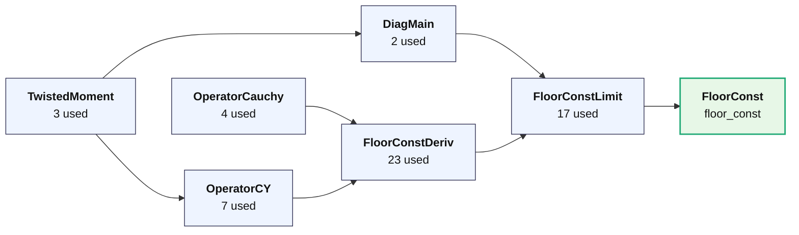

# What `FloorConst.floor_const` rests on

[`FloorConst.floor_const`](../lean_stage3/FloorConst.md#FloorConst-floor_const) in `lean_stage3/Stage3/FloorConst.lean`, line 137.

**Why.** Piece 5a: at `P(x) = x`, `θ = 49/100`, `R = 13/10`, `Re D[c](T) → K` with `log K < R` and `1 − log K / R ≥ 1/3`.

**Proves**

```lean
Tendsto (fun T => (Dop (Real.log T) (cY Polynomial.X (Mof T (49 / 100)) T) ((-((13 / 10) / Real.log T) : ℝ) : ℂ) ((-((13 / 10) / Real.log T) : ℝ) : ℂ)).re) atTop (𝓝 (Kfl 1 (1 / 2) (1 / 3) (49 / 100) (13 / 10))) ∧ Real.log (Kfl 1 (1 / 2) (1 / 3) (49 / 100) (13 / 10)) < 13 / 10 ∧ 1 / 3 ≤ kappaL (49 / 100) (13 / 10)
```

Behind it: 40 theorems and 26 definitions in 7 files. Every one is listed below; Lean recorded each step.

## The files it passes through



An arrow A → B reads "B uses something proved or defined in A"; indirect arrows are left out. Green: the theorem itself. Yellow: a file in the other tree. The number is how many of that file's declarations are on the way.

## Every declaration on the way

Files in dependency order. ★ marks what the theorem's own proof uses directly.

### [`OperatorCauchy`](../lean_stage3/OperatorCauchy.md) — 4

- [`Operator.pa`](../lean_stage3/OperatorCauchy.md#Operator-pa) — *def*
- [`Operator.pb`](../lean_stage3/OperatorCauchy.md#Operator-pb) — *def*
- [`Operator.pab`](../lean_stage3/OperatorCauchy.md#Operator-pab) — *def*
- ★ [`Operator.Dop`](../lean_stage3/OperatorCauchy.md#Operator-Dop) — *def*

### [`TwistedMoment`](../lean_stage3/TwistedMoment.md) — 3

- ★ [`TwistedMoment.Mof`](../lean_stage3/TwistedMoment.md#TwistedMoment-Mof) — *def*
- [`TwistedMoment.c1Y`](../lean_stage3/TwistedMoment.md#TwistedMoment-c1Y) — *def*
- ★ [`TwistedMoment.cY`](../lean_stage3/TwistedMoment.md#TwistedMoment-cY) — *def*

### [`DiagMain`](../lean_stage3/DiagMain.md) — 2

- [`DiagMain.logM_le`](../lean_stage3/DiagMain.md#DiagMain-logM_le) — `` Real.log (Mof T θ) ≤ θ * Real.log T ``
- [`DiagMain.logM_ge`](../lean_stage3/DiagMain.md#DiagMain-logM_ge) — `` θ * Real.log T / 2 ≤ Real.log (Mof T θ) ``

### [`OperatorCY`](../lean_stage3/OperatorCY.md) — 7

- [`Operator.Aq`](../lean_stage3/OperatorCY.md#Operator-Aq) — *def*
- [`Operator.Bq`](../lean_stage3/OperatorCY.md#Operator-Bq) — *def*
- [`Operator.Cq`](../lean_stage3/OperatorCY.md#Operator-Cq) — *def*
- [`Operator.c1form`](../lean_stage3/OperatorCY.md#Operator-c1form) — *def*
- [`Operator.cYform`](../lean_stage3/OperatorCY.md#Operator-cYform) — *def*
- [`Operator.c1Y_eq`](../lean_stage3/OperatorCY.md#Operator-c1Y_eq) — `` c1Y P M α β = c1form P M α β ``
- [`Operator.cY_eq`](../lean_stage3/OperatorCY.md#Operator-cY_eq) — `` cY P M T α β = cYform P M T (α, β) ``

### [`FloorConstDeriv`](../lean_stage3/FloorConstDeriv.md) — 23

- [`FloorConst.gF`](../lean_stage3/FloorConstDeriv.md#FloorConst-gF) — *def*
- [`FloorConst.EF`](../lean_stage3/FloorConstDeriv.md#FloorConst-EF) — *def*
- [`FloorConst.HF`](../lean_stage3/FloorConstDeriv.md#FloorConst-HF) — *def*
- [`FloorConst.gx`](../lean_stage3/FloorConstDeriv.md#FloorConst-gx) — *def*
- [`FloorConst.gy`](../lean_stage3/FloorConstDeriv.md#FloorConst-gy) — *def*
- [`FloorConst.gxy`](../lean_stage3/FloorConstDeriv.md#FloorConst-gxy) — *def*
- [`FloorConst.Hx`](../lean_stage3/FloorConstDeriv.md#FloorConst-Hx) — *def*
- [`FloorConst.Hy`](../lean_stage3/FloorConstDeriv.md#FloorConst-Hy) — *def*
- [`FloorConst.Hxy`](../lean_stage3/FloorConstDeriv.md#FloorConst-Hxy) — *def*
- [`FloorConst.hasDerivAt_gx`](../lean_stage3/FloorConstDeriv.md#FloorConst-hasDerivAt_gx) — `` HasDerivAt (fun x => gF A B C ℓ x y) (gx A C ℓ x y) x ``
- [`FloorConst.hasDerivAt_gy`](../lean_stage3/FloorConstDeriv.md#FloorConst-hasDerivAt_gy) — `` HasDerivAt (fun y => gF A B C ℓ x y) (gy A C ℓ x y) y ``
- [`FloorConst.hasDerivAt_gxy`](../lean_stage3/FloorConstDeriv.md#FloorConst-hasDerivAt_gxy) — `` HasDerivAt (fun y => gx A C ℓ x y) (gxy A C ℓ x y) y ``
- [`FloorConst.hasDerivAt_EFx`](../lean_stage3/FloorConstDeriv.md#FloorConst-hasDerivAt_EFx) — `` HasDerivAt (fun x => EF lam x y) (-lam * EF lam x y) x ``
- [`FloorConst.hasDerivAt_EFy`](../lean_stage3/FloorConstDeriv.md#FloorConst-hasDerivAt_EFy) — `` HasDerivAt (fun y => EF lam x y) (-lam * EF lam x y) y ``
- [`FloorConst.hasDerivAt_Hx`](../lean_stage3/FloorConstDeriv.md#FloorConst-hasDerivAt_Hx) — `` HasDerivAt (fun x => HF A B C ℓ lam x y) (Hx A B C ℓ lam x y) x ``
- [`FloorConst.hasDerivAt_Hy`](../lean_stage3/FloorConstDeriv.md#FloorConst-hasDerivAt_Hy) — `` HasDerivAt (fun y => HF A B C ℓ lam x y) (Hy A B C ℓ lam x y) y ``
- [`FloorConst.hasDerivAt_Hxy`](../lean_stage3/FloorConstDeriv.md#FloorConst-hasDerivAt_Hxy) — `` HasDerivAt (fun y => Hx A B C ℓ lam x y) (Hxy A B C ℓ lam x y) y ``
- [`FloorConst.cY_eq_HF`](../lean_stage3/FloorConstDeriv.md#FloorConst-cY_eq_HF) — `` cY P M T x y = HF (Aq P) (Bq P) (Cq P) ((Real.log M : ℝ) : ℂ) (Complex.log (T : ℂ)) x y ``
- [`FloorConst.nhds_ne_x`](../lean_stage3/FloorConstDeriv.md#FloorConst-nhds_ne_x) — `` ∀ᶠ x' in 𝓝 x, x' + y ≠ 0 ``
- [`FloorConst.nhds_ne_y`](../lean_stage3/FloorConstDeriv.md#FloorConst-nhds_ne_y) — `` ∀ᶠ y' in 𝓝 y, x + y' ≠ 0 ``
- [`FloorConst.pa_cY`](../lean_stage3/FloorConstDeriv.md#FloorConst-pa_cY) — `` pa (cY P M T) x y = Hx (Aq P) (Bq P) (Cq P) ((Real.log M : ℝ) : ℂ) (Complex.log (T : ℂ)) x y ``
- [`FloorConst.pb_cY`](../lean_stage3/FloorConstDeriv.md#FloorConst-pb_cY) — `` pb (cY P M T) x y = Hy (Aq P) (Bq P) (Cq P) ((Real.log M : ℝ) : ℂ) (Complex.log (T : ℂ)) x y ``
- [`FloorConst.pab_cY`](../lean_stage3/FloorConstDeriv.md#FloorConst-pab_cY) — `` pab (cY P M T) x y = Hxy (Aq P) (Bq P) (Cq P) ((Real.log M : ℝ) : ℂ) (Complex.log (T : ℂ)) x y ``

### [`FloorConstLimit`](../lean_stage3/FloorConstLimit.md) — 17

- ★ [`FloorConst.Kfl`](../lean_stage3/FloorConstLimit.md#FloorConst-Kfl) — *def*
- [`FloorConst.Ar`](../lean_stage3/FloorConstLimit.md#FloorConst-Ar) — *def*
- [`FloorConst.Br`](../lean_stage3/FloorConstLimit.md#FloorConst-Br) — *def*
- [`FloorConst.Cr`](../lean_stage3/FloorConstLimit.md#FloorConst-Cr) — *def*
- [`FloorConst.Aq_eq`](../lean_stage3/FloorConstLimit.md#FloorConst-Aq_eq) — `` Aq P = ((Ar P : ℝ) : ℂ) ``
- [`FloorConst.Bq_eq`](../lean_stage3/FloorConstLimit.md#FloorConst-Bq_eq) — `` Bq P = ((Br P : ℝ) : ℂ) ``
- [`FloorConst.Cq_eq`](../lean_stage3/FloorConstLimit.md#FloorConst-Cq_eq) — `` Cq P = ((Cr P : ℝ) : ℂ) ``
- [`FloorConst.dop_closed`](../lean_stage3/FloorConstLimit.md#FloorConst-dop_closed) — `` HF A B C ((θ * L : ℝ) : ℂ) L ((-(R / L) : ℝ) : ℂ) ((-(R / L) : ℝ) : ℂ) + 1 / (L : ℂ) * (Hx A B C ((θ * L : ℝ) : ℂ) L ((-(R / L) : ℝ) : ℂ) ((-(R / L) : ℝ) : ℂ) +… ``
- [`FloorConst.dop_cY_eq`](../lean_stage3/FloorConstLimit.md#FloorConst-dop_cY_eq) — `` Dop (Real.log T) (cY P M T) ((-(R / Real.log T) : ℝ) : ℂ) ((-(R / Real.log T) : ℝ) : ℂ) = ((Kfl (Ar P) (Br P) (Cr P) (Real.log M / Real.log T) R : ℝ) : ℂ) ``
- [`FloorConst.logM_ge'`](../lean_stage3/FloorConstLimit.md#FloorConst-logM_ge-) — `` θ * Real.log T - Real.log 2 ≤ Real.log (Mof T θ) ``
- [`FloorConst.theta_tendsto`](../lean_stage3/FloorConstLimit.md#FloorConst-theta_tendsto) — `` Tendsto (fun T => Real.log (Mof T θ) / Real.log T) atTop (𝓝 θ) ``
- [`FloorConst.tendsto_Kfl`](../lean_stage3/FloorConstLimit.md#FloorConst-tendsto_Kfl) — `` Tendsto (fun t => Kfl A B C (f t) R) l (𝓝 (Kfl A B C θ R)) ``
- [`FloorConst.re_dop_tendsto`](../lean_stage3/FloorConstLimit.md#FloorConst-re_dop_tendsto) — `` Tendsto (fun T => (Dop (Real.log T) (cY P (Mof T θ) T) ((-(R / Real.log T) : ℝ) : ℂ) ((-(R / Real.log T) : ℝ) : ℂ)).re) atTop (𝓝 (Kfl (Ar P) (Br P) (Cr P) θ R)) ``
- [`FloorConst.Ar_X`](../lean_stage3/FloorConstLimit.md#FloorConst-Ar_X) — `` Ar Polynomial.X = 1 ``
- [`FloorConst.Br_X`](../lean_stage3/FloorConstLimit.md#FloorConst-Br_X) — `` Br Polynomial.X = 1 / 2 ``
- [`FloorConst.Cr_X`](../lean_stage3/FloorConstLimit.md#FloorConst-Cr_X) — `` Cr Polynomial.X = 1 / 3 ``
- ★ [`FloorConst.re_dop_tendsto_X`](../lean_stage3/FloorConstLimit.md#FloorConst-re_dop_tendsto_X) — `` Tendsto (fun T => (Dop (Real.log T) (cY Polynomial.X (Mof T θ) T) ((-(R / Real.log T) : ℝ) : ℂ) ((-(R / Real.log T) : ℝ) : ℂ)).re) atTop (𝓝 (Kfl 1 (1 / 2) (1 / … ``

### [`FloorConst`](../lean_stage3/FloorConst.md) — 10

- ★ [`FloorConst.kappaL`](../lean_stage3/FloorConst.md#FloorConst-kappaL) — *def*
- [`FloorConst.exp_fifteenth_ge`](../lean_stage3/FloorConst.md#FloorConst-exp_fifteenth_ge) — `` 1 + 1 / 15 + 1 / 450 + 1 / 20250 ≤ Real.exp (1 / 15) ``
- [`FloorConst.exp_mul_nat`](../lean_stage3/FloorConst.md#FloorConst-exp_mul_nat) — `` Real.exp (n * x) = Real.exp x ^ n ``
- [`FloorConst.Kfl_levinson_eq`](../lean_stage3/FloorConst.md#FloorConst-Kfl_levinson_eq) — `` Kfl 1 (1 / 2) (1 / 3) (49 / 100) (13 / 10) = -760154441 / 645918000 + 3405769 / 12918360 * Real.exp (13 / 10) ^ 2 ``
- [`FloorConst.exp_13_15_ge`](../lean_stage3/FloorConst.md#FloorConst-exp_13_15_ge) — `` (1 + 1 / 15 + 1 / 450 + 1 / 20250 : ℝ) ^ 13 ≤ Real.exp (13 / 15) ``
- [`FloorConst.Kfl_levinson_le`](../lean_stage3/FloorConst.md#FloorConst-Kfl_levinson_le) — `` Kfl 1 (1 / 2) (1 / 3) (49 / 100) (13 / 10) ≤ -760154441 / 645918000 + 3405769 / 12918360 * ((1 + 1 / 10 + 1 / 200 + 1 / 6000 + 1 / 192000 : ℝ) ^ 13) ^ 2 ``
- [`FloorConst.Kfl_levinson_pos`](../lean_stage3/FloorConst.md#FloorConst-Kfl_levinson_pos) — `` 0 < Kfl 1 (1 / 2) (1 / 3) (49 / 100) (13 / 10) ``
- [`FloorConst.Kfl_levinson_lt`](../lean_stage3/FloorConst.md#FloorConst-Kfl_levinson_lt) — `` Kfl 1 (1 / 2) (1 / 3) (49 / 100) (13 / 10) < Real.exp (13 / 10) ``
- ★ [`FloorConst.log_Kfl_levinson_lt`](../lean_stage3/FloorConst.md#FloorConst-log_Kfl_levinson_lt) — `` Real.log (Kfl 1 (1 / 2) (1 / 3) (49 / 100) (13 / 10)) < 13 / 10 ``
- ★ [`FloorConst.kappa_levinson_ge`](../lean_stage3/FloorConst.md#FloorConst-kappa_levinson_ge) — `` 1 / 3 ≤ kappaL (49 / 100) (13 / 10) ``

