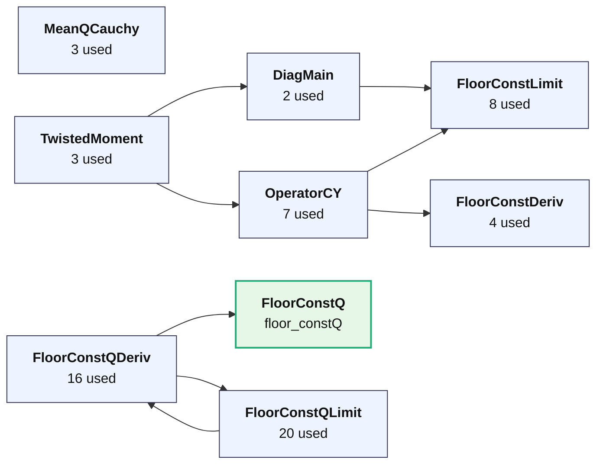

# What `FloorConstQ.floor_constQ` rests on

[`FloorConstQ.floor_constQ`](../lean_stage3/FloorConstQ.md#FloorConstQ-floor_constQ) in `lean_stage3/Stage3/FloorConstQ.lean`, line 243.

**Why.** B4 step 4: at `P₀`, `Q₀`, `θ = 49/100`, `R = 3/2`, `Re DopQ c (T) → K` with `log K < R(1 − κ₀)`, `κ₀ = 224/625 > 1/3`.

**Proves**

```lean
Tendsto (fun T => (MeanQ.DopQ Q0 (Real.log T) (cY P0 (Mof T (49 / 100)) T) ((-((3 / 2) / Real.log T) : ℝ) : ℂ) ((-((3 / 2) / Real.log T) : ℝ) : ℂ)).re) atTop (𝓝 (KflQ Q0 (FloorConst.Ar P0) (FloorConst.Br P0) (FloorConst.Cr P0) (49 / 100) (3 / 2))) ∧ Real.log (KflQ Q0 (FloorConst.Ar P0) (FloorConst.Br P0) (FloorConst.Cr P0) (49 / 100) (3 / 2)) < 3 / 2 * (1 - 224 / 625) ∧ 1 / 3 < (224 / 625 : ℝ)
```

Behind it: 63 theorems and 30 definitions in 9 files. Every one is listed below; Lean recorded each step.

## The files it passes through



An arrow A → B reads "B uses something proved or defined in A"; indirect arrows are left out. Green: the theorem itself. Yellow: a file in the other tree. The number is how many of that file's declarations are on the way.

## Every declaration on the way

Files in dependency order. ★ marks what the theorem's own proof uses directly.

### [`MeanQCauchy`](../lean_stage3/MeanQCauchy.md) — 3

- [`MeanQ.pkl`](../lean_stage3/MeanQCauchy.md#MeanQ-pkl) — *def*
- [`MeanQ.qc`](../lean_stage3/MeanQCauchy.md#MeanQ-qc) — *def*
- ★ [`MeanQ.DopQ`](../lean_stage3/MeanQCauchy.md#MeanQ-DopQ) — *def*

### [`TwistedMoment`](../lean_stage3/TwistedMoment.md) — 3

- ★ [`TwistedMoment.Mof`](../lean_stage3/TwistedMoment.md#TwistedMoment-Mof) — *def*
- [`TwistedMoment.c1Y`](../lean_stage3/TwistedMoment.md#TwistedMoment-c1Y) — *def*
- ★ [`TwistedMoment.cY`](../lean_stage3/TwistedMoment.md#TwistedMoment-cY) — *def*

### [`DiagMain`](../lean_stage3/DiagMain.md) — 2

- [`DiagMain.logM_le`](../lean_stage3/DiagMain.md#DiagMain-logM_le) — `` Real.log (Mof T θ) ≤ θ * Real.log T ``
- [`DiagMain.logM_ge`](../lean_stage3/DiagMain.md#DiagMain-logM_ge) — `` θ * Real.log T / 2 ≤ Real.log (Mof T θ) ``

### [`OperatorCY`](../lean_stage3/OperatorCY.md) — 7

- [`Operator.Aq`](../lean_stage3/OperatorCY.md#Operator-Aq) — *def*
- [`Operator.Bq`](../lean_stage3/OperatorCY.md#Operator-Bq) — *def*
- [`Operator.Cq`](../lean_stage3/OperatorCY.md#Operator-Cq) — *def*
- [`Operator.c1form`](../lean_stage3/OperatorCY.md#Operator-c1form) — *def*
- [`Operator.cYform`](../lean_stage3/OperatorCY.md#Operator-cYform) — *def*
- [`Operator.c1Y_eq`](../lean_stage3/OperatorCY.md#Operator-c1Y_eq) — `` c1Y P M α β = c1form P M α β ``
- [`Operator.cY_eq`](../lean_stage3/OperatorCY.md#Operator-cY_eq) — `` cY P M T α β = cYform P M T (α, β) ``

### [`FloorConstDeriv`](../lean_stage3/FloorConstDeriv.md) — 4

- [`FloorConst.gF`](../lean_stage3/FloorConstDeriv.md#FloorConst-gF) — *def*
- [`FloorConst.EF`](../lean_stage3/FloorConstDeriv.md#FloorConst-EF) — *def*
- [`FloorConst.HF`](../lean_stage3/FloorConstDeriv.md#FloorConst-HF) — *def*
- [`FloorConst.cY_eq_HF`](../lean_stage3/FloorConstDeriv.md#FloorConst-cY_eq_HF) — `` cY P M T x y = HF (Aq P) (Bq P) (Cq P) ((Real.log M : ℝ) : ℂ) (Complex.log (T : ℂ)) x y ``

### [`FloorConstLimit`](../lean_stage3/FloorConstLimit.md) — 8

- ★ [`FloorConst.Ar`](../lean_stage3/FloorConstLimit.md#FloorConst-Ar) — *def*
- ★ [`FloorConst.Br`](../lean_stage3/FloorConstLimit.md#FloorConst-Br) — *def*
- ★ [`FloorConst.Cr`](../lean_stage3/FloorConstLimit.md#FloorConst-Cr) — *def*
- [`FloorConst.Aq_eq`](../lean_stage3/FloorConstLimit.md#FloorConst-Aq_eq) — `` Aq P = ((Ar P : ℝ) : ℂ) ``
- [`FloorConst.Bq_eq`](../lean_stage3/FloorConstLimit.md#FloorConst-Bq_eq) — `` Bq P = ((Br P : ℝ) : ℂ) ``
- [`FloorConst.Cq_eq`](../lean_stage3/FloorConstLimit.md#FloorConst-Cq_eq) — `` Cq P = ((Cr P : ℝ) : ℂ) ``
- [`FloorConst.logM_ge'`](../lean_stage3/FloorConstLimit.md#FloorConst-logM_ge-) — `` θ * Real.log T - Real.log 2 ≤ Real.log (Mof T θ) ``
- [`FloorConst.theta_tendsto`](../lean_stage3/FloorConstLimit.md#FloorConst-theta_tendsto) — `` Tendsto (fun T => Real.log (Mof T θ) / Real.log T) atTop (𝓝 θ) ``

### [`FloorConstQ`](../lean_stage3/FloorConstQ.md) — 30

- ★ [`FloorConstQ.P0`](../lean_stage3/FloorConstQ.md#FloorConstQ-P0) — *def*
- ★ [`FloorConstQ.Q0`](../lean_stage3/FloorConstQ.md#FloorConstQ-Q0) — *def*
- [`FloorConstQ.integral_poly`](../lean_stage3/FloorConstQ.md#FloorConstQ-integral_poly) — `` ∫ u in (0 : ℝ)..1, S.eval u = F.eval 1 - F.eval 0 ``
- [`FloorConstQ.Ar_P0`](../lean_stage3/FloorConstQ.md#FloorConstQ-Ar_P0) — `` FloorConst.Ar P0 = 152147 / 150000 ``
- [`FloorConstQ.Br_P0`](../lean_stage3/FloorConstQ.md#FloorConstQ-Br_P0) — `` FloorConst.Br P0 = 1 / 2 ``
- [`FloorConstQ.Cr_P0`](../lean_stage3/FloorConstQ.md#FloorConstQ-Cr_P0) — `` FloorConst.Cr P0 = 89707 / 300000 ``
- [`FloorConstQ.Q0_natDegree`](../lean_stage3/FloorConstQ.md#FloorConstQ-Q0_natDegree) — `` Q0.natDegree = 3 ``
- [`FloorConstQ.Q0_c0`](../lean_stage3/FloorConstQ.md#FloorConstQ-Q0_c0) — `` Q0.coeff 0 = 1 ``
- [`FloorConstQ.Q0_c1`](../lean_stage3/FloorConstQ.md#FloorConstQ-Q0_c1) — `` Q0.coeff 1 = -27 / 50 ``
- [`FloorConstQ.Q0_c2`](../lean_stage3/FloorConstQ.md#FloorConstQ-Q0_c2) — `` Q0.coeff 2 = -36 / 25 ``
- [`FloorConstQ.Q0_c3`](../lean_stage3/FloorConstQ.md#FloorConstQ-Q0_c3) — `` Q0.coeff 3 = 24 / 25 ``
- [`FloorConstQ.ph0`](../lean_stage3/FloorConstQ.md#FloorConstQ-ph0) — `` ph (3 / 2) 0 = -1 / 3 + 1 / 3 * Real.exp 3 ``
- [`FloorConstQ.ph_succ`](../lean_stage3/FloorConstQ.md#FloorConstQ-ph_succ) — `` ph R (n + 1) = (-(-1) ^ (n + 1) * Real.exp (2 * R) - ((n : ℝ) + 1) * ph R n) / (-(2 * R)) ``
- [`FloorConstQ.ph1`](../lean_stage3/FloorConstQ.md#FloorConstQ-ph1) — `` ph (3 / 2) 1 = -1 / 9 - 2 / 9 * Real.exp 3 ``
- [`FloorConstQ.ph2`](../lean_stage3/FloorConstQ.md#FloorConstQ-ph2) — `` ph (3 / 2) 2 = -2 / 27 + 5 / 27 * Real.exp 3 ``
- [`FloorConstQ.ph3`](../lean_stage3/FloorConstQ.md#FloorConstQ-ph3) — `` ph (3 / 2) 3 = -2 / 27 - 4 / 27 * Real.exp 3 ``
- [`FloorConstQ.ph4`](../lean_stage3/FloorConstQ.md#FloorConstQ-ph4) — `` ph (3 / 2) 4 = -8 / 81 + 11 / 81 * Real.exp 3 ``
- [`FloorConstQ.ph5`](../lean_stage3/FloorConstQ.md#FloorConstQ-ph5) — `` ph (3 / 2) 5 = -40 / 243 - 26 / 243 * Real.exp 3 ``
- [`FloorConstQ.ph6`](../lean_stage3/FloorConstQ.md#FloorConstQ-ph6) — `` ph (3 / 2) 6 = -80 / 243 + 29 / 243 * Real.exp 3 ``
- [`FloorConstQ.SB_Q0`](../lean_stage3/FloorConstQ.md#FloorConstQ-SB_Q0) — `` SB Q0 (3 / 2) = 1 + 1 / 2500 * Real.exp 3 ``
- [`FloorConstQ.SA_Q0`](../lean_stage3/FloorConstQ.md#FloorConstQ-SA_Q0) — `` SA Q0 (3 / 2) = -29197 / 33750 + 5657 / 67500 * Real.exp 3 ``
- [`FloorConstQ.SC_Q0`](../lean_stage3/FloorConstQ.md#FloorConstQ-SC_Q0) — `` SC Q0 (3 / 2) = -26057 / 15000 + 6877 / 30000 * Real.exp 3 ``
- [`FloorConstQ.KflQ_eq`](../lean_stage3/FloorConstQ.md#FloorConstQ-KflQ_eq) — `` KflQ Q0 (FloorConst.Ar P0) (FloorConst.Br P0) (FloorConst.Cr P0) (49 / 100) (3 / 2) = -43809258948013 / 28350000000000 + 82265943397751 / 396900000000000 * Real… ``
- [`FloorConstQ.exp_half_le`](../lean_stage3/FloorConstQ.md#FloorConstQ-exp_half_le) — `` Real.exp (1 / 2) ≤ 45381251 / 27525120 ``
- [`FloorConstQ.exp_half_ge`](../lean_stage3/FloorConstQ.md#FloorConstQ-exp_half_ge) — `` 354541 / 215040 ≤ Real.exp (1 / 2) ``
- [`FloorConstQ.exp_three_eq`](../lean_stage3/FloorConstQ.md#FloorConstQ-exp_three_eq) — `` Real.exp 3 = Real.exp (1 / 2) ^ 6 ``
- [`FloorConstQ.exp_y_ge`](../lean_stage3/FloorConstQ.md#FloorConstQ-exp_y_ge) — `` ∑ i ∈ Finset.range 12, (1203 / 1250 : ℝ) ^ i / i.factorial ≤ Real.exp (1203 / 1250) ``
- [`FloorConstQ.KflQ_pos`](../lean_stage3/FloorConstQ.md#FloorConstQ-KflQ_pos) — `` 0 < KflQ Q0 (FloorConst.Ar P0) (FloorConst.Br P0) (FloorConst.Cr P0) (49 / 100) (3 / 2) ``
- [`FloorConstQ.KflQ_lt`](../lean_stage3/FloorConstQ.md#FloorConstQ-KflQ_lt) — `` KflQ Q0 (FloorConst.Ar P0) (FloorConst.Br P0) (FloorConst.Cr P0) (49 / 100) (3 / 2) < Real.exp (1203 / 1250) ``
- ★ [`FloorConstQ.log_KflQ_lt`](../lean_stage3/FloorConstQ.md#FloorConstQ-log_KflQ_lt) — `` Real.log (KflQ Q0 (FloorConst.Ar P0) (FloorConst.Br P0) (FloorConst.Cr P0) (49 / 100) (3 / 2)) < 3 / 2 * (1 - 224 / 625) ``

### [`FloorConstQDeriv`](../lean_stage3/FloorConstQDeriv.md) — 16

- [`FloorConstQ.phi`](../lean_stage3/FloorConstQDeriv.md#FloorConstQ-phi) — *def*
- [`FloorConstQ.ph`](../lean_stage3/FloorConstQDeriv.md#FloorConstQ-ph) — *def*
- [`FloorConstQ.iteratedDeriv_comp_mul`](../lean_stage3/FloorConstQDeriv.md#FloorConstQ-iteratedDeriv_comp_mul) — `` iteratedDeriv n (fun x => f (c * x)) = fun x => c ^ n * iteratedDeriv n f (c * x) ``
- [`FloorConstQ.iteratedDeriv_iteratedDeriv'`](../lean_stage3/FloorConstQDeriv.md#FloorConstQ-iteratedDeriv_iteratedDeriv-) — `` iteratedDeriv l (iteratedDeriv k f) = iteratedDeriv (l + k) f ``
- [`FloorConstQ.iteratedDeriv_id_mul`](../lean_stage3/FloorConstQDeriv.md#FloorConstQ-iteratedDeriv_id_mul) — `` iteratedDeriv n (fun z => z * ψ z) x = x * iteratedDeriv n ψ x + n * iteratedDeriv (n - 1) ψ x ``
- [`FloorConstQ.inner_sum`](../lean_stage3/FloorConstQDeriv.md#FloorConstQ-inner_sum) — `` iteratedDeriv k (fun x => g1 (x + y) + x * y * g2 (x + y)) x0 = iteratedDeriv k g1 (x0 + y) + y * (x0 * iteratedDeriv k g2 (x0 + y) + k * iteratedDeriv (k - 1) … ``
- [`FloorConstQ.analyticAt_iteratedDeriv`](../lean_stage3/FloorConstQDeriv.md#FloorConstQ-analyticAt_iteratedDeriv) — `` AnalyticAt ℂ (iteratedDeriv k g) u ``
- [`FloorConstQ.outer_lin`](../lean_stage3/FloorConstQDeriv.md#FloorConstQ-outer_lin) — `` iteratedDeriv j (fun y => x0 * iteratedDeriv k g2 (x0 + y) + (k : ℂ) * iteratedDeriv (k - 1) g2 (x0 + y)) y0 = x0 * iteratedDeriv (j + k) g2 (x0 + y0) + k * ite… ``
- [`FloorConstQ.pkl_sum`](../lean_stage3/FloorConstQDeriv.md#FloorConstQ-pkl_sum) — `` MeanQ.pkl (fun x y => g1 (x + y) + x * y * g2 (x + y)) k l x0 y0 = iteratedDeriv (l + k) g1 (x0 + y0) + (y0 * (x0 * iteratedDeriv (l + k) g2 (x0 + y0) + k * ite… ``
- [`FloorConstQ.pkl_scale`](../lean_stage3/FloorConstQDeriv.md#FloorConstQ-pkl_scale) — `` MeanQ.pkl f k l α0 β0 = c ^ k * c ^ l * MeanQ.pkl g k l (c * α0) (c * β0) ``
- [`FloorConstQ.phi_analyticAt`](../lean_stage3/FloorConstQDeriv.md#FloorConstQ-phi_analyticAt) — `` AnalyticAt ℂ phi u ``
- [`FloorConstQ.iteratedDeriv_exp_neg`](../lean_stage3/FloorConstQDeriv.md#FloorConstQ-iteratedDeriv_exp_neg) — `` iteratedDeriv n (fun z => cexp (-z)) u = (-1) ^ n * cexp (-u) ``
- [`FloorConstQ.iteratedDeriv_one_sub_exp`](../lean_stage3/FloorConstQDeriv.md#FloorConstQ-iteratedDeriv_one_sub_exp) — `` iteratedDeriv n (fun z => 1 - cexp (-z)) u = (if n = 0 then 1 else 0) - (-1) ^ n * cexp (-u) ``
- [`FloorConstQ.iteratedDeriv_one_add_exp`](../lean_stage3/FloorConstQDeriv.md#FloorConstQ-iteratedDeriv_one_add_exp) — `` iteratedDeriv n (fun z => 1 + cexp (-z)) u = (if n = 0 then 1 else 0) + (-1) ^ n * cexp (-u) ``
- [`FloorConstQ.phi_rec`](../lean_stage3/FloorConstQDeriv.md#FloorConstQ-phi_rec) — `` u * iteratedDeriv n phi u + n * iteratedDeriv (n - 1) phi u = (if n = 0 then 1 else 0) - (-1) ^ n * cexp (-u) ``
- [`FloorConstQ.phi_iter_real`](../lean_stage3/FloorConstQDeriv.md#FloorConstQ-phi_iter_real) — `` iteratedDeriv n phi ((-(2 * R) : ℝ) : ℂ) = ((ph R n : ℝ) : ℂ) ``

### [`FloorConstQLimit`](../lean_stage3/FloorConstQLimit.md) — 20

- [`FloorConstQ.g1`](../lean_stage3/FloorConstQLimit.md#FloorConstQ-g1) — *def*
- [`FloorConstQ.g2`](../lean_stage3/FloorConstQLimit.md#FloorConstQ-g2) — *def*
- [`FloorConstQ.FF`](../lean_stage3/FloorConstQLimit.md#FloorConstQ-FF) — *def*
- [`FloorConstQ.gB`](../lean_stage3/FloorConstQLimit.md#FloorConstQ-gB) — *def*
- [`FloorConstQ.XF`](../lean_stage3/FloorConstQLimit.md#FloorConstQ-XF) — *def*
- ★ [`FloorConstQ.KflQ`](../lean_stage3/FloorConstQLimit.md#FloorConstQ-KflQ) — *def*
- [`FloorConstQ.SB`](../lean_stage3/FloorConstQLimit.md#FloorConstQ-SB) — *def*
- [`FloorConstQ.SA`](../lean_stage3/FloorConstQLimit.md#FloorConstQ-SA) — *def*
- [`FloorConstQ.SC`](../lean_stage3/FloorConstQLimit.md#FloorConstQ-SC) — *def*
- [`FloorConstQ.cY_eq_FF`](../lean_stage3/FloorConstQLimit.md#FloorConstQ-cY_eq_FF) — `` cY P M T x y = FF (Aq P) (Bq P) (Cq P) ((Real.log M / Real.log T : ℝ) : ℂ) ((Real.log T : ℝ) * x) ((Real.log T : ℝ) * y) ``
- [`FloorConstQ.g1_analyticAt`](../lean_stage3/FloorConstQLimit.md#FloorConstQ-g1_analyticAt) — `` AnalyticAt ℂ (g1 A B θ) u ``
- [`FloorConstQ.g2_analyticAt`](../lean_stage3/FloorConstQLimit.md#FloorConstQ-g2_analyticAt) — `` AnalyticAt ℂ (g2 C θ) u ``
- [`FloorConstQ.g1_iter`](../lean_stage3/FloorConstQLimit.md#FloorConstQ-g1_iter) — `` iteratedDeriv n (g1 A B θ) ((-(2 * R) : ℝ) : ℂ) = ((B * gB R n + A / θ * ph R n : ℝ) : ℂ) ``
- [`FloorConstQ.g2_iter`](../lean_stage3/FloorConstQLimit.md#FloorConstQ-g2_iter) — `` iteratedDeriv n (g2 C θ) ((-(2 * R) : ℝ) : ℂ) = ((θ * C * ph R n : ℝ) : ℂ) ``
- [`FloorConstQ.pkl_FF`](../lean_stage3/FloorConstQLimit.md#FloorConstQ-pkl_FF) — `` MeanQ.pkl (FF A B C θ) k l ((-R : ℝ) : ℂ) ((-R : ℝ) : ℂ) = ((XF A B C θ R k l : ℝ) : ℂ) ``
- [`FloorConstQ.neg_inv_pow_mul`](../lean_stage3/FloorConstQLimit.md#FloorConstQ-neg_inv_pow_mul) — `` (-1 / L) ^ k * L ^ k = (-1) ^ k ``
- [`FloorConstQ.dopQ_cY_eq`](../lean_stage3/FloorConstQLimit.md#FloorConstQ-dopQ_cY_eq) — `` MeanQ.DopQ Q (Real.log T) (cY P M T) ((-(R / Real.log T) : ℝ) : ℂ) ((-(R / Real.log T) : ℝ) : ℂ) = ((KflQ Q (FloorConst.Ar P) (FloorConst.Br P) (FloorConst.Cr P… ``
- [`FloorConstQ.KflQ_lin`](../lean_stage3/FloorConstQLimit.md#FloorConstQ-KflQ_lin) — `` KflQ Q A B C θ R = B * SB Q R + A / θ * SA Q R + θ * C * SC Q R ``
- [`FloorConstQ.tendsto_KflQ`](../lean_stage3/FloorConstQLimit.md#FloorConstQ-tendsto_KflQ) — `` Tendsto (fun t => KflQ Q A B C (f t) R) l (𝓝 (KflQ Q A B C θ R)) ``
- ★ [`FloorConstQ.re_dopQ_tendsto`](../lean_stage3/FloorConstQLimit.md#FloorConstQ-re_dopQ_tendsto) — `` Tendsto (fun T => (MeanQ.DopQ Q (Real.log T) (cY P (Mof T θ) T) ((-(R / Real.log T) : ℝ) : ℂ) ((-(R / Real.log T) : ℝ) : ℂ)).re) atTop (𝓝 (KflQ Q (FloorConst.Ar… ``

