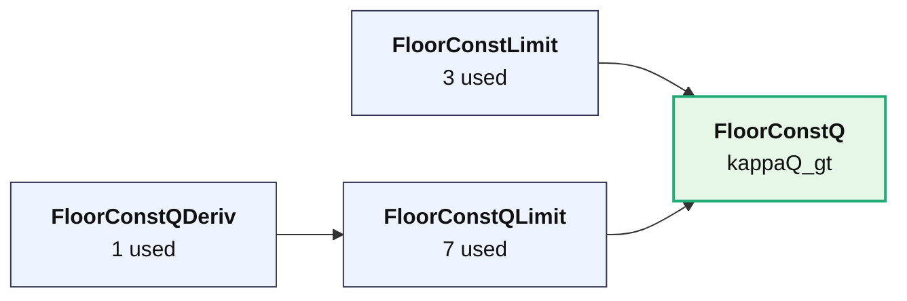

# What `FloorConstQ.kappaQ_gt` rests on

[`FloorConstQ.kappaQ_gt`](../lean_stage3/FloorConstQ.md#FloorConstQ-kappaQ_gt) in `lean_stage3/Stage3/FloorConstQ.lean`, line 231.

**Why.** `κ > κ₀ = 224/625 > 1/3`.

**Proves**

```lean
1 / 3 < (224 / 625 : ℝ) ∧ 224 / 625 < kappaQ (49 / 100) (3 / 2)
```

Behind it: 29 theorems and 13 definitions in 4 files. Every one is listed below; Lean recorded each step.

## The files it passes through



An arrow A → B reads "B uses something proved or defined in A"; indirect arrows are left out. Green: the theorem itself. Yellow: a file in the other tree. The number is how many of that file's declarations are on the way.

## Every declaration on the way

Files in dependency order. ★ marks what the theorem's own proof uses directly.

### [`FloorConstLimit`](../lean_stage3/FloorConstLimit.md) — 3

- ★ [`FloorConst.Ar`](../lean_stage3/FloorConstLimit.md#FloorConst-Ar) — *def*
- ★ [`FloorConst.Br`](../lean_stage3/FloorConstLimit.md#FloorConst-Br) — *def*
- ★ [`FloorConst.Cr`](../lean_stage3/FloorConstLimit.md#FloorConst-Cr) — *def*

### [`FloorConstQDeriv`](../lean_stage3/FloorConstQDeriv.md) — 1

- [`FloorConstQ.ph`](../lean_stage3/FloorConstQDeriv.md#FloorConstQ-ph) — *def*

### [`FloorConstQLimit`](../lean_stage3/FloorConstQLimit.md) — 7

- [`FloorConstQ.gB`](../lean_stage3/FloorConstQLimit.md#FloorConstQ-gB) — *def*
- [`FloorConstQ.XF`](../lean_stage3/FloorConstQLimit.md#FloorConstQ-XF) — *def*
- ★ [`FloorConstQ.KflQ`](../lean_stage3/FloorConstQLimit.md#FloorConstQ-KflQ) — *def*
- [`FloorConstQ.SB`](../lean_stage3/FloorConstQLimit.md#FloorConstQ-SB) — *def*
- [`FloorConstQ.SA`](../lean_stage3/FloorConstQLimit.md#FloorConstQ-SA) — *def*
- [`FloorConstQ.SC`](../lean_stage3/FloorConstQLimit.md#FloorConstQ-SC) — *def*
- [`FloorConstQ.KflQ_lin`](../lean_stage3/FloorConstQLimit.md#FloorConstQ-KflQ_lin) — `` KflQ Q A B C θ R = B * SB Q R + A / θ * SA Q R + θ * C * SC Q R ``

### [`FloorConstQ`](../lean_stage3/FloorConstQ.md) — 31

- ★ [`FloorConstQ.P0`](../lean_stage3/FloorConstQ.md#FloorConstQ-P0) — *def*
- ★ [`FloorConstQ.Q0`](../lean_stage3/FloorConstQ.md#FloorConstQ-Q0) — *def*
- ★ [`FloorConstQ.kappaQ`](../lean_stage3/FloorConstQ.md#FloorConstQ-kappaQ) — *def*
- [`FloorConstQ.integral_poly`](../lean_stage3/FloorConstQ.md#FloorConstQ-integral_poly) — `` ∫ u in (0 : ℝ)..1, S.eval u = F.eval 1 - F.eval 0 ``
- [`FloorConstQ.Ar_P0`](../lean_stage3/FloorConstQ.md#FloorConstQ-Ar_P0) — `` FloorConst.Ar P0 = 152147 / 150000 ``
- [`FloorConstQ.Br_P0`](../lean_stage3/FloorConstQ.md#FloorConstQ-Br_P0) — `` FloorConst.Br P0 = 1 / 2 ``
- [`FloorConstQ.Cr_P0`](../lean_stage3/FloorConstQ.md#FloorConstQ-Cr_P0) — `` FloorConst.Cr P0 = 89707 / 300000 ``
- [`FloorConstQ.Q0_natDegree`](../lean_stage3/FloorConstQ.md#FloorConstQ-Q0_natDegree) — `` Q0.natDegree = 3 ``
- [`FloorConstQ.Q0_c0`](../lean_stage3/FloorConstQ.md#FloorConstQ-Q0_c0) — `` Q0.coeff 0 = 1 ``
- [`FloorConstQ.Q0_c1`](../lean_stage3/FloorConstQ.md#FloorConstQ-Q0_c1) — `` Q0.coeff 1 = -27 / 50 ``
- [`FloorConstQ.Q0_c2`](../lean_stage3/FloorConstQ.md#FloorConstQ-Q0_c2) — `` Q0.coeff 2 = -36 / 25 ``
- [`FloorConstQ.Q0_c3`](../lean_stage3/FloorConstQ.md#FloorConstQ-Q0_c3) — `` Q0.coeff 3 = 24 / 25 ``
- [`FloorConstQ.ph0`](../lean_stage3/FloorConstQ.md#FloorConstQ-ph0) — `` ph (3 / 2) 0 = -1 / 3 + 1 / 3 * Real.exp 3 ``
- [`FloorConstQ.ph_succ`](../lean_stage3/FloorConstQ.md#FloorConstQ-ph_succ) — `` ph R (n + 1) = (-(-1) ^ (n + 1) * Real.exp (2 * R) - ((n : ℝ) + 1) * ph R n) / (-(2 * R)) ``
- [`FloorConstQ.ph1`](../lean_stage3/FloorConstQ.md#FloorConstQ-ph1) — `` ph (3 / 2) 1 = -1 / 9 - 2 / 9 * Real.exp 3 ``
- [`FloorConstQ.ph2`](../lean_stage3/FloorConstQ.md#FloorConstQ-ph2) — `` ph (3 / 2) 2 = -2 / 27 + 5 / 27 * Real.exp 3 ``
- [`FloorConstQ.ph3`](../lean_stage3/FloorConstQ.md#FloorConstQ-ph3) — `` ph (3 / 2) 3 = -2 / 27 - 4 / 27 * Real.exp 3 ``
- [`FloorConstQ.ph4`](../lean_stage3/FloorConstQ.md#FloorConstQ-ph4) — `` ph (3 / 2) 4 = -8 / 81 + 11 / 81 * Real.exp 3 ``
- [`FloorConstQ.ph5`](../lean_stage3/FloorConstQ.md#FloorConstQ-ph5) — `` ph (3 / 2) 5 = -40 / 243 - 26 / 243 * Real.exp 3 ``
- [`FloorConstQ.ph6`](../lean_stage3/FloorConstQ.md#FloorConstQ-ph6) — `` ph (3 / 2) 6 = -80 / 243 + 29 / 243 * Real.exp 3 ``
- [`FloorConstQ.SB_Q0`](../lean_stage3/FloorConstQ.md#FloorConstQ-SB_Q0) — `` SB Q0 (3 / 2) = 1 + 1 / 2500 * Real.exp 3 ``
- [`FloorConstQ.SA_Q0`](../lean_stage3/FloorConstQ.md#FloorConstQ-SA_Q0) — `` SA Q0 (3 / 2) = -29197 / 33750 + 5657 / 67500 * Real.exp 3 ``
- [`FloorConstQ.SC_Q0`](../lean_stage3/FloorConstQ.md#FloorConstQ-SC_Q0) — `` SC Q0 (3 / 2) = -26057 / 15000 + 6877 / 30000 * Real.exp 3 ``
- [`FloorConstQ.KflQ_eq`](../lean_stage3/FloorConstQ.md#FloorConstQ-KflQ_eq) — `` KflQ Q0 (FloorConst.Ar P0) (FloorConst.Br P0) (FloorConst.Cr P0) (49 / 100) (3 / 2) = -43809258948013 / 28350000000000 + 82265943397751 / 396900000000000 * Real… ``
- [`FloorConstQ.exp_half_le`](../lean_stage3/FloorConstQ.md#FloorConstQ-exp_half_le) — `` Real.exp (1 / 2) ≤ 45381251 / 27525120 ``
- [`FloorConstQ.exp_half_ge`](../lean_stage3/FloorConstQ.md#FloorConstQ-exp_half_ge) — `` 354541 / 215040 ≤ Real.exp (1 / 2) ``
- [`FloorConstQ.exp_three_eq`](../lean_stage3/FloorConstQ.md#FloorConstQ-exp_three_eq) — `` Real.exp 3 = Real.exp (1 / 2) ^ 6 ``
- [`FloorConstQ.exp_y_ge`](../lean_stage3/FloorConstQ.md#FloorConstQ-exp_y_ge) — `` ∑ i ∈ Finset.range 12, (1203 / 1250 : ℝ) ^ i / i.factorial ≤ Real.exp (1203 / 1250) ``
- [`FloorConstQ.KflQ_pos`](../lean_stage3/FloorConstQ.md#FloorConstQ-KflQ_pos) — `` 0 < KflQ Q0 (FloorConst.Ar P0) (FloorConst.Br P0) (FloorConst.Cr P0) (49 / 100) (3 / 2) ``
- [`FloorConstQ.KflQ_lt`](../lean_stage3/FloorConstQ.md#FloorConstQ-KflQ_lt) — `` KflQ Q0 (FloorConst.Ar P0) (FloorConst.Br P0) (FloorConst.Cr P0) (49 / 100) (3 / 2) < Real.exp (1203 / 1250) ``
- ★ [`FloorConstQ.log_KflQ_lt`](../lean_stage3/FloorConstQ.md#FloorConstQ-log_KflQ_lt) — `` Real.log (KflQ Q0 (FloorConst.Ar P0) (FloorConst.Br P0) (FloorConst.Cr P0) (49 / 100) (3 / 2)) < 3 / 2 * (1 - 224 / 625) ``

