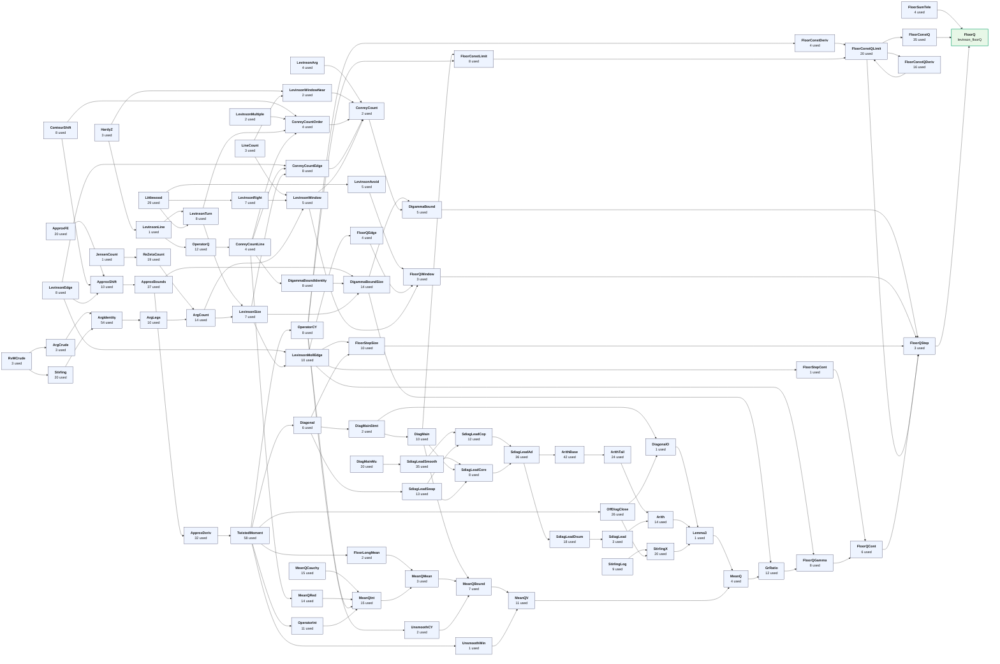

# What `FloorQ.levinson_floorQ` rests on

[`FloorQ.levinson_floorQ`](../lean_stage3/FloorQ.md#FloorQ-levinson_floorQ) in `lean_stage3/Stage3/FloorQ.lean`, line 108.

**Why.** B4 step 5, a proved floor above one third. At `Q₀`, `P₀`, `θ = 49/100`, `R = 3/2`: for every `ε > 0`, from some height on, at least `(224/625 − ε) N T` of the zeros of `ζ` with height in `(0, T]` lie on the critical line, counted with multiplicity.

**Proves**

```lean
∀ ε : ℝ, 0 < ε → ∃ T₀ : ℝ, ∀ T : ℝ, T₀ ≤ T → (224 / 625 - ε) * riemannZeta.N T ≤ (LineCount.lineCount T : ℝ)
```

Behind it: 781 theorems and 188 definitions in 82 files. Every one is listed below; Lean recorded each step.

## The files it passes through



An arrow A → B reads "B uses something proved or defined in A"; indirect arrows are left out. Green: the theorem itself. Yellow: a file in the other tree. The number is how many of that file's declarations are on the way.

## Every declaration on the way

Files in dependency order. ★ marks what the theorem's own proof uses directly.

### [`ApproxFE`](../lean_stage3/ApproxFE.md) — 20

- [`ApproxFE.uA`](../lean_stage3/ApproxFE.md#ApproxFE-uA) — *def*
- [`ApproxFE.vB`](../lean_stage3/ApproxFE.md#ApproxFE-vB) — *def*
- [`ApproxFE.XY`](../lean_stage3/ApproxFE.md#ApproxFE-XY) — *def*
- [`ApproxFE.GY`](../lean_stage3/ApproxFE.md#ApproxFE-GY) — *def*
- [`ApproxFE.gY`](../lean_stage3/ApproxFE.md#ApproxFE-gY) — *def*
- [`ApproxFE.KY`](../lean_stage3/ApproxFE.md#ApproxFE-KY) — *def*
- [`ApproxFE.VY`](../lean_stage3/ApproxFE.md#ApproxFE-VY) — *def*
- [`ApproxFE.uA_re`](../lean_stage3/ApproxFE.md#ApproxFE-uA_re) — `` (uA α t).re = 1 / 2 + α.re ``
- [`ApproxFE.vB_re`](../lean_stage3/ApproxFE.md#ApproxFE-vB_re) — `` (vB β t).re = 1 / 2 + β.re ``
- [`ApproxFE.uA_im`](../lean_stage3/ApproxFE.md#ApproxFE-uA_im) — `` (uA α t).im = α.im + t ``
- [`ApproxFE.vB_im`](../lean_stage3/ApproxFE.md#ApproxFE-vB_im) — `` (vB β t).im = β.im - t ``
- [`ApproxFE.ratio_aux`](../lean_stage3/ApproxFE.md#ApproxFE-ratio_aux) — `` P ^ a * A * (P ^ b * B) / (P ^ c * C * (P ^ d * D)) = P ^ k * (A * B) / (C * D) ``
- [`ApproxFE.XY_eq_young`](../lean_stage3/ApproxFE.md#ApproxFE-XY_eq_young) — `` XY α β t = (Real.pi : ℂ) ^ (α + β) * (Gamma ((1 / 2 - α - t * I) / 2) * Gamma ((1 / 2 - β + t * I) / 2)) / (Gamma ((1 / 2 + α + t * I) / 2) * Gamma ((1 / 2 + β … ``
- [`ApproxFE.norm_succ_cpow`](../lean_stage3/ApproxFE.md#ApproxFE-norm_succ_cpow) — `` ‖((m : ℂ) + 1) ^ z‖ = ((m : ℝ) + 1) ^ z.re ``
- [`ApproxFE.summable_succ_rpow`](../lean_stage3/ApproxFE.md#ApproxFE-summable_succ_rpow) — `` Summable fun m : ℕ => ((m : ℝ) + 1) ^ r ``
- [`ApproxFE.KY_differentiableAt`](../lean_stage3/ApproxFE.md#ApproxFE-KY_differentiableAt) — `` DifferentiableAt ℂ (KY α β t) s ``
- [`ApproxFE.gamma_mul_zeta`](../lean_stage3/ApproxFE.md#ApproxFE-gamma_mul_zeta) — `` Gammaℝ w * riemannZeta w = completedRiemannZeta w ``
- [`ApproxFE.GY_zero`](../lean_stage3/ApproxFE.md#ApproxFE-GY_zero) — `` GY α β 0 = 1 ``
- [`ApproxFE.gY_zero`](../lean_stage3/ApproxFE.md#ApproxFE-gY_zero) — `` gY α β t 0 = 1 ``
- [`ApproxFE.resY`](../lean_stage3/ApproxFE.md#ApproxFE-resY) — *def*

### [`ContourShift`](../lean_stage3/ContourShift.md) — 8

- [`ContourShift.zeta_analyticAt`](../lean_stage3/ContourShift.md#ContourShift-zeta_analyticAt) — `` AnalyticAt ℂ riemannZeta ρ ``
- [`ContourShift.borderIntegrable_sum_poles`](../lean_stage3/ContourShift.md#ContourShift-borderIntegrable_sum_poles) — `` RectangleBorderIntegrable (fun s ↦ ∑ p ∈ P, A p / (s - p)) z w ``
- [`ContourShift.rectangleIntegral_sum_poles`](../lean_stage3/ContourShift.md#ContourShift-rectangleIntegral_sum_poles) — `` RectangleIntegral' (fun s ↦ ∑ p ∈ P, A p / (s - p)) z w = ∑ p ∈ P, A p ``
- [`ContourShift.residue_rectangle_multi`](../lean_stage3/ContourShift.md#ContourShift-residue_rectangle_multi) — `` RectangleIntegral' f z w = ∑ p ∈ P, A p ``
- [`ContourShift.residue_rectangle_of_local`](../lean_stage3/ContourShift.md#ContourShift-residue_rectangle_of_local) — `` RectangleIntegral' f z w = ∑ p ∈ P, A p ``
- [`ContourShift.analyticAt_dslope`](../lean_stage3/ContourShift.md#ContourShift-analyticAt_dslope) — `` AnalyticAt ℂ (dslope f p) p ``
- [`ContourShift.div_sub_eq_dslope`](../lean_stage3/ContourShift.md#ContourShift-div_sub_eq_dslope) — `` f s / (s - p) = f p / (s - p) + dslope f p s ``
- [`ContourShift.zeta_order_ne_top`](../lean_stage3/ContourShift.md#ContourShift-zeta_order_ne_top) — `` analyticOrderAt riemannZeta ρ ≠ ⊤ ``

### [`DiagMainMu`](../lean_stage3/DiagMainMu.md) — 20

- [`DiagMain.psiMu`](../lean_stage3/DiagMainMu.md#DiagMain-psiMu) — *def*
- [`DiagMain.mMu`](../lean_stage3/DiagMainMu.md#DiagMain-mMu) — *def*
- [`DiagMain.MMu`](../lean_stage3/DiagMainMu.md#DiagMain-MMu) — *def*
- [`DiagMain.sum_range_succ_eq_Ioc`](../lean_stage3/DiagMainMu.md#DiagMain-sum_range_succ_eq_Ioc) — `` ∑ n ∈ range (t + 1), g n = ∑ n ∈ Ioc 0 t, g n ``
- [`DiagMain.MMu_bound`](../lean_stage3/DiagMainMu.md#DiagMain-MMu_bound) — `` ∃ C : ℝ, 0 ≤ C ∧ ∀ t : ℕ, |MMu t| ≤ η * t + C ``
- [`DiagMain.mMu_tendsto`](../lean_stage3/DiagMainMu.md#DiagMain-mMu_tendsto) — `` Tendsto mMu atTop (𝓝 0) ``
- [`DiagMain.sum_divisors_mu`](../lean_stage3/DiagMainMu.md#DiagMain-sum_divisors_mu) — `` ∑ d ∈ n.divisors, (μ d : ℝ) = if n = 1 then 1 else 0 ``
- [`DiagMain.mobius_harmonic`](../lean_stage3/DiagMainMu.md#DiagMain-mobius_harmonic) — `` ∑ n ∈ Ioc 0 N, (μ n : ℝ) / n * (harmonic (N / n) : ℝ) = 1 ``
- [`DiagMain.div_bounds`](../lean_stage3/DiagMainMu.md#DiagMain-div_bounds) — `` ((N / n : ℕ) : ℝ) ≤ (N : ℝ) / n ∧ (N : ℝ) / n < ((N / n : ℕ) : ℝ) + 1 ``
- [`DiagMain.harmonic_mono`](../lean_stage3/DiagMainMu.md#DiagMain-harmonic_mono) — `` Monotone (fun k : ℕ => (harmonic k : ℝ)) ``
- [`DiagMain.one_le_harmonic`](../lean_stage3/DiagMainMu.md#DiagMain-one_le_harmonic) — `` (1 : ℝ) ≤ harmonic k ``
- [`DiagMain.gamma_nonneg`](../lean_stage3/DiagMainMu.md#DiagMain-gamma_nonneg) — `` 0 ≤ Real.eulerMascheroniConstant ``
- [`DiagMain.gamma_lt_one`](../lean_stage3/DiagMainMu.md#DiagMain-gamma_lt_one) — `` Real.eulerMascheroniConstant < 1 ``
- [`DiagMain.harm_log_bound`](../lean_stage3/DiagMainMu.md#DiagMain-harm_log_bound) — `` |Real.log ((N : ℝ) / n) + Real.eulerMascheroniConstant - harmonic (N / n)| ≤ 1 / ((N / n : ℕ) : ℝ) ``
- [`DiagMain.abel_ineq`](../lean_stage3/DiagMainMu.md#DiagMain-abel_ineq) — `` |∑ n ∈ Ioc a b, c n * f n| ≤ B * f (a + 1) ``
- [`DiagMain.rhoN`](../lean_stage3/DiagMainMu.md#DiagMain-rhoN) — *def*
- [`DiagMain.head_bound`](../lean_stage3/DiagMainMu.md#DiagMain-head_bound) — `` |∑ n ∈ Ioc 0 (N / Y), (μ n : ℝ) / n * rhoN N n| ≤ 2 / Y ``
- [`DiagMain.tail_bound`](../lean_stage3/DiagMainMu.md#DiagMain-tail_bound) — `` |∑ n ∈ Ioc (N / Y) N, (μ n : ℝ) / n * rhoN N n| ≤ B * ((Y : ℝ) / N) * (Real.log Y + harmonic Y) ``
- [`DiagMain.D_small`](../lean_stage3/DiagMainMu.md#DiagMain-D_small) — `` ∃ N₀ : ℕ, ∀ N : ℕ, N₀ ≤ N → |∑ n ∈ Ioc 0 N, (μ n : ℝ) / n * rhoN N n| ≤ ε ``
- [`DiagMain.psiMu_tendsto`](../lean_stage3/DiagMainMu.md#DiagMain-psiMu_tendsto) — `` Tendsto psiMu atTop (𝓝 1) ``

### [`FloorSumTele`](../lean_stage3/FloorSumTele.md) — 4

- [`FloorSum.half_pow_succ`](../lean_stage3/FloorSumTele.md#FloorSum-half_pow_succ) — `` T / 2 / 2 ^ n = T / 2 ^ (n + 1) ``
- [`FloorSum.tele`](../lean_stage3/FloorSumTele.md#FloorSum-tele) — `` ∀ n : ℕ, ∀ T : ℝ, T₁ ≤ T / 2 ^ n → c * (g T - g (T / 2 ^ (n + 1))) - 2 * e * T * Real.log T ≤ f T - f (T / 2 ^ (n + 1)) ``
- [`FloorSum.exists_halving`](../lean_stage3/FloorSumTele.md#FloorSum-exists_halving) — `` ∃ n : ℕ, T₁ ≤ T / 2 ^ n ∧ T / 2 ^ (n + 1) < T₁ ``
- ★ [`FloorSum.tele_floor`](../lean_stage3/FloorSumTele.md#FloorSum-tele_floor) — `` ∀ T : ℝ, T₁ ≤ T → c * (g T - g T₁) - 2 * e * T * Real.log T ≤ f T ``

### [`HardyZ`](../lean_stage3/HardyZ.md) — 3

- [`HardyZ.completedRiemannZeta_conj_of_re_pos`](../lean_stage3/HardyZ.md#HardyZ-completedRiemannZeta_conj_of_re_pos) — `` completedRiemannZeta (conj s) = conj (completedRiemannZeta s) ``
- [`HardyZ.re_line`](../lean_stage3/HardyZ.md#HardyZ-re_line) — `` ((1 / 2 : ℂ) + t * I).re = 1 / 2 ``
- [`HardyZ.xi_line_real`](../lean_stage3/HardyZ.md#HardyZ-xi_line_real) — `` (completedRiemannZeta (1/2 + t * Complex.I)).im = 0 ``

### [`JensenCount`](../lean_stage3/JensenCount.md) — 1

- [`Stage3.zeta_disk_upper`](../lean_stage3/JensenCount.md#Stage3-zeta_disk_upper) — `` ‖ζ w‖ ≤ 28 * T ``

### [`LevinsonArg`](../lean_stage3/LevinsonArg.md) — 4

- [`LevinsonArg.exists_log_lift`](../lean_stage3/LevinsonArg.md#LevinsonArg-exists_log_lift) — `` ∃ L : ℝ → ℂ, ContinuousOn L (Set.Icc a b) ∧ ∀ t ∈ Set.Icc a b, Complex.exp (L t) = F t ``
- [`LevinsonArg.exists_arg_lift`](../lean_stage3/LevinsonArg.md#LevinsonArg-exists_arg_lift) — `` ∃ φ : ℝ → ℝ, ContinuousOn φ (Set.Icc a b) ∧ ∀ t ∈ Set.Icc a b, F t = ‖F t‖ * Complex.exp (φ t * Complex.I) ``
- [`LevinsonArg.crossings_of_le`](../lean_stage3/LevinsonArg.md#LevinsonArg-crossings_of_le) — `` ∃ t : Fin k → ℝ, StrictMono t ∧ (∀ i, t i ∈ Set.Icc a b) ∧ ∀ i, Real.cos (φ (t i)) = 0 ``
- [`LevinsonArg.crossings_of_arg`](../lean_stage3/LevinsonArg.md#LevinsonArg-crossings_of_arg) — `` ∃ t : Fin k → ℝ, StrictMono t ∧ (∀ i, t i ∈ Set.Icc a b) ∧ ∀ i, Real.cos (φ (t i)) = 0 ``

### [`LevinsonEdge`](../lean_stage3/LevinsonEdge.md) — 8

- [`LevinsonEdge.zeta_norm_le`](../lean_stage3/LevinsonEdge.md#LevinsonEdge-zeta_norm_le) — `` ‖riemannZeta u‖ ≤ 2 + 4 * ‖u‖ ``
- [`LevinsonEdge.symm`](../lean_stage3/LevinsonEdge.md#LevinsonEdge-symm) — *def*
- [`LevinsonEdge.model`](../lean_stage3/LevinsonEdge.md#LevinsonEdge-model) — *def*
- [`LevinsonEdge.symm_real`](../lean_stage3/LevinsonEdge.md#LevinsonEdge-symm_real) — `` symm g (x : ℂ) = ((g x).re : ℂ) ``
- [`LevinsonEdge.symm_zero`](../lean_stage3/LevinsonEdge.md#LevinsonEdge-symm_zero) — `` symm g 0 = ((g 0).re : ℂ) ``
- [`LevinsonEdge.symm_differentiableOn`](../lean_stage3/LevinsonEdge.md#LevinsonEdge-symm_differentiableOn) — `` DifferentiableOn ℂ (symm g) (Metric.ball (0 : ℂ) ρ) ``
- [`LevinsonEdge.norm_symm_le`](../lean_stage3/LevinsonEdge.md#LevinsonEdge-norm_symm_le) — `` ‖symm g z‖ ≤ M ``
- [`LevinsonEdge.real_zero_count`](../lean_stage3/LevinsonEdge.md#LevinsonEdge-real_zero_count) — `` ∃ Z : Finset ℝ, (∀ x : ℝ, |x| ≤ 5 / 6 → (g x).re = 0 → x ∈ Z) ∧ (Z.card : ℝ) ≤ 21 * Real.log (M / m) ``

### [`ApproxShift`](../lean_stage3/ApproxShift.md) — 10

- [`ApproxShift.zeta_norm_le_abs`](../lean_stage3/ApproxShift.md#ApproxShift-zeta_norm_le_abs) — `` ‖riemannZeta w‖ ≤ 2 + 4 * ‖w‖ ``
- [`ApproxShift.gammaR_bound`](../lean_stage3/ApproxShift.md#ApproxShift-gammaR_bound) — `` ∃ M : ℝ, 0 ≤ M ∧ ∀ w : ℂ, 1 / 2 ≤ w.re → w.re ≤ R → ‖Gammaℝ w‖ ≤ M ``
- [`ApproxShift.Lambda_bound`](../lean_stage3/ApproxShift.md#ApproxShift-Lambda_bound) — `` ∃ M : ℝ, 0 ≤ M ∧ ∀ w : ℂ, |w.re| ≤ R → 1 ≤ |w.im| → ‖completedRiemannZeta w‖ ≤ M * (6 + 4 * ‖w‖) ``
- [`ApproxShift.GY_norm_le`](../lean_stage3/ApproxShift.md#ApproxShift-GY_norm_le) — `` ‖GY α β s‖ ≤ Real.exp (c ^ 2 - s.im ^ 2) * ((‖α + β‖ ^ 2 + 4 * c ^ 2 + 4) / ‖α + β‖ ^ 2 * (1 + s.im ^ 2)) ``
- [`ApproxShift.gauss_atTop`](../lean_stage3/ApproxShift.md#ApproxShift-gauss_atTop) — `` Tendsto (fun y : ℝ => Real.exp (-(1 / 2) * y ^ 2)) atTop (𝓝 0) ``
- [`ApproxShift.gauss_atBot`](../lean_stage3/ApproxShift.md#ApproxShift-gauss_atBot) — `` Tendsto (fun y : ℝ => Real.exp (-(1 / 2) * y ^ 2)) atBot (𝓝 0) ``
- [`ApproxShift.GY_analyticAt`](../lean_stage3/ApproxShift.md#ApproxShift-GY_analyticAt) — `` AnalyticAt ℂ (GY α β) p ``
- [`ApproxShift.local_simple`](../lean_stage3/ApproxShift.md#ApproxShift-local_simple) — `` ∃ h : ℂ → ℂ, AnalyticAt ℂ h p ∧ ∀ᶠ s in 𝓝[≠] p, f s = h s + A / (s - p) ``
- [`ApproxShift.rect_mem_nhds`](../lean_stage3/ApproxShift.md#ApproxShift-rect_mem_nhds) — `` Rectangle (↑(-c) - I * ↑T) (↑c + I * ↑T) ∈ 𝓝 p ``
- [`ApproxShift.rect_tendsto`](../lean_stage3/ApproxShift.md#ApproxShift-rect_tendsto) — `` Tendsto (fun T : ℝ => RectangleIntegral f (↑(-c) - I * T) (↑c + I * T)) atTop (𝓝 (VerticalIntegral f c - VerticalIntegral f (-c))) ``

### [`ApproxBounds`](../lean_stage3/ApproxBounds.md) — 37

- [`ApproxBounds.lY`](../lean_stage3/ApproxBounds.md#ApproxBounds-lY) — *def*
- [`ApproxBounds.lY_nonneg`](../lean_stage3/ApproxBounds.md#ApproxBounds-lY_nonneg) — `` 0 ≤ lY Y ``
- [`ApproxBounds.lY_neg`](../lean_stage3/ApproxBounds.md#ApproxBounds-lY_neg) — `` lY (-Y) = lY Y ``
- [`ApproxBounds.gModel`](../lean_stage3/ApproxBounds.md#ApproxBounds-gModel) — *def*
- [`ApproxBounds.gErr`](../lean_stage3/ApproxBounds.md#ApproxBounds-gErr) — *def*
- [`ApproxBounds.gRModel`](../lean_stage3/ApproxBounds.md#ApproxBounds-gRModel) — *def*
- [`ApproxBounds.gErr_nonneg`](../lean_stage3/ApproxBounds.md#ApproxBounds-gErr_nonneg) — `` 0 ≤ gErr r ``
- [`ApproxBounds.const_bound`](../lean_stage3/ApproxBounds.md#ApproxBounds-const_bound) — `` ∃ K : ℝ, 0 ≤ K ∧ ∀ r : ℝ, lo ≤ r → r ≤ hi → |Real.log (Real.Gamma r)| ≤ K ∧ gErr r ≤ K ``
- [`ApproxBounds.lY_near`](../lean_stage3/ApproxBounds.md#ApproxBounds-lY_near) — `` |lY Y - Real.log (t / 2)| ≤ 3 ``
- [`ApproxBounds.log_div_two_pi`](../lean_stage3/ApproxBounds.md#ApproxBounds-log_div_two_pi) — `` Real.log (t / (2 * Real.pi)) = Real.log (t / 2) - Real.log Real.pi ``
- [`ApproxBounds.lY_lip`](../lean_stage3/ApproxBounds.md#ApproxBounds-lY_lip) — `` |lY (Y + h) - lY Y| ≤ |h| ``
- [`ApproxBounds.gR_shift`](../lean_stage3/ApproxBounds.md#ApproxBounds-gR_shift) — `` Real.log ‖Gammaℝ (w + (σ + y * I))‖ - Real.log ‖Gammaℝ w‖ ≤ σ / 2 * (Real.log (t / 2) - Real.log Real.pi) + 2 * K + 2 * K' + 3 * |σ| / 2 + (Real.pi / 4 + |σ| / … ``
- [`ApproxBounds.gY_bound`](../lean_stage3/ApproxBounds.md#ApproxBounds-gY_bound) — `` ∃ C : ℝ, 0 ≤ C ∧ ∀ α β : ℂ, ‖α‖ ≤ 1 / 10 → ‖β‖ ≤ 1 / 10 → ∀ t : ℝ, 1 ≤ t → ∀ σ y : ℝ, σ₀ ≤ σ → σ ≤ σ₁ → ‖gY α β t (σ + y * I)‖ ≤ C * (t / (2 * Real.pi)) ^ σ * R… ``
- [`ApproxBounds.gauss_absorb`](../lean_stage3/ApproxBounds.md#ApproxBounds-gauss_absorb) — `` Real.exp (-y ^ 2) * (1 + y ^ 2) * Real.exp (B * |y|) ≤ 4 * Real.exp (B ^ 2) * Real.exp (-(1 / 2) * y ^ 2) ``
- [`ApproxBounds.Q_le`](../lean_stage3/ApproxBounds.md#ApproxBounds-Q_le) — `` (n ^ 2 + A) / n ^ 2 ≤ (A + 1) * (1 + 1 / n ^ 2) ``
- [`ApproxBounds.integrand_bound`](../lean_stage3/ApproxBounds.md#ApproxBounds-integrand_bound) — `` ∃ C : ℝ, 0 ≤ C ∧ ∀ α β : ℂ, ‖α‖ ≤ 1 / 10 → ‖β‖ ≤ 1 / 10 → ∀ t : ℝ, 1 ≤ t → ∀ x : ℝ, 0 < x → ∀ σ y : ℝ, σ₀ ≤ σ → σ ≤ σ₁ → δ ≤ ‖(σ : ℂ) + y * I‖ → ‖KY α β t (σ + … ``
- [`ApproxBounds.norm_VY_le`](../lean_stage3/ApproxBounds.md#ApproxBounds-norm_VY_le) — `` ‖VY α β σ x t‖ ≤ 1 / (2 * Real.pi) * ∫ y : ℝ, ‖KY α β t (σ + y * I) * (x : ℂ) ^ (-((σ : ℂ) + y * I))‖ ``
- [`ApproxBounds.VY_line_bound`](../lean_stage3/ApproxBounds.md#ApproxBounds-VY_line_bound) — `` ∃ C : ℝ, 0 ≤ C ∧ ∀ α β : ℂ, ‖α‖ ≤ 1 / 10 → ‖β‖ ≤ 1 / 10 → ∀ t : ℝ, 1 ≤ t → ∀ x : ℝ, 0 < x → ‖VY α β σ x t‖ ≤ C * (1 + 1 / ‖α + β‖ ^ 2) * ((t / (2 * Real.pi)) ^ … ``
- [`ApproxBounds.integrand_differentiableAt`](../lean_stage3/ApproxBounds.md#ApproxBounds-integrand_differentiableAt) — `` DifferentiableAt ℂ (fun s => KY α β t s * (x : ℂ) ^ (-s)) s ``
- [`ApproxBounds.rpow_le_ends`](../lean_stage3/ApproxBounds.md#ApproxBounds-rpow_le_ends) — `` b ^ σ ≤ b ^ σ₀ + b ^ σ₁ ``
- [`ApproxBounds.rect_tendsto_ab`](../lean_stage3/ApproxBounds.md#ApproxBounds-rect_tendsto_ab) — `` Tendsto (fun T : ℝ => RectangleIntegral f (↑a - I * T) (↑b + I * T)) atTop (𝓝 (VerticalIntegral f b - VerticalIntegral f a)) ``
- [`ApproxBounds.VY_line_eq`](../lean_stage3/ApproxBounds.md#ApproxBounds-VY_line_eq) — `` VY α β c x t = VY α β c' x t ``
- [`ApproxBounds.VY_decay`](../lean_stage3/ApproxBounds.md#ApproxBounds-VY_decay) — `` ∃ C : ℝ, 0 ≤ C ∧ ∀ α β : ℂ, ‖α‖ ≤ 1 / 10 → ‖β‖ ≤ 1 / 10 → ∀ t : ℝ, 1 ≤ t → ∀ x : ℝ, 0 < x → ∀ c : ℝ, 0 < c → ‖VY α β c x t‖ ≤ C * (1 + 1 / ‖α + β‖ ^ 2) * (t / x… ``
- [`ApproxBounds.integrand_differentiableAt'`](../lean_stage3/ApproxBounds.md#ApproxBounds-integrand_differentiableAt-) — `` DifferentiableAt ℂ (fun s => KY α β t s * (x : ℂ) ^ (-s)) s ``
- [`ApproxBounds.VY_residue`](../lean_stage3/ApproxBounds.md#ApproxBounds-VY_residue) — `` VY α β (1 / 4) x t - VY α β (-(1 / 4)) x t = 1 ``
- [`ApproxBounds.rpow_quarter_le`](../lean_stage3/ApproxBounds.md#ApproxBounds-rpow_quarter_le) — `` b ^ (1 / 4 : ℝ) ≤ 1 + b ``
- [`ApproxBounds.VY_decay_young`](../lean_stage3/ApproxBounds.md#ApproxBounds-VY_decay_young) — `` ∃ C : ℝ, 0 ≤ C ∧ ∀ α β : ℂ, ‖α‖ ≤ 1 / 10 → ‖β‖ ≤ 1 / 10 → α + β ≠ 0 → ∀ t : ℝ, 1 ≤ t → ∀ x : ℝ, 0 < x → ∀ c : ℝ, 0 < c → ‖VY α β c x t‖ ≤ C * (1 + 1 / ‖α + β‖ ^… ``
- [`ApproxBounds.lY_le_abs`](../lean_stage3/ApproxBounds.md#ApproxBounds-lY_le_abs) — `` lY Y ≤ |Y| ``
- [`ApproxBounds.gR_lower`](../lean_stage3/ApproxBounds.md#ApproxBounds-gR_lower) — `` -(2 * K + |Real.log (Real.Gamma (1 / 2))|) - (Real.pi / 2 + 1) * |Y₀| ≤ Real.log ‖Gammaℝ w‖ ``
- [`ApproxBounds.resY_term`](../lean_stage3/ApproxBounds.md#ApproxBounds-resY_term) — `` ‖GY α β s / d * completedRiemannZeta w‖ ≤ Real.exp (1 - (t - 1 / 10) ^ 2) * (9 * (1 + 1 / ‖α + β‖ ^ 2) * (1 + (t + 1 / 10) ^ 2)) * (5 / 2) * (M * (14 + 8 * t)) ``
- [`ApproxBounds.poly_exp_bound`](../lean_stage3/ApproxBounds.md#ApproxBounds-poly_exp_bound) — `` Real.exp (1 - (t - 1 / 10) ^ 2) * (1 + (t + 1 / 10) ^ 2) * (14 + 8 * t) * Real.exp ((Real.pi / 2 + 1) * (t + 1 / 10)) ≤ 14 * Real.exp ((Real.pi / 2 + 5) ^ 2 / 2… ``
- [`ApproxBounds.resY_T1`](../lean_stage3/ApproxBounds.md#ApproxBounds-resY_T1) — `` ‖GY α β (1 - uA α t) / (1 - uA α t) * completedRiemannZeta (vB β t + 1 - uA α t)‖ ≤ Real.exp (1 - (t - 1 / 10) ^ 2) * (9 * (1 + 1 / ‖α + β‖ ^ 2) * (1 + (t + 1 /… ``
- [`ApproxBounds.resY_T2`](../lean_stage3/ApproxBounds.md#ApproxBounds-resY_T2) — `` ‖GY α β (-uA α t) / uA α t * completedRiemannZeta (vB β t - uA α t)‖ ≤ Real.exp (1 - (t - 1 / 10) ^ 2) * (9 * (1 + 1 / ‖α + β‖ ^ 2) * (1 + (t + 1 / 10) ^ 2)) * … ``
- [`ApproxBounds.resY_T3`](../lean_stage3/ApproxBounds.md#ApproxBounds-resY_T3) — `` ‖GY α β (1 - vB β t) / (1 - vB β t) * completedRiemannZeta (uA α t + 1 - vB β t)‖ ≤ Real.exp (1 - (t - 1 / 10) ^ 2) * (9 * (1 + 1 / ‖α + β‖ ^ 2) * (1 + (t + 1 /… ``
- [`ApproxBounds.resY_T4`](../lean_stage3/ApproxBounds.md#ApproxBounds-resY_T4) — `` ‖GY α β (-vB β t) / vB β t * completedRiemannZeta (uA α t - vB β t)‖ ≤ Real.exp (1 - (t - 1 / 10) ^ 2) * (9 * (1 + 1 / ‖α + β‖ ^ 2) * (1 + (t + 1 / 10) ^ 2)) * … ``
- [`ApproxBounds.resY_den`](../lean_stage3/ApproxBounds.md#ApproxBounds-resY_den) — `` Real.exp (-(2 * (2 * K + |Real.log (Real.Gamma (1 / 2))|)) - (Real.pi / 2 + 1) * (t + 1 / 10)) ≤ ‖Gammaℝ (uA α t) * Gammaℝ (vB β t)‖ ``
- [`ApproxBounds.resY_small`](../lean_stage3/ApproxBounds.md#ApproxBounds-resY_small) — `` ∃ C : ℝ, 0 ≤ C ∧ ∀ α β : ℂ, ‖α‖ ≤ 1 / 10 → ‖β‖ ≤ 1 / 10 → ∀ t : ℝ, 1 ≤ t → ‖resY α β t‖ ≤ C * (1 + 1 / ‖α + β‖ ^ 2) * Real.exp (-(t ^ 2 / 2)) ``

### [`ApproxDeriv`](../lean_stage3/ApproxDeriv.md) — 32

- [`ApproxDeriv.psiR`](../lean_stage3/ApproxDeriv.md#ApproxDeriv-psiR) — *def*
- [`ApproxDeriv.ne_neg_nat_of_re_pos`](../lean_stage3/ApproxDeriv.md#ApproxDeriv-ne_neg_nat_of_re_pos) — `` z ≠ -(m : ℂ) ``
- [`ApproxDeriv.hasDerivAt_line`](../lean_stage3/ApproxDeriv.md#ApproxDeriv-hasDerivAt_line) — `` HasDerivAt (fun t : ℝ => w₀ + (t : ℂ) * e) e t ``
- [`ApproxDeriv.dY`](../lean_stage3/ApproxDeriv.md#ApproxDeriv-dY) — *def*
- [`ApproxDeriv.re_conds`](../lean_stage3/ApproxDeriv.md#ApproxDeriv-re_conds) — `` 1 / 20 ≤ (uA α t / 2).re ∧ 1 / 20 ≤ (uA α t / 2 + s / 2).re ∧ 1 / 20 ≤ (vB β t / 2).re ∧ 1 / 20 ≤ (vB β t / 2 + s / 2).re ``
- [`ApproxDeriv.gY_hasDerivAt`](../lean_stage3/ApproxDeriv.md#ApproxDeriv-gY_hasDerivAt) — `` HasDerivAt (fun t => gY α β t s) (gY α β t s * dY α β t s) t ``
- [`ApproxDeriv.tau`](../lean_stage3/ApproxDeriv.md#ApproxDeriv-tau) — *def*
- [`ApproxDeriv.tau'`](../lean_stage3/ApproxDeriv.md#ApproxDeriv-tau-) — *def*
- [`ApproxDeriv.hasSum_tau`](../lean_stage3/ApproxDeriv.md#ApproxDeriv-hasSum_tau) — `` HasSum (tau h w) (digamma (w + h) - digamma w) ``
- [`ApproxDeriv.norm_nat_add_ge`](../lean_stage3/ApproxDeriv.md#ApproxDeriv-norm_nat_add_ge) — `` ((n : ℝ) + a + Y) / 2 ≤ ‖(n : ℂ) + z‖ ``
- [`ApproxDeriv.norm_tau_le`](../lean_stage3/ApproxDeriv.md#ApproxDeriv-norm_tau_le) — `` ‖tau h w n‖ ≤ 4 * ‖h‖ * (1 / ((n : ℝ) + (a + Y)) ^ 2) ``
- [`ApproxDeriv.tel`](../lean_stage3/ApproxDeriv.md#ApproxDeriv-tel) — *def*
- [`ApproxDeriv.hasSum_tel`](../lean_stage3/ApproxDeriv.md#ApproxDeriv-hasSum_tel) — `` HasSum (tel b) (1 / b) ``
- [`ApproxDeriv.sq_le_tel`](../lean_stage3/ApproxDeriv.md#ApproxDeriv-sq_le_tel) — `` 1 / ((n : ℝ) + b) ^ 2 ≤ (1 + 1 / b) * tel b n ``
- [`ApproxDeriv.dY_hasSum`](../lean_stage3/ApproxDeriv.md#ApproxDeriv-dY_hasSum) — `` HasSum (fun n => I / 2 * (tau (s / 2) (uA α t / 2) n - tau (s / 2) (vB β t / 2) n)) (dY α β t s) ``
- [`ApproxDeriv.norm_I_half`](../lean_stage3/ApproxDeriv.md#ApproxDeriv-norm_I_half) — `` ‖I / 2‖ = 1 / 2 ``
- [`ApproxDeriv.norm_dterm_le`](../lean_stage3/ApproxDeriv.md#ApproxDeriv-norm_dterm_le) — `` ‖I / 2 * (tau (s / 2) (uA α t / 2) n - tau (s / 2) (vB β t / 2) n)‖ ≤ 4 * ‖s / 2‖ * (1 + 1 / (1 / 20 + Y)) * tel (1 / 20 + Y) n ``
- [`ApproxDeriv.norm_dY_le`](../lean_stage3/ApproxDeriv.md#ApproxDeriv-norm_dY_le) — `` ‖dY α β t s‖ ≤ 4 * ‖s / 2‖ * (1 + 1 / (1 / 20 + Y)) * (1 / (1 / 20 + Y)) ``
- [`ApproxDeriv.d2Y`](../lean_stage3/ApproxDeriv.md#ApproxDeriv-d2Y) — *def*
- [`ApproxDeriv.poly_gauss`](../lean_stage3/ApproxDeriv.md#ApproxDeriv-poly_gauss) — `` (1 + |y|) ^ k * Real.exp (-(1 / 2) * y ^ 2) ≤ (k.factorial : ℝ) * Real.exp 2 * Real.exp (-(1 / 4) * y ^ 2) ``
- [`ApproxDeriv.gauss_loc`](../lean_stage3/ApproxDeriv.md#ApproxDeriv-gauss_loc) — `` Real.exp (-y ^ 2) * (1 + y ^ 2) * (1 + |y|) ^ k ≤ ((k + 2).factorial : ℝ) * Real.exp 2 * Real.exp (-(1 / 4) * y ^ 2) ``
- [`ApproxDeriv.norm_half_le`](../lean_stage3/ApproxDeriv.md#ApproxDeriv-norm_half_le) — `` ‖((σ : ℂ) + y * I) / 2‖ ≤ (1 + |σ|) * (1 + |y|) ``
- [`ApproxDeriv.dY_crude`](../lean_stage3/ApproxDeriv.md#ApproxDeriv-dY_crude) — `` ‖dY α β t (σ + y * I)‖ ≤ 1680 * (1 + |σ|) * (1 + |y|) ``
- [`ApproxDeriv.KY_local`](../lean_stage3/ApproxDeriv.md#ApproxDeriv-KY_local) — `` ∃ C : ℝ, 0 ≤ C ∧ ∀ t ∈ Metric.closedBall t₀ 1, ∀ y : ℝ, ‖KY α β t (σ + y * I)‖ ≤ C * (Real.exp (-y ^ 2) * (1 + y ^ 2)) ``
- [`ApproxDeriv.cont_F`](../lean_stage3/ApproxDeriv.md#ApproxDeriv-cont_F) — `` Continuous fun y : ℝ => KY α β t (σ + y * I) * (x : ℂ) ^ (-((σ : ℂ) + y * I)) ``
- [`ApproxDeriv.re_half_pos`](../lean_stage3/ApproxDeriv.md#ApproxDeriv-re_half_pos) — `` 0 < ((uA α t + ((σ : ℂ) + y * I)) / 2).re ∧ 0 < ((vB β t + ((σ : ℂ) + y * I)) / 2).re ``
- [`ApproxDeriv.cont_dY`](../lean_stage3/ApproxDeriv.md#ApproxDeriv-cont_dY) — `` Continuous fun y : ℝ => dY α β t (σ + y * I) ``
- [`ApproxDeriv.VY1`](../lean_stage3/ApproxDeriv.md#ApproxDeriv-VY1) — *def*
- [`ApproxDeriv.VY2`](../lean_stage3/ApproxDeriv.md#ApproxDeriv-VY2) — *def*
- [`ApproxDeriv.norm_F_local`](../lean_stage3/ApproxDeriv.md#ApproxDeriv-norm_F_local) — `` ‖KY α β t (σ + y * I) * (x : ℂ) ^ (-((σ : ℂ) + y * I))‖ ≤ C * x ^ (-σ) * (Real.exp (-y ^ 2) * (1 + y ^ 2)) ``
- [`ApproxDeriv.F_hasDerivAt`](../lean_stage3/ApproxDeriv.md#ApproxDeriv-F_hasDerivAt) — `` HasDerivAt (fun t => KY α β t s * (x : ℂ) ^ (-s)) (KY α β t s * (x : ℂ) ^ (-s) * dY α β t s) t ``
- [`ApproxDeriv.VY_hasDerivAt`](../lean_stage3/ApproxDeriv.md#ApproxDeriv-VY_hasDerivAt) — `` HasDerivAt (fun t => VY α β σ x t) (VY1 α β σ x t₀) t₀ ``

### [`LevinsonLine`](../lean_stage3/LevinsonLine.md) — 1

- [`LevinsonLine.line_facts`](../lean_stage3/LevinsonLine.md#LevinsonLine-line_facts) — `` ((1/2 : ℂ) + t * I) ≠ 0 ∧ ((1/2 : ℂ) + t * I) ≠ 1 ∧ 0 < ((1/2 : ℂ) + t * I).re ``

### [`LevinsonMultiple`](../lean_stage3/LevinsonMultiple.md) — 2

- [`LevinsonMultiple.polyP`](../lean_stage3/LevinsonMultiple.md#LevinsonMultiple-polyP) — *def*
- [`LevinsonMultiple.polyP_line`](../lean_stage3/LevinsonMultiple.md#LevinsonMultiple-polyP_line) — `` polyP D n (1/2 + t * I) = I ^ (∑ ρ ∈ D, n ρ) * ((∏ ρ ∈ D, (t - ρ.im) ^ n ρ : ℝ) : ℂ) ``

### [`LineCount`](../lean_stage3/LineCount.md) — 3

- [`LineCount.zerosUpTo`](../lean_stage3/LineCount.md#LineCount-zerosUpTo) — *def*
- ★ [`LineCount.lineCount`](../lean_stage3/LineCount.md#LineCount-lineCount) — *def*
- [`LineCount.mem_zerosUpTo`](../lean_stage3/LineCount.md#LineCount-mem_zerosUpTo) — `` ρ ∈ zerosUpTo T ↔ 0 < (ρ : ℂ).im ∧ (ρ : ℂ).im ≤ T ``

### [`LevinsonWindowNear`](../lean_stage3/LevinsonWindowNear.md) — 2

- [`LevinsonWindowNear.sum_order_le_lineCount_sub`](../lean_stage3/LevinsonWindowNear.md#LevinsonWindowNear-sum_order_le_lineCount_sub) — `` ∑ γ ∈ E, riemannZeta.order (1/2 + γ * I) ≤ lineCount b - lineCount a ``
- ★ [`LevinsonWindowNear.lineCount_nonneg`](../lean_stage3/LevinsonWindowNear.md#LevinsonWindowNear-lineCount_nonneg) — `` 0 ≤ lineCount T ``

### [`Littlewood`](../lean_stage3/Littlewood.md) — 29

- [`Littlewood.corner_mem`](../lean_stage3/Littlewood.md#Littlewood-corner_mem) — `` z ∈ Rectangle z w ``
- [`Littlewood.corner_mem_border`](../lean_stage3/Littlewood.md#Littlewood-corner_mem_border) — `` z ∈ RectangleBorder z w ``
- [`Littlewood.order_ne_top`](../lean_stage3/Littlewood.md#Littlewood-order_ne_top) — `` ∀ p ∈ Rectangle z w, meromorphicOrderAt f p ≠ ⊤ ``
- [`Littlewood.mem_support_divisor`](../lean_stage3/Littlewood.md#Littlewood-mem_support_divisor) — `` p ∈ (MeromorphicOn.divisor f U).support ↔ p ∈ U ∧ f p = 0 ``
- [`Littlewood.divisor_eq`](../lean_stage3/Littlewood.md#Littlewood-divisor_eq) — `` MeromorphicOn.divisor f U p = MeromorphicOn.divisor f (Rectangle z w) p ``
- [`Littlewood.support_interior`](../lean_stage3/Littlewood.md#Littlewood-support_interior) — `` z.re < p.re ∧ p.re < w.re ∧ z.im < p.im ∧ p.im < w.im ``
- [`Littlewood.countRight`](../lean_stage3/Littlewood.md#Littlewood-countRight) — *def*
- [`Littlewood.rectIntegral_eq_count`](../lean_stage3/Littlewood.md#Littlewood-rectIntegral_eq_count) — `` RectangleIntegral (logDeriv f) (↑σ + ↑z.im * I) w = 2 * Real.pi * I * (countRight f z w σ : ℂ) ``
- [`Littlewood.two_pi_count_eq`](../lean_stage3/Littlewood.md#Littlewood-two_pi_count_eq) — `` 2 * Real.pi * countRight f z w σ = (∫ x in σ..w.re, logDeriv f (↑x + ↑z.im * I)).im - (∫ x in σ..w.re, logDeriv f (↑x + ↑w.im * I)).im + (∫ t in z.im..w.im, log… ``
- [`Littlewood.ite_eq_indicator`](../lean_stage3/Littlewood.md#Littlewood-ite_eq_indicator) — `` (fun σ : ℝ => if σ < β then m else 0) = (Iio β).indicator (fun _ => m) ``
- [`Littlewood.intervalIntegrable_ite`](../lean_stage3/Littlewood.md#Littlewood-intervalIntegrable_ite) — `` IntervalIntegrable (fun σ : ℝ => if σ < β then m else 0) volume u v ``
- [`Littlewood.integral_ite_lt`](../lean_stage3/Littlewood.md#Littlewood-integral_ite_lt) — `` ∫ σ in u..v, (if σ < β then m else 0) = m * (β - u) ``
- [`Littlewood.integral_countRight`](../lean_stage3/Littlewood.md#Littlewood-integral_countRight) — `` ∫ σ in z.re..w.re, countRight f z w σ = ∑ p ∈ (divisor_support_rectangle_finite f z w).toFinset, ((MeromorphicOn.divisor f (Rectangle z w) p : ℤ) : ℝ) * (p.re -… ``
- [`Littlewood.locallyIntegrable_inv_norm_sub`](../lean_stage3/Littlewood.md#Littlewood-locallyIntegrable_inv_norm_sub) — `` LocallyIntegrable (fun s : ℂ => ‖s - x‖⁻¹) volume ``
- [`Littlewood.integrableAtFilter_logDeriv`](../lean_stage3/Littlewood.md#Littlewood-integrableAtFilter_logDeriv) — `` IntegrableAtFilter (logDeriv f) (𝓝[K] p) volume ``
- [`Littlewood.integrableOn_logDeriv`](../lean_stage3/Littlewood.md#Littlewood-integrableOn_logDeriv) — `` IntegrableOn (logDeriv f) (Rectangle z w) volume ``
- [`Littlewood.integrableOn_logDeriv_prod`](../lean_stage3/Littlewood.md#Littlewood-integrableOn_logDeriv_prod) — `` IntegrableOn (fun q : ℝ × ℝ => logDeriv f (↑q.1 + ↑q.2 * I)) ([[z.re, w.re]] ×ˢ [[z.im, w.im]]) volume ``
- [`Littlewood.hasDerivAt_log_norm`](../lean_stage3/Littlewood.md#Littlewood-hasDerivAt_log_norm) — `` HasDerivAt (fun y => Real.log ‖g y‖) (g' / g x).re x ``
- [`Littlewood.continuousAt_logDeriv`](../lean_stage3/Littlewood.md#Littlewood-continuousAt_logDeriv) — `` ContinuousAt (logDeriv f) s ``
- [`Littlewood.continuousOn_logDeriv_comp`](../lean_stage3/Littlewood.md#Littlewood-continuousOn_logDeriv_comp) — `` ContinuousOn (fun x => logDeriv f (γ x)) S ``
- [`Littlewood.continuousOn_log_norm_comp`](../lean_stage3/Littlewood.md#Littlewood-continuousOn_log_norm_comp) — `` ContinuousOn (fun x => Real.log ‖f (γ x)‖) S ``
- [`Littlewood.horiz_mem`](../lean_stage3/Littlewood.md#Littlewood-horiz_mem) — `` (↑x + ↑t * I : ℂ) ∈ Rectangle z w ``
- [`Littlewood.integral_re_logDeriv_horizontal`](../lean_stage3/Littlewood.md#Littlewood-integral_re_logDeriv_horizontal) — `` ∫ x in z.re..w.re, (logDeriv f (↑x + ↑t * I)).re = Real.log ‖f (↑w.re + ↑t * I)‖ - Real.log ‖f (↑z.re + ↑t * I)‖ ``
- [`Littlewood.bottom_mem_border`](../lean_stage3/Littlewood.md#Littlewood-bottom_mem_border) — `` (↑x + ↑z.im * I : ℂ) ∈ RectangleBorder z w ``
- [`Littlewood.top_mem_border`](../lean_stage3/Littlewood.md#Littlewood-top_mem_border) — `` (↑x + ↑w.im * I : ℂ) ∈ RectangleBorder z w ``
- [`Littlewood.left_mem_border`](../lean_stage3/Littlewood.md#Littlewood-left_mem_border) — `` (↑z.re + ↑t * I : ℂ) ∈ RectangleBorder z w ``
- [`Littlewood.right_mem_border`](../lean_stage3/Littlewood.md#Littlewood-right_mem_border) — `` (↑w.re + ↑t * I : ℂ) ∈ RectangleBorder z w ``
- [`Littlewood.edgeH`](../lean_stage3/Littlewood.md#Littlewood-edgeH) — *def*
- [`Littlewood.littlewood_rect`](../lean_stage3/Littlewood.md#Littlewood-littlewood_rect) — `` 2 * Real.pi * ∑ ρ ∈ (divisor_support_rectangle_finite f z w).toFinset, ((MeromorphicOn.divisor f (Rectangle z w) ρ : ℤ) : ℝ) * (ρ.re - z.re) = (∫ t in z.im..w.i… ``

### [`LevinsonAvoid`](../lean_stage3/LevinsonAvoid.md) — 5

- [`LevinsonAvoid.mem_rect_of`](../lean_stage3/LevinsonAvoid.md#LevinsonAvoid-mem_rect_of) — `` ((x : ℂ) + y * I) ∈ Rectangle z w ``
- [`LevinsonAvoid.order_ne_top_of_ne`](../lean_stage3/LevinsonAvoid.md#LevinsonAvoid-order_ne_top_of_ne) — `` ∀ q ∈ Rectangle z w, meromorphicOrderAt f q ≠ ⊤ ``
- [`LevinsonAvoid.zeros_finite`](../lean_stage3/LevinsonAvoid.md#LevinsonAvoid-zeros_finite) — `` {q | q ∈ Rectangle z w ∧ f q = 0}.Finite ``
- [`LevinsonAvoid.exists_good_height`](../lean_stage3/LevinsonAvoid.md#LevinsonAvoid-exists_good_height) — `` ∃ t ∈ Icc t₀ (t₀ + 1), ∀ x ∈ Icc σ₀ X, f ((x : ℂ) + t * I) ≠ 0 ``
- [`LevinsonAvoid.exists_good_abscissa`](../lean_stage3/LevinsonAvoid.md#LevinsonAvoid-exists_good_abscissa) — `` ∃ σ ∈ Icc (σ₀ - δ) σ₀, ∀ y ∈ Icc a b, f ((σ : ℂ) + y * I) ≠ 0 ``

### [`LevinsonRight`](../lean_stage3/LevinsonRight.md) — 7

- [`LevinsonRight.divisor_nonneg_real`](../lean_stage3/LevinsonRight.md#LevinsonRight-divisor_nonneg_real) — `` (0 : ℝ) ≤ ((MeromorphicOn.divisor f U p : ℤ) : ℝ) ``
- [`LevinsonRight.zeros_right_le`](../lean_stage3/LevinsonRight.md#LevinsonRight-zeros_right_le) — `` 2 * Real.pi * (σ₁ - z.re) * countRight f z w σ₁ ≤ (∫ t in z.im..w.im, Real.log ‖f (↑z.re + ↑t * I)‖) - (∫ t in z.im..w.im, Real.log ‖f (↑w.re + ↑t * I)‖) + (w.r… ``
- [`LevinsonRight.log_integral_le`](../lean_stage3/LevinsonRight.md#LevinsonRight-log_integral_le) — `` ∫ t in a..b, Real.log (g t) ≤ (b - a) * Real.log ((1 / (b - a)) * ∫ t in a..b, g t) ``
- [`LevinsonRight.log_integral_norm_le`](../lean_stage3/LevinsonRight.md#LevinsonRight-log_integral_norm_le) — `` ∫ t in a..b, Real.log ‖F (↑σ₀ + ↑t * I)‖ ≤ (b - a) / 2 * Real.log ((1 / (b - a)) * ∫ t in a..b, ‖F (↑σ₀ + ↑t * I)‖ ^ 2) ``
- [`LevinsonRight.countRight_mul_ge`](../lean_stage3/LevinsonRight.md#LevinsonRight-countRight_mul_ge) — `` countRight G z w σ ≤ countRight (fun s => G s * M s) z w σ ``
- [`LevinsonRight.countRight_left_eq`](../lean_stage3/LevinsonRight.md#LevinsonRight-countRight_left_eq) — `` countRight f z' w σ = countRight f z w σ ``
- [`LevinsonRight.levinson_right`](../lean_stage3/LevinsonRight.md#LevinsonRight-levinson_right) — `` countRight G ((1 / 2 : ℂ) + a * I) ((X : ℂ) + b * I) (1 / 2) ≤ (1 / (2 * Real.pi * (1 / 2 - σ₀))) * ((b - a) / 2 * Real.log ((1 / (b - a)) * ∫ t in a..b, ‖G (↑σ… ``

### [`LevinsonTurn`](../lean_stage3/LevinsonTurn.md) — 8

- [`LevinsonTurn.int_valued_const`](../lean_stage3/LevinsonTurn.md#LevinsonTurn-int_valued_const) — `` d b = 0 ``
- [`LevinsonTurn.lift_turn_eq_integral`](../lean_stage3/LevinsonTurn.md#LevinsonTurn-lift_turn_eq_integral) — `` φ b - φ a = (∫ t in a..b, F' t / F t).im ``
- [`LevinsonTurn.hasDerivAt_line_comp`](../lean_stage3/LevinsonTurn.md#LevinsonTurn-hasDerivAt_line_comp) — `` HasDerivAt (fun y : ℝ => f (1/2 + y * I)) (deriv f (1/2 + t * I) * I) t ``
- [`LevinsonTurn.continuous_line`](../lean_stage3/LevinsonTurn.md#LevinsonTurn-continuous_line) — `` Continuous (fun t : ℝ => (1/2 + t * I : ℂ)) ``
- [`LevinsonTurn.line_turn_eq_integral`](../lean_stage3/LevinsonTurn.md#LevinsonTurn-line_turn_eq_integral) — `` φ b - φ a = (∫ t in a..b, logDeriv f (1/2 + t * I)).re ``
- [`LevinsonTurn.continuousOn_logDeriv_line`](../lean_stage3/LevinsonTurn.md#LevinsonTurn-continuousOn_logDeriv_line) — `` ContinuousOn (fun t : ℝ => logDeriv f (1/2 + t * I)) S ``
- [`LevinsonTurn.turn_split`](../lean_stage3/LevinsonTurn.md#LevinsonTurn-turn_split) — `` (∫ t in a..b, logDeriv (fun s => Gammaℝ s * G s) (1/2 + t * I)).re = (∫ t in a..b, logDeriv Gammaℝ (1/2 + t * I)).re + (∫ t in a..b, logDeriv G (1/2 + t * I)).r… ``
- [`LevinsonTurn.G_turn_eq`](../lean_stage3/LevinsonTurn.md#LevinsonTurn-G_turn_eq) — `` (∫ t in a..b, logDeriv G (1/2 + t * I)).re = -(2 * Real.pi * Littlewood.countRight G ((1/2 : ℂ) + a * I) ((X : ℂ) + b * I) (1/2)) + (∫ x in (1/2 : ℝ)..X, logDer… ``

### [`MeanQCauchy`](../lean_stage3/MeanQCauchy.md) — 15

- [`MeanQ.pkl`](../lean_stage3/MeanQCauchy.md#MeanQ-pkl) — *def*
- [`MeanQ.qc`](../lean_stage3/MeanQCauchy.md#MeanQ-qc) — *def*
- [`MeanQ.DopQ`](../lean_stage3/MeanQCauchy.md#MeanQ-DopQ) — *def*
- [`MeanQ.cauchy_disc`](../lean_stage3/MeanQCauchy.md#MeanQ-cauchy_disc) — `` ‖iteratedDeriv n f c‖ ≤ n.factorial * S / ρ ^ n ``
- [`MeanQ.pkl_norm_le`](../lean_stage3/MeanQCauchy.md#MeanQ-pkl_norm_le) — `` ‖pkl F k l α₀ β₀‖ ≤ l.factorial * (k.factorial * S / ρ ^ k) / ρ ^ l ``
- [`MeanQ.norm_qc`](../lean_stage3/MeanQCauchy.md#MeanQ-norm_qc) — `` ‖qc Q L k‖ = |Q.coeff k| / L ^ k ``
- [`MeanQ.Kq`](../lean_stage3/MeanQCauchy.md#MeanQ-Kq) — *def*
- [`MeanQ.DopQ_norm_le`](../lean_stage3/MeanQCauchy.md#MeanQ-DopQ_norm_le) — `` ‖DopQ Q L F α₀ β₀‖ ≤ S * Kq Q r ^ 2 ``
- [`MeanQ.iteratedDeriv_sub_mul`](../lean_stage3/MeanQCauchy.md#MeanQ-iteratedDeriv_sub_mul) — `` iteratedDeriv k (fun z => A z - B z * c) x = iteratedDeriv k A x - iteratedDeriv k B x * c ``
- [`MeanQ.pkl_sub_mul`](../lean_stage3/MeanQCauchy.md#MeanQ-pkl_sub_mul) — `` pkl (fun x y => A x y - B x y * c) k l α₀ β₀ = pkl A k l α₀ β₀ - pkl B k l α₀ β₀ * c ``
- [`MeanQ.DopQ_sub_mul`](../lean_stage3/MeanQCauchy.md#MeanQ-DopQ_sub_mul) — `` DopQ Q L (fun x y => A x y - B x y * c) α₀ β₀ = DopQ Q L A α₀ β₀ - DopQ Q L B α₀ β₀ * c ``
- [`MeanQ.iterPartial`](../lean_stage3/MeanQCauchy.md#MeanQ-iterPartial) — *def*
- [`MeanQ.iterPartial_succ`](../lean_stage3/MeanQCauchy.md#MeanQ-iterPartial_succ) — `` iterPartial F (k + 1) p = deriv (fun x => iterPartial F k (x, p.2)) p.1 ``
- [`MeanQ.analytic_iterPartial`](../lean_stage3/MeanQCauchy.md#MeanQ-analytic_iterPartial) — `` AnalyticOnNhd ℂ (iterPartial F k) U ``
- [`MeanQ.slices_of_analytic`](../lean_stage3/MeanQCauchy.md#MeanQ-slices_of_analytic) — `` (∀ᶠ y in 𝓝 β₀, AnalyticAt ℂ (fun x => F (x, y)) α₀) ∧ ∀ k, AnalyticAt ℂ (fun y => iteratedDeriv k (fun x => F (x, y)) α₀) β₀ ``

### [`OperatorQ`](../lean_stage3/OperatorQ.md) — 12

- [`OperatorQ.domXi`](../lean_stage3/OperatorQ.md#OperatorQ-domXi) — *def*
- [`OperatorQ.line_mem`](../lean_stage3/OperatorQ.md#OperatorQ-line_mem) — `` ((1/2 : ℂ) + t * I) ∈ domXi ``
- [`OperatorQ.differentiableAt_iteratedDeriv`](../lean_stage3/OperatorQ.md#OperatorQ-differentiableAt_iteratedDeriv) — `` DifferentiableAt ℂ (iteratedDeriv k completedRiemannZeta) ((1/2 : ℂ) + t * I) ``
- [`OperatorQ.im_I_mul_deriv`](../lean_stage3/OperatorQ.md#OperatorQ-im_I_mul_deriv) — `` (I * deriv F ((1/2 : ℂ) + t * I)).im = 0 ``
- [`OperatorQ.im_I_pow_iteratedDeriv`](../lean_stage3/OperatorQ.md#OperatorQ-im_I_pow_iteratedDeriv) — `` (I ^ k * iteratedDeriv k completedRiemannZeta ((1/2 : ℂ) + t * I)).im = 0 ``
- [`OperatorQ.re_iteratedDeriv_odd`](../lean_stage3/OperatorQ.md#OperatorQ-re_iteratedDeriv_odd) — `` (iteratedDeriv k completedRiemannZeta ((1/2 : ℂ) + t * I)).re = 0 ``
- [`OperatorQ.re_sum_line`](../lean_stage3/OperatorQ.md#OperatorQ-re_sum_line) — `` (∑ k ∈ Finset.range (n + 1), (a k : ℂ) * iteratedDeriv k completedRiemannZeta ((1/2 : ℂ) + t * I)).re = a 0 * (completedRiemannZeta ((1/2 : ℂ) + t * I)).re ``
- [`OperatorQ.coeff_comp_neg_X`](../lean_stage3/OperatorQ.md#OperatorQ-coeff_comp_neg_X) — `` (p.comp (-X)).coeff n = (-1) ^ n * p.coeff n ``
- [`OperatorQ.taylor_coeff_even_eq_zero`](../lean_stage3/OperatorQ.md#OperatorQ-taylor_coeff_even_eq_zero) — `` (taylor (1/2 : ℝ) Q).coeff k = 0 ``
- [`OperatorQ.W`](../lean_stage3/OperatorQ.md#OperatorQ-W) — *def*
- [`OperatorQ.re_W_line`](../lean_stage3/OperatorQ.md#OperatorQ-re_W_line) — `` (W Q L ((1/2 : ℂ) + t * I)).re = Q.eval (1/2) * (completedRiemannZeta ((1/2 : ℂ) + t * I)).re ``
- [`OperatorQ.zeta_line_zero_iff_W`](../lean_stage3/OperatorQ.md#OperatorQ-zeta_line_zero_iff_W) — `` riemannZeta ((1/2 : ℂ) + t * I) = 0 ↔ (W Q L ((1/2 : ℂ) + t * I)).re = 0 ``

### [`ConreyCountLine`](../lean_stage3/ConreyCountLine.md) — 4

- [`ConreyCount.V`](../lean_stage3/ConreyCountLine.md#ConreyCount-V) — *def*
- [`ConreyCount.analyticAt_W`](../lean_stage3/ConreyCountLine.md#ConreyCount-analyticAt_W) — `` AnalyticAt ℂ (OperatorQ.W Q L) s ``
- [`ConreyCount.analyticAt_V`](../lean_stage3/ConreyCountLine.md#ConreyCount-analyticAt_V) — `` AnalyticAt ℂ (V Q L) s ``
- [`ConreyCount.W_eq_gammaR_mul_V`](../lean_stage3/ConreyCountLine.md#ConreyCount-W_eq_gammaR_mul_V) — `` OperatorQ.W Q L s = Gammaℝ s * V Q L s ``

### [`ConreyCountOrder`](../lean_stage3/ConreyCountOrder.md) — 4

- [`ConreyCount.order_cmp`](../lean_stage3/ConreyCountOrder.md#ConreyCount-order_cmp) — `` n ≤ m ∧ (g γ = 0 → n + 1 ≤ m) ``
- [`ConreyCount.zeta_order_eq`](../lean_stage3/ConreyCountOrder.md#ConreyCount-zeta_order_eq) — `` riemannZeta.order ρ = ((analyticOrderAt riemannZeta ρ).toNat : ℤ) ``
- [`ConreyCount.line_identity`](../lean_stage3/ConreyCountOrder.md#ConreyCount-line_identity) — `` ((Q.eval (1/2 : ℝ) : ℝ) : ℂ) * completedRiemannZeta (1/2 + t * I) = (((∏ ρ ∈ D, (t - ρ.im) ^ n ρ) * (I ^ (∑ ρ ∈ D, n ρ) * (Gammaℝ (1/2 + t * I) * H (1/2 + t * I… ``
- [`ConreyCount.zeta_order_ge_line`](../lean_stage3/ConreyCountOrder.md#ConreyCount-zeta_order_ge_line) — `` (n ρ : ℤ) ≤ riemannZeta.order ρ ∧ ((I ^ (∑ ρ' ∈ D, n ρ') * (Gammaℝ ρ * H ρ)).re = 0 → (n ρ : ℤ) + 1 ≤ riemannZeta.order ρ) ``

### [`DigammaBoundIdentity`](../lean_stage3/DigammaBoundIdentity.md) — 8

- [`DigammaBound.H`](../lean_stage3/DigammaBoundIdentity.md#DigammaBound-H) — *def*
- [`DigammaBound.poly_shift`](../lean_stage3/DigammaBoundIdentity.md#DigammaBound-poly_shift) — `` (∑ k ∈ Finset.range (Q.natDegree + 1), C ((taylor (1/2 : ℝ) Q).coeff k * (-1 / L) ^ k) * (X + C (L / 2)) ^ k) = ∑ j ∈ Finset.range (Q.natDegree + 1), C (Q.coeff… ``
- [`DigammaBound.poly_shift_coeff`](../lean_stage3/DigammaBoundIdentity.md#DigammaBound-poly_shift_coeff) — `` ∑ k ∈ Finset.range (Q.natDegree + 1), (taylor (1/2 : ℝ) Q).coeff k * (-1 / L) ^ k * ((X + C (L / 2)) ^ k).coeff i = Q.coeff i * (-1 / L) ^ i ``
- [`DigammaBound.differentiableAt_H`](../lean_stage3/DigammaBoundIdentity.md#DigammaBound-differentiableAt_H) — `` DifferentiableAt ℂ (H L w) z ``
- [`DigammaBound.analyticAt_H`](../lean_stage3/DigammaBoundIdentity.md#DigammaBound-analyticAt_H) — `` AnalyticAt ℂ (H L w) z ``
- [`DigammaBound.iteratedDeriv_E`](../lean_stage3/DigammaBoundIdentity.md#DigammaBound-iteratedDeriv_E) — `` iteratedDeriv m (fun z => cexp (a * (z - w))) w = a ^ m ``
- [`DigammaBound.xi_eventually_eq`](../lean_stage3/DigammaBoundIdentity.md#DigammaBound-xi_eventually_eq) — `` completedRiemannZeta =ᶠ[𝓝 w] fun z => Gammaℝ w * (H L w z * cexp (((L / 2 : ℝ) : ℂ) * (z - w))) ``
- [`DigammaBound.V_eq_sum_H`](../lean_stage3/DigammaBoundIdentity.md#DigammaBound-V_eq_sum_H) — `` ConreyCount.V Q L w = ∑ j ∈ Finset.range (Q.natDegree + 1), ((Q.coeff j * (-1 / L) ^ j : ℝ) : ℂ) * iteratedDeriv j (H L w) w ``

### [`MeanQRed`](../lean_stage3/MeanQRed.md) — 14

- [`MeanQ.coeff_taylor`](../lean_stage3/MeanQRed.md#MeanQ-coeff_taylor) — `` (taylor r p).coeff j = ∑ k ∈ Finset.range (p.natDegree + 1), p.coeff k * (k.choose j : ℝ) * r ^ (k - j) ``
- [`MeanQ.coeff_eq_shift`](../lean_stage3/MeanQRed.md#MeanQ-coeff_eq_shift) — `` Q.coeff j = ∑ k ∈ Finset.range (Q.natDegree + 1), (taylor (1/2 : ℝ) Q).coeff k * (k.choose j : ℝ) * (-1/2 : ℝ) ^ (k - j) ``
- [`MeanQ.zeta_analyticAt`](../lean_stage3/MeanQRed.md#MeanQ-zeta_analyticAt) — `` AnalyticAt ℂ riemannZeta s ``
- [`MeanQ.xi_eventually`](../lean_stage3/MeanQRed.md#MeanQ-xi_eventually) — `` completedRiemannZeta =ᶠ[𝓝 s] fun z => Gammaℝ z * riemannZeta z ``
- [`MeanQ.iteratedDeriv_xi`](../lean_stage3/MeanQRed.md#MeanQ-iteratedDeriv_xi) — `` iteratedDeriv k completedRiemannZeta s = ∑ i ∈ Finset.range (k + 1), (k.choose i : ℂ) * iteratedDeriv i Gammaℝ s * iteratedDeriv (k - i) riemannZeta s ``
- [`MeanQ.grR`](../lean_stage3/MeanQRed.md#MeanQ-grR) — *def*
- [`MeanQ.Acoef`](../lean_stage3/MeanQRed.md#MeanQ-Acoef) — *def*
- [`MeanQ.VQ`](../lean_stage3/MeanQRed.md#MeanQ-VQ) — *def*
- [`MeanQ.xi_div_eq`](../lean_stage3/MeanQRed.md#MeanQ-xi_div_eq) — `` iteratedDeriv k completedRiemannZeta s / Gammaℝ s = ∑ j ∈ Finset.range (d + 1), (k.choose j : ℂ) * grR (k - j) s * iteratedDeriv j riemannZeta s ``
- [`MeanQ.V_eq_sum`](../lean_stage3/MeanQRed.md#MeanQ-V_eq_sum) — `` ConreyCount.V Q L s = ∑ j ∈ Finset.range (Q.natDegree + 1), Acoef Q L j s * (((-1 / L) ^ j : ℝ) : ℂ) * iteratedDeriv j riemannZeta s ``
- [`MeanQ.V_sub_VQ`](../lean_stage3/MeanQRed.md#MeanQ-V_sub_VQ) — `` ConreyCount.V Q L s - VQ Q L s = ∑ j ∈ Finset.range (Q.natDegree + 1), (Acoef Q L j s - (Q.coeff j : ℂ)) * (((-1 / L) ^ j : ℝ) : ℂ) * iteratedDeriv j riemannZet… ``
- [`MeanQ.Acoef_sub`](../lean_stage3/MeanQRed.md#MeanQ-Acoef_sub) — `` Acoef Q L j s - (Q.coeff j : ℂ) = ∑ k ∈ Finset.range (Q.natDegree + 1), (((taylor (1/2 : ℝ) Q).coeff k * (k.choose j : ℝ) : ℝ) : ℂ) * ((((-1 / L) ^ (k - j) : ℝ)… ``
- [`MeanQ.StmtGrRatio`](../lean_stage3/MeanQRed.md#MeanQ-StmtGrRatio) — *def*
- [`MeanQ.E_bound`](../lean_stage3/MeanQRed.md#MeanQ-E_bound) — `` ∃ K T₀ : ℝ, 0 ≤ K ∧ ∀ T : ℝ, T₀ ≤ T → ∀ σ ∈ Set.Icc (1/4 : ℝ) 1, ∀ t ∈ Set.Icc (T / 4) (2 * T), ‖ConreyCount.V Q (Real.log T) ((σ : ℂ) + t * I) - VQ Q (Real.log… ``

### [`ReZetaCount`](../lean_stage3/ReZetaCount.md) — 19

- [`ReZetaCount.G`](../lean_stage3/ReZetaCount.md#ReZetaCount-G) — *def*
- [`ReZetaCount.F`](../lean_stage3/ReZetaCount.md#ReZetaCount-F) — *def*
- [`ReZetaCount.reZeroSet`](../lean_stage3/ReZetaCount.md#ReZetaCount-reZeroSet) — *def*
- [`ReZetaCount.norm_zeta_sub_one_le`](../lean_stage3/ReZetaCount.md#ReZetaCount-norm_zeta_sub_one_le) — `` ‖riemannZeta s - 1‖ ≤ Real.pi ^ 2 / 6 - 1 ``
- [`ReZetaCount.re_zeta_two_line_ge`](../lean_stage3/ReZetaCount.md#ReZetaCount-re_zeta_two_line_ge) — `` 2 - Real.pi ^ 2 / 6 ≤ (riemannZeta (2 + (t : ℂ) * Complex.I)).re ``
- [`ReZetaCount.re_zeta_two_line_pos`](../lean_stage3/ReZetaCount.md#ReZetaCount-re_zeta_two_line_pos) — `` 0 < (riemannZeta (2 + (t : ℂ) * Complex.I)).re ``
- [`ReZetaCount.G_zero_eq`](../lean_stage3/ReZetaCount.md#ReZetaCount-G_zero_eq) — `` G T 0 = ((2 * (riemannZeta (2 + Complex.I * (T : ℂ))).re : ℝ) : ℂ) ``
- [`ReZetaCount.G_real`](../lean_stage3/ReZetaCount.md#ReZetaCount-G_real) — `` G T (x : ℂ) = ((2 * (riemannZeta (2 * (x : ℂ) + 2 + Complex.I * (T : ℂ))).re : ℝ) : ℂ) ``
- [`ReZetaCount.G_zero_ne`](../lean_stage3/ReZetaCount.md#ReZetaCount-G_zero_ne) — `` G T 0 ≠ 0 ``
- [`ReZetaCount.F_zero_eq_one`](../lean_stage3/ReZetaCount.md#ReZetaCount-F_zero_eq_one) — `` F T 0 = 1 ``
- [`ReZetaCount.arg_ne_one`](../lean_stage3/ReZetaCount.md#ReZetaCount-arg_ne_one) — `` 2 * z + 2 + Complex.I * (T : ℂ) ≠ 1 ∧ 2 * z + 2 - Complex.I * (T : ℂ) ≠ 1 ``
- [`ReZetaCount.F_analytic`](../lean_stage3/ReZetaCount.md#ReZetaCount-F_analytic) — `` AnalyticOnNhd ℂ (F T) (Metric.closedBall (0 : ℂ) 1) ``
- [`ReZetaCount.F_bound`](../lean_stage3/ReZetaCount.md#ReZetaCount-F_bound) — `` ‖F T z‖ ≤ 80 * T ``
- [`ReZetaCount.F_zeros_finite`](../lean_stage3/ReZetaCount.md#ReZetaCount-F_zeros_finite) — `` (SetOfZeros 1 (F T)).Finite ``
- [`ReZetaCount.F_count_le`](../lean_stage3/ReZetaCount.md#ReZetaCount-F_count_le) — `` ∑ ρ ∈ (finiteSetOfZeros_mono (by norm_num : (7:ℝ)/8 < 1) (F_zeros_finite hT)).toFinset, (analyticOrderNatAt (F T) ρ : ℝ) ≤ 15 * Real.log T + 73 ``
- [`ReZetaCount.reZeroSet_finite`](../lean_stage3/ReZetaCount.md#ReZetaCount-reZeroSet_finite) — `` (reZeroSet T).Finite ``
- [`ReZetaCount.reZeros`](../lean_stage3/ReZetaCount.md#ReZetaCount-reZeros) — *def*
- [`ReZetaCount.mem_reZeros`](../lean_stage3/ReZetaCount.md#ReZetaCount-mem_reZeros) — `` x ∈ reZeros hT ↔ x ∈ Set.Ioo (1/2 : ℝ) 2 ∧ (riemannZeta ((x : ℂ) + T * Complex.I)).re = 0 ``
- [`ReZetaCount.card_reZeros_le`](../lean_stage3/ReZetaCount.md#ReZetaCount-card_reZeros_le) — `` ((reZeros hT).card : ℝ) ≤ 15 * Real.log T + 73 ``

### [`RvMCrude`](../lean_stage3/RvMCrude.md) — 3

- [`Stage3.StmtBacklundPhase`](../lean_stage3/RvMCrude.md#Stage3-StmtBacklundPhase) — *def*
- [`Stage3.StmtBacklundArg`](../lean_stage3/RvMCrude.md#Stage3-StmtBacklundArg) — *def*
- [`Stage3.RvM_of_phase_arg`](../lean_stage3/RvMCrude.md#Stage3-RvM_of_phase_arg) — `` riemannZeta.Riemann_vonMangoldt_bound (B₁ + B₁') 0 (B₃ + B₃') ``

### [`ArgCrude`](../lean_stage3/ArgCrude.md) — 3

- [`Stage3.StmtArgIdentity`](../lean_stage3/ArgCrude.md#Stage3-StmtArgIdentity) — *def*
- [`Stage3.StmtSCrude`](../lean_stage3/ArgCrude.md#Stage3-StmtSCrude) — *def*
- [`Stage3.backlundArg_of_identity`](../lean_stage3/ArgCrude.md#Stage3-backlundArg_of_identity) — `` StmtBacklundArg θ B₁ B₃ ``

### [`SdiagLeadSmooth`](../lean_stage3/SdiagLeadSmooth.md) — 35

- [`SdiagLead.Gp`](../lean_stage3/SdiagLeadSmooth.md#SdiagLead-Gp) — *def*
- [`SdiagLead.Gp_hasDerivAt`](../lean_stage3/SdiagLeadSmooth.md#SdiagLead-Gp_hasDerivAt) — `` HasDerivAt (Gp p β lM) (β * Gp p β lM u + (lM : ℂ)⁻¹ * Gp p.derivative β lM u) u ``
- [`SdiagLead.Gp_continuous`](../lean_stage3/SdiagLeadSmooth.md#SdiagLead-Gp_continuous) — `` Continuous (Gp p β lM) ``
- [`SdiagLead.G1`](../lean_stage3/SdiagLeadSmooth.md#SdiagLead-G1) — *def*
- [`SdiagLead.G2`](../lean_stage3/SdiagLeadSmooth.md#SdiagLead-G2) — *def*
- [`SdiagLead.G1_hasDerivAt`](../lean_stage3/SdiagLeadSmooth.md#SdiagLead-G1_hasDerivAt) — `` HasDerivAt (G1 P β lM) (G2 P β lM u) u ``
- [`SdiagLead.G2_continuous`](../lean_stage3/SdiagLeadSmooth.md#SdiagLead-G2_continuous) — `` Continuous (G2 P β lM) ``
- [`SdiagLead.Gp_zero`](../lean_stage3/SdiagLeadSmooth.md#SdiagLead-Gp_zero) — `` Gp P β lM 0 = 0 ``
- [`SdiagLead.hasDerivAt_logdiv`](../lean_stage3/SdiagLeadSmooth.md#SdiagLead-hasDerivAt_logdiv) — `` HasDerivAt (fun t : ℝ => Real.log (x / t)) (-s⁻¹) s ``
- [`SdiagLead.hasDerivAt_logdiv'`](../lean_stage3/SdiagLeadSmooth.md#SdiagLead-hasDerivAt_logdiv-) — `` HasDerivAt (fun t : ℝ => Real.log (t / n)) s⁻¹ s ``
- [`SdiagLead.kernel_continuousAt`](../lean_stage3/SdiagLeadSmooth.md#SdiagLead-kernel_continuousAt) — `` ContinuousAt (fun t : ℝ => max (Real.log (t / n)) 0 / t) s ``
- [`SdiagLead.G2comp_continuousAt`](../lean_stage3/SdiagLeadSmooth.md#SdiagLead-G2comp_continuousAt) — `` ContinuousAt (fun t : ℝ => G2 P β lM (Real.log (x / t))) s ``
- [`SdiagLead.Psi_div_continuousAt`](../lean_stage3/SdiagLeadSmooth.md#SdiagLead-Psi_div_continuousAt) — `` ContinuousAt (fun t => (∑ n ∈ Ioc 0 ⌊x⌋₊, c n * max (Real.log (t / n)) 0) / t) s ``
- [`SdiagLead.taylor_n`](../lean_stage3/SdiagLeadSmooth.md#SdiagLead-taylor_n) — `` ∫ s in (1 : ℝ)..x, G2 P β lM (Real.log (x / s)) * ((max (Real.log (s / n)) 0 / s : ℝ) : ℂ) = Gp P β lM (Real.log (x / n)) - (Real.log (x / n) : ℂ) * G1 P β lM 0 ``
- [`SdiagLead.Psi`](../lean_stage3/SdiagLeadSmooth.md#SdiagLead-Psi) — *def*
- [`SdiagLead.sum_taylor`](../lean_stage3/SdiagLeadSmooth.md#SdiagLead-sum_taylor) — `` ∑ n ∈ Ioc 0 ⌊x⌋₊, (c n : ℂ) * Gp P β lM (Real.log (x / n)) = G1 P β lM 0 * ((∑ n ∈ Ioc 0 ⌊x⌋₊, c n * Real.log (x / n) : ℝ) : ℂ) + ∫ s in (1 : ℝ)..x, G2 P β lM (… ``
- [`SdiagLead.ftc_G1`](../lean_stage3/SdiagLeadSmooth.md#SdiagLead-ftc_G1) — `` ∫ s in (1 : ℝ)..x, G2 P β lM (Real.log (x / s)) * ((1 / s : ℝ) : ℂ) = G1 P β lM (Real.log x) - G1 P β lM 0 ``
- [`SdiagLead.err_identity`](../lean_stage3/SdiagLeadSmooth.md#SdiagLead-err_identity) — `` ∑ n ∈ Ioc 0 ⌊x⌋₊, (c n : ℂ) * Gp P β lM (Real.log (x / n)) - G1 P β lM (Real.log x) = G1 P β lM 0 * ((∑ n ∈ Ioc 0 ⌊x⌋₊, c n * Real.log (x / n) - 1 : ℝ) : ℂ) + ∫… ``
- [`SdiagLead.Gp_bound`](../lean_stage3/SdiagLeadSmooth.md#SdiagLead-Gp_bound) — `` ∃ B : ℝ, 0 ≤ B ∧ ∀ (A : ℝ) (β : ℂ) (lM u : ℝ), 0 < lM → ‖β‖ * lM ≤ A → 0 ≤ u → u ≤ lM → ‖Gp p β lM u‖ ≤ Real.exp A * B ``
- [`SdiagLead.G2_bound`](../lean_stage3/SdiagLeadSmooth.md#SdiagLead-G2_bound) — `` ∃ K : ℝ, 0 ≤ K ∧ ∀ (β : ℂ) (lM u : ℝ), 0 < lM → ‖β‖ * lM ≤ A → 0 ≤ u → u ≤ lM → ‖G2 P β lM u‖ ≤ K / lM ^ 2 ``
- [`SdiagLead.int_piece`](../lean_stage3/SdiagLeadSmooth.md#SdiagLead-int_piece) — `` ‖∫ s in a..b, G2 P β lM (Real.log (x / s)) * (((Ψ s - 1) / s : ℝ) : ℂ)‖ ≤ K / lM ^ 2 * C * Real.log (b / a) ``
- [`SdiagLead.err_bound`](../lean_stage3/SdiagLeadSmooth.md#SdiagLead-err_bound) — `` ‖∑ n ∈ Ioc 0 ⌊x⌋₊, (c n : ℂ) * Gp P β lM (Real.log (x / n)) - G1 P β lM (Real.log x)‖ ≤ |(P.derivative.eval 0)| / lM * |∑ n ∈ Ioc 0 ⌊x⌋₊, c n * Real.log (x / n)… ``
- [`SdiagLead.psiR`](../lean_stage3/SdiagLeadSmooth.md#SdiagLead-psiR) — *def*
- [`SdiagLead.cmu`](../lean_stage3/SdiagLeadSmooth.md#SdiagLead-cmu) — *def*
- [`SdiagLead.Psi_eq`](../lean_stage3/SdiagLeadSmooth.md#SdiagLead-Psi_eq) — `` Psi cmu x s = psiR s ``
- [`SdiagLead.psiR_eq`](../lean_stage3/SdiagLeadSmooth.md#SdiagLead-psiR_eq) — `` psiR s = psiMu ⌊s⌋₊ + mMu ⌊s⌋₊ * Real.log (s / ⌊s⌋₊) ``
- [`SdiagLead.log_floor_le`](../lean_stage3/SdiagLeadSmooth.md#SdiagLead-log_floor_le) — `` 0 ≤ Real.log (s / ⌊s⌋₊) ∧ Real.log (s / ⌊s⌋₊) ≤ Real.log 2 ``
- [`SdiagLead.psiR_bdd`](../lean_stage3/SdiagLeadSmooth.md#SdiagLead-psiR_bdd) — `` ∃ B : ℝ, 0 ≤ B ∧ ∀ s : ℝ, 1 ≤ s → |psiR s - 1| ≤ B ``
- [`SdiagLead.psiR_tendsto`](../lean_stage3/SdiagLeadSmooth.md#SdiagLead-psiR_tendsto) — `` ∃ s₀ : ℝ, 1 ≤ s₀ ∧ ∀ s : ℝ, s₀ ≤ s → |psiR s - 1| ≤ ε ``
- [`SdiagLead.Smu`](../lean_stage3/SdiagLeadSmooth.md#SdiagLead-Smu) — *def*
- [`SdiagLead.mainS`](../lean_stage3/SdiagLeadSmooth.md#SdiagLead-mainS) — *def*
- [`SdiagLead.sum_cpow_eq`](../lean_stage3/SdiagLeadSmooth.md#SdiagLead-sum_cpow_eq) — `` Smu P lM x β - mainS P lM x β = cexp (-(β * Real.log x)) * (∑ n ∈ Ioc 0 ⌊x⌋₊, (cmu n : ℂ) * Gp P β lM (Real.log (x / n)) - G1 P β lM (Real.log x)) ``
- [`SdiagLead.norm_xpow_le`](../lean_stage3/SdiagLeadSmooth.md#SdiagLead-norm_xpow_le) — `` ‖cexp (-(β * Real.log x))‖ ≤ Real.exp A ``
- [`SdiagLead.muSmoothR`](../lean_stage3/SdiagLeadSmooth.md#SdiagLead-muSmoothR) — `` ∃ Y : ℝ, 1 ≤ Y ∧ ∃ L₀ : ℝ, 0 < L₀ ∧ ∀ lM : ℝ, L₀ ≤ lM → ∀ x : ℝ, Y ≤ x → Real.log x ≤ lM → ∀ β : ℂ, ‖β‖ * lM ≤ A → ‖Smu P lM x β - mainS P lM x β‖ ≤ ε / lM ``
- [`SdiagLead.muSmooth_crude`](../lean_stage3/SdiagLeadSmooth.md#SdiagLead-muSmooth_crude) — `` ∃ C : ℝ, 0 ≤ C ∧ ∀ lM : ℝ, 0 < lM → ∀ x : ℝ, 1 ≤ x → Real.log x ≤ lM → ∀ β : ℂ, ‖β‖ * lM ≤ A → ‖Smu P lM x β - mainS P lM x β‖ ≤ C / lM ``

### [`Stirling`](../lean_stage3/Stirling.md) — 20

- [`Stage3.phasePoint`](../lean_stage3/Stirling.md#Stage3-phasePoint) — *def*
- [`Stage3.phaseTheta`](../lean_stage3/Stirling.md#Stage3-phaseTheta) — *def*
- [`Stage3.continuous_phasePoint`](../lean_stage3/Stirling.md#Stage3-continuous_phasePoint) — `` Continuous phasePoint ``
- [`Stage3.intervalIntegrable_phasePoint`](../lean_stage3/Stirling.md#Stage3-intervalIntegrable_phasePoint) — `` IntervalIntegrable phasePoint MeasureTheory.volume a b ``
- [`Stage3.integral_log_half`](../lean_stage3/Stirling.md#Stage3-integral_log_half) — `` (∫ t in (1 : ℝ)..T, Real.log (t / 2)) = T * Real.log (T / 2) - T + 1 + Real.log 2 ``
- [`Stage3.StmtDigammaLog`](../lean_stage3/Stirling.md#Stage3-StmtDigammaLog) — *def*
- [`Stage3.backlundPhase_of_digammaLog`](../lean_stage3/Stirling.md#Stage3-backlundPhase_of_digammaLog) — `` StmtBacklundPhase phaseTheta C (C + 1) ``
- [`Stage3.digamma_term_norm_le`](../lean_stage3/Stirling.md#Stage3-digamma_term_norm_le) — `` ‖1 / ((n : ℂ) + 1) - 1 / ((n : ℂ) + z)‖ ≤ 4 / ((n : ℝ) + 1) ^ 2 ``
- [`Stage3.phasePoint_compact_le`](../lean_stage3/Stirling.md#Stage3-phasePoint_compact_le) — `` ∀ t ∈ Set.Icc (0 : ℝ) 1, |phasePoint t| ≤ 8 ``
- [`Stage3.log_norm_z_le`](../lean_stage3/Stirling.md#Stage3-log_norm_z_le) — `` |Real.log ‖(1 : ℂ) / 4 + (t : ℂ) / 2 * Complex.I‖ - Real.log (t / 2)| ≤ 1 / (4 * t) ``
- [`Stage3.inv_quadratic_tsum_le`](../lean_stage3/Stirling.md#Stage3-inv_quadratic_tsum_le) — `` (∑' n : ℕ, (((n : ℝ) + 1 / 4) ^ 2 + (t / 2) ^ 2)⁻¹) ≤ 12 / t ``
- [`Stage3.re_sub_log_norm_le`](../lean_stage3/Stirling.md#Stage3-re_sub_log_norm_le) — `` |w.re - Real.log ‖1 + w‖| ≤ 8 * ‖w‖ ^ 2 ``
- [`Stage3.zq`](../lean_stage3/Stirling.md#Stage3-zq) — *def*
- [`Stage3.phasePoint_eq`](../lean_stage3/Stirling.md#Stage3-phasePoint_eq) — `` phasePoint t = (Complex.digamma (zq t)).re ``
- [`Stage3.normSq_add_zq`](../lean_stage3/Stirling.md#Stage3-normSq_add_zq) — `` ‖(n : ℂ) + zq t‖ ^ 2 = ((n : ℝ) + 1 / 4) ^ 2 + (t / 2) ^ 2 ``
- [`Stage3.add_zq_ne_zero`](../lean_stage3/Stirling.md#Stage3-add_zq_ne_zero) — `` (n : ℂ) + zq t ≠ 0 ``
- [`Stage3.a_term_le`](../lean_stage3/Stirling.md#Stage3-a_term_le) — `` |(((n : ℂ) + zq t)⁻¹).re - (Real.log ‖((n + 1 : ℕ) : ℂ) + zq t‖ - Real.log ‖(n : ℂ) + zq t‖)| ≤ 8 * ((((n : ℝ) + 1 / 4) ^ 2 + (t / 2) ^ 2)⁻¹) ``
- [`Stage3.re_digamma_sub_log_le`](../lean_stage3/Stirling.md#Stage3-re_digamma_sub_log_le) — `` |phasePoint t - Real.log ‖zq t‖| ≤ 96 / t ``
- [`Stage3.stmtDigammaLog_holds`](../lean_stage3/Stirling.md#Stage3-stmtDigammaLog_holds) — `` StmtDigammaLog 97 ``
- [`Stage3.backlundPhase_holds`](../lean_stage3/Stirling.md#Stage3-backlundPhase_holds) — `` StmtBacklundPhase phaseTheta 97 98 ``

### [`ArgIdentity`](../lean_stage3/ArgIdentity.md) — 54

- [`Stage3.xi`](../lean_stage3/ArgIdentity.md#Stage3-xi) — *def*
- [`Stage3.differentiable_xi`](../lean_stage3/ArgIdentity.md#Stage3-differentiable_xi) — `` Differentiable ℂ xi ``
- [`Stage3.xi_zero`](../lean_stage3/ArgIdentity.md#Stage3-xi_zero) — `` xi 0 = 1 ``
- [`Stage3.xi_one`](../lean_stage3/ArgIdentity.md#Stage3-xi_one) — `` xi 1 = 1 ``
- [`Stage3.xi_eq_completed`](../lean_stage3/ArgIdentity.md#Stage3-xi_eq_completed) — `` xi s = s * (s - 1) * completedRiemannZeta s ``
- [`Stage3.xi_one_sub`](../lean_stage3/ArgIdentity.md#Stage3-xi_one_sub) — `` xi (1 - s) = xi s ``
- [`Stage3.gammaR_conj`](../lean_stage3/ArgIdentity.md#Stage3-gammaR_conj) — `` Gammaℝ (conj s) = conj (Gammaℝ s) ``
- [`Stage3.completed_eq_gammaR_mul_zeta`](../lean_stage3/ArgIdentity.md#Stage3-completed_eq_gammaR_mul_zeta) — `` completedRiemannZeta s = Gammaℝ s * riemannZeta s ``
- [`Stage3.completedZeta₀_conj`](../lean_stage3/ArgIdentity.md#Stage3-completedZeta-_conj) — `` completedRiemannZeta₀ (conj s) = conj (completedRiemannZeta₀ s) ``
- [`Stage3.xi_conj`](../lean_stage3/ArgIdentity.md#Stage3-xi_conj) — `` xi (conj s) = conj (xi s) ``
- [`Stage3.zeta_re_neg_of_real_mem_Ioo`](../lean_stage3/ArgIdentity.md#Stage3-zeta_re_neg_of_real_mem_Ioo) — `` (riemannZeta (σ : ℂ)).re < 0 ``
- [`Stage3.zeta_ne_zero_of_real_mem_Ioo`](../lean_stage3/ArgIdentity.md#Stage3-zeta_ne_zero_of_real_mem_Ioo) — `` riemannZeta (σ : ℂ) ≠ 0 ``
- [`Stage3.completed_eq_gammaR_mul_zeta'`](../lean_stage3/ArgIdentity.md#Stage3-completed_eq_gammaR_mul_zeta-) — `` completedRiemannZeta s = Gammaℝ s * riemannZeta s ``
- [`Stage3.xi_eq_prod`](../lean_stage3/ArgIdentity.md#Stage3-xi_eq_prod) — `` xi s = s * (s - 1) * Gammaℝ s * riemannZeta s ``
- [`Stage3.xi_ne_zero_of_one_le_re`](../lean_stage3/ArgIdentity.md#Stage3-xi_ne_zero_of_one_le_re) — `` xi s ≠ 0 ``
- [`Stage3.xi_ne_zero_of_re_nonpos`](../lean_stage3/ArgIdentity.md#Stage3-xi_ne_zero_of_re_nonpos) — `` xi s ≠ 0 ``
- [`Stage3.xi_ne_zero_of_real`](../lean_stage3/ArgIdentity.md#Stage3-xi_ne_zero_of_real) — `` xi (σ : ℂ) ≠ 0 ``
- [`Stage3.xi_eq_zero_iff`](../lean_stage3/ArgIdentity.md#Stage3-xi_eq_zero_iff) — `` xi s = 0 ↔ riemannZeta s = 0 ∧ 0 < s.re ∧ s.re < 1 ``
- [`Stage3.meromorphicOrderAt_xi_eq_zeta`](../lean_stage3/ArgIdentity.md#Stage3-meromorphicOrderAt_xi_eq_zeta) — `` meromorphicOrderAt xi ρ = meromorphicOrderAt riemannZeta ρ ``
- [`Stage3.xi_analyticAt`](../lean_stage3/ArgIdentity.md#Stage3-xi_analyticAt) — `` AnalyticAt ℂ xi s ``
- [`Stage3.xi_meromorphicOrderAt_ne_top`](../lean_stage3/ArgIdentity.md#Stage3-xi_meromorphicOrderAt_ne_top) — `` meromorphicOrderAt xi p ≠ ⊤ ``
- [`Stage3.logDeriv_xi_meromorphicAt`](../lean_stage3/ArgIdentity.md#Stage3-logDeriv_xi_meromorphicAt) — `` MeromorphicAt (logDeriv xi) s ``
- [`Stage3.N_eq_sum`](../lean_stage3/ArgIdentity.md#Stage3-N_eq_sum) — `` riemannZeta.N T = ∑ ρ ∈ (Kadiri.zeroes_rect_univ_positive_height_finite T).toFinset, (riemannZeta.order ρ : ℝ) ``
- [`Stage3.xi_divisor_support_eq`](../lean_stage3/ArgIdentity.md#Stage3-xi_divisor_support_eq) — `` (MeromorphicOn.divisor xi (Rectangle (-1 : ℂ) (2 + Complex.I * T))).support = riemannZeta.zeroes_rect (Set.univ : Set ℝ) (Set.Ioo 0 T) ``
- [`Stage3.rectangleIntegral_logDeriv_xi_eq_N`](../lean_stage3/ArgIdentity.md#Stage3-rectangleIntegral_logDeriv_xi_eq_N) — `` RectangleIntegral' (logDeriv xi) (-1 : ℂ) (2 + Complex.I * T) = ((riemannZeta.N T : ℝ) : ℂ) ``
- [`Stage3.logDeriv_xi_one_sub`](../lean_stage3/ArgIdentity.md#Stage3-logDeriv_xi_one_sub) — `` logDeriv xi (1 - s) = -logDeriv xi s ``
- [`Stage3.logDeriv_xi_conj`](../lean_stage3/ArgIdentity.md#Stage3-logDeriv_xi_conj) — `` logDeriv xi (conj s) = conj (logDeriv xi s) ``
- [`Stage3.logDeriv_xi_continuousAt`](../lean_stage3/ArgIdentity.md#Stage3-logDeriv_xi_continuousAt) — `` ContinuousAt (logDeriv xi) p ``
- [`Stage3.xi_ne_zero_on_good_top`](../lean_stage3/ArgIdentity.md#Stage3-xi_ne_zero_on_good_top) — `` xi ((x : ℂ) + T * Complex.I) ≠ 0 ``
- [`Stage3.pi_mul_N_eq`](../lean_stage3/ArgIdentity.md#Stage3-pi_mul_N_eq) — `` Real.pi * riemannZeta.N T = (∫ t in (0:ℝ)..T, logDeriv xi (2 + (t : ℂ) * Complex.I)).re - (∫ x in (1/2:ℝ)..2, logDeriv xi ((x : ℂ) + T * Complex.I)).im ``
- [`Stage3.logDeriv_congr_of_eventuallyEq`](../lean_stage3/ArgIdentity.md#Stage3-logDeriv_congr_of_eventuallyEq) — `` logDeriv f x = logDeriv g x ``
- [`Stage3.gammaR_eq_exp_mul`](../lean_stage3/ArgIdentity.md#Stage3-gammaR_eq_exp_mul) — `` Gammaℝ s = Complex.exp (-(Real.log Real.pi : ℂ) / 2 * s) * Complex.Gamma (s / 2) ``
- [`Stage3.differentiableAt_gammaR`](../lean_stage3/ArgIdentity.md#Stage3-differentiableAt_gammaR) — `` DifferentiableAt ℂ Gammaℝ s ``
- [`Stage3.logDeriv_gammaR`](../lean_stage3/ArgIdentity.md#Stage3-logDeriv_gammaR) — `` logDeriv Gammaℝ s = -(Real.log Real.pi : ℂ) / 2 + Complex.digamma (s / 2) / 2 ``
- [`Stage3.logDeriv_xi_split`](../lean_stage3/ArgIdentity.md#Stage3-logDeriv_xi_split) — `` logDeriv xi s = 1 / s + 1 / (s - 1) + logDeriv Gammaℝ s + logDeriv riemannZeta s ``
- [`Stage3.intervalIntegral_re`](../lean_stage3/ArgIdentity.md#Stage3-intervalIntegral_re) — `` (∫ t in a..b, f t).re = ∫ t in a..b, (f t).re ``
- [`Stage3.logDeriv_gammaR_conj`](../lean_stage3/ArgIdentity.md#Stage3-logDeriv_gammaR_conj) — `` logDeriv Gammaℝ (conj s) = conj (logDeriv Gammaℝ s) ``
- [`Stage3.logDeriv_gammaR_im_eq_zero`](../lean_stage3/ArgIdentity.md#Stage3-logDeriv_gammaR_im_eq_zero) — `` (logDeriv Gammaℝ ((x : ℝ) : ℂ)).im = 0 ``
- [`Stage3.integral_inv_vertical`](../lean_stage3/ArgIdentity.md#Stage3-integral_inv_vertical) — `` (∫ t in (0:ℝ)..T, ((c : ℂ) + t * Complex.I)⁻¹) = -Complex.I * (Complex.log ((c : ℂ) + T * Complex.I) - Complex.log (c : ℂ)) ``
- [`Stage3.integral_inv_horizontal`](../lean_stage3/ArgIdentity.md#Stage3-integral_inv_horizontal) — `` (∫ x in a..b, (((x : ℂ) - d) + T * Complex.I)⁻¹) = Complex.log (((b : ℂ) - d) + T * Complex.I) - Complex.log (((a : ℂ) - d) + T * Complex.I) ``
- [`Stage3.arg_sum_eq_pi`](../lean_stage3/ArgIdentity.md#Stage3-arg_sum_eq_pi) — `` Complex.arg ((1/2 : ℝ) + T * Complex.I) + Complex.arg ((-(1/2) : ℝ) + T * Complex.I) = Real.pi ``
- [`Stage3.elemLD`](../lean_stage3/ArgIdentity.md#Stage3-elemLD) — *def*
- [`Stage3.elem_fold_eq_pi`](../lean_stage3/ArgIdentity.md#Stage3-elem_fold_eq_pi) — `` (∫ t in (0:ℝ)..T, elemLD (2 + (t : ℂ) * Complex.I)).re - (∫ x in (1/2:ℝ)..2, elemLD ((x : ℂ) + T * Complex.I)).im = Real.pi ``
- [`Stage3.logDeriv_gammaR_analyticAt`](../lean_stage3/ArgIdentity.md#Stage3-logDeriv_gammaR_analyticAt) — `` AnalyticAt ℂ (logDeriv Gammaℝ) z ``
- [`Stage3.logDeriv_gammaR_continuousAt`](../lean_stage3/ArgIdentity.md#Stage3-logDeriv_gammaR_continuousAt) — `` ContinuousAt (logDeriv Gammaℝ) z ``
- [`Stage3.logDeriv_gammaR_holo`](../lean_stage3/ArgIdentity.md#Stage3-logDeriv_gammaR_holo) — `` HolomorphicOn (logDeriv Gammaℝ) {s : ℂ | 0 < s.re} ``
- [`Stage3.logDeriv_gammaR_comp_continuous`](../lean_stage3/ArgIdentity.md#Stage3-logDeriv_gammaR_comp_continuous) — `` Continuous fun x : ℝ => logDeriv Gammaℝ (g x) ``
- [`Stage3.gammaR_fold_eq_phaseTheta`](../lean_stage3/ArgIdentity.md#Stage3-gammaR_fold_eq_phaseTheta) — `` (∫ t in (0:ℝ)..T, logDeriv Gammaℝ (2 + (t : ℂ) * Complex.I)).re - (∫ x in (1/2:ℝ)..2, logDeriv Gammaℝ ((x : ℂ) + T * Complex.I)).im = phaseTheta T ``
- [`Stage3.argS`](../lean_stage3/ArgIdentity.md#Stage3-argS) — *def*
- [`Stage3.stmtArgIdentity_holds`](../lean_stage3/ArgIdentity.md#Stage3-stmtArgIdentity_holds) — `` StmtArgIdentity phaseTheta argS ``
- [`Stage3.logDeriv_zeta_analyticAt`](../lean_stage3/ArgIdentity.md#Stage3-logDeriv_zeta_analyticAt) — `` AnalyticAt ℂ (logDeriv riemannZeta) z ``
- [`Stage3.logDeriv_zeta_continuousAt`](../lean_stage3/ArgIdentity.md#Stage3-logDeriv_zeta_continuousAt) — `` ContinuousAt (logDeriv riemannZeta) z ``
- [`Stage3.zetaArgContour`](../lean_stage3/ArgIdentity.md#Stage3-zetaArgContour) — *def*
- [`Stage3.argS_eq_zetaArgContour`](../lean_stage3/ArgIdentity.md#Stage3-argS_eq_zetaArgContour) — `` argS T = zetaArgContour T ``

### [`ArgLegs`](../lean_stage3/ArgLegs.md) — 10

- [`ArgLegs.abs_arg_sub_le_pi`](../lean_stage3/ArgLegs.md#ArgLegs-abs_arg_sub_le_pi) — `` |z.arg - w.arg| ≤ Real.pi ``
- [`ArgLegs.mem_slitPlane_of_re_nonneg`](../lean_stage3/ArgLegs.md#ArgLegs-mem_slitPlane_of_re_nonneg) — `` z ∈ Complex.slitPlane ``
- [`ArgLegs.integral_logDeriv_eq_log_sub`](../lean_stage3/ArgLegs.md#ArgLegs-integral_logDeriv_eq_log_sub) — `` ∫ x in a..b, g' x / g x = Complex.log (g b) - Complex.log (g a) ``
- [`ArgLegs.im_integral_le_pi_of_re_nonneg`](../lean_stage3/ArgLegs.md#ArgLegs-im_integral_le_pi_of_re_nonneg) — `` |(∫ x in a..b, g' x / g x).im| ≤ Real.pi ``
- [`ArgLegs.im_integral_le_pi_of_re_nonpos`](../lean_stage3/ArgLegs.md#ArgLegs-im_integral_le_pi_of_re_nonpos) — `` |(∫ x in a..b, g' x / g x).im| ≤ Real.pi ``
- [`ArgLegs.re_sign_const`](../lean_stage3/ArgLegs.md#ArgLegs-re_sign_const) — `` (∀ x ∈ Set.Icc a b, 0 ≤ (g x).re) ∨ (∀ x ∈ Set.Icc a b, (g x).re ≤ 0) ``
- [`ArgLegs.segment_im_integral_le`](../lean_stage3/ArgLegs.md#ArgLegs-segment_im_integral_le) — `` |(∫ x in a..b, g' x / g x).im| ≤ Real.pi * ((Z.card : ℝ) + 1) ``
- [`ArgLegs.vertical_leg_le`](../lean_stage3/ArgLegs.md#ArgLegs-vertical_leg_le) — `` |(∫ t in (0:ℝ)..T, logDeriv riemannZeta (2 + (t : ℂ) * Complex.I)).re| ≤ Real.pi / 2 ``
- [`ArgLegs.horizontal_leg_le`](../lean_stage3/ArgLegs.md#ArgLegs-horizontal_leg_le) — `` |(∫ x in (1/2:ℝ)..2, logDeriv riemannZeta ((x : ℂ) + T * Complex.I)).im| ≤ Real.pi * ((Z.card : ℝ) + 1) ``
- [`ArgLegs.zetaArgContour_le`](../lean_stage3/ArgLegs.md#ArgLegs-zetaArgContour_le) — `` |Stage3.zetaArgContour T| ≤ (Z.card : ℝ) + 3 / 2 ``

### [`ArgCount`](../lean_stage3/ArgCount.md) — 14

- [`ArgCount.good`](../lean_stage3/ArgCount.md#ArgCount-good) — *def*
- [`ArgCount.argS_le_of_good`](../lean_stage3/ArgCount.md#ArgCount-argS_le_of_good) — `` |Stage3.argS T| ≤ 15 * Real.log T + 73 + 3 / 2 ``
- [`ArgCount.N_eq_sum`](../lean_stage3/ArgCount.md#ArgCount-N_eq_sum) — `` riemannZeta.N T = ∑ z ∈ (Kadiri.zeroes_rect_univ_positive_height_finite T).toFinset, (1 : ℝ) * (riemannZeta.order z : ℝ) ``
- ★ [`ArgCount.N_nonneg`](../lean_stage3/ArgCount.md#ArgCount-N_nonneg) — `` 0 ≤ riemannZeta.N T ``
- ★ [`ArgCount.N_mono`](../lean_stage3/ArgCount.md#ArgCount-N_mono) — `` riemannZeta.N T ≤ riemannZeta.N T' ``
- [`ArgCount.N_eq_of_no_zero_between`](../lean_stage3/ArgCount.md#ArgCount-N_eq_of_no_zero_between) — `` riemannZeta.N T = riemannZeta.N T₀ ``
- [`ArgCount.exists_good_below`](../lean_stage3/ArgCount.md#ArgCount-exists_good_below) — `` ∃ T : ℝ, a < T ∧ T < T₀ ∧ good T ∧ ∀ ρ : ℂ, riemannZeta ρ = 0 → ρ.im ∈ Set.Ico T T₀ → False ``
- [`ArgCount.phasePoint_bound_near`](../lean_stage3/ArgCount.md#ArgCount-phasePoint_bound_near) — `` ∃ M : ℝ, 0 ≤ M ∧ ∀ t ∈ Set.Icc (T₀ - 1) T₀, |Stage3.phasePoint t| ≤ M ``
- [`ArgCount.phaseTheta_sub_le`](../lean_stage3/ArgCount.md#ArgCount-phaseTheta_sub_le) — `` |Stage3.phaseTheta T₀ - Stage3.phaseTheta T| ≤ (T₀ - T) * (M / 2 + Real.log Real.pi / 2) ``
- [`ArgCount.argS_le_gt_two`](../lean_stage3/ArgCount.md#ArgCount-argS_le_gt_two) — `` |Stage3.argS T| ≤ 15 * Real.log T + 75 ``
- [`ArgCount.mainTerm_abs_le`](../lean_stage3/ArgCount.md#ArgCount-mainTerm_abs_le) — `` |Kadiri.zetaCountingMainTerm T| ≤ 3 ``
- [`ArgCount.argS_two_le`](../lean_stage3/ArgCount.md#ArgCount-argS_two_le) — `` |Stage3.argS 2| ≤ 15 * Real.log 2 + 600 ``
- [`ArgCount.sCrude_holds`](../lean_stage3/ArgCount.md#ArgCount-sCrude_holds) — `` Stage3.StmtSCrude Stage3.argS 15 600 ``
- [`ArgCount.rvM_crude`](../lean_stage3/ArgCount.md#ArgCount-rvM_crude) — `` riemannZeta.Riemann_vonMangoldt_bound 112 0 698 ``

### [`LevinsonSize`](../lean_stage3/LevinsonSize.md) — 7

- [`LevinsonSize.deriv_zeta_eq_LSeries`](../lean_stage3/LevinsonSize.md#LevinsonSize-deriv_zeta_eq_LSeries) — `` deriv riemannZeta s = -LSeries (LSeries.logMul 1) s ``
- [`LevinsonSize.norm_G_sub_one_le`](../lean_stage3/LevinsonSize.md#LevinsonSize-norm_G_sub_one_le) — `` ‖riemannZeta s + c * deriv riemannZeta s - 1‖ ≤ Real.pi ^ 2 / 6 - 1 ``
- [`LevinsonSize.hasDerivAt_three_comp`](../lean_stage3/LevinsonSize.md#LevinsonSize-hasDerivAt_three_comp) — `` HasDerivAt (fun y : ℝ => f (3 + y * I)) (deriv f (3 + t * I) * I) t ``
- [`LevinsonSize.re_logDeriv_gammaR_line`](../lean_stage3/LevinsonSize.md#LevinsonSize-re_logDeriv_gammaR_line) — `` (logDeriv Gammaℝ (1/2 + y * I)).re = -(Real.log Real.pi) / 2 + Stage3.phasePoint y / 2 ``
- [`LevinsonSize.gamma_part_eq`](../lean_stage3/LevinsonSize.md#LevinsonSize-gamma_part_eq) — `` (∫ t in a..b, logDeriv Gammaℝ (1/2 + t * I)).re = Stage3.phaseTheta b - Stage3.phaseTheta a ``
- [`LevinsonSize.gamma_part_eq_count`](../lean_stage3/LevinsonSize.md#LevinsonSize-gamma_part_eq_count) — `` (∫ t in a..b, logDeriv Gammaℝ (1/2 + t * I)).re = Real.pi * (riemannZeta.N b - riemannZeta.N a) - Real.pi * (Stage3.argS b - Stage3.argS a) ``
- [`LevinsonSize.gamma_part_count_le_gt_two`](../lean_stage3/LevinsonSize.md#LevinsonSize-gamma_part_count_le_gt_two) — `` |(∫ t in a..b, logDeriv Gammaℝ (1/2 + t * I)).re - Real.pi * (riemannZeta.N b - riemannZeta.N a)| ≤ Real.pi * (30 * Real.log b + 150) ``

### [`ConreyCountEdge`](../lean_stage3/ConreyCountEdge.md) — 8

- [`ConreyCount.StmtVRight`](../lean_stage3/ConreyCountEdge.md#ConreyCount-StmtVRight) — *def*
- [`ConreyCount.StmtVDisc`](../lean_stage3/ConreyCountEdge.md#ConreyCount-StmtVDisc) — *def*
- [`ConreyCount.StmtVEdges`](../lean_stage3/ConreyCountEdge.md#ConreyCount-StmtVEdges) — *def*
- [`ConreyCount.analyticAt_V_upper`](../lean_stage3/ConreyCountEdge.md#ConreyCount-analyticAt_V_upper) — `` AnalyticAt ℂ (V Q L) w ``
- [`ConreyCount.right_edge_le_of_re_pos`](../lean_stage3/ConreyCountEdge.md#ConreyCount-right_edge_le_of_re_pos) — `` |(∫ t in a..b, logDeriv G (3 + t * I)).re| ≤ Real.pi ``
- [`ConreyCount.edge_le_of_bound_upper`](../lean_stage3/ConreyCountEdge.md#ConreyCount-edge_le_of_bound_upper) — `` |(∫ x in (1/2:ℝ)..3, logDeriv G (↑x + ↑T * I)).im| ≤ Real.pi * (21 * Real.log (3 * M) + 1) ``
- [`ConreyCount.V_right_edge_le`](../lean_stage3/ConreyCountEdge.md#ConreyCount-V_right_edge_le) — `` |(∫ t in a..b, logDeriv (V Q L) (3 + t * I)).re| ≤ Real.pi ``
- [`ConreyCount.V_horizontal_edge_le`](../lean_stage3/ConreyCountEdge.md#ConreyCount-V_horizontal_edge_le) — `` |(∫ x in (1/2:ℝ)..3, logDeriv (V Q L) (↑x + ↑T * I)).im| ≤ Real.pi * (21 * Real.log (3 * M) + 1) ``

### [`DigammaBoundSize`](../lean_stage3/DigammaBoundSize.md) — 14

- [`DigammaBound.lY_bounds`](../lean_stage3/DigammaBoundSize.md#DigammaBound-lY_bounds) — `` Real.log T - 3 ≤ ApproxBounds.lY (y / 2) ∧ ApproxBounds.lY (y / 2) ≤ Real.log T + 1 ``
- [`DigammaBound.gErr_le`](../lean_stage3/DigammaBoundSize.md#DigammaBound-gErr_le) — `` ApproxBounds.gErr r ≤ 58 ``
- [`DigammaBound.logGamma_bound`](../lean_stage3/DigammaBoundSize.md#DigammaBound-logGamma_bound) — `` ∃ C : ℝ, ∀ r ∈ Set.Icc (1 / 8 : ℝ) (7 / 2), |Real.log (Real.Gamma r)| ≤ C ``
- [`DigammaBound.mul_le_of_abs`](../lean_stage3/DigammaBoundSize.md#DigammaBound-mul_le_of_abs) — `` a * b ≤ A * B ``
- [`DigammaBound.gamma_ratio`](../lean_stage3/DigammaBoundSize.md#DigammaBound-gamma_ratio) — `` ∃ B : ℝ, 0 < B ∧ ∀ T : ℝ, 16 ≤ T → ∀ z w : ℂ, 1 / 4 ≤ z.re → z.re ≤ 7 → 1 / 4 ≤ w.re → w.re ≤ 7 → T / 8 ≤ z.im → z.im ≤ 3 * T → T / 8 ≤ w.im → w.im ≤ 3 * T → |z… ``
- [`DigammaBound.norm_H`](../lean_stage3/DigammaBoundSize.md#DigammaBound-norm_H) — `` ‖H L w z‖ = ‖riemannZeta z‖ * (‖Gammaℝ z‖ / ‖Gammaℝ w‖ * Real.exp (-(L / 2) * (z.re - w.re))) ``
- [`DigammaBound.H_self`](../lean_stage3/DigammaBoundSize.md#DigammaBound-H_self) — `` H L w w = riemannZeta w ``
- [`DigammaBound.KQ`](../lean_stage3/DigammaBoundSize.md#DigammaBound-KQ) — *def*
- [`DigammaBound.KQ_nonneg`](../lean_stage3/DigammaBoundSize.md#DigammaBound-KQ_nonneg) — `` 0 ≤ KQ Q ``
- [`DigammaBound.term_le`](../lean_stage3/DigammaBoundSize.md#DigammaBound-term_le) — `` ‖((Q.coeff j * (-1 / L) ^ j : ℝ) : ℂ) * iteratedDeriv j (H L w) w‖ ≤ |Q.coeff j| * (j.factorial : ℝ) * M / (L * R) ^ j ``
- [`DigammaBound.V_norm_le`](../lean_stage3/DigammaBoundSize.md#DigammaBound-V_norm_le) — `` ‖ConreyCount.V Q L w‖ ≤ KQ Q * M ``
- [`DigammaBound.V_sub_le`](../lean_stage3/DigammaBoundSize.md#DigammaBound-V_sub_le) — `` ‖ConreyCount.V Q L w - (Q.coeff 0 : ℂ) * riemannZeta w‖ ≤ KQ Q * M / (L * R) ``
- [`DigammaBound.zeta_norm_le_two`](../lean_stage3/DigammaBoundSize.md#DigammaBound-zeta_norm_le_two) — `` ‖riemannZeta z‖ ≤ Real.pi ^ 2 / 6 ``
- [`DigammaBound.re_zeta_three_ge`](../lean_stage3/DigammaBoundSize.md#DigammaBound-re_zeta_three_ge) — `` 2 - Real.pi ^ 2 / 6 ≤ (riemannZeta (3 + t * I)).re ``

### [`LevinsonMollEdge`](../lean_stage3/LevinsonMollEdge.md) — 10

- [`LevinsonMollEdge.molli`](../lean_stage3/LevinsonMollEdge.md#LevinsonMollEdge-molli) — *def*
- [`LevinsonMollEdge.tailDelta`](../lean_stage3/LevinsonMollEdge.md#LevinsonMollEdge-tailDelta) — *def*
- [`LevinsonMollEdge.molli_norm_le`](../lean_stage3/LevinsonMollEdge.md#LevinsonMollEdge-molli_norm_le) — `` ‖molli M β s‖ ≤ M * B ``
- [`LevinsonMollEdge.molli_sub_one_le`](../lean_stage3/LevinsonMollEdge.md#LevinsonMollEdge-molli_sub_one_le) — `` ‖molli M β s - 1‖ ≤ M * B / (2 : ℝ) ^ X ``
- [`LevinsonMollEdge.molli_differentiable`](../lean_stage3/LevinsonMollEdge.md#LevinsonMollEdge-molli_differentiable) — `` Differentiable ℂ (molli M β) ``
- [`LevinsonMollEdge.norm_G_sub_one_le_X`](../lean_stage3/LevinsonMollEdge.md#LevinsonMollEdge-norm_G_sub_one_le_X) — `` ‖riemannZeta s + c * deriv riemannZeta s - 1‖ ≤ 8 / (2 : ℝ) ^ X ``
- [`LevinsonMollEdge.log_norm_abs_le`](../lean_stage3/LevinsonMollEdge.md#LevinsonMollEdge-log_norm_abs_le) — `` |Real.log ‖z‖| ≤ 2 * δ ``
- [`LevinsonMollEdge.hasDerivAt_line_comp`](../lean_stage3/LevinsonMollEdge.md#LevinsonMollEdge-hasDerivAt_line_comp) — `` HasDerivAt (fun y : ℝ => f (↑X + ↑y * I)) (deriv f (↑X + ↑t * I) * I) t ``
- [`LevinsonMollEdge.zeta_norm_le_sixteenth`](../lean_stage3/LevinsonMollEdge.md#LevinsonMollEdge-zeta_norm_le_sixteenth) — `` ‖riemannZeta u‖ ≤ 2 + 16 * ‖u‖ ``
- [`LevinsonMollEdge.real_zero_count_gen`](../lean_stage3/LevinsonMollEdge.md#LevinsonMollEdge-real_zero_count_gen) — `` ∃ Z : Finset ℝ, (∀ x : ℝ, |x| ≤ r → (g x).re = 0 → x ∈ Z) ∧ (Z.card : ℝ) ≤ 1 / Real.log (R / r) * Real.log (M / m) ``

### [`FloorQEdge`](../lean_stage3/FloorQEdge.md) — 4

- [`FloorQ.arg_term_le_on`](../lean_stage3/FloorQEdge.md#FloorQ-arg_term_le_on) — `` |(∫ t in a..b, logDeriv f (↑X + ↑t * I)).re| ≤ Real.pi ``
- [`FloorQ.right_terms_gen`](../lean_stage3/FloorQEdge.md#FloorQ-right_terms_gen) — `` -(∫ t in a..b, Real.log ‖f (↑X + ↑t * I)‖) + (X - σ₀) * (∫ t in a..b, logDeriv f (↑X + ↑t * I)).re ≤ (b - a) * (2 * δ) + (X - σ₀) * Real.pi ``
- [`FloorQ.edge_le_upper`](../lean_stage3/FloorQEdge.md#FloorQ-edge_le_upper) — `` |edgeH F X T σ| ≤ Real.pi * ((8 * X - 1) * Real.log (2 * Mf) + 1) ``
- [`FloorQ.horizontal_terms_gen`](../lean_stage3/FloorQEdge.md#FloorQ-horizontal_terms_gen) — `` |∫ σ in σ₀..X, edgeH f X T σ| ≤ (X - σ₀) * (Real.pi * ((8 * X - 1) * Real.log (2 * Mf) + 1)) ``

### [`FloorStepCont`](../lean_stage3/FloorStepCont.md) — 1

- [`FloorStep.continuous_molli`](../lean_stage3/FloorStepCont.md#FloorStep-continuous_molli) — `` Continuous (LevinsonMollEdge.molli M β) ``

### [`LevinsonWindow`](../lean_stage3/LevinsonWindow.md) — 5

- [`LevinsonWindow.border_cases`](../lean_stage3/LevinsonWindow.md#LevinsonWindow-border_cases) — `` (p.im = z.im ∧ p.re ∈ Icc z.re w.re) ∨ (p.re = z.re ∧ p.im ∈ Icc z.im w.im) ∨ (p.im = w.im ∧ p.re ∈ Icc z.re w.re) ∨ (p.re = w.re ∧ p.im ∈ Icc z.im w.im) ``
- [`LevinsonWindow.countRight_right_le`](../lean_stage3/LevinsonWindow.md#LevinsonWindow-countRight_right_le) — `` countRight f z w' σ ≤ countRight f z w σ ``
- [`LevinsonWindow.lineCount_mono`](../lean_stage3/LevinsonWindow.md#LevinsonWindow-lineCount_mono) — `` lineCount T ≤ lineCount T' ``
- [`LevinsonWindow.N_step_le`](../lean_stage3/LevinsonWindow.md#LevinsonWindow-N_step_le) — `` riemannZeta.N u - riemannZeta.N t ≤ 31 * Real.log u + 1250 ``
- [`LevinsonWindow.half_log_mean_le`](../lean_stage3/LevinsonWindow.md#LevinsonWindow-half_log_mean_le) — `` (b - a) / 2 * Real.log ((1 / (b - a)) * ∫ t in a..b, ‖F t‖ ^ 2) ≤ (b - a) / 2 * Real.log K ``

### [`ConreyCount`](../lean_stage3/ConreyCount.md) — 2

- [`ConreyCount.conrey_count_sub`](../lean_stage3/ConreyCount.md#ConreyCount-conrey_count_sub) — `` (riemannZeta.N b - riemannZeta.N a) - 2 * Littlewood.countRight (V Q L) ((1/2 : ℂ) + a * I) ((3 : ℂ) + b * I) (1/2) - (30 * Real.log b + 42 * Real.log (3 * M) +… ``
- [`ConreyCount.conrey_count_window`](../lean_stage3/ConreyCount.md#ConreyCount-conrey_count_window) — `` (riemannZeta.N b - riemannZeta.N a) - 2 * Littlewood.countRight (V Q (Real.log T)) ((1/2 : ℂ) + a * I) ((3 : ℂ) + b * I) (1/2) - (72 * Real.log b + 42 * Real.lo… ``

### [`DigammaBound`](../lean_stage3/DigammaBound.md) — 5

- [`DigammaBound.re_im_close`](../lean_stage3/DigammaBound.md#DigammaBound-re_im_close) — `` |z.re - w.re| ≤ r ∧ |z.im - w.im| ≤ r ``
- [`DigammaBound.right_edge_ge`](../lean_stage3/DigammaBound.md#DigammaBound-right_edge_ge) — `` 1 / 3 ≤ (ConreyCount.V Q (Real.log T) (3 + t * I)).re ``
- [`DigammaBound.disc_le`](../lean_stage3/DigammaBound.md#DigammaBound-disc_le) — `` ConreyCount.StmtVDisc Q (Real.log T) t (5 * KQ Q * B * t) ``
- [`DigammaBound.stmtVEdges_holds`](../lean_stage3/DigammaBound.md#DigammaBound-stmtVEdges_holds) — `` ∃ A T₀ : ℝ, 0 < A ∧ ∀ T ≥ T₀, ConreyCount.StmtVEdges Q T A ``
- [`DigammaBound.conrey_count_window'`](../lean_stage3/DigammaBound.md#DigammaBound-conrey_count_window-) — `` ∃ A T₀ : ℝ, 0 < A ∧ ∀ {T a b : ℝ}, T₀ ≤ T → T / 4 ≤ a → 4 ≤ a → a < b → b ≤ 2 * T → (∀ x ∈ Icc (1/2 : ℝ) 3, ConreyCount.V Q (Real.log T) (↑x + ↑a * I) ≠ 0) → (∀… ``

### [`FloorQWindow`](../lean_stage3/FloorQWindow.md) — 3

- [`FloorQ.windowEQ`](../lean_stage3/FloorQWindow.md#FloorQ-windowEQ) — *def*
- [`FloorQ.rect_upper`](../lean_stage3/FloorQWindow.md#FloorQ-rect_upper) — `` AnalyticOnNhd ℂ f (Rectangle z w) ``
- [`FloorQ.conrey_window_diff`](../lean_stage3/FloorQWindow.md#FloorQ-conrey_window_diff) — `` (riemannZeta.N b - riemannZeta.N a) - (1 / (Real.pi * (1 / 2 - σ₀))) * ((b - a) / 2 * Real.log K + windowEQ δR Mf X a b) - (Ec + 62 * Real.log T + 2500) ≤ (line… ``

### [`StirlingLog`](../lean_stage3/StirlingLog.md) — 9

- [`Stirling.logG`](../lean_stage3/StirlingLog.md#Stirling-logG) — *def*
- [`Stirling.tendsto_logG`](../lean_stage3/StirlingLog.md#Stirling-tendsto_logG) — `` Tendsto (Complex.logGammaSeq z) atTop (𝓝 (logG z)) ``
- [`Stirling.exp_logG`](../lean_stage3/StirlingLog.md#Stirling-exp_logG) — `` cexp (logG z) = Gamma z ``
- [`Stirling.log_step`](../lean_stage3/StirlingLog.md#Stirling-log_step) — `` ‖log (c + d) - log c - d / c‖ ≤ 2 * ‖d‖ ^ 2 / ‖c‖ ^ 2 ``
- [`Stirling.sum_inv_sq_le`](../lean_stage3/StirlingLog.md#Stirling-sum_inv_sq_le) — `` ∑ m ∈ Finset.range N, 1 / ((m : ℝ) + Y) ^ 2 ≤ 3 / Y - 3 / ((N : ℝ) + Y) ``
- [`Stirling.normSq_add_nat_ge`](../lean_stage3/StirlingLog.md#Stirling-normSq_add_nat_ge) — `` ((m : ℝ) + |z.im|) ^ 2 / 2 ≤ ‖z + m‖ ^ 2 ``
- [`Stirling.sum_inv_normSq_le`](../lean_stage3/StirlingLog.md#Stirling-sum_inv_normSq_le) — `` ∑ m ∈ Finset.range N, 1 / ‖z + m‖ ^ 2 ≤ 6 / |z.im| ``
- [`Stirling.tendsto_log_shift`](../lean_stage3/StirlingLog.md#Stirling-tendsto_log_shift) — `` Tendsto (fun n : ℕ => log (z + ((n : ℂ) + 1)) - (Real.log n : ℂ)) atTop (𝓝 0) ``
- [`Stirling.logG_shift`](../lean_stage3/StirlingLog.md#Stirling-logG_shift) — `` ‖logG (z + a) - logG z - a * log z‖ ≤ 2 / |z.im| ``

### [`TwistedMoment`](../lean_stage3/TwistedMoment.md) — 58

- [`TwistedMoment.Weight`](../lean_stage3/TwistedMoment.md#TwistedMoment-Weight) — *structure*
- [`TwistedMoment.what0`](../lean_stage3/TwistedMoment.md#TwistedMoment-what0) — *def*
- [`TwistedMoment.eL`](../lean_stage3/TwistedMoment.md#TwistedMoment-eL) — *def*
- [`TwistedMoment.norm_eL`](../lean_stage3/TwistedMoment.md#TwistedMoment-norm_eL) — `` ‖eL l t‖ = 1 ``
- [`TwistedMoment.Fw`](../lean_stage3/TwistedMoment.md#TwistedMoment-Fw) — *def*
- [`TwistedMoment.Fw1`](../lean_stage3/TwistedMoment.md#TwistedMoment-Fw1) — *def*
- [`TwistedMoment.Fw2`](../lean_stage3/TwistedMoment.md#TwistedMoment-Fw2) — *def*
- [`TwistedMoment.Fw_zero_out`](../lean_stage3/TwistedMoment.md#TwistedMoment-Fw_zero_out) — `` Fw W α β c x t = 0 ∧ Fw1 W α β c x t = 0 ∧ Fw2 W α β c x t = 0 ``
- [`TwistedMoment.continuous_VY`](../lean_stage3/TwistedMoment.md#TwistedMoment-continuous_VY) — `` Continuous fun t => VY α β c x t ``
- [`TwistedMoment.inv_t_le`](../lean_stage3/TwistedMoment.md#TwistedMoment-inv_t_le) — `` t⁻¹ ≤ 4 * (T / L)⁻¹ ``
- [`TwistedMoment.decay_le`](../lean_stage3/TwistedMoment.md#TwistedMoment-decay_le) — `` (1 + x / t) ^ (-A) ≤ (1 + x / (2 * T)) ^ (-A) ``
- [`TwistedMoment.ratio_cpow_eq`](../lean_stage3/TwistedMoment.md#TwistedMoment-ratio_cpow_eq) — `` ((p : ℂ) / (q : ℂ)) ^ (-((t : ℂ) * I)) = eL (Real.log (p / q)) t ``
- [`TwistedMoment.log_ratio_ge`](../lean_stage3/TwistedMoment.md#TwistedMoment-log_ratio_ge) — `` 1 / (2 * (p : ℝ)) ≤ Real.log ((q : ℝ) / p) ``
- [`TwistedMoment.inv_log_sq_le`](../lean_stage3/TwistedMoment.md#TwistedMoment-inv_log_sq_le) — `` ((Real.log ((P : ℝ) / Q)) ^ 2)⁻¹ ≤ 4 * (P : ℝ) * Q ``
- [`TwistedMoment.psi`](../lean_stage3/TwistedMoment.md#TwistedMoment-psi) — *def*
- [`TwistedMoment.msq`](../lean_stage3/TwistedMoment.md#TwistedMoment-msq) — *def*
- [`TwistedMoment.S1`](../lean_stage3/TwistedMoment.md#TwistedMoment-S1) — *def*
- [`TwistedMoment.Imom`](../lean_stage3/TwistedMoment.md#TwistedMoment-Imom) — *def*
- [`TwistedMoment.I1`](../lean_stage3/TwistedMoment.md#TwistedMoment-I1) — *def*
- [`TwistedMoment.IX`](../lean_stage3/TwistedMoment.md#TwistedMoment-IX) — *def*
- [`TwistedMoment.Ires`](../lean_stage3/TwistedMoment.md#TwistedMoment-Ires) — *def*
- [`TwistedMoment.norm_psi_le`](../lean_stage3/TwistedMoment.md#TwistedMoment-norm_psi_le) — `` ‖psi M a ((σ₀ : ℂ) + t * I)‖ ≤ ∑ h ∈ Finset.Icc 1 M, ‖a h‖ * (h : ℝ) ^ (-σ₀) ``
- [`TwistedMoment.msq_le`](../lean_stage3/TwistedMoment.md#TwistedMoment-msq_le) — `` msq M a σ₀ t ≤ (∑ h ∈ Finset.Icc 1 M, ‖a h‖ * (h : ℝ) ^ (-σ₀)) ^ 2 ``
- [`TwistedMoment.msq_nonneg`](../lean_stage3/TwistedMoment.md#TwistedMoment-msq_nonneg) — `` 0 ≤ msq M a σ₀ t ``
- [`TwistedMoment.continuous_msq`](../lean_stage3/TwistedMoment.md#TwistedMoment-continuous_msq) — `` Continuous (msq M a σ₀) ``
- [`TwistedMoment.re_small`](../lean_stage3/TwistedMoment.md#TwistedMoment-re_small) — `` -(1 / 10) ≤ α.re ∧ α.re ≤ 1 / 10 ``
- [`TwistedMoment.continuous_uA`](../lean_stage3/TwistedMoment.md#TwistedMoment-continuous_uA) — `` Continuous fun t : ℝ => uA α t ``
- [`TwistedMoment.continuous_vB`](../lean_stage3/TwistedMoment.md#TwistedMoment-continuous_vB) — `` Continuous fun t : ℝ => vB β t ``
- [`TwistedMoment.integrable_of_Icc`](../lean_stage3/TwistedMoment.md#TwistedMoment-integrable_of_Icc) — `` Integrable f ``
- [`TwistedMoment.w_zero_mul`](../lean_stage3/TwistedMoment.md#TwistedMoment-w_zero_mul) — `` (W.w t : ℂ) * F * G = 0 ``
- [`TwistedMoment.summable_major`](../lean_stage3/TwistedMoment.md#TwistedMoment-summable_major) — `` Summable fun p : ℕ × ℕ => ((p.1 : ℝ) + 1) ^ (-(12 / 5) : ℝ) * ((p.2 : ℝ) + 1) ^ (-(12 / 5) : ℝ) ``
- [`TwistedMoment.rpow_combine`](../lean_stage3/TwistedMoment.md#TwistedMoment-rpow_combine) — `` y ^ (-(2 / 5) : ℝ) * y ^ (-2 : ℝ) = y ^ (-(12 / 5) : ℝ) ``
- [`TwistedMoment.S1_term_bound`](../lean_stage3/TwistedMoment.md#TwistedMoment-S1_term_bound) — `` ‖((p.1 : ℂ) + 1) ^ (-uA α t) * ((p.2 : ℂ) + 1) ^ (-vB β t) * VY α β c (((p.1 : ℝ) + 1) * ((p.2 : ℝ) + 1)) t‖ ≤ C * (1 + 1 / ‖α + β‖ ^ 2) * B ^ 2 * (((p.1 : ℝ) +… ``
- [`TwistedMoment.continuousOn_S1`](../lean_stage3/TwistedMoment.md#TwistedMoment-continuousOn_S1) — `` ContinuousOn (fun t => S1 α β c t) (Set.Icc 1 B) ``
- [`TwistedMoment.integrable_I1`](../lean_stage3/TwistedMoment.md#TwistedMoment-integrable_I1) — `` Integrable fun t => (W.w t : ℂ) * S1 α β c t * (msq M a σ₀ t : ℂ) ``
- [`TwistedMoment.norm_integral_le_Icc`](../lean_stage3/TwistedMoment.md#TwistedMoment-norm_integral_le_Icc) — `` ‖∫ t, f t‖ ≤ K * (b - a) ``
- [`TwistedMoment.Ires_small`](../lean_stage3/TwistedMoment.md#TwistedMoment-Ires_small) — `` ∃ C : ℝ, 0 ≤ C ∧ ∀ (T L : ℝ) (W : Weight T L), 4 ≤ T → ∀ (M : ℕ) (a : ℕ → ℂ) (σ₀ : ℝ) (α β : ℂ), ‖α‖ ≤ 1 / 10 → ‖β‖ ≤ 1 / 10 → ‖Ires W M a σ₀ α β‖ ≤ C * (1 + 1 … ``
- [`TwistedMoment.coefY`](../lean_stage3/TwistedMoment.md#TwistedMoment-coefY) — *def*
- [`TwistedMoment.Jint`](../lean_stage3/TwistedMoment.md#TwistedMoment-Jint) — *def*
- [`TwistedMoment.coef4`](../lean_stage3/TwistedMoment.md#TwistedMoment-coef4) — `` (h : ℂ) ^ (-((σ₀ : ℂ) + t * I)) * (k : ℂ) ^ (-((σ₀ : ℂ) - t * I)) * ((m : ℂ) ^ (-uA α t) * (n : ℂ) ^ (-vB β t)) = ((h : ℂ) ^ (-(σ₀ : ℂ)) * (k : ℂ) ^ (-(σ₀ : ℂ))… ``
- [`TwistedMoment.Ehk`](../lean_stage3/TwistedMoment.md#TwistedMoment-Ehk) — *def*
- [`TwistedMoment.continuous_Ehk`](../lean_stage3/TwistedMoment.md#TwistedMoment-continuous_Ehk) — `` Continuous (Ehk σ₀ h k) ``
- [`TwistedMoment.norm_Ehk`](../lean_stage3/TwistedMoment.md#TwistedMoment-norm_Ehk) — `` ‖Ehk σ₀ h k t‖ = (h : ℝ) ^ (-σ₀) * (k : ℝ) ^ (-σ₀) ``
- [`TwistedMoment.S1term`](../lean_stage3/TwistedMoment.md#TwistedMoment-S1term) — *def*
- [`TwistedMoment.term_integral`](../lean_stage3/TwistedMoment.md#TwistedMoment-term_integral) — `` a h * (starRingEnd ℂ) (a k) * ∫ t, (W.w t : ℂ) * S1term α β c t p * Ehk σ₀ h k t = coefY a σ₀ α β h k (p.1 + 1) (p.2 + 1) * Jint W α β c h k (p.1 + 1) (p.2 + 1) ``
- [`TwistedMoment.continuous_S1term`](../lean_stage3/TwistedMoment.md#TwistedMoment-continuous_S1term) — `` Continuous fun t => S1term α β c t p ``
- [`TwistedMoment.hk_dom`](../lean_stage3/TwistedMoment.md#TwistedMoment-hk_dom) — `` (∀ p : ℕ × ℕ, Integrable fun t => (W.w t : ℂ) * S1term α β c t p * Ehk σ₀ h k t) ∧ Summable fun p : ℕ × ℕ => ∫ t, ‖(W.w t : ℂ) * S1term α β c t p * Ehk σ₀ h k t… ``
- [`TwistedMoment.summable_hk`](../lean_stage3/TwistedMoment.md#TwistedMoment-summable_hk) — `` Summable fun p : ℕ × ℕ => ‖coefY a σ₀ α β h k (p.1 + 1) (p.2 + 1) * Jint W α β c h k (p.1 + 1) (p.2 + 1)‖ ``
- [`TwistedMoment.offSum`](../lean_stage3/TwistedMoment.md#TwistedMoment-offSum) — *def*
- [`TwistedMoment.Mof`](../lean_stage3/TwistedMoment.md#TwistedMoment-Mof) — *def*
- [`TwistedMoment.sig0`](../lean_stage3/TwistedMoment.md#TwistedMoment-sig0) — *def*
- [`TwistedMoment.aY`](../lean_stage3/TwistedMoment.md#TwistedMoment-aY) — *def*
- [`TwistedMoment.c1Y`](../lean_stage3/TwistedMoment.md#TwistedMoment-c1Y) — *def*
- [`TwistedMoment.cY`](../lean_stage3/TwistedMoment.md#TwistedMoment-cY) — *def*
- [`TwistedMoment.Regime`](../lean_stage3/TwistedMoment.md#TwistedMoment-Regime) — *def*
- [`TwistedMoment.errY`](../lean_stage3/TwistedMoment.md#TwistedMoment-errY) — *def*
- [`TwistedMoment.Regime.small`](../lean_stage3/TwistedMoment.md#TwistedMoment-Regime-small) — `` ‖α‖ ≤ 1 / 10 ∧ ‖β‖ ≤ 1 / 10 ∧ α + β ≠ 0 ∧ 0 < Real.log T ``
- [`TwistedMoment.norm_Tpow_le`](../lean_stage3/TwistedMoment.md#TwistedMoment-norm_Tpow_le) — `` ‖(T : ℂ) ^ (-(α + β))‖ ≤ Real.exp (2 * κ) ``

### [`Diagonal`](../lean_stage3/Diagonal.md) — 6

- [`Diagonal.Chk`](../lean_stage3/Diagonal.md#Diagonal-Chk) — *def*
- [`Diagonal.Rhk`](../lean_stage3/Diagonal.md#Diagonal-Rhk) — *def*
- [`Diagonal.Sdiag`](../lean_stage3/Diagonal.md#Diagonal-Sdiag) — *def*
- [`Diagonal.ncpow_mul`](../lean_stage3/Diagonal.md#Diagonal-ncpow_mul) — `` ((m * n : ℕ) : ℂ) ^ z = (m : ℂ) ^ z * (n : ℂ) ^ z ``
- [`Diagonal.norm_cpow_nat`](../lean_stage3/Diagonal.md#Diagonal-norm_cpow_nat) — `` ‖(n : ℂ) ^ z‖ = (n : ℝ) ^ z.re ``
- [`Diagonal.aY_bound'`](../lean_stage3/Diagonal.md#Diagonal-aY_bound-) — `` ∃ B : ℝ, 0 ≤ B ∧ ∀ (T θ R : ℝ) (h : ℕ), 1 ≤ h → h ≤ Mof T θ → ‖aY P T θ R h‖ * (h : ℝ) ^ (-sig0 T R) ≤ B * (h : ℝ) ^ (-(1 / 2) : ℝ) ``

### [`DiagMainStmt`](../lean_stage3/DiagMainStmt.md) — 2

- [`DiagMainStmt.StmtDiagMainO`](../lean_stage3/DiagMainStmt.md#DiagMainStmt-StmtDiagMainO) — *def*
- [`DiagMainStmt.errO`](../lean_stage3/DiagMainStmt.md#DiagMainStmt-errO) — *def*

### [`DiagMain`](../lean_stage3/DiagMain.md) — 10

- [`DiagMain.IY`](../lean_stage3/DiagMain.md#DiagMain-IY) — *def*
- [`DiagMain.c1Y_eq`](../lean_stage3/DiagMain.md#DiagMain-c1Y_eq) — `` c1Y P M α β = 1 / ((α + β) * Real.log M) * IY P M α β ``
- [`DiagMain.IY_bound`](../lean_stage3/DiagMain.md#DiagMain-IY_bound) — `` ∃ C : ℝ, 0 ≤ C ∧ ∀ (M : ℕ) (α β : ℂ), ‖α‖ * Real.log M ≤ A → ‖β‖ * Real.log M ≤ A → ‖IY P M α β‖ ≤ C ``
- [`DiagMain.zeta_taylor`](../lean_stage3/DiagMain.md#DiagMain-zeta_taylor) — `` ∃ C δ : ℝ, 0 ≤ C ∧ 0 < δ ∧ ∀ s : ℂ, ‖s‖ < δ → ‖riemannZeta (1 + s) - 1 / s‖ ≤ C ``
- [`DiagMain.logM_le`](../lean_stage3/DiagMain.md#DiagMain-logM_le) — `` Real.log (Mof T θ) ≤ θ * Real.log T ``
- [`DiagMain.logM_ge`](../lean_stage3/DiagMain.md#DiagMain-logM_ge) — `` θ * Real.log T / 2 ≤ Real.log (Mof T θ) ``
- [`DiagMain.key_bound`](../lean_stage3/DiagMain.md#DiagMain-key_bound) — `` ‖z * (I / lm + E) - 1 / (s * lm) * I‖ ≤ Cz * (CI / lm + e / L) + κ * e ``
- [`DiagMain.final_real`](../lean_stage3/DiagMain.md#DiagMain-final_real) — `` Cz * (CI / lm + e / L) + κ * e ≤ ε ``
- [`DiagMain.StmtSdiagLead`](../lean_stage3/DiagMain.md#DiagMain-StmtSdiagLead) — *def*
- [`DiagMain.stmtDiagMainO_of_lead`](../lean_stage3/DiagMain.md#DiagMain-stmtDiagMainO_of_lead) — `` StmtDiagMainO P θ R κ ``

### [`FloorLongMean`](../lean_stage3/FloorLongMean.md) — 2

- [`FloorLong.pow_le_exp_long`](../lean_stage3/FloorLongMean.md#FloorLong-pow_le_exp_long) — `` T ^ (2 * k) ≤ 32 ^ k * (Nat.factorial k : ℝ) * Real.exp (T ^ 2 / 32) ``
- [`FloorLong.Ires_o_long`](../lean_stage3/FloorLongMean.md#FloorLong-Ires_o_long) — `` ∀ ε : ℝ, 0 < ε → ∃ T₀ : ℝ, ∀ T : ℝ, T₀ ≤ T → ∀ W : Weight T (Real.log T), ∀ α β : ℂ, Regime κ T α β → ‖Ires W (Mof T θ) (aY P T θ R) (sig0 T R) α β‖ ≤ ε * T ``

### [`FloorStepSize`](../lean_stage3/FloorStepSize.md) — 10

- [`FloorStep.betaC`](../lean_stage3/FloorStepSize.md#FloorStep-betaC) — *def*
- [`FloorStep.molli_betaC`](../lean_stage3/FloorStepSize.md#FloorStep-molli_betaC) — `` LevinsonMollEdge.molli (Mof T θ) (betaC P T θ R) = LevinsonMollEdge.molli (Mof T θ) (aY P T θ R) ``
- [`FloorStep.betaC_one`](../lean_stage3/FloorStepSize.md#FloorStep-betaC_one) — `` betaC P T θ R 1 = 1 ``
- [`FloorStep.betaC_bound`](../lean_stage3/FloorStepSize.md#FloorStep-betaC_bound) — `` ∃ B : ℝ, 1 ≤ B ∧ ∀ (T θ R : ℝ), sig0 T R ≤ 1 / 2 → ∀ h : ℕ, ‖betaC P T θ R h‖ ≤ B ``
- [`FloorStep.tail_le`](../lean_stage3/FloorStepSize.md#FloorStep-tail_le) — `` LevinsonMollEdge.tailDelta M B X ≤ τ ``
- [`FloorStep.XMB_le`](../lean_stage3/FloorStepSize.md#FloorStep-XMB_le) — `` 32 * M * B ≤ (2 : ℝ) ^ X ``
- [`FloorStep.X_bounds`](../lean_stage3/FloorStepSize.md#FloorStep-X_bounds) — `` 3 ≤ Real.logb 2 (A * T) ∧ Real.logb 2 (A * T) ≤ 4 * Real.log T ``
- [`FloorStep.W2_le`](../lean_stage3/FloorStepSize.md#FloorStep-W2_le) — `` X * Real.pi + 2 * (X * (Real.pi * ((8 * X - 1) * (L + lM + lB + 8) + 1))) ≤ Real.pi * (12 + 256 * (10 + B)) * L ^ 3 ``
- [`FloorStep.eventually_logpow_le`](../lean_stage3/FloorStepSize.md#FloorStep-eventually_logpow_le) — `` ∀ᶠ T : ℝ in atTop, C * Real.log T ^ n ≤ T ``
- [`FloorStep.N_window_ge`](../lean_stage3/FloorStepSize.md#FloorStep-N_window_ge) — `` T * Real.log T / (4 * Real.pi) - (riemannZeta.N T - riemannZeta.N (T / 2)) ≤ T + 224 * Real.log T + 1396 ``

### [`OffDiagClose`](../lean_stage3/OffDiagClose.md) — 26

- [`OffDiagClose.WeightAll`](../lean_stage3/OffDiagClose.md#OffDiagClose-WeightAll) — *structure*
- [`OffDiagClose.wsum`](../lean_stage3/OffDiagClose.md#OffDiagClose-wsum) — *def*
- [`OffDiagClose.wsum_nonneg`](../lean_stage3/OffDiagClose.md#OffDiagClose-wsum_nonneg) — `` 0 ≤ wsum W j ``
- [`OffDiagClose.Cj_le_wsum`](../lean_stage3/OffDiagClose.md#OffDiagClose-Cj_le_wsum) — `` W.Cj i ≤ wsum W j ``
- [`OffDiagClose.iteratedDeriv_ofReal_comp`](../lean_stage3/OffDiagClose.md#OffDiagClose-iteratedDeriv_ofReal_comp) — `` iteratedDeriv k (fun t => (f t : ℂ)) = fun t => ((iteratedDeriv k f t : ℝ) : ℂ) ``
- [`OffDiagClose.VY_iter_bound0`](../lean_stage3/OffDiagClose.md#OffDiagClose-VY_iter_bound0) — `` ∃ C : ℝ, 0 ≤ C ∧ ∀ α β : ℂ, ‖α‖ ≤ 1 / 10 → ‖β‖ ≤ 1 / 10 → α + β ≠ 0 → ∀ t : ℝ, 1 ≤ t → ∀ x : ℝ, 0 < x → ∀ c : ℝ, 0 < c → ‖(t : ℂ) ^ r * iteratedDeriv r (fun t =… ``
- [`OffDiagClose.VY_iter_on_supp`](../lean_stage3/OffDiagClose.md#OffDiagClose-VY_iter_on_supp) — `` ‖iteratedDeriv r (fun t => VY α β c x t) t‖ ≤ C * (1 + 1 / ‖α + β‖ ^ 2) * (4 * (T / L)⁻¹) ^ r * (1 + x / (2 * T)) ^ (-A) ``
- [`OffDiagClose.Fw_contDiff`](../lean_stage3/OffDiagClose.md#OffDiagClose-Fw_contDiff) — `` ContDiff ℝ ∞ (Fw W.toWeight α β c x) ``
- [`OffDiagClose.Fw_iter_zero_out`](../lean_stage3/OffDiagClose.md#OffDiagClose-Fw_iter_zero_out) — `` iteratedDeriv k (Fw W.toWeight α β c x) t = 0 ``
- [`OffDiagClose.Fw_iter_leibniz`](../lean_stage3/OffDiagClose.md#OffDiagClose-Fw_iter_leibniz) — `` iteratedDeriv j (Fw W.toWeight α β c x) t = ∑ i ∈ Finset.range (j + 1), (j.choose i : ℂ) * ((iteratedDeriv i W.w t : ℝ) : ℂ) * iteratedDeriv (j - i) (fun t => V… ``
- [`OffDiagClose.Fw_iter_bound`](../lean_stage3/OffDiagClose.md#OffDiagClose-Fw_iter_bound) — `` ∃ K : ℝ, 0 ≤ K ∧ ∀ (T L : ℝ) (W : WeightAll T L), 4 ≤ T → 1 ≤ L → ∀ α β : ℂ, ‖α‖ ≤ 1 / 10 → ‖β‖ ≤ 1 / 10 → α + β ≠ 0 → ∀ x : ℝ, 0 < x → ∀ c : ℝ, 0 < c → ∀ t : ℝ… ``
- [`OffDiagClose.offdiag_term_iter`](../lean_stage3/OffDiagClose.md#OffDiagClose-offdiag_term_iter) — `` ∃ K : ℝ, 0 ≤ K ∧ ∀ (T L : ℝ) (W : WeightAll T L), 8 ≤ T → 1 ≤ L → ∀ α β : ℂ, ‖α‖ ≤ 1 / 10 → ‖β‖ ≤ 1 / 10 → α + β ≠ 0 → ∀ x : ℝ, 0 < x → ∀ c : ℝ, 0 < c → ∀ l : ℝ… ``
- [`OffDiagClose.offdiag_term_iter_young`](../lean_stage3/OffDiagClose.md#OffDiagClose-offdiag_term_iter_young) — `` ∃ K : ℝ, 0 ≤ K ∧ ∀ (T L : ℝ) (W : WeightAll T L), 8 ≤ T → 1 ≤ L → ∀ α β : ℂ, ‖α‖ ≤ 1 / 10 → ‖β‖ ≤ 1 / 10 → α + β ≠ 0 → ∀ c : ℝ, 0 < c → ∀ h k m n : ℕ, 1 ≤ h → 1… ``
- [`OffDiagClose.major6`](../lean_stage3/OffDiagClose.md#OffDiagClose-major6) — *def*
- [`OffDiagClose.major6_nonneg`](../lean_stage3/OffDiagClose.md#OffDiagClose-major6_nonneg) — `` 0 ≤ major6 p ``
- [`OffDiagClose.decay_trade`](../lean_stage3/OffDiagClose.md#OffDiagClose-decay_trade) — `` y ^ r * y ^ (-(2 / 5) : ℝ) * (1 + y / (2 * T)) ^ (-((r : ℝ) + 4 / 5)) ≤ (2 * T) ^ ((r : ℝ) + 4 / 5) * y ^ (-(6 / 5) : ℝ) ``
- [`OffDiagClose.off_term_iter_le`](../lean_stage3/OffDiagClose.md#OffDiagClose-off_term_iter_le) — `` ‖coefY a σ₀ α β h k (p.1 + 1) (p.2 + 1) * Jint W.toWeight α β c h k (p.1 + 1) (p.2 + 1)‖ ≤ (K * wsum W (2 * r) * (1 + 1 / ‖α + β‖ ^ 2) * T * ((T / L) ^ (2 * r))… ``
- [`OffDiagClose.offSum_bound_iter`](../lean_stage3/OffDiagClose.md#OffDiagClose-offSum_bound_iter) — `` ∃ K : ℝ, 0 ≤ K ∧ ∀ (T L : ℝ) (W : WeightAll T L), 8 ≤ T → 1 ≤ L → ∀ (M : ℕ) (a : ℕ → ℂ) (σ₀ B : ℝ), 0 ≤ B → (∀ h : ℕ, 1 ≤ h → h ≤ M → ‖a h‖ * (h : ℝ) ^ (-σ₀) ≤ … ``
- [`OffDiagClose.aY_bound`](../lean_stage3/OffDiagClose.md#OffDiagClose-aY_bound) — `` ∃ B : ℝ, 0 ≤ B ∧ ∀ (T θ R : ℝ) (h : ℕ), 1 ≤ h → h ≤ Mof T θ → ‖aY P T θ R h‖ * (h : ℝ) ^ (-sig0 T R) ≤ B ``
- [`OffDiagClose.logpow_le`](../lean_stage3/OffDiagClose.md#OffDiagClose-logpow_le) — `` Real.log T ^ p ≤ (5 * ((p : ℝ) + 1)) ^ p * T ^ (1 / 5 : ℝ) ``
- [`OffDiagClose.Tpow_le`](../lean_stage3/OffDiagClose.md#OffDiagClose-Tpow_le) — `` T * ((T / L) ^ (2 * r))⁻¹ * Mr ^ (2 * r + 2) * (2 * T) ^ ((r : ℝ) + 4 / 5) ≤ (2 : ℝ) ^ ((r : ℝ) + 4 / 5) * L ^ (2 * r) * T ^ (4 / 5 : ℝ) ``
- [`OffDiagClose.final_size`](../lean_stage3/OffDiagClose.md#OffDiagClose-final_size) — `` ∃ C : ℝ, 0 ≤ C ∧ ∀ T : ℝ, Real.exp 1 ≤ T → ∀ Mr : ℝ, 0 ≤ Mr → Mr ≤ T ^ θ → (1 + κ ^ 2 * Real.log T ^ 2) * T * ((T / Real.log T) ^ (2 * r))⁻¹ * Mr ^ (2 * r + 2) … ``
- [`OffDiagClose.StmtOffDiagAll`](../lean_stage3/OffDiagClose.md#OffDiagClose-StmtOffDiagAll) — *def*
- [`OffDiagClose.r_choice`](../lean_stage3/OffDiagClose.md#OffDiagClose-r_choice) — `` 2 ≤ ((⌈2 / (1 - 2 * θ)⌉₊ : ℕ) : ℝ) * (1 - 2 * θ) ``
- [`OffDiagClose.N_le`](../lean_stage3/OffDiagClose.md#OffDiagClose-N_le) — `` 1 + 1 / ‖α + β‖ ^ 2 ≤ 1 + κ ^ 2 * Real.log T ^ 2 ``
- [`OffDiagClose.stmtOffDiag_holds`](../lean_stage3/OffDiagClose.md#OffDiagClose-stmtOffDiag_holds) — `` StmtOffDiagAll P θ R κ ``

### [`DiagonalO`](../lean_stage3/DiagonalO.md) — 1

- [`DiagonalO.StmtLemma3resO`](../lean_stage3/DiagonalO.md#DiagonalO-StmtLemma3resO) — *def*

### [`OperatorCY`](../lean_stage3/OperatorCY.md) — 8

- [`Operator.Aq`](../lean_stage3/OperatorCY.md#Operator-Aq) — *def*
- [`Operator.Bq`](../lean_stage3/OperatorCY.md#Operator-Bq) — *def*
- [`Operator.Cq`](../lean_stage3/OperatorCY.md#Operator-Cq) — *def*
- [`Operator.c1form`](../lean_stage3/OperatorCY.md#Operator-c1form) — *def*
- [`Operator.cYform`](../lean_stage3/OperatorCY.md#Operator-cYform) — *def*
- [`Operator.c1Y_eq`](../lean_stage3/OperatorCY.md#Operator-c1Y_eq) — `` c1Y P M α β = c1form P M α β ``
- [`Operator.cY_eq`](../lean_stage3/OperatorCY.md#Operator-cY_eq) — `` cY P M T α β = cYform P M T (α, β) ``
- [`Operator.cYform_analytic`](../lean_stage3/OperatorCY.md#Operator-cYform_analytic) — `` AnalyticOnNhd ℂ (cYform P M T) {q : ℂ × ℂ | q.1 + q.2 ≠ 0} ``

### [`FloorConstDeriv`](../lean_stage3/FloorConstDeriv.md) — 4

- [`FloorConst.gF`](../lean_stage3/FloorConstDeriv.md#FloorConst-gF) — *def*
- [`FloorConst.EF`](../lean_stage3/FloorConstDeriv.md#FloorConst-EF) — *def*
- [`FloorConst.HF`](../lean_stage3/FloorConstDeriv.md#FloorConst-HF) — *def*
- [`FloorConst.cY_eq_HF`](../lean_stage3/FloorConstDeriv.md#FloorConst-cY_eq_HF) — `` cY P M T x y = HF (Aq P) (Bq P) (Cq P) ((Real.log M : ℝ) : ℂ) (Complex.log (T : ℂ)) x y ``

### [`FloorConstLimit`](../lean_stage3/FloorConstLimit.md) — 8

- [`FloorConst.Ar`](../lean_stage3/FloorConstLimit.md#FloorConst-Ar) — *def*
- [`FloorConst.Br`](../lean_stage3/FloorConstLimit.md#FloorConst-Br) — *def*
- [`FloorConst.Cr`](../lean_stage3/FloorConstLimit.md#FloorConst-Cr) — *def*
- [`FloorConst.Aq_eq`](../lean_stage3/FloorConstLimit.md#FloorConst-Aq_eq) — `` Aq P = ((Ar P : ℝ) : ℂ) ``
- [`FloorConst.Bq_eq`](../lean_stage3/FloorConstLimit.md#FloorConst-Bq_eq) — `` Bq P = ((Br P : ℝ) : ℂ) ``
- [`FloorConst.Cq_eq`](../lean_stage3/FloorConstLimit.md#FloorConst-Cq_eq) — `` Cq P = ((Cr P : ℝ) : ℂ) ``
- [`FloorConst.logM_ge'`](../lean_stage3/FloorConstLimit.md#FloorConst-logM_ge-) — `` θ * Real.log T - Real.log 2 ≤ Real.log (Mof T θ) ``
- [`FloorConst.theta_tendsto`](../lean_stage3/FloorConstLimit.md#FloorConst-theta_tendsto) — `` Tendsto (fun T => Real.log (Mof T θ) / Real.log T) atTop (𝓝 θ) ``

### [`OperatorInt`](../lean_stage3/OperatorInt.md) — 11

- [`Operator.hasDerivAt_setInt`](../lean_stage3/OperatorInt.md#Operator-hasDerivAt_setInt) — `` HasDerivAt (fun x => ∫ t in Set.Icc a b, f (x + c t) * k t) (∫ t in Set.Icc a b, deriv f (x₀ + c t) * k t) x₀ ``
- [`Operator.Jfg`](../lean_stage3/OperatorInt.md#Operator-Jfg) — *def*
- [`Operator.Jfg_set`](../lean_stage3/OperatorInt.md#Operator-Jfg_set) — `` Jfg f g W M a σ₀ α β = ∫ t in Set.Icc (T / 4) (2 * T), (W.w t : ℂ) * (f (uA α t) * g (vB β t)) * (msq M a σ₀ t : ℂ) ``
- [`Operator.uA_ne_one`](../lean_stage3/OperatorInt.md#Operator-uA_ne_one) — `` uA x t ≠ 1 ``
- [`Operator.vB_ne_one`](../lean_stage3/OperatorInt.md#Operator-vB_ne_one) — `` vB y t ≠ 1 ``
- [`Operator.contOn_uA`](../lean_stage3/OperatorInt.md#Operator-contOn_uA) — `` ContinuousOn (fun t => f (uA x t)) (Set.Icc (T / 4) (2 * T)) ``
- [`Operator.contOn_vB`](../lean_stage3/OperatorInt.md#Operator-contOn_vB) — `` ContinuousOn (fun t => f (vB y t)) (Set.Icc (T / 4) (2 * T)) ``
- [`Operator.Jfg_intOn`](../lean_stage3/OperatorInt.md#Operator-Jfg_intOn) — `` IntegrableOn (fun t => (W.w t : ℂ) * (f (uA α t) * g (vB β t)) * (msq M a σ₀ t : ℂ)) (Set.Icc (T / 4) (2 * T)) ``
- [`Operator.norm_le_of_ball`](../lean_stage3/OperatorInt.md#Operator-norm_le_of_ball) — `` ‖x‖ ≤ ‖x₀‖ + δ ``
- [`Operator.Jfg_hasDerivAt_left`](../lean_stage3/OperatorInt.md#Operator-Jfg_hasDerivAt_left) — `` HasDerivAt (fun x => Jfg f g W M a σ₀ x β) (Jfg (deriv f) g W M a σ₀ x₀ β) x₀ ``
- [`Operator.Jfg_hasDerivAt_right`](../lean_stage3/OperatorInt.md#Operator-Jfg_hasDerivAt_right) — `` HasDerivAt (fun y => Jfg f g W M a σ₀ α y) (Jfg f (deriv g) W M a σ₀ α y₀) y₀ ``

### [`MeanQInt`](../lean_stage3/MeanQInt.md) — 15

- [`MeanQ.zetaK_analyticOnNhd`](../lean_stage3/MeanQInt.md#MeanQ-zetaK_analyticOnNhd) — `` AnalyticOnNhd ℂ (iteratedDeriv k riemannZeta) {1}ᶜ ``
- [`MeanQ.zetaK_diffOn`](../lean_stage3/MeanQInt.md#MeanQ-zetaK_diffOn) — `` DifferentiableOn ℂ (iteratedDeriv k riemannZeta) {1}ᶜ ``
- [`MeanQ.zetaK_conj_fun`](../lean_stage3/MeanQInt.md#MeanQ-zetaK_conj_fun) — `` (starRingEnd ℂ) ∘ iteratedDeriv k riemannZeta ∘ (starRingEnd ℂ) = iteratedDeriv k riemannZeta ``
- [`MeanQ.iteratedDeriv_zeta_conj`](../lean_stage3/MeanQInt.md#MeanQ-iteratedDeriv_zeta_conj) — `` iteratedDeriv k riemannZeta ((starRingEnd ℂ) s) = (starRingEnd ℂ) (iteratedDeriv k riemannZeta s) ``
- [`MeanQ.Jfg_iter_left`](../lean_stage3/MeanQInt.md#MeanQ-Jfg_iter_left) — `` ∀ x : ℂ, ‖x‖ < 1 / 2 → iteratedDeriv k (fun x => Jfg f g W M a σ₀ x y) x = Jfg (iteratedDeriv k f) g W M a σ₀ x y ``
- [`MeanQ.Jfg_iter_right`](../lean_stage3/MeanQInt.md#MeanQ-Jfg_iter_right) — `` ∀ y : ℂ, ‖y‖ < 1 / 2 → iteratedDeriv l (fun y => Jfg f g W M a σ₀ x y) y = Jfg f (iteratedDeriv l g) W M a σ₀ x y ``
- [`MeanQ.Jfg_analytic_left`](../lean_stage3/MeanQInt.md#MeanQ-Jfg_analytic_left) — `` AnalyticAt ℂ (fun x => Jfg f g W M a σ₀ x y) x ``
- [`MeanQ.Jfg_analytic_right`](../lean_stage3/MeanQInt.md#MeanQ-Jfg_analytic_right) — `` AnalyticAt ℂ (fun y => Jfg f g W M a σ₀ x y) y ``
- [`MeanQ.Imom_iter_left_ev`](../lean_stage3/MeanQInt.md#MeanQ-Imom_iter_left_ev) — `` (fun y => iteratedDeriv k (fun x => Imom W M a σ₀ x y) x) =ᶠ[𝓝 y] fun y => Jfg (iteratedDeriv k riemannZeta) riemannZeta W M a σ₀ x y ``
- [`MeanQ.pkl_Imom`](../lean_stage3/MeanQInt.md#MeanQ-pkl_Imom) — `` pkl (Imom W M a σ₀) k l x y = Jfg (iteratedDeriv k riemannZeta) (iteratedDeriv l riemannZeta) W M a σ₀ x y ``
- [`MeanQ.Imom_slices`](../lean_stage3/MeanQInt.md#MeanQ-Imom_slices) — `` AnalyticAt ℂ (fun x => Imom W M a σ₀ x y) x ∧ ∀ k, AnalyticAt ℂ (fun y => iteratedDeriv k (fun x => Imom W M a σ₀ x y) x) y ``
- [`MeanQ.cY_slices`](../lean_stage3/MeanQInt.md#MeanQ-cY_slices) — `` (∀ᶠ y' in 𝓝 y, AnalyticAt ℂ (fun x => cY P M T x y') x) ∧ ∀ k, AnalyticAt ℂ (fun y => iteratedDeriv k (fun x => cY P M T x y) x) y ``
- [`MeanQ.mollMeanQ`](../lean_stage3/MeanQInt.md#MeanQ-mollMeanQ) — *def*
- [`MeanQ.mollMeanQ_eq`](../lean_stage3/MeanQInt.md#MeanQ-mollMeanQ_eq) — `` mollMeanQ W M a σ₀ Q L' = ∑ k ∈ Finset.range (Q.natDegree + 1), ∑ l ∈ Finset.range (Q.natDegree + 1), qc Q L' k * qc Q L' l * Jfg (iteratedDeriv k riemannZeta) … ``
- [`MeanQ.DopQ_Imom`](../lean_stage3/MeanQInt.md#MeanQ-DopQ_Imom) — `` DopQ Q L' (Imom W M a σ₀) ((σ₀ - 1 / 2 : ℝ) : ℂ) ((σ₀ - 1 / 2 : ℝ) : ℂ) = mollMeanQ W M a σ₀ Q L' ``

### [`MeanQMean`](../lean_stage3/MeanQMean.md) — 3

- [`MeanQ.polydisc`](../lean_stage3/MeanQMean.md#MeanQ-polydisc) — `` (∀ x ∈ closedBall (((-(R / Real.log T) : ℝ) : ℂ)) (R / 2 / Real.log T), ‖x‖ < 1 / 2) ∧ (∀ x ∈ closedBall (((-(R / Real.log T) : ℝ) : ℂ)) (R / 2 / Real.log T), ∀… ``
- [`MeanQ.StmtMollMeanQ`](../lean_stage3/MeanQMean.md#MeanQ-StmtMollMeanQ) — *def*
- [`MeanQ.mollMeanQ_long`](../lean_stage3/MeanQMean.md#MeanQ-mollMeanQ_long) — `` StmtMollMeanQ Q P θ R ``

### [`SdiagLeadSwap`](../lean_stage3/SdiagLeadSwap.md) — 13

- [`SdiagLead.Pw`](../lean_stage3/SdiagLeadSwap.md#SdiagLead-Pw) — *def*
- [`SdiagLead.fw`](../lean_stage3/SdiagLeadSwap.md#SdiagLead-fw) — *def*
- [`SdiagLead.Jz`](../lean_stage3/SdiagLeadSwap.md#SdiagLead-Jz) — *def*
- [`SdiagLead.Ad`](../lean_stage3/SdiagLeadSwap.md#SdiagLead-Ad) — *def*
- [`SdiagLead.Jz_sum`](../lean_stage3/SdiagLeadSwap.md#SdiagLead-Jz_sum) — `` ∑ d ∈ n.divisors, Jz z d = (n : ℂ) ^ z ``
- [`SdiagLead.natcpow_ne`](../lean_stage3/SdiagLeadSwap.md#SdiagLead-natcpow_ne) — `` (n : ℂ) ≠ 0 ``
- [`SdiagLead.aY_mul`](../lean_stage3/SdiagLeadSwap.md#SdiagLead-aY_mul) — `` aY P T θ R h * (h : ℂ) ^ (-(sig0 T R : ℂ)) = ((μ h : ℤ) : ℂ) * ((Pw P (Mof T θ) h : ℝ) : ℂ) * (h : ℂ) ^ (-(1 / 2 : ℂ)) ``
- [`SdiagLead.conj_aY`](../lean_stage3/SdiagLeadSwap.md#SdiagLead-conj_aY) — `` (starRingEnd ℂ) (aY P T θ R h) = aY P T θ R h ``
- [`SdiagLead.term_eq`](../lean_stage3/SdiagLeadSwap.md#SdiagLead-term_eq) — `` Chk (aY P T θ R) (sig0 T R) h k * Rhk α β h k 0 = fw P (Mof T θ) β h * fw P (Mof T θ) α k * ((Nat.gcd h k : ℕ) : ℂ) ^ (1 + α + β) ``
- [`SdiagLead.gcd_swap`](../lean_stage3/SdiagLeadSwap.md#SdiagLead-gcd_swap) — `` ∑ h ∈ Icc 1 M, ∑ k ∈ Icc 1 M, F h * G k * ∑ d ∈ (Nat.gcd h k).divisors, J d = ∑ d ∈ Icc 1 M, J d * (∑ h ∈ (Icc 1 M).filter (d ∣ ·), F h) * (∑ k ∈ (Icc 1 M).filt… ``
- [`SdiagLead.sum_dvd_reindex`](../lean_stage3/SdiagLeadSwap.md#SdiagLead-sum_dvd_reindex) — `` ∑ h ∈ (Icc 1 M).filter (d ∣ ·), F h = ∑ n ∈ Icc 1 (M / d), F (d * n) ``
- [`SdiagLead.fw_mul`](../lean_stage3/SdiagLeadSwap.md#SdiagLead-fw_mul) — `` fw P M γ (d * n) = (d : ℂ) ^ (-(1 + γ)) * (((μ (d * n) : ℤ) : ℂ) * ((Pw P M (d * n) : ℝ) : ℂ) * (n : ℂ) ^ (-(1 + γ))) ``
- [`SdiagLead.Sdiag_swap`](../lean_stage3/SdiagLeadSwap.md#SdiagLead-Sdiag_swap) — `` Sdiag (Mof T θ) (aY P T θ R) (sig0 T R) α β 0 = ∑ d ∈ Icc 1 (Mof T θ), Jz (1 + α + β) d * (d : ℂ) ^ (-(2 + α + β)) * Ad P (Mof T θ) d β * Ad P (Mof T θ) d α ``

### [`SdiagLeadCop`](../lean_stage3/SdiagLeadCop.md) — 12

- [`SdiagLead.chiAF`](../lean_stage3/SdiagLeadCop.md#SdiagLead-chiAF) — *def*
- [`SdiagLead.copAF`](../lean_stage3/SdiagLeadCop.md#SdiagLead-copAF) — *def*
- [`SdiagLead.chiAF_apply`](../lean_stage3/SdiagLeadCop.md#SdiagLead-chiAF_apply) — `` chiAF d m = if m ≠ 0 ∧ m.primeFactors ⊆ d.primeFactors then 1 else 0 ``
- [`SdiagLead.copAF_apply`](../lean_stage3/SdiagLeadCop.md#SdiagLead-copAF_apply) — `` copAF d n = if n.Coprime d then μ n else 0 ``
- [`SdiagLead.chiAF_mult`](../lean_stage3/SdiagLeadCop.md#SdiagLead-chiAF_mult) — `` (chiAF d).IsMultiplicative ``
- [`SdiagLead.copAF_mult`](../lean_stage3/SdiagLeadCop.md#SdiagLead-copAF_mult) — `` (copAF d).IsMultiplicative ``
- [`SdiagLead.mu_mul_eq`](../lean_stage3/SdiagLeadCop.md#SdiagLead-mu_mul_eq) — `` μ (d * n) = μ d * copAF d n ``
- [`SdiagLead.chiAF_prime_pow`](../lean_stage3/SdiagLeadCop.md#SdiagLead-chiAF_prime_pow) — `` chiAF d (p ^ i) = if p ∣ d then 1 else 0 ``
- [`SdiagLead.mul_prime_pow`](../lean_stage3/SdiagLeadCop.md#SdiagLead-mul_prime_pow) — `` (f * g) (p ^ i) = ∑ j ∈ range (i + 1), f (p ^ j) * g (p ^ (i - j)) ``
- [`SdiagLead.copAF_eq`](../lean_stage3/SdiagLeadCop.md#SdiagLead-copAF_eq) — `` copAF d = chiAF d * μ ``
- [`SdiagLead.sum_conv_weight`](../lean_stage3/SdiagLeadCop.md#SdiagLead-sum_conv_weight) — `` ∑ n ∈ Ioc 0 N, (((f * g) n : ℤ) : ℂ) * w n = ∑ m ∈ Ioc 0 N, ((f m : ℤ) : ℂ) * ∑ k ∈ Ioc 0 (N / m), ((g k : ℤ) : ℂ) * w (m * k) ``
- [`SdiagLead.Ad_eq`](../lean_stage3/SdiagLeadCop.md#SdiagLead-Ad_eq) — `` Ad P M d γ = ((μ d : ℤ) : ℂ) * ∑ m ∈ Ioc 0 (M / d), ((chiAF d m : ℤ) : ℂ) * ((m : ℂ) ^ (-(1 + γ)) * Smu P (Real.log M) ((M : ℝ) / d / m) γ) ``

### [`SdiagLeadCore`](../lean_stage3/SdiagLeadCore.md) — 8

- [`SdiagLead.Wd`](../lean_stage3/SdiagLeadCore.md#SdiagLead-Wd) — *def*
- [`SdiagLead.sig`](../lean_stage3/SdiagLeadCore.md#SdiagLead-sig) — *def*
- [`SdiagLead.Ahat`](../lean_stage3/SdiagLeadCore.md#SdiagLead-Ahat) — *def*
- [`SdiagLead.S_eq`](../lean_stage3/SdiagLeadCore.md#SdiagLead-S_eq) — `` Sdiag (Mof T θ) (aY P T θ R) (sig0 T R) α β 0 = ∑ d ∈ Icc 1 (Mof T θ), Wd α β d * Ad P (Mof T θ) d β * Ad P (Mof T θ) d α ``
- [`SdiagLead.StmtAdApprox`](../lean_stage3/SdiagLeadCore.md#SdiagLead-StmtAdApprox) — *def*
- [`SdiagLead.StmtDsum`](../lean_stage3/SdiagLeadCore.md#SdiagLead-StmtDsum) — *def*
- [`SdiagLead.Mof_ge`](../lean_stage3/SdiagLeadCore.md#SdiagLead-Mof_ge) — `` N ≤ Mof T θ ``
- [`SdiagLead.stmtSdiagLead_of_steps`](../lean_stage3/SdiagLeadCore.md#SdiagLead-stmtSdiagLead_of_steps) — `` StmtSdiagLead P θ R κ ``

### [`SdiagLeadAd`](../lean_stage3/SdiagLeadAd.md) — 36

- [`SdiagLead.Sdm`](../lean_stage3/SdiagLeadAd.md#SdiagLead-Sdm) — *def*
- [`SdiagLead.Tl`](../lean_stage3/SdiagLeadAd.md#SdiagLead-Tl) — *def*
- [`SdiagLead.StmtSdmLe`](../lean_stage3/SdiagLeadAd.md#SdiagLead-StmtSdmLe) — *def*
- [`SdiagLead.StmtMeanSig3`](../lean_stage3/SdiagLeadAd.md#SdiagLead-StmtMeanSig3) — *def*
- [`SdiagLead.StmtTailFixed`](../lean_stage3/SdiagLeadAd.md#SdiagLead-StmtTailFixed) — *def*
- [`SdiagLead.StmtTailAvg`](../lean_stage3/SdiagLeadAd.md#SdiagLead-StmtTailAvg) — *def*
- [`SdiagLead.chi_cases`](../lean_stage3/SdiagLeadAd.md#SdiagLead-chi_cases) — `` ((chiAF d m : ℤ) : ℝ) = 0 ∨ ((chiAF d m : ℤ) : ℝ) = 1 ``
- [`SdiagLead.chi_nonneg`](../lean_stage3/SdiagLeadAd.md#SdiagLead-chi_nonneg) — `` 0 ≤ ((chiAF d m : ℤ) : ℝ) ``
- [`SdiagLead.chi_term_nonneg`](../lean_stage3/SdiagLeadAd.md#SdiagLead-chi_term_nonneg) — `` 0 ≤ ((chiAF d m : ℤ) : ℝ) / m ``
- [`SdiagLead.Sdm_mono`](../lean_stage3/SdiagLeadAd.md#SdiagLead-Sdm_mono) — `` Sdm d X ≤ Sdm d X' ``
- [`SdiagLead.Tl_nonneg`](../lean_stage3/SdiagLeadAd.md#SdiagLead-Tl_nonneg) — `` 0 ≤ Tl d X ``
- [`SdiagLead.Tl_anti`](../lean_stage3/SdiagLeadAd.md#SdiagLead-Tl_anti) — `` Tl d X' ≤ Tl d X ``
- [`SdiagLead.sum_above_le`](../lean_stage3/SdiagLeadAd.md#SdiagLead-sum_above_le) — `` ∑ m ∈ Ioc 0 N, (if m ≤ K then (0 : ℝ) else ((chiAF d m : ℤ) : ℝ) / m) ≤ Tl d K ``
- [`SdiagLead.norm_ncpow_le`](../lean_stage3/SdiagLeadAd.md#SdiagLead-norm_ncpow_le) — `` ‖(m : ℂ) ^ (-(1 + γ))‖ ≤ Real.exp A / m ``
- [`SdiagLead.norm_ncpow_sub_one_le`](../lean_stage3/SdiagLeadAd.md#SdiagLead-norm_ncpow_sub_one_le) — `` ‖(m : ℂ) ^ (-γ) - 1‖ ≤ ‖γ‖ * Real.log m * Real.exp A ``
- [`SdiagLead.poly_sup`](../lean_stage3/SdiagLeadAd.md#SdiagLead-poly_sup) — `` ∃ B : ℝ, 0 ≤ B ∧ ∀ u ∈ Set.Icc (0 : ℝ) 1, |p.eval u| ≤ B ``
- [`SdiagLead.poly_lip`](../lean_stage3/SdiagLeadAd.md#SdiagLead-poly_lip) — `` ∃ B : ℝ, 0 ≤ B ∧ ∀ u v : ℝ, 0 ≤ v → v ≤ u → u ≤ 1 → |p.eval u - p.eval v| ≤ B * (u - v) ``
- [`SdiagLead.ell_mem`](../lean_stage3/SdiagLeadAd.md#SdiagLead-ell_mem) — `` Real.log y / lM ∈ Set.Icc (0 : ℝ) 1 ``
- [`SdiagLead.mainS_bound`](../lean_stage3/SdiagLeadAd.md#SdiagLead-mainS_bound) — `` ∃ C : ℝ, 0 ≤ C ∧ ∀ lM : ℝ, 0 < lM → ∀ y : ℝ, 1 ≤ y → Real.log y ≤ lM → ∀ γ : ℂ, ‖γ‖ * lM ≤ A → ‖mainS P lM y γ‖ ≤ C / lM ``
- [`SdiagLead.mainS_shift`](../lean_stage3/SdiagLeadAd.md#SdiagLead-mainS_shift) — `` ∃ C : ℝ, 0 ≤ C ∧ ∀ lM : ℝ, 0 < lM → ∀ x : ℝ, ∀ m : ℕ, 1 ≤ m → (m : ℝ) ≤ x → Real.log x ≤ lM → ∀ γ : ℂ, ‖γ‖ * lM ≤ A → ‖(m : ℂ) ^ (-γ) * mainS P lM (x / m) γ - m… ``
- [`SdiagLead.Smu_bound`](../lean_stage3/SdiagLeadAd.md#SdiagLead-Smu_bound) — `` ∃ C : ℝ, 0 ≤ C ∧ ∀ lM : ℝ, 0 < lM → ∀ y : ℝ, 1 ≤ y → Real.log y ≤ lM → ∀ γ : ℂ, ‖γ‖ * lM ≤ A → ‖Smu P lM y γ‖ ≤ C / lM ``
- [`SdiagLead.sum_div_le_Sdm`](../lean_stage3/SdiagLeadAd.md#SdiagLead-sum_div_le_Sdm) — `` ∑ a ∈ d.divisors, (1 : ℝ) / a ≤ Sdm d d ``
- [`SdiagLead.Wd_bound`](../lean_stage3/SdiagLeadAd.md#SdiagLead-Wd_bound) — `` ‖Wd α β d‖ ≤ Real.exp (2 * A) * sig d / d ``
- [`SdiagLead.ad`](../lean_stage3/SdiagLeadAd.md#SdiagLead-ad) — *def*
- [`SdiagLead.ahat0`](../lean_stage3/SdiagLeadAd.md#SdiagLead-ahat0) — *def*
- [`SdiagLead.sig_nonneg`](../lean_stage3/SdiagLeadAd.md#SdiagLead-sig_nonneg) — `` 0 ≤ sig d ``
- [`SdiagLead.range_facts`](../lean_stage3/SdiagLeadAd.md#SdiagLead-range_facts) — `` 1 ≤ m ∧ m ≤ M ∧ (m : ℝ) ≤ (M : ℝ) / d ∧ 1 ≤ (M : ℝ) / d / m ∧ Real.log ((M : ℝ) / d / m) ≤ Real.log M ∧ Real.log ((M : ℝ) / d) ≤ Real.log M ∧ 1 ≤ (M : ℝ) / d ``
- [`SdiagLead.norm_chi_mul`](../lean_stage3/SdiagLeadAd.md#SdiagLead-norm_chi_mul) — `` ‖((chiAF d m : ℤ) : ℂ) * z‖ = ((chiAF d m : ℤ) : ℝ) * ‖z‖ ``
- [`SdiagLead.ad_bound`](../lean_stage3/SdiagLeadAd.md#SdiagLead-ad_bound) — `` ‖ad P M d γ‖ ≤ Real.exp A * C * sig d / Real.log M ``
- [`SdiagLead.ahat0_bound`](../lean_stage3/SdiagLeadAd.md#SdiagLead-ahat0_bound) — `` ‖ahat0 P M d γ‖ ≤ sig d * Cm / Real.log M ``
- [`SdiagLead.ad_err`](../lean_stage3/SdiagLeadAd.md#SdiagLead-ad_err) — `` ‖ad P M d γ - ahat0 P M d γ‖ ≤ (Real.exp A * ε * sig d + Cs * Real.log Z / Real.log M * sig d + Cs * Tl d Z + (Real.exp A * Cc + Cm) * Tl d (M / d / Y')) / Real… ``
- [`SdiagLead.AA_eq`](../lean_stage3/SdiagLeadAd.md#SdiagLead-AA_eq) — `` Ad P M d β * Ad P M d α - Ahat P M d β * Ahat P M d α = ((μ d : ℤ) : ℂ) ^ 2 * (ad P M d β * ad P M d α - ahat0 P M d β * ahat0 P M d α) ``
- [`SdiagLead.norm_mu_sq`](../lean_stage3/SdiagLeadAd.md#SdiagLead-norm_mu_sq) — `` ‖((μ d : ℤ) : ℂ) ^ 2 * z‖ = ((μ d : ℤ) : ℝ) ^ 2 * ‖z‖ ``
- [`SdiagLead.perd_bound`](../lean_stage3/SdiagLeadAd.md#SdiagLead-perd_bound) — `` ‖Wd α β d‖ * ‖Ad P M d β * Ad P M d α - Ahat P M d β * Ahat P M d α‖ ≤ 2 * Real.exp (2 * A) * (Real.exp A * CS + Cm + 1) / Real.log M ^ 2 * (((μ d : ℤ) : ℝ) ^ 2… ``
- [`SdiagLead.final_arith`](../lean_stage3/SdiagLeadAd.md#SdiagLead-final_arith) — `` K₀ / lM ^ 2 * ((Real.exp A * ε + Cs * lZ / lM) * S2 + Cs * S3 + C7 * S4) ≤ εt / lM ``
- [`SdiagLead.stmtAdApprox_of_arith`](../lean_stage3/SdiagLeadAd.md#SdiagLead-stmtAdApprox_of_arith) — `` StmtAdApprox P A ``

### [`ArithBase`](../lean_stage3/ArithBase.md) — 42

- [`Arith.sp`](../lean_stage3/ArithBase.md#Arith-sp) — *def*
- [`Arith.sig_eq_prod`](../lean_stage3/ArithBase.md#Arith-sig_eq_prod) — `` sig d = ∏ p ∈ d.primeFactors, sp p ``
- [`Arith.sig_mul`](../lean_stage3/ArithBase.md#Arith-sig_mul) — `` sig (m * n) = sig m * sig n ``
- [`Arith.sp_eq`](../lean_stage3/ArithBase.md#Arith-sp_eq) — `` sp p = (p : ℝ) / ((p : ℝ) - 1) ``
- [`Arith.sp_bounds`](../lean_stage3/ArithBase.md#Arith-sp_bounds) — `` 1 ≤ sp p ∧ sp p ≤ 2 ∧ sp p - 1 ≤ 2 / p ``
- [`Arith.sig_ge_one`](../lean_stage3/ArithBase.md#Arith-sig_ge_one) — `` 1 ≤ sig d ``
- [`Arith.sig_pf`](../lean_stage3/ArithBase.md#Arith-sig_pf) — `` sig m = sig n ``
- [`Arith.musq_of_sq`](../lean_stage3/ArithBase.md#Arith-musq_of_sq) — `` ((μ a : ℤ) : ℝ) ^ 2 = 1 ``
- [`Arith.musq_of_not`](../lean_stage3/ArithBase.md#Arith-musq_of_not) — `` ((μ a : ℤ) : ℝ) ^ 2 = 0 ``
- [`Arith.musq_mul`](../lean_stage3/ArithBase.md#Arith-musq_mul) — `` ((μ (m * n) : ℤ) : ℝ) ^ 2 = ((μ m : ℤ) : ℝ) ^ 2 * ((μ n : ℤ) : ℝ) ^ 2 ``
- [`Arith.musq_nonneg`](../lean_stage3/ArithBase.md#Arith-musq_nonneg) — `` 0 ≤ ((μ a : ℤ) : ℝ) ^ 2 ``
- [`Arith.prod_pf_mul`](../lean_stage3/ArithBase.md#Arith-prod_pf_mul) — `` ∏ p ∈ (m * n).primeFactors, x p = (∏ p ∈ m.primeFactors, x p) * ∏ p ∈ n.primeFactors, x p ``
- [`Arith.invHom`](../lean_stage3/ArithBase.md#Arith-invHom) — *def*
- [`Arith.hasSum_chi`](../lean_stage3/ArithBase.md#Arith-hasSum_chi) — `` HasSum (fun m => ((chiAF d m : ℤ) : ℝ) / m) (sig d) ``
- [`Arith.sdmLe`](../lean_stage3/ArithBase.md#Arith-sdmLe) — `` StmtSdmLe ``
- [`Arith.euler_le`](../lean_stage3/ArithBase.md#Arith-euler_le) — `` ∑ m ∈ range N, f m ≤ Real.exp (∑ p ∈ N.primesBelow, e p) ``
- [`Arith.zs`](../lean_stage3/ArithBase.md#Arith-zs) — *def*
- [`Arith.sum_primes_le_zs`](../lean_stage3/ArithBase.md#Arith-sum_primes_le_zs) — `` ∑ p ∈ N.primesBelow, e p ≤ c * zs ``
- [`Arith.sum_inv_Icc_le`](../lean_stage3/ArithBase.md#Arith-sum_inv_Icc_le) — `` ∑ b ∈ Icc 1 n, (1 : ℝ) / b ≤ 1 + Real.log n ``
- [`Arith.log_le_sum_inv_Icc`](../lean_stage3/ArithBase.md#Arith-log_le_sum_inv_Icc) — `` Real.log ((n : ℝ) + 1) ≤ ∑ b ∈ Icc 1 n, (1 : ℝ) / b ``
- [`Arith.log_nat_nonneg`](../lean_stage3/ArithBase.md#Arith-log_nat_nonneg) — `` 0 ≤ Real.log n ``
- [`Arith.sum_inv_interval_le`](../lean_stage3/ArithBase.md#Arith-sum_inv_interval_le) — `` ∑ b ∈ (Icc 1 n).filter (fun b => n < b * K), (1 : ℝ) / b ≤ 1 + Real.log K ``
- [`Arith.sum_div_swap`](../lean_stage3/ArithBase.md#Arith-sum_div_swap) — `` ∑ b ∈ (Icc 1 N).filter (fun b => N < b * K), (∑ a ∈ b.divisors, h a) / b ≤ (1 + Real.log K) * ∑ a ∈ Icc 1 N, h a / a ``
- [`Arith.qp`](../lean_stage3/ArithBase.md#Arith-qp) — *def*
- [`Arith.xg`](../lean_stage3/ArithBase.md#Arith-xg) — *def*
- [`Arith.hA`](../lean_stage3/ArithBase.md#Arith-hA) — *def*
- [`Arith.G`](../lean_stage3/ArithBase.md#Arith-G) — *def*
- [`Arith.CM`](../lean_stage3/ArithBase.md#Arith-CM) — *def*
- [`Arith.CM_pos`](../lean_stage3/ArithBase.md#Arith-CM_pos) — `` 0 < CM ``
- [`Arith.qp_bounds`](../lean_stage3/ArithBase.md#Arith-qp_bounds) — `` 0 < qp p ∧ qp p ≤ 3 / 4 ∧ 1 / (p : ℝ) ≤ qp p ``
- [`Arith.xg_bounds`](../lean_stage3/ArithBase.md#Arith-xg_bounds) — `` 0 ≤ xg p ∧ xg p ≤ 29 * qp p ``
- [`Arith.xg_div_le`](../lean_stage3/ArithBase.md#Arith-xg_div_le) — `` xg p / p ≤ 29 / ((p : ℝ) * √(p : ℝ)) ``
- [`Arith.hA_nonneg`](../lean_stage3/ArithBase.md#Arith-hA_nonneg) — `` 0 ≤ hA a ``
- [`Arith.G_nonneg`](../lean_stage3/ArithBase.md#Arith-G_nonneg) — `` 0 ≤ G b ``
- [`Arith.G_eq_sum`](../lean_stage3/ArithBase.md#Arith-G_eq_sum) — `` G b = ∑ a ∈ b.divisors, hA a ``
- [`Arith.prod_le_G`](../lean_stage3/ArithBase.md#Arith-prod_le_G) — `` ∏ p ∈ b.primeFactors, y p ≤ G b ``
- [`Arith.hA_hasSum`](../lean_stage3/ArithBase.md#Arith-hA_hasSum) — `` HasSum (fun k => hA (p ^ k) / ((p ^ k : ℕ) : ℝ)) (1 + xg p / p) ``
- [`Arith.sum_hA_le`](../lean_stage3/ArithBase.md#Arith-sum_hA_le) — `` ∑ a ∈ Icc 1 N, hA a / a ≤ CM ``
- [`Arith.mean_G`](../lean_stage3/ArithBase.md#Arith-mean_G) — `` ∑ b ∈ (Icc 1 N).filter (fun b => N < b * K), G b / b ≤ CM * (1 + Real.log K) ``
- [`Arith.log_succ_le`](../lean_stage3/ArithBase.md#Arith-log_succ_le) — `` 1 + Real.log ((M : ℝ) + 1) ≤ 2 * (1 + Real.log M) ``
- [`Arith.filter_all`](../lean_stage3/ArithBase.md#Arith-filter_all) — `` (Icc 1 M).filter (fun b => M < b * (M + 1)) = Icc 1 M ``
- [`Arith.mean_G_all`](../lean_stage3/ArithBase.md#Arith-mean_G_all) — `` ∑ b ∈ Icc 1 M, G b / b ≤ 2 * CM * (1 + Real.log M) ``

### [`ArithTail`](../lean_stage3/ArithTail.md) — 24

- [`Arith.rad'`](../lean_stage3/ArithTail.md#Arith-rad-) — *def*
- [`Arith.rad_pos`](../lean_stage3/ArithTail.md#Arith-rad_pos) — `` 0 < rad' m ``
- [`Arith.rad_pf`](../lean_stage3/ArithTail.md#Arith-rad_pf) — `` (rad' m).primeFactors = m.primeFactors ``
- [`Arith.rad_dvd`](../lean_stage3/ArithTail.md#Arith-rad_dvd) — `` rad' m ∣ m ``
- [`Arith.rad_squarefree`](../lean_stage3/ArithTail.md#Arith-rad_squarefree) — `` Squarefree (rad' n) ``
- [`Arith.spk_le`](../lean_stage3/ArithTail.md#Arith-spk_le) — `` sp p ^ k ≤ 1 + xg p ``
- [`Arith.sp_nonneg`](../lean_stage3/ArithTail.md#Arith-sp_nonneg) — `` 0 ≤ sp p ``
- [`Arith.sig2_le_G`](../lean_stage3/ArithTail.md#Arith-sig2_le_G) — `` ((μ b : ℤ) : ℝ) ^ 2 * sig b ^ 2 ≤ G b ``
- [`Arith.V`](../lean_stage3/ArithTail.md#Arith-V) — *def*
- [`Arith.KV`](../lean_stage3/ArithTail.md#Arith-KV) — *def*
- [`Arith.one_add_log_le`](../lean_stage3/ArithTail.md#Arith-one_add_log_le) — `` 1 + Real.log x ≤ 2 * √x ``
- [`Arith.V_nonneg`](../lean_stage3/ArithTail.md#Arith-V_nonneg) — `` 0 ≤ V m ``
- [`Arith.KV_nonneg`](../lean_stage3/ArithTail.md#Arith-KV_nonneg) — `` 0 ≤ KV ``
- [`Arith.tailF`](../lean_stage3/ArithTail.md#Arith-tailF) — *def*
- [`Arith.hasSum_tail`](../lean_stage3/ArithTail.md#Arith-hasSum_tail) — `` HasSum (tailF d X) (Tl d X) ``
- [`Arith.tailF_le`](../lean_stage3/ArithTail.md#Arith-tailF_le) — `` tailF d X m ≤ (if P ∧ m.primeFactors ⊆ d.primeFactors then (1 : ℝ) else 0) / m ``
- [`Arith.tailF_zero`](../lean_stage3/ArithTail.md#Arith-tailF_zero) — `` tailF d X 0 = 0 ``
- [`Arith.phiB`](../lean_stage3/ArithTail.md#Arith-phiB) — *def*
- [`Arith.phiB_nonneg`](../lean_stage3/ArithTail.md#Arith-phiB_nonneg) — `` 0 ≤ phiB m b ``
- [`Arith.inner_le`](../lean_stage3/ArithTail.md#Arith-inner_le) — `` ∑ d ∈ Icc 1 M, ((μ d : ℤ) : ℝ) ^ 2 * sig d ^ 2 / d * (if M < d * K ∧ m.primeFactors ⊆ d.primeFactors then (1 : ℝ) else 0) ≤ sig m ^ 2 / rad' m * (CM * (1 + Real… ``
- [`Arith.w_nonneg`](../lean_stage3/ArithTail.md#Arith-w_nonneg) — `` 0 ≤ ((μ d : ℤ) : ℝ) ^ 2 * sig d ^ 2 / d ``
- [`Arith.hasSum_tails`](../lean_stage3/ArithTail.md#Arith-hasSum_tails) — `` HasSum (fun m => ∑ d ∈ Icc 1 M, ((μ d : ℤ) : ℝ) ^ 2 * sig d ^ 2 / d * tailF d (X d) m) (∑ d ∈ Icc 1 M, ((μ d : ℤ) : ℝ) ^ 2 * sig d ^ 2 * Tl d (X d) / d) ``
- [`Arith.tailAvg`](../lean_stage3/ArithTail.md#Arith-tailAvg) — `` StmtTailAvg ``
- [`Arith.tailFixed`](../lean_stage3/ArithTail.md#Arith-tailFixed) — `` StmtTailFixed ``

### [`SdiagLeadDsum`](../lean_stage3/SdiagLeadDsum.md) — 18

- [`SdiagLead.gmu`](../lean_stage3/SdiagLeadDsum.md#SdiagLead-gmu) — *def*
- [`SdiagLead.StmtGmuLog`](../lean_stage3/SdiagLeadDsum.md#SdiagLead-StmtGmuLog) — *def*
- [`SdiagLead.StmtDivLog`](../lean_stage3/SdiagLeadDsum.md#SdiagLead-StmtDivLog) — *def*
- [`SdiagLead.Wd_eq`](../lean_stage3/SdiagLeadDsum.md#SdiagLead-Wd_eq) — `` Wd α β d = (1 / (d : ℂ)) * ∑ a ∈ d.divisors, ((μ a : ℤ) : ℂ) * (a : ℂ) ^ (-(1 + α + β)) ``
- [`SdiagLead.sum_mu_div`](../lean_stage3/SdiagLeadDsum.md#SdiagLead-sum_mu_div) — `` ∑ a ∈ d.divisors, ((μ a : ℤ) : ℝ) / a = (Nat.totient d : ℝ) / d ``
- [`SdiagLead.totient_pos'`](../lean_stage3/SdiagLeadDsum.md#SdiagLead-totient_pos-) — `` (0 : ℝ) < Nat.totient d ``
- [`SdiagLead.weight_err`](../lean_stage3/SdiagLeadDsum.md#SdiagLead-weight_err) — `` ‖((((μ d : ℤ) : ℝ) ^ 2 * sig d ^ 2 : ℝ) : ℂ) * Wd α β d - ((gmu d : ℝ) : ℂ)‖ ≤ ((μ d : ℤ) : ℝ) ^ 2 * sig d ^ 2 / d * (2 * A * Real.exp (2 * A) / Real.log M) * ∑… ``
- [`SdiagLead.f_hasDerivAt`](../lean_stage3/SdiagLeadDsum.md#SdiagLead-f_hasDerivAt) — `` HasDerivAt (fun t => Q (Real.log (Mr / t) / lM)) (((-t⁻¹ / lM : ℝ) : ℂ) * Q' (Real.log (Mr / t) / lM)) t ``
- [`SdiagLead.int_f_div`](../lean_stage3/SdiagLeadDsum.md#SdiagLead-int_f_div) — `` ∫ t in (1 : ℝ)..Mr, Q (Real.log (Mr / t) / Real.log Mr) * ((t⁻¹ : ℝ) : ℂ) = (Real.log Mr : ℂ) * ∫ u in (0 : ℝ)..1, Q u ``
- [`SdiagLead.int_fprime_log`](../lean_stage3/SdiagLeadDsum.md#SdiagLead-int_fprime_log) — `` ∫ t in (1 : ℝ)..Mr, ((-t⁻¹ / Real.log Mr : ℝ) : ℂ) * Q' (Real.log (Mr / t) / Real.log Mr) * (Real.log t : ℂ) = Q 0 * Real.log Mr - (Real.log Mr : ℂ) * ∫ u in (0… ``
- [`SdiagLead.abel_main`](../lean_stage3/SdiagLeadDsum.md#SdiagLead-abel_main) — `` ∃ CR : ℝ, 0 ≤ CR ∧ ∀ M : ℕ, 2 ≤ M → ∀ Q Q' : ℝ → ℂ, (∀ u, HasDerivAt Q (Q' u) u) → Continuous Q' → ∀ B B' : ℝ, ‖Q 0‖ ≤ B → (∀ u ∈ Set.Icc (0 : ℝ) 1, ‖Q' u‖ ≤ B'… ``
- [`SdiagLead.Fg`](../lean_stage3/SdiagLeadDsum.md#SdiagLead-Fg) — *def*
- [`SdiagLead.Fg_hasDerivAt`](../lean_stage3/SdiagLeadDsum.md#SdiagLead-Fg_hasDerivAt) — `` HasDerivAt (Fg P lM γ) (Fg P.derivative lM γ u) u ``
- [`SdiagLead.Fg_continuous`](../lean_stage3/SdiagLeadDsum.md#SdiagLead-Fg_continuous) — `` Continuous (Fg P lM γ) ``
- [`SdiagLead.Fg_bound`](../lean_stage3/SdiagLeadDsum.md#SdiagLead-Fg_bound) — `` ‖Fg P lM γ u‖ ≤ B1 + A * B0 ``
- [`SdiagLead.mainS_eq_Fg`](../lean_stage3/SdiagLeadDsum.md#SdiagLead-mainS_eq_Fg) — `` mainS P lM x γ = Fg P lM γ (Real.log x / lM) / (lM : ℂ) ``
- [`SdiagLead.dsum_sum0`](../lean_stage3/SdiagLeadDsum.md#SdiagLead-dsum_sum0) — `` ∑ k ∈ Icc 0 M, (Fg P (Real.log M) β (Real.log ((M : ℝ) / k) / Real.log M) * Fg P (Real.log M) α (Real.log ((M : ℝ) / k) / Real.log M)) * ((gmu k : ℝ) : ℂ) = (Re… ``
- [`SdiagLead.stmtDsum_of_arith`](../lean_stage3/SdiagLeadDsum.md#SdiagLead-stmtDsum_of_arith) — `` StmtDsum P A ``

### [`SdiagLead`](../lean_stage3/SdiagLead.md) — 3

- [`SdiagLead.StmtArith`](../lean_stage3/SdiagLead.md#SdiagLead-StmtArith) — *def*
- [`SdiagLead.stmtSdiagLead_holds`](../lean_stage3/SdiagLead.md#SdiagLead-stmtSdiagLead_holds) — `` StmtSdiagLead P θ R κ ``
- [`SdiagLead.stmtDiagMainO_holds`](../lean_stage3/SdiagLead.md#SdiagLead-stmtDiagMainO_holds) — `` StmtDiagMainO P θ R κ ``

### [`Arith`](../lean_stage3/Arith.md) — 14

- [`Arith.sig3_le_G`](../lean_stage3/Arith.md#Arith-sig3_le_G) — `` ((μ b : ℤ) : ℝ) ^ 2 * sig b ^ 3 ≤ G b ``
- [`Arith.meanSig3`](../lean_stage3/Arith.md#Arith-meanSig3) — `` StmtMeanSig3 ``
- [`Arith.rsAF`](../lean_stage3/Arith.md#Arith-rsAF) — *def*
- [`Arith.log_div_le`](../lean_stage3/Arith.md#Arith-log_div_le) — `` Real.log a / a ≤ 2 * (1 / √(a : ℝ)) ``
- [`Arith.divlog_term_le`](../lean_stage3/Arith.md#Arith-divlog_term_le) — `` ((μ d : ℤ) : ℝ) ^ 2 * sig d ^ 2 / d * (∑ a ∈ d.divisors, Real.log a / a) ≤ 2 * (G d / d) ``
- [`Arith.divLog`](../lean_stage3/Arith.md#Arith-divLog) — `` StmtDivLog ``
- [`Arith.f_ne`](../lean_stage3/Arith.md#Arith-f_ne) — `` Squarefree k ∧ m ≠ 0 ∧ m.primeFactors ⊆ k.primeFactors ``
- [`Arith.f_val`](../lean_stage3/Arith.md#Arith-f_val) — `` ((μ k : ℤ) : ℝ) ^ 2 / k * (((chiAF k m : ℤ) : ℝ) / m) = 1 / ((k * m : ℕ) : ℝ) ``
- [`Arith.rad_mul_of`](../lean_stage3/Arith.md#Arith-rad_mul_of) — `` rad' (k * m) = k ``
- [`Arith.sum_sdm_eq`](../lean_stage3/Arith.md#Arith-sum_sdm_eq) — `` ∑ k ∈ Icc 1 M, ((μ k : ℤ) : ℝ) ^ 2 / k * Sdm k (M / k) = ∑ n ∈ Icc 1 M, (1 : ℝ) / n ``
- [`Arith.gmu_eq`](../lean_stage3/Arith.md#Arith-gmu_eq) — `` gmu k = ((μ k : ℤ) : ℝ) ^ 2 / k * Sdm k X + ((μ k : ℤ) : ℝ) ^ 2 / k * Tl k X ``
- [`Arith.gmuLog`](../lean_stage3/Arith.md#Arith-gmuLog) — `` StmtGmuLog ``
- [`Arith.stmtArith_holds`](../lean_stage3/Arith.md#Arith-stmtArith_holds) — `` StmtArith ``
- [`Arith.stmtDiagMainO_holds'`](../lean_stage3/Arith.md#Arith-stmtDiagMainO_holds-) — `` StmtDiagMainO P θ R κ ``

### [`StirlingX`](../lean_stage3/StirlingX.md) — 20

- [`Stirling.wp`](../lean_stage3/StirlingX.md#Stirling-wp) — *def*
- [`Stirling.wm`](../lean_stage3/StirlingX.md#Stirling-wm) — *def*
- [`Stirling.wp_re`](../lean_stage3/StirlingX.md#Stirling-wp_re) — `` (wp t).re = 1 / 4 ``
- [`Stirling.wp_im`](../lean_stage3/StirlingX.md#Stirling-wp_im) — `` (wp t).im = t / 2 ``
- [`Stirling.wm_re`](../lean_stage3/StirlingX.md#Stirling-wm_re) — `` (wm t).re = 1 / 4 ``
- [`Stirling.wm_im`](../lean_stage3/StirlingX.md#Stirling-wm_im) — `` (wm t).im = -(t / 2) ``
- [`Stirling.re_shift_pos`](../lean_stage3/StirlingX.md#Stirling-re_shift_pos) — `` 0 < (w + a / 2).re ``
- [`Stirling.re_shift_pos'`](../lean_stage3/StirlingX.md#Stirling-re_shift_pos-) — `` 0 < (w + -a / 2).re ``
- [`Stirling.XY_eq_exp`](../lean_stage3/StirlingX.md#Stirling-XY_eq_exp) — `` XY α β t = cexp (log (Real.pi : ℂ) * (α + β) + ((logG (wm t + -α / 2) + logG (wp t + -β / 2)) - (logG (wp t + α / 2) + logG (wm t + β / 2)))) ``
- [`Stirling.log_wm_add_log_wp`](../lean_stage3/StirlingX.md#Stirling-log_wm_add_log_wp) — `` log (wm t) + log (wp t) = ((2 * Real.log ‖wp t‖ : ℝ) : ℂ) ``
- [`Stirling.norm_exp_sub_one_le'`](../lean_stage3/StirlingX.md#Stirling-norm_exp_sub_one_le-) — `` ‖cexp x - 1‖ ≤ ‖x‖ * Real.exp ‖x‖ ``
- [`Stirling.norm_wp_bounds`](../lean_stage3/StirlingX.md#Stirling-norm_wp_bounds) — `` t / 2 ≤ ‖wp t‖ ∧ ‖wp t‖ ≤ t / 2 + 1 / 4 ``
- [`Stirling.log_wp_sub`](../lean_stage3/StirlingX.md#Stirling-log_wp_sub) — `` |Real.log (t / 2) - Real.log ‖wp t‖| ≤ 1 / t ``
- [`Stirling.StmtXStirlingRel`](../lean_stage3/StirlingX.md#Stirling-StmtXStirlingRel) — *def*
- [`Stirling.exponent_le`](../lean_stage3/StirlingX.md#Stirling-exponent_le) — `` ‖(log (Real.pi : ℂ) * (α + β) + ((logG (wm t + -α / 2) + logG (wp t + -β / 2)) - (logG (wp t + α / 2) + logG (wm t + β / 2)))) - log (((t / (2 * Real.pi) : ℝ)) … ``
- [`Stirling.stmtXStirlingRel_holds`](../lean_stage3/StirlingX.md#Stirling-stmtXStirlingRel_holds) — `` StmtXStirlingRel ``
- [`Stirling.norm_main_le`](../lean_stage3/StirlingX.md#Stirling-norm_main_le) — `` ‖(((t / (2 * Real.pi) : ℝ)) : ℂ) ^ z‖ ≤ Real.exp (10 * κ) ``
- [`Stirling.E_bound'`](../lean_stage3/StirlingX.md#Stirling-E_bound-) — `` ‖∫ t, (W.w t : ℂ) * ((XY α β t - (T : ℂ) ^ (-(α + β)) * (cT (-(α + β)) T * Gk (-(α + β)) 0 t)) * S1 (-β) (-α) 1 t) * (msq M a σ₀ t : ℂ)‖ ≤ 8 * Cst * CS * N * (2… ``
- [`Stirling.stmtXAll_of'`](../lean_stage3/StirlingX.md#Stirling-stmtXAll_of-) — `` StmtXAll P θ R κ ``
- [`Stirling.lemma3_resO_of_mainO'`](../lean_stage3/StirlingX.md#Stirling-lemma3_resO_of_mainO-) — `` StmtLemma3resO P θ R κ ``

### [`Lemma3`](../lean_stage3/Lemma3.md) — 1

- [`Lemma3.lemma3_resO_holds`](../lean_stage3/Lemma3.md#Lemma3-lemma3_resO_holds) — `` StmtLemma3resO P θ R κ ``

### [`UnsmoothCY`](../lean_stage3/UnsmoothCY.md) — 2

- [`Unsmooth.c1form_norm_le`](../lean_stage3/UnsmoothCY.md#Unsmooth-c1form_norm_le) — `` ‖c1form P M x y‖ ≤ ‖Aq P‖ / (‖x + y‖ * Real.log M) + ‖Bq P‖ + ‖x‖ * ‖y‖ * Real.log M * ‖Cq P‖ / ‖x + y‖ ``
- [`Unsmooth.Tpow_norm_le`](../lean_stage3/UnsmoothCY.md#Unsmooth-Tpow_norm_le) — `` ‖(T : ℂ) ^ (-(x + y))‖ ≤ Real.exp (3 * R) ``

### [`MeanQBound`](../lean_stage3/MeanQBound.md) — 7

- [`MeanQ.cY_sup_bound`](../lean_stage3/MeanQBound.md#MeanQ-cY_sup_bound) — `` ∃ K : ℝ, 0 ≤ K ∧ ∃ T₀ : ℝ, ∀ T : ℝ, T₀ ≤ T → ∀ x ∈ closedBall (((-(R / Real.log T) : ℝ) : ℂ)) (R / 2 / Real.log T), ∀ y ∈ closedBall (((-(R / Real.log T) : ℝ) :… ``
- [`MeanQ.cY_cauchy_hyps`](../lean_stage3/MeanQBound.md#MeanQ-cY_cauchy_hyps) — `` (∀ y ∈ closedBall (((-(R / Real.log T) : ℝ) : ℂ)) (R / 2 / Real.log T), ∀ x ∈ closedBall (((-(R / Real.log T) : ℝ) : ℂ)) (R / 2 / Real.log T), DifferentiableAt … ``
- [`MeanQ.dopQ_cY_bdd`](../lean_stage3/MeanQBound.md#MeanQ-dopQ_cY_bdd) — `` ∃ K : ℝ, 0 ≤ K ∧ ∃ T₀ : ℝ, ∀ T : ℝ, T₀ ≤ T → ‖DopQ Q (Real.log T) (cY P (Mof T θ) T) ((-(R / Real.log T) : ℝ) : ℂ) ((-(R / Real.log T) : ℝ) : ℂ)‖ ≤ K ``
- [`MeanQ.Imom_sup`](../lean_stage3/MeanQBound.md#MeanQ-Imom_sup) — `` ∃ K : ℝ, 0 ≤ K ∧ ∃ T₀ : ℝ, ∀ T : ℝ, T₀ ≤ T → ∀ W : WeightAll T (Real.log T), (∀ j, W.Cj j ≤ Cs j) → ∀ x ∈ closedBall (((-(R / Real.log T) : ℝ) : ℂ)) (R / 2 / Re… ``
- [`MeanQ.VQ_X_pow`](../lean_stage3/MeanQBound.md#MeanQ-VQ_X_pow) — `` VQ (X ^ j) L s = (((-1 / L) ^ j : ℝ) : ℂ) * iteratedDeriv j riemannZeta s ``
- [`MeanQ.Kq_X_pow`](../lean_stage3/MeanQBound.md#MeanQ-Kq_X_pow) — `` Kq (X ^ j) r = j.factorial / r ^ j ``
- [`MeanQ.meanJ_bound`](../lean_stage3/MeanQBound.md#MeanQ-meanJ_bound) — `` ∃ K : ℝ, 0 ≤ K ∧ ∃ T₀ : ℝ, ∀ T : ℝ, T₀ ≤ T → ∀ W : WeightAll T (Real.log T), (∀ j, W.Cj j ≤ Cs j) → ∀ j : ℕ, ‖mollMeanQ W.toWeight (Mof T θ) (aY P T θ R) (sig0 … ``

### [`UnsmoothWin`](../lean_stage3/UnsmoothWin.md) — 1

- [`Unsmooth.w_compact`](../lean_stage3/UnsmoothWin.md#Unsmooth-w_compact) — `` HasCompactSupport W.w ``

### [`MeanQV`](../lean_stage3/MeanQV.md) — 11

- [`MeanQ.sq_add_le`](../lean_stage3/MeanQV.md#MeanQ-sq_add_le) — `` ‖a + e‖ ^ 2 ≤ (1 + δ) * ‖a‖ ^ 2 + (1 + 1 / δ) * ‖e‖ ^ 2 ``
- [`MeanQ.norm_VQ_X_pow`](../lean_stage3/MeanQV.md#MeanQ-norm_VQ_X_pow) — `` ‖VQ (X ^ j) L s‖ = ‖iteratedDeriv j riemannZeta s‖ / L ^ j ``
- [`MeanQ.mollMeanQ_re`](../lean_stage3/MeanQV.md#MeanQ-mollMeanQ_re) — `` (mollMeanQ W M a σ₀ Q L').re = ∫ t, W.w t * (‖VQ Q L' ((σ₀ : ℂ) + t * I)‖ ^ 2 * msq M a σ₀ t) ``
- [`MeanQ.line_ne_one`](../lean_stage3/MeanQV.md#MeanQ-line_ne_one) — `` (σ₀ : ℂ) + t * I ≠ 1 ``
- [`MeanQ.continuous_VQ_line`](../lean_stage3/MeanQV.md#MeanQ-continuous_VQ_line) — `` Continuous fun t : ℝ => VQ Q L ((σ₀ : ℂ) + t * I) ``
- [`MeanQ.continuous_V_line`](../lean_stage3/MeanQV.md#MeanQ-continuous_V_line) — `` Continuous fun t : ℝ => ConreyCount.V Q L ((σ₀ : ℂ) + t * I) ``
- [`MeanQ.mollMeanV`](../lean_stage3/MeanQV.md#MeanQ-mollMeanV) — *def*
- [`MeanQ.StmtMollMeanV`](../lean_stage3/MeanQV.md#MeanQ-StmtMollMeanV) — *def*
- [`MeanQ.intg_w`](../lean_stage3/MeanQV.md#MeanQ-intg_w) — `` Integrable (fun t => W.w t * f t) ``
- [`MeanQ.compare_means`](../lean_stage3/MeanQV.md#MeanQ-compare_means) — `` (∫ t, W.w t * fV t) ≤ (1 + δ) * (∫ t, W.w t * fQ t) + c * ∑ j ∈ Finset.range n, ∫ t, W.w t * fJ j t ∧ (∫ t, W.w t * fQ t) ≤ (1 + δ) * (∫ t, W.w t * fV t) + c * … ``
- [`MeanQ.mollMeanV_long`](../lean_stage3/MeanQV.md#MeanQ-mollMeanV_long) — `` StmtMollMeanV Q P θ R ``

### [`MeanQ`](../lean_stage3/MeanQ.md) — 4

- [`MeanQ.norm_Vpsi_sq`](../lean_stage3/MeanQ.md#MeanQ-norm_Vpsi_sq) — `` ‖ConreyCount.V Q L' ((σ₀ : ℂ) + t * I) * psi M a ((σ₀ : ℂ) + t * I)‖ ^ 2 = ‖ConreyCount.V Q L' ((σ₀ : ℂ) + t * I)‖ ^ 2 * msq M a σ₀ t ``
- [`MeanQ.unsmooth_V`](../lean_stage3/MeanQ.md#MeanQ-unsmooth_V) — `` ∀ ε : ℝ, 0 < ε → ∃ T₀ : ℝ, ∀ T : ℝ, T₀ ≤ T → ∀ a' b' : ℝ, T / 2 ≤ a' → a' ≤ T / 2 + 1 → T - 1 ≤ b' → b' ≤ T → (1 / (b' - a')) * ∫ t in a'..b', ‖ConreyCount.V Q … ``
- [`MeanQ.window_V_long`](../lean_stage3/MeanQ.md#MeanQ-window_V_long) — `` ∀ ε : ℝ, 0 < ε → ∃ T₀ : ℝ, ∀ T : ℝ, T₀ ≤ T → ∀ a' b' : ℝ, T / 2 ≤ a' → a' ≤ T / 2 + 1 → T - 1 ≤ b' → b' ≤ T → (1 / (b' - a')) * ∫ t in a'..b', ‖ConreyCount.V Q … ``
- [`MeanQ.window_V_lt_half`](../lean_stage3/MeanQ.md#MeanQ-window_V_lt_half) — `` ∀ ε : ℝ, 0 < ε → ∃ T₀ : ℝ, ∀ T : ℝ, T₀ ≤ T → ∀ a' b' : ℝ, T / 2 ≤ a' → a' ≤ T / 2 + 1 → T - 1 ≤ b' → b' ≤ T → (1 / (b' - a')) * ∫ t in a'..b', ‖ConreyCount.V Q … ``

### [`GrRatio`](../lean_stage3/GrRatio.md) — 12

- [`GrRatio.gErr_le16`](../lean_stage3/GrRatio.md#GrRatio-gErr_le16) — `` ApproxBounds.gErr r ≤ 110 ``
- [`GrRatio.logGamma_bound16`](../lean_stage3/GrRatio.md#GrRatio-logGamma_bound16) — `` ∃ C : ℝ, ∀ r ∈ Set.Icc (1 / 16 : ℝ) (7 / 2), |Real.log (Real.Gamma r)| ≤ C ``
- [`GrRatio.gamma_ratio8`](../lean_stage3/GrRatio.md#GrRatio-gamma_ratio8) — `` ∃ B : ℝ, 0 < B ∧ ∀ T : ℝ, 16 ≤ T → ∀ z w : ℂ, 1 / 8 ≤ z.re → z.re ≤ 7 → 1 / 8 ≤ w.re → w.re ≤ 7 → T / 8 ≤ z.im → z.im ≤ 3 * T → T / 8 ≤ w.im → w.im ≤ 3 * T → |z… ``
- [`GrRatio.hw`](../lean_stage3/GrRatio.md#GrRatio-hw) — *def*
- [`GrRatio.analyticAt_hw`](../lean_stage3/GrRatio.md#GrRatio-analyticAt_hw) — `` AnalyticAt ℂ (hw L w) z ``
- [`GrRatio.hw_self`](../lean_stage3/GrRatio.md#GrRatio-hw_self) — `` hw L w w = 1 ``
- [`GrRatio.norm_hw`](../lean_stage3/GrRatio.md#GrRatio-norm_hw) — `` ‖hw L w z‖ = ‖Gammaℝ z‖ / ‖Gammaℝ w‖ * Real.exp (-(L / 2) * (z.re - w.re)) ``
- [`GrRatio.grR_eq`](../lean_stage3/GrRatio.md#GrRatio-grR_eq) — `` MeanQ.grR i w = ∑ j ∈ Finset.range (i + 1), (i.choose j : ℂ) * iteratedDeriv j (hw L w) w * (((L / 2 : ℝ) : ℂ)) ^ (i - j) ``
- [`GrRatio.pow_shift`](../lean_stage3/GrRatio.md#GrRatio-pow_shift) — `` (-1 / L) ^ i * (L / 2) ^ (i - j) = (-1 / 2 : ℝ) ^ (i - j) * (-1 / L) ^ j ``
- [`GrRatio.grR_sub`](../lean_stage3/GrRatio.md#GrRatio-grR_sub) — `` (((-1 / L) ^ i : ℝ) : ℂ) * MeanQ.grR i w - (((-1 / 2 : ℝ) ^ i : ℝ) : ℂ) = ∑ j ∈ Finset.range i, (i.choose (j + 1) : ℂ) * (((-1 / 2 : ℝ) ^ (i - (j + 1)) : ℝ) : ℂ… ``
- [`GrRatio.stmtGrRatio_holds`](../lean_stage3/GrRatio.md#GrRatio-stmtGrRatio_holds) — `` MeanQ.StmtGrRatio n ``
- [`GrRatio.window_V_lt_half'`](../lean_stage3/GrRatio.md#GrRatio-window_V_lt_half-) — `` ∀ ε : ℝ, 0 < ε → ∃ T₀ : ℝ, ∀ T : ℝ, T₀ ≤ T → ∀ a' b' : ℝ, T / 2 ≤ a' → a' ≤ T / 2 + 1 → T - 1 ≤ b' → b' ≤ T → (1 / (b' - a')) * ∫ t in a'..b', ‖ConreyCount.V Q … ``

### [`FloorQGamma`](../lean_stage3/FloorQGamma.md) — 8

- [`FloorQ.GR`](../lean_stage3/FloorQGamma.md#FloorQ-GR) — *def*
- [`FloorQ.GR_nonneg`](../lean_stage3/FloorQGamma.md#FloorQ-GR_nonneg) — `` 0 ≤ GR T z w ``
- [`FloorQ.GR_add_two`](../lean_stage3/FloorQGamma.md#FloorQ-GR_add_two) — `` GR T (z + 2) (w + 2) = GR T z w * (‖z‖ / ‖w‖) ``
- [`FloorQ.GR_shift`](../lean_stage3/FloorQGamma.md#FloorQ-GR_shift) — `` GR T (z + 2 * n) (w + 2 * n) ≤ GR T z w * (1 + 2 / w.im) ^ n ``
- [`FloorQ.gamma_ratio_far`](../lean_stage3/FloorQGamma.md#FloorQ-gamma_ratio_far) — `` ∃ B : ℝ, 0 < B ∧ ∀ T : ℝ, 64 ≤ T → ∀ z w : ℂ, 1 / 16 ≤ z.re → 1 / 16 ≤ w.re → |z.re - w.re| ≤ 1 → w.re ≤ T / 64 → T / 4 ≤ z.im → z.im ≤ 2 * T → T / 4 ≤ w.im → w… ``
- [`FloorQ.analyticAt_V_im`](../lean_stage3/FloorQGamma.md#FloorQ-analyticAt_V_im) — `` AnalyticAt ℂ (ConreyCount.V Q L) w ``
- [`FloorQ.V_right_le`](../lean_stage3/FloorQGamma.md#FloorQ-V_right_le) — `` ∃ C : ℝ, 0 ≤ C ∧ ∀ T : ℝ, 64 ≤ T → 1 ≤ Real.log T → ∀ xR t : ℝ, 3 ≤ xR → xR ≤ T / 128 → T / 4 + 1 ≤ t → t ≤ 2 * T - 1 → ‖ConreyCount.V Q (Real.log T) ((xR : ℂ) … ``
- [`FloorQ.V_disc_le`](../lean_stage3/FloorQGamma.md#FloorQ-V_disc_le) — `` ∃ C : ℝ, 0 ≤ C ∧ ∀ T : ℝ, 64 ≤ T → 16 ≤ Real.log T → ∀ w : ℂ, 1 / 8 ≤ w.re → w.re ≤ T / 128 → T / 4 + 1 ≤ w.im → w.im ≤ 2 * T - 1 → ‖ConreyCount.V Q (Real.log T… ``

### [`FloorQCont`](../lean_stage3/FloorQCont.md) — 6

- [`FloorQ.FintV`](../lean_stage3/FloorQCont.md#FloorQ-FintV) — *def*
- [`FloorQ.continuousOn_FintV`](../lean_stage3/FloorQCont.md#FloorQ-continuousOn_FintV) — `` ContinuousOn (fun p : ℝ × ℝ => FintV Q L M β p.1 p.2) {p | 0 < p.2} ``
- [`FloorQ.continuousOn_FintV_t`](../lean_stage3/FloorQCont.md#FloorQ-continuousOn_FintV_t) — `` ContinuousOn (FintV Q L M β σ) (Ioi 0) ``
- [`FloorQ.FintV_shift`](../lean_stage3/FloorQCont.md#FloorQ-FintV_shift) — `` ∃ δ : ℝ, 0 < δ ∧ δ ≤ 1 / 8 ∧ ∀ σ ∈ Icc (σ₀ - δ) σ₀, ∀ t ∈ Icc A B, FintV Q L M β σ t ≤ FintV Q L M β σ₀ t + ε ``
- [`FloorQ.meanV_shift`](../lean_stage3/FloorQCont.md#FloorQ-meanV_shift) — `` (1 / (b' - a')) * ∫ t in a'..b', FintV Q L M β σ t ≤ (1 / (b' - a')) * (∫ t in a'..b', FintV Q L M β σ₀ t) + ε ``
- [`FloorQ.hK_shiftV`](../lean_stage3/FloorQCont.md#FloorQ-hK_shiftV) — `` ∃ δ : ℝ, 0 < δ ∧ δ ≤ 1 / 8 ∧ ∀ a' b' : ℝ, T / 2 ≤ a' → a' ≤ T / 2 + 1 → T - 1 ≤ b' → b' ≤ T → a' < b' → ∀ σ ∈ Icc (σ₀ - δ) σ₀, (1 / (b' - a')) * ∫ t in a'..b', … ``

### [`FloorConstQ`](../lean_stage3/FloorConstQ.md) — 35

- [`FloorConstQ.P0`](../lean_stage3/FloorConstQ.md#FloorConstQ-P0) — *def*
- [`FloorConstQ.Q0`](../lean_stage3/FloorConstQ.md#FloorConstQ-Q0) — *def*
- [`FloorConstQ.P0_zero`](../lean_stage3/FloorConstQ.md#FloorConstQ-P0_zero) — `` P0.eval 0 = 0 ``
- [`FloorConstQ.P0_one`](../lean_stage3/FloorConstQ.md#FloorConstQ-P0_one) — `` P0.eval 1 = 1 ``
- [`FloorConstQ.Q0_zero`](../lean_stage3/FloorConstQ.md#FloorConstQ-Q0_zero) — `` Q0.eval 0 = 1 ``
- [`FloorConstQ.Q0_deriv_symm`](../lean_stage3/FloorConstQ.md#FloorConstQ-Q0_deriv_symm) — `` Q0.derivative.eval x = Q0.derivative.eval (1 - x) ``
- [`FloorConstQ.integral_poly`](../lean_stage3/FloorConstQ.md#FloorConstQ-integral_poly) — `` ∫ u in (0 : ℝ)..1, S.eval u = F.eval 1 - F.eval 0 ``
- [`FloorConstQ.Ar_P0`](../lean_stage3/FloorConstQ.md#FloorConstQ-Ar_P0) — `` FloorConst.Ar P0 = 152147 / 150000 ``
- [`FloorConstQ.Br_P0`](../lean_stage3/FloorConstQ.md#FloorConstQ-Br_P0) — `` FloorConst.Br P0 = 1 / 2 ``
- [`FloorConstQ.Cr_P0`](../lean_stage3/FloorConstQ.md#FloorConstQ-Cr_P0) — `` FloorConst.Cr P0 = 89707 / 300000 ``
- [`FloorConstQ.Q0_natDegree`](../lean_stage3/FloorConstQ.md#FloorConstQ-Q0_natDegree) — `` Q0.natDegree = 3 ``
- [`FloorConstQ.Q0_c0`](../lean_stage3/FloorConstQ.md#FloorConstQ-Q0_c0) — `` Q0.coeff 0 = 1 ``
- [`FloorConstQ.Q0_c1`](../lean_stage3/FloorConstQ.md#FloorConstQ-Q0_c1) — `` Q0.coeff 1 = -27 / 50 ``
- [`FloorConstQ.Q0_c2`](../lean_stage3/FloorConstQ.md#FloorConstQ-Q0_c2) — `` Q0.coeff 2 = -36 / 25 ``
- [`FloorConstQ.Q0_c3`](../lean_stage3/FloorConstQ.md#FloorConstQ-Q0_c3) — `` Q0.coeff 3 = 24 / 25 ``
- [`FloorConstQ.ph0`](../lean_stage3/FloorConstQ.md#FloorConstQ-ph0) — `` ph (3 / 2) 0 = -1 / 3 + 1 / 3 * Real.exp 3 ``
- [`FloorConstQ.ph_succ`](../lean_stage3/FloorConstQ.md#FloorConstQ-ph_succ) — `` ph R (n + 1) = (-(-1) ^ (n + 1) * Real.exp (2 * R) - ((n : ℝ) + 1) * ph R n) / (-(2 * R)) ``
- [`FloorConstQ.ph1`](../lean_stage3/FloorConstQ.md#FloorConstQ-ph1) — `` ph (3 / 2) 1 = -1 / 9 - 2 / 9 * Real.exp 3 ``
- [`FloorConstQ.ph2`](../lean_stage3/FloorConstQ.md#FloorConstQ-ph2) — `` ph (3 / 2) 2 = -2 / 27 + 5 / 27 * Real.exp 3 ``
- [`FloorConstQ.ph3`](../lean_stage3/FloorConstQ.md#FloorConstQ-ph3) — `` ph (3 / 2) 3 = -2 / 27 - 4 / 27 * Real.exp 3 ``
- [`FloorConstQ.ph4`](../lean_stage3/FloorConstQ.md#FloorConstQ-ph4) — `` ph (3 / 2) 4 = -8 / 81 + 11 / 81 * Real.exp 3 ``
- [`FloorConstQ.ph5`](../lean_stage3/FloorConstQ.md#FloorConstQ-ph5) — `` ph (3 / 2) 5 = -40 / 243 - 26 / 243 * Real.exp 3 ``
- [`FloorConstQ.ph6`](../lean_stage3/FloorConstQ.md#FloorConstQ-ph6) — `` ph (3 / 2) 6 = -80 / 243 + 29 / 243 * Real.exp 3 ``
- [`FloorConstQ.SB_Q0`](../lean_stage3/FloorConstQ.md#FloorConstQ-SB_Q0) — `` SB Q0 (3 / 2) = 1 + 1 / 2500 * Real.exp 3 ``
- [`FloorConstQ.SA_Q0`](../lean_stage3/FloorConstQ.md#FloorConstQ-SA_Q0) — `` SA Q0 (3 / 2) = -29197 / 33750 + 5657 / 67500 * Real.exp 3 ``
- [`FloorConstQ.SC_Q0`](../lean_stage3/FloorConstQ.md#FloorConstQ-SC_Q0) — `` SC Q0 (3 / 2) = -26057 / 15000 + 6877 / 30000 * Real.exp 3 ``
- [`FloorConstQ.KflQ_eq`](../lean_stage3/FloorConstQ.md#FloorConstQ-KflQ_eq) — `` KflQ Q0 (FloorConst.Ar P0) (FloorConst.Br P0) (FloorConst.Cr P0) (49 / 100) (3 / 2) = -43809258948013 / 28350000000000 + 82265943397751 / 396900000000000 * Real… ``
- [`FloorConstQ.exp_half_le`](../lean_stage3/FloorConstQ.md#FloorConstQ-exp_half_le) — `` Real.exp (1 / 2) ≤ 45381251 / 27525120 ``
- [`FloorConstQ.exp_half_ge`](../lean_stage3/FloorConstQ.md#FloorConstQ-exp_half_ge) — `` 354541 / 215040 ≤ Real.exp (1 / 2) ``
- [`FloorConstQ.exp_three_eq`](../lean_stage3/FloorConstQ.md#FloorConstQ-exp_three_eq) — `` Real.exp 3 = Real.exp (1 / 2) ^ 6 ``
- [`FloorConstQ.exp_y_ge`](../lean_stage3/FloorConstQ.md#FloorConstQ-exp_y_ge) — `` ∑ i ∈ Finset.range 12, (1203 / 1250 : ℝ) ^ i / i.factorial ≤ Real.exp (1203 / 1250) ``
- [`FloorConstQ.KflQ_pos`](../lean_stage3/FloorConstQ.md#FloorConstQ-KflQ_pos) — `` 0 < KflQ Q0 (FloorConst.Ar P0) (FloorConst.Br P0) (FloorConst.Cr P0) (49 / 100) (3 / 2) ``
- [`FloorConstQ.KflQ_lt`](../lean_stage3/FloorConstQ.md#FloorConstQ-KflQ_lt) — `` KflQ Q0 (FloorConst.Ar P0) (FloorConst.Br P0) (FloorConst.Cr P0) (49 / 100) (3 / 2) < Real.exp (1203 / 1250) ``
- [`FloorConstQ.log_KflQ_lt`](../lean_stage3/FloorConstQ.md#FloorConstQ-log_KflQ_lt) — `` Real.log (KflQ Q0 (FloorConst.Ar P0) (FloorConst.Br P0) (FloorConst.Cr P0) (49 / 100) (3 / 2)) < 3 / 2 * (1 - 224 / 625) ``
- [`FloorConstQ.floor_constQ`](../lean_stage3/FloorConstQ.md#FloorConstQ-floor_constQ) — `` Tendsto (fun T => (MeanQ.DopQ Q0 (Real.log T) (cY P0 (Mof T (49 / 100)) T) ((-((3 / 2) / Real.log T) : ℝ) : ℂ) ((-((3 / 2) / Real.log T) : ℝ) : ℂ)).re) atTop (𝓝… ``

### [`FloorConstQDeriv`](../lean_stage3/FloorConstQDeriv.md) — 16

- [`FloorConstQ.phi`](../lean_stage3/FloorConstQDeriv.md#FloorConstQ-phi) — *def*
- [`FloorConstQ.ph`](../lean_stage3/FloorConstQDeriv.md#FloorConstQ-ph) — *def*
- [`FloorConstQ.iteratedDeriv_comp_mul`](../lean_stage3/FloorConstQDeriv.md#FloorConstQ-iteratedDeriv_comp_mul) — `` iteratedDeriv n (fun x => f (c * x)) = fun x => c ^ n * iteratedDeriv n f (c * x) ``
- [`FloorConstQ.iteratedDeriv_iteratedDeriv'`](../lean_stage3/FloorConstQDeriv.md#FloorConstQ-iteratedDeriv_iteratedDeriv-) — `` iteratedDeriv l (iteratedDeriv k f) = iteratedDeriv (l + k) f ``
- [`FloorConstQ.iteratedDeriv_id_mul`](../lean_stage3/FloorConstQDeriv.md#FloorConstQ-iteratedDeriv_id_mul) — `` iteratedDeriv n (fun z => z * ψ z) x = x * iteratedDeriv n ψ x + n * iteratedDeriv (n - 1) ψ x ``
- [`FloorConstQ.inner_sum`](../lean_stage3/FloorConstQDeriv.md#FloorConstQ-inner_sum) — `` iteratedDeriv k (fun x => g1 (x + y) + x * y * g2 (x + y)) x0 = iteratedDeriv k g1 (x0 + y) + y * (x0 * iteratedDeriv k g2 (x0 + y) + k * iteratedDeriv (k - 1) … ``
- [`FloorConstQ.analyticAt_iteratedDeriv`](../lean_stage3/FloorConstQDeriv.md#FloorConstQ-analyticAt_iteratedDeriv) — `` AnalyticAt ℂ (iteratedDeriv k g) u ``
- [`FloorConstQ.outer_lin`](../lean_stage3/FloorConstQDeriv.md#FloorConstQ-outer_lin) — `` iteratedDeriv j (fun y => x0 * iteratedDeriv k g2 (x0 + y) + (k : ℂ) * iteratedDeriv (k - 1) g2 (x0 + y)) y0 = x0 * iteratedDeriv (j + k) g2 (x0 + y0) + k * ite… ``
- [`FloorConstQ.pkl_sum`](../lean_stage3/FloorConstQDeriv.md#FloorConstQ-pkl_sum) — `` MeanQ.pkl (fun x y => g1 (x + y) + x * y * g2 (x + y)) k l x0 y0 = iteratedDeriv (l + k) g1 (x0 + y0) + (y0 * (x0 * iteratedDeriv (l + k) g2 (x0 + y0) + k * ite… ``
- [`FloorConstQ.pkl_scale`](../lean_stage3/FloorConstQDeriv.md#FloorConstQ-pkl_scale) — `` MeanQ.pkl f k l α0 β0 = c ^ k * c ^ l * MeanQ.pkl g k l (c * α0) (c * β0) ``
- [`FloorConstQ.phi_analyticAt`](../lean_stage3/FloorConstQDeriv.md#FloorConstQ-phi_analyticAt) — `` AnalyticAt ℂ phi u ``
- [`FloorConstQ.iteratedDeriv_exp_neg`](../lean_stage3/FloorConstQDeriv.md#FloorConstQ-iteratedDeriv_exp_neg) — `` iteratedDeriv n (fun z => cexp (-z)) u = (-1) ^ n * cexp (-u) ``
- [`FloorConstQ.iteratedDeriv_one_sub_exp`](../lean_stage3/FloorConstQDeriv.md#FloorConstQ-iteratedDeriv_one_sub_exp) — `` iteratedDeriv n (fun z => 1 - cexp (-z)) u = (if n = 0 then 1 else 0) - (-1) ^ n * cexp (-u) ``
- [`FloorConstQ.iteratedDeriv_one_add_exp`](../lean_stage3/FloorConstQDeriv.md#FloorConstQ-iteratedDeriv_one_add_exp) — `` iteratedDeriv n (fun z => 1 + cexp (-z)) u = (if n = 0 then 1 else 0) + (-1) ^ n * cexp (-u) ``
- [`FloorConstQ.phi_rec`](../lean_stage3/FloorConstQDeriv.md#FloorConstQ-phi_rec) — `` u * iteratedDeriv n phi u + n * iteratedDeriv (n - 1) phi u = (if n = 0 then 1 else 0) - (-1) ^ n * cexp (-u) ``
- [`FloorConstQ.phi_iter_real`](../lean_stage3/FloorConstQDeriv.md#FloorConstQ-phi_iter_real) — `` iteratedDeriv n phi ((-(2 * R) : ℝ) : ℂ) = ((ph R n : ℝ) : ℂ) ``

### [`FloorConstQLimit`](../lean_stage3/FloorConstQLimit.md) — 20

- [`FloorConstQ.g1`](../lean_stage3/FloorConstQLimit.md#FloorConstQ-g1) — *def*
- [`FloorConstQ.g2`](../lean_stage3/FloorConstQLimit.md#FloorConstQ-g2) — *def*
- [`FloorConstQ.FF`](../lean_stage3/FloorConstQLimit.md#FloorConstQ-FF) — *def*
- [`FloorConstQ.gB`](../lean_stage3/FloorConstQLimit.md#FloorConstQ-gB) — *def*
- [`FloorConstQ.XF`](../lean_stage3/FloorConstQLimit.md#FloorConstQ-XF) — *def*
- [`FloorConstQ.KflQ`](../lean_stage3/FloorConstQLimit.md#FloorConstQ-KflQ) — *def*
- [`FloorConstQ.SB`](../lean_stage3/FloorConstQLimit.md#FloorConstQ-SB) — *def*
- [`FloorConstQ.SA`](../lean_stage3/FloorConstQLimit.md#FloorConstQ-SA) — *def*
- [`FloorConstQ.SC`](../lean_stage3/FloorConstQLimit.md#FloorConstQ-SC) — *def*
- [`FloorConstQ.cY_eq_FF`](../lean_stage3/FloorConstQLimit.md#FloorConstQ-cY_eq_FF) — `` cY P M T x y = FF (Aq P) (Bq P) (Cq P) ((Real.log M / Real.log T : ℝ) : ℂ) ((Real.log T : ℝ) * x) ((Real.log T : ℝ) * y) ``
- [`FloorConstQ.g1_analyticAt`](../lean_stage3/FloorConstQLimit.md#FloorConstQ-g1_analyticAt) — `` AnalyticAt ℂ (g1 A B θ) u ``
- [`FloorConstQ.g2_analyticAt`](../lean_stage3/FloorConstQLimit.md#FloorConstQ-g2_analyticAt) — `` AnalyticAt ℂ (g2 C θ) u ``
- [`FloorConstQ.g1_iter`](../lean_stage3/FloorConstQLimit.md#FloorConstQ-g1_iter) — `` iteratedDeriv n (g1 A B θ) ((-(2 * R) : ℝ) : ℂ) = ((B * gB R n + A / θ * ph R n : ℝ) : ℂ) ``
- [`FloorConstQ.g2_iter`](../lean_stage3/FloorConstQLimit.md#FloorConstQ-g2_iter) — `` iteratedDeriv n (g2 C θ) ((-(2 * R) : ℝ) : ℂ) = ((θ * C * ph R n : ℝ) : ℂ) ``
- [`FloorConstQ.pkl_FF`](../lean_stage3/FloorConstQLimit.md#FloorConstQ-pkl_FF) — `` MeanQ.pkl (FF A B C θ) k l ((-R : ℝ) : ℂ) ((-R : ℝ) : ℂ) = ((XF A B C θ R k l : ℝ) : ℂ) ``
- [`FloorConstQ.neg_inv_pow_mul`](../lean_stage3/FloorConstQLimit.md#FloorConstQ-neg_inv_pow_mul) — `` (-1 / L) ^ k * L ^ k = (-1) ^ k ``
- [`FloorConstQ.dopQ_cY_eq`](../lean_stage3/FloorConstQLimit.md#FloorConstQ-dopQ_cY_eq) — `` MeanQ.DopQ Q (Real.log T) (cY P M T) ((-(R / Real.log T) : ℝ) : ℂ) ((-(R / Real.log T) : ℝ) : ℂ) = ((KflQ Q (FloorConst.Ar P) (FloorConst.Br P) (FloorConst.Cr P… ``
- [`FloorConstQ.KflQ_lin`](../lean_stage3/FloorConstQLimit.md#FloorConstQ-KflQ_lin) — `` KflQ Q A B C θ R = B * SB Q R + A / θ * SA Q R + θ * C * SC Q R ``
- [`FloorConstQ.tendsto_KflQ`](../lean_stage3/FloorConstQLimit.md#FloorConstQ-tendsto_KflQ) — `` Tendsto (fun t => KflQ Q A B C (f t) R) l (𝓝 (KflQ Q A B C θ R)) ``
- [`FloorConstQ.re_dopQ_tendsto`](../lean_stage3/FloorConstQLimit.md#FloorConstQ-re_dopQ_tendsto) — `` Tendsto (fun T => (MeanQ.DopQ Q (Real.log T) (cY P (Mof T θ) T) ((-(R / Real.log T) : ℝ) : ℂ) ((-(R / Real.log T) : ℝ) : ℂ)).re) atTop (𝓝 (KflQ Q (FloorConst.Ar… ``

### [`FloorQStep`](../lean_stage3/FloorQStep.md) — 3

- [`FloorQ.combineQ`](../lean_stage3/FloorQStep.md#FloorQ-combineQ) — `` ND - lK / R * ND - ε * T * L ≤ LC ``
- [`FloorQ.constE`](../lean_stage3/FloorQStep.md#FloorQ-constE) — `` 72 * L + 42 * Real.log (3 * Ac) + 154 + 62 * L + 2500 ≤ ε / 4 * T * L ``
- [`FloorQ.floor_stepQ`](../lean_stage3/FloorQStep.md#FloorQ-floor_stepQ) — `` ∀ ε : ℝ, 0 < ε → ∃ T₀ : ℝ, ∀ T : ℝ, T₀ ≤ T → (riemannZeta.N T - riemannZeta.N (T / 2)) - Real.log (max 1 ((MeanQ.DopQ Q (Real.log T) (cY P (Mof T θ) T) ((-(R / … ``

### [`FloorQ`](../lean_stage3/FloorQ.md) — 2

- [`FloorQ.logmaxQ_le`](../lean_stage3/FloorQ.md#FloorQ-logmaxQ_le) — `` Real.log (max 1 x) / (3 / 2) ≤ (1 - 224 / 625) + 2 * ε₁ ``
- ★ [`FloorQ.stepQ`](../lean_stage3/FloorQ.md#FloorQ-stepQ) — `` ∃ T₁ : ℝ, 1 ≤ T₁ ∧ ∀ T : ℝ, T₁ ≤ T → (224 / 625 - 2 * ε₁) * (riemannZeta.N T - riemannZeta.N (T / 2)) - ε₁ * T * Real.log T ≤ (LineCount.lineCount T : ℝ) - (Lin… ``

