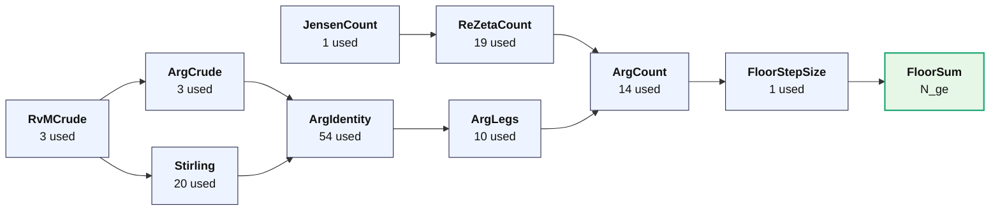

# What `FloorSum.N_ge` rests on

[`FloorSum.N_ge`](../lean_stage3/FloorSum.md#FloorSum-N_ge) in `lean_stage3/Stage3/FloorSum.lean`, line 114.

**Why.** `N T ≥ T log T / 20` eventually, from the Riemann–von Mangoldt bound in the tree.

**Proves**

```lean
∀ᶠ T : ℝ in atTop, T * Real.log T / 20 ≤ riemannZeta.N T
```

Behind it: 108 theorems and 17 definitions in 10 files. Every one is listed below; Lean recorded each step.

## The files it passes through



An arrow A → B reads "B uses something proved or defined in A"; indirect arrows are left out. Green: the theorem itself. Yellow: a file in the other tree. The number is how many of that file's declarations are on the way.

## Every declaration on the way

Files in dependency order. ★ marks what the theorem's own proof uses directly.

### [`JensenCount`](../lean_stage3/JensenCount.md) — 1

- [`Stage3.zeta_disk_upper`](../lean_stage3/JensenCount.md#Stage3-zeta_disk_upper) — `` ‖ζ w‖ ≤ 28 * T ``

### [`ReZetaCount`](../lean_stage3/ReZetaCount.md) — 19

- [`ReZetaCount.G`](../lean_stage3/ReZetaCount.md#ReZetaCount-G) — *def*
- [`ReZetaCount.F`](../lean_stage3/ReZetaCount.md#ReZetaCount-F) — *def*
- [`ReZetaCount.reZeroSet`](../lean_stage3/ReZetaCount.md#ReZetaCount-reZeroSet) — *def*
- [`ReZetaCount.norm_zeta_sub_one_le`](../lean_stage3/ReZetaCount.md#ReZetaCount-norm_zeta_sub_one_le) — `` ‖riemannZeta s - 1‖ ≤ Real.pi ^ 2 / 6 - 1 ``
- [`ReZetaCount.re_zeta_two_line_ge`](../lean_stage3/ReZetaCount.md#ReZetaCount-re_zeta_two_line_ge) — `` 2 - Real.pi ^ 2 / 6 ≤ (riemannZeta (2 + (t : ℂ) * Complex.I)).re ``
- [`ReZetaCount.re_zeta_two_line_pos`](../lean_stage3/ReZetaCount.md#ReZetaCount-re_zeta_two_line_pos) — `` 0 < (riemannZeta (2 + (t : ℂ) * Complex.I)).re ``
- [`ReZetaCount.G_zero_eq`](../lean_stage3/ReZetaCount.md#ReZetaCount-G_zero_eq) — `` G T 0 = ((2 * (riemannZeta (2 + Complex.I * (T : ℂ))).re : ℝ) : ℂ) ``
- [`ReZetaCount.G_real`](../lean_stage3/ReZetaCount.md#ReZetaCount-G_real) — `` G T (x : ℂ) = ((2 * (riemannZeta (2 * (x : ℂ) + 2 + Complex.I * (T : ℂ))).re : ℝ) : ℂ) ``
- [`ReZetaCount.G_zero_ne`](../lean_stage3/ReZetaCount.md#ReZetaCount-G_zero_ne) — `` G T 0 ≠ 0 ``
- [`ReZetaCount.F_zero_eq_one`](../lean_stage3/ReZetaCount.md#ReZetaCount-F_zero_eq_one) — `` F T 0 = 1 ``
- [`ReZetaCount.arg_ne_one`](../lean_stage3/ReZetaCount.md#ReZetaCount-arg_ne_one) — `` 2 * z + 2 + Complex.I * (T : ℂ) ≠ 1 ∧ 2 * z + 2 - Complex.I * (T : ℂ) ≠ 1 ``
- [`ReZetaCount.F_analytic`](../lean_stage3/ReZetaCount.md#ReZetaCount-F_analytic) — `` AnalyticOnNhd ℂ (F T) (Metric.closedBall (0 : ℂ) 1) ``
- [`ReZetaCount.F_bound`](../lean_stage3/ReZetaCount.md#ReZetaCount-F_bound) — `` ‖F T z‖ ≤ 80 * T ``
- [`ReZetaCount.F_zeros_finite`](../lean_stage3/ReZetaCount.md#ReZetaCount-F_zeros_finite) — `` (SetOfZeros 1 (F T)).Finite ``
- [`ReZetaCount.F_count_le`](../lean_stage3/ReZetaCount.md#ReZetaCount-F_count_le) — `` ∑ ρ ∈ (finiteSetOfZeros_mono (by norm_num : (7:ℝ)/8 < 1) (F_zeros_finite hT)).toFinset, (analyticOrderNatAt (F T) ρ : ℝ) ≤ 15 * Real.log T + 73 ``
- [`ReZetaCount.reZeroSet_finite`](../lean_stage3/ReZetaCount.md#ReZetaCount-reZeroSet_finite) — `` (reZeroSet T).Finite ``
- [`ReZetaCount.reZeros`](../lean_stage3/ReZetaCount.md#ReZetaCount-reZeros) — *def*
- [`ReZetaCount.mem_reZeros`](../lean_stage3/ReZetaCount.md#ReZetaCount-mem_reZeros) — `` x ∈ reZeros hT ↔ x ∈ Set.Ioo (1/2 : ℝ) 2 ∧ (riemannZeta ((x : ℂ) + T * Complex.I)).re = 0 ``
- [`ReZetaCount.card_reZeros_le`](../lean_stage3/ReZetaCount.md#ReZetaCount-card_reZeros_le) — `` ((reZeros hT).card : ℝ) ≤ 15 * Real.log T + 73 ``

### [`RvMCrude`](../lean_stage3/RvMCrude.md) — 3

- [`Stage3.StmtBacklundPhase`](../lean_stage3/RvMCrude.md#Stage3-StmtBacklundPhase) — *def*
- [`Stage3.StmtBacklundArg`](../lean_stage3/RvMCrude.md#Stage3-StmtBacklundArg) — *def*
- [`Stage3.RvM_of_phase_arg`](../lean_stage3/RvMCrude.md#Stage3-RvM_of_phase_arg) — `` riemannZeta.Riemann_vonMangoldt_bound (B₁ + B₁') 0 (B₃ + B₃') ``

### [`ArgCrude`](../lean_stage3/ArgCrude.md) — 3

- [`Stage3.StmtArgIdentity`](../lean_stage3/ArgCrude.md#Stage3-StmtArgIdentity) — *def*
- [`Stage3.StmtSCrude`](../lean_stage3/ArgCrude.md#Stage3-StmtSCrude) — *def*
- [`Stage3.backlundArg_of_identity`](../lean_stage3/ArgCrude.md#Stage3-backlundArg_of_identity) — `` StmtBacklundArg θ B₁ B₃ ``

### [`Stirling`](../lean_stage3/Stirling.md) — 20

- [`Stage3.phasePoint`](../lean_stage3/Stirling.md#Stage3-phasePoint) — *def*
- [`Stage3.phaseTheta`](../lean_stage3/Stirling.md#Stage3-phaseTheta) — *def*
- [`Stage3.continuous_phasePoint`](../lean_stage3/Stirling.md#Stage3-continuous_phasePoint) — `` Continuous phasePoint ``
- [`Stage3.intervalIntegrable_phasePoint`](../lean_stage3/Stirling.md#Stage3-intervalIntegrable_phasePoint) — `` IntervalIntegrable phasePoint MeasureTheory.volume a b ``
- [`Stage3.integral_log_half`](../lean_stage3/Stirling.md#Stage3-integral_log_half) — `` (∫ t in (1 : ℝ)..T, Real.log (t / 2)) = T * Real.log (T / 2) - T + 1 + Real.log 2 ``
- [`Stage3.StmtDigammaLog`](../lean_stage3/Stirling.md#Stage3-StmtDigammaLog) — *def*
- [`Stage3.backlundPhase_of_digammaLog`](../lean_stage3/Stirling.md#Stage3-backlundPhase_of_digammaLog) — `` StmtBacklundPhase phaseTheta C (C + 1) ``
- [`Stage3.digamma_term_norm_le`](../lean_stage3/Stirling.md#Stage3-digamma_term_norm_le) — `` ‖1 / ((n : ℂ) + 1) - 1 / ((n : ℂ) + z)‖ ≤ 4 / ((n : ℝ) + 1) ^ 2 ``
- [`Stage3.phasePoint_compact_le`](../lean_stage3/Stirling.md#Stage3-phasePoint_compact_le) — `` ∀ t ∈ Set.Icc (0 : ℝ) 1, |phasePoint t| ≤ 8 ``
- [`Stage3.log_norm_z_le`](../lean_stage3/Stirling.md#Stage3-log_norm_z_le) — `` |Real.log ‖(1 : ℂ) / 4 + (t : ℂ) / 2 * Complex.I‖ - Real.log (t / 2)| ≤ 1 / (4 * t) ``
- [`Stage3.inv_quadratic_tsum_le`](../lean_stage3/Stirling.md#Stage3-inv_quadratic_tsum_le) — `` (∑' n : ℕ, (((n : ℝ) + 1 / 4) ^ 2 + (t / 2) ^ 2)⁻¹) ≤ 12 / t ``
- [`Stage3.re_sub_log_norm_le`](../lean_stage3/Stirling.md#Stage3-re_sub_log_norm_le) — `` |w.re - Real.log ‖1 + w‖| ≤ 8 * ‖w‖ ^ 2 ``
- [`Stage3.zq`](../lean_stage3/Stirling.md#Stage3-zq) — *def*
- [`Stage3.phasePoint_eq`](../lean_stage3/Stirling.md#Stage3-phasePoint_eq) — `` phasePoint t = (Complex.digamma (zq t)).re ``
- [`Stage3.normSq_add_zq`](../lean_stage3/Stirling.md#Stage3-normSq_add_zq) — `` ‖(n : ℂ) + zq t‖ ^ 2 = ((n : ℝ) + 1 / 4) ^ 2 + (t / 2) ^ 2 ``
- [`Stage3.add_zq_ne_zero`](../lean_stage3/Stirling.md#Stage3-add_zq_ne_zero) — `` (n : ℂ) + zq t ≠ 0 ``
- [`Stage3.a_term_le`](../lean_stage3/Stirling.md#Stage3-a_term_le) — `` |(((n : ℂ) + zq t)⁻¹).re - (Real.log ‖((n + 1 : ℕ) : ℂ) + zq t‖ - Real.log ‖(n : ℂ) + zq t‖)| ≤ 8 * ((((n : ℝ) + 1 / 4) ^ 2 + (t / 2) ^ 2)⁻¹) ``
- [`Stage3.re_digamma_sub_log_le`](../lean_stage3/Stirling.md#Stage3-re_digamma_sub_log_le) — `` |phasePoint t - Real.log ‖zq t‖| ≤ 96 / t ``
- [`Stage3.stmtDigammaLog_holds`](../lean_stage3/Stirling.md#Stage3-stmtDigammaLog_holds) — `` StmtDigammaLog 97 ``
- [`Stage3.backlundPhase_holds`](../lean_stage3/Stirling.md#Stage3-backlundPhase_holds) — `` StmtBacklundPhase phaseTheta 97 98 ``

### [`ArgIdentity`](../lean_stage3/ArgIdentity.md) — 54

- [`Stage3.xi`](../lean_stage3/ArgIdentity.md#Stage3-xi) — *def*
- [`Stage3.differentiable_xi`](../lean_stage3/ArgIdentity.md#Stage3-differentiable_xi) — `` Differentiable ℂ xi ``
- [`Stage3.xi_zero`](../lean_stage3/ArgIdentity.md#Stage3-xi_zero) — `` xi 0 = 1 ``
- [`Stage3.xi_one`](../lean_stage3/ArgIdentity.md#Stage3-xi_one) — `` xi 1 = 1 ``
- [`Stage3.xi_eq_completed`](../lean_stage3/ArgIdentity.md#Stage3-xi_eq_completed) — `` xi s = s * (s - 1) * completedRiemannZeta s ``
- [`Stage3.xi_one_sub`](../lean_stage3/ArgIdentity.md#Stage3-xi_one_sub) — `` xi (1 - s) = xi s ``
- [`Stage3.gammaR_conj`](../lean_stage3/ArgIdentity.md#Stage3-gammaR_conj) — `` Gammaℝ (conj s) = conj (Gammaℝ s) ``
- [`Stage3.completed_eq_gammaR_mul_zeta`](../lean_stage3/ArgIdentity.md#Stage3-completed_eq_gammaR_mul_zeta) — `` completedRiemannZeta s = Gammaℝ s * riemannZeta s ``
- [`Stage3.completedZeta₀_conj`](../lean_stage3/ArgIdentity.md#Stage3-completedZeta-_conj) — `` completedRiemannZeta₀ (conj s) = conj (completedRiemannZeta₀ s) ``
- [`Stage3.xi_conj`](../lean_stage3/ArgIdentity.md#Stage3-xi_conj) — `` xi (conj s) = conj (xi s) ``
- [`Stage3.zeta_re_neg_of_real_mem_Ioo`](../lean_stage3/ArgIdentity.md#Stage3-zeta_re_neg_of_real_mem_Ioo) — `` (riemannZeta (σ : ℂ)).re < 0 ``
- [`Stage3.zeta_ne_zero_of_real_mem_Ioo`](../lean_stage3/ArgIdentity.md#Stage3-zeta_ne_zero_of_real_mem_Ioo) — `` riemannZeta (σ : ℂ) ≠ 0 ``
- [`Stage3.completed_eq_gammaR_mul_zeta'`](../lean_stage3/ArgIdentity.md#Stage3-completed_eq_gammaR_mul_zeta-) — `` completedRiemannZeta s = Gammaℝ s * riemannZeta s ``
- [`Stage3.xi_eq_prod`](../lean_stage3/ArgIdentity.md#Stage3-xi_eq_prod) — `` xi s = s * (s - 1) * Gammaℝ s * riemannZeta s ``
- [`Stage3.xi_ne_zero_of_one_le_re`](../lean_stage3/ArgIdentity.md#Stage3-xi_ne_zero_of_one_le_re) — `` xi s ≠ 0 ``
- [`Stage3.xi_ne_zero_of_re_nonpos`](../lean_stage3/ArgIdentity.md#Stage3-xi_ne_zero_of_re_nonpos) — `` xi s ≠ 0 ``
- [`Stage3.xi_ne_zero_of_real`](../lean_stage3/ArgIdentity.md#Stage3-xi_ne_zero_of_real) — `` xi (σ : ℂ) ≠ 0 ``
- [`Stage3.xi_eq_zero_iff`](../lean_stage3/ArgIdentity.md#Stage3-xi_eq_zero_iff) — `` xi s = 0 ↔ riemannZeta s = 0 ∧ 0 < s.re ∧ s.re < 1 ``
- [`Stage3.meromorphicOrderAt_xi_eq_zeta`](../lean_stage3/ArgIdentity.md#Stage3-meromorphicOrderAt_xi_eq_zeta) — `` meromorphicOrderAt xi ρ = meromorphicOrderAt riemannZeta ρ ``
- [`Stage3.xi_analyticAt`](../lean_stage3/ArgIdentity.md#Stage3-xi_analyticAt) — `` AnalyticAt ℂ xi s ``
- [`Stage3.xi_meromorphicOrderAt_ne_top`](../lean_stage3/ArgIdentity.md#Stage3-xi_meromorphicOrderAt_ne_top) — `` meromorphicOrderAt xi p ≠ ⊤ ``
- [`Stage3.logDeriv_xi_meromorphicAt`](../lean_stage3/ArgIdentity.md#Stage3-logDeriv_xi_meromorphicAt) — `` MeromorphicAt (logDeriv xi) s ``
- [`Stage3.N_eq_sum`](../lean_stage3/ArgIdentity.md#Stage3-N_eq_sum) — `` riemannZeta.N T = ∑ ρ ∈ (Kadiri.zeroes_rect_univ_positive_height_finite T).toFinset, (riemannZeta.order ρ : ℝ) ``
- [`Stage3.xi_divisor_support_eq`](../lean_stage3/ArgIdentity.md#Stage3-xi_divisor_support_eq) — `` (MeromorphicOn.divisor xi (Rectangle (-1 : ℂ) (2 + Complex.I * T))).support = riemannZeta.zeroes_rect (Set.univ : Set ℝ) (Set.Ioo 0 T) ``
- [`Stage3.rectangleIntegral_logDeriv_xi_eq_N`](../lean_stage3/ArgIdentity.md#Stage3-rectangleIntegral_logDeriv_xi_eq_N) — `` RectangleIntegral' (logDeriv xi) (-1 : ℂ) (2 + Complex.I * T) = ((riemannZeta.N T : ℝ) : ℂ) ``
- [`Stage3.logDeriv_xi_one_sub`](../lean_stage3/ArgIdentity.md#Stage3-logDeriv_xi_one_sub) — `` logDeriv xi (1 - s) = -logDeriv xi s ``
- [`Stage3.logDeriv_xi_conj`](../lean_stage3/ArgIdentity.md#Stage3-logDeriv_xi_conj) — `` logDeriv xi (conj s) = conj (logDeriv xi s) ``
- [`Stage3.logDeriv_xi_continuousAt`](../lean_stage3/ArgIdentity.md#Stage3-logDeriv_xi_continuousAt) — `` ContinuousAt (logDeriv xi) p ``
- [`Stage3.xi_ne_zero_on_good_top`](../lean_stage3/ArgIdentity.md#Stage3-xi_ne_zero_on_good_top) — `` xi ((x : ℂ) + T * Complex.I) ≠ 0 ``
- [`Stage3.pi_mul_N_eq`](../lean_stage3/ArgIdentity.md#Stage3-pi_mul_N_eq) — `` Real.pi * riemannZeta.N T = (∫ t in (0:ℝ)..T, logDeriv xi (2 + (t : ℂ) * Complex.I)).re - (∫ x in (1/2:ℝ)..2, logDeriv xi ((x : ℂ) + T * Complex.I)).im ``
- [`Stage3.logDeriv_congr_of_eventuallyEq`](../lean_stage3/ArgIdentity.md#Stage3-logDeriv_congr_of_eventuallyEq) — `` logDeriv f x = logDeriv g x ``
- [`Stage3.gammaR_eq_exp_mul`](../lean_stage3/ArgIdentity.md#Stage3-gammaR_eq_exp_mul) — `` Gammaℝ s = Complex.exp (-(Real.log Real.pi : ℂ) / 2 * s) * Complex.Gamma (s / 2) ``
- [`Stage3.differentiableAt_gammaR`](../lean_stage3/ArgIdentity.md#Stage3-differentiableAt_gammaR) — `` DifferentiableAt ℂ Gammaℝ s ``
- [`Stage3.logDeriv_gammaR`](../lean_stage3/ArgIdentity.md#Stage3-logDeriv_gammaR) — `` logDeriv Gammaℝ s = -(Real.log Real.pi : ℂ) / 2 + Complex.digamma (s / 2) / 2 ``
- [`Stage3.logDeriv_xi_split`](../lean_stage3/ArgIdentity.md#Stage3-logDeriv_xi_split) — `` logDeriv xi s = 1 / s + 1 / (s - 1) + logDeriv Gammaℝ s + logDeriv riemannZeta s ``
- [`Stage3.intervalIntegral_re`](../lean_stage3/ArgIdentity.md#Stage3-intervalIntegral_re) — `` (∫ t in a..b, f t).re = ∫ t in a..b, (f t).re ``
- [`Stage3.logDeriv_gammaR_conj`](../lean_stage3/ArgIdentity.md#Stage3-logDeriv_gammaR_conj) — `` logDeriv Gammaℝ (conj s) = conj (logDeriv Gammaℝ s) ``
- [`Stage3.logDeriv_gammaR_im_eq_zero`](../lean_stage3/ArgIdentity.md#Stage3-logDeriv_gammaR_im_eq_zero) — `` (logDeriv Gammaℝ ((x : ℝ) : ℂ)).im = 0 ``
- [`Stage3.integral_inv_vertical`](../lean_stage3/ArgIdentity.md#Stage3-integral_inv_vertical) — `` (∫ t in (0:ℝ)..T, ((c : ℂ) + t * Complex.I)⁻¹) = -Complex.I * (Complex.log ((c : ℂ) + T * Complex.I) - Complex.log (c : ℂ)) ``
- [`Stage3.integral_inv_horizontal`](../lean_stage3/ArgIdentity.md#Stage3-integral_inv_horizontal) — `` (∫ x in a..b, (((x : ℂ) - d) + T * Complex.I)⁻¹) = Complex.log (((b : ℂ) - d) + T * Complex.I) - Complex.log (((a : ℂ) - d) + T * Complex.I) ``
- [`Stage3.arg_sum_eq_pi`](../lean_stage3/ArgIdentity.md#Stage3-arg_sum_eq_pi) — `` Complex.arg ((1/2 : ℝ) + T * Complex.I) + Complex.arg ((-(1/2) : ℝ) + T * Complex.I) = Real.pi ``
- [`Stage3.elemLD`](../lean_stage3/ArgIdentity.md#Stage3-elemLD) — *def*
- [`Stage3.elem_fold_eq_pi`](../lean_stage3/ArgIdentity.md#Stage3-elem_fold_eq_pi) — `` (∫ t in (0:ℝ)..T, elemLD (2 + (t : ℂ) * Complex.I)).re - (∫ x in (1/2:ℝ)..2, elemLD ((x : ℂ) + T * Complex.I)).im = Real.pi ``
- [`Stage3.logDeriv_gammaR_analyticAt`](../lean_stage3/ArgIdentity.md#Stage3-logDeriv_gammaR_analyticAt) — `` AnalyticAt ℂ (logDeriv Gammaℝ) z ``
- [`Stage3.logDeriv_gammaR_continuousAt`](../lean_stage3/ArgIdentity.md#Stage3-logDeriv_gammaR_continuousAt) — `` ContinuousAt (logDeriv Gammaℝ) z ``
- [`Stage3.logDeriv_gammaR_holo`](../lean_stage3/ArgIdentity.md#Stage3-logDeriv_gammaR_holo) — `` HolomorphicOn (logDeriv Gammaℝ) {s : ℂ | 0 < s.re} ``
- [`Stage3.logDeriv_gammaR_comp_continuous`](../lean_stage3/ArgIdentity.md#Stage3-logDeriv_gammaR_comp_continuous) — `` Continuous fun x : ℝ => logDeriv Gammaℝ (g x) ``
- [`Stage3.gammaR_fold_eq_phaseTheta`](../lean_stage3/ArgIdentity.md#Stage3-gammaR_fold_eq_phaseTheta) — `` (∫ t in (0:ℝ)..T, logDeriv Gammaℝ (2 + (t : ℂ) * Complex.I)).re - (∫ x in (1/2:ℝ)..2, logDeriv Gammaℝ ((x : ℂ) + T * Complex.I)).im = phaseTheta T ``
- [`Stage3.argS`](../lean_stage3/ArgIdentity.md#Stage3-argS) — *def*
- [`Stage3.stmtArgIdentity_holds`](../lean_stage3/ArgIdentity.md#Stage3-stmtArgIdentity_holds) — `` StmtArgIdentity phaseTheta argS ``
- [`Stage3.logDeriv_zeta_analyticAt`](../lean_stage3/ArgIdentity.md#Stage3-logDeriv_zeta_analyticAt) — `` AnalyticAt ℂ (logDeriv riemannZeta) z ``
- [`Stage3.logDeriv_zeta_continuousAt`](../lean_stage3/ArgIdentity.md#Stage3-logDeriv_zeta_continuousAt) — `` ContinuousAt (logDeriv riemannZeta) z ``
- [`Stage3.zetaArgContour`](../lean_stage3/ArgIdentity.md#Stage3-zetaArgContour) — *def*
- [`Stage3.argS_eq_zetaArgContour`](../lean_stage3/ArgIdentity.md#Stage3-argS_eq_zetaArgContour) — `` argS T = zetaArgContour T ``

### [`ArgLegs`](../lean_stage3/ArgLegs.md) — 10

- [`ArgLegs.abs_arg_sub_le_pi`](../lean_stage3/ArgLegs.md#ArgLegs-abs_arg_sub_le_pi) — `` |z.arg - w.arg| ≤ Real.pi ``
- [`ArgLegs.mem_slitPlane_of_re_nonneg`](../lean_stage3/ArgLegs.md#ArgLegs-mem_slitPlane_of_re_nonneg) — `` z ∈ Complex.slitPlane ``
- [`ArgLegs.integral_logDeriv_eq_log_sub`](../lean_stage3/ArgLegs.md#ArgLegs-integral_logDeriv_eq_log_sub) — `` ∫ x in a..b, g' x / g x = Complex.log (g b) - Complex.log (g a) ``
- [`ArgLegs.im_integral_le_pi_of_re_nonneg`](../lean_stage3/ArgLegs.md#ArgLegs-im_integral_le_pi_of_re_nonneg) — `` |(∫ x in a..b, g' x / g x).im| ≤ Real.pi ``
- [`ArgLegs.im_integral_le_pi_of_re_nonpos`](../lean_stage3/ArgLegs.md#ArgLegs-im_integral_le_pi_of_re_nonpos) — `` |(∫ x in a..b, g' x / g x).im| ≤ Real.pi ``
- [`ArgLegs.re_sign_const`](../lean_stage3/ArgLegs.md#ArgLegs-re_sign_const) — `` (∀ x ∈ Set.Icc a b, 0 ≤ (g x).re) ∨ (∀ x ∈ Set.Icc a b, (g x).re ≤ 0) ``
- [`ArgLegs.segment_im_integral_le`](../lean_stage3/ArgLegs.md#ArgLegs-segment_im_integral_le) — `` |(∫ x in a..b, g' x / g x).im| ≤ Real.pi * ((Z.card : ℝ) + 1) ``
- [`ArgLegs.vertical_leg_le`](../lean_stage3/ArgLegs.md#ArgLegs-vertical_leg_le) — `` |(∫ t in (0:ℝ)..T, logDeriv riemannZeta (2 + (t : ℂ) * Complex.I)).re| ≤ Real.pi / 2 ``
- [`ArgLegs.horizontal_leg_le`](../lean_stage3/ArgLegs.md#ArgLegs-horizontal_leg_le) — `` |(∫ x in (1/2:ℝ)..2, logDeriv riemannZeta ((x : ℂ) + T * Complex.I)).im| ≤ Real.pi * ((Z.card : ℝ) + 1) ``
- [`ArgLegs.zetaArgContour_le`](../lean_stage3/ArgLegs.md#ArgLegs-zetaArgContour_le) — `` |Stage3.zetaArgContour T| ≤ (Z.card : ℝ) + 3 / 2 ``

### [`ArgCount`](../lean_stage3/ArgCount.md) — 14

- [`ArgCount.good`](../lean_stage3/ArgCount.md#ArgCount-good) — *def*
- [`ArgCount.argS_le_of_good`](../lean_stage3/ArgCount.md#ArgCount-argS_le_of_good) — `` |Stage3.argS T| ≤ 15 * Real.log T + 73 + 3 / 2 ``
- [`ArgCount.N_eq_sum`](../lean_stage3/ArgCount.md#ArgCount-N_eq_sum) — `` riemannZeta.N T = ∑ z ∈ (Kadiri.zeroes_rect_univ_positive_height_finite T).toFinset, (1 : ℝ) * (riemannZeta.order z : ℝ) ``
- ★ [`ArgCount.N_nonneg`](../lean_stage3/ArgCount.md#ArgCount-N_nonneg) — `` 0 ≤ riemannZeta.N T ``
- [`ArgCount.N_mono`](../lean_stage3/ArgCount.md#ArgCount-N_mono) — `` riemannZeta.N T ≤ riemannZeta.N T' ``
- [`ArgCount.N_eq_of_no_zero_between`](../lean_stage3/ArgCount.md#ArgCount-N_eq_of_no_zero_between) — `` riemannZeta.N T = riemannZeta.N T₀ ``
- [`ArgCount.exists_good_below`](../lean_stage3/ArgCount.md#ArgCount-exists_good_below) — `` ∃ T : ℝ, a < T ∧ T < T₀ ∧ good T ∧ ∀ ρ : ℂ, riemannZeta ρ = 0 → ρ.im ∈ Set.Ico T T₀ → False ``
- [`ArgCount.phasePoint_bound_near`](../lean_stage3/ArgCount.md#ArgCount-phasePoint_bound_near) — `` ∃ M : ℝ, 0 ≤ M ∧ ∀ t ∈ Set.Icc (T₀ - 1) T₀, |Stage3.phasePoint t| ≤ M ``
- [`ArgCount.phaseTheta_sub_le`](../lean_stage3/ArgCount.md#ArgCount-phaseTheta_sub_le) — `` |Stage3.phaseTheta T₀ - Stage3.phaseTheta T| ≤ (T₀ - T) * (M / 2 + Real.log Real.pi / 2) ``
- [`ArgCount.argS_le_gt_two`](../lean_stage3/ArgCount.md#ArgCount-argS_le_gt_two) — `` |Stage3.argS T| ≤ 15 * Real.log T + 75 ``
- [`ArgCount.mainTerm_abs_le`](../lean_stage3/ArgCount.md#ArgCount-mainTerm_abs_le) — `` |Kadiri.zetaCountingMainTerm T| ≤ 3 ``
- [`ArgCount.argS_two_le`](../lean_stage3/ArgCount.md#ArgCount-argS_two_le) — `` |Stage3.argS 2| ≤ 15 * Real.log 2 + 600 ``
- [`ArgCount.sCrude_holds`](../lean_stage3/ArgCount.md#ArgCount-sCrude_holds) — `` Stage3.StmtSCrude Stage3.argS 15 600 ``
- [`ArgCount.rvM_crude`](../lean_stage3/ArgCount.md#ArgCount-rvM_crude) — `` riemannZeta.Riemann_vonMangoldt_bound 112 0 698 ``

### [`FloorStepSize`](../lean_stage3/FloorStepSize.md) — 1

- ★ [`FloorStep.N_window_ge`](../lean_stage3/FloorStepSize.md#FloorStep-N_window_ge) — `` T * Real.log T / (4 * Real.pi) - (riemannZeta.N T - riemannZeta.N (T / 2)) ≤ T + 224 * Real.log T + 1396 ``

