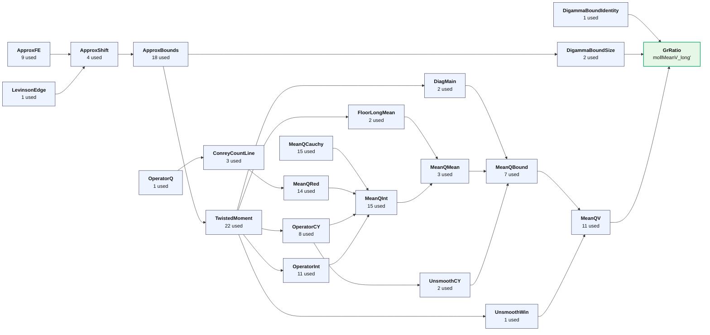

# What `GrRatio.mollMeanV_long'` rests on

[`GrRatio.mollMeanV_long'`](../lean_stage3/GrRatio.md#GrRatio-mollMeanV_long-) in `lean_stage3/Stage3/GrRatio.lean`, line 337.

**Why.** `mollMeanV_long` without `hG`.

**Proves**

```lean
StmtMollMeanV Q P θ R
```

**Needs** (its hypotheses)

  - `` Q P : ℝ[X] ``
  - `` hθ0 : 0 < θ ``
  - `` hR : 0 < R ``
  - `` hL3 : StmtLemma3resO P θ R (2 * R + 1 + 1 / R) ``

Behind it: 121 theorems and 42 definitions in 22 files. Every one is listed below; Lean recorded each step.

## The files it passes through



An arrow A → B reads "B uses something proved or defined in A"; indirect arrows are left out. Green: the theorem itself. Yellow: a file in the other tree. The number is how many of that file's declarations are on the way.

## Every declaration on the way

Files in dependency order. ★ marks what the theorem's own proof uses directly.

### [`ApproxFE`](../lean_stage3/ApproxFE.md) — 9

- [`ApproxFE.uA`](../lean_stage3/ApproxFE.md#ApproxFE-uA) — *def*
- [`ApproxFE.vB`](../lean_stage3/ApproxFE.md#ApproxFE-vB) — *def*
- [`ApproxFE.GY`](../lean_stage3/ApproxFE.md#ApproxFE-GY) — *def*
- [`ApproxFE.uA_re`](../lean_stage3/ApproxFE.md#ApproxFE-uA_re) — `` (uA α t).re = 1 / 2 + α.re ``
- [`ApproxFE.vB_re`](../lean_stage3/ApproxFE.md#ApproxFE-vB_re) — `` (vB β t).re = 1 / 2 + β.re ``
- [`ApproxFE.uA_im`](../lean_stage3/ApproxFE.md#ApproxFE-uA_im) — `` (uA α t).im = α.im + t ``
- [`ApproxFE.vB_im`](../lean_stage3/ApproxFE.md#ApproxFE-vB_im) — `` (vB β t).im = β.im - t ``
- [`ApproxFE.gamma_mul_zeta`](../lean_stage3/ApproxFE.md#ApproxFE-gamma_mul_zeta) — `` Gammaℝ w * riemannZeta w = completedRiemannZeta w ``
- [`ApproxFE.resY`](../lean_stage3/ApproxFE.md#ApproxFE-resY) — *def*

### [`DigammaBoundIdentity`](../lean_stage3/DigammaBoundIdentity.md) — 1

- [`DigammaBound.iteratedDeriv_E`](../lean_stage3/DigammaBoundIdentity.md#DigammaBound-iteratedDeriv_E) — `` iteratedDeriv m (fun z => cexp (a * (z - w))) w = a ^ m ``

### [`LevinsonEdge`](../lean_stage3/LevinsonEdge.md) — 1

- [`LevinsonEdge.zeta_norm_le`](../lean_stage3/LevinsonEdge.md#LevinsonEdge-zeta_norm_le) — `` ‖riemannZeta u‖ ≤ 2 + 4 * ‖u‖ ``

### [`ApproxShift`](../lean_stage3/ApproxShift.md) — 4

- [`ApproxShift.zeta_norm_le_abs`](../lean_stage3/ApproxShift.md#ApproxShift-zeta_norm_le_abs) — `` ‖riemannZeta w‖ ≤ 2 + 4 * ‖w‖ ``
- [`ApproxShift.gammaR_bound`](../lean_stage3/ApproxShift.md#ApproxShift-gammaR_bound) — `` ∃ M : ℝ, 0 ≤ M ∧ ∀ w : ℂ, 1 / 2 ≤ w.re → w.re ≤ R → ‖Gammaℝ w‖ ≤ M ``
- [`ApproxShift.Lambda_bound`](../lean_stage3/ApproxShift.md#ApproxShift-Lambda_bound) — `` ∃ M : ℝ, 0 ≤ M ∧ ∀ w : ℂ, |w.re| ≤ R → 1 ≤ |w.im| → ‖completedRiemannZeta w‖ ≤ M * (6 + 4 * ‖w‖) ``
- [`ApproxShift.GY_norm_le`](../lean_stage3/ApproxShift.md#ApproxShift-GY_norm_le) — `` ‖GY α β s‖ ≤ Real.exp (c ^ 2 - s.im ^ 2) * ((‖α + β‖ ^ 2 + 4 * c ^ 2 + 4) / ‖α + β‖ ^ 2 * (1 + s.im ^ 2)) ``

### [`ApproxBounds`](../lean_stage3/ApproxBounds.md) — 18

- [`ApproxBounds.lY`](../lean_stage3/ApproxBounds.md#ApproxBounds-lY) — *def*
- [`ApproxBounds.lY_nonneg`](../lean_stage3/ApproxBounds.md#ApproxBounds-lY_nonneg) — `` 0 ≤ lY Y ``
- [`ApproxBounds.gModel`](../lean_stage3/ApproxBounds.md#ApproxBounds-gModel) — *def*
- [`ApproxBounds.gErr`](../lean_stage3/ApproxBounds.md#ApproxBounds-gErr) — *def*
- [`ApproxBounds.gRModel`](../lean_stage3/ApproxBounds.md#ApproxBounds-gRModel) — *def*
- [`ApproxBounds.gErr_nonneg`](../lean_stage3/ApproxBounds.md#ApproxBounds-gErr_nonneg) — `` 0 ≤ gErr r ``
- [`ApproxBounds.const_bound`](../lean_stage3/ApproxBounds.md#ApproxBounds-const_bound) — `` ∃ K : ℝ, 0 ≤ K ∧ ∀ r : ℝ, lo ≤ r → r ≤ hi → |Real.log (Real.Gamma r)| ≤ K ∧ gErr r ≤ K ``
- [`ApproxBounds.Q_le`](../lean_stage3/ApproxBounds.md#ApproxBounds-Q_le) — `` (n ^ 2 + A) / n ^ 2 ≤ (A + 1) * (1 + 1 / n ^ 2) ``
- [`ApproxBounds.lY_le_abs`](../lean_stage3/ApproxBounds.md#ApproxBounds-lY_le_abs) — `` lY Y ≤ |Y| ``
- [`ApproxBounds.gR_lower`](../lean_stage3/ApproxBounds.md#ApproxBounds-gR_lower) — `` -(2 * K + |Real.log (Real.Gamma (1 / 2))|) - (Real.pi / 2 + 1) * |Y₀| ≤ Real.log ‖Gammaℝ w‖ ``
- [`ApproxBounds.resY_term`](../lean_stage3/ApproxBounds.md#ApproxBounds-resY_term) — `` ‖GY α β s / d * completedRiemannZeta w‖ ≤ Real.exp (1 - (t - 1 / 10) ^ 2) * (9 * (1 + 1 / ‖α + β‖ ^ 2) * (1 + (t + 1 / 10) ^ 2)) * (5 / 2) * (M * (14 + 8 * t)) ``
- [`ApproxBounds.poly_exp_bound`](../lean_stage3/ApproxBounds.md#ApproxBounds-poly_exp_bound) — `` Real.exp (1 - (t - 1 / 10) ^ 2) * (1 + (t + 1 / 10) ^ 2) * (14 + 8 * t) * Real.exp ((Real.pi / 2 + 1) * (t + 1 / 10)) ≤ 14 * Real.exp ((Real.pi / 2 + 5) ^ 2 / 2… ``
- [`ApproxBounds.resY_T1`](../lean_stage3/ApproxBounds.md#ApproxBounds-resY_T1) — `` ‖GY α β (1 - uA α t) / (1 - uA α t) * completedRiemannZeta (vB β t + 1 - uA α t)‖ ≤ Real.exp (1 - (t - 1 / 10) ^ 2) * (9 * (1 + 1 / ‖α + β‖ ^ 2) * (1 + (t + 1 /… ``
- [`ApproxBounds.resY_T2`](../lean_stage3/ApproxBounds.md#ApproxBounds-resY_T2) — `` ‖GY α β (-uA α t) / uA α t * completedRiemannZeta (vB β t - uA α t)‖ ≤ Real.exp (1 - (t - 1 / 10) ^ 2) * (9 * (1 + 1 / ‖α + β‖ ^ 2) * (1 + (t + 1 / 10) ^ 2)) * … ``
- [`ApproxBounds.resY_T3`](../lean_stage3/ApproxBounds.md#ApproxBounds-resY_T3) — `` ‖GY α β (1 - vB β t) / (1 - vB β t) * completedRiemannZeta (uA α t + 1 - vB β t)‖ ≤ Real.exp (1 - (t - 1 / 10) ^ 2) * (9 * (1 + 1 / ‖α + β‖ ^ 2) * (1 + (t + 1 /… ``
- [`ApproxBounds.resY_T4`](../lean_stage3/ApproxBounds.md#ApproxBounds-resY_T4) — `` ‖GY α β (-vB β t) / vB β t * completedRiemannZeta (uA α t - vB β t)‖ ≤ Real.exp (1 - (t - 1 / 10) ^ 2) * (9 * (1 + 1 / ‖α + β‖ ^ 2) * (1 + (t + 1 / 10) ^ 2)) * … ``
- [`ApproxBounds.resY_den`](../lean_stage3/ApproxBounds.md#ApproxBounds-resY_den) — `` Real.exp (-(2 * (2 * K + |Real.log (Real.Gamma (1 / 2))|)) - (Real.pi / 2 + 1) * (t + 1 / 10)) ≤ ‖Gammaℝ (uA α t) * Gammaℝ (vB β t)‖ ``
- [`ApproxBounds.resY_small`](../lean_stage3/ApproxBounds.md#ApproxBounds-resY_small) — `` ∃ C : ℝ, 0 ≤ C ∧ ∀ α β : ℂ, ‖α‖ ≤ 1 / 10 → ‖β‖ ≤ 1 / 10 → ∀ t : ℝ, 1 ≤ t → ‖resY α β t‖ ≤ C * (1 + 1 / ‖α + β‖ ^ 2) * Real.exp (-(t ^ 2 / 2)) ``

### [`DigammaBoundSize`](../lean_stage3/DigammaBoundSize.md) — 2

- [`DigammaBound.lY_bounds`](../lean_stage3/DigammaBoundSize.md#DigammaBound-lY_bounds) — `` Real.log T - 3 ≤ ApproxBounds.lY (y / 2) ∧ ApproxBounds.lY (y / 2) ≤ Real.log T + 1 ``
- [`DigammaBound.mul_le_of_abs`](../lean_stage3/DigammaBoundSize.md#DigammaBound-mul_le_of_abs) — `` a * b ≤ A * B ``

### [`MeanQCauchy`](../lean_stage3/MeanQCauchy.md) — 15

- [`MeanQ.pkl`](../lean_stage3/MeanQCauchy.md#MeanQ-pkl) — *def*
- [`MeanQ.qc`](../lean_stage3/MeanQCauchy.md#MeanQ-qc) — *def*
- [`MeanQ.DopQ`](../lean_stage3/MeanQCauchy.md#MeanQ-DopQ) — *def*
- [`MeanQ.cauchy_disc`](../lean_stage3/MeanQCauchy.md#MeanQ-cauchy_disc) — `` ‖iteratedDeriv n f c‖ ≤ n.factorial * S / ρ ^ n ``
- [`MeanQ.pkl_norm_le`](../lean_stage3/MeanQCauchy.md#MeanQ-pkl_norm_le) — `` ‖pkl F k l α₀ β₀‖ ≤ l.factorial * (k.factorial * S / ρ ^ k) / ρ ^ l ``
- [`MeanQ.norm_qc`](../lean_stage3/MeanQCauchy.md#MeanQ-norm_qc) — `` ‖qc Q L k‖ = |Q.coeff k| / L ^ k ``
- [`MeanQ.Kq`](../lean_stage3/MeanQCauchy.md#MeanQ-Kq) — *def*
- [`MeanQ.DopQ_norm_le`](../lean_stage3/MeanQCauchy.md#MeanQ-DopQ_norm_le) — `` ‖DopQ Q L F α₀ β₀‖ ≤ S * Kq Q r ^ 2 ``
- [`MeanQ.iteratedDeriv_sub_mul`](../lean_stage3/MeanQCauchy.md#MeanQ-iteratedDeriv_sub_mul) — `` iteratedDeriv k (fun z => A z - B z * c) x = iteratedDeriv k A x - iteratedDeriv k B x * c ``
- [`MeanQ.pkl_sub_mul`](../lean_stage3/MeanQCauchy.md#MeanQ-pkl_sub_mul) — `` pkl (fun x y => A x y - B x y * c) k l α₀ β₀ = pkl A k l α₀ β₀ - pkl B k l α₀ β₀ * c ``
- [`MeanQ.DopQ_sub_mul`](../lean_stage3/MeanQCauchy.md#MeanQ-DopQ_sub_mul) — `` DopQ Q L (fun x y => A x y - B x y * c) α₀ β₀ = DopQ Q L A α₀ β₀ - DopQ Q L B α₀ β₀ * c ``
- [`MeanQ.iterPartial`](../lean_stage3/MeanQCauchy.md#MeanQ-iterPartial) — *def*
- [`MeanQ.iterPartial_succ`](../lean_stage3/MeanQCauchy.md#MeanQ-iterPartial_succ) — `` iterPartial F (k + 1) p = deriv (fun x => iterPartial F k (x, p.2)) p.1 ``
- [`MeanQ.analytic_iterPartial`](../lean_stage3/MeanQCauchy.md#MeanQ-analytic_iterPartial) — `` AnalyticOnNhd ℂ (iterPartial F k) U ``
- [`MeanQ.slices_of_analytic`](../lean_stage3/MeanQCauchy.md#MeanQ-slices_of_analytic) — `` (∀ᶠ y in 𝓝 β₀, AnalyticAt ℂ (fun x => F (x, y)) α₀) ∧ ∀ k, AnalyticAt ℂ (fun y => iteratedDeriv k (fun x => F (x, y)) α₀) β₀ ``

### [`OperatorQ`](../lean_stage3/OperatorQ.md) — 1

- [`OperatorQ.W`](../lean_stage3/OperatorQ.md#OperatorQ-W) — *def*

### [`ConreyCountLine`](../lean_stage3/ConreyCountLine.md) — 3

- [`ConreyCount.V`](../lean_stage3/ConreyCountLine.md#ConreyCount-V) — *def*
- [`ConreyCount.analyticAt_W`](../lean_stage3/ConreyCountLine.md#ConreyCount-analyticAt_W) — `` AnalyticAt ℂ (OperatorQ.W Q L) s ``
- [`ConreyCount.analyticAt_V`](../lean_stage3/ConreyCountLine.md#ConreyCount-analyticAt_V) — `` AnalyticAt ℂ (V Q L) s ``

### [`MeanQRed`](../lean_stage3/MeanQRed.md) — 14

- [`MeanQ.coeff_taylor`](../lean_stage3/MeanQRed.md#MeanQ-coeff_taylor) — `` (taylor r p).coeff j = ∑ k ∈ Finset.range (p.natDegree + 1), p.coeff k * (k.choose j : ℝ) * r ^ (k - j) ``
- [`MeanQ.coeff_eq_shift`](../lean_stage3/MeanQRed.md#MeanQ-coeff_eq_shift) — `` Q.coeff j = ∑ k ∈ Finset.range (Q.natDegree + 1), (taylor (1/2 : ℝ) Q).coeff k * (k.choose j : ℝ) * (-1/2 : ℝ) ^ (k - j) ``
- [`MeanQ.zeta_analyticAt`](../lean_stage3/MeanQRed.md#MeanQ-zeta_analyticAt) — `` AnalyticAt ℂ riemannZeta s ``
- [`MeanQ.xi_eventually`](../lean_stage3/MeanQRed.md#MeanQ-xi_eventually) — `` completedRiemannZeta =ᶠ[𝓝 s] fun z => Gammaℝ z * riemannZeta z ``
- [`MeanQ.iteratedDeriv_xi`](../lean_stage3/MeanQRed.md#MeanQ-iteratedDeriv_xi) — `` iteratedDeriv k completedRiemannZeta s = ∑ i ∈ Finset.range (k + 1), (k.choose i : ℂ) * iteratedDeriv i Gammaℝ s * iteratedDeriv (k - i) riemannZeta s ``
- [`MeanQ.grR`](../lean_stage3/MeanQRed.md#MeanQ-grR) — *def*
- [`MeanQ.Acoef`](../lean_stage3/MeanQRed.md#MeanQ-Acoef) — *def*
- [`MeanQ.VQ`](../lean_stage3/MeanQRed.md#MeanQ-VQ) — *def*
- [`MeanQ.xi_div_eq`](../lean_stage3/MeanQRed.md#MeanQ-xi_div_eq) — `` iteratedDeriv k completedRiemannZeta s / Gammaℝ s = ∑ j ∈ Finset.range (d + 1), (k.choose j : ℂ) * grR (k - j) s * iteratedDeriv j riemannZeta s ``
- [`MeanQ.V_eq_sum`](../lean_stage3/MeanQRed.md#MeanQ-V_eq_sum) — `` ConreyCount.V Q L s = ∑ j ∈ Finset.range (Q.natDegree + 1), Acoef Q L j s * (((-1 / L) ^ j : ℝ) : ℂ) * iteratedDeriv j riemannZeta s ``
- [`MeanQ.V_sub_VQ`](../lean_stage3/MeanQRed.md#MeanQ-V_sub_VQ) — `` ConreyCount.V Q L s - VQ Q L s = ∑ j ∈ Finset.range (Q.natDegree + 1), (Acoef Q L j s - (Q.coeff j : ℂ)) * (((-1 / L) ^ j : ℝ) : ℂ) * iteratedDeriv j riemannZet… ``
- [`MeanQ.Acoef_sub`](../lean_stage3/MeanQRed.md#MeanQ-Acoef_sub) — `` Acoef Q L j s - (Q.coeff j : ℂ) = ∑ k ∈ Finset.range (Q.natDegree + 1), (((taylor (1/2 : ℝ) Q).coeff k * (k.choose j : ℝ) : ℝ) : ℂ) * ((((-1 / L) ^ (k - j) : ℝ)… ``
- [`MeanQ.StmtGrRatio`](../lean_stage3/MeanQRed.md#MeanQ-StmtGrRatio) — *def*
- [`MeanQ.E_bound`](../lean_stage3/MeanQRed.md#MeanQ-E_bound) — `` ∃ K T₀ : ℝ, 0 ≤ K ∧ ∀ T : ℝ, T₀ ≤ T → ∀ σ ∈ Set.Icc (1/4 : ℝ) 1, ∀ t ∈ Set.Icc (T / 4) (2 * T), ‖ConreyCount.V Q (Real.log T) ((σ : ℂ) + t * I) - VQ Q (Real.log… ``

### [`TwistedMoment`](../lean_stage3/TwistedMoment.md) — 22

- [`TwistedMoment.Weight`](../lean_stage3/TwistedMoment.md#TwistedMoment-Weight) — *structure*
- [`TwistedMoment.what0`](../lean_stage3/TwistedMoment.md#TwistedMoment-what0) — *def*
- [`TwistedMoment.psi`](../lean_stage3/TwistedMoment.md#TwistedMoment-psi) — *def*
- [`TwistedMoment.msq`](../lean_stage3/TwistedMoment.md#TwistedMoment-msq) — *def*
- [`TwistedMoment.Imom`](../lean_stage3/TwistedMoment.md#TwistedMoment-Imom) — *def*
- [`TwistedMoment.Ires`](../lean_stage3/TwistedMoment.md#TwistedMoment-Ires) — *def*
- [`TwistedMoment.norm_psi_le`](../lean_stage3/TwistedMoment.md#TwistedMoment-norm_psi_le) — `` ‖psi M a ((σ₀ : ℂ) + t * I)‖ ≤ ∑ h ∈ Finset.Icc 1 M, ‖a h‖ * (h : ℝ) ^ (-σ₀) ``
- [`TwistedMoment.msq_le`](../lean_stage3/TwistedMoment.md#TwistedMoment-msq_le) — `` msq M a σ₀ t ≤ (∑ h ∈ Finset.Icc 1 M, ‖a h‖ * (h : ℝ) ^ (-σ₀)) ^ 2 ``
- [`TwistedMoment.msq_nonneg`](../lean_stage3/TwistedMoment.md#TwistedMoment-msq_nonneg) — `` 0 ≤ msq M a σ₀ t ``
- [`TwistedMoment.continuous_msq`](../lean_stage3/TwistedMoment.md#TwistedMoment-continuous_msq) — `` Continuous (msq M a σ₀) ``
- [`TwistedMoment.continuous_uA`](../lean_stage3/TwistedMoment.md#TwistedMoment-continuous_uA) — `` Continuous fun t : ℝ => uA α t ``
- [`TwistedMoment.continuous_vB`](../lean_stage3/TwistedMoment.md#TwistedMoment-continuous_vB) — `` Continuous fun t : ℝ => vB β t ``
- [`TwistedMoment.w_zero_mul`](../lean_stage3/TwistedMoment.md#TwistedMoment-w_zero_mul) — `` (W.w t : ℂ) * F * G = 0 ``
- [`TwistedMoment.norm_integral_le_Icc`](../lean_stage3/TwistedMoment.md#TwistedMoment-norm_integral_le_Icc) — `` ‖∫ t, f t‖ ≤ K * (b - a) ``
- [`TwistedMoment.Ires_small`](../lean_stage3/TwistedMoment.md#TwistedMoment-Ires_small) — `` ∃ C : ℝ, 0 ≤ C ∧ ∀ (T L : ℝ) (W : Weight T L), 4 ≤ T → ∀ (M : ℕ) (a : ℕ → ℂ) (σ₀ : ℝ) (α β : ℂ), ‖α‖ ≤ 1 / 10 → ‖β‖ ≤ 1 / 10 → ‖Ires W M a σ₀ α β‖ ≤ C * (1 + 1 … ``
- [`TwistedMoment.Mof`](../lean_stage3/TwistedMoment.md#TwistedMoment-Mof) — *def*
- [`TwistedMoment.sig0`](../lean_stage3/TwistedMoment.md#TwistedMoment-sig0) — *def*
- [`TwistedMoment.aY`](../lean_stage3/TwistedMoment.md#TwistedMoment-aY) — *def*
- [`TwistedMoment.c1Y`](../lean_stage3/TwistedMoment.md#TwistedMoment-c1Y) — *def*
- [`TwistedMoment.cY`](../lean_stage3/TwistedMoment.md#TwistedMoment-cY) — *def*
- [`TwistedMoment.Regime`](../lean_stage3/TwistedMoment.md#TwistedMoment-Regime) — *def*
- [`TwistedMoment.Regime.small`](../lean_stage3/TwistedMoment.md#TwistedMoment-Regime-small) — `` ‖α‖ ≤ 1 / 10 ∧ ‖β‖ ≤ 1 / 10 ∧ α + β ≠ 0 ∧ 0 < Real.log T ``

### [`DiagMain`](../lean_stage3/DiagMain.md) — 2

- [`DiagMain.logM_le`](../lean_stage3/DiagMain.md#DiagMain-logM_le) — `` Real.log (Mof T θ) ≤ θ * Real.log T ``
- [`DiagMain.logM_ge`](../lean_stage3/DiagMain.md#DiagMain-logM_ge) — `` θ * Real.log T / 2 ≤ Real.log (Mof T θ) ``

### [`FloorLongMean`](../lean_stage3/FloorLongMean.md) — 2

- [`FloorLong.pow_le_exp_long`](../lean_stage3/FloorLongMean.md#FloorLong-pow_le_exp_long) — `` T ^ (2 * k) ≤ 32 ^ k * (Nat.factorial k : ℝ) * Real.exp (T ^ 2 / 32) ``
- [`FloorLong.Ires_o_long`](../lean_stage3/FloorLongMean.md#FloorLong-Ires_o_long) — `` ∀ ε : ℝ, 0 < ε → ∃ T₀ : ℝ, ∀ T : ℝ, T₀ ≤ T → ∀ W : Weight T (Real.log T), ∀ α β : ℂ, Regime κ T α β → ‖Ires W (Mof T θ) (aY P T θ R) (sig0 T R) α β‖ ≤ ε * T ``

### [`OperatorCY`](../lean_stage3/OperatorCY.md) — 8

- [`Operator.Aq`](../lean_stage3/OperatorCY.md#Operator-Aq) — *def*
- [`Operator.Bq`](../lean_stage3/OperatorCY.md#Operator-Bq) — *def*
- [`Operator.Cq`](../lean_stage3/OperatorCY.md#Operator-Cq) — *def*
- [`Operator.c1form`](../lean_stage3/OperatorCY.md#Operator-c1form) — *def*
- [`Operator.cYform`](../lean_stage3/OperatorCY.md#Operator-cYform) — *def*
- [`Operator.c1Y_eq`](../lean_stage3/OperatorCY.md#Operator-c1Y_eq) — `` c1Y P M α β = c1form P M α β ``
- [`Operator.cY_eq`](../lean_stage3/OperatorCY.md#Operator-cY_eq) — `` cY P M T α β = cYform P M T (α, β) ``
- [`Operator.cYform_analytic`](../lean_stage3/OperatorCY.md#Operator-cYform_analytic) — `` AnalyticOnNhd ℂ (cYform P M T) {q : ℂ × ℂ | q.1 + q.2 ≠ 0} ``

### [`OperatorInt`](../lean_stage3/OperatorInt.md) — 11

- [`Operator.hasDerivAt_setInt`](../lean_stage3/OperatorInt.md#Operator-hasDerivAt_setInt) — `` HasDerivAt (fun x => ∫ t in Set.Icc a b, f (x + c t) * k t) (∫ t in Set.Icc a b, deriv f (x₀ + c t) * k t) x₀ ``
- [`Operator.Jfg`](../lean_stage3/OperatorInt.md#Operator-Jfg) — *def*
- [`Operator.Jfg_set`](../lean_stage3/OperatorInt.md#Operator-Jfg_set) — `` Jfg f g W M a σ₀ α β = ∫ t in Set.Icc (T / 4) (2 * T), (W.w t : ℂ) * (f (uA α t) * g (vB β t)) * (msq M a σ₀ t : ℂ) ``
- [`Operator.uA_ne_one`](../lean_stage3/OperatorInt.md#Operator-uA_ne_one) — `` uA x t ≠ 1 ``
- [`Operator.vB_ne_one`](../lean_stage3/OperatorInt.md#Operator-vB_ne_one) — `` vB y t ≠ 1 ``
- [`Operator.contOn_uA`](../lean_stage3/OperatorInt.md#Operator-contOn_uA) — `` ContinuousOn (fun t => f (uA x t)) (Set.Icc (T / 4) (2 * T)) ``
- [`Operator.contOn_vB`](../lean_stage3/OperatorInt.md#Operator-contOn_vB) — `` ContinuousOn (fun t => f (vB y t)) (Set.Icc (T / 4) (2 * T)) ``
- [`Operator.Jfg_intOn`](../lean_stage3/OperatorInt.md#Operator-Jfg_intOn) — `` IntegrableOn (fun t => (W.w t : ℂ) * (f (uA α t) * g (vB β t)) * (msq M a σ₀ t : ℂ)) (Set.Icc (T / 4) (2 * T)) ``
- [`Operator.norm_le_of_ball`](../lean_stage3/OperatorInt.md#Operator-norm_le_of_ball) — `` ‖x‖ ≤ ‖x₀‖ + δ ``
- [`Operator.Jfg_hasDerivAt_left`](../lean_stage3/OperatorInt.md#Operator-Jfg_hasDerivAt_left) — `` HasDerivAt (fun x => Jfg f g W M a σ₀ x β) (Jfg (deriv f) g W M a σ₀ x₀ β) x₀ ``
- [`Operator.Jfg_hasDerivAt_right`](../lean_stage3/OperatorInt.md#Operator-Jfg_hasDerivAt_right) — `` HasDerivAt (fun y => Jfg f g W M a σ₀ α y) (Jfg f (deriv g) W M a σ₀ α y₀) y₀ ``

### [`MeanQInt`](../lean_stage3/MeanQInt.md) — 15

- [`MeanQ.zetaK_analyticOnNhd`](../lean_stage3/MeanQInt.md#MeanQ-zetaK_analyticOnNhd) — `` AnalyticOnNhd ℂ (iteratedDeriv k riemannZeta) {1}ᶜ ``
- [`MeanQ.zetaK_diffOn`](../lean_stage3/MeanQInt.md#MeanQ-zetaK_diffOn) — `` DifferentiableOn ℂ (iteratedDeriv k riemannZeta) {1}ᶜ ``
- [`MeanQ.zetaK_conj_fun`](../lean_stage3/MeanQInt.md#MeanQ-zetaK_conj_fun) — `` (starRingEnd ℂ) ∘ iteratedDeriv k riemannZeta ∘ (starRingEnd ℂ) = iteratedDeriv k riemannZeta ``
- [`MeanQ.iteratedDeriv_zeta_conj`](../lean_stage3/MeanQInt.md#MeanQ-iteratedDeriv_zeta_conj) — `` iteratedDeriv k riemannZeta ((starRingEnd ℂ) s) = (starRingEnd ℂ) (iteratedDeriv k riemannZeta s) ``
- [`MeanQ.Jfg_iter_left`](../lean_stage3/MeanQInt.md#MeanQ-Jfg_iter_left) — `` ∀ x : ℂ, ‖x‖ < 1 / 2 → iteratedDeriv k (fun x => Jfg f g W M a σ₀ x y) x = Jfg (iteratedDeriv k f) g W M a σ₀ x y ``
- [`MeanQ.Jfg_iter_right`](../lean_stage3/MeanQInt.md#MeanQ-Jfg_iter_right) — `` ∀ y : ℂ, ‖y‖ < 1 / 2 → iteratedDeriv l (fun y => Jfg f g W M a σ₀ x y) y = Jfg f (iteratedDeriv l g) W M a σ₀ x y ``
- [`MeanQ.Jfg_analytic_left`](../lean_stage3/MeanQInt.md#MeanQ-Jfg_analytic_left) — `` AnalyticAt ℂ (fun x => Jfg f g W M a σ₀ x y) x ``
- [`MeanQ.Jfg_analytic_right`](../lean_stage3/MeanQInt.md#MeanQ-Jfg_analytic_right) — `` AnalyticAt ℂ (fun y => Jfg f g W M a σ₀ x y) y ``
- [`MeanQ.Imom_iter_left_ev`](../lean_stage3/MeanQInt.md#MeanQ-Imom_iter_left_ev) — `` (fun y => iteratedDeriv k (fun x => Imom W M a σ₀ x y) x) =ᶠ[𝓝 y] fun y => Jfg (iteratedDeriv k riemannZeta) riemannZeta W M a σ₀ x y ``
- [`MeanQ.pkl_Imom`](../lean_stage3/MeanQInt.md#MeanQ-pkl_Imom) — `` pkl (Imom W M a σ₀) k l x y = Jfg (iteratedDeriv k riemannZeta) (iteratedDeriv l riemannZeta) W M a σ₀ x y ``
- [`MeanQ.Imom_slices`](../lean_stage3/MeanQInt.md#MeanQ-Imom_slices) — `` AnalyticAt ℂ (fun x => Imom W M a σ₀ x y) x ∧ ∀ k, AnalyticAt ℂ (fun y => iteratedDeriv k (fun x => Imom W M a σ₀ x y) x) y ``
- [`MeanQ.cY_slices`](../lean_stage3/MeanQInt.md#MeanQ-cY_slices) — `` (∀ᶠ y' in 𝓝 y, AnalyticAt ℂ (fun x => cY P M T x y') x) ∧ ∀ k, AnalyticAt ℂ (fun y => iteratedDeriv k (fun x => cY P M T x y) x) y ``
- [`MeanQ.mollMeanQ`](../lean_stage3/MeanQInt.md#MeanQ-mollMeanQ) — *def*
- [`MeanQ.mollMeanQ_eq`](../lean_stage3/MeanQInt.md#MeanQ-mollMeanQ_eq) — `` mollMeanQ W M a σ₀ Q L' = ∑ k ∈ Finset.range (Q.natDegree + 1), ∑ l ∈ Finset.range (Q.natDegree + 1), qc Q L' k * qc Q L' l * Jfg (iteratedDeriv k riemannZeta) … ``
- [`MeanQ.DopQ_Imom`](../lean_stage3/MeanQInt.md#MeanQ-DopQ_Imom) — `` DopQ Q L' (Imom W M a σ₀) ((σ₀ - 1 / 2 : ℝ) : ℂ) ((σ₀ - 1 / 2 : ℝ) : ℂ) = mollMeanQ W M a σ₀ Q L' ``

### [`MeanQMean`](../lean_stage3/MeanQMean.md) — 3

- [`MeanQ.polydisc`](../lean_stage3/MeanQMean.md#MeanQ-polydisc) — `` (∀ x ∈ closedBall (((-(R / Real.log T) : ℝ) : ℂ)) (R / 2 / Real.log T), ‖x‖ < 1 / 2) ∧ (∀ x ∈ closedBall (((-(R / Real.log T) : ℝ) : ℂ)) (R / 2 / Real.log T), ∀… ``
- [`MeanQ.StmtMollMeanQ`](../lean_stage3/MeanQMean.md#MeanQ-StmtMollMeanQ) — *def*
- [`MeanQ.mollMeanQ_long`](../lean_stage3/MeanQMean.md#MeanQ-mollMeanQ_long) — `` StmtMollMeanQ Q P θ R ``

### [`UnsmoothCY`](../lean_stage3/UnsmoothCY.md) — 2

- [`Unsmooth.c1form_norm_le`](../lean_stage3/UnsmoothCY.md#Unsmooth-c1form_norm_le) — `` ‖c1form P M x y‖ ≤ ‖Aq P‖ / (‖x + y‖ * Real.log M) + ‖Bq P‖ + ‖x‖ * ‖y‖ * Real.log M * ‖Cq P‖ / ‖x + y‖ ``
- [`Unsmooth.Tpow_norm_le`](../lean_stage3/UnsmoothCY.md#Unsmooth-Tpow_norm_le) — `` ‖(T : ℂ) ^ (-(x + y))‖ ≤ Real.exp (3 * R) ``

### [`MeanQBound`](../lean_stage3/MeanQBound.md) — 7

- [`MeanQ.cY_sup_bound`](../lean_stage3/MeanQBound.md#MeanQ-cY_sup_bound) — `` ∃ K : ℝ, 0 ≤ K ∧ ∃ T₀ : ℝ, ∀ T : ℝ, T₀ ≤ T → ∀ x ∈ closedBall (((-(R / Real.log T) : ℝ) : ℂ)) (R / 2 / Real.log T), ∀ y ∈ closedBall (((-(R / Real.log T) : ℝ) :… ``
- [`MeanQ.cY_cauchy_hyps`](../lean_stage3/MeanQBound.md#MeanQ-cY_cauchy_hyps) — `` (∀ y ∈ closedBall (((-(R / Real.log T) : ℝ) : ℂ)) (R / 2 / Real.log T), ∀ x ∈ closedBall (((-(R / Real.log T) : ℝ) : ℂ)) (R / 2 / Real.log T), DifferentiableAt … ``
- [`MeanQ.dopQ_cY_bdd`](../lean_stage3/MeanQBound.md#MeanQ-dopQ_cY_bdd) — `` ∃ K : ℝ, 0 ≤ K ∧ ∃ T₀ : ℝ, ∀ T : ℝ, T₀ ≤ T → ‖DopQ Q (Real.log T) (cY P (Mof T θ) T) ((-(R / Real.log T) : ℝ) : ℂ) ((-(R / Real.log T) : ℝ) : ℂ)‖ ≤ K ``
- [`MeanQ.Imom_sup`](../lean_stage3/MeanQBound.md#MeanQ-Imom_sup) — `` ∃ K : ℝ, 0 ≤ K ∧ ∃ T₀ : ℝ, ∀ T : ℝ, T₀ ≤ T → ∀ W : WeightAll T (Real.log T), (∀ j, W.Cj j ≤ Cs j) → ∀ x ∈ closedBall (((-(R / Real.log T) : ℝ) : ℂ)) (R / 2 / Re… ``
- [`MeanQ.VQ_X_pow`](../lean_stage3/MeanQBound.md#MeanQ-VQ_X_pow) — `` VQ (X ^ j) L s = (((-1 / L) ^ j : ℝ) : ℂ) * iteratedDeriv j riemannZeta s ``
- [`MeanQ.Kq_X_pow`](../lean_stage3/MeanQBound.md#MeanQ-Kq_X_pow) — `` Kq (X ^ j) r = j.factorial / r ^ j ``
- [`MeanQ.meanJ_bound`](../lean_stage3/MeanQBound.md#MeanQ-meanJ_bound) — `` ∃ K : ℝ, 0 ≤ K ∧ ∃ T₀ : ℝ, ∀ T : ℝ, T₀ ≤ T → ∀ W : WeightAll T (Real.log T), (∀ j, W.Cj j ≤ Cs j) → ∀ j : ℕ, ‖mollMeanQ W.toWeight (Mof T θ) (aY P T θ R) (sig0 … ``

### [`UnsmoothWin`](../lean_stage3/UnsmoothWin.md) — 1

- [`Unsmooth.w_compact`](../lean_stage3/UnsmoothWin.md#Unsmooth-w_compact) — `` HasCompactSupport W.w ``

### [`MeanQV`](../lean_stage3/MeanQV.md) — 11

- [`MeanQ.sq_add_le`](../lean_stage3/MeanQV.md#MeanQ-sq_add_le) — `` ‖a + e‖ ^ 2 ≤ (1 + δ) * ‖a‖ ^ 2 + (1 + 1 / δ) * ‖e‖ ^ 2 ``
- [`MeanQ.norm_VQ_X_pow`](../lean_stage3/MeanQV.md#MeanQ-norm_VQ_X_pow) — `` ‖VQ (X ^ j) L s‖ = ‖iteratedDeriv j riemannZeta s‖ / L ^ j ``
- [`MeanQ.mollMeanQ_re`](../lean_stage3/MeanQV.md#MeanQ-mollMeanQ_re) — `` (mollMeanQ W M a σ₀ Q L').re = ∫ t, W.w t * (‖VQ Q L' ((σ₀ : ℂ) + t * I)‖ ^ 2 * msq M a σ₀ t) ``
- [`MeanQ.line_ne_one`](../lean_stage3/MeanQV.md#MeanQ-line_ne_one) — `` (σ₀ : ℂ) + t * I ≠ 1 ``
- [`MeanQ.continuous_VQ_line`](../lean_stage3/MeanQV.md#MeanQ-continuous_VQ_line) — `` Continuous fun t : ℝ => VQ Q L ((σ₀ : ℂ) + t * I) ``
- [`MeanQ.continuous_V_line`](../lean_stage3/MeanQV.md#MeanQ-continuous_V_line) — `` Continuous fun t : ℝ => ConreyCount.V Q L ((σ₀ : ℂ) + t * I) ``
- [`MeanQ.mollMeanV`](../lean_stage3/MeanQV.md#MeanQ-mollMeanV) — *def*
- ★ [`MeanQ.StmtMollMeanV`](../lean_stage3/MeanQV.md#MeanQ-StmtMollMeanV) — *def*
- [`MeanQ.intg_w`](../lean_stage3/MeanQV.md#MeanQ-intg_w) — `` Integrable (fun t => W.w t * f t) ``
- [`MeanQ.compare_means`](../lean_stage3/MeanQV.md#MeanQ-compare_means) — `` (∫ t, W.w t * fV t) ≤ (1 + δ) * (∫ t, W.w t * fQ t) + c * ∑ j ∈ Finset.range n, ∫ t, W.w t * fJ j t ∧ (∫ t, W.w t * fQ t) ≤ (1 + δ) * (∫ t, W.w t * fV t) + c * … ``
- ★ [`MeanQ.mollMeanV_long`](../lean_stage3/MeanQV.md#MeanQ-mollMeanV_long) — `` StmtMollMeanV Q P θ R ``

### [`GrRatio`](../lean_stage3/GrRatio.md) — 11

- [`GrRatio.gErr_le16`](../lean_stage3/GrRatio.md#GrRatio-gErr_le16) — `` ApproxBounds.gErr r ≤ 110 ``
- [`GrRatio.logGamma_bound16`](../lean_stage3/GrRatio.md#GrRatio-logGamma_bound16) — `` ∃ C : ℝ, ∀ r ∈ Set.Icc (1 / 16 : ℝ) (7 / 2), |Real.log (Real.Gamma r)| ≤ C ``
- [`GrRatio.gamma_ratio8`](../lean_stage3/GrRatio.md#GrRatio-gamma_ratio8) — `` ∃ B : ℝ, 0 < B ∧ ∀ T : ℝ, 16 ≤ T → ∀ z w : ℂ, 1 / 8 ≤ z.re → z.re ≤ 7 → 1 / 8 ≤ w.re → w.re ≤ 7 → T / 8 ≤ z.im → z.im ≤ 3 * T → T / 8 ≤ w.im → w.im ≤ 3 * T → |z… ``
- [`GrRatio.hw`](../lean_stage3/GrRatio.md#GrRatio-hw) — *def*
- [`GrRatio.analyticAt_hw`](../lean_stage3/GrRatio.md#GrRatio-analyticAt_hw) — `` AnalyticAt ℂ (hw L w) z ``
- [`GrRatio.hw_self`](../lean_stage3/GrRatio.md#GrRatio-hw_self) — `` hw L w w = 1 ``
- [`GrRatio.norm_hw`](../lean_stage3/GrRatio.md#GrRatio-norm_hw) — `` ‖hw L w z‖ = ‖Gammaℝ z‖ / ‖Gammaℝ w‖ * Real.exp (-(L / 2) * (z.re - w.re)) ``
- [`GrRatio.grR_eq`](../lean_stage3/GrRatio.md#GrRatio-grR_eq) — `` MeanQ.grR i w = ∑ j ∈ Finset.range (i + 1), (i.choose j : ℂ) * iteratedDeriv j (hw L w) w * (((L / 2 : ℝ) : ℂ)) ^ (i - j) ``
- [`GrRatio.pow_shift`](../lean_stage3/GrRatio.md#GrRatio-pow_shift) — `` (-1 / L) ^ i * (L / 2) ^ (i - j) = (-1 / 2 : ℝ) ^ (i - j) * (-1 / L) ^ j ``
- [`GrRatio.grR_sub`](../lean_stage3/GrRatio.md#GrRatio-grR_sub) — `` (((-1 / L) ^ i : ℝ) : ℂ) * MeanQ.grR i w - (((-1 / 2 : ℝ) ^ i : ℝ) : ℂ) = ∑ j ∈ Finset.range i, (i.choose (j + 1) : ℂ) * (((-1 / 2 : ℝ) ^ (i - (j + 1)) : ℝ) : ℂ… ``
- ★ [`GrRatio.stmtGrRatio_holds`](../lean_stage3/GrRatio.md#GrRatio-stmtGrRatio_holds) — `` MeanQ.StmtGrRatio n ``

