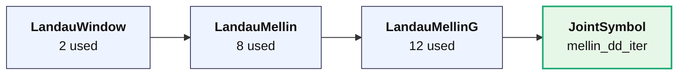

# What `JointSymbol.mellin_dd_iter` rests on

[`JointSymbol.mellin_dd_iter`](../lean_stage3/JointSymbol.md#JointSymbol-mellin_dd_iter) in `lean_stage3/Stage3/JointSymbol.lean`, line 136.

**Proves**

```lean
∫ y in Ioi (1 : ℝ), (dd^[d] cutG) y * (y : ℂ) ^ (-s - 1) = (1 - (2 : ℂ) ^ (-s)) ^ d * LandauMellinG.Phi s
```

**Needs** (its hypotheses)

  - `` hs : 1 < s.re ``
  - `` d : ℕ ``

Behind it: 20 theorems and 7 definitions in 4 files. Every one is listed below; Lean recorded each step.

## The files it passes through



An arrow A → B reads "B uses something proved or defined in A"; indirect arrows are left out. Green: the theorem itself. Yellow: a file in the other tree. The number is how many of that file's declarations are on the way.

## Every declaration on the way

Files in dependency order. ★ marks what the theorem's own proof uses directly.

### [`LandauWindow`](../lean_stage3/LandauWindow.md) — 2

- [`LandauWindow.rampSum`](../lean_stage3/LandauWindow.md#LandauWindow-rampSum) — *def*
- ★ [`LandauWindow.G`](../lean_stage3/LandauWindow.md#LandauWindow-G) — *def*

### [`LandauMellin`](../lean_stage3/LandauMellin.md) — 8

- [`LandauMellin.rampK`](../lean_stage3/LandauMellin.md#LandauMellin-rampK) — *def*
- [`LandauMellin.rampK_eq_indicator`](../lean_stage3/LandauMellin.md#LandauMellin-rampK_eq_indicator) — `` rampK s n y = (Ioi (n : ℝ)).indicator (fun t : ℝ => (1 / (n : ℂ)) * (t : ℂ) ^ (-s) - (t : ℂ) ^ (-s - 1)) y ``
- [`LandauMellin.two_powers_integrableOn`](../lean_stage3/LandauMellin.md#LandauMellin-two_powers_integrableOn) — `` IntegrableOn (fun t : ℝ => (1 / (n : ℂ)) * (t : ℂ) ^ (-s) - (t : ℂ) ^ (-s - 1)) (Ioi (n : ℝ)) ``
- [`LandauMellin.rampK_integrable`](../lean_stage3/LandauMellin.md#LandauMellin-rampK_integrable) — `` IntegrableOn (rampK s n) (Ioi 1) ``
- [`LandauMellin.rampK_integral`](../lean_stage3/LandauMellin.md#LandauMellin-rampK_integral) — `` ∫ y in Ioi (1 : ℝ), rampK s n y = (n : ℂ) ^ (-s) / (s * (s - 1)) ``
- [`LandauMellin.rampK_integral_norm`](../lean_stage3/LandauMellin.md#LandauMellin-rampK_integral_norm) — `` ∫ y in Ioi (1 : ℝ), ‖rampK s n y‖ = (n : ℝ) ^ (-s.re) / (s.re * (s.re - 1)) ``
- [`LandauMellin.rampSum_eq_tsum`](../lean_stage3/LandauMellin.md#LandauMellin-rampSum_eq_tsum) — `` LandauWindow.rampSum y = ∑' n : ℕ, Λ n * max (y / n - 1) 0 ``
- [`LandauMellin.mellin_rampSum`](../lean_stage3/LandauMellin.md#LandauMellin-mellin_rampSum) — `` ∫ y in Ioi (1 : ℝ), (LandauWindow.rampSum y : ℂ) * (y : ℂ) ^ (-s - 1) = -deriv riemannZeta s / riemannZeta s / (s * (s - 1)) ``

### [`LandauMellinG`](../lean_stage3/LandauMellinG.md) — 12

- ★ [`LandauMellinG.Phi`](../lean_stage3/LandauMellinG.md#LandauMellinG-Phi) — *def*
- [`LandauMellinG.LSeries_vonMangoldt_real_ne_zero`](../lean_stage3/LandauMellinG.md#LandauMellinG-LSeries_vonMangoldt_real_ne_zero) — `` L ↗Λ (σ : ℂ) ≠ 0 ``
- [`LandauMellinG.rampSum_mellin_integrable`](../lean_stage3/LandauMellinG.md#LandauMellinG-rampSum_mellin_integrable) — `` IntegrableOn (fun y : ℝ => (LandauWindow.rampSum y : ℂ) * (y : ℂ) ^ (-s - 1)) (Ioi 1) ``
- [`LandauMellinG.logPrim`](../lean_stage3/LandauMellinG.md#LandauMellinG-logPrim) — *def*
- [`LandauMellinG.hasDerivAt_logPrim`](../lean_stage3/LandauMellinG.md#LandauMellinG-hasDerivAt_logPrim) — `` HasDerivAt (logPrim s) ((Real.log y : ℂ) * (y : ℂ) ^ (-s)) y ``
- [`LandauMellinG.log_cpow_norm_le`](../lean_stage3/LandauMellinG.md#LandauMellinG-log_cpow_norm_le) — `` ‖(Real.log y : ℂ) * (y : ℂ) ^ (-s)‖ ≤ y ^ ((s.re - 1) / 2 - s.re) / ((s.re - 1) / 2) ``
- [`LandauMellinG.log_cpow_integrable`](../lean_stage3/LandauMellinG.md#LandauMellinG-log_cpow_integrable) — `` IntegrableOn (fun y : ℝ => (Real.log y : ℂ) * (y : ℂ) ^ (-s)) (Ioi 1) ``
- [`LandauMellinG.tendsto_logPrim`](../lean_stage3/LandauMellinG.md#LandauMellinG-tendsto_logPrim) — `` Tendsto (logPrim s) atTop (𝓝 0) ``
- [`LandauMellinG.log_cpow_integral`](../lean_stage3/LandauMellinG.md#LandauMellinG-log_cpow_integral) — `` ∫ y in Ioi (1 : ℝ), (Real.log y : ℂ) * (y : ℂ) ^ (-s) = 1 / (s - 1) ^ 2 ``
- [`LandauMellinG.G_integrand_eq`](../lean_stage3/LandauMellinG.md#LandauMellinG-G_integrand_eq) — `` (LandauWindow.G y : ℂ) * (y : ℂ) ^ (-s - 1) = (LandauWindow.rampSum y : ℂ) * (y : ℂ) ^ (-s - 1) - (Real.log y : ℂ) * (y : ℂ) ^ (-s) + (1 + (Real.eulerMascheroni… ``
- ★ [`LandauMellinG.G_mellin_integrable`](../lean_stage3/LandauMellinG.md#LandauMellinG-G_mellin_integrable) — `` IntegrableOn (fun y : ℝ => (LandauWindow.G y : ℂ) * (y : ℂ) ^ (-s - 1)) (Ioi 1) ``
- ★ [`LandauMellinG.mellin_G`](../lean_stage3/LandauMellinG.md#LandauMellinG-mellin_G) — `` ∫ y in Ioi (1 : ℝ), (LandauWindow.G y : ℂ) * (y : ℂ) ^ (-s - 1) = Phi s ``

### [`JointSymbol`](../lean_stage3/JointSymbol.md) — 5

- ★ [`JointSymbol.dd`](../lean_stage3/JointSymbol.md#JointSymbol-dd) — *def*
- ★ [`JointSymbol.cutG`](../lean_stage3/JointSymbol.md#JointSymbol-cutG) — *def*
- [`JointSymbol.mellin_shift`](../lean_stage3/JointSymbol.md#JointSymbol-mellin_shift) — `` IntegrableOn (fun y : ℝ => f (y / 2) * (y : ℂ) ^ (-s - 1)) (Ioi 1) ∧ ∫ y in Ioi (1 : ℝ), f (y / 2) * (y : ℂ) ^ (-s - 1) = (2 : ℂ) ^ (-s) * ∫ y in Ioi (1 : ℝ), f… ``
- [`JointSymbol.mellin_dd`](../lean_stage3/JointSymbol.md#JointSymbol-mellin_dd) — `` (∀ y : ℝ, y ≤ 1 → dd f y = 0) ∧ IntegrableOn (fun y : ℝ => dd f y * (y : ℂ) ^ (-s - 1)) (Ioi 1) ∧ ∫ y in Ioi (1 : ℝ), dd f y * (y : ℂ) ^ (-s - 1) = (1 - (2 : ℂ)… ``
- ★ [`JointSymbol.mellin_dd_iter_aux`](../lean_stage3/JointSymbol.md#JointSymbol-mellin_dd_iter_aux) — `` (∀ y : ℝ, y ≤ 1 → (dd^[d] f) y = 0) ∧ IntegrableOn (fun y : ℝ => (dd^[d] f) y * (y : ℂ) ^ (-s - 1)) (Ioi 1) ∧ ∫ y in Ioi (1 : ℝ), (dd^[d] f) y * (y : ℂ) ^ (-s -… ``

