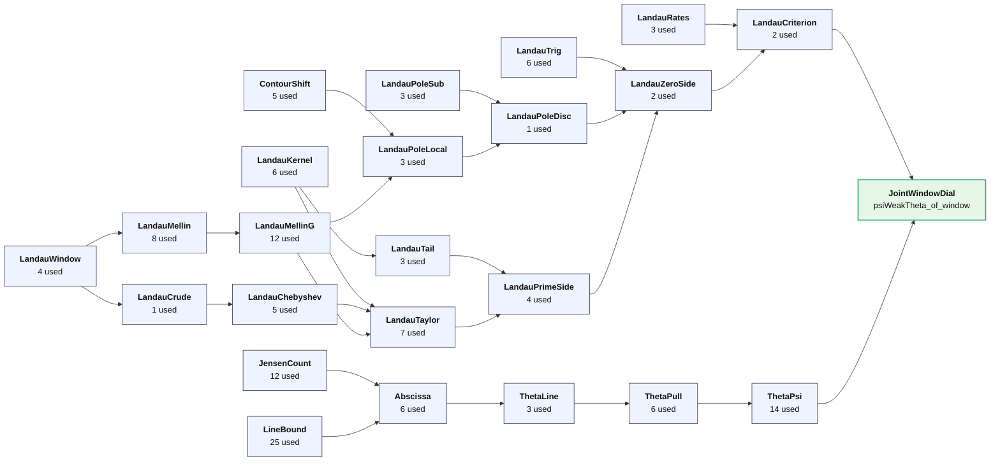

# What `JointWindowDial.psiWeakTheta_of_window` rests on

[`JointWindowDial.psiWeakTheta_of_window`](../lean_stage3/JointWindowDial.md#JointWindowDial-psiWeakTheta_of_window) in `lean_stage3/Stage3/JointWindowDial.lean`, line 42.

**Why.** For `1/2 ≤ θ < 1` and `0 < δ`, a window bound on `G` at `θ` gives `C' > 0` and `x₀` with `|ψ(t) − t| ≤ C'·t^θ·log³ t` for all `t ≥ x₀`.

**Proves**

```lean
∃ C' > 0, ∃ x₀ : ℝ, ∀ t : ℝ, x₀ ≤ t → |Chebyshev.psi t - t| ≤ C' * t ^ θ * Real.log t ^ 3
```

**Needs** (its hypotheses)

  - `` hθlo : 1 / 2 ≤ θ ``
  - `` hθ1 : θ < 1 ``
  - `` hδ : 0 < δ ``
  - `` hW : LandauWindow.WindowBound θ δ C ``

Behind it: 129 theorems and 13 definitions in 24 files. Every one is listed below; Lean recorded each step.

## The files it passes through



An arrow A → B reads "B uses something proved or defined in A"; indirect arrows are left out. Green: the theorem itself. Yellow: a file in the other tree. The number is how many of that file's declarations are on the way.

## Every declaration on the way

Files in dependency order. ★ marks what the theorem's own proof uses directly.

### [`ContourShift`](../lean_stage3/ContourShift.md) — 5

- [`ContourShift.zeta_analyticAt`](../lean_stage3/ContourShift.md#ContourShift-zeta_analyticAt) — `` AnalyticAt ℂ riemannZeta ρ ``
- [`ContourShift.one_le_zeta_order`](../lean_stage3/ContourShift.md#ContourShift-one_le_zeta_order) — `` 1 ≤ analyticOrderNatAt riemannZeta ρ ``
- [`ContourShift.zeta_order_ne_top`](../lean_stage3/ContourShift.md#ContourShift-zeta_order_ne_top) — `` analyticOrderAt riemannZeta ρ ≠ ⊤ ``
- [`ContourShift.analyticAt_conj_conj`](../lean_stage3/ContourShift.md#ContourShift-analyticAt_conj_conj) — `` AnalyticAt ℂ (fun w ↦ (starRingEnd ℂ) (g ((starRingEnd ℂ) w))) ((starRingEnd ℂ) p) ``
- [`ContourShift.zeta_order_conj`](../lean_stage3/ContourShift.md#ContourShift-zeta_order_conj) — `` analyticOrderNatAt riemannZeta ((starRingEnd ℂ) ρ) = analyticOrderNatAt riemannZeta ρ ``

### [`JensenCount`](../lean_stage3/JensenCount.md) — 12

- [`Stage3.zeta_centre_lower`](../lean_stage3/JensenCount.md#Stage3-zeta_centre_lower) — `` (1 : ℝ) / 3 ≤ ‖ζ (2 + Complex.I * T)‖ ``
- [`Stage3.zeta_disk_upper`](../lean_stage3/JensenCount.md#Stage3-zeta_disk_upper) — `` ‖ζ w‖ ≤ 28 * T ``
- [`Stage3.zeta_centre_ne_zero`](../lean_stage3/JensenCount.md#Stage3-zeta_centre_ne_zero) — `` ζ (2 + Complex.I * (T : ℂ)) ≠ 0 ``
- [`Stage3.pole_away`](../lean_stage3/JensenCount.md#Stage3-pole_away) — `` 2 * z + (2 + Complex.I * (T : ℂ)) ≠ 1 ``
- [`Stage3.pole_away_centre`](../lean_stage3/JensenCount.md#Stage3-pole_away_centre) — `` v ≠ 1 ``
- [`Stage3.zetaWindowTwo_finite`](../lean_stage3/JensenCount.md#Stage3-zetaWindowTwo_finite) — `` {ρ : ℂ | ζ ρ = 0 ∧ ‖ρ - (2 + Complex.I * (T : ℂ))‖ ≤ 2}.Finite ``
- [`Stage3.jensenF`](../lean_stage3/JensenCount.md#Stage3-jensenF) — *def*
- [`Stage3.zeta_comp_analytic`](../lean_stage3/JensenCount.md#Stage3-zeta_comp_analytic) — `` AnalyticAt ℂ (fun z : ℂ => ζ (2 * z + (2 + Complex.I * (T : ℂ)))) w ``
- [`Stage3.jensenF_analytic`](../lean_stage3/JensenCount.md#Stage3-jensenF_analytic) — `` AnalyticOnNhd ℂ (jensenF T) (Metric.closedBall (0 : ℂ) 1) ``
- [`Stage3.jensenF_zero_eq_one`](../lean_stage3/JensenCount.md#Stage3-jensenF_zero_eq_one) — `` jensenF T 0 = 1 ``
- [`Stage3.jensenF_zeros_finite`](../lean_stage3/JensenCount.md#Stage3-jensenF_zeros_finite) — `` (SetOfZeros 1 (jensenF T)).Finite ``
- [`Stage3.jensenF_bound`](../lean_stage3/JensenCount.md#Stage3-jensenF_bound) — `` ‖jensenF T z‖ ≤ 84 * T ``

### [`LandauKernel`](../lean_stage3/LandauKernel.md) — 6

- [`LandauKernel.log_pow_le`](../lean_stage3/LandauKernel.md#LandauKernel-log_pow_le) — `` Real.log y ^ n ≤ y ^ (a / 2) / (a / (2 * (n + 1))) ^ n ``
- [`LandauKernel.kernel_le`](../lean_stage3/LandauKernel.md#LandauKernel-kernel_le) — `` Real.log y ^ n * y ^ (-a - 1) ≤ y ^ (-(a / 2) - 1) / (a / (2 * (n + 1))) ^ n ``
- [`LandauKernel.log_pow_integrable`](../lean_stage3/LandauKernel.md#LandauKernel-log_pow_integrable) — `` IntegrableOn (fun y : ℝ => Real.log y ^ n * y ^ (-a - 1)) (Ioi 1) ``
- [`LandauKernel.tendsto_log_pow_mul`](../lean_stage3/LandauKernel.md#LandauKernel-tendsto_log_pow_mul) — `` Tendsto (fun y : ℝ => Real.log y ^ n * y ^ (-a)) atTop (𝓝 0) ``
- [`LandauKernel.hasDerivAt_prim`](../lean_stage3/LandauKernel.md#LandauKernel-hasDerivAt_prim) — `` HasDerivAt (fun t : ℝ => -(Real.log t ^ (k + 1) * t ^ (-a)) / a) (Real.log y ^ (k + 1) * y ^ (-a - 1) - ((k : ℝ) + 1) / a * (Real.log y ^ k * y ^ (-a - 1))) y ``
- [`LandauKernel.log_pow_integral`](../lean_stage3/LandauKernel.md#LandauKernel-log_pow_integral) — `` ∫ y in Ioi (1 : ℝ), Real.log y ^ k * y ^ (-a - 1) = k.factorial / a ^ (k + 1) ``

### [`LandauPoleSub`](../lean_stage3/LandauPoleSub.md) — 3

- [`LandauPoleSub.iteratedDeriv_inv_sub`](../lean_stage3/LandauPoleSub.md#LandauPoleSub-iteratedDeriv_inv_sub) — `` iteratedDeriv k (fun s : ℂ => (s - q)⁻¹) c = (-1) ^ k * (k.factorial : ℂ) * (c - q) ^ (-1 - (k : ℤ)) ``
- [`LandauPoleSub.exists_differentiableOn_sub_poles`](../lean_stage3/LandauPoleSub.md#LandauPoleSub-exists_differentiableOn_sub_poles) — `` ∃ g : ℂ → ℂ, DifferentiableOn ℂ g U ∧ ∀ s, s ∉ P → g s = f s - ∑ q ∈ P, A q / (s - q) ``
- [`LandauPoleSub.taylor_coeff_sub_poles`](../lean_stage3/LandauPoleSub.md#LandauPoleSub-taylor_coeff_sub_poles) — `` ∃ C : ℝ, ∀ k : ℕ, ‖iteratedDeriv k f c - ∑ q ∈ P, A q * ((-1) ^ k * (k.factorial : ℂ) * (c - q) ^ (-1 - (k : ℤ)))‖ ≤ k.factorial * C / R ^ k ``

### [`LandauRates`](../lean_stage3/LandauRates.md) — 3

- [`LandauRates.key_ineq`](../lean_stage3/LandauRates.md#LandauRates-key_ineq) — `` 4 * (lam - Real.log (1 - δ / 12)) < (1 + δ) * (Real.log (1 + δ / 3) - lam) ∧ 0 < Real.log (1 + δ / 3) - lam ∧ 0 < lam - Real.log (1 - δ / 12) ``
- [`LandauRates.exists_centre`](../lean_stage3/LandauRates.md#LandauRates-exists_centre) — `` ∃ σ₀ : ℝ, 1 < σ₀ ∧ ‖(σ₀ : ℂ) - ρ₀‖ < σ₀ - θ ∧ ‖(σ₀ : ℂ) - ρ₀‖ ≤ (σ₀ - 1) * (1 + δ ^ 2 / 240) ``
- [`LandauRates.exists_pow_small`](../lean_stage3/LandauRates.md#LandauRates-exists_pow_small) — `` ∃ K : ℕ, ∀ k : ℕ, K ≤ k → c * q ^ k < ε ``

### [`LandauTail`](../lean_stage3/LandauTail.md) — 3

- [`LandauTail.kernel_nonneg`](../lean_stage3/LandauTail.md#LandauTail-kernel_nonneg) — `` 0 ≤ᵐ[volume.restrict (Ioi (1 : ℝ))] fun y : ℝ => Real.log y ^ k * y ^ (-a - 1) ``
- [`LandauTail.lower_tail_le`](../lean_stage3/LandauTail.md#LandauTail-lower_tail_le) — `` ∫ y in Ioc (1 : ℝ) Y, Real.log y ^ k * y ^ (-a - 1) ≤ Y ^ b * (k.factorial / (a + b) ^ (k + 1)) ``
- [`LandauTail.upper_tail_le`](../lean_stage3/LandauTail.md#LandauTail-upper_tail_le) — `` ∫ y in Ioi Z, Real.log y ^ k * y ^ (-a - 1) ≤ Z ^ (-b) * (k.factorial / (a - b) ^ (k + 1)) ``

### [`LandauTrig`](../lean_stage3/LandauTrig.md) — 6

- [`LandauTrig.norm_geom_Ico_le`](../lean_stage3/LandauTrig.md#LandauTrig-norm_geom_Ico_le) — `` ‖∑ n ∈ Finset.Ico a (a + N), w ^ n‖ ≤ 2 / ‖w - 1‖ ``
- [`LandauTrig.re_mul_geom_ge`](../lean_stage3/LandauTrig.md#LandauTrig-re_mul_geom_ge) — `` -(‖c‖ * (2 / ‖w - 1‖)) ≤ (c * ∑ n ∈ Finset.Ico a (a + N), w ^ n).re ``
- [`LandauTrig.sum_block_ge`](../lean_stage3/LandauTrig.md#LandauTrig-sum_block_ge) — `` -(∑ j ∈ s, ‖c j‖ * (2 / ‖z j - 1‖)) ≤ ∑ n ∈ Finset.Ico a (a + N), T n ``
- [`LandauTrig.abs_le_sum_norm`](../lean_stage3/LandauTrig.md#LandauTrig-abs_le_sum_norm) — `` |T n| ≤ ∑ j ∈ s, ‖c j‖ ``
- [`LandauTrig.sum_sq_block_ge`](../lean_stage3/LandauTrig.md#LandauTrig-sum_sq_block_ge) — `` (N : ℝ) * ∑ j ∈ s, ‖c j‖ ^ 2 - ∑ j ∈ s, ∑ l ∈ s, (if j = l then 0 else ‖c j‖ * ‖c l‖ * (2 / ‖z j * conj (z l) - 1‖)) ≤ ∑ n ∈ Finset.Ico a (a + N), T n ^ 2 ``
- [`LandauTrig.exists_large_in_block`](../lean_stage3/LandauTrig.md#LandauTrig-exists_large_in_block) — `` ∃ τ : ℝ, 0 < τ ∧ ∃ N₀ : ℕ, ∀ a N : ℕ, N₀ ≤ N → ∃ n ∈ Finset.Ico a (a + N), τ ≤ T n ``

### [`LandauWindow`](../lean_stage3/LandauWindow.md) — 4

- [`LandauWindow.rampSum`](../lean_stage3/LandauWindow.md#LandauWindow-rampSum) — *def*
- [`LandauWindow.G`](../lean_stage3/LandauWindow.md#LandauWindow-G) — *def*
- ★ [`LandauWindow.WindowBound`](../lean_stage3/LandauWindow.md#LandauWindow-WindowBound) — *def*
- [`LandauWindow.StmtLandauWindow`](../lean_stage3/LandauWindow.md#LandauWindow-StmtLandauWindow) — *def*

### [`LandauCrude`](../lean_stage3/LandauCrude.md) — 1

- [`LandauCrude.rampSum_nonneg`](../lean_stage3/LandauCrude.md#LandauCrude-rampSum_nonneg) — `` 0 ≤ LandauWindow.rampSum y ``

### [`LandauChebyshev`](../lean_stage3/LandauChebyshev.md) — 5

- [`LandauChebyshev.rampSum_le_log`](../lean_stage3/LandauChebyshev.md#LandauChebyshev-rampSum_le_log) — `` LandauWindow.rampSum y ≤ y * (Real.log y + (Real.log 4 + 4)) ``
- [`LandauChebyshev.log_four_lt_two`](../lean_stage3/LandauChebyshev.md#LandauChebyshev-log_four_lt_two) — `` Real.log 4 < 2 ``
- [`LandauChebyshev.G_le`](../lean_stage3/LandauChebyshev.md#LandauChebyshev-G_le) — `` LandauWindow.G y ≤ 8 * y ``
- [`LandauChebyshev.neg_le_G`](../lean_stage3/LandauChebyshev.md#LandauChebyshev-neg_le_G) — `` -(y * Real.log y) ≤ LandauWindow.G y ``
- [`LandauChebyshev.abs_G_le_log`](../lean_stage3/LandauChebyshev.md#LandauChebyshev-abs_G_le_log) — `` |LandauWindow.G y| ≤ 8 * y * (1 + Real.log y) ``

### [`LandauMellin`](../lean_stage3/LandauMellin.md) — 8

- [`LandauMellin.rampK`](../lean_stage3/LandauMellin.md#LandauMellin-rampK) — *def*
- [`LandauMellin.rampK_eq_indicator`](../lean_stage3/LandauMellin.md#LandauMellin-rampK_eq_indicator) — `` rampK s n y = (Ioi (n : ℝ)).indicator (fun t : ℝ => (1 / (n : ℂ)) * (t : ℂ) ^ (-s) - (t : ℂ) ^ (-s - 1)) y ``
- [`LandauMellin.two_powers_integrableOn`](../lean_stage3/LandauMellin.md#LandauMellin-two_powers_integrableOn) — `` IntegrableOn (fun t : ℝ => (1 / (n : ℂ)) * (t : ℂ) ^ (-s) - (t : ℂ) ^ (-s - 1)) (Ioi (n : ℝ)) ``
- [`LandauMellin.rampK_integrable`](../lean_stage3/LandauMellin.md#LandauMellin-rampK_integrable) — `` IntegrableOn (rampK s n) (Ioi 1) ``
- [`LandauMellin.rampK_integral`](../lean_stage3/LandauMellin.md#LandauMellin-rampK_integral) — `` ∫ y in Ioi (1 : ℝ), rampK s n y = (n : ℂ) ^ (-s) / (s * (s - 1)) ``
- [`LandauMellin.rampK_integral_norm`](../lean_stage3/LandauMellin.md#LandauMellin-rampK_integral_norm) — `` ∫ y in Ioi (1 : ℝ), ‖rampK s n y‖ = (n : ℝ) ^ (-s.re) / (s.re * (s.re - 1)) ``
- [`LandauMellin.rampSum_eq_tsum`](../lean_stage3/LandauMellin.md#LandauMellin-rampSum_eq_tsum) — `` LandauWindow.rampSum y = ∑' n : ℕ, Λ n * max (y / n - 1) 0 ``
- [`LandauMellin.mellin_rampSum`](../lean_stage3/LandauMellin.md#LandauMellin-mellin_rampSum) — `` ∫ y in Ioi (1 : ℝ), (LandauWindow.rampSum y : ℂ) * (y : ℂ) ^ (-s - 1) = -deriv riemannZeta s / riemannZeta s / (s * (s - 1)) ``

### [`LandauMellinG`](../lean_stage3/LandauMellinG.md) — 12

- [`LandauMellinG.Phi`](../lean_stage3/LandauMellinG.md#LandauMellinG-Phi) — *def*
- [`LandauMellinG.LSeries_vonMangoldt_real_ne_zero`](../lean_stage3/LandauMellinG.md#LandauMellinG-LSeries_vonMangoldt_real_ne_zero) — `` L ↗Λ (σ : ℂ) ≠ 0 ``
- [`LandauMellinG.rampSum_mellin_integrable`](../lean_stage3/LandauMellinG.md#LandauMellinG-rampSum_mellin_integrable) — `` IntegrableOn (fun y : ℝ => (LandauWindow.rampSum y : ℂ) * (y : ℂ) ^ (-s - 1)) (Ioi 1) ``
- [`LandauMellinG.logPrim`](../lean_stage3/LandauMellinG.md#LandauMellinG-logPrim) — *def*
- [`LandauMellinG.hasDerivAt_logPrim`](../lean_stage3/LandauMellinG.md#LandauMellinG-hasDerivAt_logPrim) — `` HasDerivAt (logPrim s) ((Real.log y : ℂ) * (y : ℂ) ^ (-s)) y ``
- [`LandauMellinG.log_cpow_norm_le`](../lean_stage3/LandauMellinG.md#LandauMellinG-log_cpow_norm_le) — `` ‖(Real.log y : ℂ) * (y : ℂ) ^ (-s)‖ ≤ y ^ ((s.re - 1) / 2 - s.re) / ((s.re - 1) / 2) ``
- [`LandauMellinG.log_cpow_integrable`](../lean_stage3/LandauMellinG.md#LandauMellinG-log_cpow_integrable) — `` IntegrableOn (fun y : ℝ => (Real.log y : ℂ) * (y : ℂ) ^ (-s)) (Ioi 1) ``
- [`LandauMellinG.tendsto_logPrim`](../lean_stage3/LandauMellinG.md#LandauMellinG-tendsto_logPrim) — `` Tendsto (logPrim s) atTop (𝓝 0) ``
- [`LandauMellinG.log_cpow_integral`](../lean_stage3/LandauMellinG.md#LandauMellinG-log_cpow_integral) — `` ∫ y in Ioi (1 : ℝ), (Real.log y : ℂ) * (y : ℂ) ^ (-s) = 1 / (s - 1) ^ 2 ``
- [`LandauMellinG.G_integrand_eq`](../lean_stage3/LandauMellinG.md#LandauMellinG-G_integrand_eq) — `` (LandauWindow.G y : ℂ) * (y : ℂ) ^ (-s - 1) = (LandauWindow.rampSum y : ℂ) * (y : ℂ) ^ (-s - 1) - (Real.log y : ℂ) * (y : ℂ) ^ (-s) + (1 + (Real.eulerMascheroni… ``
- [`LandauMellinG.G_mellin_integrable`](../lean_stage3/LandauMellinG.md#LandauMellinG-G_mellin_integrable) — `` IntegrableOn (fun y : ℝ => (LandauWindow.G y : ℂ) * (y : ℂ) ^ (-s - 1)) (Ioi 1) ``
- [`LandauMellinG.mellin_G`](../lean_stage3/LandauMellinG.md#LandauMellinG-mellin_G) — `` ∫ y in Ioi (1 : ℝ), (LandauWindow.G y : ℂ) * (y : ℂ) ^ (-s - 1) = Phi s ``

### [`LandauPoleLocal`](../lean_stage3/LandauPoleLocal.md) — 3

- [`LandauPoleLocal.differentiableAt_Phi`](../lean_stage3/LandauPoleLocal.md#LandauPoleLocal-differentiableAt_Phi) — `` DifferentiableAt ℂ LandauMellinG.Phi s ``
- [`LandauPoleLocal.Phi_principal_part`](../lean_stage3/LandauPoleLocal.md#LandauPoleLocal-Phi_principal_part) — `` ∃ h : ℂ → ℂ, AnalyticAt ℂ h ρ ∧ ∀ᶠ s in 𝓝[≠] ρ, LandauMellinG.Phi s = h s + (analyticOrderNatAt riemannZeta ρ : ℂ) / (ρ * (1 - ρ)) / (s - ρ) ``
- [`LandauPoleLocal.Phi_regular_at_one`](../lean_stage3/LandauPoleLocal.md#LandauPoleLocal-Phi_regular_at_one) — `` ∃ h : ℂ → ℂ, AnalyticAt ℂ h 1 ∧ ∀ᶠ s in 𝓝[≠] 1, LandauMellinG.Phi s = h s ``

### [`LandauPoleDisc`](../lean_stage3/LandauPoleDisc.md) — 1

- [`LandauPoleDisc.Phi_taylor_on_disc`](../lean_stage3/LandauPoleDisc.md#LandauPoleDisc-Phi_taylor_on_disc) — `` ∃ (P : Finset ℂ) (C : ℝ), (∀ ρ, ρ ∈ P ↔ ρ ∈ ball c R₂ ∧ ρ ≠ 1 ∧ riemannZeta ρ = 0) ∧ ∀ k : ℕ, ‖iteratedDeriv k LandauMellinG.Phi c - ∑ ρ ∈ P, (analyticOrderNatA… ``

### [`LandauTaylor`](../lean_stage3/LandauTaylor.md) — 7

- [`LandauTaylor.mellinLog`](../lean_stage3/LandauTaylor.md#LandauTaylor-mellinLog) — *def*
- [`LandauTaylor.integrand_norm_le`](../lean_stage3/LandauTaylor.md#LandauTaylor-integrand_norm_le) — `` ‖(LandauWindow.G y : ℂ) * (-(Real.log y : ℂ)) ^ k * (y : ℂ) ^ (-s - 1)‖ ≤ 8 * (Real.log y ^ k * y ^ (-a - 1) + Real.log y ^ (k + 1) * y ^ (-a - 1)) ``
- [`LandauTaylor.bound_integrable`](../lean_stage3/LandauTaylor.md#LandauTaylor-bound_integrable) — `` IntegrableOn (fun y : ℝ => 8 * (Real.log y ^ k * y ^ (-a - 1) + Real.log y ^ (k + 1) * y ^ (-a - 1))) (Ioi 1) ``
- [`LandauTaylor.mellinLog_integrable`](../lean_stage3/LandauTaylor.md#LandauTaylor-mellinLog_integrable) — `` IntegrableOn (fun y : ℝ => (LandauWindow.G y : ℂ) * (-(Real.log y : ℂ)) ^ k * (y : ℂ) ^ (-s - 1)) (Ioi 1) ``
- [`LandauTaylor.mellinLog_hasDerivAt`](../lean_stage3/LandauTaylor.md#LandauTaylor-mellinLog_hasDerivAt) — `` HasDerivAt (mellinLog k) (mellinLog (k + 1) s) s ``
- [`LandauTaylor.iteratedDeriv_Phi`](../lean_stage3/LandauTaylor.md#LandauTaylor-iteratedDeriv_Phi) — `` iteratedDeriv k LandauMellinG.Phi s = mellinLog k s ``
- [`LandauTaylor.mellinLog_real`](../lean_stage3/LandauTaylor.md#LandauTaylor-mellinLog_real) — `` mellinLog k (σ : ℂ) = (-1) ^ k * ((∫ y in Ioi (1 : ℝ), LandauWindow.G y * Real.log y ^ k * y ^ (-σ - 1) : ℝ) : ℂ) ``

### [`LandauPrimeSide`](../lean_stage3/LandauPrimeSide.md) — 4

- [`LandauPrimeSide.Ik`](../lean_stage3/LandauPrimeSide.md#LandauPrimeSide-Ik) — *def*
- [`LandauPrimeSide.Ik_integrable`](../lean_stage3/LandauPrimeSide.md#LandauPrimeSide-Ik_integrable) — `` IntegrableOn (fun y : ℝ => LandauWindow.G y * Real.log y ^ k * y ^ (-σ - 1)) (Ioi 1) ``
- [`LandauPrimeSide.iteratedDeriv_Phi_eq_Ik`](../lean_stage3/LandauPrimeSide.md#LandauPrimeSide-iteratedDeriv_Phi_eq_Ik) — `` iteratedDeriv k LandauMellinG.Phi (σ : ℂ) = (-1) ^ k * ((Ik σ k : ℝ) : ℂ) ``
- [`LandauPrimeSide.Ik_le`](../lean_stage3/LandauPrimeSide.md#LandauPrimeSide-Ik_le) — `` Ik σ k ≤ C * (k.factorial / (σ - θ) ^ (k + 1)) + 8 * (Y ^ b * (k.factorial / (σ - 1 + b) ^ (k + 1))) + 8 * ((Y ^ (1 + δ)) ^ (-b') * (k.factorial / (σ - 1 - b') … ``

### [`LandauZeroSide`](../lean_stage3/LandauZeroSide.md) — 2

- [`LandauZeroSide.exists_gap`](../lean_stage3/LandauZeroSide.md#LandauZeroSide-exists_gap) — `` ∃ R₂ : ℝ, r < R₂ ∧ R₂ ≤ R₃ ∧ ∀ ρ ∈ F, ‖c - ρ‖ < R₂ → ‖c - ρ‖ ≤ r ``
- [`LandauZeroSide.zero_side`](../lean_stage3/LandauZeroSide.md#LandauZeroSide-zero_side) — `` ∃ r R τ C₁ : ℝ, ∃ N₀ : ℕ, σ₀ - 1 < r ∧ r ≤ ‖(σ₀ : ℂ) - ρ₀‖ ∧ r < R ∧ 0 < τ ∧ 0 ≤ C₁ ∧ ∀ a N : ℕ, N₀ ≤ N → ∃ k ∈ Finset.Ico a (a + N), τ / r ^ (k + 1) - C₁ / R ^… ``

### [`LandauCriterion`](../lean_stage3/LandauCriterion.md) — 2

- [`LandauCriterion.contradiction`](../lean_stage3/LandauCriterion.md#LandauCriterion-contradiction) — `` False ``
- [`LandauCriterion.stmtLandauWindow`](../lean_stage3/LandauCriterion.md#LandauCriterion-stmtLandauWindow) — `` LandauWindow.StmtLandauWindow ``

### [`LineBound`](../lean_stage3/LineBound.md) — 25

- [`Slice3.finalBoundConst_le`](../lean_stage3/LineBound.md#Slice3-finalBoundConst_le) — `` 16 * ((181:ℝ)/200) ^ 2 / ((181/200) - (3/4)) ^ 3 + 1 / (((15/16:ℝ) ^ 2 / (29/32) - 29/32) * Real.log ((15/16)/(29/32))) ≤ 3991 ``
- [`Slice4.zetaE`](../lean_stage3/LineBound.md#Slice4-zetaE) — *def*
- [`Slice4.zetaE_eq`](../lean_stage3/LineBound.md#Slice4-zetaE_eq) — `` zetaE s = (s - 1) * ζ s ``
- [`Slice4.zetaE_one`](../lean_stage3/LineBound.md#Slice4-zetaE_one) — `` zetaE 1 = 1 ``
- [`Slice4.zetaE_differentiableAt_of_ne`](../lean_stage3/LineBound.md#Slice4-zetaE_differentiableAt_of_ne) — `` DifferentiableAt ℂ zetaE s ``
- [`Slice4.zetaE_differentiable`](../lean_stage3/LineBound.md#Slice4-zetaE_differentiable) — `` Differentiable ℂ zetaE ``
- [`Slice4.logDeriv_zetaE`](../lean_stage3/LineBound.md#Slice4-logDeriv_zetaE) — `` deriv zetaE s / zetaE s = 1 / (s - 1) + deriv ζ s / ζ s ``
- [`Slice4.zetaE_disk_upper`](../lean_stage3/LineBound.md#Slice4-zetaE_disk_upper) — `` ‖zetaE w‖ ≤ 430 ``
- [`Slice4.log_1300_le`](../lean_stage3/LineBound.md#Slice4-log_1300_le) — `` Real.log 1300 ≤ 7.28 ``
- [`Slice4b.logDerivZeta_norm_neg`](../lean_stage3/LineBound.md#Slice4b-logDerivZeta_norm_neg) — `` ‖deriv ζ ((σ : ℂ) + I * ((-t : ℝ) : ℂ)) / ζ ((σ : ℂ) + I * ((-t : ℝ) : ℂ))‖ = ‖deriv ζ ((σ : ℂ) + I * (t : ℂ)) / ζ ((σ : ℂ) + I * (t : ℂ))‖ ``
- [`RHPull.norm_sq_line`](../lean_stage3/LineBound.md#RHPull-norm_sq_line) — `` ‖((σ : ℂ) + I * (t : ℂ))‖ ^ 2 = σ ^ 2 + t ^ 2 ``
- [`RHPull.kernel_modulus_le`](../lean_stage3/LineBound.md#RHPull-kernel_modulus_le) — `` ‖((x : ℂ)) ^ (w - 1)‖ ≤ 2 ``
- [`RHPull.mellin_bump_bounded`](../lean_stage3/LineBound.md#RHPull-mellin_bump_bounded) — `` ∃ B > 0, ∀ w : ℂ, 0 < w.re → w.re ≤ 2 → ‖mellin (fun x ↦ (ν x : ℂ)) w‖ ≤ B ``
- [`RHPull.mellin_smooth1_le`](../lean_stage3/LineBound.md#RHPull-mellin_smooth1_le) — `` ‖mellin (fun x ↦ (Smooth1 ν ε x : ℂ)) s‖ ≤ B * ‖s‖⁻¹ ``
- [`RHPull.integral_shift_inv`](../lean_stage3/LineBound.md#RHPull-integral_shift_inv) — `` ∫ t in (0:ℝ)..T, (1 + t)⁻¹ = Real.log (1 + T) ``
- [`RHPull.integral_abs_kernel`](../lean_stage3/LineBound.md#RHPull-integral_abs_kernel) — `` ∫ t in (-T)..T, (1 + |t|)⁻¹ = 2 * Real.log (1 + T) ``
- [`RHPull.psi_sub_self_le`](../lean_stage3/LineBound.md#RHPull-psi_sub_self_le) — `` |ψ X - X| ≤ E₁ + E₂ + E₃ ``
- [`RHPull.bump_exists`](../lean_stage3/LineBound.md#RHPull-bump_exists) — `` ∃ ν : ℝ → ℝ, ContDiff ℝ 1 ν ∧ (∀ x > 0, 0 ≤ ν x) ∧ ν.support ⊆ Set.Icc (1/2 : ℝ) 2 ∧ ∫ x in Set.Ioi (0:ℝ), ν x / x = 1 ``
- [`RHPull.norm_ge_height`](../lean_stage3/LineBound.md#RHPull-norm_ge_height) — `` T ≤ ‖((σ : ℂ)) + I * (T : ℂ)‖ ``
- [`RHPull.mellin_horiz_le`](../lean_stage3/LineBound.md#RHPull-mellin_horiz_le) — `` ‖mellin (fun x ↦ (Smooth1 ν ε x : ℂ)) ((σ : ℂ) + I * (T : ℂ))‖ ≤ B / T ``
- [`RHPull.horiz_small`](../lean_stage3/LineBound.md#RHPull-horiz_small) — `` (1 / (2 * Real.pi)) * (1 / 2) * ((1996 * Real.log (84 * X) + (29 * Real.log X + 129) * Real.log X) * (B / X) * (Real.exp 1 * X)) ≤ (900 * Real.exp 1 * B / Real.… ``
- [`RHPull.mellin_main_const`](../lean_stage3/LineBound.md#RHPull-mellin_main_const) — `` ∃ Cmain > 0, ∃ ε₀ > 0, ∀ ε : ℝ, 0 < ε → ε < ε₀ → ‖mellin (fun x ↦ (Smooth1 ν ε x : ℂ)) 1 - 1‖ ≤ Cmain * ε ``
- [`RHPull.norm_ge_height_neg`](../lean_stage3/LineBound.md#RHPull-norm_ge_height_neg) — `` T ≤ ‖((σ : ℂ)) - (T : ℂ) * I‖ ``
- [`RHPull.mellin_horiz_le_neg`](../lean_stage3/LineBound.md#RHPull-mellin_horiz_le_neg) — `` ‖mellin (fun x ↦ (Smooth1 ν ε x : ℂ)) ((σ : ℂ) - (T : ℂ) * I)‖ ≤ B / T ``
- [`RHPull.rpow_one_add`](../lean_stage3/LineBound.md#RHPull-rpow_one_add) — `` X ^ (1 + 1 / Real.log X) = Real.exp 1 * X ``

### [`Abscissa`](../lean_stage3/Abscissa.md) — 6

- [`Stage3.σθ`](../lean_stage3/Abscissa.md#Stage3---) — *def*
- [`Stage3.σθ_re`](../lean_stage3/Abscissa.md#Stage3---_re) — `` ((σθ θ X : ℂ) + I * (t : ℂ)).re = σθ θ X ``
- [`Stage3.StmtZeroFreeRight`](../lean_stage3/Abscissa.md#Stage3-StmtZeroFreeRight) — *def*
- [`Stage3.zeta_ne_zero_right_of`](../lean_stage3/Abscissa.md#Stage3-zeta_ne_zero_right_of) — `` ζ s ≠ 0 ``
- [`Stage3.rpow_σθ`](../lean_stage3/Abscissa.md#Stage3-rpow_--) — `` X ^ (σθ θ X) = Real.exp 1 * X ^ θ ``
- [`Stage3.logDerivZeta_crude_theta`](../lean_stage3/Abscissa.md#Stage3-logDerivZeta_crude_theta) — `` ‖deriv ζ ((σ₁ : ℂ) + I * (t : ℂ)) / ζ ((σ₁ : ℂ) + I * (t : ℂ))‖ ≤ 1996 * Real.log (84 * t) + (29 * Real.log t + 129) / (σ₁ - θ) ``

### [`ThetaLine`](../lean_stage3/ThetaLine.md) — 3

- [`Stage3.logDerivZeta_compact_theta`](../lean_stage3/ThetaLine.md#Stage3-logDerivZeta_compact_theta) — `` ‖deriv ζ ((σ₁ : ℂ) + I * (t : ℂ)) / ζ ((σ₁ : ℂ) + I * (t : ℂ))‖ ≤ 14530 + 2 / (1 - θ) + 212 / (σ₁ - θ) ``
- [`Stage3.logDerivZeta_sq_at_X_theta`](../lean_stage3/ThetaLine.md#Stage3-logDerivZeta_sq_at_X_theta) — `` ‖deriv ζ (((θ + 1/Real.log X : ℝ)) + I * (t : ℂ)) / ζ (((θ + 1/Real.log X : ℝ)) + I * (t : ℂ))‖ ≤ 11100 * (Real.log X) ^ 2 ``
- [`Stage3.logDerivZeta_line_theta`](../lean_stage3/ThetaLine.md#Stage3-logDerivZeta_line_theta) — `` ‖deriv ζ (((θ + 1/Real.log X : ℝ)) + I * (t : ℂ)) / ζ (((θ + 1/Real.log X : ℝ)) + I * (t : ℂ))‖ ≤ 11100 * (Real.log X) ^ 2 ``

### [`ThetaPull`](../lean_stage3/ThetaPull.md) — 6

- [`Stage3.half_lt_σθ`](../lean_stage3/ThetaPull.md#Stage3-half_lt_--) — `` (1:ℝ)/2 < σθ θ X ``
- [`Stage3.four_le_log_of_theta`](../lean_stage3/ThetaPull.md#Stage3-four_le_log_of_theta) — `` (4:ℝ) ≤ Real.log X ``
- [`Stage3.norm_line_ge_theta`](../lean_stage3/ThetaPull.md#Stage3-norm_line_ge_theta) — `` (1 + |t|) / 3 ≤ ‖((σθ θ X : ℂ)) + I * (t : ℂ)‖ ``
- [`Stage3.integrand_norm_le_theta`](../lean_stage3/ThetaPull.md#Stage3-integrand_norm_le_theta) — `` ‖SmoothedChebyshevIntegrand ν ε X ((σθ θ X : ℂ) + I * (t : ℂ))‖ ≤ 11100 * (Real.log X) ^ 2 * M * X ^ (σθ θ X) ``
- [`Stage3.I37_norm_le_epsfree_theta`](../lean_stage3/ThetaPull.md#Stage3-I37_norm_le_epsfree_theta) — `` ‖I₃₇ ν ε T X (σθ θ X)‖ ≤ (1 / (2 * Real.pi)) * (6 * Real.log (1 + T)) * (11100 * (Real.log X) ^ 2 * B * X ^ (σθ θ X)) ``
- [`Stage3.I37_power_log3_theta`](../lean_stage3/ThetaPull.md#Stage3-I37_power_log3_theta) — `` ‖I₃₇ ν ε T X (σθ θ X)‖ ≤ (66600 * Real.exp 1 * B / Real.pi) * X ^ θ * (Real.log X) ^ 3 ``

### [`ThetaPsi`](../lean_stage3/ThetaPsi.md) — 14

- [`Stage3.inv_log_le_theta`](../lean_stage3/ThetaPsi.md#Stage3-inv_log_le_theta) — `` 1 / Real.log X ≤ (1 - θ) / 2 ``
- [`Stage3.σθ_lt_one`](../lean_stage3/ThetaPsi.md#Stage3---_lt_one) — `` σθ θ X < 1 ``
- [`Stage3.lt_σθ`](../lean_stage3/ThetaPsi.md#Stage3-lt_--) — `` θ < σθ θ X ``
- [`Stage3.horiz_length_theta`](../lean_stage3/ThetaPsi.md#Stage3-horiz_length_theta) — `` (1 + 1 / Real.log X) - σθ θ X = 1 - θ ``
- [`Stage3.holo_logDerivZeta_theta`](../lean_stage3/ThetaPsi.md#Stage3-holo_logDerivZeta_theta) — `` HolomorphicOn (deriv riemannZeta / riemannZeta) (Set.Icc σ₁ 2 ×ℂ Set.Icc (-T) T \ {1}) ``
- [`Stage3.pull_at_theta_abscissa`](../lean_stage3/ThetaPsi.md#Stage3-pull_at_theta_abscissa) — `` SmoothedChebyshev SmoothingF ε X = I₁ SmoothingF ε X T - I₂ SmoothingF ε T X (σθ θ X) + I₃₇ SmoothingF ε T X (σθ θ X) + I₈ SmoothingF ε T X (σθ θ X) + I₉ Smooth… ``
- [`Stage3.integrand_norm_le_horiz_theta`](../lean_stage3/ThetaPsi.md#Stage3-integrand_norm_le_horiz_theta) — `` ‖SmoothedChebyshevIntegrand ν ε X ((σ : ℂ) + I * (t : ℂ))‖ ≤ (1996 * Real.log (84 * t) + (29 * Real.log t + 129) * Real.log X) * M * X ^ σ ``
- [`Stage3.integrand_norm_le_horiz_neg_theta`](../lean_stage3/ThetaPsi.md#Stage3-integrand_norm_le_horiz_neg_theta) — `` ‖SmoothedChebyshevIntegrand ν ε X ((σ : ℂ) - (T : ℂ) * I)‖ ≤ (1996 * Real.log (84 * T) + (29 * Real.log T + 129) * Real.log X) * M * X ^ σ ``
- [`Stage3.I8_norm_le_theta`](../lean_stage3/ThetaPsi.md#Stage3-I8_norm_le_theta) — `` ‖I₈ ν ε T X (σθ θ X)‖ ≤ (1 / (2 * Real.pi)) * (1 - θ) * ((1996 * Real.log (84 * T) + (29 * Real.log T + 129) * Real.log X) * M * X ^ (1 + 1 / Real.log X)) ``
- [`Stage3.I2_norm_le_theta`](../lean_stage3/ThetaPsi.md#Stage3-I2_norm_le_theta) — `` ‖I₂ ν ε T X (σθ θ X)‖ ≤ (1 / (2 * Real.pi)) * (1 - θ) * ((1996 * Real.log (84 * T) + (29 * Real.log T + 129) * Real.log X) * M * X ^ (1 + 1 / Real.log X)) ``
- [`Stage3.mellin_vert_le_theta`](../lean_stage3/ThetaPsi.md#Stage3-mellin_vert_le_theta) — `` ‖mellin (fun x ↦ (Smooth1 ν ε x : ℂ)) ((σθ θ X : ℂ) + I * (t : ℂ))‖ ≤ B * ‖((σθ θ X : ℂ)) + I * (t : ℂ)‖⁻¹ ``
- [`Stage3.contour_at_instantiation_theta`](../lean_stage3/ThetaPsi.md#Stage3-contour_at_instantiation_theta) — `` ‖SmoothedChebyshev ν ε X - mellin (fun x ↦ (Smooth1 ν ε x : ℂ)) 1 * X‖ ≤ B₁ + B₉ + (66600 * Real.exp 1 * B / Real.pi) * X ^ θ * (Real.log X) ^ 3 + (1 / (2 * Rea… ``
- [`Stage3.theta_instantiation_arithmetic`](../lean_stage3/ThetaPsi.md#Stage3-theta_instantiation_arithmetic) — `` c * (X ^ (1 - θ))⁻¹ * X * Real.log X ≤ c * X ^ θ * (Real.log X) ^ 3 ∧ c * X * Real.log X / ((X ^ (1 - θ))⁻¹ * X) ≤ c * X ^ θ * (Real.log X) ^ 3 ∧ c * ((X ^ (1 -… ``
- ★ [`Stage3.psi_weak_of_theta`](../lean_stage3/ThetaPsi.md#Stage3-psi_weak_of_theta) — `` ∃ C > 0, ∃ x₀ : ℝ, ∀ t : ℝ, x₀ ≤ t → |ψ t - t| ≤ C * t ^ θ * (Real.log t) ^ 3 ``

### [`JointWindowDial`](../lean_stage3/JointWindowDial.md) — 1

- ★ [`JointWindowDial.zeroFreeRight_of_window`](../lean_stage3/JointWindowDial.md#JointWindowDial-zeroFreeRight_of_window) — `` Stage3.StmtZeroFreeRight θ ``

