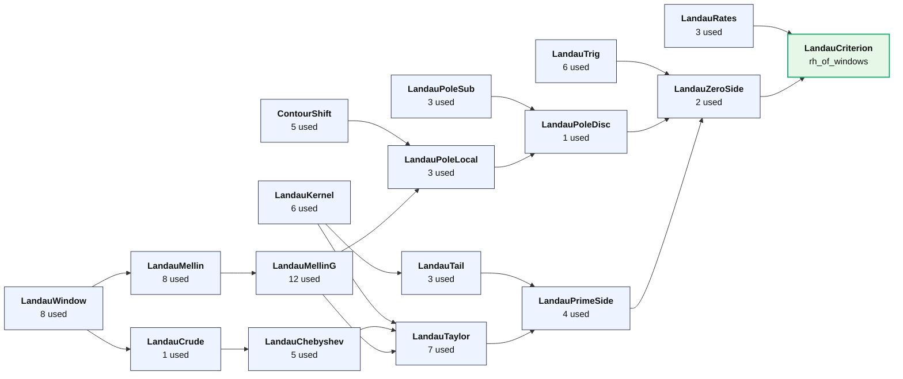

# What `LandauCriterion.rh_of_windows` rests on

[`LandauCriterion.rh_of_windows`](../lean_stage3/LandauCriterion.md#LandauCriterion-rh_of_windows) in `lean_stage3/Stage3/LandauCriterion.lean`, line 230.

**Why.** Conditional: if for every `θ` in `(1/2, 1)` there are `δ > 0` and `C` with the window bound `WindowBound θ δ C`, then `RiemannHypothesis` holds. The window bound is a hypothesis of this statement.

**Proves**

```lean
RiemannHypothesis
```

**Needs** (its hypotheses)

  - `` hW : ∀ θ : ℝ, 1 / 2 < θ → θ < 1 → ∃ δ C : ℝ, 0 < δ ∧ LandauWindow.WindowBound θ δ C ``

Behind it: 70 theorems and 9 definitions in 17 files. Every one is listed below; Lean recorded each step.

## The files it passes through



An arrow A → B reads "B uses something proved or defined in A"; indirect arrows are left out. Green: the theorem itself. Yellow: a file in the other tree. The number is how many of that file's declarations are on the way.

## Every declaration on the way

Files in dependency order. ★ marks what the theorem's own proof uses directly.

### [`ContourShift`](../lean_stage3/ContourShift.md) — 5

- [`ContourShift.zeta_analyticAt`](../lean_stage3/ContourShift.md#ContourShift-zeta_analyticAt) — `` AnalyticAt ℂ riemannZeta ρ ``
- [`ContourShift.one_le_zeta_order`](../lean_stage3/ContourShift.md#ContourShift-one_le_zeta_order) — `` 1 ≤ analyticOrderNatAt riemannZeta ρ ``
- [`ContourShift.zeta_order_ne_top`](../lean_stage3/ContourShift.md#ContourShift-zeta_order_ne_top) — `` analyticOrderAt riemannZeta ρ ≠ ⊤ ``
- [`ContourShift.analyticAt_conj_conj`](../lean_stage3/ContourShift.md#ContourShift-analyticAt_conj_conj) — `` AnalyticAt ℂ (fun w ↦ (starRingEnd ℂ) (g ((starRingEnd ℂ) w))) ((starRingEnd ℂ) p) ``
- [`ContourShift.zeta_order_conj`](../lean_stage3/ContourShift.md#ContourShift-zeta_order_conj) — `` analyticOrderNatAt riemannZeta ((starRingEnd ℂ) ρ) = analyticOrderNatAt riemannZeta ρ ``

### [`LandauKernel`](../lean_stage3/LandauKernel.md) — 6

- [`LandauKernel.log_pow_le`](../lean_stage3/LandauKernel.md#LandauKernel-log_pow_le) — `` Real.log y ^ n ≤ y ^ (a / 2) / (a / (2 * (n + 1))) ^ n ``
- [`LandauKernel.kernel_le`](../lean_stage3/LandauKernel.md#LandauKernel-kernel_le) — `` Real.log y ^ n * y ^ (-a - 1) ≤ y ^ (-(a / 2) - 1) / (a / (2 * (n + 1))) ^ n ``
- [`LandauKernel.log_pow_integrable`](../lean_stage3/LandauKernel.md#LandauKernel-log_pow_integrable) — `` IntegrableOn (fun y : ℝ => Real.log y ^ n * y ^ (-a - 1)) (Ioi 1) ``
- [`LandauKernel.tendsto_log_pow_mul`](../lean_stage3/LandauKernel.md#LandauKernel-tendsto_log_pow_mul) — `` Tendsto (fun y : ℝ => Real.log y ^ n * y ^ (-a)) atTop (𝓝 0) ``
- [`LandauKernel.hasDerivAt_prim`](../lean_stage3/LandauKernel.md#LandauKernel-hasDerivAt_prim) — `` HasDerivAt (fun t : ℝ => -(Real.log t ^ (k + 1) * t ^ (-a)) / a) (Real.log y ^ (k + 1) * y ^ (-a - 1) - ((k : ℝ) + 1) / a * (Real.log y ^ k * y ^ (-a - 1))) y ``
- [`LandauKernel.log_pow_integral`](../lean_stage3/LandauKernel.md#LandauKernel-log_pow_integral) — `` ∫ y in Ioi (1 : ℝ), Real.log y ^ k * y ^ (-a - 1) = k.factorial / a ^ (k + 1) ``

### [`LandauPoleSub`](../lean_stage3/LandauPoleSub.md) — 3

- [`LandauPoleSub.iteratedDeriv_inv_sub`](../lean_stage3/LandauPoleSub.md#LandauPoleSub-iteratedDeriv_inv_sub) — `` iteratedDeriv k (fun s : ℂ => (s - q)⁻¹) c = (-1) ^ k * (k.factorial : ℂ) * (c - q) ^ (-1 - (k : ℤ)) ``
- [`LandauPoleSub.exists_differentiableOn_sub_poles`](../lean_stage3/LandauPoleSub.md#LandauPoleSub-exists_differentiableOn_sub_poles) — `` ∃ g : ℂ → ℂ, DifferentiableOn ℂ g U ∧ ∀ s, s ∉ P → g s = f s - ∑ q ∈ P, A q / (s - q) ``
- [`LandauPoleSub.taylor_coeff_sub_poles`](../lean_stage3/LandauPoleSub.md#LandauPoleSub-taylor_coeff_sub_poles) — `` ∃ C : ℝ, ∀ k : ℕ, ‖iteratedDeriv k f c - ∑ q ∈ P, A q * ((-1) ^ k * (k.factorial : ℂ) * (c - q) ^ (-1 - (k : ℤ)))‖ ≤ k.factorial * C / R ^ k ``

### [`LandauRates`](../lean_stage3/LandauRates.md) — 3

- [`LandauRates.key_ineq`](../lean_stage3/LandauRates.md#LandauRates-key_ineq) — `` 4 * (lam - Real.log (1 - δ / 12)) < (1 + δ) * (Real.log (1 + δ / 3) - lam) ∧ 0 < Real.log (1 + δ / 3) - lam ∧ 0 < lam - Real.log (1 - δ / 12) ``
- [`LandauRates.exists_centre`](../lean_stage3/LandauRates.md#LandauRates-exists_centre) — `` ∃ σ₀ : ℝ, 1 < σ₀ ∧ ‖(σ₀ : ℂ) - ρ₀‖ < σ₀ - θ ∧ ‖(σ₀ : ℂ) - ρ₀‖ ≤ (σ₀ - 1) * (1 + δ ^ 2 / 240) ``
- [`LandauRates.exists_pow_small`](../lean_stage3/LandauRates.md#LandauRates-exists_pow_small) — `` ∃ K : ℕ, ∀ k : ℕ, K ≤ k → c * q ^ k < ε ``

### [`LandauTail`](../lean_stage3/LandauTail.md) — 3

- [`LandauTail.kernel_nonneg`](../lean_stage3/LandauTail.md#LandauTail-kernel_nonneg) — `` 0 ≤ᵐ[volume.restrict (Ioi (1 : ℝ))] fun y : ℝ => Real.log y ^ k * y ^ (-a - 1) ``
- [`LandauTail.lower_tail_le`](../lean_stage3/LandauTail.md#LandauTail-lower_tail_le) — `` ∫ y in Ioc (1 : ℝ) Y, Real.log y ^ k * y ^ (-a - 1) ≤ Y ^ b * (k.factorial / (a + b) ^ (k + 1)) ``
- [`LandauTail.upper_tail_le`](../lean_stage3/LandauTail.md#LandauTail-upper_tail_le) — `` ∫ y in Ioi Z, Real.log y ^ k * y ^ (-a - 1) ≤ Z ^ (-b) * (k.factorial / (a - b) ^ (k + 1)) ``

### [`LandauTrig`](../lean_stage3/LandauTrig.md) — 6

- [`LandauTrig.norm_geom_Ico_le`](../lean_stage3/LandauTrig.md#LandauTrig-norm_geom_Ico_le) — `` ‖∑ n ∈ Finset.Ico a (a + N), w ^ n‖ ≤ 2 / ‖w - 1‖ ``
- [`LandauTrig.re_mul_geom_ge`](../lean_stage3/LandauTrig.md#LandauTrig-re_mul_geom_ge) — `` -(‖c‖ * (2 / ‖w - 1‖)) ≤ (c * ∑ n ∈ Finset.Ico a (a + N), w ^ n).re ``
- [`LandauTrig.sum_block_ge`](../lean_stage3/LandauTrig.md#LandauTrig-sum_block_ge) — `` -(∑ j ∈ s, ‖c j‖ * (2 / ‖z j - 1‖)) ≤ ∑ n ∈ Finset.Ico a (a + N), T n ``
- [`LandauTrig.abs_le_sum_norm`](../lean_stage3/LandauTrig.md#LandauTrig-abs_le_sum_norm) — `` |T n| ≤ ∑ j ∈ s, ‖c j‖ ``
- [`LandauTrig.sum_sq_block_ge`](../lean_stage3/LandauTrig.md#LandauTrig-sum_sq_block_ge) — `` (N : ℝ) * ∑ j ∈ s, ‖c j‖ ^ 2 - ∑ j ∈ s, ∑ l ∈ s, (if j = l then 0 else ‖c j‖ * ‖c l‖ * (2 / ‖z j * conj (z l) - 1‖)) ≤ ∑ n ∈ Finset.Ico a (a + N), T n ^ 2 ``
- [`LandauTrig.exists_large_in_block`](../lean_stage3/LandauTrig.md#LandauTrig-exists_large_in_block) — `` ∃ τ : ℝ, 0 < τ ∧ ∃ N₀ : ℕ, ∀ a N : ℕ, N₀ ≤ N → ∃ n ∈ Finset.Ico a (a + N), τ ≤ T n ``

### [`LandauWindow`](../lean_stage3/LandauWindow.md) — 8

- [`LandauWindow.rampSum`](../lean_stage3/LandauWindow.md#LandauWindow-rampSum) — *def*
- [`LandauWindow.G`](../lean_stage3/LandauWindow.md#LandauWindow-G) — *def*
- ★ [`LandauWindow.WindowBound`](../lean_stage3/LandauWindow.md#LandauWindow-WindowBound) — *def*
- [`LandauWindow.StmtLandauWindow`](../lean_stage3/LandauWindow.md#LandauWindow-StmtLandauWindow) — *def*
- [`LandauWindow.zeta_neg_nat_ne_zero`](../lean_stage3/LandauWindow.md#LandauWindow-zeta_neg_nat_ne_zero) — `` riemannZeta (-(n : ℂ)) ≠ 0 ``
- [`LandauWindow.rh_of_zeroFree_half`](../lean_stage3/LandauWindow.md#LandauWindow-rh_of_zeroFree_half) — `` RiemannHypothesis ``
- [`LandauWindow.zeroFree_half_of_window`](../lean_stage3/LandauWindow.md#LandauWindow-zeroFree_half_of_window) — `` ∀ s : ℂ, 1 / 2 < s.re → riemannZeta s ≠ 0 ``
- ★ [`LandauWindow.rh_of_window`](../lean_stage3/LandauWindow.md#LandauWindow-rh_of_window) — `` RiemannHypothesis ``

### [`LandauCrude`](../lean_stage3/LandauCrude.md) — 1

- [`LandauCrude.rampSum_nonneg`](../lean_stage3/LandauCrude.md#LandauCrude-rampSum_nonneg) — `` 0 ≤ LandauWindow.rampSum y ``

### [`LandauChebyshev`](../lean_stage3/LandauChebyshev.md) — 5

- [`LandauChebyshev.rampSum_le_log`](../lean_stage3/LandauChebyshev.md#LandauChebyshev-rampSum_le_log) — `` LandauWindow.rampSum y ≤ y * (Real.log y + (Real.log 4 + 4)) ``
- [`LandauChebyshev.log_four_lt_two`](../lean_stage3/LandauChebyshev.md#LandauChebyshev-log_four_lt_two) — `` Real.log 4 < 2 ``
- [`LandauChebyshev.G_le`](../lean_stage3/LandauChebyshev.md#LandauChebyshev-G_le) — `` LandauWindow.G y ≤ 8 * y ``
- [`LandauChebyshev.neg_le_G`](../lean_stage3/LandauChebyshev.md#LandauChebyshev-neg_le_G) — `` -(y * Real.log y) ≤ LandauWindow.G y ``
- [`LandauChebyshev.abs_G_le_log`](../lean_stage3/LandauChebyshev.md#LandauChebyshev-abs_G_le_log) — `` |LandauWindow.G y| ≤ 8 * y * (1 + Real.log y) ``

### [`LandauMellin`](../lean_stage3/LandauMellin.md) — 8

- [`LandauMellin.rampK`](../lean_stage3/LandauMellin.md#LandauMellin-rampK) — *def*
- [`LandauMellin.rampK_eq_indicator`](../lean_stage3/LandauMellin.md#LandauMellin-rampK_eq_indicator) — `` rampK s n y = (Ioi (n : ℝ)).indicator (fun t : ℝ => (1 / (n : ℂ)) * (t : ℂ) ^ (-s) - (t : ℂ) ^ (-s - 1)) y ``
- [`LandauMellin.two_powers_integrableOn`](../lean_stage3/LandauMellin.md#LandauMellin-two_powers_integrableOn) — `` IntegrableOn (fun t : ℝ => (1 / (n : ℂ)) * (t : ℂ) ^ (-s) - (t : ℂ) ^ (-s - 1)) (Ioi (n : ℝ)) ``
- [`LandauMellin.rampK_integrable`](../lean_stage3/LandauMellin.md#LandauMellin-rampK_integrable) — `` IntegrableOn (rampK s n) (Ioi 1) ``
- [`LandauMellin.rampK_integral`](../lean_stage3/LandauMellin.md#LandauMellin-rampK_integral) — `` ∫ y in Ioi (1 : ℝ), rampK s n y = (n : ℂ) ^ (-s) / (s * (s - 1)) ``
- [`LandauMellin.rampK_integral_norm`](../lean_stage3/LandauMellin.md#LandauMellin-rampK_integral_norm) — `` ∫ y in Ioi (1 : ℝ), ‖rampK s n y‖ = (n : ℝ) ^ (-s.re) / (s.re * (s.re - 1)) ``
- [`LandauMellin.rampSum_eq_tsum`](../lean_stage3/LandauMellin.md#LandauMellin-rampSum_eq_tsum) — `` LandauWindow.rampSum y = ∑' n : ℕ, Λ n * max (y / n - 1) 0 ``
- [`LandauMellin.mellin_rampSum`](../lean_stage3/LandauMellin.md#LandauMellin-mellin_rampSum) — `` ∫ y in Ioi (1 : ℝ), (LandauWindow.rampSum y : ℂ) * (y : ℂ) ^ (-s - 1) = -deriv riemannZeta s / riemannZeta s / (s * (s - 1)) ``

### [`LandauMellinG`](../lean_stage3/LandauMellinG.md) — 12

- [`LandauMellinG.Phi`](../lean_stage3/LandauMellinG.md#LandauMellinG-Phi) — *def*
- [`LandauMellinG.LSeries_vonMangoldt_real_ne_zero`](../lean_stage3/LandauMellinG.md#LandauMellinG-LSeries_vonMangoldt_real_ne_zero) — `` L ↗Λ (σ : ℂ) ≠ 0 ``
- [`LandauMellinG.rampSum_mellin_integrable`](../lean_stage3/LandauMellinG.md#LandauMellinG-rampSum_mellin_integrable) — `` IntegrableOn (fun y : ℝ => (LandauWindow.rampSum y : ℂ) * (y : ℂ) ^ (-s - 1)) (Ioi 1) ``
- [`LandauMellinG.logPrim`](../lean_stage3/LandauMellinG.md#LandauMellinG-logPrim) — *def*
- [`LandauMellinG.hasDerivAt_logPrim`](../lean_stage3/LandauMellinG.md#LandauMellinG-hasDerivAt_logPrim) — `` HasDerivAt (logPrim s) ((Real.log y : ℂ) * (y : ℂ) ^ (-s)) y ``
- [`LandauMellinG.log_cpow_norm_le`](../lean_stage3/LandauMellinG.md#LandauMellinG-log_cpow_norm_le) — `` ‖(Real.log y : ℂ) * (y : ℂ) ^ (-s)‖ ≤ y ^ ((s.re - 1) / 2 - s.re) / ((s.re - 1) / 2) ``
- [`LandauMellinG.log_cpow_integrable`](../lean_stage3/LandauMellinG.md#LandauMellinG-log_cpow_integrable) — `` IntegrableOn (fun y : ℝ => (Real.log y : ℂ) * (y : ℂ) ^ (-s)) (Ioi 1) ``
- [`LandauMellinG.tendsto_logPrim`](../lean_stage3/LandauMellinG.md#LandauMellinG-tendsto_logPrim) — `` Tendsto (logPrim s) atTop (𝓝 0) ``
- [`LandauMellinG.log_cpow_integral`](../lean_stage3/LandauMellinG.md#LandauMellinG-log_cpow_integral) — `` ∫ y in Ioi (1 : ℝ), (Real.log y : ℂ) * (y : ℂ) ^ (-s) = 1 / (s - 1) ^ 2 ``
- [`LandauMellinG.G_integrand_eq`](../lean_stage3/LandauMellinG.md#LandauMellinG-G_integrand_eq) — `` (LandauWindow.G y : ℂ) * (y : ℂ) ^ (-s - 1) = (LandauWindow.rampSum y : ℂ) * (y : ℂ) ^ (-s - 1) - (Real.log y : ℂ) * (y : ℂ) ^ (-s) + (1 + (Real.eulerMascheroni… ``
- [`LandauMellinG.G_mellin_integrable`](../lean_stage3/LandauMellinG.md#LandauMellinG-G_mellin_integrable) — `` IntegrableOn (fun y : ℝ => (LandauWindow.G y : ℂ) * (y : ℂ) ^ (-s - 1)) (Ioi 1) ``
- [`LandauMellinG.mellin_G`](../lean_stage3/LandauMellinG.md#LandauMellinG-mellin_G) — `` ∫ y in Ioi (1 : ℝ), (LandauWindow.G y : ℂ) * (y : ℂ) ^ (-s - 1) = Phi s ``

### [`LandauPoleLocal`](../lean_stage3/LandauPoleLocal.md) — 3

- [`LandauPoleLocal.differentiableAt_Phi`](../lean_stage3/LandauPoleLocal.md#LandauPoleLocal-differentiableAt_Phi) — `` DifferentiableAt ℂ LandauMellinG.Phi s ``
- [`LandauPoleLocal.Phi_principal_part`](../lean_stage3/LandauPoleLocal.md#LandauPoleLocal-Phi_principal_part) — `` ∃ h : ℂ → ℂ, AnalyticAt ℂ h ρ ∧ ∀ᶠ s in 𝓝[≠] ρ, LandauMellinG.Phi s = h s + (analyticOrderNatAt riemannZeta ρ : ℂ) / (ρ * (1 - ρ)) / (s - ρ) ``
- [`LandauPoleLocal.Phi_regular_at_one`](../lean_stage3/LandauPoleLocal.md#LandauPoleLocal-Phi_regular_at_one) — `` ∃ h : ℂ → ℂ, AnalyticAt ℂ h 1 ∧ ∀ᶠ s in 𝓝[≠] 1, LandauMellinG.Phi s = h s ``

### [`LandauPoleDisc`](../lean_stage3/LandauPoleDisc.md) — 1

- [`LandauPoleDisc.Phi_taylor_on_disc`](../lean_stage3/LandauPoleDisc.md#LandauPoleDisc-Phi_taylor_on_disc) — `` ∃ (P : Finset ℂ) (C : ℝ), (∀ ρ, ρ ∈ P ↔ ρ ∈ ball c R₂ ∧ ρ ≠ 1 ∧ riemannZeta ρ = 0) ∧ ∀ k : ℕ, ‖iteratedDeriv k LandauMellinG.Phi c - ∑ ρ ∈ P, (analyticOrderNatA… ``

### [`LandauTaylor`](../lean_stage3/LandauTaylor.md) — 7

- [`LandauTaylor.mellinLog`](../lean_stage3/LandauTaylor.md#LandauTaylor-mellinLog) — *def*
- [`LandauTaylor.integrand_norm_le`](../lean_stage3/LandauTaylor.md#LandauTaylor-integrand_norm_le) — `` ‖(LandauWindow.G y : ℂ) * (-(Real.log y : ℂ)) ^ k * (y : ℂ) ^ (-s - 1)‖ ≤ 8 * (Real.log y ^ k * y ^ (-a - 1) + Real.log y ^ (k + 1) * y ^ (-a - 1)) ``
- [`LandauTaylor.bound_integrable`](../lean_stage3/LandauTaylor.md#LandauTaylor-bound_integrable) — `` IntegrableOn (fun y : ℝ => 8 * (Real.log y ^ k * y ^ (-a - 1) + Real.log y ^ (k + 1) * y ^ (-a - 1))) (Ioi 1) ``
- [`LandauTaylor.mellinLog_integrable`](../lean_stage3/LandauTaylor.md#LandauTaylor-mellinLog_integrable) — `` IntegrableOn (fun y : ℝ => (LandauWindow.G y : ℂ) * (-(Real.log y : ℂ)) ^ k * (y : ℂ) ^ (-s - 1)) (Ioi 1) ``
- [`LandauTaylor.mellinLog_hasDerivAt`](../lean_stage3/LandauTaylor.md#LandauTaylor-mellinLog_hasDerivAt) — `` HasDerivAt (mellinLog k) (mellinLog (k + 1) s) s ``
- [`LandauTaylor.iteratedDeriv_Phi`](../lean_stage3/LandauTaylor.md#LandauTaylor-iteratedDeriv_Phi) — `` iteratedDeriv k LandauMellinG.Phi s = mellinLog k s ``
- [`LandauTaylor.mellinLog_real`](../lean_stage3/LandauTaylor.md#LandauTaylor-mellinLog_real) — `` mellinLog k (σ : ℂ) = (-1) ^ k * ((∫ y in Ioi (1 : ℝ), LandauWindow.G y * Real.log y ^ k * y ^ (-σ - 1) : ℝ) : ℂ) ``

### [`LandauPrimeSide`](../lean_stage3/LandauPrimeSide.md) — 4

- [`LandauPrimeSide.Ik`](../lean_stage3/LandauPrimeSide.md#LandauPrimeSide-Ik) — *def*
- [`LandauPrimeSide.Ik_integrable`](../lean_stage3/LandauPrimeSide.md#LandauPrimeSide-Ik_integrable) — `` IntegrableOn (fun y : ℝ => LandauWindow.G y * Real.log y ^ k * y ^ (-σ - 1)) (Ioi 1) ``
- [`LandauPrimeSide.iteratedDeriv_Phi_eq_Ik`](../lean_stage3/LandauPrimeSide.md#LandauPrimeSide-iteratedDeriv_Phi_eq_Ik) — `` iteratedDeriv k LandauMellinG.Phi (σ : ℂ) = (-1) ^ k * ((Ik σ k : ℝ) : ℂ) ``
- [`LandauPrimeSide.Ik_le`](../lean_stage3/LandauPrimeSide.md#LandauPrimeSide-Ik_le) — `` Ik σ k ≤ C * (k.factorial / (σ - θ) ^ (k + 1)) + 8 * (Y ^ b * (k.factorial / (σ - 1 + b) ^ (k + 1))) + 8 * ((Y ^ (1 + δ)) ^ (-b') * (k.factorial / (σ - 1 - b') … ``

### [`LandauZeroSide`](../lean_stage3/LandauZeroSide.md) — 2

- [`LandauZeroSide.exists_gap`](../lean_stage3/LandauZeroSide.md#LandauZeroSide-exists_gap) — `` ∃ R₂ : ℝ, r < R₂ ∧ R₂ ≤ R₃ ∧ ∀ ρ ∈ F, ‖c - ρ‖ < R₂ → ‖c - ρ‖ ≤ r ``
- [`LandauZeroSide.zero_side`](../lean_stage3/LandauZeroSide.md#LandauZeroSide-zero_side) — `` ∃ r R τ C₁ : ℝ, ∃ N₀ : ℕ, σ₀ - 1 < r ∧ r ≤ ‖(σ₀ : ℂ) - ρ₀‖ ∧ r < R ∧ 0 < τ ∧ 0 ≤ C₁ ∧ ∀ a N : ℕ, N₀ ≤ N → ∃ k ∈ Finset.Ico a (a + N), τ / r ^ (k + 1) - C₁ / R ^… ``

### [`LandauCriterion`](../lean_stage3/LandauCriterion.md) — 2

- [`LandauCriterion.contradiction`](../lean_stage3/LandauCriterion.md#LandauCriterion-contradiction) — `` False ``
- ★ [`LandauCriterion.stmtLandauWindow`](../lean_stage3/LandauCriterion.md#LandauCriterion-stmtLandauWindow) — `` LandauWindow.StmtLandauWindow ``

