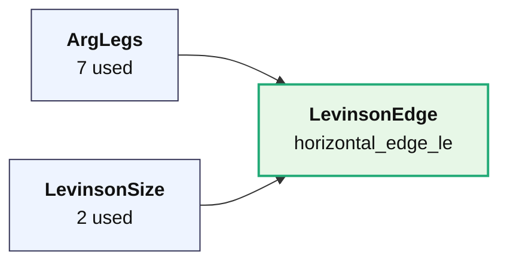

# What `LevinsonEdge.horizontal_edge_le` rests on

[`LevinsonEdge.horizontal_edge_le`](../lean_stage3/LevinsonEdge.md#LevinsonEdge-horizontal_edge_le) in `lean_stage3/Stage3/LevinsonEdge.lean`, line 455.

**Why.** S11 step 1d (ii), the horizontal edge. For `0 ≤ c ≤ 1`, `T ≥ 4`, and `G = ζ + c ζ'` nonzero on the segment `[1/2, 3] + iT`: `|Im ∫_{1/2}^{3} logDeriv G (x + iT) dx| ≤ 21π log T + 133π`.

**Proves**

```lean
|(∫ x in (1/2:ℝ)..3, logDeriv (fun s => riemannZeta s + c * deriv riemannZeta s) (↑x + ↑T * I)).im| ≤ 21 * Real.pi * Real.log T + 133 * Real.pi
```

**Needs** (its hypotheses)

  - `` hc0 : 0 ≤ c ``
  - `` hc1 : c ≤ 1 ``
  - `` hT : 4 ≤ T ``
  - `` hne : ∀ x ∈ Set.Icc (1/2:ℝ) 3, riemannZeta (↑x + ↑T * I) + c * deriv riemannZeta (↑x + ↑T * I) ≠ 0 ``

Behind it: 21 theorems and 2 definitions in 3 files. Every one is listed below; Lean recorded each step.

## The files it passes through



An arrow A → B reads "B uses something proved or defined in A"; indirect arrows are left out. Green: the theorem itself. Yellow: a file in the other tree. The number is how many of that file's declarations are on the way.

## Every declaration on the way

Files in dependency order. ★ marks what the theorem's own proof uses directly.

### [`ArgLegs`](../lean_stage3/ArgLegs.md) — 7

- [`ArgLegs.abs_arg_sub_le_pi`](../lean_stage3/ArgLegs.md#ArgLegs-abs_arg_sub_le_pi) — `` |z.arg - w.arg| ≤ Real.pi ``
- [`ArgLegs.mem_slitPlane_of_re_nonneg`](../lean_stage3/ArgLegs.md#ArgLegs-mem_slitPlane_of_re_nonneg) — `` z ∈ Complex.slitPlane ``
- [`ArgLegs.integral_logDeriv_eq_log_sub`](../lean_stage3/ArgLegs.md#ArgLegs-integral_logDeriv_eq_log_sub) — `` ∫ x in a..b, g' x / g x = Complex.log (g b) - Complex.log (g a) ``
- [`ArgLegs.im_integral_le_pi_of_re_nonneg`](../lean_stage3/ArgLegs.md#ArgLegs-im_integral_le_pi_of_re_nonneg) — `` |(∫ x in a..b, g' x / g x).im| ≤ Real.pi ``
- [`ArgLegs.im_integral_le_pi_of_re_nonpos`](../lean_stage3/ArgLegs.md#ArgLegs-im_integral_le_pi_of_re_nonpos) — `` |(∫ x in a..b, g' x / g x).im| ≤ Real.pi ``
- [`ArgLegs.re_sign_const`](../lean_stage3/ArgLegs.md#ArgLegs-re_sign_const) — `` (∀ x ∈ Set.Icc a b, 0 ≤ (g x).re) ∨ (∀ x ∈ Set.Icc a b, (g x).re ≤ 0) ``
- [`ArgLegs.segment_im_integral_le`](../lean_stage3/ArgLegs.md#ArgLegs-segment_im_integral_le) — `` |(∫ x in a..b, g' x / g x).im| ≤ Real.pi * ((Z.card : ℝ) + 1) ``

### [`LevinsonSize`](../lean_stage3/LevinsonSize.md) — 2

- [`LevinsonSize.deriv_zeta_eq_LSeries`](../lean_stage3/LevinsonSize.md#LevinsonSize-deriv_zeta_eq_LSeries) — `` deriv riemannZeta s = -LSeries (LSeries.logMul 1) s ``
- ★ [`LevinsonSize.norm_G_sub_one_le`](../lean_stage3/LevinsonSize.md#LevinsonSize-norm_G_sub_one_le) — `` ‖riemannZeta s + c * deriv riemannZeta s - 1‖ ≤ Real.pi ^ 2 / 6 - 1 ``

### [`LevinsonEdge`](../lean_stage3/LevinsonEdge.md) — 14

- [`LevinsonEdge.zeta_norm_le`](../lean_stage3/LevinsonEdge.md#LevinsonEdge-zeta_norm_le) — `` ‖riemannZeta u‖ ≤ 2 + 4 * ‖u‖ ``
- [`LevinsonEdge.disc_facts`](../lean_stage3/LevinsonEdge.md#LevinsonEdge-disc_facts) — `` 3 - d ≤ u.re ∧ T - d ≤ u.im ∧ ‖u‖ ≤ d + 3 + T ``
- [`LevinsonEdge.zeta_disc_le`](../lean_stage3/LevinsonEdge.md#LevinsonEdge-zeta_disc_le) — `` ‖riemannZeta u‖ ≤ 4 * T + 25 ``
- [`LevinsonEdge.deriv_zeta_disc_le`](../lean_stage3/LevinsonEdge.md#LevinsonEdge-deriv_zeta_disc_le) — `` ‖deriv riemannZeta w‖ ≤ 32 * T + 200 ``
- ★ [`LevinsonEdge.G_analyticAt`](../lean_stage3/LevinsonEdge.md#LevinsonEdge-G_analyticAt) — `` AnalyticAt ℂ (fun s => riemannZeta s + c * deriv riemannZeta s) w ``
- ★ [`LevinsonEdge.G_disc_le`](../lean_stage3/LevinsonEdge.md#LevinsonEdge-G_disc_le) — `` ‖riemannZeta w + c * deriv riemannZeta w‖ ≤ 36 * T + 225 ``
- [`LevinsonEdge.symm`](../lean_stage3/LevinsonEdge.md#LevinsonEdge-symm) — *def*
- [`LevinsonEdge.model`](../lean_stage3/LevinsonEdge.md#LevinsonEdge-model) — *def*
- [`LevinsonEdge.symm_real`](../lean_stage3/LevinsonEdge.md#LevinsonEdge-symm_real) — `` symm g (x : ℂ) = ((g x).re : ℂ) ``
- [`LevinsonEdge.symm_zero`](../lean_stage3/LevinsonEdge.md#LevinsonEdge-symm_zero) — `` symm g 0 = ((g 0).re : ℂ) ``
- [`LevinsonEdge.symm_differentiableOn`](../lean_stage3/LevinsonEdge.md#LevinsonEdge-symm_differentiableOn) — `` DifferentiableOn ℂ (symm g) (Metric.ball (0 : ℂ) ρ) ``
- [`LevinsonEdge.norm_symm_le`](../lean_stage3/LevinsonEdge.md#LevinsonEdge-norm_symm_le) — `` ‖symm g z‖ ≤ M ``
- [`LevinsonEdge.real_zero_count`](../lean_stage3/LevinsonEdge.md#LevinsonEdge-real_zero_count) — `` ∃ Z : Finset ℝ, (∀ x : ℝ, |x| ≤ 5 / 6 → (g x).re = 0 → x ∈ Z) ∧ (Z.card : ℝ) ≤ 21 * Real.log (M / m) ``
- ★ [`LevinsonEdge.edge_le_of_bound`](../lean_stage3/LevinsonEdge.md#LevinsonEdge-edge_le_of_bound) — `` |(∫ x in (1/2:ℝ)..3, logDeriv G (↑x + ↑T * I)).im| ≤ Real.pi * (21 * Real.log (3 * M) + 1) ``

