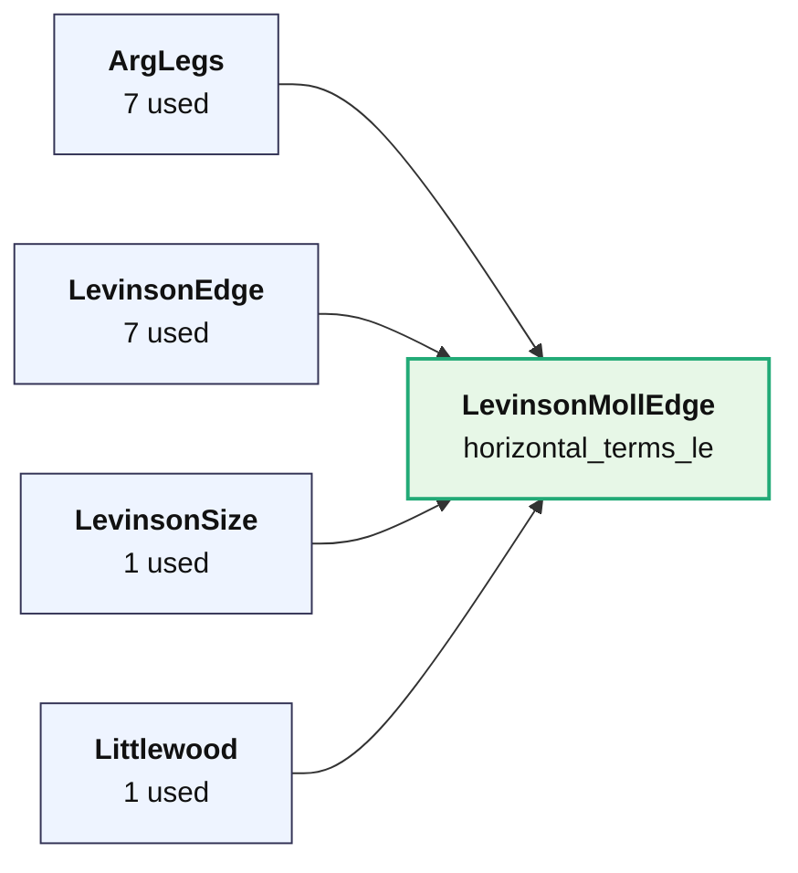

# What `LevinsonMollEdge.horizontal_terms_le` rests on

[`LevinsonMollEdge.horizontal_terms_le`](../lean_stage3/LevinsonMollEdge.md#LevinsonMollEdge-horizontal_terms_le) in `lean_stage3/Stage3/LevinsonMollEdge.lean`, line 805.

**Why.** Target 2, the horizontal edge terms of `levinson_right`. For `X ≥ 3` with `2^X ≥ 32 M B`, `1/4 ≤ σ₀ ≤ X`, `2X ≤ T`, and `f = G ψ` nonzero on `[σ₀, X] + iT`: `|∫_{σ₀}^X edgeH f X T σ dσ| ≤ (X − σ₀) π ((8X − 1)(log T + log M + log B + 8) + 1)`.

**Proves**

```lean
|∫ σ in σ₀..X, edgeH (fun s => (riemannZeta s + c * deriv riemannZeta s) * molli M β s) X T σ| ≤ (X - σ₀) * (Real.pi * ((8 * X - 1) * (Real.log T + Real.log M + Real.log B + 8) + 1))
```

**Needs** (its hypotheses)

  - `` hc0 : 0 ≤ c ``
  - `` hc1 : c ≤ 1 ``
  - `` hM : 1 ≤ M ``
  - `` hβ1 : β 1 = 1 ``
  - `` hβ : ∀ h, ‖β h‖ ≤ B ``
  - `` hX : 3 ≤ X ``
  - `` hXMB : 32 * M * B ≤ (2 : ℝ) ^ X ``
  - `` hσ₀ : 1 / 4 ≤ σ₀ ``
  - `` hσX : σ₀ ≤ X ``
  - `` hXT : 2 * X ≤ T ``
  - `` hne : ∀ x ∈ Set.Icc σ₀ X, (riemannZeta (↑x + ↑T * I) + c * deriv riemannZeta (↑x + ↑T * I)) * molli M β (↑x + ↑T * I) ≠ 0 ``

Behind it: 27 theorems and 5 definitions in 5 files. Every one is listed below; Lean recorded each step.

## The files it passes through



An arrow A → B reads "B uses something proved or defined in A"; indirect arrows are left out. Green: the theorem itself. Yellow: a file in the other tree. The number is how many of that file's declarations are on the way.

## Every declaration on the way

Files in dependency order. ★ marks what the theorem's own proof uses directly.

### [`ArgLegs`](../lean_stage3/ArgLegs.md) — 7

- [`ArgLegs.abs_arg_sub_le_pi`](../lean_stage3/ArgLegs.md#ArgLegs-abs_arg_sub_le_pi) — `` |z.arg - w.arg| ≤ Real.pi ``
- [`ArgLegs.mem_slitPlane_of_re_nonneg`](../lean_stage3/ArgLegs.md#ArgLegs-mem_slitPlane_of_re_nonneg) — `` z ∈ Complex.slitPlane ``
- [`ArgLegs.integral_logDeriv_eq_log_sub`](../lean_stage3/ArgLegs.md#ArgLegs-integral_logDeriv_eq_log_sub) — `` ∫ x in a..b, g' x / g x = Complex.log (g b) - Complex.log (g a) ``
- [`ArgLegs.im_integral_le_pi_of_re_nonneg`](../lean_stage3/ArgLegs.md#ArgLegs-im_integral_le_pi_of_re_nonneg) — `` |(∫ x in a..b, g' x / g x).im| ≤ Real.pi ``
- [`ArgLegs.im_integral_le_pi_of_re_nonpos`](../lean_stage3/ArgLegs.md#ArgLegs-im_integral_le_pi_of_re_nonpos) — `` |(∫ x in a..b, g' x / g x).im| ≤ Real.pi ``
- [`ArgLegs.re_sign_const`](../lean_stage3/ArgLegs.md#ArgLegs-re_sign_const) — `` (∀ x ∈ Set.Icc a b, 0 ≤ (g x).re) ∨ (∀ x ∈ Set.Icc a b, (g x).re ≤ 0) ``
- [`ArgLegs.segment_im_integral_le`](../lean_stage3/ArgLegs.md#ArgLegs-segment_im_integral_le) — `` |(∫ x in a..b, g' x / g x).im| ≤ Real.pi * ((Z.card : ℝ) + 1) ``

### [`LevinsonEdge`](../lean_stage3/LevinsonEdge.md) — 7

- [`LevinsonEdge.G_analyticAt`](../lean_stage3/LevinsonEdge.md#LevinsonEdge-G_analyticAt) — `` AnalyticAt ℂ (fun s => riemannZeta s + c * deriv riemannZeta s) w ``
- [`LevinsonEdge.symm`](../lean_stage3/LevinsonEdge.md#LevinsonEdge-symm) — *def*
- [`LevinsonEdge.model`](../lean_stage3/LevinsonEdge.md#LevinsonEdge-model) — *def*
- [`LevinsonEdge.symm_real`](../lean_stage3/LevinsonEdge.md#LevinsonEdge-symm_real) — `` symm g (x : ℂ) = ((g x).re : ℂ) ``
- [`LevinsonEdge.symm_zero`](../lean_stage3/LevinsonEdge.md#LevinsonEdge-symm_zero) — `` symm g 0 = ((g 0).re : ℂ) ``
- [`LevinsonEdge.symm_differentiableOn`](../lean_stage3/LevinsonEdge.md#LevinsonEdge-symm_differentiableOn) — `` DifferentiableOn ℂ (symm g) (Metric.ball (0 : ℂ) ρ) ``
- [`LevinsonEdge.norm_symm_le`](../lean_stage3/LevinsonEdge.md#LevinsonEdge-norm_symm_le) — `` ‖symm g z‖ ≤ M ``

### [`LevinsonSize`](../lean_stage3/LevinsonSize.md) — 1

- [`LevinsonSize.deriv_zeta_eq_LSeries`](../lean_stage3/LevinsonSize.md#LevinsonSize-deriv_zeta_eq_LSeries) — `` deriv riemannZeta s = -LSeries (LSeries.logMul 1) s ``

### [`Littlewood`](../lean_stage3/Littlewood.md) — 1

- ★ [`Littlewood.edgeH`](../lean_stage3/Littlewood.md#Littlewood-edgeH) — *def*

### [`LevinsonMollEdge`](../lean_stage3/LevinsonMollEdge.md) — 16

- ★ [`LevinsonMollEdge.molli`](../lean_stage3/LevinsonMollEdge.md#LevinsonMollEdge-molli) — *def*
- [`LevinsonMollEdge.tailDelta`](../lean_stage3/LevinsonMollEdge.md#LevinsonMollEdge-tailDelta) — *def*
- ★ [`LevinsonMollEdge.molli_norm_le`](../lean_stage3/LevinsonMollEdge.md#LevinsonMollEdge-molli_norm_le) — `` ‖molli M β s‖ ≤ M * B ``
- [`LevinsonMollEdge.molli_sub_one_le`](../lean_stage3/LevinsonMollEdge.md#LevinsonMollEdge-molli_sub_one_le) — `` ‖molli M β s - 1‖ ≤ M * B / (2 : ℝ) ^ X ``
- [`LevinsonMollEdge.molli_differentiable`](../lean_stage3/LevinsonMollEdge.md#LevinsonMollEdge-molli_differentiable) — `` Differentiable ℂ (molli M β) ``
- [`LevinsonMollEdge.norm_G_sub_one_le_X`](../lean_stage3/LevinsonMollEdge.md#LevinsonMollEdge-norm_G_sub_one_le_X) — `` ‖riemannZeta s + c * deriv riemannZeta s - 1‖ ≤ 8 / (2 : ℝ) ^ X ``
- ★ [`LevinsonMollEdge.f_sub_one_le`](../lean_stage3/LevinsonMollEdge.md#LevinsonMollEdge-f_sub_one_le) — `` ‖(riemannZeta s + c * deriv riemannZeta s) * molli M β s - 1‖ ≤ tailDelta M B X ``
- ★ [`LevinsonMollEdge.tailDelta_le_half`](../lean_stage3/LevinsonMollEdge.md#LevinsonMollEdge-tailDelta_le_half) — `` tailDelta M B X ≤ 1 / 2 ``
- ★ [`LevinsonMollEdge.f_analyticAt`](../lean_stage3/LevinsonMollEdge.md#LevinsonMollEdge-f_analyticAt) — `` AnalyticAt ℂ (fun s => (riemannZeta s + c * deriv riemannZeta s) * molli M β s) w ``
- [`LevinsonMollEdge.zeta_norm_le_sixteenth`](../lean_stage3/LevinsonMollEdge.md#LevinsonMollEdge-zeta_norm_le_sixteenth) — `` ‖riemannZeta u‖ ≤ 2 + 16 * ‖u‖ ``
- ★ [`LevinsonMollEdge.disc_facts_X`](../lean_stage3/LevinsonMollEdge.md#LevinsonMollEdge-disc_facts_X) — `` X - d ≤ u.re ∧ T - d ≤ u.im ∧ ‖u‖ ≤ d + X + T ``
- [`LevinsonMollEdge.zeta_disc_X`](../lean_stage3/LevinsonMollEdge.md#LevinsonMollEdge-zeta_disc_X) — `` ‖riemannZeta u‖ ≤ 33 * T ``
- [`LevinsonMollEdge.deriv_zeta_disc_X`](../lean_stage3/LevinsonMollEdge.md#LevinsonMollEdge-deriv_zeta_disc_X) — `` ‖deriv riemannZeta w‖ ≤ 528 * T ``
- ★ [`LevinsonMollEdge.G_disc_X`](../lean_stage3/LevinsonMollEdge.md#LevinsonMollEdge-G_disc_X) — `` ‖riemannZeta w + c * deriv riemannZeta w‖ ≤ 561 * T ``
- [`LevinsonMollEdge.real_zero_count_gen`](../lean_stage3/LevinsonMollEdge.md#LevinsonMollEdge-real_zero_count_gen) — `` ∃ Z : Finset ℝ, (∀ x : ℝ, |x| ≤ r → (g x).re = 0 → x ∈ Z) ∧ (Z.card : ℝ) ≤ 1 / Real.log (R / r) * Real.log (M / m) ``
- ★ [`LevinsonMollEdge.edge_le_gen`](../lean_stage3/LevinsonMollEdge.md#LevinsonMollEdge-edge_le_gen) — `` |edgeH F X T σ| ≤ Real.pi * ((8 * X - 1) * Real.log (2 * Mf) + 1) ``

