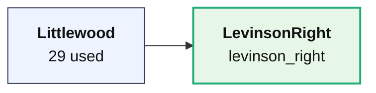

# What `LevinsonRight.levinson_right` rests on

[`LevinsonRight.levinson_right`](../lean_stage3/LevinsonRight.md#LevinsonRight-levinson_right) in `lean_stage3/Stage3/LevinsonRight.lean`, line 241.

**Why.** Steps 2–4 combined. Levinson's count of the zeros of `G` right of the line, through `G · M`, Littlewood on `[σ₀, X] × [a, b]`, and the concavity of the logarithm.

**Proves**

```lean
countRight G ((1 / 2 : ℂ) + a * I) ((X : ℂ) + b * I) (1 / 2) ≤ (1 / (2 * Real.pi * (1 / 2 - σ₀))) * ((b - a) / 2 * Real.log ((1 / (b - a)) * ∫ t in a..b, ‖G (↑σ₀ + ↑t * I) * M (↑σ₀ + ↑t * I)‖ ^ 2) - (∫ t in a..b, Real.log ‖G (↑X + ↑t * I) * M (↑X + ↑t * I)‖) + (X - σ₀) * (∫ t in a..b, logDeriv (fun s => G s * M s) (↑X + ↑t * I)).re + (∫ σ in σ₀..X, edgeH (fun s => G s * M s) X a σ) - (∫ σ in σ₀..X, edgeH (fun s => G s * M s) X b σ))
```

**Needs** (its hypotheses)

  - `` hσ₀ : σ₀ < 1 / 2 ``
  - `` hX : 1 / 2 ≤ X ``
  - `` hab : a < b ``
  - `` hG : AnalyticOnNhd ℂ G (Rectangle ((σ₀ : ℂ) + a * I) ((X : ℂ) + b * I)) ``
  - `` hM : AnalyticOnNhd ℂ M (Rectangle ((σ₀ : ℂ) + a * I) ((X : ℂ) + b * I)) ``
  - `` hB : ∀ p ∈ RectangleBorder ((σ₀ : ℂ) + a * I) ((X : ℂ) + b * I), G p * M p ≠ 0 ``

Behind it: 33 theorems and 2 definitions in 2 files. Every one is listed below; Lean recorded each step.

## The files it passes through



An arrow A → B reads "B uses something proved or defined in A"; indirect arrows are left out. Green: the theorem itself. Yellow: a file in the other tree. The number is how many of that file's declarations are on the way.

## Every declaration on the way

Files in dependency order. ★ marks what the theorem's own proof uses directly.

### [`Littlewood`](../lean_stage3/Littlewood.md) — 29

- [`Littlewood.corner_mem`](../lean_stage3/Littlewood.md#Littlewood-corner_mem) — `` z ∈ Rectangle z w ``
- ★ [`Littlewood.corner_mem_border`](../lean_stage3/Littlewood.md#Littlewood-corner_mem_border) — `` z ∈ RectangleBorder z w ``
- [`Littlewood.order_ne_top`](../lean_stage3/Littlewood.md#Littlewood-order_ne_top) — `` ∀ p ∈ Rectangle z w, meromorphicOrderAt f p ≠ ⊤ ``
- [`Littlewood.mem_support_divisor`](../lean_stage3/Littlewood.md#Littlewood-mem_support_divisor) — `` p ∈ (MeromorphicOn.divisor f U).support ↔ p ∈ U ∧ f p = 0 ``
- [`Littlewood.divisor_eq`](../lean_stage3/Littlewood.md#Littlewood-divisor_eq) — `` MeromorphicOn.divisor f U p = MeromorphicOn.divisor f (Rectangle z w) p ``
- [`Littlewood.support_interior`](../lean_stage3/Littlewood.md#Littlewood-support_interior) — `` z.re < p.re ∧ p.re < w.re ∧ z.im < p.im ∧ p.im < w.im ``
- ★ [`Littlewood.countRight`](../lean_stage3/Littlewood.md#Littlewood-countRight) — *def*
- [`Littlewood.rectIntegral_eq_count`](../lean_stage3/Littlewood.md#Littlewood-rectIntegral_eq_count) — `` RectangleIntegral (logDeriv f) (↑σ + ↑z.im * I) w = 2 * Real.pi * I * (countRight f z w σ : ℂ) ``
- [`Littlewood.two_pi_count_eq`](../lean_stage3/Littlewood.md#Littlewood-two_pi_count_eq) — `` 2 * Real.pi * countRight f z w σ = (∫ x in σ..w.re, logDeriv f (↑x + ↑z.im * I)).im - (∫ x in σ..w.re, logDeriv f (↑x + ↑w.im * I)).im + (∫ t in z.im..w.im, log… ``
- [`Littlewood.ite_eq_indicator`](../lean_stage3/Littlewood.md#Littlewood-ite_eq_indicator) — `` (fun σ : ℝ => if σ < β then m else 0) = (Iio β).indicator (fun _ => m) ``
- [`Littlewood.intervalIntegrable_ite`](../lean_stage3/Littlewood.md#Littlewood-intervalIntegrable_ite) — `` IntervalIntegrable (fun σ : ℝ => if σ < β then m else 0) volume u v ``
- [`Littlewood.integral_ite_lt`](../lean_stage3/Littlewood.md#Littlewood-integral_ite_lt) — `` ∫ σ in u..v, (if σ < β then m else 0) = m * (β - u) ``
- [`Littlewood.integral_countRight`](../lean_stage3/Littlewood.md#Littlewood-integral_countRight) — `` ∫ σ in z.re..w.re, countRight f z w σ = ∑ p ∈ (divisor_support_rectangle_finite f z w).toFinset, ((MeromorphicOn.divisor f (Rectangle z w) p : ℤ) : ℝ) * (p.re -… ``
- [`Littlewood.locallyIntegrable_inv_norm_sub`](../lean_stage3/Littlewood.md#Littlewood-locallyIntegrable_inv_norm_sub) — `` LocallyIntegrable (fun s : ℂ => ‖s - x‖⁻¹) volume ``
- [`Littlewood.integrableAtFilter_logDeriv`](../lean_stage3/Littlewood.md#Littlewood-integrableAtFilter_logDeriv) — `` IntegrableAtFilter (logDeriv f) (𝓝[K] p) volume ``
- [`Littlewood.integrableOn_logDeriv`](../lean_stage3/Littlewood.md#Littlewood-integrableOn_logDeriv) — `` IntegrableOn (logDeriv f) (Rectangle z w) volume ``
- [`Littlewood.integrableOn_logDeriv_prod`](../lean_stage3/Littlewood.md#Littlewood-integrableOn_logDeriv_prod) — `` IntegrableOn (fun q : ℝ × ℝ => logDeriv f (↑q.1 + ↑q.2 * I)) ([[z.re, w.re]] ×ˢ [[z.im, w.im]]) volume ``
- [`Littlewood.hasDerivAt_log_norm`](../lean_stage3/Littlewood.md#Littlewood-hasDerivAt_log_norm) — `` HasDerivAt (fun y => Real.log ‖g y‖) (g' / g x).re x ``
- [`Littlewood.continuousAt_logDeriv`](../lean_stage3/Littlewood.md#Littlewood-continuousAt_logDeriv) — `` ContinuousAt (logDeriv f) s ``
- [`Littlewood.continuousOn_logDeriv_comp`](../lean_stage3/Littlewood.md#Littlewood-continuousOn_logDeriv_comp) — `` ContinuousOn (fun x => logDeriv f (γ x)) S ``
- [`Littlewood.continuousOn_log_norm_comp`](../lean_stage3/Littlewood.md#Littlewood-continuousOn_log_norm_comp) — `` ContinuousOn (fun x => Real.log ‖f (γ x)‖) S ``
- [`Littlewood.horiz_mem`](../lean_stage3/Littlewood.md#Littlewood-horiz_mem) — `` (↑x + ↑t * I : ℂ) ∈ Rectangle z w ``
- [`Littlewood.integral_re_logDeriv_horizontal`](../lean_stage3/Littlewood.md#Littlewood-integral_re_logDeriv_horizontal) — `` ∫ x in z.re..w.re, (logDeriv f (↑x + ↑t * I)).re = Real.log ‖f (↑w.re + ↑t * I)‖ - Real.log ‖f (↑z.re + ↑t * I)‖ ``
- [`Littlewood.bottom_mem_border`](../lean_stage3/Littlewood.md#Littlewood-bottom_mem_border) — `` (↑x + ↑z.im * I : ℂ) ∈ RectangleBorder z w ``
- [`Littlewood.top_mem_border`](../lean_stage3/Littlewood.md#Littlewood-top_mem_border) — `` (↑x + ↑w.im * I : ℂ) ∈ RectangleBorder z w ``
- ★ [`Littlewood.left_mem_border`](../lean_stage3/Littlewood.md#Littlewood-left_mem_border) — `` (↑z.re + ↑t * I : ℂ) ∈ RectangleBorder z w ``
- [`Littlewood.right_mem_border`](../lean_stage3/Littlewood.md#Littlewood-right_mem_border) — `` (↑w.re + ↑t * I : ℂ) ∈ RectangleBorder z w ``
- ★ [`Littlewood.edgeH`](../lean_stage3/Littlewood.md#Littlewood-edgeH) — *def*
- [`Littlewood.littlewood_rect`](../lean_stage3/Littlewood.md#Littlewood-littlewood_rect) — `` 2 * Real.pi * ∑ ρ ∈ (divisor_support_rectangle_finite f z w).toFinset, ((MeromorphicOn.divisor f (Rectangle z w) ρ : ℤ) : ℝ) * (ρ.re - z.re) = (∫ t in z.im..w.i… ``

### [`LevinsonRight`](../lean_stage3/LevinsonRight.md) — 6

- [`LevinsonRight.divisor_nonneg_real`](../lean_stage3/LevinsonRight.md#LevinsonRight-divisor_nonneg_real) — `` (0 : ℝ) ≤ ((MeromorphicOn.divisor f U p : ℤ) : ℝ) ``
- ★ [`LevinsonRight.zeros_right_le`](../lean_stage3/LevinsonRight.md#LevinsonRight-zeros_right_le) — `` 2 * Real.pi * (σ₁ - z.re) * countRight f z w σ₁ ≤ (∫ t in z.im..w.im, Real.log ‖f (↑z.re + ↑t * I)‖) - (∫ t in z.im..w.im, Real.log ‖f (↑w.re + ↑t * I)‖) + (w.r… ``
- [`LevinsonRight.log_integral_le`](../lean_stage3/LevinsonRight.md#LevinsonRight-log_integral_le) — `` ∫ t in a..b, Real.log (g t) ≤ (b - a) * Real.log ((1 / (b - a)) * ∫ t in a..b, g t) ``
- ★ [`LevinsonRight.log_integral_norm_le`](../lean_stage3/LevinsonRight.md#LevinsonRight-log_integral_norm_le) — `` ∫ t in a..b, Real.log ‖F (↑σ₀ + ↑t * I)‖ ≤ (b - a) / 2 * Real.log ((1 / (b - a)) * ∫ t in a..b, ‖F (↑σ₀ + ↑t * I)‖ ^ 2) ``
- ★ [`LevinsonRight.countRight_mul_ge`](../lean_stage3/LevinsonRight.md#LevinsonRight-countRight_mul_ge) — `` countRight G z w σ ≤ countRight (fun s => G s * M s) z w σ ``
- ★ [`LevinsonRight.countRight_left_eq`](../lean_stage3/LevinsonRight.md#LevinsonRight-countRight_left_eq) — `` countRight f z' w σ = countRight f z w σ ``

