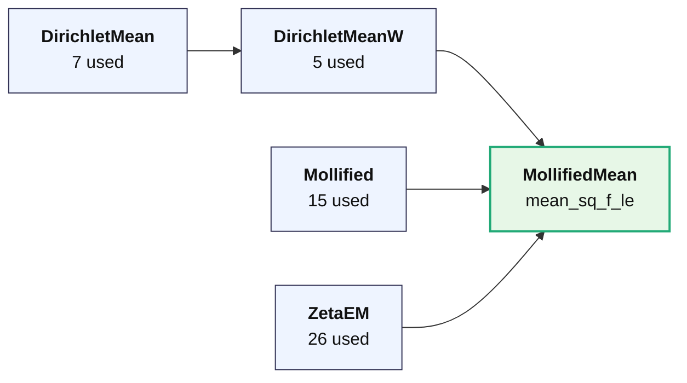

# What `MollifiedMean.mean_sq_f_le` rests on

[`MollifiedMean.mean_sq_f_le`](../lean_stage3/MollifiedMean.md#MollifiedMean-mean_sq_f_le) in `lean_stage3/Stage3/MollifiedMean.lean`, line 338.

**Why.** The mean square of `f_X = ζ·M_X − 1` over `t ∈ [1, T]` on the line `Re s = u`, for `1/2 < u ≤ 2`, `k ≥ 2`, `2 ≤ X ≤ N` and `T + 3 + k ≤ N`, is at most three times the sum of the main term `T·X^(1−2u)·logs`, the off-diagonal term `(NX)^(2−2u)·logs`, the smooth term `X²·N^(2−2u)` and the Euler–Maclaurin term `T·X²·A_k²·N^(−2u)·(1 + (T+2+k)^k·N^(1−k))²`.

**Proves**

```lean
∫ t in (1:ℝ)..T, ‖f X ((u : ℂ) + Complex.I * (t : ℂ))‖ ^ 2 ≤ 3 * (T * (2 / (1 - (2:ℝ) ^ (1 - 2 * u))) * (X:ℝ) ^ (1 - 2 * u) * (1 + Real.log X) ^ 3 + 24 * (1 + Real.log ((N * X : ℕ) : ℝ)) ^ 2 * (1 + Real.log X) ^ 3 * max 1 (((N * X : ℕ) : ℝ) ^ (2 - 2 * u)) + (X:ℝ) ^ 2 * (N:ℝ) ^ (2 - 2 * u) + T * (X:ℝ) ^ 2 * ZetaEM.emConst k ^ 2 * (N:ℝ) ^ (-2 * u) * (1 + (T + 2 + k) ^ k * (N:ℝ) ^ (1 - (k:ℝ))) ^ 2)
```

**Needs** (its hypotheses)

  - `` k : ℕ ``
  - `` hk : 2 ≤ k ``
  - `` hX : 2 ≤ X ``
  - `` hXN : X ≤ N ``
  - `` hu : 1 / 2 < u ``
  - `` hu2 : u ≤ 2 ``
  - `` hT : 1 ≤ T ``
  - `` hTN : T + 3 + k ≤ N ``

Behind it: 54 theorems and 13 definitions in 5 files. Every one is listed below; Lean recorded each step.

## The files it passes through



An arrow A → B reads "B uses something proved or defined in A"; indirect arrows are left out. Green: the theorem itself. Yellow: a file in the other tree. The number is how many of that file's declarations are on the way.

## Every declaration on the way

Files in dependency order. ★ marks what the theorem's own proof uses directly.

### [`DirichletMean`](../lean_stage3/DirichletMean.md) — 7

- [`DirichletMean.natCast_cpow_neg_I_mul`](../lean_stage3/DirichletMean.md#DirichletMean-natCast_cpow_neg_I_mul) — `` (n : ℂ) ^ (-(Complex.I * (t : ℂ))) = Complex.exp (Complex.I * ((-Real.log n : ℝ) : ℂ) * t) ``
- [`DirichletMean.sq_norm_sum_eq`](../lean_stage3/DirichletMean.md#DirichletMean-sq_norm_sum_eq) — `` ((‖∑ n ∈ Icc 1 N, a n * (n : ℂ) ^ (-(Complex.I * (t : ℂ)))‖ ^ 2 : ℝ) : ℂ) = ∑ m ∈ Icc 1 N, ∑ n ∈ Icc 1 N, a m * (starRingEnd ℂ) (a n) * Complex.exp (Complex.I *… ``
- [`DirichletMean.integral_sq_norm_eq`](../lean_stage3/DirichletMean.md#DirichletMean-integral_sq_norm_eq) — `` ((∫ t in T₁..T₂, ‖∑ n ∈ Icc 1 N, a n * (n : ℂ) ^ (-(Complex.I * (t : ℂ)))‖ ^ 2 : ℝ) : ℂ) = ∑ m ∈ Icc 1 N, ∑ n ∈ Icc 1 N, a m * (starRingEnd ℂ) (a n) * ∫ t in T₁… ``
- [`DirichletMean.norm_integral_exp_le`](../lean_stage3/DirichletMean.md#DirichletMean-norm_integral_exp_le) — `` ‖∫ t in T₁..T₂, Complex.exp (Complex.I * (θ : ℂ) * t)‖ ≤ 2 / |θ| ``
- [`DirichletMean.sum_inv_le_harmonic`](../lean_stage3/DirichletMean.md#DirichletMean-sum_inv_le_harmonic) — `` ∑ n ∈ s, ((g n : ℕ) : ℝ)⁻¹ ≤ ∑ k ∈ Icc 1 N, (k : ℝ)⁻¹ ``
- [`DirichletMean.sum_inv_Icc_le`](../lean_stage3/DirichletMean.md#DirichletMean-sum_inv_Icc_le) — `` ∑ k ∈ Icc 1 N, (k : ℝ)⁻¹ ≤ 1 + Real.log N ``
- [`DirichletMean.sum_inv_dist_le`](../lean_stage3/DirichletMean.md#DirichletMean-sum_inv_dist_le) — `` ∑ n ∈ Icc 1 N, (if m = n then 0 else |(m : ℝ) - n|⁻¹) ≤ 2 * (1 + Real.log N) ``

### [`DirichletMeanW`](../lean_stage3/DirichletMeanW.md) — 5

- [`DirichletMeanW.log_gap_larger`](../lean_stage3/DirichletMeanW.md#DirichletMeanW-log_gap_larger) — `` ((q : ℝ) - p) / q ≤ Real.log q - Real.log p ``
- [`DirichletMeanW.weighted_gap`](../lean_stage3/DirichletMeanW.md#DirichletMeanW-weighted_gap) — `` 2 / |Real.log n - Real.log m| * ((m : ℝ) / n) ≤ 2 * m * (|(m : ℝ) - n|⁻¹ + (n : ℝ)⁻¹) ``
- [`DirichletMeanW.sum_mul_mul_le_weighted`](../lean_stage3/DirichletMeanW.md#DirichletMeanW-sum_mul_mul_le_weighted) — `` ∑ m ∈ s, ∑ n ∈ s, A m * A n * K m n ≤ ∑ m ∈ s, A m ^ 2 * R m ``
- [`DirichletMeanW.dirichlet_mean_value_weighted`](../lean_stage3/DirichletMeanW.md#DirichletMeanW-dirichlet_mean_value_weighted) — `` ∫ t in T₁..T₂, ‖∑ n ∈ Finset.Icc 1 N, a n * (n : ℂ) ^ (-(Complex.I * (t : ℂ)))‖ ^ 2 ≤ ∑ n ∈ Finset.Icc 1 N, ‖a n‖ ^ 2 * ((T₂ - T₁) + 6 * n * (1 + Real.log N)) ``
- [`DirichletMeanW.dirichlet_mean_value_weighted_sigma`](../lean_stage3/DirichletMeanW.md#DirichletMeanW-dirichlet_mean_value_weighted_sigma) — `` ∫ t in T₁..T₂, ‖∑ n ∈ Finset.Icc 1 N, a n * (n : ℂ) ^ (-((σ : ℂ) + Complex.I * (t : ℂ)))‖ ^ 2 ≤ ∑ n ∈ Finset.Icc 1 N, ‖a n‖ ^ 2 * (n : ℝ) ^ (-2 * σ) * ((T₂ - T₁… ``

### [`Mollified`](../lean_stage3/Mollified.md) — 15

- [`Mollified.tauBelow`](../lean_stage3/Mollified.md#Mollified-tauBelow) — *def*
- [`Mollified.coef`](../lean_stage3/Mollified.md#Mollified-coef) — *def*
- [`Mollified.prod_eq_sum`](../lean_stage3/Mollified.md#Mollified-prod_eq_sum) — `` (∑ m ∈ Icc 1 N, (m : ℂ) ^ (-s)) * (∑ d ∈ Ico 1 X, (ArithmeticFunction.moebius d : ℂ) * (d : ℂ) ^ (-s)) = ∑ n ∈ Icc 1 (N * X), (coef X N n : ℂ) * (n : ℂ) ^ (-s) ``
- [`Mollified.coef_one`](../lean_stage3/Mollified.md#Mollified-coef_one) — `` coef X N 1 = 1 ``
- [`Mollified.coef_eq_zero`](../lean_stage3/Mollified.md#Mollified-coef_eq_zero) — `` coef X N n = 0 ``
- [`Mollified.abs_coef_le`](../lean_stage3/Mollified.md#Mollified-abs_coef_le) — `` |coef X N n| ≤ tauBelow X n ``
- [`Mollified.card_Icc_dvd`](../lean_stage3/Mollified.md#Mollified-card_Icc_dvd) — `` ((Icc 1 Y).filter (k ∣ ·)).card = Y / k ``
- [`Mollified.triples`](../lean_stage3/Mollified.md#Mollified-triples) — *def*
- [`Mollified.tauBelow_sq_le`](../lean_stage3/Mollified.md#Mollified-tauBelow_sq_le) — `` tauBelow X n ^ 2 ≤ ((triples X).filter (fun t => t.1 * t.2.1 * t.2.2 ∣ n)).card ``
- [`Mollified.sum_inv_Ico_le`](../lean_stage3/Mollified.md#Mollified-sum_inv_Ico_le) — `` ∑ k ∈ Ico 1 X, ((k : ℝ))⁻¹ ≤ 1 + Real.log X ``
- [`Mollified.sum_tauBelow_sq_le`](../lean_stage3/Mollified.md#Mollified-sum_tauBelow_sq_le) — `` ∑ n ∈ Icc 1 Y, (tauBelow X n : ℝ) ^ 2 ≤ Y * (1 + Real.log X) ^ 3 ``
- [`Mollified.coef_sq_le`](../lean_stage3/Mollified.md#Mollified-coef_sq_le) — `` (coef X N n : ℝ) ^ 2 ≤ (tauBelow X n : ℝ) ^ 2 ``
- [`Mollified.sum_coef_sq_le`](../lean_stage3/Mollified.md#Mollified-sum_coef_sq_le) — `` ∑ n ∈ Icc 1 Y, (coef X N n : ℝ) ^ 2 ≤ Y * (1 + Real.log X) ^ 3 ``
- [`Mollified.sum_Ico_dyadic`](../lean_stage3/Mollified.md#Mollified-sum_Ico_dyadic) — `` ∑ n ∈ Ico X (2 ^ J * X), f n = ∑ j ∈ range J, ∑ n ∈ Ico (2 ^ j * X) (2 ^ (j + 1) * X), f n ``
- [`Mollified.sum_coef_sq_weighted_le`](../lean_stage3/Mollified.md#Mollified-sum_coef_sq_weighted_le) — `` ∑ n ∈ Icc X Y, (coef X N n : ℝ) ^ 2 * (n : ℝ) ^ (-2 * u) ≤ 2 / (1 - (2 : ℝ) ^ (1 - 2 * u)) * (X : ℝ) ^ (1 - 2 * u) * (1 + Real.log X) ^ 3 ``

### [`ZetaEM`](../lean_stage3/ZetaEM.md) — 26

- [`ZetaEM.emInt`](../lean_stage3/ZetaEM.md#ZetaEM-emInt) — *def*
- [`ZetaEM.emCoef`](../lean_stage3/ZetaEM.md#ZetaEM-emCoef) — *def*
- [`ZetaEM.emTerm`](../lean_stage3/ZetaEM.md#ZetaEM-emTerm) — *def*
- [`ZetaEM.emBoundary`](../lean_stage3/ZetaEM.md#ZetaEM-emBoundary) — *def*
- [`ZetaEM.emRem`](../lean_stage3/ZetaEM.md#ZetaEM-emRem) — *def*
- [`ZetaEM.bernBound`](../lean_stage3/ZetaEM.md#ZetaEM-bernBound) — *def*
- [`ZetaEM.hasDerivWithinAt_fract`](../lean_stage3/ZetaEM.md#ZetaEM-hasDerivWithinAt_fract) — `` HasDerivWithinAt Int.fract 1 (Ioi x) x ``
- [`ZetaEM.continuous_bernoulliFun_fract`](../lean_stage3/ZetaEM.md#ZetaEM-continuous_bernoulliFun_fract) — `` Continuous (fun x : ℝ ↦ bernoulliFun k (Int.fract x)) ``
- [`ZetaEM.abs_bernoulliFun_fract_le`](../lean_stage3/ZetaEM.md#ZetaEM-abs_bernoulliFun_fract_le) — `` |bernoulliFun k (Int.fract x)| ≤ bernBound k ``
- [`ZetaEM.bernBound_nonneg`](../lean_stage3/ZetaEM.md#ZetaEM-bernBound_nonneg) — `` 0 ≤ bernBound k ``
- [`ZetaEM.measurable_bern`](../lean_stage3/ZetaEM.md#ZetaEM-measurable_bern) — `` Measurable (fun x : ℝ ↦ bernoulliFun k (Int.fract x)) ``
- [`ZetaEM.integrableOn_bern_cpow`](../lean_stage3/ZetaEM.md#ZetaEM-integrableOn_bern_cpow) — `` IntegrableOn (fun x : ℝ ↦ ((bernoulliFun k (Int.fract x) : ℝ) : ℂ) * (x:ℂ) ^ w) (Ioi a) ``
- [`ZetaEM.norm_integral_bern_cpow_le`](../lean_stage3/ZetaEM.md#ZetaEM-norm_integral_bern_cpow_le) — `` ‖∫ x in Ioi a, ((bernoulliFun k (Int.fract x) : ℝ) : ℂ) * (x:ℂ) ^ w‖ ≤ bernBound k * (-a ^ (w.re + 1) / (w.re + 1)) ``
- [`ZetaEM.interval_ibp`](../lean_stage3/ZetaEM.md#ZetaEM-interval_ibp) — `` ((k:ℂ) + 1) * ∫ x in a..b, ((bernoulliFun k (Int.fract x) : ℝ) : ℂ) * (x:ℂ) ^ (-(s + k)) = ((bernoulliFun (k+1) (Int.fract b) : ℝ) : ℂ) * (b:ℂ) ^ (-(s + k)) - (… ``
- [`ZetaEM.tail_ibp`](../lean_stage3/ZetaEM.md#ZetaEM-tail_ibp) — `` ((k:ℂ) + 1) * ∫ x in Ioi a, ((bernoulliFun k (Int.fract x) : ℝ) : ℂ) * (x:ℂ) ^ (-(s + k)) = -(((bernoulliFun (k+1) (Int.fract a) : ℝ) : ℂ) * (a:ℂ) ^ (-(s + k)))… ``
- [`ZetaEM.emInt_step`](../lean_stage3/ZetaEM.md#ZetaEM-emInt_step) — `` ((k:ℂ) + 1) * emInt k N s = -((bernoulliFun (k+1) 0 : ℂ) * (N:ℂ) ^ (-(s + k))) + (s + k) * emInt (k+1) N s ``
- [`ZetaEM.emRem_step`](../lean_stage3/ZetaEM.md#ZetaEM-emRem_step) — `` emRem k N s = emTerm k N s + emRem (k+1) N s ``
- [`ZetaEM.sum_range_succ_eq_sum_Icc`](../lean_stage3/ZetaEM.md#ZetaEM-sum_range_succ_eq_sum_Icc) — `` ∑ n ∈ Finset.range (N + 1), 1 / (n : ℂ) ^ s = ∑ n ∈ Finset.Icc 1 N, (n : ℂ) ^ (-s) ``
- [`ZetaEM.zeta_eq_em_one`](../lean_stage3/ZetaEM.md#ZetaEM-zeta_eq_em_one) — `` riemannZeta s = ∑ n ∈ Finset.Icc 1 N, (n : ℂ) ^ (-s) - (N:ℂ) ^ (1 - s) / (1 - s) - (N:ℂ) ^ (-s) / 2 - s * emInt 1 N s ``
- [`ZetaEM.zeta_eq_em`](../lean_stage3/ZetaEM.md#ZetaEM-zeta_eq_em) — `` riemannZeta s = ∑ n ∈ Finset.Icc 1 N, (n : ℂ) ^ (-s) - (N:ℂ) ^ (1 - s) / (1 - s) - (N:ℂ) ^ (-s) / 2 + emBoundary k N s + emRem k N s ``
- [`ZetaEM.norm_emInt_le`](../lean_stage3/ZetaEM.md#ZetaEM-norm_emInt_le) — `` ‖emInt k N s‖ ≤ bernBound k * ((N:ℝ) ^ (1 - s.re - k) / (s.re + k - 1)) ``
- [`ZetaEM.norm_remainder_le`](../lean_stage3/ZetaEM.md#ZetaEM-norm_remainder_le) — `` ‖emRem k N s‖ ≤ (∏ i ∈ Finset.range k, ‖s + i‖) / k.factorial * (bernBound k * ((N:ℝ) ^ (1 - s.re - k) / (s.re + k - 1))) ``
- [`ZetaEM.norm_emTerm`](../lean_stage3/ZetaEM.md#ZetaEM-norm_emTerm) — `` ‖emTerm j N s‖ = (∏ i ∈ Finset.range j, ‖s + i‖) * |bernoulliFun (j+1) 0| / (j+1).factorial * (N:ℝ) ^ (-s.re - j) ``
- [`ZetaEM.prod_norm_le`](../lean_stage3/ZetaEM.md#ZetaEM-prod_norm_le) — `` ∏ i ∈ Finset.range j, ‖s + i‖ ≤ (‖s‖ + k) ^ j ``
- ★ [`ZetaEM.emConst`](../lean_stage3/ZetaEM.md#ZetaEM-emConst) — *def*
- ★ [`ZetaEM.norm_zeta_sub_partial_le`](../lean_stage3/ZetaEM.md#ZetaEM-norm_zeta_sub_partial_le) — `` ‖riemannZeta s - ∑ n ∈ Finset.Icc 1 N, (n : ℂ) ^ (-s) + (N : ℂ) ^ (1 - s) / (1 - s)‖ ≤ emConst k * (N : ℝ) ^ (-s.re) * (1 + (‖s‖ + k) ^ k * (N : ℝ) ^ (1 - (k : … ``

### [`MollifiedMean`](../lean_stage3/MollifiedMean.md) — 14

- ★ [`MollifiedMean.M`](../lean_stage3/MollifiedMean.md#MollifiedMean-M) — *def*
- ★ [`MollifiedMean.f`](../lean_stage3/MollifiedMean.md#MollifiedMean-f) — *def*
- ★ [`MollifiedMean.b`](../lean_stage3/MollifiedMean.md#MollifiedMean-b) — *def*
- ★ [`MollifiedMean.emConst_nonneg`](../lean_stage3/MollifiedMean.md#MollifiedMean-emConst_nonneg) — `` 0 ≤ ZetaEM.emConst k ``
- ★ [`MollifiedMean.norm_M_le`](../lean_stage3/MollifiedMean.md#MollifiedMean-norm_M_le) — `` ‖M X s‖ ≤ X ``
- ★ [`MollifiedMean.norm_smooth_le`](../lean_stage3/MollifiedMean.md#MollifiedMean-norm_smooth_le) — `` ‖(N : ℂ) ^ (1 - ((u : ℂ) + Complex.I * (t : ℂ))) / (1 - ((u : ℂ) + Complex.I * (t : ℂ)))‖ ≤ (N : ℝ) ^ (1 - u) / t ``
- [`MollifiedMean.PM_sub_one_eq`](../lean_stage3/MollifiedMean.md#MollifiedMean-PM_sub_one_eq) — `` (∑ m ∈ Icc 1 N, (m : ℂ) ^ (-s)) * M X s - 1 = ∑ n ∈ Icc 1 (N * X), (b X N n : ℂ) * (n : ℂ) ^ (-s) ``
- ★ [`MollifiedMean.f_eq`](../lean_stage3/MollifiedMean.md#MollifiedMean-f_eq) — `` f X s = ∑ n ∈ Icc 1 (N * X), (b X N n : ℂ) * (n : ℂ) ^ (-s) + (-((N : ℂ) ^ (1 - s) / (1 - s))) * M X s + (riemannZeta s - ∑ n ∈ Icc 1 N, (n : ℂ) ^ (-s) + (N : ℂ… ``
- ★ [`MollifiedMean.norm_sq_add_three`](../lean_stage3/MollifiedMean.md#MollifiedMean-norm_sq_add_three) — `` ‖x + y + z‖ ^ 2 ≤ 3 * (‖x‖ ^ 2 + ‖y‖ ^ 2 + ‖z‖ ^ 2) ``
- ★ [`MollifiedMean.rpow_sq`](../lean_stage3/MollifiedMean.md#MollifiedMean-rpow_sq) — `` (x ^ a) ^ 2 = x ^ (2 * a) ``
- [`MollifiedMean.sum_b_sq_eq`](../lean_stage3/MollifiedMean.md#MollifiedMean-sum_b_sq_eq) — `` ∑ n ∈ Icc 1 Y, b X N n ^ 2 * w n = ∑ n ∈ Icc X Y, (Mollified.coef X N n : ℝ) ^ 2 * w n ``
- [`MollifiedMean.sum_coef_sq_up_le`](../lean_stage3/MollifiedMean.md#MollifiedMean-sum_coef_sq_up_le) — `` ∑ n ∈ Icc 1 Y, (Mollified.coef X N n : ℝ) ^ 2 * (n : ℝ) ^ (1 - 2 * u) ≤ 4 * (1 + Real.log X) ^ 3 * (1 + Real.log Y) * max 1 ((Y : ℝ) ^ (2 - 2 * u)) ``
- ★ [`MollifiedMean.integral_inv_sq_le`](../lean_stage3/MollifiedMean.md#MollifiedMean-integral_inv_sq_le) — `` ∫ t in (1:ℝ)..T, (t ^ 2)⁻¹ ≤ 1 ``
- ★ [`MollifiedMean.mean_sq_main_le`](../lean_stage3/MollifiedMean.md#MollifiedMean-mean_sq_main_le) — `` ∫ t in (1:ℝ)..T, ‖∑ n ∈ Icc 1 (N * X), (b X N n : ℂ) * (n : ℂ) ^ (-((u : ℂ) + Complex.I * (t : ℂ)))‖ ^ 2 ≤ T * (2 / (1 - (2:ℝ) ^ (1 - 2 * u))) * (X:ℝ) ^ (1 - 2 … ``

