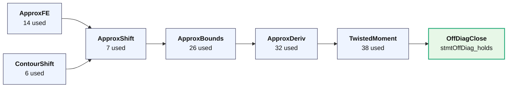

# What `OffDiagClose.stmtOffDiag_holds` rests on

[`OffDiagClose.stmtOffDiag_holds`](../lean_stage3/OffDiagClose.md#OffDiagClose-stmtOffDiag_holds) in `lean_stage3/Stage3/OffDiagClose.lean`, line 975.

**Why.** `StmtOffDiag` closed, every `θ < 1/2`, in the `WeightAll` form: Young's off-diagonal `offSum = O(T/L)` with `j = 2r`, `r = ⌈2/(1−2θ)⌉₊`, integrations by parts.

**Proves**

```lean
StmtOffDiagAll P θ R κ
```

**Needs** (its hypotheses)

  - `` P : Polynomial ℝ ``
  - `` hθ : θ < 1 / 2 ``
  - `` R : ℝ ``
  - `` hκ : 0 < κ ``

Behind it: 111 theorems and 37 definitions in 7 files. Every one is listed below; Lean recorded each step.

## The files it passes through



An arrow A → B reads "B uses something proved or defined in A"; indirect arrows are left out. Green: the theorem itself. Yellow: a file in the other tree. The number is how many of that file's declarations are on the way.

## Every declaration on the way

Files in dependency order. ★ marks what the theorem's own proof uses directly.

### [`ApproxFE`](../lean_stage3/ApproxFE.md) — 14

- [`ApproxFE.uA`](../lean_stage3/ApproxFE.md#ApproxFE-uA) — *def*
- [`ApproxFE.vB`](../lean_stage3/ApproxFE.md#ApproxFE-vB) — *def*
- [`ApproxFE.GY`](../lean_stage3/ApproxFE.md#ApproxFE-GY) — *def*
- [`ApproxFE.gY`](../lean_stage3/ApproxFE.md#ApproxFE-gY) — *def*
- [`ApproxFE.KY`](../lean_stage3/ApproxFE.md#ApproxFE-KY) — *def*
- [`ApproxFE.VY`](../lean_stage3/ApproxFE.md#ApproxFE-VY) — *def*
- [`ApproxFE.uA_re`](../lean_stage3/ApproxFE.md#ApproxFE-uA_re) — `` (uA α t).re = 1 / 2 + α.re ``
- [`ApproxFE.vB_re`](../lean_stage3/ApproxFE.md#ApproxFE-vB_re) — `` (vB β t).re = 1 / 2 + β.re ``
- [`ApproxFE.uA_im`](../lean_stage3/ApproxFE.md#ApproxFE-uA_im) — `` (uA α t).im = α.im + t ``
- [`ApproxFE.vB_im`](../lean_stage3/ApproxFE.md#ApproxFE-vB_im) — `` (vB β t).im = β.im - t ``
- [`ApproxFE.norm_succ_cpow`](../lean_stage3/ApproxFE.md#ApproxFE-norm_succ_cpow) — `` ‖((m : ℂ) + 1) ^ z‖ = ((m : ℝ) + 1) ^ z.re ``
- [`ApproxFE.KY_differentiableAt`](../lean_stage3/ApproxFE.md#ApproxFE-KY_differentiableAt) — `` DifferentiableAt ℂ (KY α β t) s ``
- [`ApproxFE.GY_zero`](../lean_stage3/ApproxFE.md#ApproxFE-GY_zero) — `` GY α β 0 = 1 ``
- [`ApproxFE.gY_zero`](../lean_stage3/ApproxFE.md#ApproxFE-gY_zero) — `` gY α β t 0 = 1 ``

### [`ContourShift`](../lean_stage3/ContourShift.md) — 6

- [`ContourShift.borderIntegrable_sum_poles`](../lean_stage3/ContourShift.md#ContourShift-borderIntegrable_sum_poles) — `` RectangleBorderIntegrable (fun s ↦ ∑ p ∈ P, A p / (s - p)) z w ``
- [`ContourShift.rectangleIntegral_sum_poles`](../lean_stage3/ContourShift.md#ContourShift-rectangleIntegral_sum_poles) — `` RectangleIntegral' (fun s ↦ ∑ p ∈ P, A p / (s - p)) z w = ∑ p ∈ P, A p ``
- [`ContourShift.residue_rectangle_multi`](../lean_stage3/ContourShift.md#ContourShift-residue_rectangle_multi) — `` RectangleIntegral' f z w = ∑ p ∈ P, A p ``
- [`ContourShift.residue_rectangle_of_local`](../lean_stage3/ContourShift.md#ContourShift-residue_rectangle_of_local) — `` RectangleIntegral' f z w = ∑ p ∈ P, A p ``
- [`ContourShift.analyticAt_dslope`](../lean_stage3/ContourShift.md#ContourShift-analyticAt_dslope) — `` AnalyticAt ℂ (dslope f p) p ``
- [`ContourShift.div_sub_eq_dslope`](../lean_stage3/ContourShift.md#ContourShift-div_sub_eq_dslope) — `` f s / (s - p) = f p / (s - p) + dslope f p s ``

### [`ApproxShift`](../lean_stage3/ApproxShift.md) — 7

- [`ApproxShift.GY_norm_le`](../lean_stage3/ApproxShift.md#ApproxShift-GY_norm_le) — `` ‖GY α β s‖ ≤ Real.exp (c ^ 2 - s.im ^ 2) * ((‖α + β‖ ^ 2 + 4 * c ^ 2 + 4) / ‖α + β‖ ^ 2 * (1 + s.im ^ 2)) ``
- [`ApproxShift.gauss_atTop`](../lean_stage3/ApproxShift.md#ApproxShift-gauss_atTop) — `` Tendsto (fun y : ℝ => Real.exp (-(1 / 2) * y ^ 2)) atTop (𝓝 0) ``
- [`ApproxShift.gauss_atBot`](../lean_stage3/ApproxShift.md#ApproxShift-gauss_atBot) — `` Tendsto (fun y : ℝ => Real.exp (-(1 / 2) * y ^ 2)) atBot (𝓝 0) ``
- [`ApproxShift.GY_analyticAt`](../lean_stage3/ApproxShift.md#ApproxShift-GY_analyticAt) — `` AnalyticAt ℂ (GY α β) p ``
- [`ApproxShift.local_simple`](../lean_stage3/ApproxShift.md#ApproxShift-local_simple) — `` ∃ h : ℂ → ℂ, AnalyticAt ℂ h p ∧ ∀ᶠ s in 𝓝[≠] p, f s = h s + A / (s - p) ``
- [`ApproxShift.rect_mem_nhds`](../lean_stage3/ApproxShift.md#ApproxShift-rect_mem_nhds) — `` Rectangle (↑(-c) - I * ↑T) (↑c + I * ↑T) ∈ 𝓝 p ``
- [`ApproxShift.rect_tendsto`](../lean_stage3/ApproxShift.md#ApproxShift-rect_tendsto) — `` Tendsto (fun T : ℝ => RectangleIntegral f (↑(-c) - I * T) (↑c + I * T)) atTop (𝓝 (VerticalIntegral f c - VerticalIntegral f (-c))) ``

### [`ApproxBounds`](../lean_stage3/ApproxBounds.md) — 26

- [`ApproxBounds.lY`](../lean_stage3/ApproxBounds.md#ApproxBounds-lY) — *def*
- [`ApproxBounds.lY_neg`](../lean_stage3/ApproxBounds.md#ApproxBounds-lY_neg) — `` lY (-Y) = lY Y ``
- [`ApproxBounds.gModel`](../lean_stage3/ApproxBounds.md#ApproxBounds-gModel) — *def*
- [`ApproxBounds.gErr`](../lean_stage3/ApproxBounds.md#ApproxBounds-gErr) — *def*
- [`ApproxBounds.gRModel`](../lean_stage3/ApproxBounds.md#ApproxBounds-gRModel) — *def*
- [`ApproxBounds.gErr_nonneg`](../lean_stage3/ApproxBounds.md#ApproxBounds-gErr_nonneg) — `` 0 ≤ gErr r ``
- [`ApproxBounds.const_bound`](../lean_stage3/ApproxBounds.md#ApproxBounds-const_bound) — `` ∃ K : ℝ, 0 ≤ K ∧ ∀ r : ℝ, lo ≤ r → r ≤ hi → |Real.log (Real.Gamma r)| ≤ K ∧ gErr r ≤ K ``
- [`ApproxBounds.lY_near`](../lean_stage3/ApproxBounds.md#ApproxBounds-lY_near) — `` |lY Y - Real.log (t / 2)| ≤ 3 ``
- [`ApproxBounds.log_div_two_pi`](../lean_stage3/ApproxBounds.md#ApproxBounds-log_div_two_pi) — `` Real.log (t / (2 * Real.pi)) = Real.log (t / 2) - Real.log Real.pi ``
- [`ApproxBounds.lY_lip`](../lean_stage3/ApproxBounds.md#ApproxBounds-lY_lip) — `` |lY (Y + h) - lY Y| ≤ |h| ``
- [`ApproxBounds.gR_shift`](../lean_stage3/ApproxBounds.md#ApproxBounds-gR_shift) — `` Real.log ‖Gammaℝ (w + (σ + y * I))‖ - Real.log ‖Gammaℝ w‖ ≤ σ / 2 * (Real.log (t / 2) - Real.log Real.pi) + 2 * K + 2 * K' + 3 * |σ| / 2 + (Real.pi / 4 + |σ| / … ``
- [`ApproxBounds.gY_bound`](../lean_stage3/ApproxBounds.md#ApproxBounds-gY_bound) — `` ∃ C : ℝ, 0 ≤ C ∧ ∀ α β : ℂ, ‖α‖ ≤ 1 / 10 → ‖β‖ ≤ 1 / 10 → ∀ t : ℝ, 1 ≤ t → ∀ σ y : ℝ, σ₀ ≤ σ → σ ≤ σ₁ → ‖gY α β t (σ + y * I)‖ ≤ C * (t / (2 * Real.pi)) ^ σ * R… ``
- [`ApproxBounds.gauss_absorb`](../lean_stage3/ApproxBounds.md#ApproxBounds-gauss_absorb) — `` Real.exp (-y ^ 2) * (1 + y ^ 2) * Real.exp (B * |y|) ≤ 4 * Real.exp (B ^ 2) * Real.exp (-(1 / 2) * y ^ 2) ``
- [`ApproxBounds.Q_le`](../lean_stage3/ApproxBounds.md#ApproxBounds-Q_le) — `` (n ^ 2 + A) / n ^ 2 ≤ (A + 1) * (1 + 1 / n ^ 2) ``
- [`ApproxBounds.integrand_bound`](../lean_stage3/ApproxBounds.md#ApproxBounds-integrand_bound) — `` ∃ C : ℝ, 0 ≤ C ∧ ∀ α β : ℂ, ‖α‖ ≤ 1 / 10 → ‖β‖ ≤ 1 / 10 → ∀ t : ℝ, 1 ≤ t → ∀ x : ℝ, 0 < x → ∀ σ y : ℝ, σ₀ ≤ σ → σ ≤ σ₁ → δ ≤ ‖(σ : ℂ) + y * I‖ → ‖KY α β t (σ + … ``
- [`ApproxBounds.norm_VY_le`](../lean_stage3/ApproxBounds.md#ApproxBounds-norm_VY_le) — `` ‖VY α β σ x t‖ ≤ 1 / (2 * Real.pi) * ∫ y : ℝ, ‖KY α β t (σ + y * I) * (x : ℂ) ^ (-((σ : ℂ) + y * I))‖ ``
- [`ApproxBounds.VY_line_bound`](../lean_stage3/ApproxBounds.md#ApproxBounds-VY_line_bound) — `` ∃ C : ℝ, 0 ≤ C ∧ ∀ α β : ℂ, ‖α‖ ≤ 1 / 10 → ‖β‖ ≤ 1 / 10 → ∀ t : ℝ, 1 ≤ t → ∀ x : ℝ, 0 < x → ‖VY α β σ x t‖ ≤ C * (1 + 1 / ‖α + β‖ ^ 2) * ((t / (2 * Real.pi)) ^ … ``
- [`ApproxBounds.integrand_differentiableAt`](../lean_stage3/ApproxBounds.md#ApproxBounds-integrand_differentiableAt) — `` DifferentiableAt ℂ (fun s => KY α β t s * (x : ℂ) ^ (-s)) s ``
- [`ApproxBounds.rpow_le_ends`](../lean_stage3/ApproxBounds.md#ApproxBounds-rpow_le_ends) — `` b ^ σ ≤ b ^ σ₀ + b ^ σ₁ ``
- [`ApproxBounds.rect_tendsto_ab`](../lean_stage3/ApproxBounds.md#ApproxBounds-rect_tendsto_ab) — `` Tendsto (fun T : ℝ => RectangleIntegral f (↑a - I * T) (↑b + I * T)) atTop (𝓝 (VerticalIntegral f b - VerticalIntegral f a)) ``
- [`ApproxBounds.VY_line_eq`](../lean_stage3/ApproxBounds.md#ApproxBounds-VY_line_eq) — `` VY α β c x t = VY α β c' x t ``
- [`ApproxBounds.VY_decay`](../lean_stage3/ApproxBounds.md#ApproxBounds-VY_decay) — `` ∃ C : ℝ, 0 ≤ C ∧ ∀ α β : ℂ, ‖α‖ ≤ 1 / 10 → ‖β‖ ≤ 1 / 10 → ∀ t : ℝ, 1 ≤ t → ∀ x : ℝ, 0 < x → ∀ c : ℝ, 0 < c → ‖VY α β c x t‖ ≤ C * (1 + 1 / ‖α + β‖ ^ 2) * (t / x… ``
- [`ApproxBounds.integrand_differentiableAt'`](../lean_stage3/ApproxBounds.md#ApproxBounds-integrand_differentiableAt-) — `` DifferentiableAt ℂ (fun s => KY α β t s * (x : ℂ) ^ (-s)) s ``
- [`ApproxBounds.VY_residue`](../lean_stage3/ApproxBounds.md#ApproxBounds-VY_residue) — `` VY α β (1 / 4) x t - VY α β (-(1 / 4)) x t = 1 ``
- [`ApproxBounds.rpow_quarter_le`](../lean_stage3/ApproxBounds.md#ApproxBounds-rpow_quarter_le) — `` b ^ (1 / 4 : ℝ) ≤ 1 + b ``
- [`ApproxBounds.VY_decay_young`](../lean_stage3/ApproxBounds.md#ApproxBounds-VY_decay_young) — `` ∃ C : ℝ, 0 ≤ C ∧ ∀ α β : ℂ, ‖α‖ ≤ 1 / 10 → ‖β‖ ≤ 1 / 10 → α + β ≠ 0 → ∀ t : ℝ, 1 ≤ t → ∀ x : ℝ, 0 < x → ∀ c : ℝ, 0 < c → ‖VY α β c x t‖ ≤ C * (1 + 1 / ‖α + β‖ ^… ``

### [`ApproxDeriv`](../lean_stage3/ApproxDeriv.md) — 32

- [`ApproxDeriv.psiR`](../lean_stage3/ApproxDeriv.md#ApproxDeriv-psiR) — *def*
- [`ApproxDeriv.ne_neg_nat_of_re_pos`](../lean_stage3/ApproxDeriv.md#ApproxDeriv-ne_neg_nat_of_re_pos) — `` z ≠ -(m : ℂ) ``
- [`ApproxDeriv.hasDerivAt_line`](../lean_stage3/ApproxDeriv.md#ApproxDeriv-hasDerivAt_line) — `` HasDerivAt (fun t : ℝ => w₀ + (t : ℂ) * e) e t ``
- [`ApproxDeriv.dY`](../lean_stage3/ApproxDeriv.md#ApproxDeriv-dY) — *def*
- [`ApproxDeriv.re_conds`](../lean_stage3/ApproxDeriv.md#ApproxDeriv-re_conds) — `` 1 / 20 ≤ (uA α t / 2).re ∧ 1 / 20 ≤ (uA α t / 2 + s / 2).re ∧ 1 / 20 ≤ (vB β t / 2).re ∧ 1 / 20 ≤ (vB β t / 2 + s / 2).re ``
- [`ApproxDeriv.gY_hasDerivAt`](../lean_stage3/ApproxDeriv.md#ApproxDeriv-gY_hasDerivAt) — `` HasDerivAt (fun t => gY α β t s) (gY α β t s * dY α β t s) t ``
- [`ApproxDeriv.tau`](../lean_stage3/ApproxDeriv.md#ApproxDeriv-tau) — *def*
- [`ApproxDeriv.tau'`](../lean_stage3/ApproxDeriv.md#ApproxDeriv-tau-) — *def*
- [`ApproxDeriv.hasSum_tau`](../lean_stage3/ApproxDeriv.md#ApproxDeriv-hasSum_tau) — `` HasSum (tau h w) (digamma (w + h) - digamma w) ``
- [`ApproxDeriv.norm_nat_add_ge`](../lean_stage3/ApproxDeriv.md#ApproxDeriv-norm_nat_add_ge) — `` ((n : ℝ) + a + Y) / 2 ≤ ‖(n : ℂ) + z‖ ``
- [`ApproxDeriv.norm_tau_le`](../lean_stage3/ApproxDeriv.md#ApproxDeriv-norm_tau_le) — `` ‖tau h w n‖ ≤ 4 * ‖h‖ * (1 / ((n : ℝ) + (a + Y)) ^ 2) ``
- [`ApproxDeriv.tel`](../lean_stage3/ApproxDeriv.md#ApproxDeriv-tel) — *def*
- [`ApproxDeriv.hasSum_tel`](../lean_stage3/ApproxDeriv.md#ApproxDeriv-hasSum_tel) — `` HasSum (tel b) (1 / b) ``
- [`ApproxDeriv.sq_le_tel`](../lean_stage3/ApproxDeriv.md#ApproxDeriv-sq_le_tel) — `` 1 / ((n : ℝ) + b) ^ 2 ≤ (1 + 1 / b) * tel b n ``
- [`ApproxDeriv.dY_hasSum`](../lean_stage3/ApproxDeriv.md#ApproxDeriv-dY_hasSum) — `` HasSum (fun n => I / 2 * (tau (s / 2) (uA α t / 2) n - tau (s / 2) (vB β t / 2) n)) (dY α β t s) ``
- [`ApproxDeriv.norm_I_half`](../lean_stage3/ApproxDeriv.md#ApproxDeriv-norm_I_half) — `` ‖I / 2‖ = 1 / 2 ``
- [`ApproxDeriv.norm_dterm_le`](../lean_stage3/ApproxDeriv.md#ApproxDeriv-norm_dterm_le) — `` ‖I / 2 * (tau (s / 2) (uA α t / 2) n - tau (s / 2) (vB β t / 2) n)‖ ≤ 4 * ‖s / 2‖ * (1 + 1 / (1 / 20 + Y)) * tel (1 / 20 + Y) n ``
- [`ApproxDeriv.norm_dY_le`](../lean_stage3/ApproxDeriv.md#ApproxDeriv-norm_dY_le) — `` ‖dY α β t s‖ ≤ 4 * ‖s / 2‖ * (1 + 1 / (1 / 20 + Y)) * (1 / (1 / 20 + Y)) ``
- [`ApproxDeriv.d2Y`](../lean_stage3/ApproxDeriv.md#ApproxDeriv-d2Y) — *def*
- [`ApproxDeriv.poly_gauss`](../lean_stage3/ApproxDeriv.md#ApproxDeriv-poly_gauss) — `` (1 + |y|) ^ k * Real.exp (-(1 / 2) * y ^ 2) ≤ (k.factorial : ℝ) * Real.exp 2 * Real.exp (-(1 / 4) * y ^ 2) ``
- [`ApproxDeriv.gauss_loc`](../lean_stage3/ApproxDeriv.md#ApproxDeriv-gauss_loc) — `` Real.exp (-y ^ 2) * (1 + y ^ 2) * (1 + |y|) ^ k ≤ ((k + 2).factorial : ℝ) * Real.exp 2 * Real.exp (-(1 / 4) * y ^ 2) ``
- [`ApproxDeriv.norm_half_le`](../lean_stage3/ApproxDeriv.md#ApproxDeriv-norm_half_le) — `` ‖((σ : ℂ) + y * I) / 2‖ ≤ (1 + |σ|) * (1 + |y|) ``
- [`ApproxDeriv.dY_crude`](../lean_stage3/ApproxDeriv.md#ApproxDeriv-dY_crude) — `` ‖dY α β t (σ + y * I)‖ ≤ 1680 * (1 + |σ|) * (1 + |y|) ``
- [`ApproxDeriv.KY_local`](../lean_stage3/ApproxDeriv.md#ApproxDeriv-KY_local) — `` ∃ C : ℝ, 0 ≤ C ∧ ∀ t ∈ Metric.closedBall t₀ 1, ∀ y : ℝ, ‖KY α β t (σ + y * I)‖ ≤ C * (Real.exp (-y ^ 2) * (1 + y ^ 2)) ``
- [`ApproxDeriv.cont_F`](../lean_stage3/ApproxDeriv.md#ApproxDeriv-cont_F) — `` Continuous fun y : ℝ => KY α β t (σ + y * I) * (x : ℂ) ^ (-((σ : ℂ) + y * I)) ``
- [`ApproxDeriv.re_half_pos`](../lean_stage3/ApproxDeriv.md#ApproxDeriv-re_half_pos) — `` 0 < ((uA α t + ((σ : ℂ) + y * I)) / 2).re ∧ 0 < ((vB β t + ((σ : ℂ) + y * I)) / 2).re ``
- [`ApproxDeriv.cont_dY`](../lean_stage3/ApproxDeriv.md#ApproxDeriv-cont_dY) — `` Continuous fun y : ℝ => dY α β t (σ + y * I) ``
- [`ApproxDeriv.VY1`](../lean_stage3/ApproxDeriv.md#ApproxDeriv-VY1) — *def*
- [`ApproxDeriv.VY2`](../lean_stage3/ApproxDeriv.md#ApproxDeriv-VY2) — *def*
- [`ApproxDeriv.norm_F_local`](../lean_stage3/ApproxDeriv.md#ApproxDeriv-norm_F_local) — `` ‖KY α β t (σ + y * I) * (x : ℂ) ^ (-((σ : ℂ) + y * I))‖ ≤ C * x ^ (-σ) * (Real.exp (-y ^ 2) * (1 + y ^ 2)) ``
- [`ApproxDeriv.F_hasDerivAt`](../lean_stage3/ApproxDeriv.md#ApproxDeriv-F_hasDerivAt) — `` HasDerivAt (fun t => KY α β t s * (x : ℂ) ^ (-s)) (KY α β t s * (x : ℂ) ^ (-s) * dY α β t s) t ``
- [`ApproxDeriv.VY_hasDerivAt`](../lean_stage3/ApproxDeriv.md#ApproxDeriv-VY_hasDerivAt) — `` HasDerivAt (fun t => VY α β σ x t) (VY1 α β σ x t₀) t₀ ``

### [`TwistedMoment`](../lean_stage3/TwistedMoment.md) — 38

- [`TwistedMoment.Weight`](../lean_stage3/TwistedMoment.md#TwistedMoment-Weight) — *structure*
- [`TwistedMoment.eL`](../lean_stage3/TwistedMoment.md#TwistedMoment-eL) — *def*
- [`TwistedMoment.norm_eL`](../lean_stage3/TwistedMoment.md#TwistedMoment-norm_eL) — `` ‖eL l t‖ = 1 ``
- [`TwistedMoment.Fw`](../lean_stage3/TwistedMoment.md#TwistedMoment-Fw) — *def*
- [`TwistedMoment.Fw1`](../lean_stage3/TwistedMoment.md#TwistedMoment-Fw1) — *def*
- [`TwistedMoment.Fw2`](../lean_stage3/TwistedMoment.md#TwistedMoment-Fw2) — *def*
- [`TwistedMoment.Fw_zero_out`](../lean_stage3/TwistedMoment.md#TwistedMoment-Fw_zero_out) — `` Fw W α β c x t = 0 ∧ Fw1 W α β c x t = 0 ∧ Fw2 W α β c x t = 0 ``
- [`TwistedMoment.continuous_VY`](../lean_stage3/TwistedMoment.md#TwistedMoment-continuous_VY) — `` Continuous fun t => VY α β c x t ``
- [`TwistedMoment.inv_t_le`](../lean_stage3/TwistedMoment.md#TwistedMoment-inv_t_le) — `` t⁻¹ ≤ 4 * (T / L)⁻¹ ``
- [`TwistedMoment.decay_le`](../lean_stage3/TwistedMoment.md#TwistedMoment-decay_le) — `` (1 + x / t) ^ (-A) ≤ (1 + x / (2 * T)) ^ (-A) ``
- [`TwistedMoment.ratio_cpow_eq`](../lean_stage3/TwistedMoment.md#TwistedMoment-ratio_cpow_eq) — `` ((p : ℂ) / (q : ℂ)) ^ (-((t : ℂ) * I)) = eL (Real.log (p / q)) t ``
- [`TwistedMoment.log_ratio_ge`](../lean_stage3/TwistedMoment.md#TwistedMoment-log_ratio_ge) — `` 1 / (2 * (p : ℝ)) ≤ Real.log ((q : ℝ) / p) ``
- [`TwistedMoment.inv_log_sq_le`](../lean_stage3/TwistedMoment.md#TwistedMoment-inv_log_sq_le) — `` ((Real.log ((P : ℝ) / Q)) ^ 2)⁻¹ ≤ 4 * (P : ℝ) * Q ``
- [`TwistedMoment.re_small`](../lean_stage3/TwistedMoment.md#TwistedMoment-re_small) — `` -(1 / 10) ≤ α.re ∧ α.re ≤ 1 / 10 ``
- [`TwistedMoment.continuous_uA`](../lean_stage3/TwistedMoment.md#TwistedMoment-continuous_uA) — `` Continuous fun t : ℝ => uA α t ``
- [`TwistedMoment.continuous_vB`](../lean_stage3/TwistedMoment.md#TwistedMoment-continuous_vB) — `` Continuous fun t : ℝ => vB β t ``
- [`TwistedMoment.integrable_of_Icc`](../lean_stage3/TwistedMoment.md#TwistedMoment-integrable_of_Icc) — `` Integrable f ``
- [`TwistedMoment.w_zero_mul`](../lean_stage3/TwistedMoment.md#TwistedMoment-w_zero_mul) — `` (W.w t : ℂ) * F * G = 0 ``
- [`TwistedMoment.rpow_combine`](../lean_stage3/TwistedMoment.md#TwistedMoment-rpow_combine) — `` y ^ (-(2 / 5) : ℝ) * y ^ (-2 : ℝ) = y ^ (-(12 / 5) : ℝ) ``
- [`TwistedMoment.S1_term_bound`](../lean_stage3/TwistedMoment.md#TwistedMoment-S1_term_bound) — `` ‖((p.1 : ℂ) + 1) ^ (-uA α t) * ((p.2 : ℂ) + 1) ^ (-vB β t) * VY α β c (((p.1 : ℝ) + 1) * ((p.2 : ℝ) + 1)) t‖ ≤ C * (1 + 1 / ‖α + β‖ ^ 2) * B ^ 2 * (((p.1 : ℝ) +… ``
- [`TwistedMoment.norm_integral_le_Icc`](../lean_stage3/TwistedMoment.md#TwistedMoment-norm_integral_le_Icc) — `` ‖∫ t, f t‖ ≤ K * (b - a) ``
- [`TwistedMoment.coefY`](../lean_stage3/TwistedMoment.md#TwistedMoment-coefY) — *def*
- [`TwistedMoment.Jint`](../lean_stage3/TwistedMoment.md#TwistedMoment-Jint) — *def*
- [`TwistedMoment.coef4`](../lean_stage3/TwistedMoment.md#TwistedMoment-coef4) — `` (h : ℂ) ^ (-((σ₀ : ℂ) + t * I)) * (k : ℂ) ^ (-((σ₀ : ℂ) - t * I)) * ((m : ℂ) ^ (-uA α t) * (n : ℂ) ^ (-vB β t)) = ((h : ℂ) ^ (-(σ₀ : ℂ)) * (k : ℂ) ^ (-(σ₀ : ℂ))… ``
- [`TwistedMoment.Ehk`](../lean_stage3/TwistedMoment.md#TwistedMoment-Ehk) — *def*
- [`TwistedMoment.continuous_Ehk`](../lean_stage3/TwistedMoment.md#TwistedMoment-continuous_Ehk) — `` Continuous (Ehk σ₀ h k) ``
- [`TwistedMoment.norm_Ehk`](../lean_stage3/TwistedMoment.md#TwistedMoment-norm_Ehk) — `` ‖Ehk σ₀ h k t‖ = (h : ℝ) ^ (-σ₀) * (k : ℝ) ^ (-σ₀) ``
- [`TwistedMoment.S1term`](../lean_stage3/TwistedMoment.md#TwistedMoment-S1term) — *def*
- [`TwistedMoment.term_integral`](../lean_stage3/TwistedMoment.md#TwistedMoment-term_integral) — `` a h * (starRingEnd ℂ) (a k) * ∫ t, (W.w t : ℂ) * S1term α β c t p * Ehk σ₀ h k t = coefY a σ₀ α β h k (p.1 + 1) (p.2 + 1) * Jint W α β c h k (p.1 + 1) (p.2 + 1) ``
- [`TwistedMoment.continuous_S1term`](../lean_stage3/TwistedMoment.md#TwistedMoment-continuous_S1term) — `` Continuous fun t => S1term α β c t p ``
- [`TwistedMoment.hk_dom`](../lean_stage3/TwistedMoment.md#TwistedMoment-hk_dom) — `` (∀ p : ℕ × ℕ, Integrable fun t => (W.w t : ℂ) * S1term α β c t p * Ehk σ₀ h k t) ∧ Summable fun p : ℕ × ℕ => ∫ t, ‖(W.w t : ℂ) * S1term α β c t p * Ehk σ₀ h k t… ``
- [`TwistedMoment.summable_hk`](../lean_stage3/TwistedMoment.md#TwistedMoment-summable_hk) — `` Summable fun p : ℕ × ℕ => ‖coefY a σ₀ α β h k (p.1 + 1) (p.2 + 1) * Jint W α β c h k (p.1 + 1) (p.2 + 1)‖ ``
- ★ [`TwistedMoment.offSum`](../lean_stage3/TwistedMoment.md#TwistedMoment-offSum) — *def*
- ★ [`TwistedMoment.Mof`](../lean_stage3/TwistedMoment.md#TwistedMoment-Mof) — *def*
- ★ [`TwistedMoment.sig0`](../lean_stage3/TwistedMoment.md#TwistedMoment-sig0) — *def*
- ★ [`TwistedMoment.aY`](../lean_stage3/TwistedMoment.md#TwistedMoment-aY) — *def*
- [`TwistedMoment.Regime`](../lean_stage3/TwistedMoment.md#TwistedMoment-Regime) — *def*
- ★ [`TwistedMoment.errY`](../lean_stage3/TwistedMoment.md#TwistedMoment-errY) — *def*

### [`OffDiagClose`](../lean_stage3/OffDiagClose.md) — 25

- [`OffDiagClose.WeightAll`](../lean_stage3/OffDiagClose.md#OffDiagClose-WeightAll) — *structure*
- ★ [`OffDiagClose.wsum`](../lean_stage3/OffDiagClose.md#OffDiagClose-wsum) — *def*
- [`OffDiagClose.wsum_nonneg`](../lean_stage3/OffDiagClose.md#OffDiagClose-wsum_nonneg) — `` 0 ≤ wsum W j ``
- [`OffDiagClose.Cj_le_wsum`](../lean_stage3/OffDiagClose.md#OffDiagClose-Cj_le_wsum) — `` W.Cj i ≤ wsum W j ``
- [`OffDiagClose.iteratedDeriv_ofReal_comp`](../lean_stage3/OffDiagClose.md#OffDiagClose-iteratedDeriv_ofReal_comp) — `` iteratedDeriv k (fun t => (f t : ℂ)) = fun t => ((iteratedDeriv k f t : ℝ) : ℂ) ``
- [`OffDiagClose.VY_iter_bound0`](../lean_stage3/OffDiagClose.md#OffDiagClose-VY_iter_bound0) — `` ∃ C : ℝ, 0 ≤ C ∧ ∀ α β : ℂ, ‖α‖ ≤ 1 / 10 → ‖β‖ ≤ 1 / 10 → α + β ≠ 0 → ∀ t : ℝ, 1 ≤ t → ∀ x : ℝ, 0 < x → ∀ c : ℝ, 0 < c → ‖(t : ℂ) ^ r * iteratedDeriv r (fun t =… ``
- [`OffDiagClose.VY_iter_on_supp`](../lean_stage3/OffDiagClose.md#OffDiagClose-VY_iter_on_supp) — `` ‖iteratedDeriv r (fun t => VY α β c x t) t‖ ≤ C * (1 + 1 / ‖α + β‖ ^ 2) * (4 * (T / L)⁻¹) ^ r * (1 + x / (2 * T)) ^ (-A) ``
- [`OffDiagClose.Fw_contDiff`](../lean_stage3/OffDiagClose.md#OffDiagClose-Fw_contDiff) — `` ContDiff ℝ ∞ (Fw W.toWeight α β c x) ``
- [`OffDiagClose.Fw_iter_zero_out`](../lean_stage3/OffDiagClose.md#OffDiagClose-Fw_iter_zero_out) — `` iteratedDeriv k (Fw W.toWeight α β c x) t = 0 ``
- [`OffDiagClose.Fw_iter_leibniz`](../lean_stage3/OffDiagClose.md#OffDiagClose-Fw_iter_leibniz) — `` iteratedDeriv j (Fw W.toWeight α β c x) t = ∑ i ∈ Finset.range (j + 1), (j.choose i : ℂ) * ((iteratedDeriv i W.w t : ℝ) : ℂ) * iteratedDeriv (j - i) (fun t => V… ``
- [`OffDiagClose.Fw_iter_bound`](../lean_stage3/OffDiagClose.md#OffDiagClose-Fw_iter_bound) — `` ∃ K : ℝ, 0 ≤ K ∧ ∀ (T L : ℝ) (W : WeightAll T L), 4 ≤ T → 1 ≤ L → ∀ α β : ℂ, ‖α‖ ≤ 1 / 10 → ‖β‖ ≤ 1 / 10 → α + β ≠ 0 → ∀ x : ℝ, 0 < x → ∀ c : ℝ, 0 < c → ∀ t : ℝ… ``
- [`OffDiagClose.offdiag_term_iter`](../lean_stage3/OffDiagClose.md#OffDiagClose-offdiag_term_iter) — `` ∃ K : ℝ, 0 ≤ K ∧ ∀ (T L : ℝ) (W : WeightAll T L), 8 ≤ T → 1 ≤ L → ∀ α β : ℂ, ‖α‖ ≤ 1 / 10 → ‖β‖ ≤ 1 / 10 → α + β ≠ 0 → ∀ x : ℝ, 0 < x → ∀ c : ℝ, 0 < c → ∀ l : ℝ… ``
- [`OffDiagClose.offdiag_term_iter_young`](../lean_stage3/OffDiagClose.md#OffDiagClose-offdiag_term_iter_young) — `` ∃ K : ℝ, 0 ≤ K ∧ ∀ (T L : ℝ) (W : WeightAll T L), 8 ≤ T → 1 ≤ L → ∀ α β : ℂ, ‖α‖ ≤ 1 / 10 → ‖β‖ ≤ 1 / 10 → α + β ≠ 0 → ∀ c : ℝ, 0 < c → ∀ h k m n : ℕ, 1 ≤ h → 1… ``
- [`OffDiagClose.major6`](../lean_stage3/OffDiagClose.md#OffDiagClose-major6) — *def*
- [`OffDiagClose.major6_nonneg`](../lean_stage3/OffDiagClose.md#OffDiagClose-major6_nonneg) — `` 0 ≤ major6 p ``
- [`OffDiagClose.decay_trade`](../lean_stage3/OffDiagClose.md#OffDiagClose-decay_trade) — `` y ^ r * y ^ (-(2 / 5) : ℝ) * (1 + y / (2 * T)) ^ (-((r : ℝ) + 4 / 5)) ≤ (2 * T) ^ ((r : ℝ) + 4 / 5) * y ^ (-(6 / 5) : ℝ) ``
- [`OffDiagClose.off_term_iter_le`](../lean_stage3/OffDiagClose.md#OffDiagClose-off_term_iter_le) — `` ‖coefY a σ₀ α β h k (p.1 + 1) (p.2 + 1) * Jint W.toWeight α β c h k (p.1 + 1) (p.2 + 1)‖ ≤ (K * wsum W (2 * r) * (1 + 1 / ‖α + β‖ ^ 2) * T * ((T / L) ^ (2 * r))… ``
- ★ [`OffDiagClose.offSum_bound_iter`](../lean_stage3/OffDiagClose.md#OffDiagClose-offSum_bound_iter) — `` ∃ K : ℝ, 0 ≤ K ∧ ∀ (T L : ℝ) (W : WeightAll T L), 8 ≤ T → 1 ≤ L → ∀ (M : ℕ) (a : ℕ → ℂ) (σ₀ B : ℝ), 0 ≤ B → (∀ h : ℕ, 1 ≤ h → h ≤ M → ‖a h‖ * (h : ℝ) ^ (-σ₀) ≤ … ``
- ★ [`OffDiagClose.aY_bound`](../lean_stage3/OffDiagClose.md#OffDiagClose-aY_bound) — `` ∃ B : ℝ, 0 ≤ B ∧ ∀ (T θ R : ℝ) (h : ℕ), 1 ≤ h → h ≤ Mof T θ → ‖aY P T θ R h‖ * (h : ℝ) ^ (-sig0 T R) ≤ B ``
- [`OffDiagClose.logpow_le`](../lean_stage3/OffDiagClose.md#OffDiagClose-logpow_le) — `` Real.log T ^ p ≤ (5 * ((p : ℝ) + 1)) ^ p * T ^ (1 / 5 : ℝ) ``
- [`OffDiagClose.Tpow_le`](../lean_stage3/OffDiagClose.md#OffDiagClose-Tpow_le) — `` T * ((T / L) ^ (2 * r))⁻¹ * Mr ^ (2 * r + 2) * (2 * T) ^ ((r : ℝ) + 4 / 5) ≤ (2 : ℝ) ^ ((r : ℝ) + 4 / 5) * L ^ (2 * r) * T ^ (4 / 5 : ℝ) ``
- ★ [`OffDiagClose.final_size`](../lean_stage3/OffDiagClose.md#OffDiagClose-final_size) — `` ∃ C : ℝ, 0 ≤ C ∧ ∀ T : ℝ, Real.exp 1 ≤ T → ∀ Mr : ℝ, 0 ≤ Mr → Mr ≤ T ^ θ → (1 + κ ^ 2 * Real.log T ^ 2) * T * ((T / Real.log T) ^ (2 * r))⁻¹ * Mr ^ (2 * r + 2) … ``
- ★ [`OffDiagClose.StmtOffDiagAll`](../lean_stage3/OffDiagClose.md#OffDiagClose-StmtOffDiagAll) — *def*
- ★ [`OffDiagClose.r_choice`](../lean_stage3/OffDiagClose.md#OffDiagClose-r_choice) — `` 2 ≤ ((⌈2 / (1 - 2 * θ)⌉₊ : ℕ) : ℝ) * (1 - 2 * θ) ``
- ★ [`OffDiagClose.N_le`](../lean_stage3/OffDiagClose.md#OffDiagClose-N_le) — `` 1 + 1 / ‖α + β‖ ^ 2 ≤ 1 + κ ^ 2 * Real.log T ^ 2 ``

