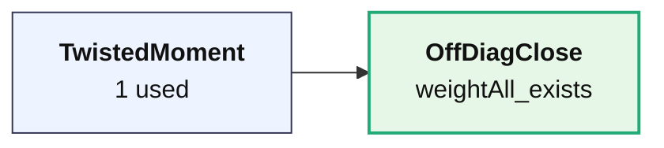

# What `OffDiagClose.weightAll_exists` rests on

[`OffDiagClose.weightAll_exists`](../lean_stage3/OffDiagClose.md#OffDiagClose-weightAll_exists) in `lean_stage3/Stage3/OffDiagClose.lean`, line 275.

**Why.** Existence of the window. There are constants `C_j ≥ 0`, independent of `T` and `L`, such that for every `T ≥ 8`, `L ≥ 1` there is a `WeightAll T L` with these constants (and `C₁ = C_1`, `C₂ = C_2`), namely `w(t) = φ((t − T/4)/Δ) φ((2T − t)/Δ)`, `Δ = T/L`, `φ = smoothTransition`.

**Proves**

```lean
∃ Cs : ℕ → ℝ, (∀ j, 0 ≤ Cs j) ∧ ∀ T L : ℝ, 8 ≤ T → 1 ≤ L → ∃ W : WeightAll T L, W.Cj = Cs ∧ W.C1 = Cs 1 ∧ W.C2 = Cs 2 ∧ ∀ t, W.w t = Real.smoothTransition ((t - T / 4) / (T / L)) * Real.smoothTransition ((2 * T - t) / (T / L))
```

Behind it: 20 theorems and 8 definitions in 2 files. Every one is listed below; Lean recorded each step.

## The files it passes through



An arrow A → B reads "B uses something proved or defined in A"; indirect arrows are left out. Green: the theorem itself. Yellow: a file in the other tree. The number is how many of that file's declarations are on the way.

## Every declaration on the way

Files in dependency order. ★ marks what the theorem's own proof uses directly.

### [`TwistedMoment`](../lean_stage3/TwistedMoment.md) — 1

- [`TwistedMoment.Weight`](../lean_stage3/TwistedMoment.md#TwistedMoment-Weight) — *structure*

### [`OffDiagClose`](../lean_stage3/OffDiagClose.md) — 27

- ★ [`OffDiagClose.WeightAll`](../lean_stage3/OffDiagClose.md#OffDiagClose-WeightAll) — *structure*
- [`OffDiagClose.phi_contDiff`](../lean_stage3/OffDiagClose.md#OffDiagClose-phi_contDiff) — `` ContDiff ℝ ∞ Real.smoothTransition ``
- [`OffDiagClose.phi_deriv_compact`](../lean_stage3/OffDiagClose.md#OffDiagClose-phi_deriv_compact) — `` HasCompactSupport (deriv Real.smoothTransition) ``
- [`OffDiagClose.phi_iter_compact`](../lean_stage3/OffDiagClose.md#OffDiagClose-phi_iter_compact) — `` HasCompactSupport (iteratedDeriv k (deriv Real.smoothTransition)) ``
- [`OffDiagClose.phi_iter_bdd`](../lean_stage3/OffDiagClose.md#OffDiagClose-phi_iter_bdd) — `` ∃ B : ℝ, 0 ≤ B ∧ ∀ s, |iteratedDeriv i Real.smoothTransition s| ≤ B ``
- [`OffDiagClose.phiB`](../lean_stage3/OffDiagClose.md#OffDiagClose-phiB) — *def*
- [`OffDiagClose.phiB_nonneg`](../lean_stage3/OffDiagClose.md#OffDiagClose-phiB_nonneg) — `` 0 ≤ phiB i ``
- [`OffDiagClose.phiB_bound`](../lean_stage3/OffDiagClose.md#OffDiagClose-phiB_bound) — `` |iteratedDeriv i Real.smoothTransition s| ≤ phiB i ``
- ★ [`OffDiagClose.winC`](../lean_stage3/OffDiagClose.md#OffDiagClose-winC) — *def*
- ★ [`OffDiagClose.winC_nonneg`](../lean_stage3/OffDiagClose.md#OffDiagClose-winC_nonneg) — `` 0 ≤ winC j ``
- ★ [`OffDiagClose.edgeUp`](../lean_stage3/OffDiagClose.md#OffDiagClose-edgeUp) — *def*
- ★ [`OffDiagClose.edgeDn`](../lean_stage3/OffDiagClose.md#OffDiagClose-edgeDn) — *def*
- ★ [`OffDiagClose.winY`](../lean_stage3/OffDiagClose.md#OffDiagClose-winY) — *def*
- [`OffDiagClose.edgeUp_contDiff`](../lean_stage3/OffDiagClose.md#OffDiagClose-edgeUp_contDiff) — `` ContDiff ℝ ∞ (edgeUp c a) ``
- [`OffDiagClose.edgeDn_contDiff`](../lean_stage3/OffDiagClose.md#OffDiagClose-edgeDn_contDiff) — `` ContDiff ℝ ∞ (edgeDn c b) ``
- [`OffDiagClose.phi_scale_iter`](../lean_stage3/OffDiagClose.md#OffDiagClose-phi_scale_iter) — `` iteratedDeriv i (fun z => Real.smoothTransition (c * z)) = fun z => c ^ i * iteratedDeriv i Real.smoothTransition (c * z) ``
- [`OffDiagClose.edgeUp_iter`](../lean_stage3/OffDiagClose.md#OffDiagClose-edgeUp_iter) — `` iteratedDeriv i (edgeUp c a) t = c ^ i * iteratedDeriv i Real.smoothTransition (c * (t - a)) ``
- [`OffDiagClose.edgeDn_iter`](../lean_stage3/OffDiagClose.md#OffDiagClose-edgeDn_iter) — `` iteratedDeriv i (edgeDn c b) t = (-1) ^ i * (c ^ i * iteratedDeriv i Real.smoothTransition (c * (b - t))) ``
- [`OffDiagClose.edgeUp_iter_le`](../lean_stage3/OffDiagClose.md#OffDiagClose-edgeUp_iter_le) — `` |iteratedDeriv i (edgeUp c a) t| ≤ phiB i * c ^ i ``
- [`OffDiagClose.edgeDn_iter_le`](../lean_stage3/OffDiagClose.md#OffDiagClose-edgeDn_iter_le) — `` |iteratedDeriv i (edgeDn c b) t| ≤ phiB i * c ^ i ``
- [`OffDiagClose.winY_contDiff`](../lean_stage3/OffDiagClose.md#OffDiagClose-winY_contDiff) — `` ContDiff ℝ ∞ (winY T L) ``
- [`OffDiagClose.winY_iter_le`](../lean_stage3/OffDiagClose.md#OffDiagClose-winY_iter_le) — `` |iteratedDeriv j (winY T L) t| ≤ winC j * ((T / L) ^ j)⁻¹ ``
- [`OffDiagClose.phi_pos_of_ne`](../lean_stage3/OffDiagClose.md#OffDiagClose-phi_pos_of_ne) — `` 0 < x ``
- [`OffDiagClose.winY_supp`](../lean_stage3/OffDiagClose.md#OffDiagClose-winY_supp) — `` T / 4 ≤ t ∧ t ≤ 2 * T ``
- [`OffDiagClose.winY_nonneg`](../lean_stage3/OffDiagClose.md#OffDiagClose-winY_nonneg) — `` 0 ≤ winY T L t ``
- [`OffDiagClose.winY_le_one`](../lean_stage3/OffDiagClose.md#OffDiagClose-winY_le_one) — `` winY T L t ≤ 1 ``
- ★ [`OffDiagClose.winW`](../lean_stage3/OffDiagClose.md#OffDiagClose-winW) — *def*

