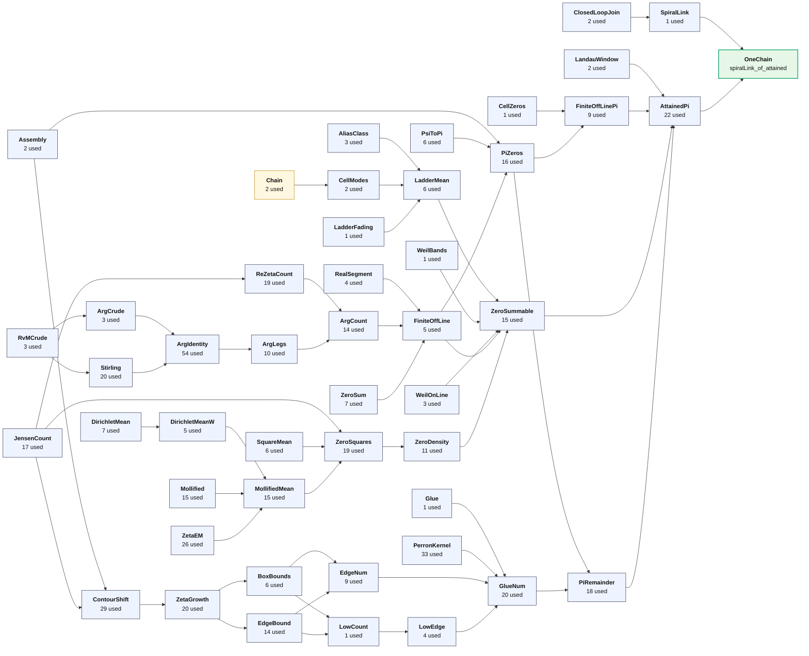

# What `OneChain.spiralLink_of_attained` rests on

[`OneChain.spiralLink_of_attained`](../lean_stage3/OneChain.md#OneChain-spiralLink_of_attained) in `lean_stage3/Stage3/OneChain.lean`, line 87.

**Why.** From the count's ladder to the loop, a largest real part attained.

**Proves**

```lean
SpiralLink.SpiralLink
```

**Needs** (its hypotheses)

  - `` ρ₀ : NontrivialZeros ``
  - `` hmax : ∀ ρ : NontrivialZeros, (ρ : ℂ).re ≤ (ρ₀ : ℂ).re ``
  - `` C : ℝ ``
  - `` hrows : ∀ᶠ r : ℕ in Filter.atTop, |(Nat.primeCounting ⌊(2:ℝ) ^ r⌋₊ : ℝ) - Stage3.Li ((2:ℝ) ^ r)| ≤ C * (r : ℝ) ^ 2 * Real.sqrt 2 ^ r ``

Behind it: 427 theorems and 82 definitions in 48 files. Every one is listed below; Lean recorded each step.

## The files it passes through



An arrow A → B reads "B uses something proved or defined in A"; indirect arrows are left out. Green: the theorem itself. Yellow: a file in the other tree. The number is how many of that file's declarations are on the way.

## Every declaration on the way

Files in dependency order. ★ marks what the theorem's own proof uses directly.

### [`Chain`](../lean/Chain.md) — 2

- [`Chain.Sym`](../lean/Chain.md#Chain-Sym) — *def*
- [`Chain.mode`](../lean/Chain.md#Chain-mode) — *def*

### [`AliasClass`](../lean_stage3/AliasClass.md) — 3

- [`AliasClass.re_inv_pos`](../lean_stage3/AliasClass.md#AliasClass-re_inv_pos) — `` 0 < (ρ⁻¹).re ``
- [`AliasClass.zero_re_pos`](../lean_stage3/AliasClass.md#AliasClass-zero_re_pos) — `` 0 < (ρ : ℂ).re ``
- [`AliasClass.re_order_div_pos`](../lean_stage3/AliasClass.md#AliasClass-re_order_div_pos) — `` 0 < ((((riemannZeta.order (ρ : ℂ) : ℤ) : ℂ)) / (ρ : ℂ)).re ``

### [`Assembly`](../lean_stage3/Assembly.md) — 2

- [`Stage3.zeroPartialSum`](../lean_stage3/Assembly.md#Stage3-zeroPartialSum) — *def*
- [`Stage3.inv_le_dyadic_sum`](../lean_stage3/Assembly.md#Stage3-inv_le_dyadic_sum) — `` ∀ γ : ℝ, 1 ≤ γ → γ < 2 ^ (K + 1) → γ⁻¹ ≤ ∑ j ∈ Finset.range (K + 1), ((2 : ℝ) ^ j)⁻¹ * (if γ < 2 ^ (j + 1) then 1 else 0) ``

### [`CellModes`](../lean_stage3/CellModes.md) — 2

- [`CellModes.mode_two_int`](../lean_stage3/CellModes.md#CellModes-mode_two_int) — `` Chain.mode 2 ρ (r : ℂ) = ((2:ℂ) ^ ρ) ^ r ``
- [`CellModes.sym_two`](../lean_stage3/CellModes.md#CellModes-sym_two) — `` Chain.Sym 2 ρ = 1 - ((2:ℂ) ^ ρ)⁻¹ ``

### [`CellZeros`](../lean_stage3/CellZeros.md) — 1

- [`CellZeros.cpow_two_zpow`](../lean_stage3/CellZeros.md#CellZeros-cpow_two_zpow) — `` (((2:ℝ) ^ n : ℝ) : ℂ) ^ ρ = ((2:ℂ) ^ ρ) ^ n ``

### [`ClosedLoopJoin`](../lean_stage3/ClosedLoopJoin.md) — 2

- [`ClosedLoopJoin.primeWeight`](../lean_stage3/ClosedLoopJoin.md#ClosedLoopJoin-primeWeight) — *def*
- [`ClosedLoopJoin.isHermitianHandshake`](../lean_stage3/ClosedLoopJoin.md#ClosedLoopJoin-isHermitianHandshake) — *def*

### [`DirichletMean`](../lean_stage3/DirichletMean.md) — 7

- [`DirichletMean.natCast_cpow_neg_I_mul`](../lean_stage3/DirichletMean.md#DirichletMean-natCast_cpow_neg_I_mul) — `` (n : ℂ) ^ (-(Complex.I * (t : ℂ))) = Complex.exp (Complex.I * ((-Real.log n : ℝ) : ℂ) * t) ``
- [`DirichletMean.sq_norm_sum_eq`](../lean_stage3/DirichletMean.md#DirichletMean-sq_norm_sum_eq) — `` ((‖∑ n ∈ Icc 1 N, a n * (n : ℂ) ^ (-(Complex.I * (t : ℂ)))‖ ^ 2 : ℝ) : ℂ) = ∑ m ∈ Icc 1 N, ∑ n ∈ Icc 1 N, a m * (starRingEnd ℂ) (a n) * Complex.exp (Complex.I *… ``
- [`DirichletMean.integral_sq_norm_eq`](../lean_stage3/DirichletMean.md#DirichletMean-integral_sq_norm_eq) — `` ((∫ t in T₁..T₂, ‖∑ n ∈ Icc 1 N, a n * (n : ℂ) ^ (-(Complex.I * (t : ℂ)))‖ ^ 2 : ℝ) : ℂ) = ∑ m ∈ Icc 1 N, ∑ n ∈ Icc 1 N, a m * (starRingEnd ℂ) (a n) * ∫ t in T₁… ``
- [`DirichletMean.norm_integral_exp_le`](../lean_stage3/DirichletMean.md#DirichletMean-norm_integral_exp_le) — `` ‖∫ t in T₁..T₂, Complex.exp (Complex.I * (θ : ℂ) * t)‖ ≤ 2 / |θ| ``
- [`DirichletMean.sum_inv_le_harmonic`](../lean_stage3/DirichletMean.md#DirichletMean-sum_inv_le_harmonic) — `` ∑ n ∈ s, ((g n : ℕ) : ℝ)⁻¹ ≤ ∑ k ∈ Icc 1 N, (k : ℝ)⁻¹ ``
- [`DirichletMean.sum_inv_Icc_le`](../lean_stage3/DirichletMean.md#DirichletMean-sum_inv_Icc_le) — `` ∑ k ∈ Icc 1 N, (k : ℝ)⁻¹ ≤ 1 + Real.log N ``
- [`DirichletMean.sum_inv_dist_le`](../lean_stage3/DirichletMean.md#DirichletMean-sum_inv_dist_le) — `` ∑ n ∈ Icc 1 N, (if m = n then 0 else |(m : ℝ) - n|⁻¹) ≤ 2 * (1 + Real.log N) ``

### [`DirichletMeanW`](../lean_stage3/DirichletMeanW.md) — 5

- [`DirichletMeanW.log_gap_larger`](../lean_stage3/DirichletMeanW.md#DirichletMeanW-log_gap_larger) — `` ((q : ℝ) - p) / q ≤ Real.log q - Real.log p ``
- [`DirichletMeanW.weighted_gap`](../lean_stage3/DirichletMeanW.md#DirichletMeanW-weighted_gap) — `` 2 / |Real.log n - Real.log m| * ((m : ℝ) / n) ≤ 2 * m * (|(m : ℝ) - n|⁻¹ + (n : ℝ)⁻¹) ``
- [`DirichletMeanW.sum_mul_mul_le_weighted`](../lean_stage3/DirichletMeanW.md#DirichletMeanW-sum_mul_mul_le_weighted) — `` ∑ m ∈ s, ∑ n ∈ s, A m * A n * K m n ≤ ∑ m ∈ s, A m ^ 2 * R m ``
- [`DirichletMeanW.dirichlet_mean_value_weighted`](../lean_stage3/DirichletMeanW.md#DirichletMeanW-dirichlet_mean_value_weighted) — `` ∫ t in T₁..T₂, ‖∑ n ∈ Finset.Icc 1 N, a n * (n : ℂ) ^ (-(Complex.I * (t : ℂ)))‖ ^ 2 ≤ ∑ n ∈ Finset.Icc 1 N, ‖a n‖ ^ 2 * ((T₂ - T₁) + 6 * n * (1 + Real.log N)) ``
- [`DirichletMeanW.dirichlet_mean_value_weighted_sigma`](../lean_stage3/DirichletMeanW.md#DirichletMeanW-dirichlet_mean_value_weighted_sigma) — `` ∫ t in T₁..T₂, ‖∑ n ∈ Finset.Icc 1 N, a n * (n : ℂ) ^ (-((σ : ℂ) + Complex.I * (t : ℂ)))‖ ^ 2 ≤ ∑ n ∈ Finset.Icc 1 N, ‖a n‖ ^ 2 * (n : ℝ) ^ (-2 * σ) * ((T₂ - T₁… ``

### [`Glue`](../lean_stage3/Glue.md) — 1

- [`Glue.Gf`](../lean_stage3/Glue.md#Glue-Gf) — *def*

### [`JensenCount`](../lean_stage3/JensenCount.md) — 17

- [`Stage3.zeta_centre_lower`](../lean_stage3/JensenCount.md#Stage3-zeta_centre_lower) — `` (1 : ℝ) / 3 ≤ ‖ζ (2 + Complex.I * T)‖ ``
- [`Stage3.zeta_disk_upper`](../lean_stage3/JensenCount.md#Stage3-zeta_disk_upper) — `` ‖ζ w‖ ≤ 28 * T ``
- [`Stage3.zeta_centre_ne_zero`](../lean_stage3/JensenCount.md#Stage3-zeta_centre_ne_zero) — `` ζ (2 + Complex.I * (T : ℂ)) ≠ 0 ``
- [`Stage3.pole_away`](../lean_stage3/JensenCount.md#Stage3-pole_away) — `` 2 * z + (2 + Complex.I * (T : ℂ)) ≠ 1 ``
- [`Stage3.pole_away_centre`](../lean_stage3/JensenCount.md#Stage3-pole_away_centre) — `` v ≠ 1 ``
- [`Stage3.zetaWindowTwo_finite`](../lean_stage3/JensenCount.md#Stage3-zetaWindowTwo_finite) — `` {ρ : ℂ | ζ ρ = 0 ∧ ‖ρ - (2 + Complex.I * (T : ℂ))‖ ≤ 2}.Finite ``
- [`Stage3.zetaWindow`](../lean_stage3/JensenCount.md#Stage3-zetaWindow) — *def*
- [`Stage3.zetaWindow_finite`](../lean_stage3/JensenCount.md#Stage3-zetaWindow_finite) — `` (zetaWindow T).Finite ``
- [`Stage3.jensenF`](../lean_stage3/JensenCount.md#Stage3-jensenF) — *def*
- [`Stage3.zeta_comp_analytic`](../lean_stage3/JensenCount.md#Stage3-zeta_comp_analytic) — `` AnalyticAt ℂ (fun z : ℂ => ζ (2 * z + (2 + Complex.I * (T : ℂ)))) w ``
- [`Stage3.jensenF_analytic`](../lean_stage3/JensenCount.md#Stage3-jensenF_analytic) — `` AnalyticOnNhd ℂ (jensenF T) (Metric.closedBall (0 : ℂ) 1) ``
- [`Stage3.jensenF_zero_eq_one`](../lean_stage3/JensenCount.md#Stage3-jensenF_zero_eq_one) — `` jensenF T 0 = 1 ``
- [`Stage3.jensenF_zeros_finite`](../lean_stage3/JensenCount.md#Stage3-jensenF_zeros_finite) — `` (SetOfZeros 1 (jensenF T)).Finite ``
- [`Stage3.jensenF_bound`](../lean_stage3/JensenCount.md#Stage3-jensenF_bound) — `` ‖jensenF T z‖ ≤ 84 * T ``
- [`Stage3.analyticOrderNatAt_fun_comp_affine`](../lean_stage3/JensenCount.md#Stage3-analyticOrderNatAt_fun_comp_affine) — `` analyticOrderNatAt (fun w : ℂ => g (a * w + b)) z = analyticOrderNatAt g (a * z + b) ``
- [`Stage3.jensenF_order`](../lean_stage3/JensenCount.md#Stage3-jensenF_order) — `` analyticOrderNatAt (jensenF T) w = analyticOrderNatAt ζ (2 * w + (2 + Complex.I * (T : ℂ))) ``
- [`Stage3.zeta_local_zero_count`](../lean_stage3/JensenCount.md#Stage3-zeta_local_zero_count) — `` ∑ ρ ∈ (zetaWindow_finite hT).toFinset, (analyticOrderNatAt ζ ρ : ℝ) ≤ 15 * Real.log T + 73 ``

### [`ContourShift`](../lean_stage3/ContourShift.md) — 29

- [`ContourShift.zeroGap`](../lean_stage3/ContourShift.md#ContourShift-zeroGap) — *def*
- [`ContourShift.zeroGap_pos`](../lean_stage3/ContourShift.md#ContourShift-zeroGap_pos) — `` 0 < zeroGap T ``
- [`ContourShift.zeroGap_le`](../lean_stage3/ContourShift.md#ContourShift-zeroGap_le) — `` zeroGap T ≤ 9/10 ``
- [`ContourShift.zeta_analyticAt`](../lean_stage3/ContourShift.md#ContourShift-zeta_analyticAt) — `` AnalyticAt ℂ riemannZeta ρ ``
- [`ContourShift.one_le_zeta_order`](../lean_stage3/ContourShift.md#ContourShift-one_le_zeta_order) — `` 1 ≤ analyticOrderNatAt riemannZeta ρ ``
- [`ContourShift.partner_zero`](../lean_stage3/ContourShift.md#ContourShift-partner_zero) — `` ∃ ρ' : ℂ, riemannZeta ρ' = 0 ∧ ρ'.im = ρ.im ∧ 1/2 ≤ ρ'.re ∧ ρ'.re < 1 ``
- [`ContourShift.mem_zetaWindow`](../lean_stage3/ContourShift.md#ContourShift-mem_zetaWindow) — `` ρ ∈ Stage3.zetaWindow T₀ ``
- [`ContourShift.goodT_exists`](../lean_stage3/ContourShift.md#ContourShift-goodT_exists) — `` ∃ T' ∈ Set.Icc T (T+1), ∀ ρ : ℂ, riemannZeta ρ = 0 → 0 < ρ.re → zeroGap T ≤ |ρ.im - T'| ``
- [`ContourShift.borderIntegrable_sum_poles`](../lean_stage3/ContourShift.md#ContourShift-borderIntegrable_sum_poles) — `` RectangleBorderIntegrable (fun s ↦ ∑ p ∈ P, A p / (s - p)) z w ``
- [`ContourShift.rectangleIntegral_sum_poles`](../lean_stage3/ContourShift.md#ContourShift-rectangleIntegral_sum_poles) — `` RectangleIntegral' (fun s ↦ ∑ p ∈ P, A p / (s - p)) z w = ∑ p ∈ P, A p ``
- [`ContourShift.residue_rectangle_multi`](../lean_stage3/ContourShift.md#ContourShift-residue_rectangle_multi) — `` RectangleIntegral' f z w = ∑ p ∈ P, A p ``
- [`ContourShift.residue_rectangle_of_local`](../lean_stage3/ContourShift.md#ContourShift-residue_rectangle_of_local) — `` RectangleIntegral' f z w = ∑ p ∈ P, A p ``
- [`ContourShift.analyticAt_dslope`](../lean_stage3/ContourShift.md#ContourShift-analyticAt_dslope) — `` AnalyticAt ℂ (dslope f p) p ``
- [`ContourShift.div_sub_eq_dslope`](../lean_stage3/ContourShift.md#ContourShift-div_sub_eq_dslope) — `` f s / (s - p) = f p / (s - p) + dslope f p s ``
- [`ContourShift.zeta_local_data`](../lean_stage3/ContourShift.md#ContourShift-zeta_local_data) — `` ∃ h : ℂ → ℂ, AnalyticAt ℂ h p ∧ ∀ᶠ s in nhdsWithin p {p}ᶜ, - deriv riemannZeta s / riemannZeta s * ((x:ℝ):ℂ) ^ s / s = h s + (-(n:ℂ) * ((x:ℝ):ℂ) ^ p / p) / (s -… ``
- [`ContourShift.zeta_order_ne_top`](../lean_stage3/ContourShift.md#ContourShift-zeta_order_ne_top) — `` analyticOrderAt riemannZeta ρ ≠ ⊤ ``
- [`ContourShift.zeta_local_data_zero`](../lean_stage3/ContourShift.md#ContourShift-zeta_local_data_zero) — `` ∃ h : ℂ → ℂ, AnalyticAt ℂ h ρ ∧ ∀ᶠ s in nhdsWithin ρ {ρ}ᶜ, - deriv riemannZeta s / riemannZeta s * ((x:ℝ):ℂ) ^ s / s = h s + (-(analyticOrderNatAt riemannZeta ρ… ``
- [`ContourShift.zeta_local_data_one`](../lean_stage3/ContourShift.md#ContourShift-zeta_local_data_one) — `` ∃ h : ℂ → ℂ, AnalyticAt ℂ h 1 ∧ ∀ᶠ s in nhdsWithin 1 {1}ᶜ, - deriv riemannZeta s / riemannZeta s * ((x:ℝ):ℂ) ^ s / s = h s + ((x:ℝ):ℂ) / (s - 1) ``
- [`ContourShift.zeta_local_data_origin`](../lean_stage3/ContourShift.md#ContourShift-zeta_local_data_origin) — `` ∃ h : ℂ → ℂ, AnalyticAt ℂ h 0 ∧ ∀ᶠ s in nhdsWithin 0 {0}ᶜ, - deriv riemannZeta s / riemannZeta s * ((x:ℝ):ℂ) ^ s / s = h s + (- deriv riemannZeta 0 / riemannZet… ``
- [`ContourShift.zeta_ne_zero_of_re_mem`](../lean_stage3/ContourShift.md#ContourShift-zeta_ne_zero_of_re_mem) — `` riemannZeta w ≠ 0 ``
- [`ContourShift.sq_mul_zeta_analyticAt_one`](../lean_stage3/ContourShift.md#ContourShift-sq_mul_zeta_analyticAt_one) — `` AnalyticAt ℂ (fun s ↦ (s - 1)^2 * riemannZeta s) 1 ``
- [`ContourShift.zeta_meromorphicOn`](../lean_stage3/ContourShift.md#ContourShift-zeta_meromorphicOn) — `` MeromorphicOn riemannZeta U ``
- [`ContourShift.zeta_zeros_rectangle_finite`](../lean_stage3/ContourShift.md#ContourShift-zeta_zeros_rectangle_finite) — `` {ρ : ℂ | riemannZeta ρ = 0 ∧ ρ ∈ Rectangle z w}.Finite ``
- [`ContourShift.order_bridge`](../lean_stage3/ContourShift.md#ContourShift-order_bridge) — `` ((riemannZeta.order ρ : ℤ) : ℂ) = ((analyticOrderNatAt riemannZeta ρ : ℕ) : ℂ) ``
- [`ContourShift.zeroPartialSum_eq_sum`](../lean_stage3/ContourShift.md#ContourShift-zeroPartialSum_eq_sum) — `` Stage3.zeroPartialSum x T' = ∑ p ∈ ZF, ((analyticOrderNatAt riemannZeta p : ℂ) * ((x : ℂ) ^ p / p)) ``
- [`ContourShift.analyticAt_conj_conj`](../lean_stage3/ContourShift.md#ContourShift-analyticAt_conj_conj) — `` AnalyticAt ℂ (fun w ↦ (starRingEnd ℂ) (g ((starRingEnd ℂ) w))) ((starRingEnd ℂ) p) ``
- [`ContourShift.zeta_order_conj`](../lean_stage3/ContourShift.md#ContourShift-zeta_order_conj) — `` analyticOrderNatAt riemannZeta ((starRingEnd ℂ) ρ) = analyticOrderNatAt riemannZeta ρ ``
- [`ContourShift.zeta_order_reflect`](../lean_stage3/ContourShift.md#ContourShift-zeta_order_reflect) — `` analyticOrderNatAt riemannZeta (1 - (starRingEnd ℂ) ρ) = analyticOrderNatAt riemannZeta ρ ``
- [`ContourShift.residue_identity`](../lean_stage3/ContourShift.md#ContourShift-residue_identity) — `` RectangleIntegral' (fun s : ℂ ↦ (- deriv riemannZeta s / riemannZeta s) * ((x:ℝ):ℂ) ^ s / s) (((-1/4 : ℝ):ℂ) - Complex.I * T') (((1 + 1/Real.log x : ℝ):ℂ) + Com… ``

### [`LadderFading`](../lean_stage3/LadderFading.md) — 1

- [`LadderFading.one_sub_inv_ne_zero`](../lean_stage3/LadderFading.md#LadderFading-one_sub_inv_ne_zero) — `` (1 : ℂ) - z⁻¹ ≠ 0 ``

### [`LadderMean`](../lean_stage3/LadderMean.md) — 6

- [`LadderMean.geom_mean_norm_le`](../lean_stage3/LadderMean.md#LadderMean-geom_mean_norm_le) — `` ‖((N : ℝ)⁻¹ : ℝ) • ∑ r ∈ range N, ξ ^ r‖ ≤ 1 ``
- [`LadderMean.geom_mean_tendsto_zero`](../lean_stage3/LadderMean.md#LadderMean-geom_mean_tendsto_zero) — `` Tendsto (fun N : ℕ => ((N : ℝ)⁻¹ : ℝ) • ∑ r ∈ range N, ξ ^ r) atTop (𝓝 0) ``
- [`LadderMean.mean_extract`](../lean_stage3/LadderMean.md#LadderMean-mean_extract) — `` ∑' i, (if w i = w k then C i else 0) = 0 ``
- [`LadderMean.coef`](../lean_stage3/LadderMean.md#LadderMean-coef) — *def*
- [`LadderMean.zOf`](../lean_stage3/LadderMean.md#LadderMean-zOf) — *def*
- [`LadderMean.line_not_fading_summable`](../lean_stage3/LadderMean.md#LadderMean-line_not_fading_summable) — `` ¬ Tendsto (fun r : ℕ => (∑' ρ : S, coef ρ * Chain.Sym 2 ((ρ : Kadiri.NontrivialZeros) : ℂ) ^ d * Chain.mode 2 ((ρ : Kadiri.NontrivialZeros) : ℂ) (((r : ℤ)) : ℂ)… ``

### [`LandauWindow`](../lean_stage3/LandauWindow.md) — 2

- [`LandauWindow.zeta_neg_nat_ne_zero`](../lean_stage3/LandauWindow.md#LandauWindow-zeta_neg_nat_ne_zero) — `` riemannZeta (-(n : ℂ)) ≠ 0 ``
- [`LandauWindow.rh_of_zeroFree_half`](../lean_stage3/LandauWindow.md#LandauWindow-rh_of_zeroFree_half) — `` RiemannHypothesis ``

### [`Mollified`](../lean_stage3/Mollified.md) — 15

- [`Mollified.tauBelow`](../lean_stage3/Mollified.md#Mollified-tauBelow) — *def*
- [`Mollified.coef`](../lean_stage3/Mollified.md#Mollified-coef) — *def*
- [`Mollified.prod_eq_sum`](../lean_stage3/Mollified.md#Mollified-prod_eq_sum) — `` (∑ m ∈ Icc 1 N, (m : ℂ) ^ (-s)) * (∑ d ∈ Ico 1 X, (ArithmeticFunction.moebius d : ℂ) * (d : ℂ) ^ (-s)) = ∑ n ∈ Icc 1 (N * X), (coef X N n : ℂ) * (n : ℂ) ^ (-s) ``
- [`Mollified.coef_one`](../lean_stage3/Mollified.md#Mollified-coef_one) — `` coef X N 1 = 1 ``
- [`Mollified.coef_eq_zero`](../lean_stage3/Mollified.md#Mollified-coef_eq_zero) — `` coef X N n = 0 ``
- [`Mollified.abs_coef_le`](../lean_stage3/Mollified.md#Mollified-abs_coef_le) — `` |coef X N n| ≤ tauBelow X n ``
- [`Mollified.card_Icc_dvd`](../lean_stage3/Mollified.md#Mollified-card_Icc_dvd) — `` ((Icc 1 Y).filter (k ∣ ·)).card = Y / k ``
- [`Mollified.triples`](../lean_stage3/Mollified.md#Mollified-triples) — *def*
- [`Mollified.tauBelow_sq_le`](../lean_stage3/Mollified.md#Mollified-tauBelow_sq_le) — `` tauBelow X n ^ 2 ≤ ((triples X).filter (fun t => t.1 * t.2.1 * t.2.2 ∣ n)).card ``
- [`Mollified.sum_inv_Ico_le`](../lean_stage3/Mollified.md#Mollified-sum_inv_Ico_le) — `` ∑ k ∈ Ico 1 X, ((k : ℝ))⁻¹ ≤ 1 + Real.log X ``
- [`Mollified.sum_tauBelow_sq_le`](../lean_stage3/Mollified.md#Mollified-sum_tauBelow_sq_le) — `` ∑ n ∈ Icc 1 Y, (tauBelow X n : ℝ) ^ 2 ≤ Y * (1 + Real.log X) ^ 3 ``
- [`Mollified.coef_sq_le`](../lean_stage3/Mollified.md#Mollified-coef_sq_le) — `` (coef X N n : ℝ) ^ 2 ≤ (tauBelow X n : ℝ) ^ 2 ``
- [`Mollified.sum_coef_sq_le`](../lean_stage3/Mollified.md#Mollified-sum_coef_sq_le) — `` ∑ n ∈ Icc 1 Y, (coef X N n : ℝ) ^ 2 ≤ Y * (1 + Real.log X) ^ 3 ``
- [`Mollified.sum_Ico_dyadic`](../lean_stage3/Mollified.md#Mollified-sum_Ico_dyadic) — `` ∑ n ∈ Ico X (2 ^ J * X), f n = ∑ j ∈ range J, ∑ n ∈ Ico (2 ^ j * X) (2 ^ (j + 1) * X), f n ``
- [`Mollified.sum_coef_sq_weighted_le`](../lean_stage3/Mollified.md#Mollified-sum_coef_sq_weighted_le) — `` ∑ n ∈ Icc X Y, (coef X N n : ℝ) ^ 2 * (n : ℝ) ^ (-2 * u) ≤ 2 / (1 - (2 : ℝ) ^ (1 - 2 * u)) * (X : ℝ) ^ (1 - 2 * u) * (1 + Real.log X) ^ 3 ``

### [`PerronKernel`](../lean_stage3/PerronKernel.md) — 33

- [`PerronKernel.perronI`](../lean_stage3/PerronKernel.md#PerronKernel-perronI) — *def*
- [`PerronKernel.perronδ`](../lean_stage3/PerronKernel.md#PerronKernel-perron-) — *def*
- [`PerronKernel.perronI_eq_VIntegral'`](../lean_stage3/PerronKernel.md#PerronKernel-perronI_eq_VIntegral-) — `` perronI y c T = VIntegral' (fun s : ℂ ↦ (y : ℂ) ^ s / s) c (-T) T ``
- [`PerronKernel.kernel_holo`](../lean_stage3/PerronKernel.md#PerronKernel-kernel_holo) — `` HolomorphicOn (fun s : ℂ ↦ (y : ℂ) ^ s / s) {s : ℂ | 0 < s.re} ``
- [`PerronKernel.rect_subset_right`](../lean_stage3/PerronKernel.md#PerronKernel-rect_subset_right) — `` Rectangle ((c : ℂ) - Complex.I * T) ((X : ℂ) + Complex.I * T) ⊆ {s : ℂ | 0 < s.re} ``
- [`PerronKernel.perron_kernel_coarse_lt`](../lean_stage3/PerronKernel.md#PerronKernel-perron_kernel_coarse_lt) — `` ‖perronI y c T - perronδ y‖ ≤ y ^ c ``
- [`PerronKernel.horiz_bound`](../lean_stage3/PerronKernel.md#PerronKernel-horiz_bound) — `` ‖∫ σ in a..b, (y : ℂ) ^ ((σ : ℂ) + (T' : ℂ) * Complex.I) / ((σ : ℂ) + (T' : ℂ) * Complex.I)‖ ≤ max (y ^ a) (y ^ b) / (|T'| * |Real.log y|) ``
- [`PerronKernel.perron_kernel_decay_lt`](../lean_stage3/PerronKernel.md#PerronKernel-perron_kernel_decay_lt) — `` ‖perronI y c T - perronδ y‖ ≤ y ^ c / (T * |Real.log y|) ``
- [`PerronKernel.dslope_kernel_diff`](../lean_stage3/PerronKernel.md#PerronKernel-dslope_kernel_diff) — `` Differentiable ℂ (dslope (fun s : ℂ ↦ (y : ℂ) ^ s) 0) ``
- [`PerronKernel.rect_residue`](../lean_stage3/PerronKernel.md#PerronKernel-rect_residue) — `` RectangleIntegral' (fun s : ℂ ↦ (y : ℂ) ^ s / s) (-(X:ℂ) - Complex.I * T) ((c:ℂ) + Complex.I * T) = 1 ``
- [`PerronKernel.perron_kernel_decay_gt`](../lean_stage3/PerronKernel.md#PerronKernel-perron_kernel_decay_gt) — `` ‖perronI y c T - perronδ y‖ ≤ y ^ c / (T * |Real.log y|) ``
- [`PerronKernel.perron_kernel_decay`](../lean_stage3/PerronKernel.md#PerronKernel-perron_kernel_decay) — `` ‖perronI y c T - perronδ y‖ ≤ y ^ c / (T * |Real.log y|) ``
- [`PerronKernel.coarse_gt_ineq`](../lean_stage3/PerronKernel.md#PerronKernel-coarse_gt_ineq) — `` v * Real.exp u + Real.pi - Real.arctan (v / u) ≤ Real.pi * Real.exp u ``
- [`PerronKernel.seg_inv_integral`](../lean_stage3/PerronKernel.md#PerronKernel-seg_inv_integral) — `` (∫ t in (-T)..T, ((c : ℂ) + Complex.I * t)⁻¹ * Complex.I) = 2 * Real.arctan (T / c) * Complex.I ``
- [`PerronKernel.cpow_sub_one_bound`](../lean_stage3/PerronKernel.md#PerronKernel-cpow_sub_one_bound) — `` ‖(y : ℂ) ^ s - 1‖ ≤ ‖s‖ * Real.log y * y ^ s.re ``
- [`PerronKernel.perron_kernel_coarse_gt`](../lean_stage3/PerronKernel.md#PerronKernel-perron_kernel_coarse_gt) — `` ‖perronI y c T - perronδ y‖ ≤ y ^ c ``
- [`PerronKernel.perron_kernel_coarse`](../lean_stage3/PerronKernel.md#PerronKernel-perron_kernel_coarse) — `` ‖perronI y c T - perronδ y‖ ≤ y ^ c ``
- [`PerronKernel.perron_kernel_truncated`](../lean_stage3/PerronKernel.md#PerronKernel-perron_kernel_truncated) — `` ‖perronI y c T - perronδ y‖ ≤ y ^ c * min 1 (1 / (T * |Real.log y|)) ``
- [`PerronKernel.one_sub_two_neg_rpow`](../lean_stage3/PerronKernel.md#PerronKernel-one_sub_two_neg_rpow) — `` δ / 5 ≤ 1 - (2:ℝ) ^ (-δ) ``
- [`PerronKernel.vonMangoldt_rpow_partial`](../lean_stage3/PerronKernel.md#PerronKernel-vonMangoldt_rpow_partial) — `` ∑ n ∈ s, ArithmeticFunction.vonMangoldt n * (n : ℝ) ^ (-c) ≤ 2 * (Real.log 4 + 4) / (1 - (2:ℝ) ^ (1 - c)) ``
- [`PerronKernel.vonMangoldt_rpow_tsum`](../lean_stage3/PerronKernel.md#PerronKernel-vonMangoldt_rpow_tsum) — `` ∑' n : ℕ, ArithmeticFunction.vonMangoldt n * (n : ℝ) ^ (-c) ≤ 2 * (Real.log 4 + 4) / (1 - (2:ℝ) ^ (1 - c)) ``
- [`PerronKernel.vonMangoldt_rpow_summable`](../lean_stage3/PerronKernel.md#PerronKernel-vonMangoldt_rpow_summable) — `` Summable (fun n : ℕ ↦ ArithmeticFunction.vonMangoldt n * (n : ℝ) ^ (-c)) ``
- [`PerronKernel.far_terms_sum`](../lean_stage3/PerronKernel.md#PerronKernel-far_terms_sum) — `` (∑' n : ℕ, if 1/2 ≤ |Real.log (x / n)| then ArithmeticFunction.vonMangoldt n * (x / n) ^ (1 + 1/Real.log x) / (T * |Real.log (x / n)|) else 0) ≤ 300 * x * Real.… ``
- [`PerronKernel.abs_sub_one_le_two_abs_log`](../lean_stage3/PerronKernel.md#PerronKernel-abs_sub_one_le_two_abs_log) — `` |t - 1| / 2 ≤ |Real.log t| ``
- [`PerronKernel.near_diagonal_sum`](../lean_stage3/PerronKernel.md#PerronKernel-near_diagonal_sum) — `` (∑' n : ℕ, if 0 < |Real.log (x / n)| ∧ |Real.log (x / n)| < 1/2 then ArithmeticFunction.vonMangoldt n * min 1 (1/(T * |Real.log (x / n)|)) else 0) ≤ 100 * x * R… ``
- [`PerronKernel.perronI_one_norm`](../lean_stage3/PerronKernel.md#PerronKernel-perronI_one_norm) — `` ‖perronI 1 c T‖ ≤ 1/2 ``
- [`PerronKernel.kernel_sum_bound`](../lean_stage3/PerronKernel.md#PerronKernel-kernel_sum_bound) — `` ‖(∑' n : ℕ, (ArithmeticFunction.vonMangoldt n : ℂ) * (perronI (x/n) (1 + 1/Real.log x) T - perronδ (x/n)))‖ ≤ 600 * x * Real.log (x * T) ^ 2 / T + 12 * Real.log… ``
- [`PerronKernel.delta_sum_close`](../lean_stage3/PerronKernel.md#PerronKernel-delta_sum_close) — `` ‖(Chebyshev.psi x : ℂ) - ∑' n : ℕ, (ArithmeticFunction.vonMangoldt n : ℂ) * perronδ (x / n)‖ ≤ Real.log x ``
- [`PerronKernel.kernel_diff_summable`](../lean_stage3/PerronKernel.md#PerronKernel-kernel_diff_summable) — `` Summable (fun n : ℕ ↦ (ArithmeticFunction.vonMangoldt n : ℂ) * (perronI (x/n) (1 + 1/Real.log x) T - perronδ (x/n))) ``
- [`PerronKernel.perron_to_psi`](../lean_stage3/PerronKernel.md#PerronKernel-perron_to_psi) — `` ‖(Chebyshev.psi x : ℂ) - ∑' n : ℕ, (ArithmeticFunction.vonMangoldt n : ℂ) * perronI (x/n) (1 + 1/Real.log x) T‖ ≤ 600 * x * Real.log (x * T) ^ 2 / T + 13 * Real… ``
- [`PerronKernel.tsum_vonMangoldt_div_cpow`](../lean_stage3/PerronKernel.md#PerronKernel-tsum_vonMangoldt_div_cpow) — `` (∑' n : ℕ, (ArithmeticFunction.vonMangoldt n : ℂ) * ((x / n : ℝ) : ℂ) ^ s) = (- deriv riemannZeta s / riemannZeta s) * ((x:ℝ):ℂ) ^ s ``
- [`PerronKernel.perron_sum_eq_integral`](../lean_stage3/PerronKernel.md#PerronKernel-perron_sum_eq_integral) — `` (∑' n : ℕ, (ArithmeticFunction.vonMangoldt n : ℂ) * perronI (x/n) (1 + 1/Real.log x) T) = (2 * (Real.pi:ℂ) * Complex.I)⁻¹ * ∫ t in (-T)..T, (- deriv riemannZeta… ``
- [`PerronKernel.explicit_formula_perron`](../lean_stage3/PerronKernel.md#PerronKernel-explicit_formula_perron) — `` ‖(Chebyshev.psi x : ℂ) - (2 * (Real.pi:ℂ) * Complex.I)⁻¹ * ∫ t in (-T)..T, (- deriv riemannZeta (((1 + 1/Real.log x : ℝ):ℂ) + Complex.I * t) / riemannZeta (((1 … ``

### [`PsiToPi`](../lean_stage3/PsiToPi.md) — 6

- ★ [`Stage3.Li`](../lean_stage3/PsiToPi.md#Stage3-Li) — *def*
- [`Stage3.continuousOn_inv_log_sq`](../lean_stage3/PsiToPi.md#Stage3-continuousOn_inv_log_sq) — `` ContinuousOn (fun t : ℝ => 1 / Real.log t ^ 2) (Set.uIcc a x) ``
- [`Stage3.continuousOn_inv_mul_log_sq`](../lean_stage3/PsiToPi.md#Stage3-continuousOn_inv_mul_log_sq) — `` ContinuousOn (fun t : ℝ => (t * Real.log t ^ 2)⁻¹) (Set.uIcc a x) ``
- [`Stage3.integrable_theta_term`](../lean_stage3/PsiToPi.md#Stage3-integrable_theta_term) — `` IntervalIntegrable (fun t => θ t / (t * Real.log t ^ 2)) volume a x ``
- [`Stage3.pi_sub_Li_eq`](../lean_stage3/PsiToPi.md#Stage3-pi_sub_Li_eq) — `` (Nat.primeCounting ⌊x⌋₊ : ℝ) - Li x = (θ x - x) / Real.log x + ∫ t in (2 : ℝ)..x, (θ t - t) / (t * Real.log t ^ 2) ``
- [`Stage3.integral_A_rpow_le`](../lean_stage3/PsiToPi.md#Stage3-integral_A_rpow_le) — `` (∫ t in a..x, A * t ^ (-(1 : ℝ) / 2)) ≤ 2 * A * Real.sqrt x ``

### [`ReZetaCount`](../lean_stage3/ReZetaCount.md) — 19

- [`ReZetaCount.G`](../lean_stage3/ReZetaCount.md#ReZetaCount-G) — *def*
- [`ReZetaCount.F`](../lean_stage3/ReZetaCount.md#ReZetaCount-F) — *def*
- [`ReZetaCount.reZeroSet`](../lean_stage3/ReZetaCount.md#ReZetaCount-reZeroSet) — *def*
- [`ReZetaCount.norm_zeta_sub_one_le`](../lean_stage3/ReZetaCount.md#ReZetaCount-norm_zeta_sub_one_le) — `` ‖riemannZeta s - 1‖ ≤ Real.pi ^ 2 / 6 - 1 ``
- [`ReZetaCount.re_zeta_two_line_ge`](../lean_stage3/ReZetaCount.md#ReZetaCount-re_zeta_two_line_ge) — `` 2 - Real.pi ^ 2 / 6 ≤ (riemannZeta (2 + (t : ℂ) * Complex.I)).re ``
- [`ReZetaCount.re_zeta_two_line_pos`](../lean_stage3/ReZetaCount.md#ReZetaCount-re_zeta_two_line_pos) — `` 0 < (riemannZeta (2 + (t : ℂ) * Complex.I)).re ``
- [`ReZetaCount.G_zero_eq`](../lean_stage3/ReZetaCount.md#ReZetaCount-G_zero_eq) — `` G T 0 = ((2 * (riemannZeta (2 + Complex.I * (T : ℂ))).re : ℝ) : ℂ) ``
- [`ReZetaCount.G_real`](../lean_stage3/ReZetaCount.md#ReZetaCount-G_real) — `` G T (x : ℂ) = ((2 * (riemannZeta (2 * (x : ℂ) + 2 + Complex.I * (T : ℂ))).re : ℝ) : ℂ) ``
- [`ReZetaCount.G_zero_ne`](../lean_stage3/ReZetaCount.md#ReZetaCount-G_zero_ne) — `` G T 0 ≠ 0 ``
- [`ReZetaCount.F_zero_eq_one`](../lean_stage3/ReZetaCount.md#ReZetaCount-F_zero_eq_one) — `` F T 0 = 1 ``
- [`ReZetaCount.arg_ne_one`](../lean_stage3/ReZetaCount.md#ReZetaCount-arg_ne_one) — `` 2 * z + 2 + Complex.I * (T : ℂ) ≠ 1 ∧ 2 * z + 2 - Complex.I * (T : ℂ) ≠ 1 ``
- [`ReZetaCount.F_analytic`](../lean_stage3/ReZetaCount.md#ReZetaCount-F_analytic) — `` AnalyticOnNhd ℂ (F T) (Metric.closedBall (0 : ℂ) 1) ``
- [`ReZetaCount.F_bound`](../lean_stage3/ReZetaCount.md#ReZetaCount-F_bound) — `` ‖F T z‖ ≤ 80 * T ``
- [`ReZetaCount.F_zeros_finite`](../lean_stage3/ReZetaCount.md#ReZetaCount-F_zeros_finite) — `` (SetOfZeros 1 (F T)).Finite ``
- [`ReZetaCount.F_count_le`](../lean_stage3/ReZetaCount.md#ReZetaCount-F_count_le) — `` ∑ ρ ∈ (finiteSetOfZeros_mono (by norm_num : (7:ℝ)/8 < 1) (F_zeros_finite hT)).toFinset, (analyticOrderNatAt (F T) ρ : ℝ) ≤ 15 * Real.log T + 73 ``
- [`ReZetaCount.reZeroSet_finite`](../lean_stage3/ReZetaCount.md#ReZetaCount-reZeroSet_finite) — `` (reZeroSet T).Finite ``
- [`ReZetaCount.reZeros`](../lean_stage3/ReZetaCount.md#ReZetaCount-reZeros) — *def*
- [`ReZetaCount.mem_reZeros`](../lean_stage3/ReZetaCount.md#ReZetaCount-mem_reZeros) — `` x ∈ reZeros hT ↔ x ∈ Set.Ioo (1/2 : ℝ) 2 ∧ (riemannZeta ((x : ℂ) + T * Complex.I)).re = 0 ``
- [`ReZetaCount.card_reZeros_le`](../lean_stage3/ReZetaCount.md#ReZetaCount-card_reZeros_le) — `` ((reZeros hT).card : ℝ) ≤ 15 * Real.log T + 73 ``

### [`RealSegment`](../lean_stage3/RealSegment.md) — 4

- [`Stage3.zeta_real_ne_zero_upper`](../lean_stage3/RealSegment.md#Stage3-zeta_real_ne_zero_upper) — `` riemannZeta (σ : ℂ) ≠ 0 ``
- [`Stage3.zeta_real_ne_zero`](../lean_stage3/RealSegment.md#Stage3-zeta_real_ne_zero) — `` riemannZeta (σ : ℂ) ≠ 0 ``
- [`Stage3.isEmpty_zeroHeight`](../lean_stage3/RealSegment.md#Stage3-isEmpty_zeroHeight) — `` IsEmpty Kadiri.ZeroHeightNontrivialZeros ``
- [`Stage3.weightedZeroHeightBucket_eq_zero`](../lean_stage3/RealSegment.md#Stage3-weightedZeroHeightBucket_eq_zero) — `` Kadiri.weightedZeroHeightBucket = 0 ``

### [`RvMCrude`](../lean_stage3/RvMCrude.md) — 3

- [`Stage3.StmtBacklundPhase`](../lean_stage3/RvMCrude.md#Stage3-StmtBacklundPhase) — *def*
- [`Stage3.StmtBacklundArg`](../lean_stage3/RvMCrude.md#Stage3-StmtBacklundArg) — *def*
- [`Stage3.RvM_of_phase_arg`](../lean_stage3/RvMCrude.md#Stage3-RvM_of_phase_arg) — `` riemannZeta.Riemann_vonMangoldt_bound (B₁ + B₁') 0 (B₃ + B₃') ``

### [`ArgCrude`](../lean_stage3/ArgCrude.md) — 3

- [`Stage3.StmtArgIdentity`](../lean_stage3/ArgCrude.md#Stage3-StmtArgIdentity) — *def*
- [`Stage3.StmtSCrude`](../lean_stage3/ArgCrude.md#Stage3-StmtSCrude) — *def*
- [`Stage3.backlundArg_of_identity`](../lean_stage3/ArgCrude.md#Stage3-backlundArg_of_identity) — `` StmtBacklundArg θ B₁ B₃ ``

### [`SpiralLink`](../lean_stage3/SpiralLink.md) — 1

- ★ [`SpiralLink.SpiralLink`](../lean_stage3/SpiralLink.md#SpiralLink-SpiralLink) — *def*

### [`SquareMean`](../lean_stage3/SquareMean.md) — 6

- [`SquareMean.circle_sq_mean`](../lean_stage3/SquareMean.md#SquareMean-circle_sq_mean) — `` 2 * π * ‖f c‖ ^ 2 ≤ ∫ θ in Ioo (-π) π, ‖f (c + (r : ℂ) * ((Real.cos θ : ℂ) + (Real.sin θ : ℂ) * Complex.I))‖ ^ 2 ``
- [`SquareMean.ball_subset_sq`](../lean_stage3/SquareMean.md#SquareMean-ball_subset_sq) — `` closedBall c δ ⊆ (Icc (c.re - δ) (c.re + δ)) ×ℂ (Icc (c.im - δ) (c.im + δ)) ``
- [`SquareMean.norm_polar`](../lean_stage3/SquareMean.md#SquareMean-norm_polar) — `` ‖(r : ℂ) * ((Real.cos θ : ℂ) + (Real.sin θ : ℂ) * Complex.I)‖ = |r| ``
- [`SquareMean.disc_sq_mean`](../lean_stage3/SquareMean.md#SquareMean-disc_sq_mean) — `` π * δ ^ 2 * ‖f c‖ ^ 2 ≤ ∫ z, (ball c δ).indicator (fun z => ‖f z‖ ^ 2) z ``
- [`SquareMean.sq_set_integral`](../lean_stage3/SquareMean.md#SquareMean-sq_set_integral) — `` ∫ z in (Icc (c.re - δ) (c.re + δ)) ×ℂ (Icc (c.im - δ) (c.im + δ)), F z = ∫ u in (c.re - δ)..(c.re + δ), ∫ t in (c.im - δ)..(c.im + δ), F ((u : ℂ) + Complex.I * … ``
- [`SquareMean.sq_mean_lower`](../lean_stage3/SquareMean.md#SquareMean-sq_mean_lower) — `` π * δ ^ 2 * ‖f c‖ ^ 2 ≤ ∫ u in (c.re - δ)..(c.re + δ), ∫ t in (c.im - δ)..(c.im + δ), ‖f ((u : ℂ) + Complex.I * (t : ℂ))‖ ^ 2 ``

### [`Stirling`](../lean_stage3/Stirling.md) — 20

- [`Stage3.phasePoint`](../lean_stage3/Stirling.md#Stage3-phasePoint) — *def*
- [`Stage3.phaseTheta`](../lean_stage3/Stirling.md#Stage3-phaseTheta) — *def*
- [`Stage3.continuous_phasePoint`](../lean_stage3/Stirling.md#Stage3-continuous_phasePoint) — `` Continuous phasePoint ``
- [`Stage3.intervalIntegrable_phasePoint`](../lean_stage3/Stirling.md#Stage3-intervalIntegrable_phasePoint) — `` IntervalIntegrable phasePoint MeasureTheory.volume a b ``
- [`Stage3.integral_log_half`](../lean_stage3/Stirling.md#Stage3-integral_log_half) — `` (∫ t in (1 : ℝ)..T, Real.log (t / 2)) = T * Real.log (T / 2) - T + 1 + Real.log 2 ``
- [`Stage3.StmtDigammaLog`](../lean_stage3/Stirling.md#Stage3-StmtDigammaLog) — *def*
- [`Stage3.backlundPhase_of_digammaLog`](../lean_stage3/Stirling.md#Stage3-backlundPhase_of_digammaLog) — `` StmtBacklundPhase phaseTheta C (C + 1) ``
- [`Stage3.digamma_term_norm_le`](../lean_stage3/Stirling.md#Stage3-digamma_term_norm_le) — `` ‖1 / ((n : ℂ) + 1) - 1 / ((n : ℂ) + z)‖ ≤ 4 / ((n : ℝ) + 1) ^ 2 ``
- [`Stage3.phasePoint_compact_le`](../lean_stage3/Stirling.md#Stage3-phasePoint_compact_le) — `` ∀ t ∈ Set.Icc (0 : ℝ) 1, |phasePoint t| ≤ 8 ``
- [`Stage3.log_norm_z_le`](../lean_stage3/Stirling.md#Stage3-log_norm_z_le) — `` |Real.log ‖(1 : ℂ) / 4 + (t : ℂ) / 2 * Complex.I‖ - Real.log (t / 2)| ≤ 1 / (4 * t) ``
- [`Stage3.inv_quadratic_tsum_le`](../lean_stage3/Stirling.md#Stage3-inv_quadratic_tsum_le) — `` (∑' n : ℕ, (((n : ℝ) + 1 / 4) ^ 2 + (t / 2) ^ 2)⁻¹) ≤ 12 / t ``
- [`Stage3.re_sub_log_norm_le`](../lean_stage3/Stirling.md#Stage3-re_sub_log_norm_le) — `` |w.re - Real.log ‖1 + w‖| ≤ 8 * ‖w‖ ^ 2 ``
- [`Stage3.zq`](../lean_stage3/Stirling.md#Stage3-zq) — *def*
- [`Stage3.phasePoint_eq`](../lean_stage3/Stirling.md#Stage3-phasePoint_eq) — `` phasePoint t = (Complex.digamma (zq t)).re ``
- [`Stage3.normSq_add_zq`](../lean_stage3/Stirling.md#Stage3-normSq_add_zq) — `` ‖(n : ℂ) + zq t‖ ^ 2 = ((n : ℝ) + 1 / 4) ^ 2 + (t / 2) ^ 2 ``
- [`Stage3.add_zq_ne_zero`](../lean_stage3/Stirling.md#Stage3-add_zq_ne_zero) — `` (n : ℂ) + zq t ≠ 0 ``
- [`Stage3.a_term_le`](../lean_stage3/Stirling.md#Stage3-a_term_le) — `` |(((n : ℂ) + zq t)⁻¹).re - (Real.log ‖((n + 1 : ℕ) : ℂ) + zq t‖ - Real.log ‖(n : ℂ) + zq t‖)| ≤ 8 * ((((n : ℝ) + 1 / 4) ^ 2 + (t / 2) ^ 2)⁻¹) ``
- [`Stage3.re_digamma_sub_log_le`](../lean_stage3/Stirling.md#Stage3-re_digamma_sub_log_le) — `` |phasePoint t - Real.log ‖zq t‖| ≤ 96 / t ``
- [`Stage3.stmtDigammaLog_holds`](../lean_stage3/Stirling.md#Stage3-stmtDigammaLog_holds) — `` StmtDigammaLog 97 ``
- [`Stage3.backlundPhase_holds`](../lean_stage3/Stirling.md#Stage3-backlundPhase_holds) — `` StmtBacklundPhase phaseTheta 97 98 ``

### [`ArgIdentity`](../lean_stage3/ArgIdentity.md) — 54

- [`Stage3.xi`](../lean_stage3/ArgIdentity.md#Stage3-xi) — *def*
- [`Stage3.differentiable_xi`](../lean_stage3/ArgIdentity.md#Stage3-differentiable_xi) — `` Differentiable ℂ xi ``
- [`Stage3.xi_zero`](../lean_stage3/ArgIdentity.md#Stage3-xi_zero) — `` xi 0 = 1 ``
- [`Stage3.xi_one`](../lean_stage3/ArgIdentity.md#Stage3-xi_one) — `` xi 1 = 1 ``
- [`Stage3.xi_eq_completed`](../lean_stage3/ArgIdentity.md#Stage3-xi_eq_completed) — `` xi s = s * (s - 1) * completedRiemannZeta s ``
- [`Stage3.xi_one_sub`](../lean_stage3/ArgIdentity.md#Stage3-xi_one_sub) — `` xi (1 - s) = xi s ``
- [`Stage3.gammaR_conj`](../lean_stage3/ArgIdentity.md#Stage3-gammaR_conj) — `` Gammaℝ (conj s) = conj (Gammaℝ s) ``
- [`Stage3.completed_eq_gammaR_mul_zeta`](../lean_stage3/ArgIdentity.md#Stage3-completed_eq_gammaR_mul_zeta) — `` completedRiemannZeta s = Gammaℝ s * riemannZeta s ``
- [`Stage3.completedZeta₀_conj`](../lean_stage3/ArgIdentity.md#Stage3-completedZeta-_conj) — `` completedRiemannZeta₀ (conj s) = conj (completedRiemannZeta₀ s) ``
- [`Stage3.xi_conj`](../lean_stage3/ArgIdentity.md#Stage3-xi_conj) — `` xi (conj s) = conj (xi s) ``
- [`Stage3.zeta_re_neg_of_real_mem_Ioo`](../lean_stage3/ArgIdentity.md#Stage3-zeta_re_neg_of_real_mem_Ioo) — `` (riemannZeta (σ : ℂ)).re < 0 ``
- [`Stage3.zeta_ne_zero_of_real_mem_Ioo`](../lean_stage3/ArgIdentity.md#Stage3-zeta_ne_zero_of_real_mem_Ioo) — `` riemannZeta (σ : ℂ) ≠ 0 ``
- [`Stage3.completed_eq_gammaR_mul_zeta'`](../lean_stage3/ArgIdentity.md#Stage3-completed_eq_gammaR_mul_zeta-) — `` completedRiemannZeta s = Gammaℝ s * riemannZeta s ``
- [`Stage3.xi_eq_prod`](../lean_stage3/ArgIdentity.md#Stage3-xi_eq_prod) — `` xi s = s * (s - 1) * Gammaℝ s * riemannZeta s ``
- [`Stage3.xi_ne_zero_of_one_le_re`](../lean_stage3/ArgIdentity.md#Stage3-xi_ne_zero_of_one_le_re) — `` xi s ≠ 0 ``
- [`Stage3.xi_ne_zero_of_re_nonpos`](../lean_stage3/ArgIdentity.md#Stage3-xi_ne_zero_of_re_nonpos) — `` xi s ≠ 0 ``
- [`Stage3.xi_ne_zero_of_real`](../lean_stage3/ArgIdentity.md#Stage3-xi_ne_zero_of_real) — `` xi (σ : ℂ) ≠ 0 ``
- [`Stage3.xi_eq_zero_iff`](../lean_stage3/ArgIdentity.md#Stage3-xi_eq_zero_iff) — `` xi s = 0 ↔ riemannZeta s = 0 ∧ 0 < s.re ∧ s.re < 1 ``
- [`Stage3.meromorphicOrderAt_xi_eq_zeta`](../lean_stage3/ArgIdentity.md#Stage3-meromorphicOrderAt_xi_eq_zeta) — `` meromorphicOrderAt xi ρ = meromorphicOrderAt riemannZeta ρ ``
- [`Stage3.xi_analyticAt`](../lean_stage3/ArgIdentity.md#Stage3-xi_analyticAt) — `` AnalyticAt ℂ xi s ``
- [`Stage3.xi_meromorphicOrderAt_ne_top`](../lean_stage3/ArgIdentity.md#Stage3-xi_meromorphicOrderAt_ne_top) — `` meromorphicOrderAt xi p ≠ ⊤ ``
- [`Stage3.logDeriv_xi_meromorphicAt`](../lean_stage3/ArgIdentity.md#Stage3-logDeriv_xi_meromorphicAt) — `` MeromorphicAt (logDeriv xi) s ``
- [`Stage3.N_eq_sum`](../lean_stage3/ArgIdentity.md#Stage3-N_eq_sum) — `` riemannZeta.N T = ∑ ρ ∈ (Kadiri.zeroes_rect_univ_positive_height_finite T).toFinset, (riemannZeta.order ρ : ℝ) ``
- [`Stage3.xi_divisor_support_eq`](../lean_stage3/ArgIdentity.md#Stage3-xi_divisor_support_eq) — `` (MeromorphicOn.divisor xi (Rectangle (-1 : ℂ) (2 + Complex.I * T))).support = riemannZeta.zeroes_rect (Set.univ : Set ℝ) (Set.Ioo 0 T) ``
- [`Stage3.rectangleIntegral_logDeriv_xi_eq_N`](../lean_stage3/ArgIdentity.md#Stage3-rectangleIntegral_logDeriv_xi_eq_N) — `` RectangleIntegral' (logDeriv xi) (-1 : ℂ) (2 + Complex.I * T) = ((riemannZeta.N T : ℝ) : ℂ) ``
- [`Stage3.logDeriv_xi_one_sub`](../lean_stage3/ArgIdentity.md#Stage3-logDeriv_xi_one_sub) — `` logDeriv xi (1 - s) = -logDeriv xi s ``
- [`Stage3.logDeriv_xi_conj`](../lean_stage3/ArgIdentity.md#Stage3-logDeriv_xi_conj) — `` logDeriv xi (conj s) = conj (logDeriv xi s) ``
- [`Stage3.logDeriv_xi_continuousAt`](../lean_stage3/ArgIdentity.md#Stage3-logDeriv_xi_continuousAt) — `` ContinuousAt (logDeriv xi) p ``
- [`Stage3.xi_ne_zero_on_good_top`](../lean_stage3/ArgIdentity.md#Stage3-xi_ne_zero_on_good_top) — `` xi ((x : ℂ) + T * Complex.I) ≠ 0 ``
- [`Stage3.pi_mul_N_eq`](../lean_stage3/ArgIdentity.md#Stage3-pi_mul_N_eq) — `` Real.pi * riemannZeta.N T = (∫ t in (0:ℝ)..T, logDeriv xi (2 + (t : ℂ) * Complex.I)).re - (∫ x in (1/2:ℝ)..2, logDeriv xi ((x : ℂ) + T * Complex.I)).im ``
- [`Stage3.logDeriv_congr_of_eventuallyEq`](../lean_stage3/ArgIdentity.md#Stage3-logDeriv_congr_of_eventuallyEq) — `` logDeriv f x = logDeriv g x ``
- [`Stage3.gammaR_eq_exp_mul`](../lean_stage3/ArgIdentity.md#Stage3-gammaR_eq_exp_mul) — `` Gammaℝ s = Complex.exp (-(Real.log Real.pi : ℂ) / 2 * s) * Complex.Gamma (s / 2) ``
- [`Stage3.differentiableAt_gammaR`](../lean_stage3/ArgIdentity.md#Stage3-differentiableAt_gammaR) — `` DifferentiableAt ℂ Gammaℝ s ``
- [`Stage3.logDeriv_gammaR`](../lean_stage3/ArgIdentity.md#Stage3-logDeriv_gammaR) — `` logDeriv Gammaℝ s = -(Real.log Real.pi : ℂ) / 2 + Complex.digamma (s / 2) / 2 ``
- [`Stage3.logDeriv_xi_split`](../lean_stage3/ArgIdentity.md#Stage3-logDeriv_xi_split) — `` logDeriv xi s = 1 / s + 1 / (s - 1) + logDeriv Gammaℝ s + logDeriv riemannZeta s ``
- [`Stage3.intervalIntegral_re`](../lean_stage3/ArgIdentity.md#Stage3-intervalIntegral_re) — `` (∫ t in a..b, f t).re = ∫ t in a..b, (f t).re ``
- [`Stage3.logDeriv_gammaR_conj`](../lean_stage3/ArgIdentity.md#Stage3-logDeriv_gammaR_conj) — `` logDeriv Gammaℝ (conj s) = conj (logDeriv Gammaℝ s) ``
- [`Stage3.logDeriv_gammaR_im_eq_zero`](../lean_stage3/ArgIdentity.md#Stage3-logDeriv_gammaR_im_eq_zero) — `` (logDeriv Gammaℝ ((x : ℝ) : ℂ)).im = 0 ``
- [`Stage3.integral_inv_vertical`](../lean_stage3/ArgIdentity.md#Stage3-integral_inv_vertical) — `` (∫ t in (0:ℝ)..T, ((c : ℂ) + t * Complex.I)⁻¹) = -Complex.I * (Complex.log ((c : ℂ) + T * Complex.I) - Complex.log (c : ℂ)) ``
- [`Stage3.integral_inv_horizontal`](../lean_stage3/ArgIdentity.md#Stage3-integral_inv_horizontal) — `` (∫ x in a..b, (((x : ℂ) - d) + T * Complex.I)⁻¹) = Complex.log (((b : ℂ) - d) + T * Complex.I) - Complex.log (((a : ℂ) - d) + T * Complex.I) ``
- [`Stage3.arg_sum_eq_pi`](../lean_stage3/ArgIdentity.md#Stage3-arg_sum_eq_pi) — `` Complex.arg ((1/2 : ℝ) + T * Complex.I) + Complex.arg ((-(1/2) : ℝ) + T * Complex.I) = Real.pi ``
- [`Stage3.elemLD`](../lean_stage3/ArgIdentity.md#Stage3-elemLD) — *def*
- [`Stage3.elem_fold_eq_pi`](../lean_stage3/ArgIdentity.md#Stage3-elem_fold_eq_pi) — `` (∫ t in (0:ℝ)..T, elemLD (2 + (t : ℂ) * Complex.I)).re - (∫ x in (1/2:ℝ)..2, elemLD ((x : ℂ) + T * Complex.I)).im = Real.pi ``
- [`Stage3.logDeriv_gammaR_analyticAt`](../lean_stage3/ArgIdentity.md#Stage3-logDeriv_gammaR_analyticAt) — `` AnalyticAt ℂ (logDeriv Gammaℝ) z ``
- [`Stage3.logDeriv_gammaR_continuousAt`](../lean_stage3/ArgIdentity.md#Stage3-logDeriv_gammaR_continuousAt) — `` ContinuousAt (logDeriv Gammaℝ) z ``
- [`Stage3.logDeriv_gammaR_holo`](../lean_stage3/ArgIdentity.md#Stage3-logDeriv_gammaR_holo) — `` HolomorphicOn (logDeriv Gammaℝ) {s : ℂ | 0 < s.re} ``
- [`Stage3.logDeriv_gammaR_comp_continuous`](../lean_stage3/ArgIdentity.md#Stage3-logDeriv_gammaR_comp_continuous) — `` Continuous fun x : ℝ => logDeriv Gammaℝ (g x) ``
- [`Stage3.gammaR_fold_eq_phaseTheta`](../lean_stage3/ArgIdentity.md#Stage3-gammaR_fold_eq_phaseTheta) — `` (∫ t in (0:ℝ)..T, logDeriv Gammaℝ (2 + (t : ℂ) * Complex.I)).re - (∫ x in (1/2:ℝ)..2, logDeriv Gammaℝ ((x : ℂ) + T * Complex.I)).im = phaseTheta T ``
- [`Stage3.argS`](../lean_stage3/ArgIdentity.md#Stage3-argS) — *def*
- [`Stage3.stmtArgIdentity_holds`](../lean_stage3/ArgIdentity.md#Stage3-stmtArgIdentity_holds) — `` StmtArgIdentity phaseTheta argS ``
- [`Stage3.logDeriv_zeta_analyticAt`](../lean_stage3/ArgIdentity.md#Stage3-logDeriv_zeta_analyticAt) — `` AnalyticAt ℂ (logDeriv riemannZeta) z ``
- [`Stage3.logDeriv_zeta_continuousAt`](../lean_stage3/ArgIdentity.md#Stage3-logDeriv_zeta_continuousAt) — `` ContinuousAt (logDeriv riemannZeta) z ``
- [`Stage3.zetaArgContour`](../lean_stage3/ArgIdentity.md#Stage3-zetaArgContour) — *def*
- [`Stage3.argS_eq_zetaArgContour`](../lean_stage3/ArgIdentity.md#Stage3-argS_eq_zetaArgContour) — `` argS T = zetaArgContour T ``

### [`ArgLegs`](../lean_stage3/ArgLegs.md) — 10

- [`ArgLegs.abs_arg_sub_le_pi`](../lean_stage3/ArgLegs.md#ArgLegs-abs_arg_sub_le_pi) — `` |z.arg - w.arg| ≤ Real.pi ``
- [`ArgLegs.mem_slitPlane_of_re_nonneg`](../lean_stage3/ArgLegs.md#ArgLegs-mem_slitPlane_of_re_nonneg) — `` z ∈ Complex.slitPlane ``
- [`ArgLegs.integral_logDeriv_eq_log_sub`](../lean_stage3/ArgLegs.md#ArgLegs-integral_logDeriv_eq_log_sub) — `` ∫ x in a..b, g' x / g x = Complex.log (g b) - Complex.log (g a) ``
- [`ArgLegs.im_integral_le_pi_of_re_nonneg`](../lean_stage3/ArgLegs.md#ArgLegs-im_integral_le_pi_of_re_nonneg) — `` |(∫ x in a..b, g' x / g x).im| ≤ Real.pi ``
- [`ArgLegs.im_integral_le_pi_of_re_nonpos`](../lean_stage3/ArgLegs.md#ArgLegs-im_integral_le_pi_of_re_nonpos) — `` |(∫ x in a..b, g' x / g x).im| ≤ Real.pi ``
- [`ArgLegs.re_sign_const`](../lean_stage3/ArgLegs.md#ArgLegs-re_sign_const) — `` (∀ x ∈ Set.Icc a b, 0 ≤ (g x).re) ∨ (∀ x ∈ Set.Icc a b, (g x).re ≤ 0) ``
- [`ArgLegs.segment_im_integral_le`](../lean_stage3/ArgLegs.md#ArgLegs-segment_im_integral_le) — `` |(∫ x in a..b, g' x / g x).im| ≤ Real.pi * ((Z.card : ℝ) + 1) ``
- [`ArgLegs.vertical_leg_le`](../lean_stage3/ArgLegs.md#ArgLegs-vertical_leg_le) — `` |(∫ t in (0:ℝ)..T, logDeriv riemannZeta (2 + (t : ℂ) * Complex.I)).re| ≤ Real.pi / 2 ``
- [`ArgLegs.horizontal_leg_le`](../lean_stage3/ArgLegs.md#ArgLegs-horizontal_leg_le) — `` |(∫ x in (1/2:ℝ)..2, logDeriv riemannZeta ((x : ℂ) + T * Complex.I)).im| ≤ Real.pi * ((Z.card : ℝ) + 1) ``
- [`ArgLegs.zetaArgContour_le`](../lean_stage3/ArgLegs.md#ArgLegs-zetaArgContour_le) — `` |Stage3.zetaArgContour T| ≤ (Z.card : ℝ) + 3 / 2 ``

### [`ArgCount`](../lean_stage3/ArgCount.md) — 14

- [`ArgCount.good`](../lean_stage3/ArgCount.md#ArgCount-good) — *def*
- [`ArgCount.argS_le_of_good`](../lean_stage3/ArgCount.md#ArgCount-argS_le_of_good) — `` |Stage3.argS T| ≤ 15 * Real.log T + 73 + 3 / 2 ``
- [`ArgCount.N_eq_sum`](../lean_stage3/ArgCount.md#ArgCount-N_eq_sum) — `` riemannZeta.N T = ∑ z ∈ (Kadiri.zeroes_rect_univ_positive_height_finite T).toFinset, (1 : ℝ) * (riemannZeta.order z : ℝ) ``
- [`ArgCount.N_nonneg`](../lean_stage3/ArgCount.md#ArgCount-N_nonneg) — `` 0 ≤ riemannZeta.N T ``
- [`ArgCount.N_mono`](../lean_stage3/ArgCount.md#ArgCount-N_mono) — `` riemannZeta.N T ≤ riemannZeta.N T' ``
- [`ArgCount.N_eq_of_no_zero_between`](../lean_stage3/ArgCount.md#ArgCount-N_eq_of_no_zero_between) — `` riemannZeta.N T = riemannZeta.N T₀ ``
- [`ArgCount.exists_good_below`](../lean_stage3/ArgCount.md#ArgCount-exists_good_below) — `` ∃ T : ℝ, a < T ∧ T < T₀ ∧ good T ∧ ∀ ρ : ℂ, riemannZeta ρ = 0 → ρ.im ∈ Set.Ico T T₀ → False ``
- [`ArgCount.phasePoint_bound_near`](../lean_stage3/ArgCount.md#ArgCount-phasePoint_bound_near) — `` ∃ M : ℝ, 0 ≤ M ∧ ∀ t ∈ Set.Icc (T₀ - 1) T₀, |Stage3.phasePoint t| ≤ M ``
- [`ArgCount.phaseTheta_sub_le`](../lean_stage3/ArgCount.md#ArgCount-phaseTheta_sub_le) — `` |Stage3.phaseTheta T₀ - Stage3.phaseTheta T| ≤ (T₀ - T) * (M / 2 + Real.log Real.pi / 2) ``
- [`ArgCount.argS_le_gt_two`](../lean_stage3/ArgCount.md#ArgCount-argS_le_gt_two) — `` |Stage3.argS T| ≤ 15 * Real.log T + 75 ``
- [`ArgCount.mainTerm_abs_le`](../lean_stage3/ArgCount.md#ArgCount-mainTerm_abs_le) — `` |Kadiri.zetaCountingMainTerm T| ≤ 3 ``
- [`ArgCount.argS_two_le`](../lean_stage3/ArgCount.md#ArgCount-argS_two_le) — `` |Stage3.argS 2| ≤ 15 * Real.log 2 + 600 ``
- [`ArgCount.sCrude_holds`](../lean_stage3/ArgCount.md#ArgCount-sCrude_holds) — `` Stage3.StmtSCrude Stage3.argS 15 600 ``
- [`ArgCount.rvM_crude`](../lean_stage3/ArgCount.md#ArgCount-rvM_crude) — `` riemannZeta.Riemann_vonMangoldt_bound 112 0 698 ``

### [`WeilBands`](../lean_stage3/WeilBands.md) — 1

- [`WeilBands.order_eq_analyticOrderNatAt`](../lean_stage3/WeilBands.md#WeilBands-order_eq_analyticOrderNatAt) — `` ((riemannZeta.order (ρ : ℂ) : ℤ) : ℝ) = (analyticOrderNatAt riemannZeta (ρ : ℂ) : ℝ) ``

### [`WeilOnLine`](../lean_stage3/WeilOnLine.md) — 3

- [`WeilOnLine.conj_mem`](../lean_stage3/WeilOnLine.md#WeilOnLine-conj_mem) — `` (starRingEnd ℂ) (ρ : ℂ) ∈ Kadiri.NontrivialZeros ``
- [`WeilOnLine.conjZ`](../lean_stage3/WeilOnLine.md#WeilOnLine-conjZ) — *def*
- [`WeilOnLine.conjZ_injective`](../lean_stage3/WeilOnLine.md#WeilOnLine-conjZ_injective) — `` Function.Injective conjZ ``

### [`ZeroSum`](../lean_stage3/ZeroSum.md) — 7

- [`Stage3.log_two_pi_le`](../lean_stage3/ZeroSum.md#Stage3-log_two_pi_le) — `` Real.log (2 * Real.pi) ≤ 2 ``
- [`Stage3.RvM_mono`](../lean_stage3/ZeroSum.md#Stage3-RvM_mono) — `` riemannZeta.RvM b₁ b₂ b₃ T ≤ riemannZeta.RvM b₁ b₂ b₃ T' ``
- [`Stage3.abs_mainterm_le`](../lean_stage3/ZeroSum.md#Stage3-abs_mainterm_le) — `` |zetaCountingMainTerm T| ≤ T / (2 * Real.pi) * (Real.log T + 3) + 7 / 8 ``
- [`Stage3.N_abs_le`](../lean_stage3/ZeroSum.md#Stage3-N_abs_le) — `` |riemannZeta.N T| ≤ T / (2 * Real.pi) * (Real.log T + 3) + riemannZeta.RvM b₁ b₂ b₃ T + 7 / 8 ``
- [`Stage3.sum_range_add_one`](../lean_stage3/ZeroSum.md#Stage3-sum_range_add_one) — `` (∑ j ∈ range n, ((j : ℝ) + 1)) = n * (n + 1) / 2 ``
- [`Stage3.sum_inv_pow_two_le`](../lean_stage3/ZeroSum.md#Stage3-sum_inv_pow_two_le) — `` (∑ j ∈ range n, ((2 : ℝ) ^ j)⁻¹) ≤ 2 ``
- [`Stage3.dyadic_abs_N_sum_le`](../lean_stage3/ZeroSum.md#Stage3-dyadic_abs_N_sum_le) — `` (∑ j ∈ range (K + 1), ((2 : ℝ) ^ j)⁻¹ * |riemannZeta.N ((2 : ℝ) ^ (j + 1))|) ≤ Real.log 2 / (2 * Real.pi) * (K + 1) * (K + 2) + 3 * (K + 1) / Real.pi + 2 * (rie… ``

### [`FiniteOffLine`](../lean_stage3/FiniteOffLine.md) — 5

- [`FiniteOffLine.ZF`](../lean_stage3/FiniteOffLine.md#FiniteOffLine-ZF) — *def*
- [`FiniteOffLine.mem_ZF`](../lean_stage3/FiniteOffLine.md#FiniteOffLine-mem_ZF) — `` ρ ∈ ZF T ↔ |(ρ : ℂ).im| < T ``
- [`FiniteOffLine.tsum_sub_eq_sum`](../lean_stage3/FiniteOffLine.md#FiniteOffLine-tsum_sub_eq_sum) — `` ∑' σ : {ρ : NontrivialZeros // |(ρ : ℂ).im| < T}, f σ.1 = ∑ ρ ∈ ZF T, f ρ ``
- [`FiniteOffLine.order_nonneg`](../lean_stage3/FiniteOffLine.md#FiniteOffLine-order_nonneg) — `` (0 : ℝ) ≤ ((riemannZeta.order (ρ : ℂ) : ℤ) : ℝ) ``
- [`FiniteOffLine.dyadic_count_le`](../lean_stage3/FiniteOffLine.md#FiniteOffLine-dyadic_count_le) — `` ∑ j ∈ range (K + 1), ((2 : ℝ) ^ j)⁻¹ * (2 * |riemannZeta.N ((2 : ℝ) ^ (j + 1))| + weightedZeroHeightBucket) ≤ 3000 * ((K : ℝ) + 2) ^ 2 ``

### [`PiZeros`](../lean_stage3/PiZeros.md) — 16

- [`PiZeros.wt`](../lean_stage3/PiZeros.md#PiZeros-wt) — *def*
- [`PiZeros.tr`](../lean_stage3/PiZeros.md#PiZeros-tr) — *def*
- [`PiZeros.wt_continuousOn`](../lean_stage3/PiZeros.md#PiZeros-wt_continuousOn) — `` ContinuousOn wt (Set.uIcc 2 x) ``
- [`PiZeros.integrable_mul_wt`](../lean_stage3/PiZeros.md#PiZeros-integrable_mul_wt) — `` IntervalIntegrable (fun t => f t * wt t) volume 2 x ``
- [`PiZeros.tr_sub`](../lean_stage3/PiZeros.md#PiZeros-tr_sub) — `` tr (fun t => f t - g t) x = tr f x - tr g x ``
- [`PiZeros.tr_const_mul`](../lean_stage3/PiZeros.md#PiZeros-tr_const_mul) — `` tr (fun t => c * f t) x = c * tr f x ``
- [`PiZeros.tr_sum`](../lean_stage3/PiZeros.md#PiZeros-tr_sum) — `` tr (fun t => ∑ i ∈ s, f i t) x = ∑ i ∈ s, tr (f i) x ``
- [`PiZeros.pi_sub_Li_eq_tr`](../lean_stage3/PiZeros.md#PiZeros-pi_sub_Li_eq_tr) — `` (((Nat.primeCounting ⌊x⌋₊ : ℝ) - Stage3.Li x : ℝ) : ℂ) = tr (fun t => ((θ t - t : ℝ) : ℂ)) x ``
- [`PiZeros.piMode`](../lean_stage3/PiZeros.md#PiZeros-piMode) — *def*
- [`PiZeros.efRem`](../lean_stage3/PiZeros.md#PiZeros-efRem) — *def*
- [`PiZeros.psiTheta`](../lean_stage3/PiZeros.md#PiZeros-psiTheta) — *def*
- [`PiZeros.zeroPartialSum_eq_sum`](../lean_stage3/PiZeros.md#PiZeros-zeroPartialSum_eq_sum) — `` Stage3.zeroPartialSum t T = ∑ ρ ∈ ZF T, ((riemannZeta.order (ρ : ℂ) : ℤ) : ℂ) * ((t : ℂ) ^ (ρ : ℂ) / (ρ : ℂ)) ``
- [`PiZeros.integrable_ofReal_of_monotone`](../lean_stage3/PiZeros.md#PiZeros-integrable_ofReal_of_monotone) — `` IntervalIntegrable (fun t => ((f t : ℝ) : ℂ)) volume 2 x ``
- [`PiZeros.integrable_cpow`](../lean_stage3/PiZeros.md#PiZeros-integrable_cpow) — `` IntervalIntegrable (fun t : ℝ => (t : ℂ) ^ ρ / ρ) volume 2 x ``
- [`PiZeros.pi_eq_zero_sum`](../lean_stage3/PiZeros.md#PiZeros-pi_eq_zero_sum) — `` (((Nat.primeCounting ⌊x⌋₊ : ℝ) - Stage3.Li x : ℝ) : ℂ) = -∑ ρ ∈ ZF T, ((riemannZeta.order (ρ : ℂ) : ℤ) : ℂ) * piMode (ρ : ℂ) x + tr (efRem T) x - tr psiTheta x ``
- [`PiZeros.norm_tr_psiTheta_le`](../lean_stage3/PiZeros.md#PiZeros-norm_tr_psiTheta_le) — `` ‖tr psiTheta x‖ ≤ 8 * Real.sqrt x ``

### [`FiniteOffLinePi`](../lean_stage3/FiniteOffLinePi.md) — 9

- [`FiniteOffLinePi.ipart`](../lean_stage3/FiniteOffLinePi.md#FiniteOffLinePi-ipart) — *def*
- [`FiniteOffLinePi.piMode_eq`](../lean_stage3/FiniteOffLinePi.md#FiniteOffLinePi-piMode_eq) — `` piMode ρ x = (x : ℂ) ^ ρ / ρ / (Real.log x : ℂ) + ipart ρ x ``
- [`FiniteOffLinePi.norm_integrand`](../lean_stage3/FiniteOffLinePi.md#FiniteOffLinePi-norm_integrand) — `` ‖(t : ℂ) ^ ρ / ρ * wt t‖ = ‖ρ‖⁻¹ * (t ^ ρ.re * (t * Real.log t ^ 2)⁻¹) ``
- [`FiniteOffLinePi.sqrt_doubling`](../lean_stage3/FiniteOffLinePi.md#FiniteOffLinePi-sqrt_doubling) — `` Real.sqrt ((2:ℝ) ^ r) = Real.sqrt 2 ^ r ``
- [`FiniteOffLinePi.rpow_doubling`](../lean_stage3/FiniteOffLinePi.md#FiniteOffLinePi-rpow_doubling) — `` ((2:ℝ) ^ r) ^ b = ((2:ℝ) ^ b) ^ r ``
- [`FiniteOffLinePi.cpow_doubling`](../lean_stage3/FiniteOffLinePi.md#FiniteOffLinePi-cpow_doubling) — `` (((2:ℝ) ^ r : ℝ) : ℂ) ^ ρ = ((2:ℂ) ^ ρ) ^ r ``
- [`FiniteOffLinePi.ordR`](../lean_stage3/FiniteOffLinePi.md#FiniteOffLinePi-ordR) — *def*
- [`FiniteOffLinePi.ordR_nonneg`](../lean_stage3/FiniteOffLinePi.md#FiniteOffLinePi-ordR_nonneg) — `` 0 ≤ ordR ρ ``
- [`FiniteOffLinePi.norm_order_mul`](../lean_stage3/FiniteOffLinePi.md#FiniteOffLinePi-norm_order_mul) — `` ‖((riemannZeta.order (ρ : ℂ) : ℤ) : ℂ) * w‖ = ordR ρ * ‖w‖ ``

### [`ZetaEM`](../lean_stage3/ZetaEM.md) — 26

- [`ZetaEM.emInt`](../lean_stage3/ZetaEM.md#ZetaEM-emInt) — *def*
- [`ZetaEM.emCoef`](../lean_stage3/ZetaEM.md#ZetaEM-emCoef) — *def*
- [`ZetaEM.emTerm`](../lean_stage3/ZetaEM.md#ZetaEM-emTerm) — *def*
- [`ZetaEM.emBoundary`](../lean_stage3/ZetaEM.md#ZetaEM-emBoundary) — *def*
- [`ZetaEM.emRem`](../lean_stage3/ZetaEM.md#ZetaEM-emRem) — *def*
- [`ZetaEM.bernBound`](../lean_stage3/ZetaEM.md#ZetaEM-bernBound) — *def*
- [`ZetaEM.hasDerivWithinAt_fract`](../lean_stage3/ZetaEM.md#ZetaEM-hasDerivWithinAt_fract) — `` HasDerivWithinAt Int.fract 1 (Ioi x) x ``
- [`ZetaEM.continuous_bernoulliFun_fract`](../lean_stage3/ZetaEM.md#ZetaEM-continuous_bernoulliFun_fract) — `` Continuous (fun x : ℝ ↦ bernoulliFun k (Int.fract x)) ``
- [`ZetaEM.abs_bernoulliFun_fract_le`](../lean_stage3/ZetaEM.md#ZetaEM-abs_bernoulliFun_fract_le) — `` |bernoulliFun k (Int.fract x)| ≤ bernBound k ``
- [`ZetaEM.bernBound_nonneg`](../lean_stage3/ZetaEM.md#ZetaEM-bernBound_nonneg) — `` 0 ≤ bernBound k ``
- [`ZetaEM.measurable_bern`](../lean_stage3/ZetaEM.md#ZetaEM-measurable_bern) — `` Measurable (fun x : ℝ ↦ bernoulliFun k (Int.fract x)) ``
- [`ZetaEM.integrableOn_bern_cpow`](../lean_stage3/ZetaEM.md#ZetaEM-integrableOn_bern_cpow) — `` IntegrableOn (fun x : ℝ ↦ ((bernoulliFun k (Int.fract x) : ℝ) : ℂ) * (x:ℂ) ^ w) (Ioi a) ``
- [`ZetaEM.norm_integral_bern_cpow_le`](../lean_stage3/ZetaEM.md#ZetaEM-norm_integral_bern_cpow_le) — `` ‖∫ x in Ioi a, ((bernoulliFun k (Int.fract x) : ℝ) : ℂ) * (x:ℂ) ^ w‖ ≤ bernBound k * (-a ^ (w.re + 1) / (w.re + 1)) ``
- [`ZetaEM.interval_ibp`](../lean_stage3/ZetaEM.md#ZetaEM-interval_ibp) — `` ((k:ℂ) + 1) * ∫ x in a..b, ((bernoulliFun k (Int.fract x) : ℝ) : ℂ) * (x:ℂ) ^ (-(s + k)) = ((bernoulliFun (k+1) (Int.fract b) : ℝ) : ℂ) * (b:ℂ) ^ (-(s + k)) - (… ``
- [`ZetaEM.tail_ibp`](../lean_stage3/ZetaEM.md#ZetaEM-tail_ibp) — `` ((k:ℂ) + 1) * ∫ x in Ioi a, ((bernoulliFun k (Int.fract x) : ℝ) : ℂ) * (x:ℂ) ^ (-(s + k)) = -(((bernoulliFun (k+1) (Int.fract a) : ℝ) : ℂ) * (a:ℂ) ^ (-(s + k)))… ``
- [`ZetaEM.emInt_step`](../lean_stage3/ZetaEM.md#ZetaEM-emInt_step) — `` ((k:ℂ) + 1) * emInt k N s = -((bernoulliFun (k+1) 0 : ℂ) * (N:ℂ) ^ (-(s + k))) + (s + k) * emInt (k+1) N s ``
- [`ZetaEM.emRem_step`](../lean_stage3/ZetaEM.md#ZetaEM-emRem_step) — `` emRem k N s = emTerm k N s + emRem (k+1) N s ``
- [`ZetaEM.sum_range_succ_eq_sum_Icc`](../lean_stage3/ZetaEM.md#ZetaEM-sum_range_succ_eq_sum_Icc) — `` ∑ n ∈ Finset.range (N + 1), 1 / (n : ℂ) ^ s = ∑ n ∈ Finset.Icc 1 N, (n : ℂ) ^ (-s) ``
- [`ZetaEM.zeta_eq_em_one`](../lean_stage3/ZetaEM.md#ZetaEM-zeta_eq_em_one) — `` riemannZeta s = ∑ n ∈ Finset.Icc 1 N, (n : ℂ) ^ (-s) - (N:ℂ) ^ (1 - s) / (1 - s) - (N:ℂ) ^ (-s) / 2 - s * emInt 1 N s ``
- [`ZetaEM.zeta_eq_em`](../lean_stage3/ZetaEM.md#ZetaEM-zeta_eq_em) — `` riemannZeta s = ∑ n ∈ Finset.Icc 1 N, (n : ℂ) ^ (-s) - (N:ℂ) ^ (1 - s) / (1 - s) - (N:ℂ) ^ (-s) / 2 + emBoundary k N s + emRem k N s ``
- [`ZetaEM.norm_emInt_le`](../lean_stage3/ZetaEM.md#ZetaEM-norm_emInt_le) — `` ‖emInt k N s‖ ≤ bernBound k * ((N:ℝ) ^ (1 - s.re - k) / (s.re + k - 1)) ``
- [`ZetaEM.norm_remainder_le`](../lean_stage3/ZetaEM.md#ZetaEM-norm_remainder_le) — `` ‖emRem k N s‖ ≤ (∏ i ∈ Finset.range k, ‖s + i‖) / k.factorial * (bernBound k * ((N:ℝ) ^ (1 - s.re - k) / (s.re + k - 1))) ``
- [`ZetaEM.norm_emTerm`](../lean_stage3/ZetaEM.md#ZetaEM-norm_emTerm) — `` ‖emTerm j N s‖ = (∏ i ∈ Finset.range j, ‖s + i‖) * |bernoulliFun (j+1) 0| / (j+1).factorial * (N:ℝ) ^ (-s.re - j) ``
- [`ZetaEM.prod_norm_le`](../lean_stage3/ZetaEM.md#ZetaEM-prod_norm_le) — `` ∏ i ∈ Finset.range j, ‖s + i‖ ≤ (‖s‖ + k) ^ j ``
- [`ZetaEM.emConst`](../lean_stage3/ZetaEM.md#ZetaEM-emConst) — *def*
- [`ZetaEM.norm_zeta_sub_partial_le`](../lean_stage3/ZetaEM.md#ZetaEM-norm_zeta_sub_partial_le) — `` ‖riemannZeta s - ∑ n ∈ Finset.Icc 1 N, (n : ℂ) ^ (-s) + (N : ℂ) ^ (1 - s) / (1 - s)‖ ≤ emConst k * (N : ℝ) ^ (-s.re) * (1 + (‖s‖ + k) ^ k * (N : ℝ) ^ (1 - (k : … ``

### [`MollifiedMean`](../lean_stage3/MollifiedMean.md) — 15

- [`MollifiedMean.M`](../lean_stage3/MollifiedMean.md#MollifiedMean-M) — *def*
- [`MollifiedMean.f`](../lean_stage3/MollifiedMean.md#MollifiedMean-f) — *def*
- [`MollifiedMean.b`](../lean_stage3/MollifiedMean.md#MollifiedMean-b) — *def*
- [`MollifiedMean.emConst_nonneg`](../lean_stage3/MollifiedMean.md#MollifiedMean-emConst_nonneg) — `` 0 ≤ ZetaEM.emConst k ``
- [`MollifiedMean.norm_M_le`](../lean_stage3/MollifiedMean.md#MollifiedMean-norm_M_le) — `` ‖M X s‖ ≤ X ``
- [`MollifiedMean.norm_smooth_le`](../lean_stage3/MollifiedMean.md#MollifiedMean-norm_smooth_le) — `` ‖(N : ℂ) ^ (1 - ((u : ℂ) + Complex.I * (t : ℂ))) / (1 - ((u : ℂ) + Complex.I * (t : ℂ)))‖ ≤ (N : ℝ) ^ (1 - u) / t ``
- [`MollifiedMean.PM_sub_one_eq`](../lean_stage3/MollifiedMean.md#MollifiedMean-PM_sub_one_eq) — `` (∑ m ∈ Icc 1 N, (m : ℂ) ^ (-s)) * M X s - 1 = ∑ n ∈ Icc 1 (N * X), (b X N n : ℂ) * (n : ℂ) ^ (-s) ``
- [`MollifiedMean.f_eq`](../lean_stage3/MollifiedMean.md#MollifiedMean-f_eq) — `` f X s = ∑ n ∈ Icc 1 (N * X), (b X N n : ℂ) * (n : ℂ) ^ (-s) + (-((N : ℂ) ^ (1 - s) / (1 - s))) * M X s + (riemannZeta s - ∑ n ∈ Icc 1 N, (n : ℂ) ^ (-s) + (N : ℂ… ``
- [`MollifiedMean.norm_sq_add_three`](../lean_stage3/MollifiedMean.md#MollifiedMean-norm_sq_add_three) — `` ‖x + y + z‖ ^ 2 ≤ 3 * (‖x‖ ^ 2 + ‖y‖ ^ 2 + ‖z‖ ^ 2) ``
- [`MollifiedMean.rpow_sq`](../lean_stage3/MollifiedMean.md#MollifiedMean-rpow_sq) — `` (x ^ a) ^ 2 = x ^ (2 * a) ``
- [`MollifiedMean.sum_b_sq_eq`](../lean_stage3/MollifiedMean.md#MollifiedMean-sum_b_sq_eq) — `` ∑ n ∈ Icc 1 Y, b X N n ^ 2 * w n = ∑ n ∈ Icc X Y, (Mollified.coef X N n : ℝ) ^ 2 * w n ``
- [`MollifiedMean.sum_coef_sq_up_le`](../lean_stage3/MollifiedMean.md#MollifiedMean-sum_coef_sq_up_le) — `` ∑ n ∈ Icc 1 Y, (Mollified.coef X N n : ℝ) ^ 2 * (n : ℝ) ^ (1 - 2 * u) ≤ 4 * (1 + Real.log X) ^ 3 * (1 + Real.log Y) * max 1 ((Y : ℝ) ^ (2 - 2 * u)) ``
- [`MollifiedMean.integral_inv_sq_le`](../lean_stage3/MollifiedMean.md#MollifiedMean-integral_inv_sq_le) — `` ∫ t in (1:ℝ)..T, (t ^ 2)⁻¹ ≤ 1 ``
- [`MollifiedMean.mean_sq_main_le`](../lean_stage3/MollifiedMean.md#MollifiedMean-mean_sq_main_le) — `` ∫ t in (1:ℝ)..T, ‖∑ n ∈ Icc 1 (N * X), (b X N n : ℂ) * (n : ℂ) ^ (-((u : ℂ) + Complex.I * (t : ℂ)))‖ ^ 2 ≤ T * (2 / (1 - (2:ℝ) ^ (1 - 2 * u))) * (X:ℝ) ^ (1 - 2 … ``
- [`MollifiedMean.mean_sq_f_le`](../lean_stage3/MollifiedMean.md#MollifiedMean-mean_sq_f_le) — `` ∫ t in (1:ℝ)..T, ‖f X ((u : ℂ) + Complex.I * (t : ℂ))‖ ^ 2 ≤ 3 * (T * (2 / (1 - (2:ℝ) ^ (1 - 2 * u))) * (X:ℝ) ^ (1 - 2 * u) * (1 + Real.log X) ^ 3 + 24 * (1 + R… ``

### [`ZeroSquares`](../lean_stage3/ZeroSquares.md) — 19

- [`ZeroSquares.one_le_zeta_order`](../lean_stage3/ZeroSquares.md#ZeroSquares-one_le_zeta_order) — `` 1 ≤ analyticOrderNatAt riemannZeta ρ ``
- [`ZeroSquares.differentiable_M`](../lean_stage3/ZeroSquares.md#ZeroSquares-differentiable_M) — `` Differentiable ℂ (MollifiedMean.M X) ``
- [`ZeroSquares.differentiableOn_f`](../lean_stage3/ZeroSquares.md#ZeroSquares-differentiableOn_f) — `` DifferentiableOn ℂ (MollifiedMean.f X) ({(1:ℂ)}ᶜ : Set ℂ) ``
- [`ZeroSquares.f_at_zero`](../lean_stage3/ZeroSquares.md#ZeroSquares-f_at_zero) — `` MollifiedMean.f X ρ = -1 ``
- [`ZeroSquares.sqG`](../lean_stage3/ZeroSquares.md#ZeroSquares-sqG) — *def*
- [`ZeroSquares.continuous_sqG`](../lean_stage3/ZeroSquares.md#ZeroSquares-continuous_sqG) — `` Continuous (Function.uncurry (sqG X)) ``
- [`ZeroSquares.sqG_nonneg`](../lean_stage3/ZeroSquares.md#ZeroSquares-sqG_nonneg) — `` 0 ≤ sqG X u t ``
- [`ZeroSquares.innerI`](../lean_stage3/ZeroSquares.md#ZeroSquares-innerI) — *def*
- [`ZeroSquares.continuous_sqG_slice`](../lean_stage3/ZeroSquares.md#ZeroSquares-continuous_sqG_slice) — `` Continuous (sqG X u) ``
- [`ZeroSquares.continuous_innerI`](../lean_stage3/ZeroSquares.md#ZeroSquares-continuous_innerI) — `` Continuous (innerI X a b) ``
- [`ZeroSquares.innerI_nonneg`](../lean_stage3/ZeroSquares.md#ZeroSquares-innerI_nonneg) — `` 0 ≤ innerI X a b u ``
- [`ZeroSquares.innerI_mono`](../lean_stage3/ZeroSquares.md#ZeroSquares-innerI_mono) — `` innerI X a b u ≤ innerI X c d u ``
- [`ZeroSquares.innerI_eq`](../lean_stage3/ZeroSquares.md#ZeroSquares-innerI_eq) — `` innerI X a b u = ∫ t in a..b, ‖MollifiedMean.f X ((u : ℂ) + Complex.I * (t : ℂ))‖ ^ 2 ``
- [`ZeroSquares.square_lower`](../lean_stage3/ZeroSquares.md#ZeroSquares-square_lower) — `` Real.pi * δ ^ 2 ≤ ∫ u in (σ - δ)..(1 + δ), innerI X ((n : ℝ) + 7 / 4) ((n : ℝ) + 13 / 4) u ``
- [`ZeroSquares.window_mem`](../lean_stage3/ZeroSquares.md#ZeroSquares-window_mem) — `` ρ ∈ Stage3.zetaWindow ((n : ℝ) + 5 / 2) ``
- [`ZeroSquares.card_fiber_le`](../lean_stage3/ZeroSquares.md#ZeroSquares-card_fiber_le) — `` (W.card : ℝ) ≤ 15 * Real.log T + 73 ``
- [`ZeroSquares.sum_unit_strips`](../lean_stage3/ZeroSquares.md#ZeroSquares-sum_unit_strips) — `` ∑ n ∈ Finset.range L, innerI X ((n : ℝ) + c) ((n : ℝ) + 1 + c) u = innerI X c ((L : ℝ) + c) u ``
- [`ZeroSquares.strips_le`](../lean_stage3/ZeroSquares.md#ZeroSquares-strips_le) — `` ∑ n ∈ Finset.range L, innerI X ((n : ℝ) + 7 / 4) ((n : ℝ) + 13 / 4) u ≤ 3 * innerI X 1 T u ``
- [`ZeroSquares.card_zeros_le`](../lean_stage3/ZeroSquares.md#ZeroSquares-card_zeros_le) — `` Real.pi * δ ^ 2 * (Z.card : ℝ) ≤ 3 * (15 * Real.log T + 73) * ∫ u in (σ - δ)..(1 + δ), ∫ t in (1:ℝ)..T, ‖MollifiedMean.f X ((u : ℂ) + Complex.I * (t : ℂ))‖ ^ 2 ``

### [`ZeroDensity`](../lean_stage3/ZeroDensity.md) — 11

- [`ZeroDensity.ceil_bounds`](../lean_stage3/ZeroDensity.md#ZeroDensity-ceil_bounds) — `` y ≤ (⌈y⌉₊ : ℝ) ∧ (⌈y⌉₊ : ℝ) ≤ 2 * y ``
- [`ZeroDensity.one_add_log_le`](../lean_stage3/ZeroDensity.md#ZeroDensity-one_add_log_le) — `` 1 + Real.log T ≤ (1 + 1 / ε) * T ^ ε ``
- [`ZeroDensity.sq_rpow_le`](../lean_stage3/ZeroDensity.md#ZeroDensity-sq_rpow_le) — `` (X:ℝ) ^ 2 ≤ 4 * T ^ (2 * δ) ``
- [`ZeroDensity.term1_le`](../lean_stage3/ZeroDensity.md#ZeroDensity-term1_le) — `` T * (2 / (1 - (2:ℝ) ^ (1 - 2 * u))) * (X:ℝ) ^ (1 - 2 * u) * (1 + Real.log X) ^ 3 ≤ T * (2 / (1 - (2:ℝ) ^ (-(6 * δ)))) * T ^ (-(6 * δ ^ 2)) * L ^ 3 ``
- [`ZeroDensity.term2_le`](../lean_stage3/ZeroDensity.md#ZeroDensity-term2_le) — `` 24 * (1 + Real.log ((N * X : ℕ) : ℝ)) ^ 2 * (1 + Real.log X) ^ 3 * max 1 (((N * X : ℕ) : ℝ) ^ (2 - 2 * u)) ≤ 24 * (4 * L) ^ 2 * (2 * L) ^ 3 * (4 * T ^ (1 - 4 * … ``
- [`ZeroDensity.term3_le`](../lean_stage3/ZeroDensity.md#ZeroDensity-term3_le) — `` (X:ℝ) ^ 2 * (N:ℝ) ^ (2 - 2 * u) ≤ 8 * T ^ (1 - 3 * δ) ``
- [`ZeroDensity.term4_le`](../lean_stage3/ZeroDensity.md#ZeroDensity-term4_le) — `` T * (X:ℝ) ^ 2 * E ^ 2 * (N:ℝ) ^ (-2 * u) * (1 + (T + 2 + k) ^ k * (N:ℝ) ^ (1 - (k:ℝ))) ^ 2 ≤ 4 * E ^ 2 * (1 + 2 ^ k) ^ 2 * T ^ δ ``
- [`ZeroDensity.bConst`](../lean_stage3/ZeroDensity.md#ZeroDensity-bConst) — *def*
- [`ZeroDensity.bConst_nonneg`](../lean_stage3/ZeroDensity.md#ZeroDensity-bConst_nonneg) — `` 0 ≤ bConst δ k ``
- [`ZeroDensity.inner_le`](../lean_stage3/ZeroDensity.md#ZeroDensity-inner_le) — `` ∫ t in (1:ℝ)..T, ‖MollifiedMean.f X ((u : ℂ) + Complex.I * (t : ℂ))‖ ^ 2 ≤ bConst δ k * T ^ (1 - 6 * δ ^ 2) * (1 + Real.log T) ^ 5 ``
- [`ZeroDensity.zero_density`](../lean_stage3/ZeroDensity.md#ZeroDensity-zero_density) — `` ∃ θ C T₀ : ℝ, θ < 1 ∧ 0 ≤ C ∧ ∀ T : ℝ, T₀ ≤ T → ∀ Z : Finset ℂ, (∀ ρ ∈ Z, riemannZeta ρ = 0 ∧ σ ≤ ρ.re ∧ ρ.re < 1 ∧ 2 ≤ ρ.im ∧ ρ.im ≤ T - 2) → (Z.card : ℝ) ≤ C … ``

### [`ZeroSummable`](../lean_stage3/ZeroSummable.md) — 15

- [`ZeroSummable.w`](../lean_stage3/ZeroSummable.md#ZeroSummable-w) — *def*
- [`ZeroSummable.w_nonneg`](../lean_stage3/ZeroSummable.md#ZeroSummable-w_nonneg) — `` 0 ≤ w ρ ``
- [`ZeroSummable.mem_nt`](../lean_stage3/ZeroSummable.md#ZeroSummable-mem_nt) — `` riemannZeta (ρ : ℂ) = 0 ∧ 0 < (ρ : ℂ).re ∧ (ρ : ℂ).re < 1 ``
- [`ZeroSummable.order_le_log_pos`](../lean_stage3/ZeroSummable.md#ZeroSummable-order_le_log_pos) — `` ((riemannZeta.order (ρ : ℂ) : ℤ) : ℝ) ≤ 15 * Real.log ((ρ : ℂ).im + 1) + 73 ``
- [`ZeroSummable.order_le_log`](../lean_stage3/ZeroSummable.md#ZeroSummable-order_le_log) — `` ((riemannZeta.order (ρ : ℂ) : ℤ) : ℝ) ≤ 15 * Real.log (|(ρ : ℂ).im| + 1) + 73 ``
- [`ZeroSummable.order_le_shell`](../lean_stage3/ZeroSummable.md#ZeroSummable-order_le_shell) — `` ((riemannZeta.order (ρ : ℂ) : ℤ) : ℝ) ≤ 103 * ((j : ℝ) + 1) ``
- [`ZeroSummable.card_shell_le`](../lean_stage3/ZeroSummable.md#ZeroSummable-card_shell_le) — `` (F.card : ℝ) ≤ 2 * (C * ((2 : ℝ) ^ (j + 1) + 2) ^ θ) ``
- [`ZeroSummable.shell_sum_le`](../lean_stage3/ZeroSummable.md#ZeroSummable-shell_sum_le) — `` ∑ ρ ∈ F, w ρ ≤ 2 * (C * ((2 : ℝ) ^ (j + 1) + 2) ^ θ) * (103 * ((j : ℝ) + 1) / 2 ^ j) ``
- [`ZeroSummable.shell_bound_le`](../lean_stage3/ZeroSummable.md#ZeroSummable-shell_bound_le) — `` 2 * (C * ((2 : ℝ) ^ (j + 1) + 2) ^ θ) * (103 * ((j : ℝ) + 1) / 2 ^ j) ≤ 206 * C * (4 : ℝ) ^ (max θ 0) * (((j : ℝ) + 1) * ((2 : ℝ) ^ (max θ 0) / 2) ^ j) ``
- [`ZeroSummable.summable_shell`](../lean_stage3/ZeroSummable.md#ZeroSummable-summable_shell) — `` Summable fun j : ℕ => K * (((j : ℝ) + 1) * r ^ j) ``
- [`ZeroSummable.dyadic_index`](../lean_stage3/ZeroSummable.md#ZeroSummable-dyadic_index) — `` (2 : ℝ) ^ (Nat.log 2 ⌊x⌋₊) ≤ x ∧ x < 2 ^ (Nat.log 2 ⌊x⌋₊ + 1) ``
- [`ZeroSummable.sum_le_const`](../lean_stage3/ZeroSummable.md#ZeroSummable-sum_le_const) — `` ∃ M : ℝ, ∀ v : Finset NontrivialZeros, (∀ ρ ∈ v, σ ≤ (ρ : ℂ).re) → ∑ ρ ∈ v, w ρ ≤ M ``
- [`ZeroSummable.summable_order_div`](../lean_stage3/ZeroSummable.md#ZeroSummable-summable_order_div) — `` Summable fun ρ : {ρ : Kadiri.NontrivialZeros // σ ≤ ((ρ : Kadiri.NontrivialZeros) : ℂ).re} => ((riemannZeta.order ((ρ : Kadiri.NontrivialZeros) : ℂ) : ℤ) : ℝ) /… ``
- [`ZeroSummable.norm_coef`](../lean_stage3/ZeroSummable.md#ZeroSummable-norm_coef) — `` ‖LadderMean.coef ρ‖ = w ρ ``
- [`ZeroSummable.summable_norm_coef`](../lean_stage3/ZeroSummable.md#ZeroSummable-summable_norm_coef) — `` Summable fun ρ : S => ‖LadderMean.coef ρ‖ ``

### [`ZetaGrowth`](../lean_stage3/ZetaGrowth.md) — 20

- [`ZetaGrowth.emA`](../lean_stage3/ZetaGrowth.md#ZetaGrowth-emA) — *def*
- [`ZetaGrowth.emA_nonneg`](../lean_stage3/ZetaGrowth.md#ZetaGrowth-emA_nonneg) — `` 0 ≤ emA x ``
- [`ZetaGrowth.emA_le`](../lean_stage3/ZetaGrowth.md#ZetaGrowth-emA_le) — `` emA x ≤ 1/8 ``
- [`ZetaGrowth.emA_natCast`](../lean_stage3/ZetaGrowth.md#ZetaGrowth-emA_natCast) — `` emA n = 0 ``
- [`ZetaGrowth.emA_eq_poly`](../lean_stage3/ZetaGrowth.md#ZetaGrowth-emA_eq_poly) — `` emA x = ((x - n) - (x - n)^2)/2 ``
- [`ZetaGrowth.integrable_emA_tail`](../lean_stage3/ZetaGrowth.md#ZetaGrowth-integrable_emA_tail) — `` IntegrableOn (fun x : ℝ ↦ (emA x : ℂ) * (x : ℂ) ^ (-(s+2))) (Ioi (N:ℝ)) ``
- [`ZetaGrowth.interval_ibp`](../lean_stage3/ZetaGrowth.md#ZetaGrowth-interval_ibp) — `` ∫ x in (n:ℝ)..((n:ℝ)+1), ((⌊x⌋ : ℂ) + 1/2 - (x:ℂ)) * (x:ℂ) ^ (-(s+1)) = (s+1) * ∫ x in (n:ℝ)..((n:ℝ)+1), (emA x : ℂ) * (x:ℂ) ^ (-(s+2)) ``
- [`ZetaGrowth.tail_ibp`](../lean_stage3/ZetaGrowth.md#ZetaGrowth-tail_ibp) — `` ∫ x in Ioi (N:ℝ), ((⌊x⌋ : ℂ) + 1/2 - (x:ℂ)) * (x:ℂ) ^ (-(s+1)) = (s+1) * ∫ x in Ioi (N:ℝ), (emA x : ℂ) * (x:ℂ) ^ (-(s+2)) ``
- [`ZetaGrowth.zeta1`](../lean_stage3/ZetaGrowth.md#ZetaGrowth-zeta1) — *def*
- [`ZetaGrowth.zeta1_eq_zeta`](../lean_stage3/ZetaGrowth.md#ZetaGrowth-zeta1_eq_zeta) — `` zeta1 N s = riemannZeta s ``
- [`ZetaGrowth.tail_differentiableAt`](../lean_stage3/ZetaGrowth.md#ZetaGrowth-tail_differentiableAt) — `` DifferentiableAt ℂ (fun w : ℂ ↦ ∫ x in Ioi (N:ℝ), (emA x : ℂ) * (x:ℂ) ^ (-(w+2))) z ``
- [`ZetaGrowth.stripRegion`](../lean_stage3/ZetaGrowth.md#ZetaGrowth-stripRegion) — *def*
- [`ZetaGrowth.isOpen_stripRegion`](../lean_stage3/ZetaGrowth.md#ZetaGrowth-isOpen_stripRegion) — `` IsOpen stripRegion ``
- [`ZetaGrowth.preconnected_stripRegion`](../lean_stage3/ZetaGrowth.md#ZetaGrowth-preconnected_stripRegion) — `` IsPreconnected stripRegion ``
- [`ZetaGrowth.zeta1_analyticOnNhd`](../lean_stage3/ZetaGrowth.md#ZetaGrowth-zeta1_analyticOnNhd) — `` AnalyticOnNhd ℂ (zeta1 N) stripRegion ``
- [`ZetaGrowth.zeta1_eq_zeta_strip`](../lean_stage3/ZetaGrowth.md#ZetaGrowth-zeta1_eq_zeta_strip) — `` Set.EqOn (zeta1 N) riemannZeta stripRegion ``
- [`ZetaGrowth.tail_norm_le`](../lean_stage3/ZetaGrowth.md#ZetaGrowth-tail_norm_le) — `` ‖∫ x in Ioi (N:ℝ), (emA x : ℂ) * (x:ℂ) ^ (-(s+2))‖ ≤ (1/4) * (N:ℝ) ^ (-s.re - 1) ``
- [`ZetaGrowth.sum_norm_le`](../lean_stage3/ZetaGrowth.md#ZetaGrowth-sum_norm_le) — `` ‖∑ n ∈ Finset.range N, 1 / ((n:ℂ) + 1) ^ s‖ ≤ (N:ℝ) * (N:ℝ) ^ ((1:ℝ)/2) ``
- [`ZetaGrowth.zeta_growth_strip`](../lean_stage3/ZetaGrowth.md#ZetaGrowth-zeta_growth_strip) — `` ‖riemannZeta s‖ ≤ 15 * |s.im| ^ 2 ``
- [`ZetaGrowth.sq_mul_zeta_analytic`](../lean_stage3/ZetaGrowth.md#ZetaGrowth-sq_mul_zeta_analytic) — `` AnalyticAt ℂ (fun z : ℂ ↦ (z - 1)^2 * riemannZeta z) s ``

### [`BoxBounds`](../lean_stage3/BoxBounds.md) — 6

- [`BoxBounds.norm_le_of_sq`](../lean_stage3/BoxBounds.md#BoxBounds-norm_le_of_sq) — `` ‖z‖ ≤ c ``
- [`BoxBounds.sq_zeta_box`](../lean_stage3/BoxBounds.md#BoxBounds-sq_zeta_box) — `` ‖(s - 1) ^ 2 * riemannZeta s‖ ≤ 135 ``
- [`BoxBounds.sq_zeta_band_explicit`](../lean_stage3/BoxBounds.md#BoxBounds-sq_zeta_band_explicit) — `` ‖(s - 1) ^ 2 * riemannZeta s‖ ≤ 135 * (2 + |s.im|) ^ 4 ``
- [`BoxBounds.norm_zeta_three_halves_le`](../lean_stage3/BoxBounds.md#BoxBounds-norm_zeta_three_halves_le) — `` ‖riemannZeta (3 / 2)‖ ≤ 7 / 2 ``
- [`BoxBounds.one_le_norm_zeta_three`](../lean_stage3/BoxBounds.md#BoxBounds-one_le_norm_zeta_three) — `` 1 ≤ ‖riemannZeta 3‖ ``
- [`BoxBounds.zeta_ratio_ge`](../lean_stage3/BoxBounds.md#BoxBounds-zeta_ratio_ge) — `` 2 / 7 ≤ ‖riemannZeta 3 / riemannZeta (3 / 2)‖ ``

### [`EdgeBound`](../lean_stage3/EdgeBound.md) — 14

- [`EdgeBound.c0`](../lean_stage3/EdgeBound.md#EdgeBound-c0) — *def*
- [`EdgeBound.gz`](../lean_stage3/EdgeBound.md#EdgeBound-gz) — *def*
- [`EdgeBound.gz_analytic`](../lean_stage3/EdgeBound.md#EdgeBound-gz_analytic) — `` AnalyticAt ℂ gz s ``
- [`EdgeBound.c0_im`](../lean_stage3/EdgeBound.md#EdgeBound-c0_im) — `` (c0 T').im = T' ``
- [`EdgeBound.c0_re`](../lean_stage3/EdgeBound.md#EdgeBound-c0_re) — `` (c0 T').re = 3/2 ``
- [`EdgeBound.gz_lower`](../lean_stage3/EdgeBound.md#EdgeBound-gz_lower) — `` 4 * ‖riemannZeta 3 / riemannZeta (3/2)‖ ≤ ‖gz (c0 T')‖ ``
- [`EdgeBound.zeta_ratio_pos`](../lean_stage3/EdgeBound.md#EdgeBound-zeta_ratio_pos) — `` (0:ℝ) < ‖riemannZeta 3 / riemannZeta (3/2)‖ ``
- [`EdgeBound.gz_c0_ne`](../lean_stage3/EdgeBound.md#EdgeBound-gz_c0_ne) — `` gz (c0 T') ≠ 0 ``
- [`EdgeBound.gz_zero_cases`](../lean_stage3/EdgeBound.md#EdgeBound-gz_zero_cases) — `` w = 1 ∨ riemannZeta w = 0 ``
- [`EdgeBound.gz_zeros_ball_finite`](../lean_stage3/EdgeBound.md#EdgeBound-gz_zeros_ball_finite) — `` {w : ℂ | gz w = 0 ∧ ‖w - c0 T'‖ ≤ ρ}.Finite ``
- [`EdgeBound.gz_order_eq`](../lean_stage3/EdgeBound.md#EdgeBound-gz_order_eq) — `` analyticOrderNatAt gz w = analyticOrderNatAt riemannZeta w ``
- [`EdgeBound.ball_zero_shape`](../lean_stage3/EdgeBound.md#EdgeBound-ball_zero_shape) — `` riemannZeta w = 0 ∧ (0 < w.re ∧ w.re < 1) ∧ |w.im - T'| ≤ 46/25 ``
- [`EdgeBound.gz_logderiv`](../lean_stage3/EdgeBound.md#EdgeBound-gz_logderiv) — `` deriv gz u / gz u = 2/(u - 1) + deriv riemannZeta u / riemannZeta u ``
- [`EdgeBound.deriv_zeta_conj`](../lean_stage3/EdgeBound.md#EdgeBound-deriv_zeta_conj) — `` deriv riemannZeta ((starRingEnd ℂ) s) = (starRingEnd ℂ) (deriv riemannZeta s) ``

### [`EdgeNum`](../lean_stage3/EdgeNum.md) — 9

- [`EdgeBound.C1n`](../lean_stage3/EdgeNum.md#EdgeBound-C1n) — *def*
- [`EdgeBound.C1n_pos`](../lean_stage3/EdgeNum.md#EdgeBound-C1n_pos) — `` 0 < C1n ``
- [`EdgeBound.gz_partial_fraction_num`](../lean_stage3/EdgeNum.md#EdgeBound-gz_partial_fraction_num) — `` ∀ T' : ℝ, 2 ≤ T' → ∀ u : ℂ, u.im = T' → -1/4 ≤ u.re → u.re ≤ 2 → gz u ≠ 0 → ‖deriv gz u / gz u - ∑ w ∈ (gz_zeros_ball_finite T' (by norm_num : (0:ℝ) ≤ 46/25)).t… ``
- [`EdgeBound.C2n`](../lean_stage3/EdgeNum.md#EdgeBound-C2n) — *def*
- [`EdgeBound.C2n_pos`](../lean_stage3/EdgeNum.md#EdgeBound-C2n_pos) — `` 0 < C2n ``
- [`EdgeBound.ball_order_sum_le_num`](../lean_stage3/EdgeNum.md#EdgeBound-ball_order_sum_le_num) — `` ∀ T' : ℝ, 2 ≤ T' → (∑ w ∈ (gz_zeros_ball_finite T' (by norm_num : (0:ℝ) ≤ 46/25)).toFinset, (analyticOrderNatAt gz w : ℝ)) ≤ C2n * Real.log T' ``
- [`EdgeBound.Cen`](../lean_stage3/EdgeNum.md#EdgeBound-Cen) — *def*
- [`EdgeBound.Cen_pos`](../lean_stage3/EdgeNum.md#EdgeBound-Cen_pos) — `` 0 < Cen ``
- [`EdgeBound.edge_bound_core_num`](../lean_stage3/EdgeNum.md#EdgeBound-edge_bound_core_num) — `` ∀ t : ℝ, 2 ≤ t → ∀ u : ℂ, u.im = t → -1/4 ≤ u.re → u.re ≤ 2 → riemannZeta u ≠ 0 → ∀ δ : ℝ, 0 < δ → δ ≤ 1 → (∀ w ∈ (gz_zeros_ball_finite t (by norm_num : (0:ℝ) ≤… ``

### [`LowCount`](../lean_stage3/LowCount.md) — 1

- [`EdgeBound.gz_c0_lower`](../lean_stage3/LowCount.md#EdgeBound-gz_c0_lower) — `` 1 / 14 ≤ ‖gz (c0 T')‖ ``

### [`LowEdge`](../lean_stage3/LowEdge.md) — 4

- [`EdgeBound.low_ball_count_wide`](../lean_stage3/LowEdge.md#EdgeBound-low_ball_count_wide) — `` (∑ w ∈ (gz_zeros_ball_finite T' (by norm_num : (0 : ℝ) ≤ 46 / 25)).toFinset, (analyticOrderNatAt gz w : ℝ)) ≤ 250 ``
- [`EdgeBound.gz_partial_fraction_low`](../lean_stage3/LowEdge.md#EdgeBound-gz_partial_fraction_low) — `` ‖deriv gz u / gz u - ∑ w ∈ (gz_zeros_ball_finite T' (by norm_num : (0:ℝ) ≤ 46/25)).toFinset, (analyticOrderNatAt gz w : ℂ) / (u - w)‖ ≤ 1617537 ``
- [`EdgeBound.logDerivZeta_low_edge`](../lean_stage3/LowEdge.md#EdgeBound-logDerivZeta_low_edge) — `` ‖deriv riemannZeta u / riemannZeta u‖ ≤ 1620000 ``
- [`EdgeBound.logDerivZeta_short_segment`](../lean_stage3/LowEdge.md#EdgeBound-logDerivZeta_short_segment) — `` ‖deriv riemannZeta (((-1/4 : ℝ):ℂ) + t * Complex.I) / riemannZeta (((-1/4 : ℝ):ℂ) + t * Complex.I)‖ ≤ 1620000 ``

### [`GlueNum`](../lean_stage3/GlueNum.md) — 20

- [`Glue.Csn`](../lean_stage3/GlueNum.md#Glue-Csn) — *def*
- [`Glue.Csn_pos`](../lean_stage3/GlueNum.md#Glue-Csn_pos) — `` 0 < Csn ``
- [`Glue.Cpn`](../lean_stage3/GlueNum.md#Glue-Cpn) — *def*
- [`Glue.Cpn_pos`](../lean_stage3/GlueNum.md#Glue-Cpn_pos) — `` 0 < Cpn ``
- [`Glue.Chn`](../lean_stage3/GlueNum.md#Glue-Chn) — *def*
- [`Glue.Chn_pos`](../lean_stage3/GlueNum.md#Glue-Chn_pos) — `` 0 < Chn ``
- [`Glue.Dln`](../lean_stage3/GlueNum.md#Glue-Dln) — *def*
- [`Glue.Dln_pos`](../lean_stage3/GlueNum.md#Glue-Dln_pos) — `` 0 < Dln ``
- [`Glue.c1n`](../lean_stage3/GlueNum.md#Glue-c1n) — *def*
- [`Glue.c3n`](../lean_stage3/GlueNum.md#Glue-c3n) — *def*
- [`Glue.c4n`](../lean_stage3/GlueNum.md#Glue-c4n) — *def*
- [`Glue.c1n_nonneg`](../lean_stage3/GlueNum.md#Glue-c1n_nonneg) — `` 0 ≤ c1n ``
- [`Glue.c3n_nonneg`](../lean_stage3/GlueNum.md#Glue-c3n_nonneg) — `` 0 ≤ c3n ``
- [`Glue.c4n_nonneg`](../lean_stage3/GlueNum.md#Glue-c4n_nonneg) — `` 0 ≤ c4n ``
- [`Glue.band_order_sum_le_num`](../lean_stage3/GlueNum.md#Glue-band_order_sum_le_num) — `` ∀ T : ℝ, 2 ≤ T → ∀ F : Finset ℂ, (∀ ρ ∈ F, riemannZeta ρ = 0 ∧ (0 < ρ.re ∧ ρ.re < 1) ∧ T ≤ |ρ.im| ∧ |ρ.im| ≤ T + 1) → (∑ ρ ∈ F, (analyticOrderNatAt riemannZeta … ``
- [`Glue.zeroPartialSum_swap_num`](../lean_stage3/GlueNum.md#Glue-zeroPartialSum_swap_num) — `` ∀ x T T' : ℝ, 16 ≤ x → 2 ≤ T → T ≤ T' → T' ≤ T + 1 → ‖Stage3.zeroPartialSum x T' - Stage3.zeroPartialSum x T‖ ≤ Csn * x * Real.log T / T ``
- [`Glue.zeta_logderiv_good_bound_num`](../lean_stage3/GlueNum.md#Glue-zeta_logderiv_good_bound_num) — `` ∀ T T' : ℝ, 2 ≤ T → T' ∈ Set.Icc T (T+1) → (∀ ρ : ℂ, riemannZeta ρ = 0 → 0 < ρ.re → ContourShift.zeroGap T ≤ |ρ.im - T'|) → ∀ u : ℂ, |u.im| = T' → -1/4 ≤ u.re →… ``
- [`Glue.edge_horizontal_bound_num`](../lean_stage3/GlueNum.md#Glue-edge_horizontal_bound_num) — `` ∀ x T T' : ℝ, 16 ≤ x → 2 ≤ T → T' ∈ Set.Icc T (T+1) → (∀ ρ : ℂ, riemannZeta ρ = 0 → 0 < ρ.re → ContourShift.zeroGap T ≤ |ρ.im - T'|) → ∀ y : ℝ, |y| = T' → ‖HInt… ``
- [`Glue.edge_left_sharp_num`](../lean_stage3/GlueNum.md#Glue-edge_left_sharp_num) — `` ∀ x T' : ℝ, 16 ≤ x → 2 ≤ T' → T' ≤ 2*x^2 → ‖VIntegral (Gf x) (-1/4) (-T') T'‖ ≤ 72 * Dln * ((Real.log x)^2 * x ^ (-(1:ℝ)/4)) ``
- [`Glue.explicit_formula_split_num`](../lean_stage3/GlueNum.md#Glue-explicit_formula_split_num) — `` ∀ x T : ℝ, 16 ≤ x → 2 ≤ T → T ≤ x^2 → ‖(Chebyshev.psi x : ℂ) - (x:ℂ) + Stage3.zeroPartialSum x T‖ ≤ c1n * x * Real.log (x*T)^2 / T + c3n * Real.log x + c4n * ((… ``

### [`PiRemainder`](../lean_stage3/PiRemainder.md) — 18

- [`PiRemainder.Mlow`](../lean_stage3/PiRemainder.md#PiRemainder-Mlow) — *def*
- [`PiRemainder.two_le_Mlow`](../lean_stage3/PiRemainder.md#PiRemainder-two_le_Mlow) — `` 2 ≤ Mlow ``
- [`PiRemainder.inv_norm_le_Mlow`](../lean_stage3/PiRemainder.md#PiRemainder-inv_norm_le_Mlow) — `` ‖(ρ : ℂ)‖⁻¹ ≤ Mlow ``
- [`PiRemainder.inv_norm_le_dyadic`](../lean_stage3/PiRemainder.md#PiRemainder-inv_norm_le_dyadic) — `` ‖(ρ : ℂ)‖⁻¹ ≤ Mlow * ∑ j ∈ range (K + 1), ((2 : ℝ) ^ j)⁻¹ * (if |(ρ : ℂ).im| < 2 ^ (j + 1) then 1 else 0) ``
- [`PiRemainder.sum_order_inv_le`](../lean_stage3/PiRemainder.md#PiRemainder-sum_order_inv_le) — `` ∑ ρ ∈ ZF ((2 : ℝ) ^ (K + 1)), ((riemannZeta.order (ρ : ℂ) : ℤ) : ℝ) * ‖(ρ : ℂ)‖⁻¹ ≤ Mlow * ∑ j ∈ range (K + 1), ((2 : ℝ) ^ j)⁻¹ * (2 * |riemannZeta.N ((2 : ℝ) ^… ``
- [`PiRemainder.zinv`](../lean_stage3/PiRemainder.md#PiRemainder-zinv) — *def*
- [`PiRemainder.zinv_nonneg`](../lean_stage3/PiRemainder.md#PiRemainder-zinv_nonneg) — `` 0 ≤ zinv T ``
- [`PiRemainder.zinv_le_log`](../lean_stage3/PiRemainder.md#PiRemainder-zinv_le_log) — `` zinv x ≤ Mlow * 39000 * Real.log x ^ 2 ``
- [`PiRemainder.norm_zeroPartialSum_le`](../lean_stage3/PiRemainder.md#PiRemainder-norm_zeroPartialSum_le) — `` ‖Stage3.zeroPartialSum t T‖ ≤ t * zinv T ``
- [`PiRemainder.norm_psi_sub_le`](../lean_stage3/PiRemainder.md#PiRemainder-norm_psi_sub_le) — `` ‖((ψ t : ℝ) : ℂ) - (t : ℂ)‖ ≤ 7 * t ``
- [`PiRemainder.norm_efRem_le_low`](../lean_stage3/PiRemainder.md#PiRemainder-norm_efRem_le_low) — `` ‖efRem T t‖ ≤ (7 + zinv T) * t ``
- [`PiRemainder.Chigh`](../lean_stage3/PiRemainder.md#PiRemainder-Chigh) — *def*
- [`PiRemainder.Chigh_nonneg`](../lean_stage3/PiRemainder.md#PiRemainder-Chigh_nonneg) — `` 0 ≤ Chigh ``
- [`PiRemainder.norm_efRem_le_high`](../lean_stage3/PiRemainder.md#PiRemainder-norm_efRem_le_high) — `` ‖efRem x t‖ ≤ Chigh * Real.log x ^ 2 ``
- [`PiRemainder.integrable_efRem`](../lean_stage3/PiRemainder.md#PiRemainder-integrable_efRem) — `` IntervalIntegrable (efRem T) volume 2 x ``
- [`PiRemainder.Arem`](../lean_stage3/PiRemainder.md#PiRemainder-Arem) — *def*
- [`PiRemainder.Arem_nonneg`](../lean_stage3/PiRemainder.md#PiRemainder-Arem_nonneg) — `` 0 ≤ Arem ``
- [`PiRemainder.norm_tr_efRem_le_of`](../lean_stage3/PiRemainder.md#PiRemainder-norm_tr_efRem_le_of) — `` ‖tr (efRem x) x‖ ≤ Arem * Real.sqrt x * Real.log x ^ 2 ``

### [`AttainedPi`](../lean_stage3/AttainedPi.md) — 22

- [`AttainedPi.norm_ipart_le_of_le`](../lean_stage3/AttainedPi.md#AttainedPi-norm_ipart_le_of_le) — `` ‖ipart ρ x‖ ≤ ‖ρ‖⁻¹ * (3 * Real.sqrt x + 4 * x ^ c / (c * Real.log x ^ 2)) ``
- [`AttainedPi.one_le_log`](../lean_stage3/AttainedPi.md#AttainedPi-one_le_log) — `` 1 ≤ Real.log x ``
- [`AttainedPi.norm_log_ipart_le`](../lean_stage3/AttainedPi.md#AttainedPi-norm_log_ipart_le) — `` Real.log x * ‖ipart ρ x‖ ≤ ‖ρ‖⁻¹ * (3 * (Real.sqrt x * Real.log x) + 8 * (x ^ max ρ.re (1 / 2) / Real.log x)) ``
- [`AttainedPi.norm_log_piMode_le`](../lean_stage3/AttainedPi.md#AttainedPi-norm_log_piMode_le) — `` Real.log x * ‖piMode ρ x‖ ≤ ‖ρ‖⁻¹ * (x ^ ρ.re + 3 * (Real.sqrt x * Real.log x) + 8 * (x ^ max ρ.re (1 / 2) / Real.log x)) ``
- [`AttainedPi.norm_log_piMode_low`](../lean_stage3/AttainedPi.md#AttainedPi-norm_log_piMode_low) — `` Real.log x * ‖piMode ρ x‖ ≤ ‖ρ‖⁻¹ * (9 * x ^ θ₁ + 3 * (Real.sqrt x * Real.log x)) ``
- [`AttainedPi.norm_log_piMode_band`](../lean_stage3/AttainedPi.md#AttainedPi-norm_log_piMode_band) — `` Real.log x * ‖piMode ρ x‖ ≤ ‖ρ‖⁻¹ * (2 * x ^ Θ + 3 * (Real.sqrt x * Real.log x)) ``
- [`AttainedPi.topRow`](../lean_stage3/AttainedPi.md#AttainedPi-topRow) — *def*
- [`AttainedPi.slack`](../lean_stage3/AttainedPi.md#AttainedPi-slack) — *def*
- [`AttainedPi.slack_isLittleO`](../lean_stage3/AttainedPi.md#AttainedPi-slack_isLittleO) — `` (fun r : ℕ => slack Θ θ₁ C M ε r) =o[atTop] fun r : ℕ => ((2:ℝ) ^ Θ) ^ r ``
- [`AttainedPi.fin_bound`](../lean_stage3/AttainedPi.md#AttainedPi-fin_bound) — `` ‖∑ ρ ∈ topRow Θ r, LadderMean.coef ρ * ((2:ℂ) ^ (ρ : ℂ)) ^ r‖ ≤ slack Θ θ₁ C M ε r + 2 * ε * ((2:ℝ) ^ Θ) ^ r ``
- [`AttainedPi.band_small`](../lean_stage3/AttainedPi.md#AttainedPi-band_small) — `` ∃ η : ℝ, 0 < η ∧ η ≤ (Θ - 1 / 2) / 2 ∧ ∀ F : Finset NontrivialZeros, (∀ ρ ∈ F, Θ - η < (ρ : ℂ).re ∧ (ρ : ℂ).re < Θ) → ∑ ρ ∈ F, ordR ρ * ‖(ρ : ℂ)‖⁻¹ ≤ ε ``
- [`AttainedPi.fin_eventually`](../lean_stage3/AttainedPi.md#AttainedPi-fin_eventually) — `` ∀ᶠ r : ℕ in atTop, ‖∑ ρ ∈ topRow Θ r, LadderMean.coef ρ * ((2:ℂ) ^ (ρ : ℂ)) ^ r‖ ≤ ε * ((2:ℝ) ^ Θ) ^ r ``
- [`AttainedPi.lineSet`](../lean_stage3/AttainedPi.md#AttainedPi-lineSet) — *def*
- [`AttainedPi.mem_lineSet`](../lean_stage3/AttainedPi.md#AttainedPi-mem_lineSet) — `` ρ ∈ lineSet Θ ↔ (ρ : ℂ).re = Θ ``
- [`AttainedPi.term`](../lean_stage3/AttainedPi.md#AttainedPi-term) — *def*
- [`AttainedPi.tailTerm`](../lean_stage3/AttainedPi.md#AttainedPi-tailTerm) — *def*
- [`AttainedPi.norm_term`](../lean_stage3/AttainedPi.md#AttainedPi-norm_term) — `` ‖term Θ r ρ‖ = ‖LadderMean.coef ρ‖ ``
- [`AttainedPi.norm_tailTerm_le`](../lean_stage3/AttainedPi.md#AttainedPi-norm_tailTerm_le) — `` ‖tailTerm Θ r ρ‖ ≤ (lineSet Θ).indicator (fun ρ => ‖LadderMean.coef ρ‖) ρ ``
- [`AttainedPi.summable_line`](../lean_stage3/AttainedPi.md#AttainedPi-summable_line) — `` Summable ((lineSet Θ).indicator fun ρ => ‖LadderMean.coef ρ‖) ``
- [`AttainedPi.tsum_split`](../lean_stage3/AttainedPi.md#AttainedPi-tsum_split) — `` ∑' ρ : lineSet Θ, term Θ r ρ = (∑ ρ ∈ topRow Θ r, LadderMean.coef ρ * ((2:ℂ) ^ (ρ : ℂ)) ^ r) / ((((2:ℝ) ^ Θ : ℝ)) : ℂ) ^ r + ∑' ρ, tailTerm Θ r ρ ``
- [`AttainedPi.tendsto_tail`](../lean_stage3/AttainedPi.md#AttainedPi-tendsto_tail) — `` Tendsto (fun r : ℕ => ∑' ρ, tailTerm Θ r ρ) atTop (𝓝 0) ``
- ★ [`AttainedPi.attained_off_line_pi`](../lean_stage3/AttainedPi.md#AttainedPi-attained_off_line_pi) — `` RiemannHypothesis ``

