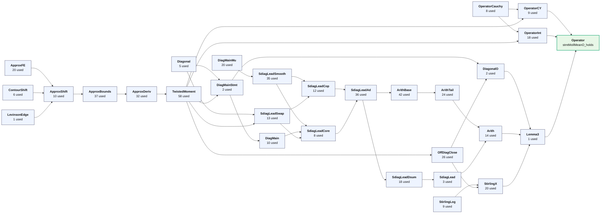

# What `Operator.stmtMollMeanO_holds` rests on

[`Operator.stmtMollMeanO_holds`](../lean_stage3/Operator.md#Operator-stmtMollMeanO_holds) in `lean_stage3/Stage3/Operator.lean`, line 143.

**Why.** The mollified mean of Levinson's `G`, `o(T)`, unconditional: Lemma 3 at `o(T)` and Cauchy's estimate on circles of radius `R/(2L)`.

**Proves**

```lean
StmtMollMeanO P θ R
```

**Needs** (its hypotheses)

  - `` P : Polynomial ℝ ``
  - `` hP0 : P.eval 0 = 0 ``
  - `` hθ0 : 0 < θ ``
  - `` hθ : θ < 1 / 2 ``
  - `` hR : 0 < R ``

Behind it: 378 theorems and 124 definitions in 30 files. Every one is listed below; Lean recorded each step.

## The files it passes through



An arrow A → B reads "B uses something proved or defined in A"; indirect arrows are left out. Green: the theorem itself. Yellow: a file in the other tree. The number is how many of that file's declarations are on the way.

## Every declaration on the way

Files in dependency order. ★ marks what the theorem's own proof uses directly.

### [`ApproxFE`](../lean_stage3/ApproxFE.md) — 20

- [`ApproxFE.uA`](../lean_stage3/ApproxFE.md#ApproxFE-uA) — *def*
- [`ApproxFE.vB`](../lean_stage3/ApproxFE.md#ApproxFE-vB) — *def*
- [`ApproxFE.XY`](../lean_stage3/ApproxFE.md#ApproxFE-XY) — *def*
- [`ApproxFE.GY`](../lean_stage3/ApproxFE.md#ApproxFE-GY) — *def*
- [`ApproxFE.gY`](../lean_stage3/ApproxFE.md#ApproxFE-gY) — *def*
- [`ApproxFE.KY`](../lean_stage3/ApproxFE.md#ApproxFE-KY) — *def*
- [`ApproxFE.VY`](../lean_stage3/ApproxFE.md#ApproxFE-VY) — *def*
- [`ApproxFE.uA_re`](../lean_stage3/ApproxFE.md#ApproxFE-uA_re) — `` (uA α t).re = 1 / 2 + α.re ``
- [`ApproxFE.vB_re`](../lean_stage3/ApproxFE.md#ApproxFE-vB_re) — `` (vB β t).re = 1 / 2 + β.re ``
- [`ApproxFE.uA_im`](../lean_stage3/ApproxFE.md#ApproxFE-uA_im) — `` (uA α t).im = α.im + t ``
- [`ApproxFE.vB_im`](../lean_stage3/ApproxFE.md#ApproxFE-vB_im) — `` (vB β t).im = β.im - t ``
- [`ApproxFE.ratio_aux`](../lean_stage3/ApproxFE.md#ApproxFE-ratio_aux) — `` P ^ a * A * (P ^ b * B) / (P ^ c * C * (P ^ d * D)) = P ^ k * (A * B) / (C * D) ``
- [`ApproxFE.XY_eq_young`](../lean_stage3/ApproxFE.md#ApproxFE-XY_eq_young) — `` XY α β t = (Real.pi : ℂ) ^ (α + β) * (Gamma ((1 / 2 - α - t * I) / 2) * Gamma ((1 / 2 - β + t * I) / 2)) / (Gamma ((1 / 2 + α + t * I) / 2) * Gamma ((1 / 2 + β … ``
- [`ApproxFE.norm_succ_cpow`](../lean_stage3/ApproxFE.md#ApproxFE-norm_succ_cpow) — `` ‖((m : ℂ) + 1) ^ z‖ = ((m : ℝ) + 1) ^ z.re ``
- [`ApproxFE.summable_succ_rpow`](../lean_stage3/ApproxFE.md#ApproxFE-summable_succ_rpow) — `` Summable fun m : ℕ => ((m : ℝ) + 1) ^ r ``
- [`ApproxFE.KY_differentiableAt`](../lean_stage3/ApproxFE.md#ApproxFE-KY_differentiableAt) — `` DifferentiableAt ℂ (KY α β t) s ``
- [`ApproxFE.gamma_mul_zeta`](../lean_stage3/ApproxFE.md#ApproxFE-gamma_mul_zeta) — `` Gammaℝ w * riemannZeta w = completedRiemannZeta w ``
- [`ApproxFE.GY_zero`](../lean_stage3/ApproxFE.md#ApproxFE-GY_zero) — `` GY α β 0 = 1 ``
- [`ApproxFE.gY_zero`](../lean_stage3/ApproxFE.md#ApproxFE-gY_zero) — `` gY α β t 0 = 1 ``
- [`ApproxFE.resY`](../lean_stage3/ApproxFE.md#ApproxFE-resY) — *def*

### [`ContourShift`](../lean_stage3/ContourShift.md) — 6

- [`ContourShift.borderIntegrable_sum_poles`](../lean_stage3/ContourShift.md#ContourShift-borderIntegrable_sum_poles) — `` RectangleBorderIntegrable (fun s ↦ ∑ p ∈ P, A p / (s - p)) z w ``
- [`ContourShift.rectangleIntegral_sum_poles`](../lean_stage3/ContourShift.md#ContourShift-rectangleIntegral_sum_poles) — `` RectangleIntegral' (fun s ↦ ∑ p ∈ P, A p / (s - p)) z w = ∑ p ∈ P, A p ``
- [`ContourShift.residue_rectangle_multi`](../lean_stage3/ContourShift.md#ContourShift-residue_rectangle_multi) — `` RectangleIntegral' f z w = ∑ p ∈ P, A p ``
- [`ContourShift.residue_rectangle_of_local`](../lean_stage3/ContourShift.md#ContourShift-residue_rectangle_of_local) — `` RectangleIntegral' f z w = ∑ p ∈ P, A p ``
- [`ContourShift.analyticAt_dslope`](../lean_stage3/ContourShift.md#ContourShift-analyticAt_dslope) — `` AnalyticAt ℂ (dslope f p) p ``
- [`ContourShift.div_sub_eq_dslope`](../lean_stage3/ContourShift.md#ContourShift-div_sub_eq_dslope) — `` f s / (s - p) = f p / (s - p) + dslope f p s ``

### [`DiagMainMu`](../lean_stage3/DiagMainMu.md) — 20

- [`DiagMain.psiMu`](../lean_stage3/DiagMainMu.md#DiagMain-psiMu) — *def*
- [`DiagMain.mMu`](../lean_stage3/DiagMainMu.md#DiagMain-mMu) — *def*
- [`DiagMain.MMu`](../lean_stage3/DiagMainMu.md#DiagMain-MMu) — *def*
- [`DiagMain.sum_range_succ_eq_Ioc`](../lean_stage3/DiagMainMu.md#DiagMain-sum_range_succ_eq_Ioc) — `` ∑ n ∈ range (t + 1), g n = ∑ n ∈ Ioc 0 t, g n ``
- [`DiagMain.MMu_bound`](../lean_stage3/DiagMainMu.md#DiagMain-MMu_bound) — `` ∃ C : ℝ, 0 ≤ C ∧ ∀ t : ℕ, |MMu t| ≤ η * t + C ``
- [`DiagMain.mMu_tendsto`](../lean_stage3/DiagMainMu.md#DiagMain-mMu_tendsto) — `` Tendsto mMu atTop (𝓝 0) ``
- [`DiagMain.sum_divisors_mu`](../lean_stage3/DiagMainMu.md#DiagMain-sum_divisors_mu) — `` ∑ d ∈ n.divisors, (μ d : ℝ) = if n = 1 then 1 else 0 ``
- [`DiagMain.mobius_harmonic`](../lean_stage3/DiagMainMu.md#DiagMain-mobius_harmonic) — `` ∑ n ∈ Ioc 0 N, (μ n : ℝ) / n * (harmonic (N / n) : ℝ) = 1 ``
- [`DiagMain.div_bounds`](../lean_stage3/DiagMainMu.md#DiagMain-div_bounds) — `` ((N / n : ℕ) : ℝ) ≤ (N : ℝ) / n ∧ (N : ℝ) / n < ((N / n : ℕ) : ℝ) + 1 ``
- [`DiagMain.harmonic_mono`](../lean_stage3/DiagMainMu.md#DiagMain-harmonic_mono) — `` Monotone (fun k : ℕ => (harmonic k : ℝ)) ``
- [`DiagMain.one_le_harmonic`](../lean_stage3/DiagMainMu.md#DiagMain-one_le_harmonic) — `` (1 : ℝ) ≤ harmonic k ``
- [`DiagMain.gamma_nonneg`](../lean_stage3/DiagMainMu.md#DiagMain-gamma_nonneg) — `` 0 ≤ Real.eulerMascheroniConstant ``
- [`DiagMain.gamma_lt_one`](../lean_stage3/DiagMainMu.md#DiagMain-gamma_lt_one) — `` Real.eulerMascheroniConstant < 1 ``
- [`DiagMain.harm_log_bound`](../lean_stage3/DiagMainMu.md#DiagMain-harm_log_bound) — `` |Real.log ((N : ℝ) / n) + Real.eulerMascheroniConstant - harmonic (N / n)| ≤ 1 / ((N / n : ℕ) : ℝ) ``
- [`DiagMain.abel_ineq`](../lean_stage3/DiagMainMu.md#DiagMain-abel_ineq) — `` |∑ n ∈ Ioc a b, c n * f n| ≤ B * f (a + 1) ``
- [`DiagMain.rhoN`](../lean_stage3/DiagMainMu.md#DiagMain-rhoN) — *def*
- [`DiagMain.head_bound`](../lean_stage3/DiagMainMu.md#DiagMain-head_bound) — `` |∑ n ∈ Ioc 0 (N / Y), (μ n : ℝ) / n * rhoN N n| ≤ 2 / Y ``
- [`DiagMain.tail_bound`](../lean_stage3/DiagMainMu.md#DiagMain-tail_bound) — `` |∑ n ∈ Ioc (N / Y) N, (μ n : ℝ) / n * rhoN N n| ≤ B * ((Y : ℝ) / N) * (Real.log Y + harmonic Y) ``
- [`DiagMain.D_small`](../lean_stage3/DiagMainMu.md#DiagMain-D_small) — `` ∃ N₀ : ℕ, ∀ N : ℕ, N₀ ≤ N → |∑ n ∈ Ioc 0 N, (μ n : ℝ) / n * rhoN N n| ≤ ε ``
- [`DiagMain.psiMu_tendsto`](../lean_stage3/DiagMainMu.md#DiagMain-psiMu_tendsto) — `` Tendsto psiMu atTop (𝓝 1) ``

### [`Diagonal`](../lean_stage3/Diagonal.md) — 5

- [`Diagonal.Chk`](../lean_stage3/Diagonal.md#Diagonal-Chk) — *def*
- [`Diagonal.Rhk`](../lean_stage3/Diagonal.md#Diagonal-Rhk) — *def*
- [`Diagonal.Sdiag`](../lean_stage3/Diagonal.md#Diagonal-Sdiag) — *def*
- [`Diagonal.ncpow_mul`](../lean_stage3/Diagonal.md#Diagonal-ncpow_mul) — `` ((m * n : ℕ) : ℂ) ^ z = (m : ℂ) ^ z * (n : ℂ) ^ z ``
- [`Diagonal.norm_cpow_nat`](../lean_stage3/Diagonal.md#Diagonal-norm_cpow_nat) — `` ‖(n : ℂ) ^ z‖ = (n : ℝ) ^ z.re ``

### [`LevinsonEdge`](../lean_stage3/LevinsonEdge.md) — 1

- [`LevinsonEdge.zeta_norm_le`](../lean_stage3/LevinsonEdge.md#LevinsonEdge-zeta_norm_le) — `` ‖riemannZeta u‖ ≤ 2 + 4 * ‖u‖ ``

### [`ApproxShift`](../lean_stage3/ApproxShift.md) — 10

- [`ApproxShift.zeta_norm_le_abs`](../lean_stage3/ApproxShift.md#ApproxShift-zeta_norm_le_abs) — `` ‖riemannZeta w‖ ≤ 2 + 4 * ‖w‖ ``
- [`ApproxShift.gammaR_bound`](../lean_stage3/ApproxShift.md#ApproxShift-gammaR_bound) — `` ∃ M : ℝ, 0 ≤ M ∧ ∀ w : ℂ, 1 / 2 ≤ w.re → w.re ≤ R → ‖Gammaℝ w‖ ≤ M ``
- [`ApproxShift.Lambda_bound`](../lean_stage3/ApproxShift.md#ApproxShift-Lambda_bound) — `` ∃ M : ℝ, 0 ≤ M ∧ ∀ w : ℂ, |w.re| ≤ R → 1 ≤ |w.im| → ‖completedRiemannZeta w‖ ≤ M * (6 + 4 * ‖w‖) ``
- [`ApproxShift.GY_norm_le`](../lean_stage3/ApproxShift.md#ApproxShift-GY_norm_le) — `` ‖GY α β s‖ ≤ Real.exp (c ^ 2 - s.im ^ 2) * ((‖α + β‖ ^ 2 + 4 * c ^ 2 + 4) / ‖α + β‖ ^ 2 * (1 + s.im ^ 2)) ``
- [`ApproxShift.gauss_atTop`](../lean_stage3/ApproxShift.md#ApproxShift-gauss_atTop) — `` Tendsto (fun y : ℝ => Real.exp (-(1 / 2) * y ^ 2)) atTop (𝓝 0) ``
- [`ApproxShift.gauss_atBot`](../lean_stage3/ApproxShift.md#ApproxShift-gauss_atBot) — `` Tendsto (fun y : ℝ => Real.exp (-(1 / 2) * y ^ 2)) atBot (𝓝 0) ``
- [`ApproxShift.GY_analyticAt`](../lean_stage3/ApproxShift.md#ApproxShift-GY_analyticAt) — `` AnalyticAt ℂ (GY α β) p ``
- [`ApproxShift.local_simple`](../lean_stage3/ApproxShift.md#ApproxShift-local_simple) — `` ∃ h : ℂ → ℂ, AnalyticAt ℂ h p ∧ ∀ᶠ s in 𝓝[≠] p, f s = h s + A / (s - p) ``
- [`ApproxShift.rect_mem_nhds`](../lean_stage3/ApproxShift.md#ApproxShift-rect_mem_nhds) — `` Rectangle (↑(-c) - I * ↑T) (↑c + I * ↑T) ∈ 𝓝 p ``
- [`ApproxShift.rect_tendsto`](../lean_stage3/ApproxShift.md#ApproxShift-rect_tendsto) — `` Tendsto (fun T : ℝ => RectangleIntegral f (↑(-c) - I * T) (↑c + I * T)) atTop (𝓝 (VerticalIntegral f c - VerticalIntegral f (-c))) ``

### [`ApproxBounds`](../lean_stage3/ApproxBounds.md) — 37

- [`ApproxBounds.lY`](../lean_stage3/ApproxBounds.md#ApproxBounds-lY) — *def*
- [`ApproxBounds.lY_nonneg`](../lean_stage3/ApproxBounds.md#ApproxBounds-lY_nonneg) — `` 0 ≤ lY Y ``
- [`ApproxBounds.lY_neg`](../lean_stage3/ApproxBounds.md#ApproxBounds-lY_neg) — `` lY (-Y) = lY Y ``
- [`ApproxBounds.gModel`](../lean_stage3/ApproxBounds.md#ApproxBounds-gModel) — *def*
- [`ApproxBounds.gErr`](../lean_stage3/ApproxBounds.md#ApproxBounds-gErr) — *def*
- [`ApproxBounds.gRModel`](../lean_stage3/ApproxBounds.md#ApproxBounds-gRModel) — *def*
- [`ApproxBounds.gErr_nonneg`](../lean_stage3/ApproxBounds.md#ApproxBounds-gErr_nonneg) — `` 0 ≤ gErr r ``
- [`ApproxBounds.const_bound`](../lean_stage3/ApproxBounds.md#ApproxBounds-const_bound) — `` ∃ K : ℝ, 0 ≤ K ∧ ∀ r : ℝ, lo ≤ r → r ≤ hi → |Real.log (Real.Gamma r)| ≤ K ∧ gErr r ≤ K ``
- [`ApproxBounds.lY_near`](../lean_stage3/ApproxBounds.md#ApproxBounds-lY_near) — `` |lY Y - Real.log (t / 2)| ≤ 3 ``
- [`ApproxBounds.log_div_two_pi`](../lean_stage3/ApproxBounds.md#ApproxBounds-log_div_two_pi) — `` Real.log (t / (2 * Real.pi)) = Real.log (t / 2) - Real.log Real.pi ``
- [`ApproxBounds.lY_lip`](../lean_stage3/ApproxBounds.md#ApproxBounds-lY_lip) — `` |lY (Y + h) - lY Y| ≤ |h| ``
- [`ApproxBounds.gR_shift`](../lean_stage3/ApproxBounds.md#ApproxBounds-gR_shift) — `` Real.log ‖Gammaℝ (w + (σ + y * I))‖ - Real.log ‖Gammaℝ w‖ ≤ σ / 2 * (Real.log (t / 2) - Real.log Real.pi) + 2 * K + 2 * K' + 3 * |σ| / 2 + (Real.pi / 4 + |σ| / … ``
- [`ApproxBounds.gY_bound`](../lean_stage3/ApproxBounds.md#ApproxBounds-gY_bound) — `` ∃ C : ℝ, 0 ≤ C ∧ ∀ α β : ℂ, ‖α‖ ≤ 1 / 10 → ‖β‖ ≤ 1 / 10 → ∀ t : ℝ, 1 ≤ t → ∀ σ y : ℝ, σ₀ ≤ σ → σ ≤ σ₁ → ‖gY α β t (σ + y * I)‖ ≤ C * (t / (2 * Real.pi)) ^ σ * R… ``
- [`ApproxBounds.gauss_absorb`](../lean_stage3/ApproxBounds.md#ApproxBounds-gauss_absorb) — `` Real.exp (-y ^ 2) * (1 + y ^ 2) * Real.exp (B * |y|) ≤ 4 * Real.exp (B ^ 2) * Real.exp (-(1 / 2) * y ^ 2) ``
- [`ApproxBounds.Q_le`](../lean_stage3/ApproxBounds.md#ApproxBounds-Q_le) — `` (n ^ 2 + A) / n ^ 2 ≤ (A + 1) * (1 + 1 / n ^ 2) ``
- [`ApproxBounds.integrand_bound`](../lean_stage3/ApproxBounds.md#ApproxBounds-integrand_bound) — `` ∃ C : ℝ, 0 ≤ C ∧ ∀ α β : ℂ, ‖α‖ ≤ 1 / 10 → ‖β‖ ≤ 1 / 10 → ∀ t : ℝ, 1 ≤ t → ∀ x : ℝ, 0 < x → ∀ σ y : ℝ, σ₀ ≤ σ → σ ≤ σ₁ → δ ≤ ‖(σ : ℂ) + y * I‖ → ‖KY α β t (σ + … ``
- [`ApproxBounds.norm_VY_le`](../lean_stage3/ApproxBounds.md#ApproxBounds-norm_VY_le) — `` ‖VY α β σ x t‖ ≤ 1 / (2 * Real.pi) * ∫ y : ℝ, ‖KY α β t (σ + y * I) * (x : ℂ) ^ (-((σ : ℂ) + y * I))‖ ``
- [`ApproxBounds.VY_line_bound`](../lean_stage3/ApproxBounds.md#ApproxBounds-VY_line_bound) — `` ∃ C : ℝ, 0 ≤ C ∧ ∀ α β : ℂ, ‖α‖ ≤ 1 / 10 → ‖β‖ ≤ 1 / 10 → ∀ t : ℝ, 1 ≤ t → ∀ x : ℝ, 0 < x → ‖VY α β σ x t‖ ≤ C * (1 + 1 / ‖α + β‖ ^ 2) * ((t / (2 * Real.pi)) ^ … ``
- [`ApproxBounds.integrand_differentiableAt`](../lean_stage3/ApproxBounds.md#ApproxBounds-integrand_differentiableAt) — `` DifferentiableAt ℂ (fun s => KY α β t s * (x : ℂ) ^ (-s)) s ``
- [`ApproxBounds.rpow_le_ends`](../lean_stage3/ApproxBounds.md#ApproxBounds-rpow_le_ends) — `` b ^ σ ≤ b ^ σ₀ + b ^ σ₁ ``
- [`ApproxBounds.rect_tendsto_ab`](../lean_stage3/ApproxBounds.md#ApproxBounds-rect_tendsto_ab) — `` Tendsto (fun T : ℝ => RectangleIntegral f (↑a - I * T) (↑b + I * T)) atTop (𝓝 (VerticalIntegral f b - VerticalIntegral f a)) ``
- [`ApproxBounds.VY_line_eq`](../lean_stage3/ApproxBounds.md#ApproxBounds-VY_line_eq) — `` VY α β c x t = VY α β c' x t ``
- [`ApproxBounds.VY_decay`](../lean_stage3/ApproxBounds.md#ApproxBounds-VY_decay) — `` ∃ C : ℝ, 0 ≤ C ∧ ∀ α β : ℂ, ‖α‖ ≤ 1 / 10 → ‖β‖ ≤ 1 / 10 → ∀ t : ℝ, 1 ≤ t → ∀ x : ℝ, 0 < x → ∀ c : ℝ, 0 < c → ‖VY α β c x t‖ ≤ C * (1 + 1 / ‖α + β‖ ^ 2) * (t / x… ``
- [`ApproxBounds.integrand_differentiableAt'`](../lean_stage3/ApproxBounds.md#ApproxBounds-integrand_differentiableAt-) — `` DifferentiableAt ℂ (fun s => KY α β t s * (x : ℂ) ^ (-s)) s ``
- [`ApproxBounds.VY_residue`](../lean_stage3/ApproxBounds.md#ApproxBounds-VY_residue) — `` VY α β (1 / 4) x t - VY α β (-(1 / 4)) x t = 1 ``
- [`ApproxBounds.rpow_quarter_le`](../lean_stage3/ApproxBounds.md#ApproxBounds-rpow_quarter_le) — `` b ^ (1 / 4 : ℝ) ≤ 1 + b ``
- [`ApproxBounds.VY_decay_young`](../lean_stage3/ApproxBounds.md#ApproxBounds-VY_decay_young) — `` ∃ C : ℝ, 0 ≤ C ∧ ∀ α β : ℂ, ‖α‖ ≤ 1 / 10 → ‖β‖ ≤ 1 / 10 → α + β ≠ 0 → ∀ t : ℝ, 1 ≤ t → ∀ x : ℝ, 0 < x → ∀ c : ℝ, 0 < c → ‖VY α β c x t‖ ≤ C * (1 + 1 / ‖α + β‖ ^… ``
- [`ApproxBounds.lY_le_abs`](../lean_stage3/ApproxBounds.md#ApproxBounds-lY_le_abs) — `` lY Y ≤ |Y| ``
- [`ApproxBounds.gR_lower`](../lean_stage3/ApproxBounds.md#ApproxBounds-gR_lower) — `` -(2 * K + |Real.log (Real.Gamma (1 / 2))|) - (Real.pi / 2 + 1) * |Y₀| ≤ Real.log ‖Gammaℝ w‖ ``
- [`ApproxBounds.resY_term`](../lean_stage3/ApproxBounds.md#ApproxBounds-resY_term) — `` ‖GY α β s / d * completedRiemannZeta w‖ ≤ Real.exp (1 - (t - 1 / 10) ^ 2) * (9 * (1 + 1 / ‖α + β‖ ^ 2) * (1 + (t + 1 / 10) ^ 2)) * (5 / 2) * (M * (14 + 8 * t)) ``
- [`ApproxBounds.poly_exp_bound`](../lean_stage3/ApproxBounds.md#ApproxBounds-poly_exp_bound) — `` Real.exp (1 - (t - 1 / 10) ^ 2) * (1 + (t + 1 / 10) ^ 2) * (14 + 8 * t) * Real.exp ((Real.pi / 2 + 1) * (t + 1 / 10)) ≤ 14 * Real.exp ((Real.pi / 2 + 5) ^ 2 / 2… ``
- [`ApproxBounds.resY_T1`](../lean_stage3/ApproxBounds.md#ApproxBounds-resY_T1) — `` ‖GY α β (1 - uA α t) / (1 - uA α t) * completedRiemannZeta (vB β t + 1 - uA α t)‖ ≤ Real.exp (1 - (t - 1 / 10) ^ 2) * (9 * (1 + 1 / ‖α + β‖ ^ 2) * (1 + (t + 1 /… ``
- [`ApproxBounds.resY_T2`](../lean_stage3/ApproxBounds.md#ApproxBounds-resY_T2) — `` ‖GY α β (-uA α t) / uA α t * completedRiemannZeta (vB β t - uA α t)‖ ≤ Real.exp (1 - (t - 1 / 10) ^ 2) * (9 * (1 + 1 / ‖α + β‖ ^ 2) * (1 + (t + 1 / 10) ^ 2)) * … ``
- [`ApproxBounds.resY_T3`](../lean_stage3/ApproxBounds.md#ApproxBounds-resY_T3) — `` ‖GY α β (1 - vB β t) / (1 - vB β t) * completedRiemannZeta (uA α t + 1 - vB β t)‖ ≤ Real.exp (1 - (t - 1 / 10) ^ 2) * (9 * (1 + 1 / ‖α + β‖ ^ 2) * (1 + (t + 1 /… ``
- [`ApproxBounds.resY_T4`](../lean_stage3/ApproxBounds.md#ApproxBounds-resY_T4) — `` ‖GY α β (-vB β t) / vB β t * completedRiemannZeta (uA α t - vB β t)‖ ≤ Real.exp (1 - (t - 1 / 10) ^ 2) * (9 * (1 + 1 / ‖α + β‖ ^ 2) * (1 + (t + 1 / 10) ^ 2)) * … ``
- [`ApproxBounds.resY_den`](../lean_stage3/ApproxBounds.md#ApproxBounds-resY_den) — `` Real.exp (-(2 * (2 * K + |Real.log (Real.Gamma (1 / 2))|)) - (Real.pi / 2 + 1) * (t + 1 / 10)) ≤ ‖Gammaℝ (uA α t) * Gammaℝ (vB β t)‖ ``
- [`ApproxBounds.resY_small`](../lean_stage3/ApproxBounds.md#ApproxBounds-resY_small) — `` ∃ C : ℝ, 0 ≤ C ∧ ∀ α β : ℂ, ‖α‖ ≤ 1 / 10 → ‖β‖ ≤ 1 / 10 → ∀ t : ℝ, 1 ≤ t → ‖resY α β t‖ ≤ C * (1 + 1 / ‖α + β‖ ^ 2) * Real.exp (-(t ^ 2 / 2)) ``

### [`ApproxDeriv`](../lean_stage3/ApproxDeriv.md) — 32

- [`ApproxDeriv.psiR`](../lean_stage3/ApproxDeriv.md#ApproxDeriv-psiR) — *def*
- [`ApproxDeriv.ne_neg_nat_of_re_pos`](../lean_stage3/ApproxDeriv.md#ApproxDeriv-ne_neg_nat_of_re_pos) — `` z ≠ -(m : ℂ) ``
- [`ApproxDeriv.hasDerivAt_line`](../lean_stage3/ApproxDeriv.md#ApproxDeriv-hasDerivAt_line) — `` HasDerivAt (fun t : ℝ => w₀ + (t : ℂ) * e) e t ``
- [`ApproxDeriv.dY`](../lean_stage3/ApproxDeriv.md#ApproxDeriv-dY) — *def*
- [`ApproxDeriv.re_conds`](../lean_stage3/ApproxDeriv.md#ApproxDeriv-re_conds) — `` 1 / 20 ≤ (uA α t / 2).re ∧ 1 / 20 ≤ (uA α t / 2 + s / 2).re ∧ 1 / 20 ≤ (vB β t / 2).re ∧ 1 / 20 ≤ (vB β t / 2 + s / 2).re ``
- [`ApproxDeriv.gY_hasDerivAt`](../lean_stage3/ApproxDeriv.md#ApproxDeriv-gY_hasDerivAt) — `` HasDerivAt (fun t => gY α β t s) (gY α β t s * dY α β t s) t ``
- [`ApproxDeriv.tau`](../lean_stage3/ApproxDeriv.md#ApproxDeriv-tau) — *def*
- [`ApproxDeriv.tau'`](../lean_stage3/ApproxDeriv.md#ApproxDeriv-tau-) — *def*
- [`ApproxDeriv.hasSum_tau`](../lean_stage3/ApproxDeriv.md#ApproxDeriv-hasSum_tau) — `` HasSum (tau h w) (digamma (w + h) - digamma w) ``
- [`ApproxDeriv.norm_nat_add_ge`](../lean_stage3/ApproxDeriv.md#ApproxDeriv-norm_nat_add_ge) — `` ((n : ℝ) + a + Y) / 2 ≤ ‖(n : ℂ) + z‖ ``
- [`ApproxDeriv.norm_tau_le`](../lean_stage3/ApproxDeriv.md#ApproxDeriv-norm_tau_le) — `` ‖tau h w n‖ ≤ 4 * ‖h‖ * (1 / ((n : ℝ) + (a + Y)) ^ 2) ``
- [`ApproxDeriv.tel`](../lean_stage3/ApproxDeriv.md#ApproxDeriv-tel) — *def*
- [`ApproxDeriv.hasSum_tel`](../lean_stage3/ApproxDeriv.md#ApproxDeriv-hasSum_tel) — `` HasSum (tel b) (1 / b) ``
- [`ApproxDeriv.sq_le_tel`](../lean_stage3/ApproxDeriv.md#ApproxDeriv-sq_le_tel) — `` 1 / ((n : ℝ) + b) ^ 2 ≤ (1 + 1 / b) * tel b n ``
- [`ApproxDeriv.dY_hasSum`](../lean_stage3/ApproxDeriv.md#ApproxDeriv-dY_hasSum) — `` HasSum (fun n => I / 2 * (tau (s / 2) (uA α t / 2) n - tau (s / 2) (vB β t / 2) n)) (dY α β t s) ``
- [`ApproxDeriv.norm_I_half`](../lean_stage3/ApproxDeriv.md#ApproxDeriv-norm_I_half) — `` ‖I / 2‖ = 1 / 2 ``
- [`ApproxDeriv.norm_dterm_le`](../lean_stage3/ApproxDeriv.md#ApproxDeriv-norm_dterm_le) — `` ‖I / 2 * (tau (s / 2) (uA α t / 2) n - tau (s / 2) (vB β t / 2) n)‖ ≤ 4 * ‖s / 2‖ * (1 + 1 / (1 / 20 + Y)) * tel (1 / 20 + Y) n ``
- [`ApproxDeriv.norm_dY_le`](../lean_stage3/ApproxDeriv.md#ApproxDeriv-norm_dY_le) — `` ‖dY α β t s‖ ≤ 4 * ‖s / 2‖ * (1 + 1 / (1 / 20 + Y)) * (1 / (1 / 20 + Y)) ``
- [`ApproxDeriv.d2Y`](../lean_stage3/ApproxDeriv.md#ApproxDeriv-d2Y) — *def*
- [`ApproxDeriv.poly_gauss`](../lean_stage3/ApproxDeriv.md#ApproxDeriv-poly_gauss) — `` (1 + |y|) ^ k * Real.exp (-(1 / 2) * y ^ 2) ≤ (k.factorial : ℝ) * Real.exp 2 * Real.exp (-(1 / 4) * y ^ 2) ``
- [`ApproxDeriv.gauss_loc`](../lean_stage3/ApproxDeriv.md#ApproxDeriv-gauss_loc) — `` Real.exp (-y ^ 2) * (1 + y ^ 2) * (1 + |y|) ^ k ≤ ((k + 2).factorial : ℝ) * Real.exp 2 * Real.exp (-(1 / 4) * y ^ 2) ``
- [`ApproxDeriv.norm_half_le`](../lean_stage3/ApproxDeriv.md#ApproxDeriv-norm_half_le) — `` ‖((σ : ℂ) + y * I) / 2‖ ≤ (1 + |σ|) * (1 + |y|) ``
- [`ApproxDeriv.dY_crude`](../lean_stage3/ApproxDeriv.md#ApproxDeriv-dY_crude) — `` ‖dY α β t (σ + y * I)‖ ≤ 1680 * (1 + |σ|) * (1 + |y|) ``
- [`ApproxDeriv.KY_local`](../lean_stage3/ApproxDeriv.md#ApproxDeriv-KY_local) — `` ∃ C : ℝ, 0 ≤ C ∧ ∀ t ∈ Metric.closedBall t₀ 1, ∀ y : ℝ, ‖KY α β t (σ + y * I)‖ ≤ C * (Real.exp (-y ^ 2) * (1 + y ^ 2)) ``
- [`ApproxDeriv.cont_F`](../lean_stage3/ApproxDeriv.md#ApproxDeriv-cont_F) — `` Continuous fun y : ℝ => KY α β t (σ + y * I) * (x : ℂ) ^ (-((σ : ℂ) + y * I)) ``
- [`ApproxDeriv.re_half_pos`](../lean_stage3/ApproxDeriv.md#ApproxDeriv-re_half_pos) — `` 0 < ((uA α t + ((σ : ℂ) + y * I)) / 2).re ∧ 0 < ((vB β t + ((σ : ℂ) + y * I)) / 2).re ``
- [`ApproxDeriv.cont_dY`](../lean_stage3/ApproxDeriv.md#ApproxDeriv-cont_dY) — `` Continuous fun y : ℝ => dY α β t (σ + y * I) ``
- [`ApproxDeriv.VY1`](../lean_stage3/ApproxDeriv.md#ApproxDeriv-VY1) — *def*
- [`ApproxDeriv.VY2`](../lean_stage3/ApproxDeriv.md#ApproxDeriv-VY2) — *def*
- [`ApproxDeriv.norm_F_local`](../lean_stage3/ApproxDeriv.md#ApproxDeriv-norm_F_local) — `` ‖KY α β t (σ + y * I) * (x : ℂ) ^ (-((σ : ℂ) + y * I))‖ ≤ C * x ^ (-σ) * (Real.exp (-y ^ 2) * (1 + y ^ 2)) ``
- [`ApproxDeriv.F_hasDerivAt`](../lean_stage3/ApproxDeriv.md#ApproxDeriv-F_hasDerivAt) — `` HasDerivAt (fun t => KY α β t s * (x : ℂ) ^ (-s)) (KY α β t s * (x : ℂ) ^ (-s) * dY α β t s) t ``
- [`ApproxDeriv.VY_hasDerivAt`](../lean_stage3/ApproxDeriv.md#ApproxDeriv-VY_hasDerivAt) — `` HasDerivAt (fun t => VY α β σ x t) (VY1 α β σ x t₀) t₀ ``

### [`OperatorCauchy`](../lean_stage3/OperatorCauchy.md) — 8

- ★ [`Operator.pa`](../lean_stage3/OperatorCauchy.md#Operator-pa) — *def*
- [`Operator.pb`](../lean_stage3/OperatorCauchy.md#Operator-pb) — *def*
- [`Operator.pab`](../lean_stage3/OperatorCauchy.md#Operator-pab) — *def*
- ★ [`Operator.Dop`](../lean_stage3/OperatorCauchy.md#Operator-Dop) — *def*
- [`Operator.cauchy_bounds`](../lean_stage3/OperatorCauchy.md#Operator-cauchy_bounds) — `` ‖F α₀ β₀‖ ≤ S ∧ ‖pa F α₀ β₀‖ ≤ S / ρ ∧ ‖pb F α₀ β₀‖ ≤ S / ρ ∧ ‖pab F α₀ β₀‖ ≤ S / ρ / ρ ``
- ★ [`Operator.Dop_norm_le`](../lean_stage3/OperatorCauchy.md#Operator-Dop_norm_le) — `` ‖Dop L F α₀ β₀‖ ≤ S * (1 + 2 / r + 1 / r ^ 2) ``
- ★ [`Operator.Dop_sub_mul`](../lean_stage3/OperatorCauchy.md#Operator-Dop_sub_mul) — `` Dop L (fun x y => A x y - B x y * c) α₀ β₀ = Dop L A α₀ β₀ - Dop L B α₀ β₀ * c ``
- [`Operator.analytic_partials`](../lean_stage3/OperatorCauchy.md#Operator-analytic_partials) — `` (∀ p ∈ U, DifferentiableAt ℂ (fun x => f (x, p.2)) p.1) ∧ (∀ p ∈ U, DifferentiableAt ℂ (fun y => f (p.1, y)) p.2) ∧ (∀ p ∈ U, DifferentiableAt ℂ (fun y => pa (f… ``

### [`SdiagLeadSmooth`](../lean_stage3/SdiagLeadSmooth.md) — 35

- [`SdiagLead.Gp`](../lean_stage3/SdiagLeadSmooth.md#SdiagLead-Gp) — *def*
- [`SdiagLead.Gp_hasDerivAt`](../lean_stage3/SdiagLeadSmooth.md#SdiagLead-Gp_hasDerivAt) — `` HasDerivAt (Gp p β lM) (β * Gp p β lM u + (lM : ℂ)⁻¹ * Gp p.derivative β lM u) u ``
- [`SdiagLead.Gp_continuous`](../lean_stage3/SdiagLeadSmooth.md#SdiagLead-Gp_continuous) — `` Continuous (Gp p β lM) ``
- [`SdiagLead.G1`](../lean_stage3/SdiagLeadSmooth.md#SdiagLead-G1) — *def*
- [`SdiagLead.G2`](../lean_stage3/SdiagLeadSmooth.md#SdiagLead-G2) — *def*
- [`SdiagLead.G1_hasDerivAt`](../lean_stage3/SdiagLeadSmooth.md#SdiagLead-G1_hasDerivAt) — `` HasDerivAt (G1 P β lM) (G2 P β lM u) u ``
- [`SdiagLead.G2_continuous`](../lean_stage3/SdiagLeadSmooth.md#SdiagLead-G2_continuous) — `` Continuous (G2 P β lM) ``
- [`SdiagLead.Gp_zero`](../lean_stage3/SdiagLeadSmooth.md#SdiagLead-Gp_zero) — `` Gp P β lM 0 = 0 ``
- [`SdiagLead.hasDerivAt_logdiv`](../lean_stage3/SdiagLeadSmooth.md#SdiagLead-hasDerivAt_logdiv) — `` HasDerivAt (fun t : ℝ => Real.log (x / t)) (-s⁻¹) s ``
- [`SdiagLead.hasDerivAt_logdiv'`](../lean_stage3/SdiagLeadSmooth.md#SdiagLead-hasDerivAt_logdiv-) — `` HasDerivAt (fun t : ℝ => Real.log (t / n)) s⁻¹ s ``
- [`SdiagLead.kernel_continuousAt`](../lean_stage3/SdiagLeadSmooth.md#SdiagLead-kernel_continuousAt) — `` ContinuousAt (fun t : ℝ => max (Real.log (t / n)) 0 / t) s ``
- [`SdiagLead.G2comp_continuousAt`](../lean_stage3/SdiagLeadSmooth.md#SdiagLead-G2comp_continuousAt) — `` ContinuousAt (fun t : ℝ => G2 P β lM (Real.log (x / t))) s ``
- [`SdiagLead.Psi_div_continuousAt`](../lean_stage3/SdiagLeadSmooth.md#SdiagLead-Psi_div_continuousAt) — `` ContinuousAt (fun t => (∑ n ∈ Ioc 0 ⌊x⌋₊, c n * max (Real.log (t / n)) 0) / t) s ``
- [`SdiagLead.taylor_n`](../lean_stage3/SdiagLeadSmooth.md#SdiagLead-taylor_n) — `` ∫ s in (1 : ℝ)..x, G2 P β lM (Real.log (x / s)) * ((max (Real.log (s / n)) 0 / s : ℝ) : ℂ) = Gp P β lM (Real.log (x / n)) - (Real.log (x / n) : ℂ) * G1 P β lM 0 ``
- [`SdiagLead.Psi`](../lean_stage3/SdiagLeadSmooth.md#SdiagLead-Psi) — *def*
- [`SdiagLead.sum_taylor`](../lean_stage3/SdiagLeadSmooth.md#SdiagLead-sum_taylor) — `` ∑ n ∈ Ioc 0 ⌊x⌋₊, (c n : ℂ) * Gp P β lM (Real.log (x / n)) = G1 P β lM 0 * ((∑ n ∈ Ioc 0 ⌊x⌋₊, c n * Real.log (x / n) : ℝ) : ℂ) + ∫ s in (1 : ℝ)..x, G2 P β lM (… ``
- [`SdiagLead.ftc_G1`](../lean_stage3/SdiagLeadSmooth.md#SdiagLead-ftc_G1) — `` ∫ s in (1 : ℝ)..x, G2 P β lM (Real.log (x / s)) * ((1 / s : ℝ) : ℂ) = G1 P β lM (Real.log x) - G1 P β lM 0 ``
- [`SdiagLead.err_identity`](../lean_stage3/SdiagLeadSmooth.md#SdiagLead-err_identity) — `` ∑ n ∈ Ioc 0 ⌊x⌋₊, (c n : ℂ) * Gp P β lM (Real.log (x / n)) - G1 P β lM (Real.log x) = G1 P β lM 0 * ((∑ n ∈ Ioc 0 ⌊x⌋₊, c n * Real.log (x / n) - 1 : ℝ) : ℂ) + ∫… ``
- [`SdiagLead.Gp_bound`](../lean_stage3/SdiagLeadSmooth.md#SdiagLead-Gp_bound) — `` ∃ B : ℝ, 0 ≤ B ∧ ∀ (A : ℝ) (β : ℂ) (lM u : ℝ), 0 < lM → ‖β‖ * lM ≤ A → 0 ≤ u → u ≤ lM → ‖Gp p β lM u‖ ≤ Real.exp A * B ``
- [`SdiagLead.G2_bound`](../lean_stage3/SdiagLeadSmooth.md#SdiagLead-G2_bound) — `` ∃ K : ℝ, 0 ≤ K ∧ ∀ (β : ℂ) (lM u : ℝ), 0 < lM → ‖β‖ * lM ≤ A → 0 ≤ u → u ≤ lM → ‖G2 P β lM u‖ ≤ K / lM ^ 2 ``
- [`SdiagLead.int_piece`](../lean_stage3/SdiagLeadSmooth.md#SdiagLead-int_piece) — `` ‖∫ s in a..b, G2 P β lM (Real.log (x / s)) * (((Ψ s - 1) / s : ℝ) : ℂ)‖ ≤ K / lM ^ 2 * C * Real.log (b / a) ``
- [`SdiagLead.err_bound`](../lean_stage3/SdiagLeadSmooth.md#SdiagLead-err_bound) — `` ‖∑ n ∈ Ioc 0 ⌊x⌋₊, (c n : ℂ) * Gp P β lM (Real.log (x / n)) - G1 P β lM (Real.log x)‖ ≤ |(P.derivative.eval 0)| / lM * |∑ n ∈ Ioc 0 ⌊x⌋₊, c n * Real.log (x / n)… ``
- [`SdiagLead.psiR`](../lean_stage3/SdiagLeadSmooth.md#SdiagLead-psiR) — *def*
- [`SdiagLead.cmu`](../lean_stage3/SdiagLeadSmooth.md#SdiagLead-cmu) — *def*
- [`SdiagLead.Psi_eq`](../lean_stage3/SdiagLeadSmooth.md#SdiagLead-Psi_eq) — `` Psi cmu x s = psiR s ``
- [`SdiagLead.psiR_eq`](../lean_stage3/SdiagLeadSmooth.md#SdiagLead-psiR_eq) — `` psiR s = psiMu ⌊s⌋₊ + mMu ⌊s⌋₊ * Real.log (s / ⌊s⌋₊) ``
- [`SdiagLead.log_floor_le`](../lean_stage3/SdiagLeadSmooth.md#SdiagLead-log_floor_le) — `` 0 ≤ Real.log (s / ⌊s⌋₊) ∧ Real.log (s / ⌊s⌋₊) ≤ Real.log 2 ``
- [`SdiagLead.psiR_bdd`](../lean_stage3/SdiagLeadSmooth.md#SdiagLead-psiR_bdd) — `` ∃ B : ℝ, 0 ≤ B ∧ ∀ s : ℝ, 1 ≤ s → |psiR s - 1| ≤ B ``
- [`SdiagLead.psiR_tendsto`](../lean_stage3/SdiagLeadSmooth.md#SdiagLead-psiR_tendsto) — `` ∃ s₀ : ℝ, 1 ≤ s₀ ∧ ∀ s : ℝ, s₀ ≤ s → |psiR s - 1| ≤ ε ``
- [`SdiagLead.Smu`](../lean_stage3/SdiagLeadSmooth.md#SdiagLead-Smu) — *def*
- [`SdiagLead.mainS`](../lean_stage3/SdiagLeadSmooth.md#SdiagLead-mainS) — *def*
- [`SdiagLead.sum_cpow_eq`](../lean_stage3/SdiagLeadSmooth.md#SdiagLead-sum_cpow_eq) — `` Smu P lM x β - mainS P lM x β = cexp (-(β * Real.log x)) * (∑ n ∈ Ioc 0 ⌊x⌋₊, (cmu n : ℂ) * Gp P β lM (Real.log (x / n)) - G1 P β lM (Real.log x)) ``
- [`SdiagLead.norm_xpow_le`](../lean_stage3/SdiagLeadSmooth.md#SdiagLead-norm_xpow_le) — `` ‖cexp (-(β * Real.log x))‖ ≤ Real.exp A ``
- [`SdiagLead.muSmoothR`](../lean_stage3/SdiagLeadSmooth.md#SdiagLead-muSmoothR) — `` ∃ Y : ℝ, 1 ≤ Y ∧ ∃ L₀ : ℝ, 0 < L₀ ∧ ∀ lM : ℝ, L₀ ≤ lM → ∀ x : ℝ, Y ≤ x → Real.log x ≤ lM → ∀ β : ℂ, ‖β‖ * lM ≤ A → ‖Smu P lM x β - mainS P lM x β‖ ≤ ε / lM ``
- [`SdiagLead.muSmooth_crude`](../lean_stage3/SdiagLeadSmooth.md#SdiagLead-muSmooth_crude) — `` ∃ C : ℝ, 0 ≤ C ∧ ∀ lM : ℝ, 0 < lM → ∀ x : ℝ, 1 ≤ x → Real.log x ≤ lM → ∀ β : ℂ, ‖β‖ * lM ≤ A → ‖Smu P lM x β - mainS P lM x β‖ ≤ C / lM ``

### [`StirlingLog`](../lean_stage3/StirlingLog.md) — 9

- [`Stirling.logG`](../lean_stage3/StirlingLog.md#Stirling-logG) — *def*
- [`Stirling.tendsto_logG`](../lean_stage3/StirlingLog.md#Stirling-tendsto_logG) — `` Tendsto (Complex.logGammaSeq z) atTop (𝓝 (logG z)) ``
- [`Stirling.exp_logG`](../lean_stage3/StirlingLog.md#Stirling-exp_logG) — `` cexp (logG z) = Gamma z ``
- [`Stirling.log_step`](../lean_stage3/StirlingLog.md#Stirling-log_step) — `` ‖log (c + d) - log c - d / c‖ ≤ 2 * ‖d‖ ^ 2 / ‖c‖ ^ 2 ``
- [`Stirling.sum_inv_sq_le`](../lean_stage3/StirlingLog.md#Stirling-sum_inv_sq_le) — `` ∑ m ∈ Finset.range N, 1 / ((m : ℝ) + Y) ^ 2 ≤ 3 / Y - 3 / ((N : ℝ) + Y) ``
- [`Stirling.normSq_add_nat_ge`](../lean_stage3/StirlingLog.md#Stirling-normSq_add_nat_ge) — `` ((m : ℝ) + |z.im|) ^ 2 / 2 ≤ ‖z + m‖ ^ 2 ``
- [`Stirling.sum_inv_normSq_le`](../lean_stage3/StirlingLog.md#Stirling-sum_inv_normSq_le) — `` ∑ m ∈ Finset.range N, 1 / ‖z + m‖ ^ 2 ≤ 6 / |z.im| ``
- [`Stirling.tendsto_log_shift`](../lean_stage3/StirlingLog.md#Stirling-tendsto_log_shift) — `` Tendsto (fun n : ℕ => log (z + ((n : ℂ) + 1)) - (Real.log n : ℂ)) atTop (𝓝 0) ``
- [`Stirling.logG_shift`](../lean_stage3/StirlingLog.md#Stirling-logG_shift) — `` ‖logG (z + a) - logG z - a * log z‖ ≤ 2 / |z.im| ``

### [`TwistedMoment`](../lean_stage3/TwistedMoment.md) — 58

- [`TwistedMoment.Weight`](../lean_stage3/TwistedMoment.md#TwistedMoment-Weight) — *structure*
- ★ [`TwistedMoment.what0`](../lean_stage3/TwistedMoment.md#TwistedMoment-what0) — *def*
- [`TwistedMoment.eL`](../lean_stage3/TwistedMoment.md#TwistedMoment-eL) — *def*
- [`TwistedMoment.norm_eL`](../lean_stage3/TwistedMoment.md#TwistedMoment-norm_eL) — `` ‖eL l t‖ = 1 ``
- [`TwistedMoment.Fw`](../lean_stage3/TwistedMoment.md#TwistedMoment-Fw) — *def*
- [`TwistedMoment.Fw1`](../lean_stage3/TwistedMoment.md#TwistedMoment-Fw1) — *def*
- [`TwistedMoment.Fw2`](../lean_stage3/TwistedMoment.md#TwistedMoment-Fw2) — *def*
- [`TwistedMoment.Fw_zero_out`](../lean_stage3/TwistedMoment.md#TwistedMoment-Fw_zero_out) — `` Fw W α β c x t = 0 ∧ Fw1 W α β c x t = 0 ∧ Fw2 W α β c x t = 0 ``
- [`TwistedMoment.continuous_VY`](../lean_stage3/TwistedMoment.md#TwistedMoment-continuous_VY) — `` Continuous fun t => VY α β c x t ``
- [`TwistedMoment.inv_t_le`](../lean_stage3/TwistedMoment.md#TwistedMoment-inv_t_le) — `` t⁻¹ ≤ 4 * (T / L)⁻¹ ``
- [`TwistedMoment.decay_le`](../lean_stage3/TwistedMoment.md#TwistedMoment-decay_le) — `` (1 + x / t) ^ (-A) ≤ (1 + x / (2 * T)) ^ (-A) ``
- [`TwistedMoment.ratio_cpow_eq`](../lean_stage3/TwistedMoment.md#TwistedMoment-ratio_cpow_eq) — `` ((p : ℂ) / (q : ℂ)) ^ (-((t : ℂ) * I)) = eL (Real.log (p / q)) t ``
- [`TwistedMoment.log_ratio_ge`](../lean_stage3/TwistedMoment.md#TwistedMoment-log_ratio_ge) — `` 1 / (2 * (p : ℝ)) ≤ Real.log ((q : ℝ) / p) ``
- [`TwistedMoment.inv_log_sq_le`](../lean_stage3/TwistedMoment.md#TwistedMoment-inv_log_sq_le) — `` ((Real.log ((P : ℝ) / Q)) ^ 2)⁻¹ ≤ 4 * (P : ℝ) * Q ``
- [`TwistedMoment.psi`](../lean_stage3/TwistedMoment.md#TwistedMoment-psi) — *def*
- [`TwistedMoment.msq`](../lean_stage3/TwistedMoment.md#TwistedMoment-msq) — *def*
- [`TwistedMoment.S1`](../lean_stage3/TwistedMoment.md#TwistedMoment-S1) — *def*
- ★ [`TwistedMoment.Imom`](../lean_stage3/TwistedMoment.md#TwistedMoment-Imom) — *def*
- [`TwistedMoment.I1`](../lean_stage3/TwistedMoment.md#TwistedMoment-I1) — *def*
- [`TwistedMoment.IX`](../lean_stage3/TwistedMoment.md#TwistedMoment-IX) — *def*
- [`TwistedMoment.Ires`](../lean_stage3/TwistedMoment.md#TwistedMoment-Ires) — *def*
- [`TwistedMoment.norm_psi_le`](../lean_stage3/TwistedMoment.md#TwistedMoment-norm_psi_le) — `` ‖psi M a ((σ₀ : ℂ) + t * I)‖ ≤ ∑ h ∈ Finset.Icc 1 M, ‖a h‖ * (h : ℝ) ^ (-σ₀) ``
- [`TwistedMoment.msq_le`](../lean_stage3/TwistedMoment.md#TwistedMoment-msq_le) — `` msq M a σ₀ t ≤ (∑ h ∈ Finset.Icc 1 M, ‖a h‖ * (h : ℝ) ^ (-σ₀)) ^ 2 ``
- [`TwistedMoment.msq_nonneg`](../lean_stage3/TwistedMoment.md#TwistedMoment-msq_nonneg) — `` 0 ≤ msq M a σ₀ t ``
- [`TwistedMoment.continuous_msq`](../lean_stage3/TwistedMoment.md#TwistedMoment-continuous_msq) — `` Continuous (msq M a σ₀) ``
- [`TwistedMoment.re_small`](../lean_stage3/TwistedMoment.md#TwistedMoment-re_small) — `` -(1 / 10) ≤ α.re ∧ α.re ≤ 1 / 10 ``
- [`TwistedMoment.continuous_uA`](../lean_stage3/TwistedMoment.md#TwistedMoment-continuous_uA) — `` Continuous fun t : ℝ => uA α t ``
- [`TwistedMoment.continuous_vB`](../lean_stage3/TwistedMoment.md#TwistedMoment-continuous_vB) — `` Continuous fun t : ℝ => vB β t ``
- [`TwistedMoment.integrable_of_Icc`](../lean_stage3/TwistedMoment.md#TwistedMoment-integrable_of_Icc) — `` Integrable f ``
- [`TwistedMoment.w_zero_mul`](../lean_stage3/TwistedMoment.md#TwistedMoment-w_zero_mul) — `` (W.w t : ℂ) * F * G = 0 ``
- [`TwistedMoment.summable_major`](../lean_stage3/TwistedMoment.md#TwistedMoment-summable_major) — `` Summable fun p : ℕ × ℕ => ((p.1 : ℝ) + 1) ^ (-(12 / 5) : ℝ) * ((p.2 : ℝ) + 1) ^ (-(12 / 5) : ℝ) ``
- [`TwistedMoment.rpow_combine`](../lean_stage3/TwistedMoment.md#TwistedMoment-rpow_combine) — `` y ^ (-(2 / 5) : ℝ) * y ^ (-2 : ℝ) = y ^ (-(12 / 5) : ℝ) ``
- [`TwistedMoment.S1_term_bound`](../lean_stage3/TwistedMoment.md#TwistedMoment-S1_term_bound) — `` ‖((p.1 : ℂ) + 1) ^ (-uA α t) * ((p.2 : ℂ) + 1) ^ (-vB β t) * VY α β c (((p.1 : ℝ) + 1) * ((p.2 : ℝ) + 1)) t‖ ≤ C * (1 + 1 / ‖α + β‖ ^ 2) * B ^ 2 * (((p.1 : ℝ) +… ``
- [`TwistedMoment.continuousOn_S1`](../lean_stage3/TwistedMoment.md#TwistedMoment-continuousOn_S1) — `` ContinuousOn (fun t => S1 α β c t) (Set.Icc 1 B) ``
- [`TwistedMoment.integrable_I1`](../lean_stage3/TwistedMoment.md#TwistedMoment-integrable_I1) — `` Integrable fun t => (W.w t : ℂ) * S1 α β c t * (msq M a σ₀ t : ℂ) ``
- [`TwistedMoment.norm_integral_le_Icc`](../lean_stage3/TwistedMoment.md#TwistedMoment-norm_integral_le_Icc) — `` ‖∫ t, f t‖ ≤ K * (b - a) ``
- [`TwistedMoment.Ires_small`](../lean_stage3/TwistedMoment.md#TwistedMoment-Ires_small) — `` ∃ C : ℝ, 0 ≤ C ∧ ∀ (T L : ℝ) (W : Weight T L), 4 ≤ T → ∀ (M : ℕ) (a : ℕ → ℂ) (σ₀ : ℝ) (α β : ℂ), ‖α‖ ≤ 1 / 10 → ‖β‖ ≤ 1 / 10 → ‖Ires W M a σ₀ α β‖ ≤ C * (1 + 1 … ``
- [`TwistedMoment.coefY`](../lean_stage3/TwistedMoment.md#TwistedMoment-coefY) — *def*
- [`TwistedMoment.Jint`](../lean_stage3/TwistedMoment.md#TwistedMoment-Jint) — *def*
- [`TwistedMoment.coef4`](../lean_stage3/TwistedMoment.md#TwistedMoment-coef4) — `` (h : ℂ) ^ (-((σ₀ : ℂ) + t * I)) * (k : ℂ) ^ (-((σ₀ : ℂ) - t * I)) * ((m : ℂ) ^ (-uA α t) * (n : ℂ) ^ (-vB β t)) = ((h : ℂ) ^ (-(σ₀ : ℂ)) * (k : ℂ) ^ (-(σ₀ : ℂ))… ``
- [`TwistedMoment.Ehk`](../lean_stage3/TwistedMoment.md#TwistedMoment-Ehk) — *def*
- [`TwistedMoment.continuous_Ehk`](../lean_stage3/TwistedMoment.md#TwistedMoment-continuous_Ehk) — `` Continuous (Ehk σ₀ h k) ``
- [`TwistedMoment.norm_Ehk`](../lean_stage3/TwistedMoment.md#TwistedMoment-norm_Ehk) — `` ‖Ehk σ₀ h k t‖ = (h : ℝ) ^ (-σ₀) * (k : ℝ) ^ (-σ₀) ``
- [`TwistedMoment.S1term`](../lean_stage3/TwistedMoment.md#TwistedMoment-S1term) — *def*
- [`TwistedMoment.term_integral`](../lean_stage3/TwistedMoment.md#TwistedMoment-term_integral) — `` a h * (starRingEnd ℂ) (a k) * ∫ t, (W.w t : ℂ) * S1term α β c t p * Ehk σ₀ h k t = coefY a σ₀ α β h k (p.1 + 1) (p.2 + 1) * Jint W α β c h k (p.1 + 1) (p.2 + 1) ``
- [`TwistedMoment.continuous_S1term`](../lean_stage3/TwistedMoment.md#TwistedMoment-continuous_S1term) — `` Continuous fun t => S1term α β c t p ``
- [`TwistedMoment.hk_dom`](../lean_stage3/TwistedMoment.md#TwistedMoment-hk_dom) — `` (∀ p : ℕ × ℕ, Integrable fun t => (W.w t : ℂ) * S1term α β c t p * Ehk σ₀ h k t) ∧ Summable fun p : ℕ × ℕ => ∫ t, ‖(W.w t : ℂ) * S1term α β c t p * Ehk σ₀ h k t… ``
- [`TwistedMoment.summable_hk`](../lean_stage3/TwistedMoment.md#TwistedMoment-summable_hk) — `` Summable fun p : ℕ × ℕ => ‖coefY a σ₀ α β h k (p.1 + 1) (p.2 + 1) * Jint W α β c h k (p.1 + 1) (p.2 + 1)‖ ``
- [`TwistedMoment.offSum`](../lean_stage3/TwistedMoment.md#TwistedMoment-offSum) — *def*
- ★ [`TwistedMoment.Mof`](../lean_stage3/TwistedMoment.md#TwistedMoment-Mof) — *def*
- ★ [`TwistedMoment.sig0`](../lean_stage3/TwistedMoment.md#TwistedMoment-sig0) — *def*
- ★ [`TwistedMoment.aY`](../lean_stage3/TwistedMoment.md#TwistedMoment-aY) — *def*
- [`TwistedMoment.c1Y`](../lean_stage3/TwistedMoment.md#TwistedMoment-c1Y) — *def*
- ★ [`TwistedMoment.cY`](../lean_stage3/TwistedMoment.md#TwistedMoment-cY) — *def*
- ★ [`TwistedMoment.Regime`](../lean_stage3/TwistedMoment.md#TwistedMoment-Regime) — *def*
- [`TwistedMoment.errY`](../lean_stage3/TwistedMoment.md#TwistedMoment-errY) — *def*
- [`TwistedMoment.Regime.small`](../lean_stage3/TwistedMoment.md#TwistedMoment-Regime-small) — `` ‖α‖ ≤ 1 / 10 ∧ ‖β‖ ≤ 1 / 10 ∧ α + β ≠ 0 ∧ 0 < Real.log T ``
- [`TwistedMoment.norm_Tpow_le`](../lean_stage3/TwistedMoment.md#TwistedMoment-norm_Tpow_le) — `` ‖(T : ℂ) ^ (-(α + β))‖ ≤ Real.exp (2 * κ) ``

### [`DiagMainStmt`](../lean_stage3/DiagMainStmt.md) — 2

- [`DiagMainStmt.StmtDiagMainO`](../lean_stage3/DiagMainStmt.md#DiagMainStmt-StmtDiagMainO) — *def*
- ★ [`DiagMainStmt.errO`](../lean_stage3/DiagMainStmt.md#DiagMainStmt-errO) — *def*

### [`DiagMain`](../lean_stage3/DiagMain.md) — 10

- [`DiagMain.IY`](../lean_stage3/DiagMain.md#DiagMain-IY) — *def*
- [`DiagMain.c1Y_eq`](../lean_stage3/DiagMain.md#DiagMain-c1Y_eq) — `` c1Y P M α β = 1 / ((α + β) * Real.log M) * IY P M α β ``
- [`DiagMain.IY_bound`](../lean_stage3/DiagMain.md#DiagMain-IY_bound) — `` ∃ C : ℝ, 0 ≤ C ∧ ∀ (M : ℕ) (α β : ℂ), ‖α‖ * Real.log M ≤ A → ‖β‖ * Real.log M ≤ A → ‖IY P M α β‖ ≤ C ``
- [`DiagMain.zeta_taylor`](../lean_stage3/DiagMain.md#DiagMain-zeta_taylor) — `` ∃ C δ : ℝ, 0 ≤ C ∧ 0 < δ ∧ ∀ s : ℂ, ‖s‖ < δ → ‖riemannZeta (1 + s) - 1 / s‖ ≤ C ``
- [`DiagMain.logM_le`](../lean_stage3/DiagMain.md#DiagMain-logM_le) — `` Real.log (Mof T θ) ≤ θ * Real.log T ``
- [`DiagMain.logM_ge`](../lean_stage3/DiagMain.md#DiagMain-logM_ge) — `` θ * Real.log T / 2 ≤ Real.log (Mof T θ) ``
- [`DiagMain.key_bound`](../lean_stage3/DiagMain.md#DiagMain-key_bound) — `` ‖z * (I / lm + E) - 1 / (s * lm) * I‖ ≤ Cz * (CI / lm + e / L) + κ * e ``
- [`DiagMain.final_real`](../lean_stage3/DiagMain.md#DiagMain-final_real) — `` Cz * (CI / lm + e / L) + κ * e ≤ ε ``
- [`DiagMain.StmtSdiagLead`](../lean_stage3/DiagMain.md#DiagMain-StmtSdiagLead) — *def*
- [`DiagMain.stmtDiagMainO_of_lead`](../lean_stage3/DiagMain.md#DiagMain-stmtDiagMainO_of_lead) — `` StmtDiagMainO P θ R κ ``

### [`OffDiagClose`](../lean_stage3/OffDiagClose.md) — 26

- [`OffDiagClose.WeightAll`](../lean_stage3/OffDiagClose.md#OffDiagClose-WeightAll) — *structure*
- [`OffDiagClose.wsum`](../lean_stage3/OffDiagClose.md#OffDiagClose-wsum) — *def*
- [`OffDiagClose.wsum_nonneg`](../lean_stage3/OffDiagClose.md#OffDiagClose-wsum_nonneg) — `` 0 ≤ wsum W j ``
- [`OffDiagClose.Cj_le_wsum`](../lean_stage3/OffDiagClose.md#OffDiagClose-Cj_le_wsum) — `` W.Cj i ≤ wsum W j ``
- [`OffDiagClose.iteratedDeriv_ofReal_comp`](../lean_stage3/OffDiagClose.md#OffDiagClose-iteratedDeriv_ofReal_comp) — `` iteratedDeriv k (fun t => (f t : ℂ)) = fun t => ((iteratedDeriv k f t : ℝ) : ℂ) ``
- [`OffDiagClose.VY_iter_bound0`](../lean_stage3/OffDiagClose.md#OffDiagClose-VY_iter_bound0) — `` ∃ C : ℝ, 0 ≤ C ∧ ∀ α β : ℂ, ‖α‖ ≤ 1 / 10 → ‖β‖ ≤ 1 / 10 → α + β ≠ 0 → ∀ t : ℝ, 1 ≤ t → ∀ x : ℝ, 0 < x → ∀ c : ℝ, 0 < c → ‖(t : ℂ) ^ r * iteratedDeriv r (fun t =… ``
- [`OffDiagClose.VY_iter_on_supp`](../lean_stage3/OffDiagClose.md#OffDiagClose-VY_iter_on_supp) — `` ‖iteratedDeriv r (fun t => VY α β c x t) t‖ ≤ C * (1 + 1 / ‖α + β‖ ^ 2) * (4 * (T / L)⁻¹) ^ r * (1 + x / (2 * T)) ^ (-A) ``
- [`OffDiagClose.Fw_contDiff`](../lean_stage3/OffDiagClose.md#OffDiagClose-Fw_contDiff) — `` ContDiff ℝ ∞ (Fw W.toWeight α β c x) ``
- [`OffDiagClose.Fw_iter_zero_out`](../lean_stage3/OffDiagClose.md#OffDiagClose-Fw_iter_zero_out) — `` iteratedDeriv k (Fw W.toWeight α β c x) t = 0 ``
- [`OffDiagClose.Fw_iter_leibniz`](../lean_stage3/OffDiagClose.md#OffDiagClose-Fw_iter_leibniz) — `` iteratedDeriv j (Fw W.toWeight α β c x) t = ∑ i ∈ Finset.range (j + 1), (j.choose i : ℂ) * ((iteratedDeriv i W.w t : ℝ) : ℂ) * iteratedDeriv (j - i) (fun t => V… ``
- [`OffDiagClose.Fw_iter_bound`](../lean_stage3/OffDiagClose.md#OffDiagClose-Fw_iter_bound) — `` ∃ K : ℝ, 0 ≤ K ∧ ∀ (T L : ℝ) (W : WeightAll T L), 4 ≤ T → 1 ≤ L → ∀ α β : ℂ, ‖α‖ ≤ 1 / 10 → ‖β‖ ≤ 1 / 10 → α + β ≠ 0 → ∀ x : ℝ, 0 < x → ∀ c : ℝ, 0 < c → ∀ t : ℝ… ``
- [`OffDiagClose.offdiag_term_iter`](../lean_stage3/OffDiagClose.md#OffDiagClose-offdiag_term_iter) — `` ∃ K : ℝ, 0 ≤ K ∧ ∀ (T L : ℝ) (W : WeightAll T L), 8 ≤ T → 1 ≤ L → ∀ α β : ℂ, ‖α‖ ≤ 1 / 10 → ‖β‖ ≤ 1 / 10 → α + β ≠ 0 → ∀ x : ℝ, 0 < x → ∀ c : ℝ, 0 < c → ∀ l : ℝ… ``
- [`OffDiagClose.offdiag_term_iter_young`](../lean_stage3/OffDiagClose.md#OffDiagClose-offdiag_term_iter_young) — `` ∃ K : ℝ, 0 ≤ K ∧ ∀ (T L : ℝ) (W : WeightAll T L), 8 ≤ T → 1 ≤ L → ∀ α β : ℂ, ‖α‖ ≤ 1 / 10 → ‖β‖ ≤ 1 / 10 → α + β ≠ 0 → ∀ c : ℝ, 0 < c → ∀ h k m n : ℕ, 1 ≤ h → 1… ``
- [`OffDiagClose.major6`](../lean_stage3/OffDiagClose.md#OffDiagClose-major6) — *def*
- [`OffDiagClose.major6_nonneg`](../lean_stage3/OffDiagClose.md#OffDiagClose-major6_nonneg) — `` 0 ≤ major6 p ``
- [`OffDiagClose.decay_trade`](../lean_stage3/OffDiagClose.md#OffDiagClose-decay_trade) — `` y ^ r * y ^ (-(2 / 5) : ℝ) * (1 + y / (2 * T)) ^ (-((r : ℝ) + 4 / 5)) ≤ (2 * T) ^ ((r : ℝ) + 4 / 5) * y ^ (-(6 / 5) : ℝ) ``
- [`OffDiagClose.off_term_iter_le`](../lean_stage3/OffDiagClose.md#OffDiagClose-off_term_iter_le) — `` ‖coefY a σ₀ α β h k (p.1 + 1) (p.2 + 1) * Jint W.toWeight α β c h k (p.1 + 1) (p.2 + 1)‖ ≤ (K * wsum W (2 * r) * (1 + 1 / ‖α + β‖ ^ 2) * T * ((T / L) ^ (2 * r))… ``
- [`OffDiagClose.offSum_bound_iter`](../lean_stage3/OffDiagClose.md#OffDiagClose-offSum_bound_iter) — `` ∃ K : ℝ, 0 ≤ K ∧ ∀ (T L : ℝ) (W : WeightAll T L), 8 ≤ T → 1 ≤ L → ∀ (M : ℕ) (a : ℕ → ℂ) (σ₀ B : ℝ), 0 ≤ B → (∀ h : ℕ, 1 ≤ h → h ≤ M → ‖a h‖ * (h : ℝ) ^ (-σ₀) ≤ … ``
- [`OffDiagClose.aY_bound`](../lean_stage3/OffDiagClose.md#OffDiagClose-aY_bound) — `` ∃ B : ℝ, 0 ≤ B ∧ ∀ (T θ R : ℝ) (h : ℕ), 1 ≤ h → h ≤ Mof T θ → ‖aY P T θ R h‖ * (h : ℝ) ^ (-sig0 T R) ≤ B ``
- [`OffDiagClose.logpow_le`](../lean_stage3/OffDiagClose.md#OffDiagClose-logpow_le) — `` Real.log T ^ p ≤ (5 * ((p : ℝ) + 1)) ^ p * T ^ (1 / 5 : ℝ) ``
- [`OffDiagClose.Tpow_le`](../lean_stage3/OffDiagClose.md#OffDiagClose-Tpow_le) — `` T * ((T / L) ^ (2 * r))⁻¹ * Mr ^ (2 * r + 2) * (2 * T) ^ ((r : ℝ) + 4 / 5) ≤ (2 : ℝ) ^ ((r : ℝ) + 4 / 5) * L ^ (2 * r) * T ^ (4 / 5 : ℝ) ``
- [`OffDiagClose.final_size`](../lean_stage3/OffDiagClose.md#OffDiagClose-final_size) — `` ∃ C : ℝ, 0 ≤ C ∧ ∀ T : ℝ, Real.exp 1 ≤ T → ∀ Mr : ℝ, 0 ≤ Mr → Mr ≤ T ^ θ → (1 + κ ^ 2 * Real.log T ^ 2) * T * ((T / Real.log T) ^ (2 * r))⁻¹ * Mr ^ (2 * r + 2) … ``
- [`OffDiagClose.StmtOffDiagAll`](../lean_stage3/OffDiagClose.md#OffDiagClose-StmtOffDiagAll) — *def*
- [`OffDiagClose.r_choice`](../lean_stage3/OffDiagClose.md#OffDiagClose-r_choice) — `` 2 ≤ ((⌈2 / (1 - 2 * θ)⌉₊ : ℕ) : ℝ) * (1 - 2 * θ) ``
- [`OffDiagClose.N_le`](../lean_stage3/OffDiagClose.md#OffDiagClose-N_le) — `` 1 + 1 / ‖α + β‖ ^ 2 ≤ 1 + κ ^ 2 * Real.log T ^ 2 ``
- [`OffDiagClose.stmtOffDiag_holds`](../lean_stage3/OffDiagClose.md#OffDiagClose-stmtOffDiag_holds) — `` StmtOffDiagAll P θ R κ ``

### [`DiagonalO`](../lean_stage3/DiagonalO.md) — 2

- ★ [`DiagonalO.T_le_errO`](../lean_stage3/DiagonalO.md#DiagonalO-T_le_errO) — `` T ≤ errO W ``
- [`DiagonalO.StmtLemma3resO`](../lean_stage3/DiagonalO.md#DiagonalO-StmtLemma3resO) — *def*

### [`OperatorCY`](../lean_stage3/OperatorCY.md) — 9

- [`Operator.Aq`](../lean_stage3/OperatorCY.md#Operator-Aq) — *def*
- [`Operator.Bq`](../lean_stage3/OperatorCY.md#Operator-Bq) — *def*
- [`Operator.Cq`](../lean_stage3/OperatorCY.md#Operator-Cq) — *def*
- [`Operator.c1form`](../lean_stage3/OperatorCY.md#Operator-c1form) — *def*
- [`Operator.cYform`](../lean_stage3/OperatorCY.md#Operator-cYform) — *def*
- [`Operator.c1Y_eq`](../lean_stage3/OperatorCY.md#Operator-c1Y_eq) — `` c1Y P M α β = c1form P M α β ``
- [`Operator.cY_eq`](../lean_stage3/OperatorCY.md#Operator-cY_eq) — `` cY P M T α β = cYform P M T (α, β) ``
- [`Operator.cYform_analytic`](../lean_stage3/OperatorCY.md#Operator-cYform_analytic) — `` AnalyticOnNhd ℂ (cYform P M T) {q : ℂ × ℂ | q.1 + q.2 ≠ 0} ``
- ★ [`Operator.cY_partials`](../lean_stage3/OperatorCY.md#Operator-cY_partials) — `` DifferentiableAt ℂ (fun x => cY P M T x y) x ∧ DifferentiableAt ℂ (fun y => cY P M T x y) y ∧ DifferentiableAt ℂ (fun y => pa (cY P M T) x y) y ``

### [`OperatorInt`](../lean_stage3/OperatorInt.md) — 18

- [`Operator.hasDerivAt_setInt`](../lean_stage3/OperatorInt.md#Operator-hasDerivAt_setInt) — `` HasDerivAt (fun x => ∫ t in Set.Icc a b, f (x + c t) * k t) (∫ t in Set.Icc a b, deriv f (x₀ + c t) * k t) x₀ ``
- [`Operator.Jfg`](../lean_stage3/OperatorInt.md#Operator-Jfg) — *def*
- [`Operator.Gl`](../lean_stage3/OperatorInt.md#Operator-Gl) — *def*
- ★ [`Operator.mollMean`](../lean_stage3/OperatorInt.md#Operator-mollMean) — *def*
- [`Operator.Jfg_set`](../lean_stage3/OperatorInt.md#Operator-Jfg_set) — `` Jfg f g W M a σ₀ α β = ∫ t in Set.Icc (T / 4) (2 * T), (W.w t : ℂ) * (f (uA α t) * g (vB β t)) * (msq M a σ₀ t : ℂ) ``
- [`Operator.uA_ne_one`](../lean_stage3/OperatorInt.md#Operator-uA_ne_one) — `` uA x t ≠ 1 ``
- [`Operator.vB_ne_one`](../lean_stage3/OperatorInt.md#Operator-vB_ne_one) — `` vB y t ≠ 1 ``
- [`Operator.contOn_uA`](../lean_stage3/OperatorInt.md#Operator-contOn_uA) — `` ContinuousOn (fun t => f (uA x t)) (Set.Icc (T / 4) (2 * T)) ``
- [`Operator.contOn_vB`](../lean_stage3/OperatorInt.md#Operator-contOn_vB) — `` ContinuousOn (fun t => f (vB y t)) (Set.Icc (T / 4) (2 * T)) ``
- [`Operator.Jfg_intOn`](../lean_stage3/OperatorInt.md#Operator-Jfg_intOn) — `` IntegrableOn (fun t => (W.w t : ℂ) * (f (uA α t) * g (vB β t)) * (msq M a σ₀ t : ℂ)) (Set.Icc (T / 4) (2 * T)) ``
- ★ [`Operator.norm_le_of_ball`](../lean_stage3/OperatorInt.md#Operator-norm_le_of_ball) — `` ‖x‖ ≤ ‖x₀‖ + δ ``
- [`Operator.Jfg_hasDerivAt_left`](../lean_stage3/OperatorInt.md#Operator-Jfg_hasDerivAt_left) — `` HasDerivAt (fun x => Jfg f g W M a σ₀ x β) (Jfg (deriv f) g W M a σ₀ x₀ β) x₀ ``
- [`Operator.Jfg_hasDerivAt_right`](../lean_stage3/OperatorInt.md#Operator-Jfg_hasDerivAt_right) — `` HasDerivAt (fun y => Jfg f g W M a σ₀ α y) (Jfg f (deriv g) W M a σ₀ α y₀) y₀ ``
- [`Operator.zeta_diffOn`](../lean_stage3/OperatorInt.md#Operator-zeta_diffOn) — `` DifferentiableOn ℂ riemannZeta {1}ᶜ ``
- [`Operator.deriv_zeta_conj`](../lean_stage3/OperatorInt.md#Operator-deriv_zeta_conj) — `` deriv riemannZeta ((starRingEnd ℂ) s) = (starRingEnd ℂ) (deriv riemannZeta s) ``
- [`Operator.mollMean_eq`](../lean_stage3/OperatorInt.md#Operator-mollMean_eq) — `` mollMean W M a σ₀ L' = Jfg riemannZeta riemannZeta W M a σ₀ ((σ₀ - 1 / 2 : ℝ) : ℂ) ((σ₀ - 1 / 2 : ℝ) : ℂ) + 1 / (L' : ℂ) * (Jfg (deriv riemannZeta) riemannZeta … ``
- ★ [`Operator.Imom_partials`](../lean_stage3/OperatorInt.md#Operator-Imom_partials) — `` DifferentiableAt ℂ (fun x => Imom W M a σ₀ x y) x ∧ DifferentiableAt ℂ (fun y => Imom W M a σ₀ x y) y ∧ pa (Imom W M a σ₀) x y = Jfg (deriv riemannZeta) riemann… ``
- ★ [`Operator.Dop_Imom`](../lean_stage3/OperatorInt.md#Operator-Dop_Imom) — `` Dop L' (Imom W M a σ₀) ((σ₀ - 1 / 2 : ℝ) : ℂ) ((σ₀ - 1 / 2 : ℝ) : ℂ) = mollMean W M a σ₀ L' ``

### [`SdiagLeadSwap`](../lean_stage3/SdiagLeadSwap.md) — 13

- [`SdiagLead.Pw`](../lean_stage3/SdiagLeadSwap.md#SdiagLead-Pw) — *def*
- [`SdiagLead.fw`](../lean_stage3/SdiagLeadSwap.md#SdiagLead-fw) — *def*
- [`SdiagLead.Jz`](../lean_stage3/SdiagLeadSwap.md#SdiagLead-Jz) — *def*
- [`SdiagLead.Ad`](../lean_stage3/SdiagLeadSwap.md#SdiagLead-Ad) — *def*
- [`SdiagLead.Jz_sum`](../lean_stage3/SdiagLeadSwap.md#SdiagLead-Jz_sum) — `` ∑ d ∈ n.divisors, Jz z d = (n : ℂ) ^ z ``
- [`SdiagLead.natcpow_ne`](../lean_stage3/SdiagLeadSwap.md#SdiagLead-natcpow_ne) — `` (n : ℂ) ≠ 0 ``
- [`SdiagLead.aY_mul`](../lean_stage3/SdiagLeadSwap.md#SdiagLead-aY_mul) — `` aY P T θ R h * (h : ℂ) ^ (-(sig0 T R : ℂ)) = ((μ h : ℤ) : ℂ) * ((Pw P (Mof T θ) h : ℝ) : ℂ) * (h : ℂ) ^ (-(1 / 2 : ℂ)) ``
- [`SdiagLead.conj_aY`](../lean_stage3/SdiagLeadSwap.md#SdiagLead-conj_aY) — `` (starRingEnd ℂ) (aY P T θ R h) = aY P T θ R h ``
- [`SdiagLead.term_eq`](../lean_stage3/SdiagLeadSwap.md#SdiagLead-term_eq) — `` Chk (aY P T θ R) (sig0 T R) h k * Rhk α β h k 0 = fw P (Mof T θ) β h * fw P (Mof T θ) α k * ((Nat.gcd h k : ℕ) : ℂ) ^ (1 + α + β) ``
- [`SdiagLead.gcd_swap`](../lean_stage3/SdiagLeadSwap.md#SdiagLead-gcd_swap) — `` ∑ h ∈ Icc 1 M, ∑ k ∈ Icc 1 M, F h * G k * ∑ d ∈ (Nat.gcd h k).divisors, J d = ∑ d ∈ Icc 1 M, J d * (∑ h ∈ (Icc 1 M).filter (d ∣ ·), F h) * (∑ k ∈ (Icc 1 M).filt… ``
- [`SdiagLead.sum_dvd_reindex`](../lean_stage3/SdiagLeadSwap.md#SdiagLead-sum_dvd_reindex) — `` ∑ h ∈ (Icc 1 M).filter (d ∣ ·), F h = ∑ n ∈ Icc 1 (M / d), F (d * n) ``
- [`SdiagLead.fw_mul`](../lean_stage3/SdiagLeadSwap.md#SdiagLead-fw_mul) — `` fw P M γ (d * n) = (d : ℂ) ^ (-(1 + γ)) * (((μ (d * n) : ℤ) : ℂ) * ((Pw P M (d * n) : ℝ) : ℂ) * (n : ℂ) ^ (-(1 + γ))) ``
- [`SdiagLead.Sdiag_swap`](../lean_stage3/SdiagLeadSwap.md#SdiagLead-Sdiag_swap) — `` Sdiag (Mof T θ) (aY P T θ R) (sig0 T R) α β 0 = ∑ d ∈ Icc 1 (Mof T θ), Jz (1 + α + β) d * (d : ℂ) ^ (-(2 + α + β)) * Ad P (Mof T θ) d β * Ad P (Mof T θ) d α ``

### [`SdiagLeadCop`](../lean_stage3/SdiagLeadCop.md) — 12

- [`SdiagLead.chiAF`](../lean_stage3/SdiagLeadCop.md#SdiagLead-chiAF) — *def*
- [`SdiagLead.copAF`](../lean_stage3/SdiagLeadCop.md#SdiagLead-copAF) — *def*
- [`SdiagLead.chiAF_apply`](../lean_stage3/SdiagLeadCop.md#SdiagLead-chiAF_apply) — `` chiAF d m = if m ≠ 0 ∧ m.primeFactors ⊆ d.primeFactors then 1 else 0 ``
- [`SdiagLead.copAF_apply`](../lean_stage3/SdiagLeadCop.md#SdiagLead-copAF_apply) — `` copAF d n = if n.Coprime d then μ n else 0 ``
- [`SdiagLead.chiAF_mult`](../lean_stage3/SdiagLeadCop.md#SdiagLead-chiAF_mult) — `` (chiAF d).IsMultiplicative ``
- [`SdiagLead.copAF_mult`](../lean_stage3/SdiagLeadCop.md#SdiagLead-copAF_mult) — `` (copAF d).IsMultiplicative ``
- [`SdiagLead.mu_mul_eq`](../lean_stage3/SdiagLeadCop.md#SdiagLead-mu_mul_eq) — `` μ (d * n) = μ d * copAF d n ``
- [`SdiagLead.chiAF_prime_pow`](../lean_stage3/SdiagLeadCop.md#SdiagLead-chiAF_prime_pow) — `` chiAF d (p ^ i) = if p ∣ d then 1 else 0 ``
- [`SdiagLead.mul_prime_pow`](../lean_stage3/SdiagLeadCop.md#SdiagLead-mul_prime_pow) — `` (f * g) (p ^ i) = ∑ j ∈ range (i + 1), f (p ^ j) * g (p ^ (i - j)) ``
- [`SdiagLead.copAF_eq`](../lean_stage3/SdiagLeadCop.md#SdiagLead-copAF_eq) — `` copAF d = chiAF d * μ ``
- [`SdiagLead.sum_conv_weight`](../lean_stage3/SdiagLeadCop.md#SdiagLead-sum_conv_weight) — `` ∑ n ∈ Ioc 0 N, (((f * g) n : ℤ) : ℂ) * w n = ∑ m ∈ Ioc 0 N, ((f m : ℤ) : ℂ) * ∑ k ∈ Ioc 0 (N / m), ((g k : ℤ) : ℂ) * w (m * k) ``
- [`SdiagLead.Ad_eq`](../lean_stage3/SdiagLeadCop.md#SdiagLead-Ad_eq) — `` Ad P M d γ = ((μ d : ℤ) : ℂ) * ∑ m ∈ Ioc 0 (M / d), ((chiAF d m : ℤ) : ℂ) * ((m : ℂ) ^ (-(1 + γ)) * Smu P (Real.log M) ((M : ℝ) / d / m) γ) ``

### [`SdiagLeadCore`](../lean_stage3/SdiagLeadCore.md) — 8

- [`SdiagLead.Wd`](../lean_stage3/SdiagLeadCore.md#SdiagLead-Wd) — *def*
- [`SdiagLead.sig`](../lean_stage3/SdiagLeadCore.md#SdiagLead-sig) — *def*
- [`SdiagLead.Ahat`](../lean_stage3/SdiagLeadCore.md#SdiagLead-Ahat) — *def*
- [`SdiagLead.S_eq`](../lean_stage3/SdiagLeadCore.md#SdiagLead-S_eq) — `` Sdiag (Mof T θ) (aY P T θ R) (sig0 T R) α β 0 = ∑ d ∈ Icc 1 (Mof T θ), Wd α β d * Ad P (Mof T θ) d β * Ad P (Mof T θ) d α ``
- [`SdiagLead.StmtAdApprox`](../lean_stage3/SdiagLeadCore.md#SdiagLead-StmtAdApprox) — *def*
- [`SdiagLead.StmtDsum`](../lean_stage3/SdiagLeadCore.md#SdiagLead-StmtDsum) — *def*
- [`SdiagLead.Mof_ge`](../lean_stage3/SdiagLeadCore.md#SdiagLead-Mof_ge) — `` N ≤ Mof T θ ``
- [`SdiagLead.stmtSdiagLead_of_steps`](../lean_stage3/SdiagLeadCore.md#SdiagLead-stmtSdiagLead_of_steps) — `` StmtSdiagLead P θ R κ ``

### [`SdiagLeadAd`](../lean_stage3/SdiagLeadAd.md) — 36

- [`SdiagLead.Sdm`](../lean_stage3/SdiagLeadAd.md#SdiagLead-Sdm) — *def*
- [`SdiagLead.Tl`](../lean_stage3/SdiagLeadAd.md#SdiagLead-Tl) — *def*
- [`SdiagLead.StmtSdmLe`](../lean_stage3/SdiagLeadAd.md#SdiagLead-StmtSdmLe) — *def*
- [`SdiagLead.StmtMeanSig3`](../lean_stage3/SdiagLeadAd.md#SdiagLead-StmtMeanSig3) — *def*
- [`SdiagLead.StmtTailFixed`](../lean_stage3/SdiagLeadAd.md#SdiagLead-StmtTailFixed) — *def*
- [`SdiagLead.StmtTailAvg`](../lean_stage3/SdiagLeadAd.md#SdiagLead-StmtTailAvg) — *def*
- [`SdiagLead.chi_cases`](../lean_stage3/SdiagLeadAd.md#SdiagLead-chi_cases) — `` ((chiAF d m : ℤ) : ℝ) = 0 ∨ ((chiAF d m : ℤ) : ℝ) = 1 ``
- [`SdiagLead.chi_nonneg`](../lean_stage3/SdiagLeadAd.md#SdiagLead-chi_nonneg) — `` 0 ≤ ((chiAF d m : ℤ) : ℝ) ``
- [`SdiagLead.chi_term_nonneg`](../lean_stage3/SdiagLeadAd.md#SdiagLead-chi_term_nonneg) — `` 0 ≤ ((chiAF d m : ℤ) : ℝ) / m ``
- [`SdiagLead.Sdm_mono`](../lean_stage3/SdiagLeadAd.md#SdiagLead-Sdm_mono) — `` Sdm d X ≤ Sdm d X' ``
- [`SdiagLead.Tl_nonneg`](../lean_stage3/SdiagLeadAd.md#SdiagLead-Tl_nonneg) — `` 0 ≤ Tl d X ``
- [`SdiagLead.Tl_anti`](../lean_stage3/SdiagLeadAd.md#SdiagLead-Tl_anti) — `` Tl d X' ≤ Tl d X ``
- [`SdiagLead.sum_above_le`](../lean_stage3/SdiagLeadAd.md#SdiagLead-sum_above_le) — `` ∑ m ∈ Ioc 0 N, (if m ≤ K then (0 : ℝ) else ((chiAF d m : ℤ) : ℝ) / m) ≤ Tl d K ``
- [`SdiagLead.norm_ncpow_le`](../lean_stage3/SdiagLeadAd.md#SdiagLead-norm_ncpow_le) — `` ‖(m : ℂ) ^ (-(1 + γ))‖ ≤ Real.exp A / m ``
- [`SdiagLead.norm_ncpow_sub_one_le`](../lean_stage3/SdiagLeadAd.md#SdiagLead-norm_ncpow_sub_one_le) — `` ‖(m : ℂ) ^ (-γ) - 1‖ ≤ ‖γ‖ * Real.log m * Real.exp A ``
- [`SdiagLead.poly_sup`](../lean_stage3/SdiagLeadAd.md#SdiagLead-poly_sup) — `` ∃ B : ℝ, 0 ≤ B ∧ ∀ u ∈ Set.Icc (0 : ℝ) 1, |p.eval u| ≤ B ``
- [`SdiagLead.poly_lip`](../lean_stage3/SdiagLeadAd.md#SdiagLead-poly_lip) — `` ∃ B : ℝ, 0 ≤ B ∧ ∀ u v : ℝ, 0 ≤ v → v ≤ u → u ≤ 1 → |p.eval u - p.eval v| ≤ B * (u - v) ``
- [`SdiagLead.ell_mem`](../lean_stage3/SdiagLeadAd.md#SdiagLead-ell_mem) — `` Real.log y / lM ∈ Set.Icc (0 : ℝ) 1 ``
- [`SdiagLead.mainS_bound`](../lean_stage3/SdiagLeadAd.md#SdiagLead-mainS_bound) — `` ∃ C : ℝ, 0 ≤ C ∧ ∀ lM : ℝ, 0 < lM → ∀ y : ℝ, 1 ≤ y → Real.log y ≤ lM → ∀ γ : ℂ, ‖γ‖ * lM ≤ A → ‖mainS P lM y γ‖ ≤ C / lM ``
- [`SdiagLead.mainS_shift`](../lean_stage3/SdiagLeadAd.md#SdiagLead-mainS_shift) — `` ∃ C : ℝ, 0 ≤ C ∧ ∀ lM : ℝ, 0 < lM → ∀ x : ℝ, ∀ m : ℕ, 1 ≤ m → (m : ℝ) ≤ x → Real.log x ≤ lM → ∀ γ : ℂ, ‖γ‖ * lM ≤ A → ‖(m : ℂ) ^ (-γ) * mainS P lM (x / m) γ - m… ``
- [`SdiagLead.Smu_bound`](../lean_stage3/SdiagLeadAd.md#SdiagLead-Smu_bound) — `` ∃ C : ℝ, 0 ≤ C ∧ ∀ lM : ℝ, 0 < lM → ∀ y : ℝ, 1 ≤ y → Real.log y ≤ lM → ∀ γ : ℂ, ‖γ‖ * lM ≤ A → ‖Smu P lM y γ‖ ≤ C / lM ``
- [`SdiagLead.sum_div_le_Sdm`](../lean_stage3/SdiagLeadAd.md#SdiagLead-sum_div_le_Sdm) — `` ∑ a ∈ d.divisors, (1 : ℝ) / a ≤ Sdm d d ``
- [`SdiagLead.Wd_bound`](../lean_stage3/SdiagLeadAd.md#SdiagLead-Wd_bound) — `` ‖Wd α β d‖ ≤ Real.exp (2 * A) * sig d / d ``
- [`SdiagLead.ad`](../lean_stage3/SdiagLeadAd.md#SdiagLead-ad) — *def*
- [`SdiagLead.ahat0`](../lean_stage3/SdiagLeadAd.md#SdiagLead-ahat0) — *def*
- [`SdiagLead.sig_nonneg`](../lean_stage3/SdiagLeadAd.md#SdiagLead-sig_nonneg) — `` 0 ≤ sig d ``
- [`SdiagLead.range_facts`](../lean_stage3/SdiagLeadAd.md#SdiagLead-range_facts) — `` 1 ≤ m ∧ m ≤ M ∧ (m : ℝ) ≤ (M : ℝ) / d ∧ 1 ≤ (M : ℝ) / d / m ∧ Real.log ((M : ℝ) / d / m) ≤ Real.log M ∧ Real.log ((M : ℝ) / d) ≤ Real.log M ∧ 1 ≤ (M : ℝ) / d ``
- [`SdiagLead.norm_chi_mul`](../lean_stage3/SdiagLeadAd.md#SdiagLead-norm_chi_mul) — `` ‖((chiAF d m : ℤ) : ℂ) * z‖ = ((chiAF d m : ℤ) : ℝ) * ‖z‖ ``
- [`SdiagLead.ad_bound`](../lean_stage3/SdiagLeadAd.md#SdiagLead-ad_bound) — `` ‖ad P M d γ‖ ≤ Real.exp A * C * sig d / Real.log M ``
- [`SdiagLead.ahat0_bound`](../lean_stage3/SdiagLeadAd.md#SdiagLead-ahat0_bound) — `` ‖ahat0 P M d γ‖ ≤ sig d * Cm / Real.log M ``
- [`SdiagLead.ad_err`](../lean_stage3/SdiagLeadAd.md#SdiagLead-ad_err) — `` ‖ad P M d γ - ahat0 P M d γ‖ ≤ (Real.exp A * ε * sig d + Cs * Real.log Z / Real.log M * sig d + Cs * Tl d Z + (Real.exp A * Cc + Cm) * Tl d (M / d / Y')) / Real… ``
- [`SdiagLead.AA_eq`](../lean_stage3/SdiagLeadAd.md#SdiagLead-AA_eq) — `` Ad P M d β * Ad P M d α - Ahat P M d β * Ahat P M d α = ((μ d : ℤ) : ℂ) ^ 2 * (ad P M d β * ad P M d α - ahat0 P M d β * ahat0 P M d α) ``
- [`SdiagLead.norm_mu_sq`](../lean_stage3/SdiagLeadAd.md#SdiagLead-norm_mu_sq) — `` ‖((μ d : ℤ) : ℂ) ^ 2 * z‖ = ((μ d : ℤ) : ℝ) ^ 2 * ‖z‖ ``
- [`SdiagLead.perd_bound`](../lean_stage3/SdiagLeadAd.md#SdiagLead-perd_bound) — `` ‖Wd α β d‖ * ‖Ad P M d β * Ad P M d α - Ahat P M d β * Ahat P M d α‖ ≤ 2 * Real.exp (2 * A) * (Real.exp A * CS + Cm + 1) / Real.log M ^ 2 * (((μ d : ℤ) : ℝ) ^ 2… ``
- [`SdiagLead.final_arith`](../lean_stage3/SdiagLeadAd.md#SdiagLead-final_arith) — `` K₀ / lM ^ 2 * ((Real.exp A * ε + Cs * lZ / lM) * S2 + Cs * S3 + C7 * S4) ≤ εt / lM ``
- [`SdiagLead.stmtAdApprox_of_arith`](../lean_stage3/SdiagLeadAd.md#SdiagLead-stmtAdApprox_of_arith) — `` StmtAdApprox P A ``

### [`ArithBase`](../lean_stage3/ArithBase.md) — 42

- [`Arith.sp`](../lean_stage3/ArithBase.md#Arith-sp) — *def*
- [`Arith.sig_eq_prod`](../lean_stage3/ArithBase.md#Arith-sig_eq_prod) — `` sig d = ∏ p ∈ d.primeFactors, sp p ``
- [`Arith.sig_mul`](../lean_stage3/ArithBase.md#Arith-sig_mul) — `` sig (m * n) = sig m * sig n ``
- [`Arith.sp_eq`](../lean_stage3/ArithBase.md#Arith-sp_eq) — `` sp p = (p : ℝ) / ((p : ℝ) - 1) ``
- [`Arith.sp_bounds`](../lean_stage3/ArithBase.md#Arith-sp_bounds) — `` 1 ≤ sp p ∧ sp p ≤ 2 ∧ sp p - 1 ≤ 2 / p ``
- [`Arith.sig_ge_one`](../lean_stage3/ArithBase.md#Arith-sig_ge_one) — `` 1 ≤ sig d ``
- [`Arith.sig_pf`](../lean_stage3/ArithBase.md#Arith-sig_pf) — `` sig m = sig n ``
- [`Arith.musq_of_sq`](../lean_stage3/ArithBase.md#Arith-musq_of_sq) — `` ((μ a : ℤ) : ℝ) ^ 2 = 1 ``
- [`Arith.musq_of_not`](../lean_stage3/ArithBase.md#Arith-musq_of_not) — `` ((μ a : ℤ) : ℝ) ^ 2 = 0 ``
- [`Arith.musq_mul`](../lean_stage3/ArithBase.md#Arith-musq_mul) — `` ((μ (m * n) : ℤ) : ℝ) ^ 2 = ((μ m : ℤ) : ℝ) ^ 2 * ((μ n : ℤ) : ℝ) ^ 2 ``
- [`Arith.musq_nonneg`](../lean_stage3/ArithBase.md#Arith-musq_nonneg) — `` 0 ≤ ((μ a : ℤ) : ℝ) ^ 2 ``
- [`Arith.prod_pf_mul`](../lean_stage3/ArithBase.md#Arith-prod_pf_mul) — `` ∏ p ∈ (m * n).primeFactors, x p = (∏ p ∈ m.primeFactors, x p) * ∏ p ∈ n.primeFactors, x p ``
- [`Arith.invHom`](../lean_stage3/ArithBase.md#Arith-invHom) — *def*
- [`Arith.hasSum_chi`](../lean_stage3/ArithBase.md#Arith-hasSum_chi) — `` HasSum (fun m => ((chiAF d m : ℤ) : ℝ) / m) (sig d) ``
- [`Arith.sdmLe`](../lean_stage3/ArithBase.md#Arith-sdmLe) — `` StmtSdmLe ``
- [`Arith.euler_le`](../lean_stage3/ArithBase.md#Arith-euler_le) — `` ∑ m ∈ range N, f m ≤ Real.exp (∑ p ∈ N.primesBelow, e p) ``
- [`Arith.zs`](../lean_stage3/ArithBase.md#Arith-zs) — *def*
- [`Arith.sum_primes_le_zs`](../lean_stage3/ArithBase.md#Arith-sum_primes_le_zs) — `` ∑ p ∈ N.primesBelow, e p ≤ c * zs ``
- [`Arith.sum_inv_Icc_le`](../lean_stage3/ArithBase.md#Arith-sum_inv_Icc_le) — `` ∑ b ∈ Icc 1 n, (1 : ℝ) / b ≤ 1 + Real.log n ``
- [`Arith.log_le_sum_inv_Icc`](../lean_stage3/ArithBase.md#Arith-log_le_sum_inv_Icc) — `` Real.log ((n : ℝ) + 1) ≤ ∑ b ∈ Icc 1 n, (1 : ℝ) / b ``
- [`Arith.log_nat_nonneg`](../lean_stage3/ArithBase.md#Arith-log_nat_nonneg) — `` 0 ≤ Real.log n ``
- [`Arith.sum_inv_interval_le`](../lean_stage3/ArithBase.md#Arith-sum_inv_interval_le) — `` ∑ b ∈ (Icc 1 n).filter (fun b => n < b * K), (1 : ℝ) / b ≤ 1 + Real.log K ``
- [`Arith.sum_div_swap`](../lean_stage3/ArithBase.md#Arith-sum_div_swap) — `` ∑ b ∈ (Icc 1 N).filter (fun b => N < b * K), (∑ a ∈ b.divisors, h a) / b ≤ (1 + Real.log K) * ∑ a ∈ Icc 1 N, h a / a ``
- [`Arith.qp`](../lean_stage3/ArithBase.md#Arith-qp) — *def*
- [`Arith.xg`](../lean_stage3/ArithBase.md#Arith-xg) — *def*
- [`Arith.hA`](../lean_stage3/ArithBase.md#Arith-hA) — *def*
- [`Arith.G`](../lean_stage3/ArithBase.md#Arith-G) — *def*
- [`Arith.CM`](../lean_stage3/ArithBase.md#Arith-CM) — *def*
- [`Arith.CM_pos`](../lean_stage3/ArithBase.md#Arith-CM_pos) — `` 0 < CM ``
- [`Arith.qp_bounds`](../lean_stage3/ArithBase.md#Arith-qp_bounds) — `` 0 < qp p ∧ qp p ≤ 3 / 4 ∧ 1 / (p : ℝ) ≤ qp p ``
- [`Arith.xg_bounds`](../lean_stage3/ArithBase.md#Arith-xg_bounds) — `` 0 ≤ xg p ∧ xg p ≤ 29 * qp p ``
- [`Arith.xg_div_le`](../lean_stage3/ArithBase.md#Arith-xg_div_le) — `` xg p / p ≤ 29 / ((p : ℝ) * √(p : ℝ)) ``
- [`Arith.hA_nonneg`](../lean_stage3/ArithBase.md#Arith-hA_nonneg) — `` 0 ≤ hA a ``
- [`Arith.G_nonneg`](../lean_stage3/ArithBase.md#Arith-G_nonneg) — `` 0 ≤ G b ``
- [`Arith.G_eq_sum`](../lean_stage3/ArithBase.md#Arith-G_eq_sum) — `` G b = ∑ a ∈ b.divisors, hA a ``
- [`Arith.prod_le_G`](../lean_stage3/ArithBase.md#Arith-prod_le_G) — `` ∏ p ∈ b.primeFactors, y p ≤ G b ``
- [`Arith.hA_hasSum`](../lean_stage3/ArithBase.md#Arith-hA_hasSum) — `` HasSum (fun k => hA (p ^ k) / ((p ^ k : ℕ) : ℝ)) (1 + xg p / p) ``
- [`Arith.sum_hA_le`](../lean_stage3/ArithBase.md#Arith-sum_hA_le) — `` ∑ a ∈ Icc 1 N, hA a / a ≤ CM ``
- [`Arith.mean_G`](../lean_stage3/ArithBase.md#Arith-mean_G) — `` ∑ b ∈ (Icc 1 N).filter (fun b => N < b * K), G b / b ≤ CM * (1 + Real.log K) ``
- [`Arith.log_succ_le`](../lean_stage3/ArithBase.md#Arith-log_succ_le) — `` 1 + Real.log ((M : ℝ) + 1) ≤ 2 * (1 + Real.log M) ``
- [`Arith.filter_all`](../lean_stage3/ArithBase.md#Arith-filter_all) — `` (Icc 1 M).filter (fun b => M < b * (M + 1)) = Icc 1 M ``
- [`Arith.mean_G_all`](../lean_stage3/ArithBase.md#Arith-mean_G_all) — `` ∑ b ∈ Icc 1 M, G b / b ≤ 2 * CM * (1 + Real.log M) ``

### [`ArithTail`](../lean_stage3/ArithTail.md) — 24

- [`Arith.rad'`](../lean_stage3/ArithTail.md#Arith-rad-) — *def*
- [`Arith.rad_pos`](../lean_stage3/ArithTail.md#Arith-rad_pos) — `` 0 < rad' m ``
- [`Arith.rad_pf`](../lean_stage3/ArithTail.md#Arith-rad_pf) — `` (rad' m).primeFactors = m.primeFactors ``
- [`Arith.rad_dvd`](../lean_stage3/ArithTail.md#Arith-rad_dvd) — `` rad' m ∣ m ``
- [`Arith.rad_squarefree`](../lean_stage3/ArithTail.md#Arith-rad_squarefree) — `` Squarefree (rad' n) ``
- [`Arith.spk_le`](../lean_stage3/ArithTail.md#Arith-spk_le) — `` sp p ^ k ≤ 1 + xg p ``
- [`Arith.sp_nonneg`](../lean_stage3/ArithTail.md#Arith-sp_nonneg) — `` 0 ≤ sp p ``
- [`Arith.sig2_le_G`](../lean_stage3/ArithTail.md#Arith-sig2_le_G) — `` ((μ b : ℤ) : ℝ) ^ 2 * sig b ^ 2 ≤ G b ``
- [`Arith.V`](../lean_stage3/ArithTail.md#Arith-V) — *def*
- [`Arith.KV`](../lean_stage3/ArithTail.md#Arith-KV) — *def*
- [`Arith.one_add_log_le`](../lean_stage3/ArithTail.md#Arith-one_add_log_le) — `` 1 + Real.log x ≤ 2 * √x ``
- [`Arith.V_nonneg`](../lean_stage3/ArithTail.md#Arith-V_nonneg) — `` 0 ≤ V m ``
- [`Arith.KV_nonneg`](../lean_stage3/ArithTail.md#Arith-KV_nonneg) — `` 0 ≤ KV ``
- [`Arith.tailF`](../lean_stage3/ArithTail.md#Arith-tailF) — *def*
- [`Arith.hasSum_tail`](../lean_stage3/ArithTail.md#Arith-hasSum_tail) — `` HasSum (tailF d X) (Tl d X) ``
- [`Arith.tailF_le`](../lean_stage3/ArithTail.md#Arith-tailF_le) — `` tailF d X m ≤ (if P ∧ m.primeFactors ⊆ d.primeFactors then (1 : ℝ) else 0) / m ``
- [`Arith.tailF_zero`](../lean_stage3/ArithTail.md#Arith-tailF_zero) — `` tailF d X 0 = 0 ``
- [`Arith.phiB`](../lean_stage3/ArithTail.md#Arith-phiB) — *def*
- [`Arith.phiB_nonneg`](../lean_stage3/ArithTail.md#Arith-phiB_nonneg) — `` 0 ≤ phiB m b ``
- [`Arith.inner_le`](../lean_stage3/ArithTail.md#Arith-inner_le) — `` ∑ d ∈ Icc 1 M, ((μ d : ℤ) : ℝ) ^ 2 * sig d ^ 2 / d * (if M < d * K ∧ m.primeFactors ⊆ d.primeFactors then (1 : ℝ) else 0) ≤ sig m ^ 2 / rad' m * (CM * (1 + Real… ``
- [`Arith.w_nonneg`](../lean_stage3/ArithTail.md#Arith-w_nonneg) — `` 0 ≤ ((μ d : ℤ) : ℝ) ^ 2 * sig d ^ 2 / d ``
- [`Arith.hasSum_tails`](../lean_stage3/ArithTail.md#Arith-hasSum_tails) — `` HasSum (fun m => ∑ d ∈ Icc 1 M, ((μ d : ℤ) : ℝ) ^ 2 * sig d ^ 2 / d * tailF d (X d) m) (∑ d ∈ Icc 1 M, ((μ d : ℤ) : ℝ) ^ 2 * sig d ^ 2 * Tl d (X d) / d) ``
- [`Arith.tailAvg`](../lean_stage3/ArithTail.md#Arith-tailAvg) — `` StmtTailAvg ``
- [`Arith.tailFixed`](../lean_stage3/ArithTail.md#Arith-tailFixed) — `` StmtTailFixed ``

### [`SdiagLeadDsum`](../lean_stage3/SdiagLeadDsum.md) — 18

- [`SdiagLead.gmu`](../lean_stage3/SdiagLeadDsum.md#SdiagLead-gmu) — *def*
- [`SdiagLead.StmtGmuLog`](../lean_stage3/SdiagLeadDsum.md#SdiagLead-StmtGmuLog) — *def*
- [`SdiagLead.StmtDivLog`](../lean_stage3/SdiagLeadDsum.md#SdiagLead-StmtDivLog) — *def*
- [`SdiagLead.Wd_eq`](../lean_stage3/SdiagLeadDsum.md#SdiagLead-Wd_eq) — `` Wd α β d = (1 / (d : ℂ)) * ∑ a ∈ d.divisors, ((μ a : ℤ) : ℂ) * (a : ℂ) ^ (-(1 + α + β)) ``
- [`SdiagLead.sum_mu_div`](../lean_stage3/SdiagLeadDsum.md#SdiagLead-sum_mu_div) — `` ∑ a ∈ d.divisors, ((μ a : ℤ) : ℝ) / a = (Nat.totient d : ℝ) / d ``
- [`SdiagLead.totient_pos'`](../lean_stage3/SdiagLeadDsum.md#SdiagLead-totient_pos-) — `` (0 : ℝ) < Nat.totient d ``
- [`SdiagLead.weight_err`](../lean_stage3/SdiagLeadDsum.md#SdiagLead-weight_err) — `` ‖((((μ d : ℤ) : ℝ) ^ 2 * sig d ^ 2 : ℝ) : ℂ) * Wd α β d - ((gmu d : ℝ) : ℂ)‖ ≤ ((μ d : ℤ) : ℝ) ^ 2 * sig d ^ 2 / d * (2 * A * Real.exp (2 * A) / Real.log M) * ∑… ``
- [`SdiagLead.f_hasDerivAt`](../lean_stage3/SdiagLeadDsum.md#SdiagLead-f_hasDerivAt) — `` HasDerivAt (fun t => Q (Real.log (Mr / t) / lM)) (((-t⁻¹ / lM : ℝ) : ℂ) * Q' (Real.log (Mr / t) / lM)) t ``
- [`SdiagLead.int_f_div`](../lean_stage3/SdiagLeadDsum.md#SdiagLead-int_f_div) — `` ∫ t in (1 : ℝ)..Mr, Q (Real.log (Mr / t) / Real.log Mr) * ((t⁻¹ : ℝ) : ℂ) = (Real.log Mr : ℂ) * ∫ u in (0 : ℝ)..1, Q u ``
- [`SdiagLead.int_fprime_log`](../lean_stage3/SdiagLeadDsum.md#SdiagLead-int_fprime_log) — `` ∫ t in (1 : ℝ)..Mr, ((-t⁻¹ / Real.log Mr : ℝ) : ℂ) * Q' (Real.log (Mr / t) / Real.log Mr) * (Real.log t : ℂ) = Q 0 * Real.log Mr - (Real.log Mr : ℂ) * ∫ u in (0… ``
- [`SdiagLead.abel_main`](../lean_stage3/SdiagLeadDsum.md#SdiagLead-abel_main) — `` ∃ CR : ℝ, 0 ≤ CR ∧ ∀ M : ℕ, 2 ≤ M → ∀ Q Q' : ℝ → ℂ, (∀ u, HasDerivAt Q (Q' u) u) → Continuous Q' → ∀ B B' : ℝ, ‖Q 0‖ ≤ B → (∀ u ∈ Set.Icc (0 : ℝ) 1, ‖Q' u‖ ≤ B'… ``
- [`SdiagLead.Fg`](../lean_stage3/SdiagLeadDsum.md#SdiagLead-Fg) — *def*
- [`SdiagLead.Fg_hasDerivAt`](../lean_stage3/SdiagLeadDsum.md#SdiagLead-Fg_hasDerivAt) — `` HasDerivAt (Fg P lM γ) (Fg P.derivative lM γ u) u ``
- [`SdiagLead.Fg_continuous`](../lean_stage3/SdiagLeadDsum.md#SdiagLead-Fg_continuous) — `` Continuous (Fg P lM γ) ``
- [`SdiagLead.Fg_bound`](../lean_stage3/SdiagLeadDsum.md#SdiagLead-Fg_bound) — `` ‖Fg P lM γ u‖ ≤ B1 + A * B0 ``
- [`SdiagLead.mainS_eq_Fg`](../lean_stage3/SdiagLeadDsum.md#SdiagLead-mainS_eq_Fg) — `` mainS P lM x γ = Fg P lM γ (Real.log x / lM) / (lM : ℂ) ``
- [`SdiagLead.dsum_sum0`](../lean_stage3/SdiagLeadDsum.md#SdiagLead-dsum_sum0) — `` ∑ k ∈ Icc 0 M, (Fg P (Real.log M) β (Real.log ((M : ℝ) / k) / Real.log M) * Fg P (Real.log M) α (Real.log ((M : ℝ) / k) / Real.log M)) * ((gmu k : ℝ) : ℂ) = (Re… ``
- [`SdiagLead.stmtDsum_of_arith`](../lean_stage3/SdiagLeadDsum.md#SdiagLead-stmtDsum_of_arith) — `` StmtDsum P A ``

### [`SdiagLead`](../lean_stage3/SdiagLead.md) — 3

- [`SdiagLead.StmtArith`](../lean_stage3/SdiagLead.md#SdiagLead-StmtArith) — *def*
- [`SdiagLead.stmtSdiagLead_holds`](../lean_stage3/SdiagLead.md#SdiagLead-stmtSdiagLead_holds) — `` StmtSdiagLead P θ R κ ``
- [`SdiagLead.stmtDiagMainO_holds`](../lean_stage3/SdiagLead.md#SdiagLead-stmtDiagMainO_holds) — `` StmtDiagMainO P θ R κ ``

### [`Arith`](../lean_stage3/Arith.md) — 14

- [`Arith.sig3_le_G`](../lean_stage3/Arith.md#Arith-sig3_le_G) — `` ((μ b : ℤ) : ℝ) ^ 2 * sig b ^ 3 ≤ G b ``
- [`Arith.meanSig3`](../lean_stage3/Arith.md#Arith-meanSig3) — `` StmtMeanSig3 ``
- [`Arith.rsAF`](../lean_stage3/Arith.md#Arith-rsAF) — *def*
- [`Arith.log_div_le`](../lean_stage3/Arith.md#Arith-log_div_le) — `` Real.log a / a ≤ 2 * (1 / √(a : ℝ)) ``
- [`Arith.divlog_term_le`](../lean_stage3/Arith.md#Arith-divlog_term_le) — `` ((μ d : ℤ) : ℝ) ^ 2 * sig d ^ 2 / d * (∑ a ∈ d.divisors, Real.log a / a) ≤ 2 * (G d / d) ``
- [`Arith.divLog`](../lean_stage3/Arith.md#Arith-divLog) — `` StmtDivLog ``
- [`Arith.f_ne`](../lean_stage3/Arith.md#Arith-f_ne) — `` Squarefree k ∧ m ≠ 0 ∧ m.primeFactors ⊆ k.primeFactors ``
- [`Arith.f_val`](../lean_stage3/Arith.md#Arith-f_val) — `` ((μ k : ℤ) : ℝ) ^ 2 / k * (((chiAF k m : ℤ) : ℝ) / m) = 1 / ((k * m : ℕ) : ℝ) ``
- [`Arith.rad_mul_of`](../lean_stage3/Arith.md#Arith-rad_mul_of) — `` rad' (k * m) = k ``
- [`Arith.sum_sdm_eq`](../lean_stage3/Arith.md#Arith-sum_sdm_eq) — `` ∑ k ∈ Icc 1 M, ((μ k : ℤ) : ℝ) ^ 2 / k * Sdm k (M / k) = ∑ n ∈ Icc 1 M, (1 : ℝ) / n ``
- [`Arith.gmu_eq`](../lean_stage3/Arith.md#Arith-gmu_eq) — `` gmu k = ((μ k : ℤ) : ℝ) ^ 2 / k * Sdm k X + ((μ k : ℤ) : ℝ) ^ 2 / k * Tl k X ``
- [`Arith.gmuLog`](../lean_stage3/Arith.md#Arith-gmuLog) — `` StmtGmuLog ``
- [`Arith.stmtArith_holds`](../lean_stage3/Arith.md#Arith-stmtArith_holds) — `` StmtArith ``
- [`Arith.stmtDiagMainO_holds'`](../lean_stage3/Arith.md#Arith-stmtDiagMainO_holds-) — `` StmtDiagMainO P θ R κ ``

### [`StirlingX`](../lean_stage3/StirlingX.md) — 20

- [`Stirling.wp`](../lean_stage3/StirlingX.md#Stirling-wp) — *def*
- [`Stirling.wm`](../lean_stage3/StirlingX.md#Stirling-wm) — *def*
- [`Stirling.wp_re`](../lean_stage3/StirlingX.md#Stirling-wp_re) — `` (wp t).re = 1 / 4 ``
- [`Stirling.wp_im`](../lean_stage3/StirlingX.md#Stirling-wp_im) — `` (wp t).im = t / 2 ``
- [`Stirling.wm_re`](../lean_stage3/StirlingX.md#Stirling-wm_re) — `` (wm t).re = 1 / 4 ``
- [`Stirling.wm_im`](../lean_stage3/StirlingX.md#Stirling-wm_im) — `` (wm t).im = -(t / 2) ``
- [`Stirling.re_shift_pos`](../lean_stage3/StirlingX.md#Stirling-re_shift_pos) — `` 0 < (w + a / 2).re ``
- [`Stirling.re_shift_pos'`](../lean_stage3/StirlingX.md#Stirling-re_shift_pos-) — `` 0 < (w + -a / 2).re ``
- [`Stirling.XY_eq_exp`](../lean_stage3/StirlingX.md#Stirling-XY_eq_exp) — `` XY α β t = cexp (log (Real.pi : ℂ) * (α + β) + ((logG (wm t + -α / 2) + logG (wp t + -β / 2)) - (logG (wp t + α / 2) + logG (wm t + β / 2)))) ``
- [`Stirling.log_wm_add_log_wp`](../lean_stage3/StirlingX.md#Stirling-log_wm_add_log_wp) — `` log (wm t) + log (wp t) = ((2 * Real.log ‖wp t‖ : ℝ) : ℂ) ``
- [`Stirling.norm_exp_sub_one_le'`](../lean_stage3/StirlingX.md#Stirling-norm_exp_sub_one_le-) — `` ‖cexp x - 1‖ ≤ ‖x‖ * Real.exp ‖x‖ ``
- [`Stirling.norm_wp_bounds`](../lean_stage3/StirlingX.md#Stirling-norm_wp_bounds) — `` t / 2 ≤ ‖wp t‖ ∧ ‖wp t‖ ≤ t / 2 + 1 / 4 ``
- [`Stirling.log_wp_sub`](../lean_stage3/StirlingX.md#Stirling-log_wp_sub) — `` |Real.log (t / 2) - Real.log ‖wp t‖| ≤ 1 / t ``
- [`Stirling.StmtXStirlingRel`](../lean_stage3/StirlingX.md#Stirling-StmtXStirlingRel) — *def*
- [`Stirling.exponent_le`](../lean_stage3/StirlingX.md#Stirling-exponent_le) — `` ‖(log (Real.pi : ℂ) * (α + β) + ((logG (wm t + -α / 2) + logG (wp t + -β / 2)) - (logG (wp t + α / 2) + logG (wm t + β / 2)))) - log (((t / (2 * Real.pi) : ℝ)) … ``
- [`Stirling.stmtXStirlingRel_holds`](../lean_stage3/StirlingX.md#Stirling-stmtXStirlingRel_holds) — `` StmtXStirlingRel ``
- [`Stirling.norm_main_le`](../lean_stage3/StirlingX.md#Stirling-norm_main_le) — `` ‖(((t / (2 * Real.pi) : ℝ)) : ℂ) ^ z‖ ≤ Real.exp (10 * κ) ``
- [`Stirling.E_bound'`](../lean_stage3/StirlingX.md#Stirling-E_bound-) — `` ‖∫ t, (W.w t : ℂ) * ((XY α β t - (T : ℂ) ^ (-(α + β)) * (cT (-(α + β)) T * Gk (-(α + β)) 0 t)) * S1 (-β) (-α) 1 t) * (msq M a σ₀ t : ℂ)‖ ≤ 8 * Cst * CS * N * (2… ``
- [`Stirling.stmtXAll_of'`](../lean_stage3/StirlingX.md#Stirling-stmtXAll_of-) — `` StmtXAll P θ R κ ``
- [`Stirling.lemma3_resO_of_mainO'`](../lean_stage3/StirlingX.md#Stirling-lemma3_resO_of_mainO-) — `` StmtLemma3resO P θ R κ ``

### [`Lemma3`](../lean_stage3/Lemma3.md) — 1

- ★ [`Lemma3.lemma3_resO_holds`](../lean_stage3/Lemma3.md#Lemma3-lemma3_resO_holds) — `` StmtLemma3resO P θ R κ ``

### [`Operator`](../lean_stage3/Operator.md) — 3

- ★ [`Operator.StmtMollMeanO`](../lean_stage3/Operator.md#Operator-StmtMollMeanO) — *def*
- [`Operator.pow_six_le_exp`](../lean_stage3/Operator.md#Operator-pow_six_le_exp) — `` T ^ 6 ≤ 196608 * Real.exp (T ^ 2 / 32) ``
- ★ [`Operator.Ires_o`](../lean_stage3/Operator.md#Operator-Ires_o) — `` ∀ ε : ℝ, 0 < ε → ∃ T₀ : ℝ, ∀ T : ℝ, T₀ ≤ T → ∀ W : Weight T (Real.log T), ∀ α β : ℂ, Regime κ T α β → ‖Ires W (Mof T θ) (aY P T θ R) (sig0 T R) α β‖ ≤ ε * T ``

