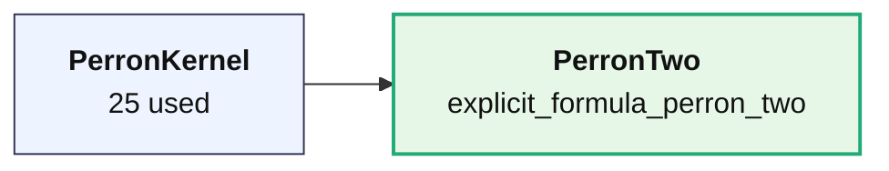

# What `PerronTwo.explicit_formula_perron_two` rests on

[`PerronTwo.explicit_formula_perron_two`](../lean_stage3/PerronTwo.md#PerronTwo-explicit_formula_perron_two) in `lean_stage3/Stage3/PerronTwo.lean`, line 1141.

**Why.** hEF, Perron form from `x = 2` — the truncated explicit formula at the line `re = c`, `c = 1 + 1/log x`. For `x ≥ 2`, `T ≥ 2`, `ψ` misses the truncated `−ζ′/ζ` integral by at most `700·x·log(xT)²/T + 18·log x`.

**Proves**

```lean
‖(Chebyshev.psi x : ℂ) - (2 * (Real.pi:ℂ) * Complex.I)⁻¹ * ∫ t in (-T)..T, (- deriv riemannZeta (((1 + 1/Real.log x : ℝ):ℂ) + Complex.I * t) / riemannZeta (((1 + 1/Real.log x : ℝ):ℂ) + Complex.I * t)) * ((x:ℝ):ℂ) ^ (((1 + 1/Real.log x : ℝ):ℂ) + Complex.I * t) / (((1 + 1/Real.log x : ℝ):ℂ) + Complex.I * t) * Complex.I‖ ≤ 700 * x * Real.log (x * T) ^ 2 / T + 18 * Real.log x
```

**Needs** (its hypotheses)

  - `` hx : 2 ≤ x ``
  - `` hT : 2 ≤ T ``

Behind it: 32 theorems and 2 definitions in 2 files. Every one is listed below; Lean recorded each step.

## The files it passes through



An arrow A → B reads "B uses something proved or defined in A"; indirect arrows are left out. Green: the theorem itself. Yellow: a file in the other tree. The number is how many of that file's declarations are on the way.

## Every declaration on the way

Files in dependency order. ★ marks what the theorem's own proof uses directly.

### [`PerronKernel`](../lean_stage3/PerronKernel.md) — 25

- [`PerronKernel.perronI`](../lean_stage3/PerronKernel.md#PerronKernel-perronI) — *def*
- [`PerronKernel.perronδ`](../lean_stage3/PerronKernel.md#PerronKernel-perron-) — *def*
- [`PerronKernel.perronI_eq_VIntegral'`](../lean_stage3/PerronKernel.md#PerronKernel-perronI_eq_VIntegral-) — `` perronI y c T = VIntegral' (fun s : ℂ ↦ (y : ℂ) ^ s / s) c (-T) T ``
- [`PerronKernel.kernel_holo`](../lean_stage3/PerronKernel.md#PerronKernel-kernel_holo) — `` HolomorphicOn (fun s : ℂ ↦ (y : ℂ) ^ s / s) {s : ℂ | 0 < s.re} ``
- [`PerronKernel.rect_subset_right`](../lean_stage3/PerronKernel.md#PerronKernel-rect_subset_right) — `` Rectangle ((c : ℂ) - Complex.I * T) ((X : ℂ) + Complex.I * T) ⊆ {s : ℂ | 0 < s.re} ``
- [`PerronKernel.perron_kernel_coarse_lt`](../lean_stage3/PerronKernel.md#PerronKernel-perron_kernel_coarse_lt) — `` ‖perronI y c T - perronδ y‖ ≤ y ^ c ``
- [`PerronKernel.horiz_bound`](../lean_stage3/PerronKernel.md#PerronKernel-horiz_bound) — `` ‖∫ σ in a..b, (y : ℂ) ^ ((σ : ℂ) + (T' : ℂ) * Complex.I) / ((σ : ℂ) + (T' : ℂ) * Complex.I)‖ ≤ max (y ^ a) (y ^ b) / (|T'| * |Real.log y|) ``
- [`PerronKernel.perron_kernel_decay_lt`](../lean_stage3/PerronKernel.md#PerronKernel-perron_kernel_decay_lt) — `` ‖perronI y c T - perronδ y‖ ≤ y ^ c / (T * |Real.log y|) ``
- [`PerronKernel.dslope_kernel_diff`](../lean_stage3/PerronKernel.md#PerronKernel-dslope_kernel_diff) — `` Differentiable ℂ (dslope (fun s : ℂ ↦ (y : ℂ) ^ s) 0) ``
- [`PerronKernel.rect_residue`](../lean_stage3/PerronKernel.md#PerronKernel-rect_residue) — `` RectangleIntegral' (fun s : ℂ ↦ (y : ℂ) ^ s / s) (-(X:ℂ) - Complex.I * T) ((c:ℂ) + Complex.I * T) = 1 ``
- [`PerronKernel.perron_kernel_decay_gt`](../lean_stage3/PerronKernel.md#PerronKernel-perron_kernel_decay_gt) — `` ‖perronI y c T - perronδ y‖ ≤ y ^ c / (T * |Real.log y|) ``
- [`PerronKernel.perron_kernel_decay`](../lean_stage3/PerronKernel.md#PerronKernel-perron_kernel_decay) — `` ‖perronI y c T - perronδ y‖ ≤ y ^ c / (T * |Real.log y|) ``
- [`PerronKernel.coarse_gt_ineq`](../lean_stage3/PerronKernel.md#PerronKernel-coarse_gt_ineq) — `` v * Real.exp u + Real.pi - Real.arctan (v / u) ≤ Real.pi * Real.exp u ``
- [`PerronKernel.seg_inv_integral`](../lean_stage3/PerronKernel.md#PerronKernel-seg_inv_integral) — `` (∫ t in (-T)..T, ((c : ℂ) + Complex.I * t)⁻¹ * Complex.I) = 2 * Real.arctan (T / c) * Complex.I ``
- [`PerronKernel.cpow_sub_one_bound`](../lean_stage3/PerronKernel.md#PerronKernel-cpow_sub_one_bound) — `` ‖(y : ℂ) ^ s - 1‖ ≤ ‖s‖ * Real.log y * y ^ s.re ``
- [`PerronKernel.perron_kernel_coarse_gt`](../lean_stage3/PerronKernel.md#PerronKernel-perron_kernel_coarse_gt) — `` ‖perronI y c T - perronδ y‖ ≤ y ^ c ``
- [`PerronKernel.perron_kernel_coarse`](../lean_stage3/PerronKernel.md#PerronKernel-perron_kernel_coarse) — `` ‖perronI y c T - perronδ y‖ ≤ y ^ c ``
- [`PerronKernel.perron_kernel_truncated`](../lean_stage3/PerronKernel.md#PerronKernel-perron_kernel_truncated) — `` ‖perronI y c T - perronδ y‖ ≤ y ^ c * min 1 (1 / (T * |Real.log y|)) ``
- [`PerronKernel.one_sub_two_neg_rpow`](../lean_stage3/PerronKernel.md#PerronKernel-one_sub_two_neg_rpow) — `` δ / 5 ≤ 1 - (2:ℝ) ^ (-δ) ``
- [`PerronKernel.vonMangoldt_rpow_partial`](../lean_stage3/PerronKernel.md#PerronKernel-vonMangoldt_rpow_partial) — `` ∑ n ∈ s, ArithmeticFunction.vonMangoldt n * (n : ℝ) ^ (-c) ≤ 2 * (Real.log 4 + 4) / (1 - (2:ℝ) ^ (1 - c)) ``
- [`PerronKernel.vonMangoldt_rpow_tsum`](../lean_stage3/PerronKernel.md#PerronKernel-vonMangoldt_rpow_tsum) — `` ∑' n : ℕ, ArithmeticFunction.vonMangoldt n * (n : ℝ) ^ (-c) ≤ 2 * (Real.log 4 + 4) / (1 - (2:ℝ) ^ (1 - c)) ``
- [`PerronKernel.vonMangoldt_rpow_summable`](../lean_stage3/PerronKernel.md#PerronKernel-vonMangoldt_rpow_summable) — `` Summable (fun n : ℕ ↦ ArithmeticFunction.vonMangoldt n * (n : ℝ) ^ (-c)) ``
- [`PerronKernel.abs_sub_one_le_two_abs_log`](../lean_stage3/PerronKernel.md#PerronKernel-abs_sub_one_le_two_abs_log) — `` |t - 1| / 2 ≤ |Real.log t| ``
- [`PerronKernel.perronI_one_norm`](../lean_stage3/PerronKernel.md#PerronKernel-perronI_one_norm) — `` ‖perronI 1 c T‖ ≤ 1/2 ``
- [`PerronKernel.tsum_vonMangoldt_div_cpow`](../lean_stage3/PerronKernel.md#PerronKernel-tsum_vonMangoldt_div_cpow) — `` (∑' n : ℕ, (ArithmeticFunction.vonMangoldt n : ℂ) * ((x / n : ℝ) : ℂ) ^ s) = (- deriv riemannZeta s / riemannZeta s) * ((x:ℝ):ℂ) ^ s ``

### [`PerronTwo`](../lean_stage3/PerronTwo.md) — 9

- [`PerronTwo.one_sub_two_neg_rpow'`](../lean_stage3/PerronTwo.md#PerronTwo-one_sub_two_neg_rpow-) — `` δ / 5 ≤ 1 - (2:ℝ) ^ (-δ) ``
- [`PerronTwo.inv_log_le_of_two_le`](../lean_stage3/PerronTwo.md#PerronTwo-inv_log_le_of_two_le) — `` 1 / Real.log x ≤ 3/2 ``
- [`PerronTwo.far_terms_sum_two`](../lean_stage3/PerronTwo.md#PerronTwo-far_terms_sum_two) — `` (∑' n : ℕ, if 1/2 ≤ |Real.log (x / n)| then ArithmeticFunction.vonMangoldt n * (x / n) ^ (1 + 1/Real.log x) / (T * |Real.log (x / n)|) else 0) ≤ 300 * x * Real.… ``
- [`PerronTwo.near_diagonal_sum_two`](../lean_stage3/PerronTwo.md#PerronTwo-near_diagonal_sum_two) — `` (∑' n : ℕ, if 0 < |Real.log (x / n)| ∧ |Real.log (x / n)| < 1/2 then ArithmeticFunction.vonMangoldt n * min 1 (1/(T * |Real.log (x / n)|)) else 0) ≤ 100 * x * R… ``
- [`PerronTwo.kernel_sum_bound_two`](../lean_stage3/PerronTwo.md#PerronTwo-kernel_sum_bound_two) — `` ‖(∑' n : ℕ, (ArithmeticFunction.vonMangoldt n : ℂ) * (perronI (x/n) (1 + 1/Real.log x) T - perronδ (x/n)))‖ ≤ 700 * x * Real.log (x * T) ^ 2 / T + 17 * Real.log… ``
- [`PerronTwo.delta_sum_close_two`](../lean_stage3/PerronTwo.md#PerronTwo-delta_sum_close_two) — `` ‖(Chebyshev.psi x : ℂ) - ∑' n : ℕ, (ArithmeticFunction.vonMangoldt n : ℂ) * perronδ (x / n)‖ ≤ Real.log x ``
- [`PerronTwo.kernel_diff_summable_two`](../lean_stage3/PerronTwo.md#PerronTwo-kernel_diff_summable_two) — `` Summable (fun n : ℕ ↦ (ArithmeticFunction.vonMangoldt n : ℂ) * (perronI (x/n) (1 + 1/Real.log x) T - perronδ (x/n))) ``
- ★ [`PerronTwo.perron_to_psi_two`](../lean_stage3/PerronTwo.md#PerronTwo-perron_to_psi_two) — `` ‖(Chebyshev.psi x : ℂ) - ∑' n : ℕ, (ArithmeticFunction.vonMangoldt n : ℂ) * perronI (x/n) (1 + 1/Real.log x) T‖ ≤ 700 * x * Real.log (x * T) ^ 2 / T + 18 * Real… ``
- ★ [`PerronTwo.perron_sum_eq_integral_two`](../lean_stage3/PerronTwo.md#PerronTwo-perron_sum_eq_integral_two) — `` (∑' n : ℕ, (ArithmeticFunction.vonMangoldt n : ℂ) * perronI (x/n) (1 + 1/Real.log x) T) = (2 * (Real.pi:ℂ) * Complex.I)⁻¹ * ∫ t in (-T)..T, (- deriv riemannZeta… ``

