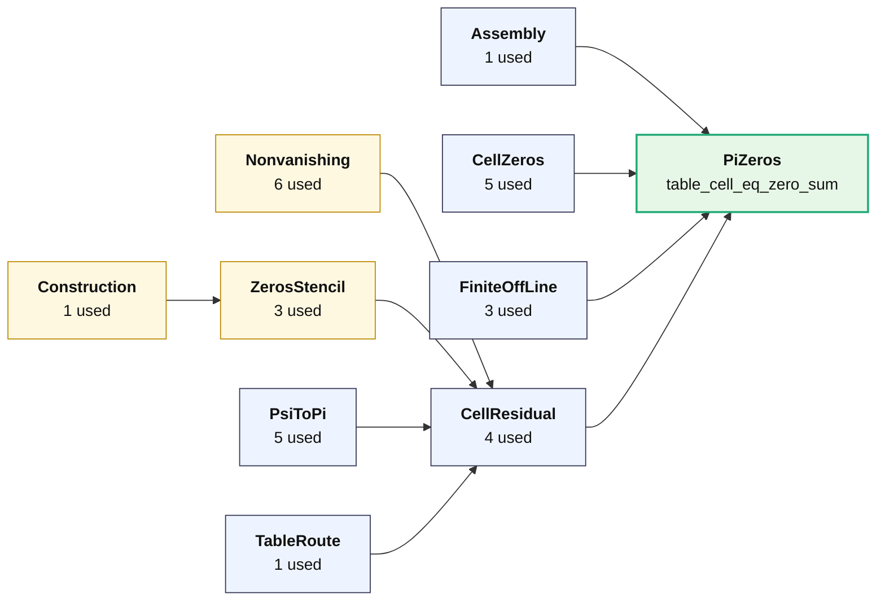

# What `PiZeros.table_cell_eq_zero_sum` rests on

[`PiZeros.table_cell_eq_zero_sum`](../lean_stage3/PiZeros.md#PiZeros-table_cell_eq_zero_sum) in `lean_stage3/Stage3/PiZeros.lean`, line 284.

**Why.** The integer table's cell as a sum over the zeros, exactly. The cell `(r, d)` of the table of the prime count along the doublings, less the smooth cell, is minus the sum over the zeros below any height of each zero's part under the stencil, plus the stencil of the explicit formula's remainder passed to the count, minus the stencil of the higher prime powers.

**Proves**

```lean
((((Construction.tableFrom TableRoute.rowN r d : ℤ) : ℝ) - Nonvanishing.stencilR (d + 1) (fun m : ℤ => Stage3.Li ((2 : ℝ) ^ (m : ℝ))) r : ℝ) : ℂ) = -∑ ρ ∈ ZF T, ((riemannZeta.order (ρ : ℂ) : ℤ) : ℂ) * CellZeros.stencil (d + 1) (fun m : ℤ => piMode (ρ : ℂ) ((2:ℝ) ^ (m : ℝ))) r + CellZeros.stencil (d + 1) (fun m : ℤ => tr (efRem T) ((2:ℝ) ^ (m : ℝ))) r - CellZeros.stencil (d + 1) (fun m : ℤ => tr psiTheta ((2:ℝ) ^ (m : ℝ))) r
```

**Needs** (its hypotheses)

  - `` r : ℤ ``
  - `` d : ℕ ``
  - `` hr : (d : ℤ) + 2 ≤ r ``
  - `` T : ℝ ``

Behind it: 31 theorems and 16 definitions in 10 files. Every one is listed below; Lean recorded each step.

## The files it passes through



An arrow A → B reads "B uses something proved or defined in A"; indirect arrows are left out. Green: the theorem itself. Yellow: a file in the other tree. The number is how many of that file's declarations are on the way.

## Every declaration on the way

Files in dependency order. ★ marks what the theorem's own proof uses directly.

### [`Construction`](../lean/Construction.md) — 1

- ★ [`Construction.tableFrom`](../lean/Construction.md#Construction-tableFrom) — *def*

### [`Nonvanishing`](../lean/Nonvanishing.md) — 6

- [`Nonvanishing.bdiffZ`](../lean/Nonvanishing.md#Nonvanishing-bdiffZ) — *def*
- ★ [`Nonvanishing.stencilR`](../lean/Nonvanishing.md#Nonvanishing-stencilR) — *def*
- [`Nonvanishing.iter_bdiffZ_eq_fwdDiff`](../lean/Nonvanishing.md#Nonvanishing-iter_bdiffZ_eq_fwdDiff) — `` (bdiffZ^[n]) g r = (-1 : ℝ) ^ n * (fwdDiff (-1 : ℤ))^[n] g r ``
- [`Nonvanishing.iter_bdiffZ_eq_stencilR`](../lean/Nonvanishing.md#Nonvanishing-iter_bdiffZ_eq_stencilR) — `` (bdiffZ^[n]) g r = stencilR n g r ``
- [`Nonvanishing.stencilR_row`](../lean/Nonvanishing.md#Nonvanishing-stencilR_row) — `` stencilR d (bdiffZ g) r = stencilR (d + 1) g r ``
- [`Nonvanishing.stencilR_sub`](../lean/Nonvanishing.md#Nonvanishing-stencilR_sub) — `` stencilR n (fun x => f x - L x) r = stencilR n f r - stencilR n L r ``

### [`ZerosStencil`](../lean/ZerosStencil.md) — 3

- [`Zeros.tableFrom_eq_fwdDiff`](../lean/ZerosStencil.md#Zeros-tableFrom_eq_fwdDiff) — `` Construction.tableFrom N r d = (-1 : ℤ) ^ d * (fwdDiff (-1 : ℤ))^[d] N r ``
- [`Zeros.stencil`](../lean/ZerosStencil.md#Zeros-stencil) — *def*
- [`Zeros.tableFrom_eq_stencil`](../lean/ZerosStencil.md#Zeros-tableFrom_eq_stencil) — `` Construction.tableFrom N r d = stencil d (fun k => N (r - k)) ``

### [`Assembly`](../lean_stage3/Assembly.md) — 1

- [`Stage3.zeroPartialSum`](../lean_stage3/Assembly.md#Stage3-zeroPartialSum) — *def*

### [`CellZeros`](../lean_stage3/CellZeros.md) — 5

- ★ [`CellZeros.stencil`](../lean_stage3/CellZeros.md#CellZeros-stencil) — *def*
- ★ [`CellZeros.stencil_add`](../lean_stage3/CellZeros.md#CellZeros-stencil_add) — `` stencil d (fun n => a n + b n) r = stencil d a r + stencil d b r ``
- ★ [`CellZeros.stencil_sub`](../lean_stage3/CellZeros.md#CellZeros-stencil_sub) — `` stencil d (fun n => a n - b n) r = stencil d a r - stencil d b r ``
- ★ [`CellZeros.stencil_const_mul`](../lean_stage3/CellZeros.md#CellZeros-stencil_const_mul) — `` stencil d (fun n => c * a n) r = c * stencil d a r ``
- ★ [`CellZeros.stencil_sum`](../lean_stage3/CellZeros.md#CellZeros-stencil_sum) — `` stencil d (fun n => ∑ i ∈ s, f i n) r = ∑ i ∈ s, stencil d (f i) r ``

### [`FiniteOffLine`](../lean_stage3/FiniteOffLine.md) — 3

- ★ [`FiniteOffLine.ZF`](../lean_stage3/FiniteOffLine.md#FiniteOffLine-ZF) — *def*
- [`FiniteOffLine.mem_ZF`](../lean_stage3/FiniteOffLine.md#FiniteOffLine-mem_ZF) — `` ρ ∈ ZF T ↔ |(ρ : ℂ).im| < T ``
- [`FiniteOffLine.tsum_sub_eq_sum`](../lean_stage3/FiniteOffLine.md#FiniteOffLine-tsum_sub_eq_sum) — `` ∑' σ : {ρ : NontrivialZeros // |(ρ : ℂ).im| < T}, f σ.1 = ∑ ρ ∈ ZF T, f ρ ``

### [`PsiToPi`](../lean_stage3/PsiToPi.md) — 5

- ★ [`Stage3.Li`](../lean_stage3/PsiToPi.md#Stage3-Li) — *def*
- [`Stage3.continuousOn_inv_log_sq`](../lean_stage3/PsiToPi.md#Stage3-continuousOn_inv_log_sq) — `` ContinuousOn (fun t : ℝ => 1 / Real.log t ^ 2) (Set.uIcc a x) ``
- [`Stage3.continuousOn_inv_mul_log_sq`](../lean_stage3/PsiToPi.md#Stage3-continuousOn_inv_mul_log_sq) — `` ContinuousOn (fun t : ℝ => (t * Real.log t ^ 2)⁻¹) (Set.uIcc a x) ``
- [`Stage3.integrable_theta_term`](../lean_stage3/PsiToPi.md#Stage3-integrable_theta_term) — `` IntervalIntegrable (fun t => θ t / (t * Real.log t ^ 2)) volume a x ``
- [`Stage3.pi_sub_Li_eq`](../lean_stage3/PsiToPi.md#Stage3-pi_sub_Li_eq) — `` (Nat.primeCounting ⌊x⌋₊ : ℝ) - Li x = (θ x - x) / Real.log x + ∫ t in (2 : ℝ)..x, (θ t - t) / (t * Real.log t ^ 2) ``

### [`TableRoute`](../lean_stage3/TableRoute.md) — 1

- ★ [`TableRoute.rowN`](../lean_stage3/TableRoute.md#TableRoute-rowN) — *def*

### [`CellResidual`](../lean_stage3/CellResidual.md) — 4

- ★ [`CellResidual.resid`](../lean_stage3/CellResidual.md#CellResidual-resid) — *def*
- ★ [`CellResidual.cellResid`](../lean_stage3/CellResidual.md#CellResidual-cellResid) — *def*
- [`CellResidual.tableFrom_cast`](../lean_stage3/CellResidual.md#CellResidual-tableFrom_cast) — `` ((Construction.tableFrom N r d : ℤ) : ℝ) = stencilR (d + 1) f r ``
- ★ [`CellResidual.table_cell_eq`](../lean_stage3/CellResidual.md#CellResidual-table_cell_eq) — `` ((Construction.tableFrom TableRoute.rowN r d : ℤ) : ℝ) - stencilR (d + 1) (fun m : ℤ => Stage3.Li ((2 : ℝ) ^ (m : ℝ))) r = cellResid 1 r d ``

### [`PiZeros`](../lean_stage3/PiZeros.md) — 18

- [`PiZeros.wt`](../lean_stage3/PiZeros.md#PiZeros-wt) — *def*
- ★ [`PiZeros.tr`](../lean_stage3/PiZeros.md#PiZeros-tr) — *def*
- [`PiZeros.wt_continuousOn`](../lean_stage3/PiZeros.md#PiZeros-wt_continuousOn) — `` ContinuousOn wt (Set.uIcc 2 x) ``
- [`PiZeros.integrable_mul_wt`](../lean_stage3/PiZeros.md#PiZeros-integrable_mul_wt) — `` IntervalIntegrable (fun t => f t * wt t) volume 2 x ``
- [`PiZeros.tr_sub`](../lean_stage3/PiZeros.md#PiZeros-tr_sub) — `` tr (fun t => f t - g t) x = tr f x - tr g x ``
- [`PiZeros.tr_const_mul`](../lean_stage3/PiZeros.md#PiZeros-tr_const_mul) — `` tr (fun t => c * f t) x = c * tr f x ``
- [`PiZeros.tr_sum`](../lean_stage3/PiZeros.md#PiZeros-tr_sum) — `` tr (fun t => ∑ i ∈ s, f i t) x = ∑ i ∈ s, tr (f i) x ``
- [`PiZeros.pi_sub_Li_eq_tr`](../lean_stage3/PiZeros.md#PiZeros-pi_sub_Li_eq_tr) — `` (((Nat.primeCounting ⌊x⌋₊ : ℝ) - Stage3.Li x : ℝ) : ℂ) = tr (fun t => ((θ t - t : ℝ) : ℂ)) x ``
- ★ [`PiZeros.piMode`](../lean_stage3/PiZeros.md#PiZeros-piMode) — *def*
- ★ [`PiZeros.efRem`](../lean_stage3/PiZeros.md#PiZeros-efRem) — *def*
- ★ [`PiZeros.psiTheta`](../lean_stage3/PiZeros.md#PiZeros-psiTheta) — *def*
- [`PiZeros.zeroPartialSum_eq_sum`](../lean_stage3/PiZeros.md#PiZeros-zeroPartialSum_eq_sum) — `` Stage3.zeroPartialSum t T = ∑ ρ ∈ ZF T, ((riemannZeta.order (ρ : ℂ) : ℤ) : ℂ) * ((t : ℂ) ^ (ρ : ℂ) / (ρ : ℂ)) ``
- [`PiZeros.integrable_ofReal_of_monotone`](../lean_stage3/PiZeros.md#PiZeros-integrable_ofReal_of_monotone) — `` IntervalIntegrable (fun t => ((f t : ℝ) : ℂ)) volume 2 x ``
- [`PiZeros.integrable_cpow`](../lean_stage3/PiZeros.md#PiZeros-integrable_cpow) — `` IntervalIntegrable (fun t : ℝ => (t : ℂ) ^ ρ / ρ) volume 2 x ``
- ★ [`PiZeros.pi_eq_zero_sum`](../lean_stage3/PiZeros.md#PiZeros-pi_eq_zero_sum) — `` (((Nat.primeCounting ⌊x⌋₊ : ℝ) - Stage3.Li x : ℝ) : ℂ) = -∑ ρ ∈ ZF T, ((riemannZeta.order (ρ : ℂ) : ℤ) : ℂ) * piMode (ρ : ℂ) x + tr (efRem T) x - tr psiTheta x ``
- ★ [`PiZeros.stencil_congr`](../lean_stage3/PiZeros.md#PiZeros-stencil_congr) — `` CellZeros.stencil n a r = CellZeros.stencil n b r ``
- ★ [`PiZeros.stencil_neg`](../lean_stage3/PiZeros.md#PiZeros-stencil_neg) — `` CellZeros.stencil n (fun m => -a m) r = -CellZeros.stencil n a r ``
- ★ [`PiZeros.stencilR_cast`](../lean_stage3/PiZeros.md#PiZeros-stencilR_cast) — `` ((Nonvanishing.stencilR n g r : ℝ) : ℂ) = CellZeros.stencil n (fun m => ((g m : ℝ) : ℂ)) r ``

