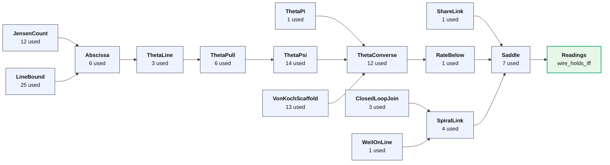

# What `Readings.wire_holds_iff` rests on

[`Readings.wire_holds_iff`](../lean_stage3/Readings.md#Readings-wire_holds_iff) in `lean_stage3/Stage3/Readings.lean`, line 137.

**Why.** The wire holds. The link holds exactly when the current never outruns the wire: the staircase stays in the square-root frame at every `N` from some point on.

**Proves**

```lean
SpiralLink.SpiralLink ↔ Saddle.NoRunaway
```

Behind it: 93 theorems and 16 definitions in 16 files. Every one is listed below; Lean recorded each step.

## The files it passes through



An arrow A → B reads "B uses something proved or defined in A"; indirect arrows are left out. Green: the theorem itself. Yellow: a file in the other tree. The number is how many of that file's declarations are on the way.

## Every declaration on the way

Files in dependency order. ★ marks what the theorem's own proof uses directly.

### [`ClosedLoopJoin`](../lean_stage3/ClosedLoopJoin.md) — 3

- [`ClosedLoopJoin.epsilon`](../lean_stage3/ClosedLoopJoin.md#ClosedLoopJoin-epsilon) — *def*
- [`ClosedLoopJoin.primeWeight`](../lean_stage3/ClosedLoopJoin.md#ClosedLoopJoin-primeWeight) — *def*
- [`ClosedLoopJoin.isHermitianHandshake`](../lean_stage3/ClosedLoopJoin.md#ClosedLoopJoin-isHermitianHandshake) — *def*

### [`JensenCount`](../lean_stage3/JensenCount.md) — 12

- [`Stage3.zeta_centre_lower`](../lean_stage3/JensenCount.md#Stage3-zeta_centre_lower) — `` (1 : ℝ) / 3 ≤ ‖ζ (2 + Complex.I * T)‖ ``
- [`Stage3.zeta_disk_upper`](../lean_stage3/JensenCount.md#Stage3-zeta_disk_upper) — `` ‖ζ w‖ ≤ 28 * T ``
- [`Stage3.zeta_centre_ne_zero`](../lean_stage3/JensenCount.md#Stage3-zeta_centre_ne_zero) — `` ζ (2 + Complex.I * (T : ℂ)) ≠ 0 ``
- [`Stage3.pole_away`](../lean_stage3/JensenCount.md#Stage3-pole_away) — `` 2 * z + (2 + Complex.I * (T : ℂ)) ≠ 1 ``
- [`Stage3.pole_away_centre`](../lean_stage3/JensenCount.md#Stage3-pole_away_centre) — `` v ≠ 1 ``
- [`Stage3.zetaWindowTwo_finite`](../lean_stage3/JensenCount.md#Stage3-zetaWindowTwo_finite) — `` {ρ : ℂ | ζ ρ = 0 ∧ ‖ρ - (2 + Complex.I * (T : ℂ))‖ ≤ 2}.Finite ``
- [`Stage3.jensenF`](../lean_stage3/JensenCount.md#Stage3-jensenF) — *def*
- [`Stage3.zeta_comp_analytic`](../lean_stage3/JensenCount.md#Stage3-zeta_comp_analytic) — `` AnalyticAt ℂ (fun z : ℂ => ζ (2 * z + (2 + Complex.I * (T : ℂ)))) w ``
- [`Stage3.jensenF_analytic`](../lean_stage3/JensenCount.md#Stage3-jensenF_analytic) — `` AnalyticOnNhd ℂ (jensenF T) (Metric.closedBall (0 : ℂ) 1) ``
- [`Stage3.jensenF_zero_eq_one`](../lean_stage3/JensenCount.md#Stage3-jensenF_zero_eq_one) — `` jensenF T 0 = 1 ``
- [`Stage3.jensenF_zeros_finite`](../lean_stage3/JensenCount.md#Stage3-jensenF_zeros_finite) — `` (SetOfZeros 1 (jensenF T)).Finite ``
- [`Stage3.jensenF_bound`](../lean_stage3/JensenCount.md#Stage3-jensenF_bound) — `` ‖jensenF T z‖ ≤ 84 * T ``

### [`LineBound`](../lean_stage3/LineBound.md) — 25

- [`Slice3.finalBoundConst_le`](../lean_stage3/LineBound.md#Slice3-finalBoundConst_le) — `` 16 * ((181:ℝ)/200) ^ 2 / ((181/200) - (3/4)) ^ 3 + 1 / (((15/16:ℝ) ^ 2 / (29/32) - 29/32) * Real.log ((15/16)/(29/32))) ≤ 3991 ``
- [`Slice4.zetaE`](../lean_stage3/LineBound.md#Slice4-zetaE) — *def*
- [`Slice4.zetaE_eq`](../lean_stage3/LineBound.md#Slice4-zetaE_eq) — `` zetaE s = (s - 1) * ζ s ``
- [`Slice4.zetaE_one`](../lean_stage3/LineBound.md#Slice4-zetaE_one) — `` zetaE 1 = 1 ``
- [`Slice4.zetaE_differentiableAt_of_ne`](../lean_stage3/LineBound.md#Slice4-zetaE_differentiableAt_of_ne) — `` DifferentiableAt ℂ zetaE s ``
- [`Slice4.zetaE_differentiable`](../lean_stage3/LineBound.md#Slice4-zetaE_differentiable) — `` Differentiable ℂ zetaE ``
- [`Slice4.logDeriv_zetaE`](../lean_stage3/LineBound.md#Slice4-logDeriv_zetaE) — `` deriv zetaE s / zetaE s = 1 / (s - 1) + deriv ζ s / ζ s ``
- [`Slice4.zetaE_disk_upper`](../lean_stage3/LineBound.md#Slice4-zetaE_disk_upper) — `` ‖zetaE w‖ ≤ 430 ``
- [`Slice4.log_1300_le`](../lean_stage3/LineBound.md#Slice4-log_1300_le) — `` Real.log 1300 ≤ 7.28 ``
- [`Slice4b.logDerivZeta_norm_neg`](../lean_stage3/LineBound.md#Slice4b-logDerivZeta_norm_neg) — `` ‖deriv ζ ((σ : ℂ) + I * ((-t : ℝ) : ℂ)) / ζ ((σ : ℂ) + I * ((-t : ℝ) : ℂ))‖ = ‖deriv ζ ((σ : ℂ) + I * (t : ℂ)) / ζ ((σ : ℂ) + I * (t : ℂ))‖ ``
- [`RHPull.norm_sq_line`](../lean_stage3/LineBound.md#RHPull-norm_sq_line) — `` ‖((σ : ℂ) + I * (t : ℂ))‖ ^ 2 = σ ^ 2 + t ^ 2 ``
- [`RHPull.kernel_modulus_le`](../lean_stage3/LineBound.md#RHPull-kernel_modulus_le) — `` ‖((x : ℂ)) ^ (w - 1)‖ ≤ 2 ``
- [`RHPull.mellin_bump_bounded`](../lean_stage3/LineBound.md#RHPull-mellin_bump_bounded) — `` ∃ B > 0, ∀ w : ℂ, 0 < w.re → w.re ≤ 2 → ‖mellin (fun x ↦ (ν x : ℂ)) w‖ ≤ B ``
- [`RHPull.mellin_smooth1_le`](../lean_stage3/LineBound.md#RHPull-mellin_smooth1_le) — `` ‖mellin (fun x ↦ (Smooth1 ν ε x : ℂ)) s‖ ≤ B * ‖s‖⁻¹ ``
- [`RHPull.integral_shift_inv`](../lean_stage3/LineBound.md#RHPull-integral_shift_inv) — `` ∫ t in (0:ℝ)..T, (1 + t)⁻¹ = Real.log (1 + T) ``
- [`RHPull.integral_abs_kernel`](../lean_stage3/LineBound.md#RHPull-integral_abs_kernel) — `` ∫ t in (-T)..T, (1 + |t|)⁻¹ = 2 * Real.log (1 + T) ``
- [`RHPull.psi_sub_self_le`](../lean_stage3/LineBound.md#RHPull-psi_sub_self_le) — `` |ψ X - X| ≤ E₁ + E₂ + E₃ ``
- [`RHPull.bump_exists`](../lean_stage3/LineBound.md#RHPull-bump_exists) — `` ∃ ν : ℝ → ℝ, ContDiff ℝ 1 ν ∧ (∀ x > 0, 0 ≤ ν x) ∧ ν.support ⊆ Set.Icc (1/2 : ℝ) 2 ∧ ∫ x in Set.Ioi (0:ℝ), ν x / x = 1 ``
- [`RHPull.norm_ge_height`](../lean_stage3/LineBound.md#RHPull-norm_ge_height) — `` T ≤ ‖((σ : ℂ)) + I * (T : ℂ)‖ ``
- [`RHPull.mellin_horiz_le`](../lean_stage3/LineBound.md#RHPull-mellin_horiz_le) — `` ‖mellin (fun x ↦ (Smooth1 ν ε x : ℂ)) ((σ : ℂ) + I * (T : ℂ))‖ ≤ B / T ``
- [`RHPull.horiz_small`](../lean_stage3/LineBound.md#RHPull-horiz_small) — `` (1 / (2 * Real.pi)) * (1 / 2) * ((1996 * Real.log (84 * X) + (29 * Real.log X + 129) * Real.log X) * (B / X) * (Real.exp 1 * X)) ≤ (900 * Real.exp 1 * B / Real.… ``
- [`RHPull.mellin_main_const`](../lean_stage3/LineBound.md#RHPull-mellin_main_const) — `` ∃ Cmain > 0, ∃ ε₀ > 0, ∀ ε : ℝ, 0 < ε → ε < ε₀ → ‖mellin (fun x ↦ (Smooth1 ν ε x : ℂ)) 1 - 1‖ ≤ Cmain * ε ``
- [`RHPull.norm_ge_height_neg`](../lean_stage3/LineBound.md#RHPull-norm_ge_height_neg) — `` T ≤ ‖((σ : ℂ)) - (T : ℂ) * I‖ ``
- [`RHPull.mellin_horiz_le_neg`](../lean_stage3/LineBound.md#RHPull-mellin_horiz_le_neg) — `` ‖mellin (fun x ↦ (Smooth1 ν ε x : ℂ)) ((σ : ℂ) - (T : ℂ) * I)‖ ≤ B / T ``
- [`RHPull.rpow_one_add`](../lean_stage3/LineBound.md#RHPull-rpow_one_add) — `` X ^ (1 + 1 / Real.log X) = Real.exp 1 * X ``

### [`Abscissa`](../lean_stage3/Abscissa.md) — 6

- [`Stage3.σθ`](../lean_stage3/Abscissa.md#Stage3---) — *def*
- [`Stage3.σθ_re`](../lean_stage3/Abscissa.md#Stage3---_re) — `` ((σθ θ X : ℂ) + I * (t : ℂ)).re = σθ θ X ``
- [`Stage3.StmtZeroFreeRight`](../lean_stage3/Abscissa.md#Stage3-StmtZeroFreeRight) — *def*
- [`Stage3.zeta_ne_zero_right_of`](../lean_stage3/Abscissa.md#Stage3-zeta_ne_zero_right_of) — `` ζ s ≠ 0 ``
- [`Stage3.rpow_σθ`](../lean_stage3/Abscissa.md#Stage3-rpow_--) — `` X ^ (σθ θ X) = Real.exp 1 * X ^ θ ``
- [`Stage3.logDerivZeta_crude_theta`](../lean_stage3/Abscissa.md#Stage3-logDerivZeta_crude_theta) — `` ‖deriv ζ ((σ₁ : ℂ) + I * (t : ℂ)) / ζ ((σ₁ : ℂ) + I * (t : ℂ))‖ ≤ 1996 * Real.log (84 * t) + (29 * Real.log t + 129) / (σ₁ - θ) ``

### [`ShareLink`](../lean_stage3/ShareLink.md) — 1

- [`ShareLink.mode_size`](../lean_stage3/ShareLink.md#ShareLink-mode_size) — `` ‖(T : ℂ) ^ (ρ : ℂ)‖ = T ^ (ρ : ℂ).re ``

### [`ThetaLine`](../lean_stage3/ThetaLine.md) — 3

- [`Stage3.logDerivZeta_compact_theta`](../lean_stage3/ThetaLine.md#Stage3-logDerivZeta_compact_theta) — `` ‖deriv ζ ((σ₁ : ℂ) + I * (t : ℂ)) / ζ ((σ₁ : ℂ) + I * (t : ℂ))‖ ≤ 14530 + 2 / (1 - θ) + 212 / (σ₁ - θ) ``
- [`Stage3.logDerivZeta_sq_at_X_theta`](../lean_stage3/ThetaLine.md#Stage3-logDerivZeta_sq_at_X_theta) — `` ‖deriv ζ (((θ + 1/Real.log X : ℝ)) + I * (t : ℂ)) / ζ (((θ + 1/Real.log X : ℝ)) + I * (t : ℂ))‖ ≤ 11100 * (Real.log X) ^ 2 ``
- [`Stage3.logDerivZeta_line_theta`](../lean_stage3/ThetaLine.md#Stage3-logDerivZeta_line_theta) — `` ‖deriv ζ (((θ + 1/Real.log X : ℝ)) + I * (t : ℂ)) / ζ (((θ + 1/Real.log X : ℝ)) + I * (t : ℂ))‖ ≤ 11100 * (Real.log X) ^ 2 ``

### [`ThetaPi`](../lean_stage3/ThetaPi.md) — 1

- [`Stage3.StmtPsiWeakTheta`](../lean_stage3/ThetaPi.md#Stage3-StmtPsiWeakTheta) — *def*

### [`ThetaPull`](../lean_stage3/ThetaPull.md) — 6

- [`Stage3.half_lt_σθ`](../lean_stage3/ThetaPull.md#Stage3-half_lt_--) — `` (1:ℝ)/2 < σθ θ X ``
- [`Stage3.four_le_log_of_theta`](../lean_stage3/ThetaPull.md#Stage3-four_le_log_of_theta) — `` (4:ℝ) ≤ Real.log X ``
- [`Stage3.norm_line_ge_theta`](../lean_stage3/ThetaPull.md#Stage3-norm_line_ge_theta) — `` (1 + |t|) / 3 ≤ ‖((σθ θ X : ℂ)) + I * (t : ℂ)‖ ``
- [`Stage3.integrand_norm_le_theta`](../lean_stage3/ThetaPull.md#Stage3-integrand_norm_le_theta) — `` ‖SmoothedChebyshevIntegrand ν ε X ((σθ θ X : ℂ) + I * (t : ℂ))‖ ≤ 11100 * (Real.log X) ^ 2 * M * X ^ (σθ θ X) ``
- [`Stage3.I37_norm_le_epsfree_theta`](../lean_stage3/ThetaPull.md#Stage3-I37_norm_le_epsfree_theta) — `` ‖I₃₇ ν ε T X (σθ θ X)‖ ≤ (1 / (2 * Real.pi)) * (6 * Real.log (1 + T)) * (11100 * (Real.log X) ^ 2 * B * X ^ (σθ θ X)) ``
- [`Stage3.I37_power_log3_theta`](../lean_stage3/ThetaPull.md#Stage3-I37_power_log3_theta) — `` ‖I₃₇ ν ε T X (σθ θ X)‖ ≤ (66600 * Real.exp 1 * B / Real.pi) * X ^ θ * (Real.log X) ^ 3 ``

### [`ThetaPsi`](../lean_stage3/ThetaPsi.md) — 14

- [`Stage3.inv_log_le_theta`](../lean_stage3/ThetaPsi.md#Stage3-inv_log_le_theta) — `` 1 / Real.log X ≤ (1 - θ) / 2 ``
- [`Stage3.σθ_lt_one`](../lean_stage3/ThetaPsi.md#Stage3---_lt_one) — `` σθ θ X < 1 ``
- [`Stage3.lt_σθ`](../lean_stage3/ThetaPsi.md#Stage3-lt_--) — `` θ < σθ θ X ``
- [`Stage3.horiz_length_theta`](../lean_stage3/ThetaPsi.md#Stage3-horiz_length_theta) — `` (1 + 1 / Real.log X) - σθ θ X = 1 - θ ``
- [`Stage3.holo_logDerivZeta_theta`](../lean_stage3/ThetaPsi.md#Stage3-holo_logDerivZeta_theta) — `` HolomorphicOn (deriv riemannZeta / riemannZeta) (Set.Icc σ₁ 2 ×ℂ Set.Icc (-T) T \ {1}) ``
- [`Stage3.pull_at_theta_abscissa`](../lean_stage3/ThetaPsi.md#Stage3-pull_at_theta_abscissa) — `` SmoothedChebyshev SmoothingF ε X = I₁ SmoothingF ε X T - I₂ SmoothingF ε T X (σθ θ X) + I₃₇ SmoothingF ε T X (σθ θ X) + I₈ SmoothingF ε T X (σθ θ X) + I₉ Smooth… ``
- [`Stage3.integrand_norm_le_horiz_theta`](../lean_stage3/ThetaPsi.md#Stage3-integrand_norm_le_horiz_theta) — `` ‖SmoothedChebyshevIntegrand ν ε X ((σ : ℂ) + I * (t : ℂ))‖ ≤ (1996 * Real.log (84 * t) + (29 * Real.log t + 129) * Real.log X) * M * X ^ σ ``
- [`Stage3.integrand_norm_le_horiz_neg_theta`](../lean_stage3/ThetaPsi.md#Stage3-integrand_norm_le_horiz_neg_theta) — `` ‖SmoothedChebyshevIntegrand ν ε X ((σ : ℂ) - (T : ℂ) * I)‖ ≤ (1996 * Real.log (84 * T) + (29 * Real.log T + 129) * Real.log X) * M * X ^ σ ``
- [`Stage3.I8_norm_le_theta`](../lean_stage3/ThetaPsi.md#Stage3-I8_norm_le_theta) — `` ‖I₈ ν ε T X (σθ θ X)‖ ≤ (1 / (2 * Real.pi)) * (1 - θ) * ((1996 * Real.log (84 * T) + (29 * Real.log T + 129) * Real.log X) * M * X ^ (1 + 1 / Real.log X)) ``
- [`Stage3.I2_norm_le_theta`](../lean_stage3/ThetaPsi.md#Stage3-I2_norm_le_theta) — `` ‖I₂ ν ε T X (σθ θ X)‖ ≤ (1 / (2 * Real.pi)) * (1 - θ) * ((1996 * Real.log (84 * T) + (29 * Real.log T + 129) * Real.log X) * M * X ^ (1 + 1 / Real.log X)) ``
- [`Stage3.mellin_vert_le_theta`](../lean_stage3/ThetaPsi.md#Stage3-mellin_vert_le_theta) — `` ‖mellin (fun x ↦ (Smooth1 ν ε x : ℂ)) ((σθ θ X : ℂ) + I * (t : ℂ))‖ ≤ B * ‖((σθ θ X : ℂ)) + I * (t : ℂ)‖⁻¹ ``
- [`Stage3.contour_at_instantiation_theta`](../lean_stage3/ThetaPsi.md#Stage3-contour_at_instantiation_theta) — `` ‖SmoothedChebyshev ν ε X - mellin (fun x ↦ (Smooth1 ν ε x : ℂ)) 1 * X‖ ≤ B₁ + B₉ + (66600 * Real.exp 1 * B / Real.pi) * X ^ θ * (Real.log X) ^ 3 + (1 / (2 * Rea… ``
- [`Stage3.theta_instantiation_arithmetic`](../lean_stage3/ThetaPsi.md#Stage3-theta_instantiation_arithmetic) — `` c * (X ^ (1 - θ))⁻¹ * X * Real.log X ≤ c * X ^ θ * (Real.log X) ^ 3 ∧ c * X * Real.log X / ((X ^ (1 - θ))⁻¹ * X) ≤ c * X ^ θ * (Real.log X) ^ 3 ∧ c * ((X ^ (1 -… ``
- [`Stage3.psi_weak_of_theta`](../lean_stage3/ThetaPsi.md#Stage3-psi_weak_of_theta) — `` ∃ C > 0, ∃ x₀ : ℝ, ∀ t : ℝ, x₀ ≤ t → |ψ t - t| ≤ C * t ^ θ * (Real.log t) ^ 3 ``

### [`VonKochScaffold`](../lean_stage3/VonKochScaffold.md) — 13

- [`VonKoch.E`](../lean_stage3/VonKochScaffold.md#VonKoch-E) — *def*
- [`VonKoch.F`](../lean_stage3/VonKochScaffold.md#VonKoch-F) — *def*
- [`VonKoch.Etr`](../lean_stage3/VonKochScaffold.md#VonKoch-Etr) — *def*
- [`VonKoch.measurable_psi'`](../lean_stage3/VonKochScaffold.md#VonKoch-measurable_psi-) — `` Measurable (fun t : ℝ ↦ ψ t) ``
- [`VonKoch.Etr_measurable`](../lean_stage3/VonKochScaffold.md#VonKoch-Etr_measurable) — `` Measurable Etr ``
- [`VonKoch.E_le_linear`](../lean_stage3/VonKochScaffold.md#VonKoch-E_le_linear) — `` ‖(E t : ℝ)‖ ≤ (Real.log 4 + 5) * t ``
- [`VonKoch.E_integral_eq_mellin`](../lean_stage3/VonKochScaffold.md#VonKoch-E_integral_eq_mellin) — `` ∫ x in Set.Ioi (1:ℝ), (E x : ℂ) * (x : ℂ) ^ (-s - 1) = mellin Etr (-s) ``
- [`VonKoch.Etr_locallyIntegrable`](../lean_stage3/VonKochScaffold.md#VonKoch-Etr_locallyIntegrable) — `` MeasureTheory.LocallyIntegrableOn Etr (Set.Ioi 0) ``
- [`VonKoch.sum_Icc_vonMangoldt`](../lean_stage3/VonKochScaffold.md#VonKoch-sum_Icc_vonMangoldt) — `` ∑ k ∈ Finset.Icc 1 n, ArithmeticFunction.vonMangoldt k = ψ n ``
- [`VonKoch.psi_partial_bigO`](../lean_stage3/VonKochScaffold.md#VonKoch-psi_partial_bigO) — `` (fun n : ℕ ↦ ∑ k ∈ Finset.Icc 1 n, ArithmeticFunction.vonMangoldt k) =O[Filter.atTop] fun n : ℕ ↦ (n : ℝ) ^ (1:ℝ) ``
- [`VonKoch.measurable_psi`](../lean_stage3/VonKochScaffold.md#VonKoch-measurable_psi) — `` Measurable (fun t : ℝ ↦ ψ t) ``
- [`VonKoch.integrable_psi_cpow`](../lean_stage3/VonKochScaffold.md#VonKoch-integrable_psi_cpow) — `` IntegrableOn (fun t : ℝ ↦ ((ψ t : ℝ) : ℂ) * (t : ℂ) ^ (-(s + 1))) (Set.Ioi (1:ℝ)) ``
- [`VonKoch.F_eq_neg_logDeriv`](../lean_stage3/VonKochScaffold.md#VonKoch-F_eq_neg_logDeriv) — `` F s = -deriv riemannZeta s / riemannZeta s ``

### [`ThetaConverse`](../lean_stage3/ThetaConverse.md) — 12

- [`Stage3.regionθ`](../lean_stage3/ThetaConverse.md#Stage3-region-) — *def*
- [`Stage3.isOpen_regionθ`](../lean_stage3/ThetaConverse.md#Stage3-isOpen_region-) — `` IsOpen (regionθ θ) ``
- [`Stage3.preconnected_regionθ`](../lean_stage3/ThetaConverse.md#Stage3-preconnected_region-) — `` IsPreconnected (regionθ θ) ``
- [`Stage3.zeta_analyticOnNhd_regionθ`](../lean_stage3/ThetaConverse.md#Stage3-zeta_analyticOnNhd_region-) — `` AnalyticOnNhd ℂ ζ (regionθ θ) ``
- [`Stage3.log_pow_isBigO_rpow`](../lean_stage3/ThetaConverse.md#Stage3-log_pow_isBigO_rpow) — `` (fun t : ℝ ↦ (Real.log t) ^ k) =O[Filter.atTop] (fun t : ℝ ↦ t ^ δ) ``
- [`Stage3.F_differentiableAt_theta`](../lean_stage3/ThetaConverse.md#Stage3-F_differentiableAt_theta) — `` DifferentiableAt ℂ VonKoch.F s ``
- [`Stage3.F_analyticOnNhd_theta`](../lean_stage3/ThetaConverse.md#Stage3-F_analyticOnNhd_theta) — `` AnalyticOnNhd ℂ VonKoch.F (regionθ θ) ``
- [`Stage3.anchor_mem_regionθ`](../lean_stage3/ThetaConverse.md#Stage3-anchor_mem_region-) — `` ((max θ 1 + 1 : ℝ) : ℂ) ∈ regionθ θ ∧ 1 < ((max θ 1 + 1 : ℝ) : ℂ).re ``
- [`Stage3.F_mul_zeta_add_deriv_eqOn_zero_theta`](../lean_stage3/ThetaConverse.md#Stage3-F_mul_zeta_add_deriv_eqOn_zero_theta) — `` Set.EqOn (fun s : ℂ ↦ VonKoch.F s * ζ s + deriv ζ s) 0 (regionθ θ) ``
- [`Stage3.no_zero_right_of_theta`](../lean_stage3/ThetaConverse.md#Stage3-no_zero_right_of_theta) — `` ζ ρ ≠ 0 ``
- [`Stage3.zeroFreeRight_of_psiWeakTheta`](../lean_stage3/ThetaConverse.md#Stage3-zeroFreeRight_of_psiWeakTheta) — `` StmtZeroFreeRight θ ``
- [`Stage3.zeroFreeRight_iff_psiWeakTheta`](../lean_stage3/ThetaConverse.md#Stage3-zeroFreeRight_iff_psiWeakTheta) — `` StmtZeroFreeRight θ ↔ ∃ C > 0, ∃ x₀ : ℝ, StmtPsiWeakTheta θ C 3 x₀ ``

### [`RateBelow`](../lean_stage3/RateBelow.md) — 1

- [`RateBelow.rain_psi`](../lean_stage3/RateBelow.md#RateBelow-rain_psi) — `` ∃ x : ℝ, x₀ ≤ x ∧ C * x ^ θ * Real.log x ^ k < |Chebyshev.psi x - x| ``

### [`WeilOnLine`](../lean_stage3/WeilOnLine.md) — 1

- [`WeilOnLine.conj_mem`](../lean_stage3/WeilOnLine.md#WeilOnLine-conj_mem) — `` (starRingEnd ℂ) (ρ : ℂ) ∈ Kadiri.NontrivialZeros ``

### [`SpiralLink`](../lean_stage3/SpiralLink.md) — 4

- [`SpiralLink.mirror_mem`](../lean_stage3/SpiralLink.md#SpiralLink-mirror_mem) — `` (1 - (starRingEnd ℂ) (ρ : ℂ)) ∈ NontrivialZeros ``
- [`SpiralLink.mirrorZ`](../lean_stage3/SpiralLink.md#SpiralLink-mirrorZ) — *def*
- [`SpiralLink.mirrorZ_re`](../lean_stage3/SpiralLink.md#SpiralLink-mirrorZ_re) — `` ((mirrorZ ρ : NontrivialZeros) : ℂ).re = 1 - (ρ : ℂ).re ``
- ★ [`SpiralLink.SpiralLink`](../lean_stage3/SpiralLink.md#SpiralLink-SpiralLink) — *def*

### [`Saddle`](../lean_stage3/Saddle.md) — 7

- [`Saddle.stretch`](../lean_stage3/Saddle.md#Saddle-stretch) — *def*
- [`Saddle.stretch_eq`](../lean_stage3/Saddle.md#Saddle-stretch_eq) — `` stretch ρ = (2 : ℝ) ^ epsilon (ρ : ℂ).re ``
- [`Saddle.centre_iff`](../lean_stage3/Saddle.md#Saddle-centre_iff) — `` stretch ρ = 1 ↔ (ρ : ℂ).re = 1 / 2 ``
- [`Saddle.saddle_runs_away`](../lean_stage3/Saddle.md#Saddle-saddle_runs_away) — `` ∃ x : ℝ, x₀ ≤ x ∧ C * x ^ ((1 : ℝ) / 2) * Real.log x ^ k < |Chebyshev.psi x - x| ``
- ★ [`Saddle.NoRunaway`](../lean_stage3/Saddle.md#Saddle-NoRunaway) — *def*
- [`Saddle.centre_of_noRunaway`](../lean_stage3/Saddle.md#Saddle-centre_of_noRunaway) — `` stretch ρ = 1 ``
- ★ [`Saddle.spiralLink_iff_noRunaway`](../lean_stage3/Saddle.md#Saddle-spiralLink_iff_noRunaway) — `` SpiralLink.SpiralLink ↔ NoRunaway ``

