# What `Schoenfeld.tableFrom_ne_zero_of_schoenfeld` rests on

[`Schoenfeld.tableFrom_ne_zero_of_schoenfeld`](../lean/Schoenfeld.md#Schoenfeld-tableFrom_ne_zero_of_schoenfeld) in `lean/Schoenfeld.lean`, line 86.

**Why.** The arrow, with the literature sentence as its one analytic input. Identical to `Expansion.tableFrom_ne_zero_of_li` except that `hS` is replaced by `StmtSchoenfeld` — Schoenfeld's published inequality character for character — plus the compatibility of `f` and `G` with `pi` and `li` at the points `2^m`, and the window bottom raised to `12 ≤ r − (d+1)` so every window point clears Schoenfeld's floor `x ≥ 2657`.

**Proves**

```lean
Construction.tableFrom N r d ≠ 0
```

**Needs** (its hypotheses)

  - `` hG : ContDiff ℝ (⊤ : ℕ∞) G ``
  - `` hG' : ∀ x ∈ Ioi ((1 : ℝ) / 2), HasDerivAt G (Expansion.f2x x) x ``
  - `` hpi : StmtSchoenfeld pi li ``
  - `` hf : ∀ m : ℤ, f m = pi ((2 : ℝ) ^ (m : ℝ)) ``
  - `` hli : ∀ m : ℤ, G (m : ℝ) = li ((2 : ℝ) ^ (m : ℝ)) ``
  - `` hrow : ∀ k ∈ range (d + 2), ((N (r - k) : ℤ) : ℝ) = Nonvanishing.bdiffZ f (r - k) ``
  - `` hr : ((d + 1 : ℕ) : ℤ) ≤ r ``
  - `` hbot : (12 : ℤ) ≤ r - ((d + 1 : ℕ) : ℤ) ``
  - `` hw : 2 * (d : ℝ) ≤ Real.log 2 * ((r : ℝ) - (d + 1)) ``
  - `` hgap : Nonvanishing.Ehigh r (d + 1) < Nonvanishing.Mlow r d ``

Behind it: 38 theorems and 15 definitions in 6 files. Every one is listed below; Lean recorded each step.

## The files it passes through

```mermaid
flowchart LR
  f0["<b>Construction</b><br/>1 used"]:::thm
  f1["<b>ZerosStencil</b><br/>3 used"]:::thm
  f2["<b>Nonvanishing</b><br/>13 used"]:::thm
  f3["<b>MainTerm</b><br/>11 used"]:::thm
  f4["<b>Expansion</b><br/>23 used"]:::thm
  f5["<b>Schoenfeld</b><br/>tableFrom_ne_zero_of_schoenfeld"]:::end_
  f0 --> f1
  f1 --> f2
  f2 --> f3
  f3 --> f4
  f4 --> f5
  classDef cnt fill:#dff5ec,stroke:#17694a,color:#111
  classDef shp fill:#f1ecfb,stroke:#5b3fa0,color:#111
  classDef rh fill:#ffe5e5,stroke:#c22,color:#111,stroke-width:2px
  classDef thm fill:#eef4ff,stroke:#335,color:#111
  classDef end_ fill:#e7f7e7,stroke:#2a7,color:#111,stroke-width:2px
  classDef lone fill:#fff,stroke:#999,color:#111,stroke-dasharray:4 3
  classDef bad fill:#ffe5e5,stroke:#c22,color:#111,stroke-width:2px
  classDef ext fill:#fff8e1,stroke:#b80,color:#111
```



An arrow A → B reads "B uses something proved or defined in A"; indirect arrows are left out. Green: the theorem itself. Yellow: a file in the other tree. The number is how many of that file's declarations are on the way.

## Every declaration on the way

Files in dependency order. ★ marks what the theorem's own proof uses directly.

### [`Construction`](../lean/Construction.md) — 1

- ★ [`Construction.tableFrom`](../lean/Construction.md#Construction-tableFrom) — *def*

### [`ZerosStencil`](../lean/ZerosStencil.md) — 3

- [`Zeros.tableFrom_eq_fwdDiff`](../lean/ZerosStencil.md#Zeros-tableFrom_eq_fwdDiff) — `` Construction.tableFrom N r d = (-1 : ℤ) ^ d * (fwdDiff (-1 : ℤ))^[d] N r ``
- [`Zeros.stencil`](../lean/ZerosStencil.md#Zeros-stencil) — *def*
- [`Zeros.tableFrom_eq_stencil`](../lean/ZerosStencil.md#Zeros-tableFrom_eq_stencil) — `` Construction.tableFrom N r d = stencil d (fun k => N (r - k)) ``

### [`Nonvanishing`](../lean/Nonvanishing.md) — 13

- ★ [`Nonvanishing.bdiffZ`](../lean/Nonvanishing.md#Nonvanishing-bdiffZ) — *def*
- [`Nonvanishing.stencilR`](../lean/Nonvanishing.md#Nonvanishing-stencilR) — *def*
- [`Nonvanishing.iter_bdiffZ_eq_fwdDiff`](../lean/Nonvanishing.md#Nonvanishing-iter_bdiffZ_eq_fwdDiff) — `` (bdiffZ^[n]) g r = (-1 : ℝ) ^ n * (fwdDiff (-1 : ℤ))^[n] g r ``
- [`Nonvanishing.iter_bdiffZ_eq_stencilR`](../lean/Nonvanishing.md#Nonvanishing-iter_bdiffZ_eq_stencilR) — `` (bdiffZ^[n]) g r = stencilR n g r ``
- [`Nonvanishing.stencilR_row`](../lean/Nonvanishing.md#Nonvanishing-stencilR_row) — `` stencilR d (bdiffZ g) r = stencilR (d + 1) g r ``
- [`Nonvanishing.stencilR_sub`](../lean/Nonvanishing.md#Nonvanishing-stencilR_sub) — `` stencilR n (fun x => f x - L x) r = stencilR n f r - stencilR n L r ``
- ★ [`Nonvanishing.Ehigh`](../lean/Nonvanishing.md#Nonvanishing-Ehigh) — *def*
- [`Nonvanishing.StmtSchoenfeldWindow`](../lean/Nonvanishing.md#Nonvanishing-StmtSchoenfeldWindow) — *def*
- [`Nonvanishing.window_term_le`](../lean/Nonvanishing.md#Nonvanishing-window_term_le) — `` (Real.log 2 * ((r : ℝ) - k) / (8 * Real.pi)) * (2 : ℝ) ^ (((r : ℝ) - k) / 2) ≤ (Real.log 2 * r / (8 * Real.pi)) * (2 : ℝ) ^ ((r : ℝ) / 2) * ((2 : ℝ) ^ (-(1 : ℝ)… ``
- [`Nonvanishing.error_bound`](../lean/Nonvanishing.md#Nonvanishing-error_bound) — `` |stencilR n (fun x => f x - L x) r| ≤ Ehigh r n ``
- ★ [`Nonvanishing.Mlow`](../lean/Nonvanishing.md#Nonvanishing-Mlow) — *def*
- [`Nonvanishing.nonvanishing_of`](../lean/Nonvanishing.md#Nonvanishing-nonvanishing_of) — `` stencilR (d + 1) f r ≠ 0 ``
- [`Nonvanishing.tableFrom_ne_zero_of`](../lean/Nonvanishing.md#Nonvanishing-tableFrom_ne_zero_of) — `` Construction.tableFrom N r d ≠ 0 ``

### [`MainTerm`](../lean/MainTerm.md) — 11

- [`MainTerm.bdiffR`](../lean/MainTerm.md#MainTerm-bdiffR) — *def*
- [`MainTerm.iter_bdiffR_eq_fwdDiff`](../lean/MainTerm.md#MainTerm-iter_bdiffR_eq_fwdDiff) — `` (bdiffR^[n]) g x = (-1 : ℝ) ^ n * (fwdDiff (-1 : ℝ))^[n] g x ``
- [`MainTerm.iter_bdiffR_eq_sum`](../lean/MainTerm.md#MainTerm-iter_bdiffR_eq_sum) — `` (bdiffR^[n]) g x = ∑ k ∈ range (n + 1), (-1 : ℝ) ^ k * (n.choose k) * g (x - k) ``
- [`MainTerm.stencilR_eq_iter`](../lean/MainTerm.md#MainTerm-stencilR_eq_iter) — `` Nonvanishing.stencilR n (fun k : ℤ => G k) r = (bdiffR^[n]) G r ``
- [`MainTerm.deriv_bdiffR`](../lean/MainTerm.md#MainTerm-deriv_bdiffR) — `` deriv (bdiffR g) = bdiffR (deriv g) ``
- [`MainTerm.contDiff_bdiffR`](../lean/MainTerm.md#MainTerm-contDiff_bdiffR) — `` ContDiff ℝ (⊤ : ℕ∞) (bdiffR g) ``
- [`MainTerm.iteratedDeriv_bdiffR`](../lean/MainTerm.md#MainTerm-iteratedDeriv_bdiffR) — `` iteratedDeriv n (bdiffR g) = bdiffR (iteratedDeriv n g) ``
- [`MainTerm.bdiffR_lb`](../lean/MainTerm.md#MainTerm-bdiffR_lb) — `` m ≤ bdiffR g x ``
- [`MainTerm.iter_bdiffR_lb`](../lean/MainTerm.md#MainTerm-iter_bdiffR_lb) — `` m ≤ (bdiffR^[n]) g x ``
- [`MainTerm.stencilR_ge_of`](../lean/MainTerm.md#MainTerm-stencilR_ge_of) — `` c ≤ |Nonvanishing.stencilR (d + 1) (fun k : ℤ => G k) r| ``
- [`MainTerm.tableFrom_ne_zero_of_deriv`](../lean/MainTerm.md#MainTerm-tableFrom_ne_zero_of_deriv) — `` Construction.tableFrom N r d ≠ 0 ``

### [`Expansion`](../lean/Expansion.md) — 23

- [`Expansion.c`](../lean/Expansion.md#Expansion-c) — *def*
- [`Expansion.S`](../lean/Expansion.md#Expansion-S) — *def*
- [`Expansion.F`](../lean/Expansion.md#Expansion-F) — *def*
- ★ [`Expansion.f2x`](../lean/Expansion.md#Expansion-f2x) — *def*
- [`Expansion.exp_eq_rpow`](../lean/Expansion.md#Expansion-exp_eq_rpow) — `` Real.exp (Real.log 2 * x) = (2 : ℝ) ^ x ``
- [`Expansion.F_zero`](../lean/Expansion.md#Expansion-F_zero) — `` F 0 x = f2x x ``
- [`Expansion.c_rec`](../lean/Expansion.md#Expansion-c_rec) — `` c (d + 1) j = Real.log 2 * c d j + (-(j : ℝ)) * c d (j - 1) ``
- [`Expansion.hasDerivAt_S`](../lean/Expansion.md#Expansion-hasDerivAt_S) — `` HasDerivAt (S d) (∑ j ∈ range (d + 1), c d j * (-(j : ℝ) - 1) * x ^ (-(j + 2 : ℤ))) x ``
- [`Expansion.hasDerivAt_F`](../lean/Expansion.md#Expansion-hasDerivAt_F) — `` HasDerivAt (F d) (F (d + 1) x) x ``
- [`Expansion.iteratedDeriv_f2x`](../lean/Expansion.md#Expansion-iteratedDeriv_f2x) — `` ∀ x ∈ Ioi (0 : ℝ), iteratedDeriv d f2x x = F d x ``
- [`Expansion.t`](../lean/Expansion.md#Expansion-t) — *def*
- [`Expansion.t_nonneg`](../lean/Expansion.md#Expansion-t_nonneg) — `` 0 ≤ t d j x ``
- [`Expansion.S_eq_alt`](../lean/Expansion.md#Expansion-S_eq_alt) — `` S d x = ∑ j ∈ range (d + 1), (-1 : ℝ) ^ j * t d j x ``
- [`Expansion.choose_factorial_step`](../lean/Expansion.md#Expansion-choose_factorial_step) — `` d.choose (j + 1) * (j + 1).factorial = d.choose j * j.factorial * (d - j) ``
- [`Expansion.t_halves`](../lean/Expansion.md#Expansion-t_halves) — `` t d (j + 1) x ≤ t d j x / 2 ``
- [`Expansion.B`](../lean/Expansion.md#Expansion-B) — *def*
- [`Expansion.B_peel`](../lean/Expansion.md#Expansion-B_peel) — `` B d x k = t d k x - B d x (k + 1) ``
- [`Expansion.B_bounds`](../lean/Expansion.md#Expansion-B_bounds) — `` ∀ m k, k + m = d → 0 ≤ B d x k ∧ B d x k ≤ t d k x ``
- [`Expansion.t_zero`](../lean/Expansion.md#Expansion-t_zero) — `` t d 0 x = Real.log 2 ^ d * x⁻¹ ``
- [`Expansion.S_floor`](../lean/Expansion.md#Expansion-S_floor) — `` Real.log 2 ^ d / (2 * x) ≤ S d x ``
- [`Expansion.F_floor`](../lean/Expansion.md#Expansion-F_floor) — `` (2 : ℝ) ^ x * (Real.log 2 ^ d / (2 * x)) ≤ F d x ``
- [`Expansion.hD_of_window`](../lean/Expansion.md#Expansion-hD_of_window) — `` ∀ y ∈ Icc ((r : ℝ) - (d + 1)) r, Nonvanishing.Mlow r d ≤ iteratedDeriv (d + 1) G y ``
- ★ [`Expansion.tableFrom_ne_zero_of_li`](../lean/Expansion.md#Expansion-tableFrom_ne_zero_of_li) — `` Construction.tableFrom N r d ≠ 0 ``

### [`Schoenfeld`](../lean/Schoenfeld.md) — 2

- ★ [`Schoenfeld.StmtSchoenfeld`](../lean/Schoenfeld.md#Schoenfeld-StmtSchoenfeld) — *def*
- ★ [`Schoenfeld.window_of_global`](../lean/Schoenfeld.md#Schoenfeld-window_of_global) — `` Nonvanishing.StmtSchoenfeldWindow f L r n ``

