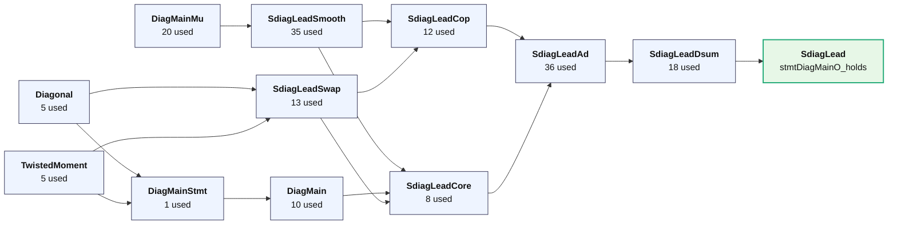

# What `SdiagLead.stmtDiagMainO_holds` rests on

[`SdiagLead.stmtDiagMainO_holds`](../lean_stage3/SdiagLead.md#SdiagLead-stmtDiagMainO_holds) in `lean_stage3/Stage3/SdiagLead.lean`, line 63.

**Why.** The main term, little-o: `ζ(1+α+β) S(α,β,0) = c₁(α,β) + o(1)`, given `StmtArith`.

**Proves**

```lean
StmtDiagMainO P θ R κ
```

**Needs** (its hypotheses)

  - `` P : Polynomial ℝ ``
  - `` hP0 : P.eval 0 = 0 ``
  - `` hθ0 : 0 < θ ``
  - `` hθ : θ < 1 / 2 ``
  - `` R : ℝ ``
  - `` hκ : 0 < κ ``
  - `` hA : StmtArith ``

Behind it: 118 theorems and 47 definitions in 12 files. Every one is listed below; Lean recorded each step.

## The files it passes through



An arrow A → B reads "B uses something proved or defined in A"; indirect arrows are left out. Green: the theorem itself. Yellow: a file in the other tree. The number is how many of that file's declarations are on the way.

## Every declaration on the way

Files in dependency order. ★ marks what the theorem's own proof uses directly.

### [`DiagMainMu`](../lean_stage3/DiagMainMu.md) — 20

- [`DiagMain.psiMu`](../lean_stage3/DiagMainMu.md#DiagMain-psiMu) — *def*
- [`DiagMain.mMu`](../lean_stage3/DiagMainMu.md#DiagMain-mMu) — *def*
- [`DiagMain.MMu`](../lean_stage3/DiagMainMu.md#DiagMain-MMu) — *def*
- [`DiagMain.sum_range_succ_eq_Ioc`](../lean_stage3/DiagMainMu.md#DiagMain-sum_range_succ_eq_Ioc) — `` ∑ n ∈ range (t + 1), g n = ∑ n ∈ Ioc 0 t, g n ``
- [`DiagMain.MMu_bound`](../lean_stage3/DiagMainMu.md#DiagMain-MMu_bound) — `` ∃ C : ℝ, 0 ≤ C ∧ ∀ t : ℕ, |MMu t| ≤ η * t + C ``
- [`DiagMain.mMu_tendsto`](../lean_stage3/DiagMainMu.md#DiagMain-mMu_tendsto) — `` Tendsto mMu atTop (𝓝 0) ``
- [`DiagMain.sum_divisors_mu`](../lean_stage3/DiagMainMu.md#DiagMain-sum_divisors_mu) — `` ∑ d ∈ n.divisors, (μ d : ℝ) = if n = 1 then 1 else 0 ``
- [`DiagMain.mobius_harmonic`](../lean_stage3/DiagMainMu.md#DiagMain-mobius_harmonic) — `` ∑ n ∈ Ioc 0 N, (μ n : ℝ) / n * (harmonic (N / n) : ℝ) = 1 ``
- [`DiagMain.div_bounds`](../lean_stage3/DiagMainMu.md#DiagMain-div_bounds) — `` ((N / n : ℕ) : ℝ) ≤ (N : ℝ) / n ∧ (N : ℝ) / n < ((N / n : ℕ) : ℝ) + 1 ``
- [`DiagMain.harmonic_mono`](../lean_stage3/DiagMainMu.md#DiagMain-harmonic_mono) — `` Monotone (fun k : ℕ => (harmonic k : ℝ)) ``
- [`DiagMain.one_le_harmonic`](../lean_stage3/DiagMainMu.md#DiagMain-one_le_harmonic) — `` (1 : ℝ) ≤ harmonic k ``
- [`DiagMain.gamma_nonneg`](../lean_stage3/DiagMainMu.md#DiagMain-gamma_nonneg) — `` 0 ≤ Real.eulerMascheroniConstant ``
- [`DiagMain.gamma_lt_one`](../lean_stage3/DiagMainMu.md#DiagMain-gamma_lt_one) — `` Real.eulerMascheroniConstant < 1 ``
- [`DiagMain.harm_log_bound`](../lean_stage3/DiagMainMu.md#DiagMain-harm_log_bound) — `` |Real.log ((N : ℝ) / n) + Real.eulerMascheroniConstant - harmonic (N / n)| ≤ 1 / ((N / n : ℕ) : ℝ) ``
- [`DiagMain.abel_ineq`](../lean_stage3/DiagMainMu.md#DiagMain-abel_ineq) — `` |∑ n ∈ Ioc a b, c n * f n| ≤ B * f (a + 1) ``
- [`DiagMain.rhoN`](../lean_stage3/DiagMainMu.md#DiagMain-rhoN) — *def*
- [`DiagMain.head_bound`](../lean_stage3/DiagMainMu.md#DiagMain-head_bound) — `` |∑ n ∈ Ioc 0 (N / Y), (μ n : ℝ) / n * rhoN N n| ≤ 2 / Y ``
- [`DiagMain.tail_bound`](../lean_stage3/DiagMainMu.md#DiagMain-tail_bound) — `` |∑ n ∈ Ioc (N / Y) N, (μ n : ℝ) / n * rhoN N n| ≤ B * ((Y : ℝ) / N) * (Real.log Y + harmonic Y) ``
- [`DiagMain.D_small`](../lean_stage3/DiagMainMu.md#DiagMain-D_small) — `` ∃ N₀ : ℕ, ∀ N : ℕ, N₀ ≤ N → |∑ n ∈ Ioc 0 N, (μ n : ℝ) / n * rhoN N n| ≤ ε ``
- [`DiagMain.psiMu_tendsto`](../lean_stage3/DiagMainMu.md#DiagMain-psiMu_tendsto) — `` Tendsto psiMu atTop (𝓝 1) ``

### [`Diagonal`](../lean_stage3/Diagonal.md) — 5

- [`Diagonal.Chk`](../lean_stage3/Diagonal.md#Diagonal-Chk) — *def*
- [`Diagonal.Rhk`](../lean_stage3/Diagonal.md#Diagonal-Rhk) — *def*
- [`Diagonal.Sdiag`](../lean_stage3/Diagonal.md#Diagonal-Sdiag) — *def*
- [`Diagonal.ncpow_mul`](../lean_stage3/Diagonal.md#Diagonal-ncpow_mul) — `` ((m * n : ℕ) : ℂ) ^ z = (m : ℂ) ^ z * (n : ℂ) ^ z ``
- [`Diagonal.norm_cpow_nat`](../lean_stage3/Diagonal.md#Diagonal-norm_cpow_nat) — `` ‖(n : ℂ) ^ z‖ = (n : ℝ) ^ z.re ``

### [`SdiagLeadSmooth`](../lean_stage3/SdiagLeadSmooth.md) — 35

- [`SdiagLead.Gp`](../lean_stage3/SdiagLeadSmooth.md#SdiagLead-Gp) — *def*
- [`SdiagLead.Gp_hasDerivAt`](../lean_stage3/SdiagLeadSmooth.md#SdiagLead-Gp_hasDerivAt) — `` HasDerivAt (Gp p β lM) (β * Gp p β lM u + (lM : ℂ)⁻¹ * Gp p.derivative β lM u) u ``
- [`SdiagLead.Gp_continuous`](../lean_stage3/SdiagLeadSmooth.md#SdiagLead-Gp_continuous) — `` Continuous (Gp p β lM) ``
- [`SdiagLead.G1`](../lean_stage3/SdiagLeadSmooth.md#SdiagLead-G1) — *def*
- [`SdiagLead.G2`](../lean_stage3/SdiagLeadSmooth.md#SdiagLead-G2) — *def*
- [`SdiagLead.G1_hasDerivAt`](../lean_stage3/SdiagLeadSmooth.md#SdiagLead-G1_hasDerivAt) — `` HasDerivAt (G1 P β lM) (G2 P β lM u) u ``
- [`SdiagLead.G2_continuous`](../lean_stage3/SdiagLeadSmooth.md#SdiagLead-G2_continuous) — `` Continuous (G2 P β lM) ``
- [`SdiagLead.Gp_zero`](../lean_stage3/SdiagLeadSmooth.md#SdiagLead-Gp_zero) — `` Gp P β lM 0 = 0 ``
- [`SdiagLead.hasDerivAt_logdiv`](../lean_stage3/SdiagLeadSmooth.md#SdiagLead-hasDerivAt_logdiv) — `` HasDerivAt (fun t : ℝ => Real.log (x / t)) (-s⁻¹) s ``
- [`SdiagLead.hasDerivAt_logdiv'`](../lean_stage3/SdiagLeadSmooth.md#SdiagLead-hasDerivAt_logdiv-) — `` HasDerivAt (fun t : ℝ => Real.log (t / n)) s⁻¹ s ``
- [`SdiagLead.kernel_continuousAt`](../lean_stage3/SdiagLeadSmooth.md#SdiagLead-kernel_continuousAt) — `` ContinuousAt (fun t : ℝ => max (Real.log (t / n)) 0 / t) s ``
- [`SdiagLead.G2comp_continuousAt`](../lean_stage3/SdiagLeadSmooth.md#SdiagLead-G2comp_continuousAt) — `` ContinuousAt (fun t : ℝ => G2 P β lM (Real.log (x / t))) s ``
- [`SdiagLead.Psi_div_continuousAt`](../lean_stage3/SdiagLeadSmooth.md#SdiagLead-Psi_div_continuousAt) — `` ContinuousAt (fun t => (∑ n ∈ Ioc 0 ⌊x⌋₊, c n * max (Real.log (t / n)) 0) / t) s ``
- [`SdiagLead.taylor_n`](../lean_stage3/SdiagLeadSmooth.md#SdiagLead-taylor_n) — `` ∫ s in (1 : ℝ)..x, G2 P β lM (Real.log (x / s)) * ((max (Real.log (s / n)) 0 / s : ℝ) : ℂ) = Gp P β lM (Real.log (x / n)) - (Real.log (x / n) : ℂ) * G1 P β lM 0 ``
- [`SdiagLead.Psi`](../lean_stage3/SdiagLeadSmooth.md#SdiagLead-Psi) — *def*
- [`SdiagLead.sum_taylor`](../lean_stage3/SdiagLeadSmooth.md#SdiagLead-sum_taylor) — `` ∑ n ∈ Ioc 0 ⌊x⌋₊, (c n : ℂ) * Gp P β lM (Real.log (x / n)) = G1 P β lM 0 * ((∑ n ∈ Ioc 0 ⌊x⌋₊, c n * Real.log (x / n) : ℝ) : ℂ) + ∫ s in (1 : ℝ)..x, G2 P β lM (… ``
- [`SdiagLead.ftc_G1`](../lean_stage3/SdiagLeadSmooth.md#SdiagLead-ftc_G1) — `` ∫ s in (1 : ℝ)..x, G2 P β lM (Real.log (x / s)) * ((1 / s : ℝ) : ℂ) = G1 P β lM (Real.log x) - G1 P β lM 0 ``
- [`SdiagLead.err_identity`](../lean_stage3/SdiagLeadSmooth.md#SdiagLead-err_identity) — `` ∑ n ∈ Ioc 0 ⌊x⌋₊, (c n : ℂ) * Gp P β lM (Real.log (x / n)) - G1 P β lM (Real.log x) = G1 P β lM 0 * ((∑ n ∈ Ioc 0 ⌊x⌋₊, c n * Real.log (x / n) - 1 : ℝ) : ℂ) + ∫… ``
- [`SdiagLead.Gp_bound`](../lean_stage3/SdiagLeadSmooth.md#SdiagLead-Gp_bound) — `` ∃ B : ℝ, 0 ≤ B ∧ ∀ (A : ℝ) (β : ℂ) (lM u : ℝ), 0 < lM → ‖β‖ * lM ≤ A → 0 ≤ u → u ≤ lM → ‖Gp p β lM u‖ ≤ Real.exp A * B ``
- [`SdiagLead.G2_bound`](../lean_stage3/SdiagLeadSmooth.md#SdiagLead-G2_bound) — `` ∃ K : ℝ, 0 ≤ K ∧ ∀ (β : ℂ) (lM u : ℝ), 0 < lM → ‖β‖ * lM ≤ A → 0 ≤ u → u ≤ lM → ‖G2 P β lM u‖ ≤ K / lM ^ 2 ``
- [`SdiagLead.int_piece`](../lean_stage3/SdiagLeadSmooth.md#SdiagLead-int_piece) — `` ‖∫ s in a..b, G2 P β lM (Real.log (x / s)) * (((Ψ s - 1) / s : ℝ) : ℂ)‖ ≤ K / lM ^ 2 * C * Real.log (b / a) ``
- [`SdiagLead.err_bound`](../lean_stage3/SdiagLeadSmooth.md#SdiagLead-err_bound) — `` ‖∑ n ∈ Ioc 0 ⌊x⌋₊, (c n : ℂ) * Gp P β lM (Real.log (x / n)) - G1 P β lM (Real.log x)‖ ≤ |(P.derivative.eval 0)| / lM * |∑ n ∈ Ioc 0 ⌊x⌋₊, c n * Real.log (x / n)… ``
- [`SdiagLead.psiR`](../lean_stage3/SdiagLeadSmooth.md#SdiagLead-psiR) — *def*
- [`SdiagLead.cmu`](../lean_stage3/SdiagLeadSmooth.md#SdiagLead-cmu) — *def*
- [`SdiagLead.Psi_eq`](../lean_stage3/SdiagLeadSmooth.md#SdiagLead-Psi_eq) — `` Psi cmu x s = psiR s ``
- [`SdiagLead.psiR_eq`](../lean_stage3/SdiagLeadSmooth.md#SdiagLead-psiR_eq) — `` psiR s = psiMu ⌊s⌋₊ + mMu ⌊s⌋₊ * Real.log (s / ⌊s⌋₊) ``
- [`SdiagLead.log_floor_le`](../lean_stage3/SdiagLeadSmooth.md#SdiagLead-log_floor_le) — `` 0 ≤ Real.log (s / ⌊s⌋₊) ∧ Real.log (s / ⌊s⌋₊) ≤ Real.log 2 ``
- [`SdiagLead.psiR_bdd`](../lean_stage3/SdiagLeadSmooth.md#SdiagLead-psiR_bdd) — `` ∃ B : ℝ, 0 ≤ B ∧ ∀ s : ℝ, 1 ≤ s → |psiR s - 1| ≤ B ``
- [`SdiagLead.psiR_tendsto`](../lean_stage3/SdiagLeadSmooth.md#SdiagLead-psiR_tendsto) — `` ∃ s₀ : ℝ, 1 ≤ s₀ ∧ ∀ s : ℝ, s₀ ≤ s → |psiR s - 1| ≤ ε ``
- [`SdiagLead.Smu`](../lean_stage3/SdiagLeadSmooth.md#SdiagLead-Smu) — *def*
- [`SdiagLead.mainS`](../lean_stage3/SdiagLeadSmooth.md#SdiagLead-mainS) — *def*
- [`SdiagLead.sum_cpow_eq`](../lean_stage3/SdiagLeadSmooth.md#SdiagLead-sum_cpow_eq) — `` Smu P lM x β - mainS P lM x β = cexp (-(β * Real.log x)) * (∑ n ∈ Ioc 0 ⌊x⌋₊, (cmu n : ℂ) * Gp P β lM (Real.log (x / n)) - G1 P β lM (Real.log x)) ``
- [`SdiagLead.norm_xpow_le`](../lean_stage3/SdiagLeadSmooth.md#SdiagLead-norm_xpow_le) — `` ‖cexp (-(β * Real.log x))‖ ≤ Real.exp A ``
- [`SdiagLead.muSmoothR`](../lean_stage3/SdiagLeadSmooth.md#SdiagLead-muSmoothR) — `` ∃ Y : ℝ, 1 ≤ Y ∧ ∃ L₀ : ℝ, 0 < L₀ ∧ ∀ lM : ℝ, L₀ ≤ lM → ∀ x : ℝ, Y ≤ x → Real.log x ≤ lM → ∀ β : ℂ, ‖β‖ * lM ≤ A → ‖Smu P lM x β - mainS P lM x β‖ ≤ ε / lM ``
- [`SdiagLead.muSmooth_crude`](../lean_stage3/SdiagLeadSmooth.md#SdiagLead-muSmooth_crude) — `` ∃ C : ℝ, 0 ≤ C ∧ ∀ lM : ℝ, 0 < lM → ∀ x : ℝ, 1 ≤ x → Real.log x ≤ lM → ∀ β : ℂ, ‖β‖ * lM ≤ A → ‖Smu P lM x β - mainS P lM x β‖ ≤ C / lM ``

### [`TwistedMoment`](../lean_stage3/TwistedMoment.md) — 5

- [`TwistedMoment.Mof`](../lean_stage3/TwistedMoment.md#TwistedMoment-Mof) — *def*
- [`TwistedMoment.sig0`](../lean_stage3/TwistedMoment.md#TwistedMoment-sig0) — *def*
- [`TwistedMoment.aY`](../lean_stage3/TwistedMoment.md#TwistedMoment-aY) — *def*
- [`TwistedMoment.c1Y`](../lean_stage3/TwistedMoment.md#TwistedMoment-c1Y) — *def*
- [`TwistedMoment.Regime`](../lean_stage3/TwistedMoment.md#TwistedMoment-Regime) — *def*

### [`DiagMainStmt`](../lean_stage3/DiagMainStmt.md) — 1

- ★ [`DiagMainStmt.StmtDiagMainO`](../lean_stage3/DiagMainStmt.md#DiagMainStmt-StmtDiagMainO) — *def*

### [`DiagMain`](../lean_stage3/DiagMain.md) — 10

- [`DiagMain.IY`](../lean_stage3/DiagMain.md#DiagMain-IY) — *def*
- [`DiagMain.c1Y_eq`](../lean_stage3/DiagMain.md#DiagMain-c1Y_eq) — `` c1Y P M α β = 1 / ((α + β) * Real.log M) * IY P M α β ``
- [`DiagMain.IY_bound`](../lean_stage3/DiagMain.md#DiagMain-IY_bound) — `` ∃ C : ℝ, 0 ≤ C ∧ ∀ (M : ℕ) (α β : ℂ), ‖α‖ * Real.log M ≤ A → ‖β‖ * Real.log M ≤ A → ‖IY P M α β‖ ≤ C ``
- [`DiagMain.zeta_taylor`](../lean_stage3/DiagMain.md#DiagMain-zeta_taylor) — `` ∃ C δ : ℝ, 0 ≤ C ∧ 0 < δ ∧ ∀ s : ℂ, ‖s‖ < δ → ‖riemannZeta (1 + s) - 1 / s‖ ≤ C ``
- [`DiagMain.logM_le`](../lean_stage3/DiagMain.md#DiagMain-logM_le) — `` Real.log (Mof T θ) ≤ θ * Real.log T ``
- [`DiagMain.logM_ge`](../lean_stage3/DiagMain.md#DiagMain-logM_ge) — `` θ * Real.log T / 2 ≤ Real.log (Mof T θ) ``
- [`DiagMain.key_bound`](../lean_stage3/DiagMain.md#DiagMain-key_bound) — `` ‖z * (I / lm + E) - 1 / (s * lm) * I‖ ≤ Cz * (CI / lm + e / L) + κ * e ``
- [`DiagMain.final_real`](../lean_stage3/DiagMain.md#DiagMain-final_real) — `` Cz * (CI / lm + e / L) + κ * e ≤ ε ``
- [`DiagMain.StmtSdiagLead`](../lean_stage3/DiagMain.md#DiagMain-StmtSdiagLead) — *def*
- ★ [`DiagMain.stmtDiagMainO_of_lead`](../lean_stage3/DiagMain.md#DiagMain-stmtDiagMainO_of_lead) — `` StmtDiagMainO P θ R κ ``

### [`SdiagLeadSwap`](../lean_stage3/SdiagLeadSwap.md) — 13

- [`SdiagLead.Pw`](../lean_stage3/SdiagLeadSwap.md#SdiagLead-Pw) — *def*
- [`SdiagLead.fw`](../lean_stage3/SdiagLeadSwap.md#SdiagLead-fw) — *def*
- [`SdiagLead.Jz`](../lean_stage3/SdiagLeadSwap.md#SdiagLead-Jz) — *def*
- [`SdiagLead.Ad`](../lean_stage3/SdiagLeadSwap.md#SdiagLead-Ad) — *def*
- [`SdiagLead.Jz_sum`](../lean_stage3/SdiagLeadSwap.md#SdiagLead-Jz_sum) — `` ∑ d ∈ n.divisors, Jz z d = (n : ℂ) ^ z ``
- [`SdiagLead.natcpow_ne`](../lean_stage3/SdiagLeadSwap.md#SdiagLead-natcpow_ne) — `` (n : ℂ) ≠ 0 ``
- [`SdiagLead.aY_mul`](../lean_stage3/SdiagLeadSwap.md#SdiagLead-aY_mul) — `` aY P T θ R h * (h : ℂ) ^ (-(sig0 T R : ℂ)) = ((μ h : ℤ) : ℂ) * ((Pw P (Mof T θ) h : ℝ) : ℂ) * (h : ℂ) ^ (-(1 / 2 : ℂ)) ``
- [`SdiagLead.conj_aY`](../lean_stage3/SdiagLeadSwap.md#SdiagLead-conj_aY) — `` (starRingEnd ℂ) (aY P T θ R h) = aY P T θ R h ``
- [`SdiagLead.term_eq`](../lean_stage3/SdiagLeadSwap.md#SdiagLead-term_eq) — `` Chk (aY P T θ R) (sig0 T R) h k * Rhk α β h k 0 = fw P (Mof T θ) β h * fw P (Mof T θ) α k * ((Nat.gcd h k : ℕ) : ℂ) ^ (1 + α + β) ``
- [`SdiagLead.gcd_swap`](../lean_stage3/SdiagLeadSwap.md#SdiagLead-gcd_swap) — `` ∑ h ∈ Icc 1 M, ∑ k ∈ Icc 1 M, F h * G k * ∑ d ∈ (Nat.gcd h k).divisors, J d = ∑ d ∈ Icc 1 M, J d * (∑ h ∈ (Icc 1 M).filter (d ∣ ·), F h) * (∑ k ∈ (Icc 1 M).filt… ``
- [`SdiagLead.sum_dvd_reindex`](../lean_stage3/SdiagLeadSwap.md#SdiagLead-sum_dvd_reindex) — `` ∑ h ∈ (Icc 1 M).filter (d ∣ ·), F h = ∑ n ∈ Icc 1 (M / d), F (d * n) ``
- [`SdiagLead.fw_mul`](../lean_stage3/SdiagLeadSwap.md#SdiagLead-fw_mul) — `` fw P M γ (d * n) = (d : ℂ) ^ (-(1 + γ)) * (((μ (d * n) : ℤ) : ℂ) * ((Pw P M (d * n) : ℝ) : ℂ) * (n : ℂ) ^ (-(1 + γ))) ``
- [`SdiagLead.Sdiag_swap`](../lean_stage3/SdiagLeadSwap.md#SdiagLead-Sdiag_swap) — `` Sdiag (Mof T θ) (aY P T θ R) (sig0 T R) α β 0 = ∑ d ∈ Icc 1 (Mof T θ), Jz (1 + α + β) d * (d : ℂ) ^ (-(2 + α + β)) * Ad P (Mof T θ) d β * Ad P (Mof T θ) d α ``

### [`SdiagLeadCop`](../lean_stage3/SdiagLeadCop.md) — 12

- [`SdiagLead.chiAF`](../lean_stage3/SdiagLeadCop.md#SdiagLead-chiAF) — *def*
- [`SdiagLead.copAF`](../lean_stage3/SdiagLeadCop.md#SdiagLead-copAF) — *def*
- [`SdiagLead.chiAF_apply`](../lean_stage3/SdiagLeadCop.md#SdiagLead-chiAF_apply) — `` chiAF d m = if m ≠ 0 ∧ m.primeFactors ⊆ d.primeFactors then 1 else 0 ``
- [`SdiagLead.copAF_apply`](../lean_stage3/SdiagLeadCop.md#SdiagLead-copAF_apply) — `` copAF d n = if n.Coprime d then μ n else 0 ``
- [`SdiagLead.chiAF_mult`](../lean_stage3/SdiagLeadCop.md#SdiagLead-chiAF_mult) — `` (chiAF d).IsMultiplicative ``
- [`SdiagLead.copAF_mult`](../lean_stage3/SdiagLeadCop.md#SdiagLead-copAF_mult) — `` (copAF d).IsMultiplicative ``
- [`SdiagLead.mu_mul_eq`](../lean_stage3/SdiagLeadCop.md#SdiagLead-mu_mul_eq) — `` μ (d * n) = μ d * copAF d n ``
- [`SdiagLead.chiAF_prime_pow`](../lean_stage3/SdiagLeadCop.md#SdiagLead-chiAF_prime_pow) — `` chiAF d (p ^ i) = if p ∣ d then 1 else 0 ``
- [`SdiagLead.mul_prime_pow`](../lean_stage3/SdiagLeadCop.md#SdiagLead-mul_prime_pow) — `` (f * g) (p ^ i) = ∑ j ∈ range (i + 1), f (p ^ j) * g (p ^ (i - j)) ``
- [`SdiagLead.copAF_eq`](../lean_stage3/SdiagLeadCop.md#SdiagLead-copAF_eq) — `` copAF d = chiAF d * μ ``
- [`SdiagLead.sum_conv_weight`](../lean_stage3/SdiagLeadCop.md#SdiagLead-sum_conv_weight) — `` ∑ n ∈ Ioc 0 N, (((f * g) n : ℤ) : ℂ) * w n = ∑ m ∈ Ioc 0 N, ((f m : ℤ) : ℂ) * ∑ k ∈ Ioc 0 (N / m), ((g k : ℤ) : ℂ) * w (m * k) ``
- [`SdiagLead.Ad_eq`](../lean_stage3/SdiagLeadCop.md#SdiagLead-Ad_eq) — `` Ad P M d γ = ((μ d : ℤ) : ℂ) * ∑ m ∈ Ioc 0 (M / d), ((chiAF d m : ℤ) : ℂ) * ((m : ℂ) ^ (-(1 + γ)) * Smu P (Real.log M) ((M : ℝ) / d / m) γ) ``

### [`SdiagLeadCore`](../lean_stage3/SdiagLeadCore.md) — 8

- [`SdiagLead.Wd`](../lean_stage3/SdiagLeadCore.md#SdiagLead-Wd) — *def*
- [`SdiagLead.sig`](../lean_stage3/SdiagLeadCore.md#SdiagLead-sig) — *def*
- [`SdiagLead.Ahat`](../lean_stage3/SdiagLeadCore.md#SdiagLead-Ahat) — *def*
- [`SdiagLead.S_eq`](../lean_stage3/SdiagLeadCore.md#SdiagLead-S_eq) — `` Sdiag (Mof T θ) (aY P T θ R) (sig0 T R) α β 0 = ∑ d ∈ Icc 1 (Mof T θ), Wd α β d * Ad P (Mof T θ) d β * Ad P (Mof T θ) d α ``
- [`SdiagLead.StmtAdApprox`](../lean_stage3/SdiagLeadCore.md#SdiagLead-StmtAdApprox) — *def*
- [`SdiagLead.StmtDsum`](../lean_stage3/SdiagLeadCore.md#SdiagLead-StmtDsum) — *def*
- [`SdiagLead.Mof_ge`](../lean_stage3/SdiagLeadCore.md#SdiagLead-Mof_ge) — `` N ≤ Mof T θ ``
- [`SdiagLead.stmtSdiagLead_of_steps`](../lean_stage3/SdiagLeadCore.md#SdiagLead-stmtSdiagLead_of_steps) — `` StmtSdiagLead P θ R κ ``

### [`SdiagLeadAd`](../lean_stage3/SdiagLeadAd.md) — 36

- [`SdiagLead.Sdm`](../lean_stage3/SdiagLeadAd.md#SdiagLead-Sdm) — *def*
- [`SdiagLead.Tl`](../lean_stage3/SdiagLeadAd.md#SdiagLead-Tl) — *def*
- [`SdiagLead.StmtSdmLe`](../lean_stage3/SdiagLeadAd.md#SdiagLead-StmtSdmLe) — *def*
- [`SdiagLead.StmtMeanSig3`](../lean_stage3/SdiagLeadAd.md#SdiagLead-StmtMeanSig3) — *def*
- [`SdiagLead.StmtTailFixed`](../lean_stage3/SdiagLeadAd.md#SdiagLead-StmtTailFixed) — *def*
- [`SdiagLead.StmtTailAvg`](../lean_stage3/SdiagLeadAd.md#SdiagLead-StmtTailAvg) — *def*
- [`SdiagLead.chi_cases`](../lean_stage3/SdiagLeadAd.md#SdiagLead-chi_cases) — `` ((chiAF d m : ℤ) : ℝ) = 0 ∨ ((chiAF d m : ℤ) : ℝ) = 1 ``
- [`SdiagLead.chi_nonneg`](../lean_stage3/SdiagLeadAd.md#SdiagLead-chi_nonneg) — `` 0 ≤ ((chiAF d m : ℤ) : ℝ) ``
- [`SdiagLead.chi_term_nonneg`](../lean_stage3/SdiagLeadAd.md#SdiagLead-chi_term_nonneg) — `` 0 ≤ ((chiAF d m : ℤ) : ℝ) / m ``
- [`SdiagLead.Sdm_mono`](../lean_stage3/SdiagLeadAd.md#SdiagLead-Sdm_mono) — `` Sdm d X ≤ Sdm d X' ``
- [`SdiagLead.Tl_nonneg`](../lean_stage3/SdiagLeadAd.md#SdiagLead-Tl_nonneg) — `` 0 ≤ Tl d X ``
- [`SdiagLead.Tl_anti`](../lean_stage3/SdiagLeadAd.md#SdiagLead-Tl_anti) — `` Tl d X' ≤ Tl d X ``
- [`SdiagLead.sum_above_le`](../lean_stage3/SdiagLeadAd.md#SdiagLead-sum_above_le) — `` ∑ m ∈ Ioc 0 N, (if m ≤ K then (0 : ℝ) else ((chiAF d m : ℤ) : ℝ) / m) ≤ Tl d K ``
- [`SdiagLead.norm_ncpow_le`](../lean_stage3/SdiagLeadAd.md#SdiagLead-norm_ncpow_le) — `` ‖(m : ℂ) ^ (-(1 + γ))‖ ≤ Real.exp A / m ``
- [`SdiagLead.norm_ncpow_sub_one_le`](../lean_stage3/SdiagLeadAd.md#SdiagLead-norm_ncpow_sub_one_le) — `` ‖(m : ℂ) ^ (-γ) - 1‖ ≤ ‖γ‖ * Real.log m * Real.exp A ``
- [`SdiagLead.poly_sup`](../lean_stage3/SdiagLeadAd.md#SdiagLead-poly_sup) — `` ∃ B : ℝ, 0 ≤ B ∧ ∀ u ∈ Set.Icc (0 : ℝ) 1, |p.eval u| ≤ B ``
- [`SdiagLead.poly_lip`](../lean_stage3/SdiagLeadAd.md#SdiagLead-poly_lip) — `` ∃ B : ℝ, 0 ≤ B ∧ ∀ u v : ℝ, 0 ≤ v → v ≤ u → u ≤ 1 → |p.eval u - p.eval v| ≤ B * (u - v) ``
- [`SdiagLead.ell_mem`](../lean_stage3/SdiagLeadAd.md#SdiagLead-ell_mem) — `` Real.log y / lM ∈ Set.Icc (0 : ℝ) 1 ``
- [`SdiagLead.mainS_bound`](../lean_stage3/SdiagLeadAd.md#SdiagLead-mainS_bound) — `` ∃ C : ℝ, 0 ≤ C ∧ ∀ lM : ℝ, 0 < lM → ∀ y : ℝ, 1 ≤ y → Real.log y ≤ lM → ∀ γ : ℂ, ‖γ‖ * lM ≤ A → ‖mainS P lM y γ‖ ≤ C / lM ``
- [`SdiagLead.mainS_shift`](../lean_stage3/SdiagLeadAd.md#SdiagLead-mainS_shift) — `` ∃ C : ℝ, 0 ≤ C ∧ ∀ lM : ℝ, 0 < lM → ∀ x : ℝ, ∀ m : ℕ, 1 ≤ m → (m : ℝ) ≤ x → Real.log x ≤ lM → ∀ γ : ℂ, ‖γ‖ * lM ≤ A → ‖(m : ℂ) ^ (-γ) * mainS P lM (x / m) γ - m… ``
- [`SdiagLead.Smu_bound`](../lean_stage3/SdiagLeadAd.md#SdiagLead-Smu_bound) — `` ∃ C : ℝ, 0 ≤ C ∧ ∀ lM : ℝ, 0 < lM → ∀ y : ℝ, 1 ≤ y → Real.log y ≤ lM → ∀ γ : ℂ, ‖γ‖ * lM ≤ A → ‖Smu P lM y γ‖ ≤ C / lM ``
- [`SdiagLead.sum_div_le_Sdm`](../lean_stage3/SdiagLeadAd.md#SdiagLead-sum_div_le_Sdm) — `` ∑ a ∈ d.divisors, (1 : ℝ) / a ≤ Sdm d d ``
- [`SdiagLead.Wd_bound`](../lean_stage3/SdiagLeadAd.md#SdiagLead-Wd_bound) — `` ‖Wd α β d‖ ≤ Real.exp (2 * A) * sig d / d ``
- [`SdiagLead.ad`](../lean_stage3/SdiagLeadAd.md#SdiagLead-ad) — *def*
- [`SdiagLead.ahat0`](../lean_stage3/SdiagLeadAd.md#SdiagLead-ahat0) — *def*
- [`SdiagLead.sig_nonneg`](../lean_stage3/SdiagLeadAd.md#SdiagLead-sig_nonneg) — `` 0 ≤ sig d ``
- [`SdiagLead.range_facts`](../lean_stage3/SdiagLeadAd.md#SdiagLead-range_facts) — `` 1 ≤ m ∧ m ≤ M ∧ (m : ℝ) ≤ (M : ℝ) / d ∧ 1 ≤ (M : ℝ) / d / m ∧ Real.log ((M : ℝ) / d / m) ≤ Real.log M ∧ Real.log ((M : ℝ) / d) ≤ Real.log M ∧ 1 ≤ (M : ℝ) / d ``
- [`SdiagLead.norm_chi_mul`](../lean_stage3/SdiagLeadAd.md#SdiagLead-norm_chi_mul) — `` ‖((chiAF d m : ℤ) : ℂ) * z‖ = ((chiAF d m : ℤ) : ℝ) * ‖z‖ ``
- [`SdiagLead.ad_bound`](../lean_stage3/SdiagLeadAd.md#SdiagLead-ad_bound) — `` ‖ad P M d γ‖ ≤ Real.exp A * C * sig d / Real.log M ``
- [`SdiagLead.ahat0_bound`](../lean_stage3/SdiagLeadAd.md#SdiagLead-ahat0_bound) — `` ‖ahat0 P M d γ‖ ≤ sig d * Cm / Real.log M ``
- [`SdiagLead.ad_err`](../lean_stage3/SdiagLeadAd.md#SdiagLead-ad_err) — `` ‖ad P M d γ - ahat0 P M d γ‖ ≤ (Real.exp A * ε * sig d + Cs * Real.log Z / Real.log M * sig d + Cs * Tl d Z + (Real.exp A * Cc + Cm) * Tl d (M / d / Y')) / Real… ``
- [`SdiagLead.AA_eq`](../lean_stage3/SdiagLeadAd.md#SdiagLead-AA_eq) — `` Ad P M d β * Ad P M d α - Ahat P M d β * Ahat P M d α = ((μ d : ℤ) : ℂ) ^ 2 * (ad P M d β * ad P M d α - ahat0 P M d β * ahat0 P M d α) ``
- [`SdiagLead.norm_mu_sq`](../lean_stage3/SdiagLeadAd.md#SdiagLead-norm_mu_sq) — `` ‖((μ d : ℤ) : ℂ) ^ 2 * z‖ = ((μ d : ℤ) : ℝ) ^ 2 * ‖z‖ ``
- [`SdiagLead.perd_bound`](../lean_stage3/SdiagLeadAd.md#SdiagLead-perd_bound) — `` ‖Wd α β d‖ * ‖Ad P M d β * Ad P M d α - Ahat P M d β * Ahat P M d α‖ ≤ 2 * Real.exp (2 * A) * (Real.exp A * CS + Cm + 1) / Real.log M ^ 2 * (((μ d : ℤ) : ℝ) ^ 2… ``
- [`SdiagLead.final_arith`](../lean_stage3/SdiagLeadAd.md#SdiagLead-final_arith) — `` K₀ / lM ^ 2 * ((Real.exp A * ε + Cs * lZ / lM) * S2 + Cs * S3 + C7 * S4) ≤ εt / lM ``
- [`SdiagLead.stmtAdApprox_of_arith`](../lean_stage3/SdiagLeadAd.md#SdiagLead-stmtAdApprox_of_arith) — `` StmtAdApprox P A ``

### [`SdiagLeadDsum`](../lean_stage3/SdiagLeadDsum.md) — 18

- [`SdiagLead.gmu`](../lean_stage3/SdiagLeadDsum.md#SdiagLead-gmu) — *def*
- [`SdiagLead.StmtGmuLog`](../lean_stage3/SdiagLeadDsum.md#SdiagLead-StmtGmuLog) — *def*
- [`SdiagLead.StmtDivLog`](../lean_stage3/SdiagLeadDsum.md#SdiagLead-StmtDivLog) — *def*
- [`SdiagLead.Wd_eq`](../lean_stage3/SdiagLeadDsum.md#SdiagLead-Wd_eq) — `` Wd α β d = (1 / (d : ℂ)) * ∑ a ∈ d.divisors, ((μ a : ℤ) : ℂ) * (a : ℂ) ^ (-(1 + α + β)) ``
- [`SdiagLead.sum_mu_div`](../lean_stage3/SdiagLeadDsum.md#SdiagLead-sum_mu_div) — `` ∑ a ∈ d.divisors, ((μ a : ℤ) : ℝ) / a = (Nat.totient d : ℝ) / d ``
- [`SdiagLead.totient_pos'`](../lean_stage3/SdiagLeadDsum.md#SdiagLead-totient_pos-) — `` (0 : ℝ) < Nat.totient d ``
- [`SdiagLead.weight_err`](../lean_stage3/SdiagLeadDsum.md#SdiagLead-weight_err) — `` ‖((((μ d : ℤ) : ℝ) ^ 2 * sig d ^ 2 : ℝ) : ℂ) * Wd α β d - ((gmu d : ℝ) : ℂ)‖ ≤ ((μ d : ℤ) : ℝ) ^ 2 * sig d ^ 2 / d * (2 * A * Real.exp (2 * A) / Real.log M) * ∑… ``
- [`SdiagLead.f_hasDerivAt`](../lean_stage3/SdiagLeadDsum.md#SdiagLead-f_hasDerivAt) — `` HasDerivAt (fun t => Q (Real.log (Mr / t) / lM)) (((-t⁻¹ / lM : ℝ) : ℂ) * Q' (Real.log (Mr / t) / lM)) t ``
- [`SdiagLead.int_f_div`](../lean_stage3/SdiagLeadDsum.md#SdiagLead-int_f_div) — `` ∫ t in (1 : ℝ)..Mr, Q (Real.log (Mr / t) / Real.log Mr) * ((t⁻¹ : ℝ) : ℂ) = (Real.log Mr : ℂ) * ∫ u in (0 : ℝ)..1, Q u ``
- [`SdiagLead.int_fprime_log`](../lean_stage3/SdiagLeadDsum.md#SdiagLead-int_fprime_log) — `` ∫ t in (1 : ℝ)..Mr, ((-t⁻¹ / Real.log Mr : ℝ) : ℂ) * Q' (Real.log (Mr / t) / Real.log Mr) * (Real.log t : ℂ) = Q 0 * Real.log Mr - (Real.log Mr : ℂ) * ∫ u in (0… ``
- [`SdiagLead.abel_main`](../lean_stage3/SdiagLeadDsum.md#SdiagLead-abel_main) — `` ∃ CR : ℝ, 0 ≤ CR ∧ ∀ M : ℕ, 2 ≤ M → ∀ Q Q' : ℝ → ℂ, (∀ u, HasDerivAt Q (Q' u) u) → Continuous Q' → ∀ B B' : ℝ, ‖Q 0‖ ≤ B → (∀ u ∈ Set.Icc (0 : ℝ) 1, ‖Q' u‖ ≤ B'… ``
- [`SdiagLead.Fg`](../lean_stage3/SdiagLeadDsum.md#SdiagLead-Fg) — *def*
- [`SdiagLead.Fg_hasDerivAt`](../lean_stage3/SdiagLeadDsum.md#SdiagLead-Fg_hasDerivAt) — `` HasDerivAt (Fg P lM γ) (Fg P.derivative lM γ u) u ``
- [`SdiagLead.Fg_continuous`](../lean_stage3/SdiagLeadDsum.md#SdiagLead-Fg_continuous) — `` Continuous (Fg P lM γ) ``
- [`SdiagLead.Fg_bound`](../lean_stage3/SdiagLeadDsum.md#SdiagLead-Fg_bound) — `` ‖Fg P lM γ u‖ ≤ B1 + A * B0 ``
- [`SdiagLead.mainS_eq_Fg`](../lean_stage3/SdiagLeadDsum.md#SdiagLead-mainS_eq_Fg) — `` mainS P lM x γ = Fg P lM γ (Real.log x / lM) / (lM : ℂ) ``
- [`SdiagLead.dsum_sum0`](../lean_stage3/SdiagLeadDsum.md#SdiagLead-dsum_sum0) — `` ∑ k ∈ Icc 0 M, (Fg P (Real.log M) β (Real.log ((M : ℝ) / k) / Real.log M) * Fg P (Real.log M) α (Real.log ((M : ℝ) / k) / Real.log M)) * ((gmu k : ℝ) : ℂ) = (Re… ``
- [`SdiagLead.stmtDsum_of_arith`](../lean_stage3/SdiagLeadDsum.md#SdiagLead-stmtDsum_of_arith) — `` StmtDsum P A ``

### [`SdiagLead`](../lean_stage3/SdiagLead.md) — 2

- ★ [`SdiagLead.StmtArith`](../lean_stage3/SdiagLead.md#SdiagLead-StmtArith) — *def*
- ★ [`SdiagLead.stmtSdiagLead_holds`](../lean_stage3/SdiagLead.md#SdiagLead-stmtSdiagLead_holds) — `` StmtSdiagLead P θ R κ ``

