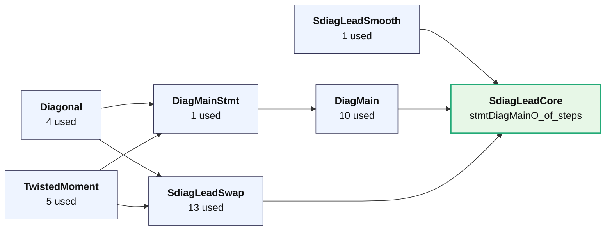

# What `SdiagLead.stmtDiagMainO_of_steps` rests on

[`SdiagLead.stmtDiagMainO_of_steps`](../lean_stage3/SdiagLeadCore.md#SdiagLead-stmtDiagMainO_of_steps) in `lean_stage3/Stage3/SdiagLeadCore.lean`, line 167.

**Why.** The corollary through the Taylor step: (2) and (3) give `StmtDiagMainO`.

**Proves**

```lean
StmtDiagMainO P θ R κ
```

**Needs** (its hypotheses)

  - `` P : Polynomial ℝ ``
  - `` hθ0 : 0 < θ ``
  - `` R : ℝ ``
  - `` hκ : 0 < κ ``
  - `` h2 : StmtAdApprox P (κ * θ) ``
  - `` h3 : StmtDsum P (κ * θ) ``

Behind it: 21 theorems and 21 definitions in 7 files. Every one is listed below; Lean recorded each step.

## The files it passes through



An arrow A → B reads "B uses something proved or defined in A"; indirect arrows are left out. Green: the theorem itself. Yellow: a file in the other tree. The number is how many of that file's declarations are on the way.

## Every declaration on the way

Files in dependency order. ★ marks what the theorem's own proof uses directly.

### [`Diagonal`](../lean_stage3/Diagonal.md) — 4

- [`Diagonal.Chk`](../lean_stage3/Diagonal.md#Diagonal-Chk) — *def*
- [`Diagonal.Rhk`](../lean_stage3/Diagonal.md#Diagonal-Rhk) — *def*
- [`Diagonal.Sdiag`](../lean_stage3/Diagonal.md#Diagonal-Sdiag) — *def*
- [`Diagonal.ncpow_mul`](../lean_stage3/Diagonal.md#Diagonal-ncpow_mul) — `` ((m * n : ℕ) : ℂ) ^ z = (m : ℂ) ^ z * (n : ℂ) ^ z ``

### [`SdiagLeadSmooth`](../lean_stage3/SdiagLeadSmooth.md) — 1

- [`SdiagLead.mainS`](../lean_stage3/SdiagLeadSmooth.md#SdiagLead-mainS) — *def*

### [`TwistedMoment`](../lean_stage3/TwistedMoment.md) — 5

- [`TwistedMoment.Mof`](../lean_stage3/TwistedMoment.md#TwistedMoment-Mof) — *def*
- [`TwistedMoment.sig0`](../lean_stage3/TwistedMoment.md#TwistedMoment-sig0) — *def*
- [`TwistedMoment.aY`](../lean_stage3/TwistedMoment.md#TwistedMoment-aY) — *def*
- [`TwistedMoment.c1Y`](../lean_stage3/TwistedMoment.md#TwistedMoment-c1Y) — *def*
- [`TwistedMoment.Regime`](../lean_stage3/TwistedMoment.md#TwistedMoment-Regime) — *def*

### [`DiagMainStmt`](../lean_stage3/DiagMainStmt.md) — 1

- ★ [`DiagMainStmt.StmtDiagMainO`](../lean_stage3/DiagMainStmt.md#DiagMainStmt-StmtDiagMainO) — *def*

### [`DiagMain`](../lean_stage3/DiagMain.md) — 10

- [`DiagMain.IY`](../lean_stage3/DiagMain.md#DiagMain-IY) — *def*
- [`DiagMain.c1Y_eq`](../lean_stage3/DiagMain.md#DiagMain-c1Y_eq) — `` c1Y P M α β = 1 / ((α + β) * Real.log M) * IY P M α β ``
- [`DiagMain.IY_bound`](../lean_stage3/DiagMain.md#DiagMain-IY_bound) — `` ∃ C : ℝ, 0 ≤ C ∧ ∀ (M : ℕ) (α β : ℂ), ‖α‖ * Real.log M ≤ A → ‖β‖ * Real.log M ≤ A → ‖IY P M α β‖ ≤ C ``
- [`DiagMain.zeta_taylor`](../lean_stage3/DiagMain.md#DiagMain-zeta_taylor) — `` ∃ C δ : ℝ, 0 ≤ C ∧ 0 < δ ∧ ∀ s : ℂ, ‖s‖ < δ → ‖riemannZeta (1 + s) - 1 / s‖ ≤ C ``
- [`DiagMain.logM_le`](../lean_stage3/DiagMain.md#DiagMain-logM_le) — `` Real.log (Mof T θ) ≤ θ * Real.log T ``
- [`DiagMain.logM_ge`](../lean_stage3/DiagMain.md#DiagMain-logM_ge) — `` θ * Real.log T / 2 ≤ Real.log (Mof T θ) ``
- [`DiagMain.key_bound`](../lean_stage3/DiagMain.md#DiagMain-key_bound) — `` ‖z * (I / lm + E) - 1 / (s * lm) * I‖ ≤ Cz * (CI / lm + e / L) + κ * e ``
- [`DiagMain.final_real`](../lean_stage3/DiagMain.md#DiagMain-final_real) — `` Cz * (CI / lm + e / L) + κ * e ≤ ε ``
- [`DiagMain.StmtSdiagLead`](../lean_stage3/DiagMain.md#DiagMain-StmtSdiagLead) — *def*
- ★ [`DiagMain.stmtDiagMainO_of_lead`](../lean_stage3/DiagMain.md#DiagMain-stmtDiagMainO_of_lead) — `` StmtDiagMainO P θ R κ ``

### [`SdiagLeadSwap`](../lean_stage3/SdiagLeadSwap.md) — 13

- [`SdiagLead.Pw`](../lean_stage3/SdiagLeadSwap.md#SdiagLead-Pw) — *def*
- [`SdiagLead.fw`](../lean_stage3/SdiagLeadSwap.md#SdiagLead-fw) — *def*
- [`SdiagLead.Jz`](../lean_stage3/SdiagLeadSwap.md#SdiagLead-Jz) — *def*
- [`SdiagLead.Ad`](../lean_stage3/SdiagLeadSwap.md#SdiagLead-Ad) — *def*
- [`SdiagLead.Jz_sum`](../lean_stage3/SdiagLeadSwap.md#SdiagLead-Jz_sum) — `` ∑ d ∈ n.divisors, Jz z d = (n : ℂ) ^ z ``
- [`SdiagLead.natcpow_ne`](../lean_stage3/SdiagLeadSwap.md#SdiagLead-natcpow_ne) — `` (n : ℂ) ≠ 0 ``
- [`SdiagLead.aY_mul`](../lean_stage3/SdiagLeadSwap.md#SdiagLead-aY_mul) — `` aY P T θ R h * (h : ℂ) ^ (-(sig0 T R : ℂ)) = ((μ h : ℤ) : ℂ) * ((Pw P (Mof T θ) h : ℝ) : ℂ) * (h : ℂ) ^ (-(1 / 2 : ℂ)) ``
- [`SdiagLead.conj_aY`](../lean_stage3/SdiagLeadSwap.md#SdiagLead-conj_aY) — `` (starRingEnd ℂ) (aY P T θ R h) = aY P T θ R h ``
- [`SdiagLead.term_eq`](../lean_stage3/SdiagLeadSwap.md#SdiagLead-term_eq) — `` Chk (aY P T θ R) (sig0 T R) h k * Rhk α β h k 0 = fw P (Mof T θ) β h * fw P (Mof T θ) α k * ((Nat.gcd h k : ℕ) : ℂ) ^ (1 + α + β) ``
- [`SdiagLead.gcd_swap`](../lean_stage3/SdiagLeadSwap.md#SdiagLead-gcd_swap) — `` ∑ h ∈ Icc 1 M, ∑ k ∈ Icc 1 M, F h * G k * ∑ d ∈ (Nat.gcd h k).divisors, J d = ∑ d ∈ Icc 1 M, J d * (∑ h ∈ (Icc 1 M).filter (d ∣ ·), F h) * (∑ k ∈ (Icc 1 M).filt… ``
- [`SdiagLead.sum_dvd_reindex`](../lean_stage3/SdiagLeadSwap.md#SdiagLead-sum_dvd_reindex) — `` ∑ h ∈ (Icc 1 M).filter (d ∣ ·), F h = ∑ n ∈ Icc 1 (M / d), F (d * n) ``
- [`SdiagLead.fw_mul`](../lean_stage3/SdiagLeadSwap.md#SdiagLead-fw_mul) — `` fw P M γ (d * n) = (d : ℂ) ^ (-(1 + γ)) * (((μ (d * n) : ℤ) : ℂ) * ((Pw P M (d * n) : ℝ) : ℂ) * (n : ℂ) ^ (-(1 + γ))) ``
- [`SdiagLead.Sdiag_swap`](../lean_stage3/SdiagLeadSwap.md#SdiagLead-Sdiag_swap) — `` Sdiag (Mof T θ) (aY P T θ R) (sig0 T R) α β 0 = ∑ d ∈ Icc 1 (Mof T θ), Jz (1 + α + β) d * (d : ℂ) ^ (-(2 + α + β)) * Ad P (Mof T θ) d β * Ad P (Mof T θ) d α ``

### [`SdiagLeadCore`](../lean_stage3/SdiagLeadCore.md) — 8

- [`SdiagLead.Wd`](../lean_stage3/SdiagLeadCore.md#SdiagLead-Wd) — *def*
- [`SdiagLead.sig`](../lean_stage3/SdiagLeadCore.md#SdiagLead-sig) — *def*
- [`SdiagLead.Ahat`](../lean_stage3/SdiagLeadCore.md#SdiagLead-Ahat) — *def*
- [`SdiagLead.S_eq`](../lean_stage3/SdiagLeadCore.md#SdiagLead-S_eq) — `` Sdiag (Mof T θ) (aY P T θ R) (sig0 T R) α β 0 = ∑ d ∈ Icc 1 (Mof T θ), Wd α β d * Ad P (Mof T θ) d β * Ad P (Mof T θ) d α ``
- ★ [`SdiagLead.StmtAdApprox`](../lean_stage3/SdiagLeadCore.md#SdiagLead-StmtAdApprox) — *def*
- ★ [`SdiagLead.StmtDsum`](../lean_stage3/SdiagLeadCore.md#SdiagLead-StmtDsum) — *def*
- [`SdiagLead.Mof_ge`](../lean_stage3/SdiagLeadCore.md#SdiagLead-Mof_ge) — `` N ≤ Mof T θ ``
- ★ [`SdiagLead.stmtSdiagLead_of_steps`](../lean_stage3/SdiagLeadCore.md#SdiagLead-stmtSdiagLead_of_steps) — `` StmtSdiagLead P θ R κ ``

