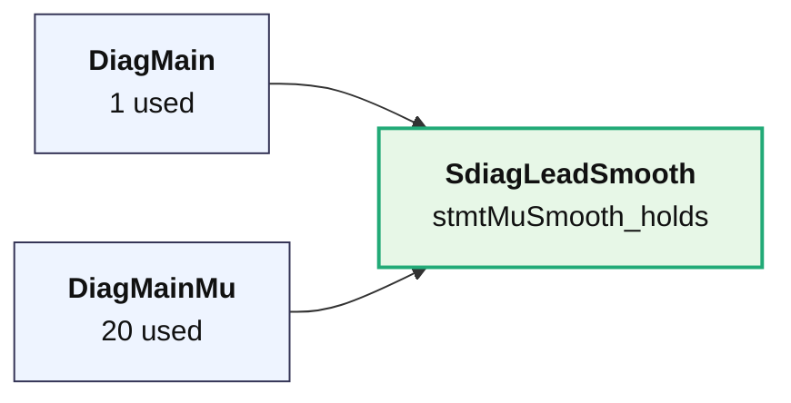

# What `SdiagLead.stmtMuSmooth_holds` rests on

[`SdiagLead.stmtMuSmooth_holds`](../lean_stage3/SdiagLeadSmooth.md#SdiagLead-stmtMuSmooth_holds) in `lean_stage3/Stage3/SdiagLeadSmooth.lean`, line 703.

**Why.** `DiagMain.StmtMuSmooth` holds (the `d = 1` per-`d` step, natural `x`).

**Proves**

```lean
StmtMuSmooth P κ
```

**Needs** (its hypotheses)

  - `` P : Polynomial ℝ ``
  - `` κ : ℝ ``

Behind it: 42 theorems and 13 definitions in 3 files. Every one is listed below; Lean recorded each step.

## The files it passes through



An arrow A → B reads "B uses something proved or defined in A"; indirect arrows are left out. Green: the theorem itself. Yellow: a file in the other tree. The number is how many of that file's declarations are on the way.

## Every declaration on the way

Files in dependency order. ★ marks what the theorem's own proof uses directly.

### [`DiagMain`](../lean_stage3/DiagMain.md) — 1

- ★ [`DiagMain.StmtMuSmooth`](../lean_stage3/DiagMain.md#DiagMain-StmtMuSmooth) — *def*

### [`DiagMainMu`](../lean_stage3/DiagMainMu.md) — 20

- [`DiagMain.psiMu`](../lean_stage3/DiagMainMu.md#DiagMain-psiMu) — *def*
- [`DiagMain.mMu`](../lean_stage3/DiagMainMu.md#DiagMain-mMu) — *def*
- [`DiagMain.MMu`](../lean_stage3/DiagMainMu.md#DiagMain-MMu) — *def*
- [`DiagMain.sum_range_succ_eq_Ioc`](../lean_stage3/DiagMainMu.md#DiagMain-sum_range_succ_eq_Ioc) — `` ∑ n ∈ range (t + 1), g n = ∑ n ∈ Ioc 0 t, g n ``
- [`DiagMain.MMu_bound`](../lean_stage3/DiagMainMu.md#DiagMain-MMu_bound) — `` ∃ C : ℝ, 0 ≤ C ∧ ∀ t : ℕ, |MMu t| ≤ η * t + C ``
- [`DiagMain.mMu_tendsto`](../lean_stage3/DiagMainMu.md#DiagMain-mMu_tendsto) — `` Tendsto mMu atTop (𝓝 0) ``
- [`DiagMain.sum_divisors_mu`](../lean_stage3/DiagMainMu.md#DiagMain-sum_divisors_mu) — `` ∑ d ∈ n.divisors, (μ d : ℝ) = if n = 1 then 1 else 0 ``
- [`DiagMain.mobius_harmonic`](../lean_stage3/DiagMainMu.md#DiagMain-mobius_harmonic) — `` ∑ n ∈ Ioc 0 N, (μ n : ℝ) / n * (harmonic (N / n) : ℝ) = 1 ``
- [`DiagMain.div_bounds`](../lean_stage3/DiagMainMu.md#DiagMain-div_bounds) — `` ((N / n : ℕ) : ℝ) ≤ (N : ℝ) / n ∧ (N : ℝ) / n < ((N / n : ℕ) : ℝ) + 1 ``
- [`DiagMain.harmonic_mono`](../lean_stage3/DiagMainMu.md#DiagMain-harmonic_mono) — `` Monotone (fun k : ℕ => (harmonic k : ℝ)) ``
- [`DiagMain.one_le_harmonic`](../lean_stage3/DiagMainMu.md#DiagMain-one_le_harmonic) — `` (1 : ℝ) ≤ harmonic k ``
- [`DiagMain.gamma_nonneg`](../lean_stage3/DiagMainMu.md#DiagMain-gamma_nonneg) — `` 0 ≤ Real.eulerMascheroniConstant ``
- [`DiagMain.gamma_lt_one`](../lean_stage3/DiagMainMu.md#DiagMain-gamma_lt_one) — `` Real.eulerMascheroniConstant < 1 ``
- [`DiagMain.harm_log_bound`](../lean_stage3/DiagMainMu.md#DiagMain-harm_log_bound) — `` |Real.log ((N : ℝ) / n) + Real.eulerMascheroniConstant - harmonic (N / n)| ≤ 1 / ((N / n : ℕ) : ℝ) ``
- [`DiagMain.abel_ineq`](../lean_stage3/DiagMainMu.md#DiagMain-abel_ineq) — `` |∑ n ∈ Ioc a b, c n * f n| ≤ B * f (a + 1) ``
- [`DiagMain.rhoN`](../lean_stage3/DiagMainMu.md#DiagMain-rhoN) — *def*
- [`DiagMain.head_bound`](../lean_stage3/DiagMainMu.md#DiagMain-head_bound) — `` |∑ n ∈ Ioc 0 (N / Y), (μ n : ℝ) / n * rhoN N n| ≤ 2 / Y ``
- [`DiagMain.tail_bound`](../lean_stage3/DiagMainMu.md#DiagMain-tail_bound) — `` |∑ n ∈ Ioc (N / Y) N, (μ n : ℝ) / n * rhoN N n| ≤ B * ((Y : ℝ) / N) * (Real.log Y + harmonic Y) ``
- [`DiagMain.D_small`](../lean_stage3/DiagMainMu.md#DiagMain-D_small) — `` ∃ N₀ : ℕ, ∀ N : ℕ, N₀ ≤ N → |∑ n ∈ Ioc 0 N, (μ n : ℝ) / n * rhoN N n| ≤ ε ``
- [`DiagMain.psiMu_tendsto`](../lean_stage3/DiagMainMu.md#DiagMain-psiMu_tendsto) — `` Tendsto psiMu atTop (𝓝 1) ``

### [`SdiagLeadSmooth`](../lean_stage3/SdiagLeadSmooth.md) — 34

- [`SdiagLead.Gp`](../lean_stage3/SdiagLeadSmooth.md#SdiagLead-Gp) — *def*
- [`SdiagLead.Gp_hasDerivAt`](../lean_stage3/SdiagLeadSmooth.md#SdiagLead-Gp_hasDerivAt) — `` HasDerivAt (Gp p β lM) (β * Gp p β lM u + (lM : ℂ)⁻¹ * Gp p.derivative β lM u) u ``
- [`SdiagLead.Gp_continuous`](../lean_stage3/SdiagLeadSmooth.md#SdiagLead-Gp_continuous) — `` Continuous (Gp p β lM) ``
- [`SdiagLead.G1`](../lean_stage3/SdiagLeadSmooth.md#SdiagLead-G1) — *def*
- [`SdiagLead.G2`](../lean_stage3/SdiagLeadSmooth.md#SdiagLead-G2) — *def*
- [`SdiagLead.G1_hasDerivAt`](../lean_stage3/SdiagLeadSmooth.md#SdiagLead-G1_hasDerivAt) — `` HasDerivAt (G1 P β lM) (G2 P β lM u) u ``
- [`SdiagLead.G2_continuous`](../lean_stage3/SdiagLeadSmooth.md#SdiagLead-G2_continuous) — `` Continuous (G2 P β lM) ``
- [`SdiagLead.Gp_zero`](../lean_stage3/SdiagLeadSmooth.md#SdiagLead-Gp_zero) — `` Gp P β lM 0 = 0 ``
- [`SdiagLead.hasDerivAt_logdiv`](../lean_stage3/SdiagLeadSmooth.md#SdiagLead-hasDerivAt_logdiv) — `` HasDerivAt (fun t : ℝ => Real.log (x / t)) (-s⁻¹) s ``
- [`SdiagLead.hasDerivAt_logdiv'`](../lean_stage3/SdiagLeadSmooth.md#SdiagLead-hasDerivAt_logdiv-) — `` HasDerivAt (fun t : ℝ => Real.log (t / n)) s⁻¹ s ``
- [`SdiagLead.kernel_continuousAt`](../lean_stage3/SdiagLeadSmooth.md#SdiagLead-kernel_continuousAt) — `` ContinuousAt (fun t : ℝ => max (Real.log (t / n)) 0 / t) s ``
- [`SdiagLead.G2comp_continuousAt`](../lean_stage3/SdiagLeadSmooth.md#SdiagLead-G2comp_continuousAt) — `` ContinuousAt (fun t : ℝ => G2 P β lM (Real.log (x / t))) s ``
- [`SdiagLead.Psi_div_continuousAt`](../lean_stage3/SdiagLeadSmooth.md#SdiagLead-Psi_div_continuousAt) — `` ContinuousAt (fun t => (∑ n ∈ Ioc 0 ⌊x⌋₊, c n * max (Real.log (t / n)) 0) / t) s ``
- [`SdiagLead.taylor_n`](../lean_stage3/SdiagLeadSmooth.md#SdiagLead-taylor_n) — `` ∫ s in (1 : ℝ)..x, G2 P β lM (Real.log (x / s)) * ((max (Real.log (s / n)) 0 / s : ℝ) : ℂ) = Gp P β lM (Real.log (x / n)) - (Real.log (x / n) : ℂ) * G1 P β lM 0 ``
- [`SdiagLead.Psi`](../lean_stage3/SdiagLeadSmooth.md#SdiagLead-Psi) — *def*
- [`SdiagLead.sum_taylor`](../lean_stage3/SdiagLeadSmooth.md#SdiagLead-sum_taylor) — `` ∑ n ∈ Ioc 0 ⌊x⌋₊, (c n : ℂ) * Gp P β lM (Real.log (x / n)) = G1 P β lM 0 * ((∑ n ∈ Ioc 0 ⌊x⌋₊, c n * Real.log (x / n) : ℝ) : ℂ) + ∫ s in (1 : ℝ)..x, G2 P β lM (… ``
- [`SdiagLead.ftc_G1`](../lean_stage3/SdiagLeadSmooth.md#SdiagLead-ftc_G1) — `` ∫ s in (1 : ℝ)..x, G2 P β lM (Real.log (x / s)) * ((1 / s : ℝ) : ℂ) = G1 P β lM (Real.log x) - G1 P β lM 0 ``
- [`SdiagLead.err_identity`](../lean_stage3/SdiagLeadSmooth.md#SdiagLead-err_identity) — `` ∑ n ∈ Ioc 0 ⌊x⌋₊, (c n : ℂ) * Gp P β lM (Real.log (x / n)) - G1 P β lM (Real.log x) = G1 P β lM 0 * ((∑ n ∈ Ioc 0 ⌊x⌋₊, c n * Real.log (x / n) - 1 : ℝ) : ℂ) + ∫… ``
- [`SdiagLead.Gp_bound`](../lean_stage3/SdiagLeadSmooth.md#SdiagLead-Gp_bound) — `` ∃ B : ℝ, 0 ≤ B ∧ ∀ (A : ℝ) (β : ℂ) (lM u : ℝ), 0 < lM → ‖β‖ * lM ≤ A → 0 ≤ u → u ≤ lM → ‖Gp p β lM u‖ ≤ Real.exp A * B ``
- [`SdiagLead.G2_bound`](../lean_stage3/SdiagLeadSmooth.md#SdiagLead-G2_bound) — `` ∃ K : ℝ, 0 ≤ K ∧ ∀ (β : ℂ) (lM u : ℝ), 0 < lM → ‖β‖ * lM ≤ A → 0 ≤ u → u ≤ lM → ‖G2 P β lM u‖ ≤ K / lM ^ 2 ``
- [`SdiagLead.int_piece`](../lean_stage3/SdiagLeadSmooth.md#SdiagLead-int_piece) — `` ‖∫ s in a..b, G2 P β lM (Real.log (x / s)) * (((Ψ s - 1) / s : ℝ) : ℂ)‖ ≤ K / lM ^ 2 * C * Real.log (b / a) ``
- [`SdiagLead.err_bound`](../lean_stage3/SdiagLeadSmooth.md#SdiagLead-err_bound) — `` ‖∑ n ∈ Ioc 0 ⌊x⌋₊, (c n : ℂ) * Gp P β lM (Real.log (x / n)) - G1 P β lM (Real.log x)‖ ≤ |(P.derivative.eval 0)| / lM * |∑ n ∈ Ioc 0 ⌊x⌋₊, c n * Real.log (x / n)… ``
- [`SdiagLead.psiR`](../lean_stage3/SdiagLeadSmooth.md#SdiagLead-psiR) — *def*
- [`SdiagLead.cmu`](../lean_stage3/SdiagLeadSmooth.md#SdiagLead-cmu) — *def*
- [`SdiagLead.Psi_eq`](../lean_stage3/SdiagLeadSmooth.md#SdiagLead-Psi_eq) — `` Psi cmu x s = psiR s ``
- [`SdiagLead.psiR_eq`](../lean_stage3/SdiagLeadSmooth.md#SdiagLead-psiR_eq) — `` psiR s = psiMu ⌊s⌋₊ + mMu ⌊s⌋₊ * Real.log (s / ⌊s⌋₊) ``
- [`SdiagLead.log_floor_le`](../lean_stage3/SdiagLeadSmooth.md#SdiagLead-log_floor_le) — `` 0 ≤ Real.log (s / ⌊s⌋₊) ∧ Real.log (s / ⌊s⌋₊) ≤ Real.log 2 ``
- [`SdiagLead.psiR_bdd`](../lean_stage3/SdiagLeadSmooth.md#SdiagLead-psiR_bdd) — `` ∃ B : ℝ, 0 ≤ B ∧ ∀ s : ℝ, 1 ≤ s → |psiR s - 1| ≤ B ``
- [`SdiagLead.psiR_tendsto`](../lean_stage3/SdiagLeadSmooth.md#SdiagLead-psiR_tendsto) — `` ∃ s₀ : ℝ, 1 ≤ s₀ ∧ ∀ s : ℝ, s₀ ≤ s → |psiR s - 1| ≤ ε ``
- ★ [`SdiagLead.Smu`](../lean_stage3/SdiagLeadSmooth.md#SdiagLead-Smu) — *def*
- ★ [`SdiagLead.mainS`](../lean_stage3/SdiagLeadSmooth.md#SdiagLead-mainS) — *def*
- [`SdiagLead.sum_cpow_eq`](../lean_stage3/SdiagLeadSmooth.md#SdiagLead-sum_cpow_eq) — `` Smu P lM x β - mainS P lM x β = cexp (-(β * Real.log x)) * (∑ n ∈ Ioc 0 ⌊x⌋₊, (cmu n : ℂ) * Gp P β lM (Real.log (x / n)) - G1 P β lM (Real.log x)) ``
- [`SdiagLead.norm_xpow_le`](../lean_stage3/SdiagLeadSmooth.md#SdiagLead-norm_xpow_le) — `` ‖cexp (-(β * Real.log x))‖ ≤ Real.exp A ``
- ★ [`SdiagLead.muSmoothR`](../lean_stage3/SdiagLeadSmooth.md#SdiagLead-muSmoothR) — `` ∃ Y : ℝ, 1 ≤ Y ∧ ∃ L₀ : ℝ, 0 < L₀ ∧ ∀ lM : ℝ, L₀ ≤ lM → ∀ x : ℝ, Y ≤ x → Real.log x ≤ lM → ∀ β : ℂ, ‖β‖ * lM ≤ A → ‖Smu P lM x β - mainS P lM x β‖ ≤ ε / lM ``

