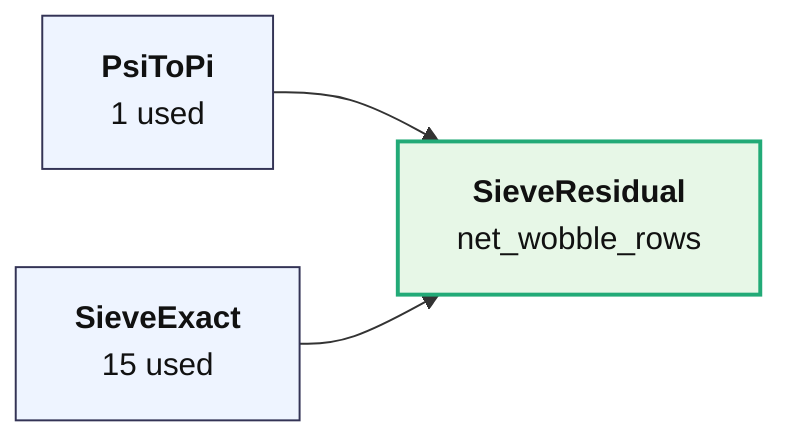

# What `SieveResidual.net_wobble_rows` rests on

[`SieveResidual.net_wobble_rows`](../lean_stage3/SieveResidual.md#SieveResidual-net_wobble_rows) in `lean_stage3/Stage3/SieveResidual.lean`, line 66.

**Why.** The row and its half. At the doubling of an even row `2m`, the net rounding less its smooth part is minus the residual of the table at row `2m` less the residual at row `m`.

**Proves**

```lean
((netRounding (2 ^ (2 * m)) : ℚ) : ℝ) - smoothNet (2 ^ (2 * m)) = -(((Nat.primeCounting (2 ^ (2 * m)) : ℝ) - Stage3.Li (((2 ^ (2 * m) : ℕ) : ℝ))) - ((Nat.primeCounting (2 ^ m) : ℝ) - Stage3.Li (((2 ^ m : ℕ) : ℝ))))
```

**Needs** (its hypotheses)

  - `` m : ℕ ``
  - `` hm : 1 ≤ m ``

Behind it: 14 theorems and 6 definitions in 3 files. Every one is listed below; Lean recorded each step.

## The files it passes through



An arrow A → B reads "B uses something proved or defined in A"; indirect arrows are left out. Green: the theorem itself. Yellow: a file in the other tree. The number is how many of that file's declarations are on the way.

## Every declaration on the way

Files in dependency order. ★ marks what the theorem's own proof uses directly.

### [`PsiToPi`](../lean_stage3/PsiToPi.md) — 1

- ★ [`Stage3.Li`](../lean_stage3/PsiToPi.md#Stage3-Li) — *def*

### [`SieveExact`](../lean_stage3/SieveExact.md) — 15

- [`SieveExact.smallPrimes`](../lean_stage3/SieveExact.md#SieveExact-smallPrimes) — *def*
- [`SieveExact.survivors`](../lean_stage3/SieveExact.md#SieveExact-survivors) — *def*
- [`SieveExact.prime_of_mem_smallPrimes`](../lean_stage3/SieveExact.md#SieveExact-prime_of_mem_smallPrimes) — `` p.Prime ``
- [`SieveExact.forall_dvd_iff_prod_dvd`](../lean_stage3/SieveExact.md#SieveExact-forall_dvd_iff_prod_dvd) — `` (∀ p ∈ T, p ∣ n) ↔ (∏ p ∈ T, p) ∣ n ``
- [`SieveExact.card_filter_not_dvd`](../lean_stage3/SieveExact.md#SieveExact-card_filter_not_dvd) — `` ((A.filter (fun n => ∀ p ∈ s, ¬ p ∣ n)).card : ℤ) = ∑ T ∈ s.powerset, (-1 : ℤ) ^ T.card * ((A.filter (fun n => (∏ p ∈ T, p) ∣ n)).card : ℤ) ``
- [`SieveExact.card_multiples`](../lean_stage3/SieveExact.md#SieveExact-card_multiples) — `` ((Finset.Icc 1 N).filter (fun n => d ∣ n)).card = N / d ``
- [`SieveExact.sieve_sum`](../lean_stage3/SieveExact.md#SieveExact-sieve_sum) — `` ((survivors N).card : ℤ) = ∑ T ∈ (smallPrimes N).powerset, (-1 : ℤ) ^ T.card * ((N / ∏ p ∈ T, p : ℕ) : ℤ) ``
- [`SieveExact.survivors_eq`](../lean_stage3/SieveExact.md#SieveExact-survivors_eq) — `` survivors N = insert 1 ((Finset.Icc 1 N).filter (fun n => Nat.Prime n ∧ Nat.sqrt N < n)) ``
- [`SieveExact.card_survivors`](../lean_stage3/SieveExact.md#SieveExact-card_survivors) — `` (survivors N).card + Nat.primeCounting (Nat.sqrt N) = 1 + Nat.primeCounting N ``
- [`SieveExact.smoothPart`](../lean_stage3/SieveExact.md#SieveExact-smoothPart) — *def*
- ★ [`SieveExact.netRounding`](../lean_stage3/SieveExact.md#SieveExact-netRounding) — *def*
- [`SieveExact.natDiv_eq_sub_fract`](../lean_stage3/SieveExact.md#SieveExact-natDiv_eq_sub_fract) — `` ((n / d : ℕ) : ℚ) = (n : ℚ) / (d : ℚ) - Int.fract ((n : ℚ) / (d : ℚ)) ``
- [`SieveExact.sieve_split`](../lean_stage3/SieveExact.md#SieveExact-sieve_split) — `` ((survivors N).card : ℚ) = smoothPart N - netRounding N ``
- [`SieveExact.smoothPart_eq_prod`](../lean_stage3/SieveExact.md#SieveExact-smoothPart_eq_prod) — `` smoothPart N = (N : ℚ) * ∏ p ∈ smallPrimes N, (1 - 1 / (p : ℚ)) ``
- [`SieveExact.netRounding_eq`](../lean_stage3/SieveExact.md#SieveExact-netRounding_eq) — `` netRounding N = (N : ℚ) * ∏ p ∈ smallPrimes N, (1 - 1 / (p : ℚ)) - (1 + (Nat.primeCounting N : ℚ) - (Nat.primeCounting (Nat.sqrt N) : ℚ)) ``

### [`SieveResidual`](../lean_stage3/SieveResidual.md) — 4

- ★ [`SieveResidual.smoothNet`](../lean_stage3/SieveResidual.md#SieveResidual-smoothNet) — *def*
- [`SieveResidual.cast_netRounding`](../lean_stage3/SieveResidual.md#SieveResidual-cast_netRounding) — `` ((netRounding N : ℚ) : ℝ) = (N : ℝ) * ∏ p ∈ smallPrimes N, (1 - 1 / (p : ℝ)) - (1 + (Nat.primeCounting N : ℝ) - (Nat.primeCounting (Nat.sqrt N) : ℝ)) ``
- ★ [`SieveResidual.net_wobble`](../lean_stage3/SieveResidual.md#SieveResidual-net_wobble) — `` ((netRounding N : ℚ) : ℝ) - smoothNet N = -(((Nat.primeCounting N : ℝ) - Stage3.Li (N : ℝ)) - ((Nat.primeCounting (Nat.sqrt N) : ℝ) - Stage3.Li ((Nat.sqrt N : ℕ… ``
- ★ [`SieveResidual.sqrt_two_pow`](../lean_stage3/SieveResidual.md#SieveResidual-sqrt_two_pow) — `` Nat.sqrt (2 ^ (2 * m)) = 2 ^ m ``

