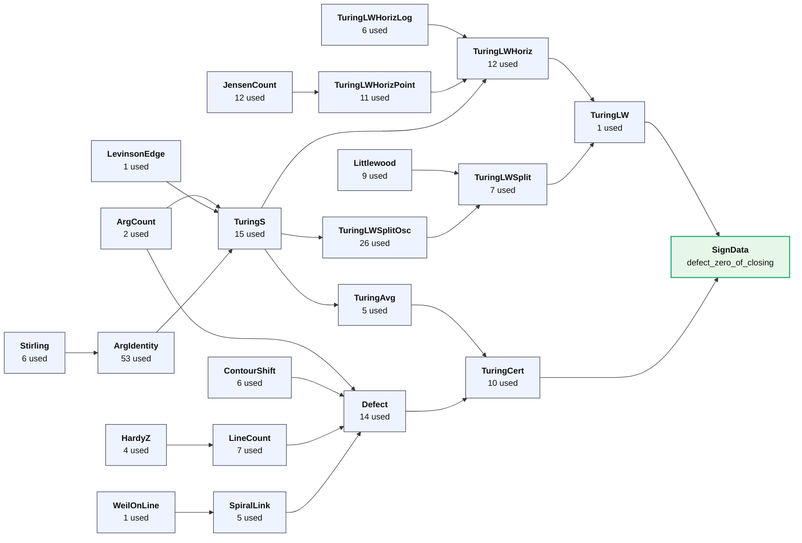

# What `SignData.defect_zero_of_closing` rests on

[`SignData.defect_zero_of_closing`](../lean_stage3/SignData.md#SignData-defect_zero_of_closing) in `lean_stage3/Stage3/SignData.lean`, line 142.

**Why.** Turing's method with Littlewood's constants: the closing data give the defect `0`.

**Proves**

```lean
∀ T ≤ T₁, Defect.defect T = 0
```

**Needs** (its hypotheses)

  - `` hd : StmtClosingData T₁ h ``
  - `` h2 : 2 ≤ T₁ ``
  - `` hh : 0 < h ``

Behind it: 180 theorems and 34 definitions in 22 files. Every one is listed below; Lean recorded each step.

## The files it passes through



An arrow A → B reads "B uses something proved or defined in A"; indirect arrows are left out. Green: the theorem itself. Yellow: a file in the other tree. The number is how many of that file's declarations are on the way.

## Every declaration on the way

Files in dependency order. ★ marks what the theorem's own proof uses directly.

### [`ArgCount`](../lean_stage3/ArgCount.md) — 2

- [`ArgCount.N_eq_sum`](../lean_stage3/ArgCount.md#ArgCount-N_eq_sum) — `` riemannZeta.N T = ∑ z ∈ (Kadiri.zeroes_rect_univ_positive_height_finite T).toFinset, (1 : ℝ) * (riemannZeta.order z : ℝ) ``
- [`ArgCount.N_mono`](../lean_stage3/ArgCount.md#ArgCount-N_mono) — `` riemannZeta.N T ≤ riemannZeta.N T' ``

### [`ContourShift`](../lean_stage3/ContourShift.md) — 6

- [`ContourShift.zeta_analyticAt`](../lean_stage3/ContourShift.md#ContourShift-zeta_analyticAt) — `` AnalyticAt ℂ riemannZeta ρ ``
- [`ContourShift.zeta_order_ne_top`](../lean_stage3/ContourShift.md#ContourShift-zeta_order_ne_top) — `` analyticOrderAt riemannZeta ρ ≠ ⊤ ``
- [`ContourShift.order_bridge`](../lean_stage3/ContourShift.md#ContourShift-order_bridge) — `` ((riemannZeta.order ρ : ℤ) : ℂ) = ((analyticOrderNatAt riemannZeta ρ : ℕ) : ℂ) ``
- [`ContourShift.analyticAt_conj_conj`](../lean_stage3/ContourShift.md#ContourShift-analyticAt_conj_conj) — `` AnalyticAt ℂ (fun w ↦ (starRingEnd ℂ) (g ((starRingEnd ℂ) w))) ((starRingEnd ℂ) p) ``
- [`ContourShift.zeta_order_conj`](../lean_stage3/ContourShift.md#ContourShift-zeta_order_conj) — `` analyticOrderNatAt riemannZeta ((starRingEnd ℂ) ρ) = analyticOrderNatAt riemannZeta ρ ``
- [`ContourShift.zeta_order_reflect`](../lean_stage3/ContourShift.md#ContourShift-zeta_order_reflect) — `` analyticOrderNatAt riemannZeta (1 - (starRingEnd ℂ) ρ) = analyticOrderNatAt riemannZeta ρ ``

### [`HardyZ`](../lean_stage3/HardyZ.md) — 4

- [`HardyZ.completedRiemannZeta_conj_of_re_pos`](../lean_stage3/HardyZ.md#HardyZ-completedRiemannZeta_conj_of_re_pos) — `` completedRiemannZeta (conj s) = conj (completedRiemannZeta s) ``
- [`HardyZ.re_line`](../lean_stage3/HardyZ.md#HardyZ-re_line) — `` ((1 / 2 : ℂ) + t * I).re = 1 / 2 ``
- [`HardyZ.xi_line_real`](../lean_stage3/HardyZ.md#HardyZ-xi_line_real) — `` (completedRiemannZeta (1/2 + t * Complex.I)).im = 0 ``
- [`HardyZ.continuous_xi_line`](../lean_stage3/HardyZ.md#HardyZ-continuous_xi_line) — `` Continuous (fun t : ℝ => completedRiemannZeta (1/2 + t * Complex.I)) ``

### [`JensenCount`](../lean_stage3/JensenCount.md) — 12

- [`Stage3.zeta_centre_lower`](../lean_stage3/JensenCount.md#Stage3-zeta_centre_lower) — `` (1 : ℝ) / 3 ≤ ‖ζ (2 + Complex.I * T)‖ ``
- [`Stage3.zeta_disk_upper`](../lean_stage3/JensenCount.md#Stage3-zeta_disk_upper) — `` ‖ζ w‖ ≤ 28 * T ``
- [`Stage3.zeta_centre_ne_zero`](../lean_stage3/JensenCount.md#Stage3-zeta_centre_ne_zero) — `` ζ (2 + Complex.I * (T : ℂ)) ≠ 0 ``
- [`Stage3.pole_away`](../lean_stage3/JensenCount.md#Stage3-pole_away) — `` 2 * z + (2 + Complex.I * (T : ℂ)) ≠ 1 ``
- [`Stage3.pole_away_centre`](../lean_stage3/JensenCount.md#Stage3-pole_away_centre) — `` v ≠ 1 ``
- [`Stage3.zetaWindowTwo_finite`](../lean_stage3/JensenCount.md#Stage3-zetaWindowTwo_finite) — `` {ρ : ℂ | ζ ρ = 0 ∧ ‖ρ - (2 + Complex.I * (T : ℂ))‖ ≤ 2}.Finite ``
- [`Stage3.jensenF`](../lean_stage3/JensenCount.md#Stage3-jensenF) — *def*
- [`Stage3.zeta_comp_analytic`](../lean_stage3/JensenCount.md#Stage3-zeta_comp_analytic) — `` AnalyticAt ℂ (fun z : ℂ => ζ (2 * z + (2 + Complex.I * (T : ℂ)))) w ``
- [`Stage3.jensenF_analytic`](../lean_stage3/JensenCount.md#Stage3-jensenF_analytic) — `` AnalyticOnNhd ℂ (jensenF T) (Metric.closedBall (0 : ℂ) 1) ``
- [`Stage3.jensenF_zero_eq_one`](../lean_stage3/JensenCount.md#Stage3-jensenF_zero_eq_one) — `` jensenF T 0 = 1 ``
- [`Stage3.jensenF_zeros_finite`](../lean_stage3/JensenCount.md#Stage3-jensenF_zeros_finite) — `` (SetOfZeros 1 (jensenF T)).Finite ``
- [`Stage3.jensenF_bound`](../lean_stage3/JensenCount.md#Stage3-jensenF_bound) — `` ‖jensenF T z‖ ≤ 84 * T ``

### [`LevinsonEdge`](../lean_stage3/LevinsonEdge.md) — 1

- [`LevinsonEdge.zeta_norm_le`](../lean_stage3/LevinsonEdge.md#LevinsonEdge-zeta_norm_le) — `` ‖riemannZeta u‖ ≤ 2 + 4 * ‖u‖ ``

### [`LineCount`](../lean_stage3/LineCount.md) — 7

- [`LineCount.zerosUpTo`](../lean_stage3/LineCount.md#LineCount-zerosUpTo) — *def*
- [`LineCount.allCount`](../lean_stage3/LineCount.md#LineCount-allCount) — *def*
- [`LineCount.lineCount`](../lean_stage3/LineCount.md#LineCount-lineCount) — *def*
- [`LineCount.mem_zerosUpTo`](../lean_stage3/LineCount.md#LineCount-mem_zerosUpTo) — `` ρ ∈ zerosUpTo T ↔ 0 < (ρ : ℂ).im ∧ (ρ : ℂ).im ≤ T ``
- [`LineCount.strictSignChange_zero_on_line`](../lean_stage3/LineCount.md#LineCount-strictSignChange_zero_on_line) — `` ∃ γ ∈ Set.Ioo t₁ t₂, riemannZeta (1/2 + γ * I) = 0 ``
- [`LineCount.lineCount_le_allCount`](../lean_stage3/LineCount.md#LineCount-lineCount_le_allCount) — `` lineCount T ≤ allCount T ``
- [`LineCount.signChanges_le_line_count`](../lean_stage3/LineCount.md#LineCount-signChanges_le_line_count) — `` (k : ℤ) ≤ lineCount T ``

### [`Littlewood`](../lean_stage3/Littlewood.md) — 9

- [`Littlewood.mem_support_divisor`](../lean_stage3/Littlewood.md#Littlewood-mem_support_divisor) — `` p ∈ (MeromorphicOn.divisor f U).support ↔ p ∈ U ∧ f p = 0 ``
- [`Littlewood.locallyIntegrable_inv_norm_sub`](../lean_stage3/Littlewood.md#Littlewood-locallyIntegrable_inv_norm_sub) — `` LocallyIntegrable (fun s : ℂ => ‖s - x‖⁻¹) volume ``
- [`Littlewood.integrableAtFilter_logDeriv`](../lean_stage3/Littlewood.md#Littlewood-integrableAtFilter_logDeriv) — `` IntegrableAtFilter (logDeriv f) (𝓝[K] p) volume ``
- [`Littlewood.integrableOn_logDeriv`](../lean_stage3/Littlewood.md#Littlewood-integrableOn_logDeriv) — `` IntegrableOn (logDeriv f) (Rectangle z w) volume ``
- [`Littlewood.integrableOn_logDeriv_prod`](../lean_stage3/Littlewood.md#Littlewood-integrableOn_logDeriv_prod) — `` IntegrableOn (fun q : ℝ × ℝ => logDeriv f (↑q.1 + ↑q.2 * I)) ([[z.re, w.re]] ×ˢ [[z.im, w.im]]) volume ``
- [`Littlewood.hasDerivAt_log_norm`](../lean_stage3/Littlewood.md#Littlewood-hasDerivAt_log_norm) — `` HasDerivAt (fun y => Real.log ‖g y‖) (g' / g x).re x ``
- [`Littlewood.continuousAt_logDeriv`](../lean_stage3/Littlewood.md#Littlewood-continuousAt_logDeriv) — `` ContinuousAt (logDeriv f) s ``
- [`Littlewood.continuousOn_logDeriv_comp`](../lean_stage3/Littlewood.md#Littlewood-continuousOn_logDeriv_comp) — `` ContinuousOn (fun x => logDeriv f (γ x)) S ``
- [`Littlewood.horiz_mem`](../lean_stage3/Littlewood.md#Littlewood-horiz_mem) — `` (↑x + ↑t * I : ℂ) ∈ Rectangle z w ``

### [`Stirling`](../lean_stage3/Stirling.md) — 6

- [`Stage3.phasePoint`](../lean_stage3/Stirling.md#Stage3-phasePoint) — *def*
- [`Stage3.phaseTheta`](../lean_stage3/Stirling.md#Stage3-phaseTheta) — *def*
- [`Stage3.continuous_phasePoint`](../lean_stage3/Stirling.md#Stage3-continuous_phasePoint) — `` Continuous phasePoint ``
- [`Stage3.intervalIntegrable_phasePoint`](../lean_stage3/Stirling.md#Stage3-intervalIntegrable_phasePoint) — `` IntervalIntegrable phasePoint MeasureTheory.volume a b ``
- [`Stage3.zq`](../lean_stage3/Stirling.md#Stage3-zq) — *def*
- [`Stage3.phasePoint_eq`](../lean_stage3/Stirling.md#Stage3-phasePoint_eq) — `` phasePoint t = (Complex.digamma (zq t)).re ``

### [`ArgIdentity`](../lean_stage3/ArgIdentity.md) — 53

- [`Stage3.xi`](../lean_stage3/ArgIdentity.md#Stage3-xi) — *def*
- [`Stage3.differentiable_xi`](../lean_stage3/ArgIdentity.md#Stage3-differentiable_xi) — `` Differentiable ℂ xi ``
- [`Stage3.xi_zero`](../lean_stage3/ArgIdentity.md#Stage3-xi_zero) — `` xi 0 = 1 ``
- [`Stage3.xi_one`](../lean_stage3/ArgIdentity.md#Stage3-xi_one) — `` xi 1 = 1 ``
- [`Stage3.xi_eq_completed`](../lean_stage3/ArgIdentity.md#Stage3-xi_eq_completed) — `` xi s = s * (s - 1) * completedRiemannZeta s ``
- [`Stage3.xi_one_sub`](../lean_stage3/ArgIdentity.md#Stage3-xi_one_sub) — `` xi (1 - s) = xi s ``
- [`Stage3.gammaR_conj`](../lean_stage3/ArgIdentity.md#Stage3-gammaR_conj) — `` Gammaℝ (conj s) = conj (Gammaℝ s) ``
- [`Stage3.completed_eq_gammaR_mul_zeta`](../lean_stage3/ArgIdentity.md#Stage3-completed_eq_gammaR_mul_zeta) — `` completedRiemannZeta s = Gammaℝ s * riemannZeta s ``
- [`Stage3.completedZeta₀_conj`](../lean_stage3/ArgIdentity.md#Stage3-completedZeta-_conj) — `` completedRiemannZeta₀ (conj s) = conj (completedRiemannZeta₀ s) ``
- [`Stage3.xi_conj`](../lean_stage3/ArgIdentity.md#Stage3-xi_conj) — `` xi (conj s) = conj (xi s) ``
- [`Stage3.zeta_re_neg_of_real_mem_Ioo`](../lean_stage3/ArgIdentity.md#Stage3-zeta_re_neg_of_real_mem_Ioo) — `` (riemannZeta (σ : ℂ)).re < 0 ``
- [`Stage3.zeta_ne_zero_of_real_mem_Ioo`](../lean_stage3/ArgIdentity.md#Stage3-zeta_ne_zero_of_real_mem_Ioo) — `` riemannZeta (σ : ℂ) ≠ 0 ``
- [`Stage3.completed_eq_gammaR_mul_zeta'`](../lean_stage3/ArgIdentity.md#Stage3-completed_eq_gammaR_mul_zeta-) — `` completedRiemannZeta s = Gammaℝ s * riemannZeta s ``
- [`Stage3.xi_eq_prod`](../lean_stage3/ArgIdentity.md#Stage3-xi_eq_prod) — `` xi s = s * (s - 1) * Gammaℝ s * riemannZeta s ``
- [`Stage3.xi_ne_zero_of_one_le_re`](../lean_stage3/ArgIdentity.md#Stage3-xi_ne_zero_of_one_le_re) — `` xi s ≠ 0 ``
- [`Stage3.xi_ne_zero_of_re_nonpos`](../lean_stage3/ArgIdentity.md#Stage3-xi_ne_zero_of_re_nonpos) — `` xi s ≠ 0 ``
- [`Stage3.xi_ne_zero_of_real`](../lean_stage3/ArgIdentity.md#Stage3-xi_ne_zero_of_real) — `` xi (σ : ℂ) ≠ 0 ``
- [`Stage3.xi_eq_zero_iff`](../lean_stage3/ArgIdentity.md#Stage3-xi_eq_zero_iff) — `` xi s = 0 ↔ riemannZeta s = 0 ∧ 0 < s.re ∧ s.re < 1 ``
- [`Stage3.meromorphicOrderAt_xi_eq_zeta`](../lean_stage3/ArgIdentity.md#Stage3-meromorphicOrderAt_xi_eq_zeta) — `` meromorphicOrderAt xi ρ = meromorphicOrderAt riemannZeta ρ ``
- [`Stage3.xi_analyticAt`](../lean_stage3/ArgIdentity.md#Stage3-xi_analyticAt) — `` AnalyticAt ℂ xi s ``
- [`Stage3.xi_meromorphicOrderAt_ne_top`](../lean_stage3/ArgIdentity.md#Stage3-xi_meromorphicOrderAt_ne_top) — `` meromorphicOrderAt xi p ≠ ⊤ ``
- [`Stage3.logDeriv_xi_meromorphicAt`](../lean_stage3/ArgIdentity.md#Stage3-logDeriv_xi_meromorphicAt) — `` MeromorphicAt (logDeriv xi) s ``
- [`Stage3.N_eq_sum`](../lean_stage3/ArgIdentity.md#Stage3-N_eq_sum) — `` riemannZeta.N T = ∑ ρ ∈ (Kadiri.zeroes_rect_univ_positive_height_finite T).toFinset, (riemannZeta.order ρ : ℝ) ``
- [`Stage3.xi_divisor_support_eq`](../lean_stage3/ArgIdentity.md#Stage3-xi_divisor_support_eq) — `` (MeromorphicOn.divisor xi (Rectangle (-1 : ℂ) (2 + Complex.I * T))).support = riemannZeta.zeroes_rect (Set.univ : Set ℝ) (Set.Ioo 0 T) ``
- [`Stage3.rectangleIntegral_logDeriv_xi_eq_N`](../lean_stage3/ArgIdentity.md#Stage3-rectangleIntegral_logDeriv_xi_eq_N) — `` RectangleIntegral' (logDeriv xi) (-1 : ℂ) (2 + Complex.I * T) = ((riemannZeta.N T : ℝ) : ℂ) ``
- [`Stage3.logDeriv_xi_one_sub`](../lean_stage3/ArgIdentity.md#Stage3-logDeriv_xi_one_sub) — `` logDeriv xi (1 - s) = -logDeriv xi s ``
- [`Stage3.logDeriv_xi_conj`](../lean_stage3/ArgIdentity.md#Stage3-logDeriv_xi_conj) — `` logDeriv xi (conj s) = conj (logDeriv xi s) ``
- [`Stage3.logDeriv_xi_continuousAt`](../lean_stage3/ArgIdentity.md#Stage3-logDeriv_xi_continuousAt) — `` ContinuousAt (logDeriv xi) p ``
- [`Stage3.xi_ne_zero_on_good_top`](../lean_stage3/ArgIdentity.md#Stage3-xi_ne_zero_on_good_top) — `` xi ((x : ℂ) + T * Complex.I) ≠ 0 ``
- [`Stage3.pi_mul_N_eq`](../lean_stage3/ArgIdentity.md#Stage3-pi_mul_N_eq) — `` Real.pi * riemannZeta.N T = (∫ t in (0:ℝ)..T, logDeriv xi (2 + (t : ℂ) * Complex.I)).re - (∫ x in (1/2:ℝ)..2, logDeriv xi ((x : ℂ) + T * Complex.I)).im ``
- [`Stage3.logDeriv_congr_of_eventuallyEq`](../lean_stage3/ArgIdentity.md#Stage3-logDeriv_congr_of_eventuallyEq) — `` logDeriv f x = logDeriv g x ``
- [`Stage3.gammaR_eq_exp_mul`](../lean_stage3/ArgIdentity.md#Stage3-gammaR_eq_exp_mul) — `` Gammaℝ s = Complex.exp (-(Real.log Real.pi : ℂ) / 2 * s) * Complex.Gamma (s / 2) ``
- [`Stage3.differentiableAt_gammaR`](../lean_stage3/ArgIdentity.md#Stage3-differentiableAt_gammaR) — `` DifferentiableAt ℂ Gammaℝ s ``
- [`Stage3.logDeriv_gammaR`](../lean_stage3/ArgIdentity.md#Stage3-logDeriv_gammaR) — `` logDeriv Gammaℝ s = -(Real.log Real.pi : ℂ) / 2 + Complex.digamma (s / 2) / 2 ``
- [`Stage3.logDeriv_xi_split`](../lean_stage3/ArgIdentity.md#Stage3-logDeriv_xi_split) — `` logDeriv xi s = 1 / s + 1 / (s - 1) + logDeriv Gammaℝ s + logDeriv riemannZeta s ``
- [`Stage3.intervalIntegral_re`](../lean_stage3/ArgIdentity.md#Stage3-intervalIntegral_re) — `` (∫ t in a..b, f t).re = ∫ t in a..b, (f t).re ``
- [`Stage3.logDeriv_gammaR_conj`](../lean_stage3/ArgIdentity.md#Stage3-logDeriv_gammaR_conj) — `` logDeriv Gammaℝ (conj s) = conj (logDeriv Gammaℝ s) ``
- [`Stage3.logDeriv_gammaR_im_eq_zero`](../lean_stage3/ArgIdentity.md#Stage3-logDeriv_gammaR_im_eq_zero) — `` (logDeriv Gammaℝ ((x : ℝ) : ℂ)).im = 0 ``
- [`Stage3.integral_inv_vertical`](../lean_stage3/ArgIdentity.md#Stage3-integral_inv_vertical) — `` (∫ t in (0:ℝ)..T, ((c : ℂ) + t * Complex.I)⁻¹) = -Complex.I * (Complex.log ((c : ℂ) + T * Complex.I) - Complex.log (c : ℂ)) ``
- [`Stage3.integral_inv_horizontal`](../lean_stage3/ArgIdentity.md#Stage3-integral_inv_horizontal) — `` (∫ x in a..b, (((x : ℂ) - d) + T * Complex.I)⁻¹) = Complex.log (((b : ℂ) - d) + T * Complex.I) - Complex.log (((a : ℂ) - d) + T * Complex.I) ``
- [`Stage3.arg_sum_eq_pi`](../lean_stage3/ArgIdentity.md#Stage3-arg_sum_eq_pi) — `` Complex.arg ((1/2 : ℝ) + T * Complex.I) + Complex.arg ((-(1/2) : ℝ) + T * Complex.I) = Real.pi ``
- [`Stage3.elemLD`](../lean_stage3/ArgIdentity.md#Stage3-elemLD) — *def*
- [`Stage3.elem_fold_eq_pi`](../lean_stage3/ArgIdentity.md#Stage3-elem_fold_eq_pi) — `` (∫ t in (0:ℝ)..T, elemLD (2 + (t : ℂ) * Complex.I)).re - (∫ x in (1/2:ℝ)..2, elemLD ((x : ℂ) + T * Complex.I)).im = Real.pi ``
- [`Stage3.logDeriv_gammaR_analyticAt`](../lean_stage3/ArgIdentity.md#Stage3-logDeriv_gammaR_analyticAt) — `` AnalyticAt ℂ (logDeriv Gammaℝ) z ``
- [`Stage3.logDeriv_gammaR_continuousAt`](../lean_stage3/ArgIdentity.md#Stage3-logDeriv_gammaR_continuousAt) — `` ContinuousAt (logDeriv Gammaℝ) z ``
- [`Stage3.logDeriv_gammaR_holo`](../lean_stage3/ArgIdentity.md#Stage3-logDeriv_gammaR_holo) — `` HolomorphicOn (logDeriv Gammaℝ) {s : ℂ | 0 < s.re} ``
- [`Stage3.logDeriv_gammaR_comp_continuous`](../lean_stage3/ArgIdentity.md#Stage3-logDeriv_gammaR_comp_continuous) — `` Continuous fun x : ℝ => logDeriv Gammaℝ (g x) ``
- [`Stage3.gammaR_fold_eq_phaseTheta`](../lean_stage3/ArgIdentity.md#Stage3-gammaR_fold_eq_phaseTheta) — `` (∫ t in (0:ℝ)..T, logDeriv Gammaℝ (2 + (t : ℂ) * Complex.I)).re - (∫ x in (1/2:ℝ)..2, logDeriv Gammaℝ ((x : ℂ) + T * Complex.I)).im = phaseTheta T ``
- [`Stage3.argS`](../lean_stage3/ArgIdentity.md#Stage3-argS) — *def*
- [`Stage3.logDeriv_zeta_analyticAt`](../lean_stage3/ArgIdentity.md#Stage3-logDeriv_zeta_analyticAt) — `` AnalyticAt ℂ (logDeriv riemannZeta) z ``
- [`Stage3.logDeriv_zeta_continuousAt`](../lean_stage3/ArgIdentity.md#Stage3-logDeriv_zeta_continuousAt) — `` ContinuousAt (logDeriv riemannZeta) z ``
- [`Stage3.zetaArgContour`](../lean_stage3/ArgIdentity.md#Stage3-zetaArgContour) — *def*
- [`Stage3.argS_eq_zetaArgContour`](../lean_stage3/ArgIdentity.md#Stage3-argS_eq_zetaArgContour) — `` argS T = zetaArgContour T ``

### [`TuringLWHorizLog`](../lean_stage3/TuringLWHorizLog.md) — 6

- [`TuringLW.mul_log_ge`](../lean_stage3/TuringLWHorizLog.md#TuringLW-mul_log_ge) — `` -1 ≤ u * Real.log u ``
- [`TuringLW.mul_log_nonpos`](../lean_stage3/TuringLWHorizLog.md#TuringLW-mul_log_nonpos) — `` u * Real.log u ≤ 0 ``
- [`TuringLW.mul_log_sub_ge_of_nonneg`](../lean_stage3/TuringLWHorizLog.md#TuringLW-mul_log_sub_ge_of_nonneg) — `` -2 ≤ b * Real.log b - a * Real.log a ``
- [`TuringLW.mul_log_sub_ge`](../lean_stage3/TuringLWHorizLog.md#TuringLW-mul_log_sub_ge) — `` -2 ≤ b * Real.log b - a * Real.log a ``
- [`TuringLW.intervalIntegrable_log_sub`](../lean_stage3/TuringLWHorizLog.md#TuringLW-intervalIntegrable_log_sub) — `` IntervalIntegrable (fun x : ℝ => Real.log (x - β)) volume (1 / 2) 2 ``
- [`TuringLW.integral_log_sub_ge`](../lean_stage3/TuringLWHorizLog.md#TuringLW-integral_log_sub_ge) — `` -(7 / 2) ≤ ∫ x in (1 / 2 : ℝ)..2, Real.log (x - β) ``

### [`TuringLWHorizPoint`](../lean_stage3/TuringLWHorizPoint.md) — 11

- [`TuringLW.h78`](../lean_stage3/TuringLWHorizPoint.md#TuringLW-h78) — `` (7 : ℝ) / 8 < 1 ``
- [`TuringLW.zeroSet`](../lean_stage3/TuringLWHorizPoint.md#TuringLW-zeroSet) — *def*
- [`TuringLW.zeroMass`](../lean_stage3/TuringLWHorizPoint.md#TuringLW-zeroMass) — *def*
- [`TuringLW.log84_le`](../lean_stage3/TuringLWHorizPoint.md#TuringLW-log84_le) — `` Real.log 84 ≤ 4.86 ``
- [`TuringLW.log84T_eq`](../lean_stage3/TuringLWHorizPoint.md#TuringLW-log84T_eq) — `` Real.log (84 * T) = Real.log 84 + Real.log T ``
- [`TuringLW.log84T_pos`](../lean_stage3/TuringLWHorizPoint.md#TuringLW-log84T_pos) — `` 0 < Real.log (84 * T) ``
- [`TuringLW.zeroMass_le`](../lean_stage3/TuringLWHorizPoint.md#TuringLW-zeroMass_le) — `` zeroMass hT ≤ 15 * Real.log (84 * T) ``
- [`TuringLW.log_blaschke_ge`](../lean_stage3/TuringLWHorizPoint.md#TuringLW-log_blaschke_ge) — `` -12 * Real.log (84 * T) ≤ Real.log ‖BlaschkeB (7 / 8) (15 / 16) (jensenF T) z‖ ``
- [`TuringLW.norm_numer_le`](../lean_stage3/TuringLWHorizPoint.md#TuringLW-norm_numer_le) — `` ‖((15 / 16 : ℝ) : ℂ) - z * (starRingEnd ℂ) ρ / ((15 / 16 : ℝ) : ℂ)‖ ≤ 2 ``
- [`TuringLW.norm_blaschke_mul_le`](../lean_stage3/TuringLWHorizPoint.md#TuringLW-norm_blaschke_mul_le) — `` ‖BlaschkeB (7 / 8) (15 / 16) (jensenF T) z‖ * ∏ ρ ∈ zeroSet hT, ‖z - ρ‖ ^ analyticOrderNatAt (jensenF T) ρ ≤ ‖jensenF T z‖ * 2 ^ (∑ ρ ∈ zeroSet hT, analyticOrde… ``
- [`TuringLW.log_jensenF_ge`](../lean_stage3/TuringLWHorizPoint.md#TuringLW-log_jensenF_ge) — `` -12 * Real.log (84 * T) - zeroMass hT * Real.log 2 + ∑ ρ ∈ zeroSet hT, (analyticOrderNatAt (jensenF T) ρ : ℝ) * Real.log ‖z - ρ‖ ≤ Real.log ‖jensenF T z‖ ``

### [`TuringS`](../lean_stage3/TuringS.md) — 15

- [`Turing.S`](../lean_stage3/TuringS.md#Turing-S) — *def*
- [`Turing.S₁`](../lean_stage3/TuringS.md#Turing-S-) — *def*
- [`Turing.F`](../lean_stage3/TuringS.md#Turing-F) — *def*
- [`Turing.StmtLittlewood`](../lean_stage3/TuringS.md#Turing-StmtLittlewood) — *def*
- [`Turing.StmtSplit`](../lean_stage3/TuringS.md#Turing-StmtSplit) — *def*
- [`Turing.StmtOsc`](../lean_stage3/TuringS.md#Turing-StmtOsc) — *def*
- [`Turing.StmtHorizUpper`](../lean_stage3/TuringS.md#Turing-StmtHorizUpper) — *def*
- [`Turing.StmtHorizLower`](../lean_stage3/TuringS.md#Turing-StmtHorizLower) — *def*
- [`Turing.S_eq_argS`](../lean_stage3/TuringS.md#Turing-S_eq_argS) — `` S t = Stage3.argS t ``
- [`Turing.continuous_phaseTheta`](../lean_stage3/TuringS.md#Turing-continuous_phaseTheta) — `` Continuous Stage3.phaseTheta ``
- [`Turing.intervalIntegrable_S`](../lean_stage3/TuringS.md#Turing-intervalIntegrable_S) — `` IntervalIntegrable S volume a b ``
- [`Turing.S₁_sub`](../lean_stage3/TuringS.md#Turing-S-_sub) — `` S₁ t₂ - S₁ t₁ = ∫ t in t₁..t₂, S t ``
- [`Turing.log_zeta_le`](../lean_stage3/TuringS.md#Turing-log_zeta_le) — `` Real.log ‖riemannZeta ((x : ℂ) + (t : ℂ) * Complex.I)‖ ≤ Real.log 9 + Real.log t ``
- [`Turing.horizUpper_holds`](../lean_stage3/TuringS.md#Turing-horizUpper_holds) — `` StmtHorizUpper (3 / 2) ((3 / 2) * Real.log 9) ``
- [`Turing.littlewood_of_pieces`](../lean_stage3/TuringS.md#Turing-littlewood_of_pieces) — `` StmtLittlewood ((3 / 2 + a₂) / Real.pi) ((c₀ + (3 / 2) * Real.log 9 + b₂) / Real.pi) 2 ``

### [`TuringAvg`](../lean_stage3/TuringAvg.md) — 5

- [`Turing.theta_sub_le`](../lean_stage3/TuringAvg.md#Turing-theta_sub_le) — `` Stage3.phaseTheta u - Stage3.phaseTheta t ≤ (u - t) * ((Real.log (u / 2) - Real.log Real.pi + 97 / t) / 2) ``
- [`Turing.avg_le`](../lean_stage3/TuringAvg.md#Turing-avg_le) — `` f t ≤ ((∫ u in t..t + h, f u) + ∫ u in t..t + h, e u) / h ``
- [`Turing.integral_lin`](../lean_stage3/TuringAvg.md#Turing-integral_lin) — `` (∫ u in t..t + h, (u - t) * K / Real.pi) = K * h ^ 2 / (2 * Real.pi) ``
- [`Turing.S_le_pointwise`](../lean_stage3/TuringAvg.md#Turing-S_le_pointwise) — `` S t ≤ S u + ((u - t) * K / Real.pi - c) ``
- [`Turing.S_le_of_count`](../lean_stage3/TuringAvg.md#Turing-S_le_of_count) — `` S t ≤ ((S₁ (t + h) - S₁ t) - (∫ u in t..t + h, c u) + K * h ^ 2 / (2 * Real.pi)) / h ``

### [`TuringLWHoriz`](../lean_stage3/TuringLWHoriz.md) — 12

- [`TuringLW.zx`](../lean_stage3/TuringLWHoriz.md#TuringLW-zx) — *def*
- [`TuringLW.beta`](../lean_stage3/TuringLWHoriz.md#TuringLW-beta) — *def*
- [`TuringLW.gLow`](../lean_stage3/TuringLWHoriz.md#TuringLW-gLow) — *def*
- [`TuringLW.zx_arg`](../lean_stage3/TuringLWHoriz.md#TuringLW-zx_arg) — `` 2 * zx x + (2 + Complex.I * (t : ℂ)) = (x : ℂ) + (t : ℂ) * Complex.I ``
- [`TuringLW.norm_zx`](../lean_stage3/TuringLWHoriz.md#TuringLW-norm_zx) — `` ‖zx x‖ ≤ 3 / 4 ``
- [`TuringLW.log_sub_le`](../lean_stage3/TuringLWHoriz.md#TuringLW-log_sub_le) — `` Real.log (x - beta ρ) - Real.log 2 ≤ Real.log ‖zx x - ρ‖ ``
- [`TuringLW.log_zeta_ge`](../lean_stage3/TuringLWHoriz.md#TuringLW-log_zeta_ge) — `` gLow ht x ≤ Real.log ‖riemannZeta ((x : ℂ) + (t : ℂ) * Complex.I)‖ ``
- [`TuringLW.intervalIntegrable_sum'`](../lean_stage3/TuringLWHoriz.md#TuringLW-intervalIntegrable_sum-) — `` IntervalIntegrable (fun x => ∑ i ∈ s, f i x) volume a b ``
- [`TuringLW.intervalIntegrable_gLow`](../lean_stage3/TuringLWHoriz.md#TuringLW-intervalIntegrable_gLow) — `` IntervalIntegrable (gLow ht) volume (1 / 2) 2 ``
- [`TuringLW.log3_le`](../lean_stage3/TuringLWHoriz.md#TuringLW-log3_le) — `` Real.log 3 ≤ 2 ``
- [`TuringLW.integral_g_ge`](../lean_stage3/TuringLWHoriz.md#TuringLW-integral_g_ge) — `` -(102 * Real.log t + 500) ≤ ∫ x in (1 / 2 : ℝ)..2, gLow ht x ``
- [`TuringLW.horizLower_holds`](../lean_stage3/TuringLWHoriz.md#TuringLW-horizLower_holds) — `` Turing.StmtHorizLower 102 500 ``

### [`TuringLWSplitOsc`](../lean_stage3/TuringLWSplitOsc.md) — 26

- [`TuringLW.vm`](../lean_stage3/TuringLWSplitOsc.md#TuringLW-vm) — *def*
- [`TuringLW.E`](../lean_stage3/TuringLWSplitOsc.md#TuringLW-E) — *def*
- [`TuringLW.H`](../lean_stage3/TuringLWSplitOsc.md#TuringLW-H) — *def*
- [`TuringLW.vm_nonneg`](../lean_stage3/TuringLWSplitOsc.md#TuringLW-vm_nonneg) — `` 0 ≤ vm n ``
- [`TuringLW.vm_le_log`](../lean_stage3/TuringLWSplitOsc.md#TuringLW-vm_le_log) — `` vm n ≤ Real.log n ``
- [`TuringLW.vm_eq_zero_of_log`](../lean_stage3/TuringLWSplitOsc.md#TuringLW-vm_eq_zero_of_log) — `` vm n = 0 ``
- [`TuringLW.vm_div_log_mul`](../lean_stage3/TuringLWSplitOsc.md#TuringLW-vm_div_log_mul) — `` vm n / Real.log n * Real.log n = vm n ``
- [`TuringLW.vm_div_log_nonneg`](../lean_stage3/TuringLWSplitOsc.md#TuringLW-vm_div_log_nonneg) — `` 0 ≤ vm n / Real.log n ``
- [`TuringLW.vm_div_log_le_one`](../lean_stage3/TuringLWSplitOsc.md#TuringLW-vm_div_log_le_one) — `` vm n / Real.log n ≤ 1 ``
- [`TuringLW.vm_div_log_sq_nonneg`](../lean_stage3/TuringLWSplitOsc.md#TuringLW-vm_div_log_sq_nonneg) — `` 0 ≤ vm n / Real.log n ^ 2 ``
- [`TuringLW.vm_div_log_sq_le`](../lean_stage3/TuringLWSplitOsc.md#TuringLW-vm_div_log_sq_le) — `` vm n / Real.log n ^ 2 ≤ 1 / Real.log 2 ``
- [`TuringLW.hasDerivAt_E`](../lean_stage3/TuringLWSplitOsc.md#TuringLW-hasDerivAt_E) — `` HasDerivAt (E n) (-(I * (Real.log n : ℂ)) * E n t) t ``
- [`TuringLW.norm_E`](../lean_stage3/TuringLWSplitOsc.md#TuringLW-norm_E) — `` ‖E n t‖ = Real.exp (-2 * Real.log n) ``
- [`TuringLW.E_zero`](../lean_stage3/TuringLWSplitOsc.md#TuringLW-E_zero) — `` E n 0 = ((Real.exp (-2 * Real.log n) : ℝ) : ℂ) ``
- [`TuringLW.term_eq`](../lean_stage3/TuringLWSplitOsc.md#TuringLW-term_eq) — `` LSeries.term (fun n => ((ArithmeticFunction.vonMangoldt n : ℝ) : ℂ)) (2 + (t : ℂ) * I) n = (vm n : ℂ) * E n t ``
- [`TuringLW.summable_v`](../lean_stage3/TuringLWSplitOsc.md#TuringLW-summable_v) — `` Summable fun n : ℕ => Real.exp (-2 * Real.log n) ``
- [`TuringLW.summable_u`](../lean_stage3/TuringLWSplitOsc.md#TuringLW-summable_u) — `` Summable fun n : ℕ => vm n * Real.exp (-2 * Real.log n) ``
- [`TuringLW.logDeriv_eq_tsum`](../lean_stage3/TuringLWSplitOsc.md#TuringLW-logDeriv_eq_tsum) — `` logDeriv riemannZeta (2 + (t : ℂ) * I) = ∑' n : ℕ, -(vm n : ℂ) * E n t ``
- [`TuringLW.hasDerivAt_H`](../lean_stage3/TuringLWSplitOsc.md#TuringLW-hasDerivAt_H) — `` HasDerivAt H (∑' n : ℕ, -(vm n : ℂ) * E n t) t ``
- [`TuringLW.re_H_zero`](../lean_stage3/TuringLWSplitOsc.md#TuringLW-re_H_zero) — `` (H 0).re = 0 ``
- [`TuringLW.F_eq_re_H`](../lean_stage3/TuringLWSplitOsc.md#TuringLW-F_eq_re_H) — `` Turing.F t = (H t).re ``
- [`TuringLW.integral_F`](../lean_stage3/TuringLWSplitOsc.md#TuringLW-integral_F) — `` ∫ t in t₁..t₂, Turing.F t = (Ψ t₂).re - (Ψ t₁).re ``
- [`TuringLW.coeff_le_w`](../lean_stage3/TuringLWSplitOsc.md#TuringLW-coeff_le_w) — `` vm n / Real.log n ^ 2 * Real.exp (-2 * Real.log n) ≤ (1 / Real.log 2) * (1 / (n : ℝ) ^ 2 - if n = 1 then 1 else 0) ``
- [`TuringLW.stmtOsc_explicit`](../lean_stage3/TuringLWSplitOsc.md#TuringLW-stmtOsc_explicit) — `` Turing.StmtOsc (2 * (Real.pi ^ 2 / 6 - 1) / Real.log 2) ``
- [`TuringLW.c₀_le_two`](../lean_stage3/TuringLWSplitOsc.md#TuringLW-c-_le_two) — `` 2 * (Real.pi ^ 2 / 6 - 1) / Real.log 2 ≤ 2 ``
- [`TuringLW.stmtOsc_holds`](../lean_stage3/TuringLWSplitOsc.md#TuringLW-stmtOsc_holds) — `` Turing.StmtOsc 2 ``

### [`TuringLWSplit`](../lean_stage3/TuringLWSplit.md) — 7

- [`TuringLW.order_ne_top_of`](../lean_stage3/TuringLWSplit.md#TuringLW-order_ne_top_of) — `` ∀ p ∈ Rectangle z w, meromorphicOrderAt f p ≠ ⊤ ``
- [`TuringLW.far_mem`](../lean_stage3/TuringLWSplit.md#TuringLW-far_mem) — `` w ∈ Rectangle z w ``
- [`TuringLW.zeta_analyticOnNhd`](../lean_stage3/TuringLWSplit.md#TuringLW-zeta_analyticOnNhd) — `` AnalyticOnNhd ℂ riemannZeta (Rectangle z w) ``
- [`TuringLW.integral_im_logDeriv_vertical`](../lean_stage3/TuringLWSplit.md#TuringLW-integral_im_logDeriv_vertical) — `` ∫ t in z.im..w.im, (logDeriv f (↑x + ↑t * I)).im = Real.log ‖f (↑x + ↑z.im * I)‖ - Real.log ‖f (↑x + ↑w.im * I)‖ ``
- [`TuringLW.intervalIntegrable_log_zeta`](../lean_stage3/TuringLWSplit.md#TuringLW-intervalIntegrable_log_zeta) — `` IntervalIntegrable (fun x : ℝ => Real.log ‖riemannZeta ((x : ℂ) + (t : ℂ) * I)‖) volume a b ``
- [`TuringLW.stmtSplit_holds`](../lean_stage3/TuringLWSplit.md#TuringLW-stmtSplit_holds) — `` Turing.StmtSplit ``
- [`TuringLW.littlewood_of_lower`](../lean_stage3/TuringLWSplit.md#TuringLW-littlewood_of_lower) — `` Turing.StmtLittlewood ((3 / 2 + a₂) / Real.pi) ((2 + (3 / 2) * Real.log 9 + b₂) / Real.pi) 2 ``

### [`TuringLW`](../lean_stage3/TuringLW.md) — 1

- ★ [`TuringLW.littlewood_holds`](../lean_stage3/TuringLW.md#TuringLW-littlewood_holds) — `` Turing.StmtLittlewood ((3 / 2 + 102) / Real.pi) ((2 + (3 / 2) * Real.log 9 + 500) / Real.pi) 2 ``

### [`WeilOnLine`](../lean_stage3/WeilOnLine.md) — 1

- [`WeilOnLine.conj_mem`](../lean_stage3/WeilOnLine.md#WeilOnLine-conj_mem) — `` (starRingEnd ℂ) (ρ : ℂ) ∈ Kadiri.NontrivialZeros ``

### [`SpiralLink`](../lean_stage3/SpiralLink.md) — 5

- [`SpiralLink.mirror_mem`](../lean_stage3/SpiralLink.md#SpiralLink-mirror_mem) — `` (1 - (starRingEnd ℂ) (ρ : ℂ)) ∈ NontrivialZeros ``
- [`SpiralLink.mirrorZ`](../lean_stage3/SpiralLink.md#SpiralLink-mirrorZ) — *def*
- [`SpiralLink.mirrorZ_im`](../lean_stage3/SpiralLink.md#SpiralLink-mirrorZ_im) — `` ((mirrorZ ρ : NontrivialZeros) : ℂ).im = (ρ : ℂ).im ``
- [`SpiralLink.mirrorZ_re`](../lean_stage3/SpiralLink.md#SpiralLink-mirrorZ_re) — `` ((mirrorZ ρ : NontrivialZeros) : ℂ).re = 1 - (ρ : ℂ).re ``
- [`SpiralLink.mirrorZ_eq_iff`](../lean_stage3/SpiralLink.md#SpiralLink-mirrorZ_eq_iff) — `` mirrorZ ρ = ρ ↔ (ρ : ℂ).re = 1 / 2 ``

### [`Defect`](../lean_stage3/Defect.md) — 14

- ★ [`Defect.defect`](../lean_stage3/Defect.md#Defect-defect) — *def*
- [`Defect.offCount`](../lean_stage3/Defect.md#Defect-offCount) — *def*
- [`Defect.defect_eq_offCount`](../lean_stage3/Defect.md#Defect-defect_eq_offCount) — `` defect T = offCount T ``
- [`Defect.defect_nonneg`](../lean_stage3/Defect.md#Defect-defect_nonneg) — `` 0 ≤ defect T ``
- [`Defect.N_eq_sum_lt`](../lean_stage3/Defect.md#Defect-N_eq_sum_lt) — `` riemannZeta.N T = ∑ ρ ∈ (zerosUpTo T).filter (fun ρ : NontrivialZeros => (ρ : ℂ).im < T), ((riemannZeta.order (ρ : ℂ) : ℤ) : ℝ) ``
- [`Defect.allCount_cast`](../lean_stage3/Defect.md#Defect-allCount_cast) — `` (allCount T : ℝ) = ∑ ρ ∈ zerosUpTo T, ((riemannZeta.order (ρ : ℂ) : ℤ) : ℝ) ``
- [`Defect.exists_right`](../lean_stage3/Defect.md#Defect-exists_right) — `` ∃ T' : ℝ, T < T' ∧ ∀ z : ℂ, riemannZeta z = 0 → 0 < z.im → T < z.im → T' < z.im ``
- [`Defect.zerosUpTo_eq_right`](../lean_stage3/Defect.md#Defect-zerosUpTo_eq_right) — `` zerosUpTo T' = zerosUpTo T ``
- [`Defect.N_eq_allCount_right`](../lean_stage3/Defect.md#Defect-N_eq_allCount_right) — `` riemannZeta.N T' = (allCount T : ℝ) ∧ lineCount T' = lineCount T ``
- [`Defect.mirrorZ_order`](../lean_stage3/Defect.md#Defect-mirrorZ_order) — `` riemannZeta.order ((SpiralLink.mirrorZ ρ : NontrivialZeros) : ℂ) = riemannZeta.order (ρ : ℂ) ``
- [`Defect.mirrorZ_mirrorZ`](../lean_stage3/Defect.md#Defect-mirrorZ_mirrorZ) — `` SpiralLink.mirrorZ (SpiralLink.mirrorZ ρ) = ρ ``
- [`Defect.offLine_pair`](../lean_stage3/Defect.md#Defect-offLine_pair) — `` SpiralLink.mirrorZ ρ ∈ (zerosUpTo T).filter (fun ρ : NontrivialZeros => ¬ (ρ : ℂ).re = 1 / 2) ∧ SpiralLink.mirrorZ ρ ≠ ρ ∧ ((SpiralLink.mirrorZ ρ : NontrivialZe… ``
- [`Defect.offCount_eq_two_mul`](../lean_stage3/Defect.md#Defect-offCount_eq_two_mul) — `` offCount T = 2 * ∑ ρ ∈ ((zerosUpTo T).filter (fun ρ : NontrivialZeros => ¬ (ρ : ℂ).re = 1 / 2)).filter (fun ρ : NontrivialZeros => (ρ : ℂ).re < 1 / 2), riemannZ… ``
- [`Defect.defect_even`](../lean_stage3/Defect.md#Defect-defect_even) — `` Even (defect T) ``

### [`TuringCert`](../lean_stage3/TuringCert.md) — 10

- [`Turing.StmtSignData`](../lean_stage3/TuringCert.md#Turing-StmtSignData) — *def*
- [`Turing.turingK`](../lean_stage3/TuringCert.md#Turing-turingK) — *def*
- [`Turing.turingErr`](../lean_stage3/TuringCert.md#Turing-turingErr) — *def*
- [`Turing.defect_mono`](../lean_stage3/TuringCert.md#Turing-defect_mono) — `` defect T ≤ defect T' ``
- [`Turing.defect_eq_zero_of_lt_two`](../lean_stage3/TuringCert.md#Turing-defect_eq_zero_of_lt_two) — `` defect T = 0 ``
- [`Turing.defect_zero_below`](../lean_stage3/TuringCert.md#Turing-defect_zero_below) — `` ∀ T ≤ T₁, defect T = 0 ``
- [`Turing.allCount_add_card_le_N`](../lean_stage3/TuringCert.md#Turing-allCount_add_card_le_N) — `` (allCount T₁ : ℝ) + Z.card ≤ riemannZeta.N u ``
- [`Turing.count_le_N_sub`](../lean_stage3/TuringCert.md#Turing-count_le_N_sub) — `` (∑ j : Fin m, if s j.succ < u then (1 : ℝ) else 0) ≤ riemannZeta.N u - (allCount T₁ : ℝ) ``
- [`Turing.integral_step`](../lean_stage3/TuringCert.md#Turing-integral_step) — `` (∫ u in a..b, if s < u then (1 : ℝ) else 0) = b - s ``
- ★ [`Turing.defect_zero_of_signs`](../lean_stage3/TuringCert.md#Turing-defect_zero_of_signs) — `` ∀ T ≤ T₁, defect T = 0 ``

### [`SignData`](../lean_stage3/SignData.md) — 1

- ★ [`SignData.StmtClosingData`](../lean_stage3/SignData.md#SignData-StmtClosingData) — *def*

