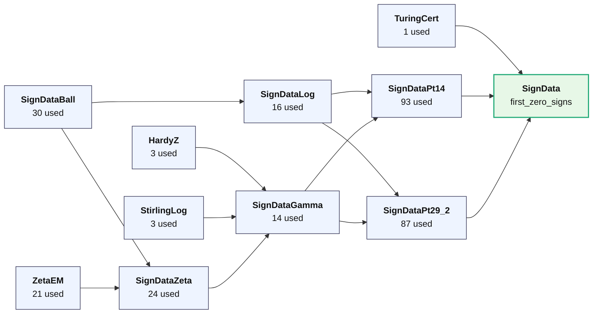

# What `SignData.first_zero_signs` rests on

[`SignData.first_zero_signs`](../lean_stage3/SignData.md#SignData-first_zero_signs) in `lean_stage3/Stage3/SignData.lean`, line 91.

**Why.** The first zero: `Re Λ` changes sign between `t = 14` and `t = 29/2`.

**Proves**

```lean
Turing.StmtSignData 1 ![14, 29 / 2]
```

Behind it: 275 theorems and 17 definitions in 11 files. Every one is listed below; Lean recorded each step.

## The files it passes through



An arrow A → B reads "B uses something proved or defined in A"; indirect arrows are left out. Green: the theorem itself. Yellow: a file in the other tree. The number is how many of that file's declarations are on the way.

## Every declaration on the way

Files in dependency order. ★ marks what the theorem's own proof uses directly.

### [`HardyZ`](../lean_stage3/HardyZ.md) — 3

- [`HardyZ.completedRiemannZeta_conj_of_re_pos`](../lean_stage3/HardyZ.md#HardyZ-completedRiemannZeta_conj_of_re_pos) — `` completedRiemannZeta (conj s) = conj (completedRiemannZeta s) ``
- [`HardyZ.re_line`](../lean_stage3/HardyZ.md#HardyZ-re_line) — `` ((1 / 2 : ℂ) + t * I).re = 1 / 2 ``
- [`HardyZ.xi_line_real`](../lean_stage3/HardyZ.md#HardyZ-xi_line_real) — `` (completedRiemannZeta (1/2 + t * Complex.I)).im = 0 ``

### [`SignDataBall`](../lean_stage3/SignDataBall.md) — 30

- [`SignData.cx`](../lean_stage3/SignDataBall.md#SignData-cx) — *def*
- [`SignData.cx_re`](../lean_stage3/SignDataBall.md#SignData-cx_re) — `` (cx a b).re = a ``
- [`SignData.cx_im`](../lean_stage3/SignDataBall.md#SignData-cx_im) — `` (cx a b).im = b ``
- [`SignData.norm_cx_le`](../lean_stage3/SignDataBall.md#SignData-norm_cx_le) — `` ‖cx a b‖ ≤ |a| + |b| ``
- [`SignData.ball_add`](../lean_stage3/SignDataBall.md#SignData-ball_add) — `` ‖z + w - cx e f‖ ≤ R ``
- [`SignData.ball_mul`](../lean_stage3/SignDataBall.md#SignData-ball_mul) — `` ‖z * w - cx e f‖ ≤ R ``
- [`SignData.ball_conj`](../lean_stage3/SignDataBall.md#SignData-ball_conj) — `` ‖(starRingEnd ℂ) z - cx a (-b)‖ ≤ r ``
- [`SignData.ball_ofReal`](../lean_stage3/SignDataBall.md#SignData-ball_ofReal) — `` ‖(x : ℂ) - cx c 0‖ ≤ e ``
- [`SignData.re_pos_of_ball`](../lean_stage3/SignDataBall.md#SignData-re_pos_of_ball) — `` 0 < z.re ``
- [`SignData.re_neg_of_ball`](../lean_stage3/SignDataBall.md#SignData-re_neg_of_ball) — `` z.re < 0 ``
- [`SignData.real_mul_ball`](../lean_stage3/SignDataBall.md#SignData-real_mul_ball) — `` |u * x - u * a| ≤ |u| * e ``
- [`SignData.neg_mul_ball`](../lean_stage3/SignDataBall.md#SignData-neg_mul_ball) — `` |-(t * x) - -(t * a)| ≤ |t| * e ``
- [`SignData.phase_ball`](../lean_stage3/SignDataBall.md#SignData-phase_ball) — `` |(t / 2) * (x - y) - (t / 2) * (a - b)| ≤ |t / 2| * (e₁ + e₂) ``
- [`SignData.cosP`](../lean_stage3/SignDataBall.md#SignData-cosP) — *def*
- [`SignData.sinP`](../lean_stage3/SignDataBall.md#SignData-sinP) — *def*
- [`SignData.taylor_eq`](../lean_stage3/SignDataBall.md#SignData-taylor_eq) — `` ∑ m ∈ Finset.range (2 * K), ((y : ℂ) * I) ^ m / (m.factorial : ℂ) = cx (cosP K y) (sinP K y) ``
- [`SignData.norm_exp_sub_exp_le`](../lean_stage3/SignDataBall.md#SignData-norm_exp_sub_exp_le) — `` ‖cexp ((y : ℂ) * I) - cexp ((y₀ : ℂ) * I)‖ ≤ |y - y₀| ``
- [`SignData.exp_ball_core`](../lean_stage3/SignDataBall.md#SignData-exp_ball_core) — `` ‖cexp ((y : ℂ) * I) - cx (cosP K y₀) (sinP K y₀)‖ ≤ ε + |y₀| ^ (2 * K) * ((2 * K + 1 : ℝ) / (((2 * K).factorial : ℝ) * (2 * K))) ``
- [`SignData.exp_reduce`](../lean_stage3/SignDataBall.md#SignData-exp_reduce) — `` cexp ((x : ℂ) * I) = cexp (((x - (j * (Real.pi / 2) + k * (2 * Real.pi)) : ℝ) : ℂ) * I) * I ^ j ``
- [`SignData.pi_ball`](../lean_stage3/SignDataBall.md#SignData-pi_ball) — `` |Real.pi - 3.14159265358979323846| ≤ 1 / 10 ^ 20 ``
- [`SignData.red_ball`](../lean_stage3/SignDataBall.md#SignData-red_ball) — `` |(x - (j * (Real.pi / 2) + k * (2 * Real.pi))) - y₀| ≤ ε' ``
- [`SignData.exp_ball_red`](../lean_stage3/SignDataBall.md#SignData-exp_ball_red) — `` ‖cexp (((x - (j * (Real.pi / 2) + k * (2 * Real.pi)) : ℝ) : ℂ) * I) - cx e f‖ ≤ R ``
- [`SignData.exp_ball0`](../lean_stage3/SignDataBall.md#SignData-exp_ball0) — `` ‖cexp ((x : ℂ) * I) - cx e f‖ ≤ R ``
- [`SignData.exp_ball1`](../lean_stage3/SignDataBall.md#SignData-exp_ball1) — `` ‖cexp ((x : ℂ) * I) - cx (-f) e‖ ≤ R ``
- [`SignData.exp_ball2`](../lean_stage3/SignDataBall.md#SignData-exp_ball2) — `` ‖cexp ((x : ℂ) * I) - cx (-e) (-f)‖ ≤ R ``
- [`SignData.exp_ball3`](../lean_stage3/SignDataBall.md#SignData-exp_ball3) — `` ‖cexp ((x : ℂ) * I) - cx f (-e)‖ ≤ R ``
- [`SignData.log_succ_ball`](../lean_stage3/SignDataBall.md#SignData-log_succ_ball) — `` |Real.log q - c| ≤ R ``
- [`SignData.log_pow_ball`](../lean_stage3/SignDataBall.md#SignData-log_pow_ball) — `` |Real.log (b ^ m) - m * a| ≤ m * e ``
- [`SignData.log_pi_ball`](../lean_stage3/SignDataBall.md#SignData-log_pi_ball) — `` |Real.log Real.pi - c| ≤ R ``
- [`SignData.inv_sqrt_ball`](../lean_stage3/SignDataBall.md#SignData-inv_sqrt_ball) — `` |(Real.sqrt m)⁻¹ - c| ≤ R ``

### [`SignDataLog`](../lean_stage3/SignDataLog.md) — 16

- [`SignData.log_ball_2`](../lean_stage3/SignDataLog.md#SignData-log_ball_2) — `` |Real.log ((2 : ℕ) : ℝ) - (0.69314718055)| ≤ (0.00000000025) ``
- [`SignData.log_ball_3`](../lean_stage3/SignDataLog.md#SignData-log_ball_3) — `` |Real.log (((3 : ℕ)) : ℝ) - (1.098612288658164142930964760306)| ≤ (0.000000000250007285403624428292) ``
- [`SignData.log_ball_4`](../lean_stage3/SignDataLog.md#SignData-log_ball_4) — `` |Real.log (((4 : ℕ)) : ℝ) - (1.386294361109944875563750019823)| ≤ (0.000000000250012022355196162294) ``
- [`SignData.log_ball_5`](../lean_stage3/SignDataLog.md#SignData-log_ball_5) — `` |Real.log (((5 : ℕ)) : ℝ) - (1.609437912424154507888186373287)| ≤ (0.000000000250014643795196162295) ``
- [`SignData.log_ball_6`](../lean_stage3/SignDataLog.md#SignData-log_ball_6) — `` |Real.log (((6 : ℕ)) : ℝ) - (1.791759469218109031470825672761)| ≤ (0.000000000250016613075280171998) ``
- [`SignData.log_ball_7`](../lean_stage3/SignDataLog.md#SignData-log_ball_7) — `` |Real.log (((7 : ℕ)) : ℝ) - (1.945910149045367043442249594592)| ≤ (0.000000000250021628181194999771) ``
- [`SignData.log_ball_8`](../lean_stage3/SignDataLog.md#SignData-log_ball_8) — `` |Real.log (((8 : ℕ)) : ℝ) - (2.079441541669889414922705144822)| ≤ (0.000000000250025688425399343201) ``
- [`SignData.log_pi_ball'`](../lean_stage3/SignDataLog.md#SignData-log_pi_ball-) — `` |Real.log Real.pi - (1.144729885839454400081836469865)| ≤ (0.000000000250010002548919421399) ``
- [`SignData.log_pow2_ball_64`](../lean_stage3/SignDataLog.md#SignData-log_pow2_ball_64) — `` |Real.log (((64 : ℕ)) : ℝ) - (4.1588830833)| ≤ (0.0000000015) ``
- [`SignData.isqrt_ball_2`](../lean_stage3/SignDataLog.md#SignData-isqrt_ball_2) — `` |(Real.sqrt (((2 : ℕ)) : ℝ))⁻¹ - (0.707106781186547524400844362104)| ≤ (0.000000000000000000000000000001) ``
- [`SignData.isqrt_ball_3`](../lean_stage3/SignDataLog.md#SignData-isqrt_ball_3) — `` |(Real.sqrt (((3 : ℕ)) : ℝ))⁻¹ - (0.577350269189625764509148780502)| ≤ (0.000000000000000000000000000001) ``
- [`SignData.isqrt_ball_4`](../lean_stage3/SignDataLog.md#SignData-isqrt_ball_4) — `` |(Real.sqrt (((4 : ℕ)) : ℝ))⁻¹ - (0.5)| ≤ (0.000000000000000000000000000001) ``
- [`SignData.isqrt_ball_5`](../lean_stage3/SignDataLog.md#SignData-isqrt_ball_5) — `` |(Real.sqrt (((5 : ℕ)) : ℝ))⁻¹ - (0.447213595499957939281834733746)| ≤ (0.000000000000000000000000000001) ``
- [`SignData.isqrt_ball_6`](../lean_stage3/SignDataLog.md#SignData-isqrt_ball_6) — `` |(Real.sqrt (((6 : ℕ)) : ℝ))⁻¹ - (0.40824829046386301636621401245)| ≤ (0.000000000000000000000000000001) ``
- [`SignData.isqrt_ball_7`](../lean_stage3/SignDataLog.md#SignData-isqrt_ball_7) — `` |(Real.sqrt (((7 : ℕ)) : ℝ))⁻¹ - (0.377964473009227227214516536234)| ≤ (0.000000000000000000000000000001) ``
- [`SignData.isqrt_ball_8`](../lean_stage3/SignDataLog.md#SignData-isqrt_ball_8) — `` |(Real.sqrt (((8 : ℕ)) : ℝ))⁻¹ - (0.353553390593273762200422181052)| ≤ (0.000000000000000000000000000001) ``

### [`StirlingLog`](../lean_stage3/StirlingLog.md) — 3

- [`Stirling.logG`](../lean_stage3/StirlingLog.md#Stirling-logG) — *def*
- [`Stirling.tendsto_logG`](../lean_stage3/StirlingLog.md#Stirling-tendsto_logG) — `` Tendsto (Complex.logGammaSeq z) atTop (𝓝 (logG z)) ``
- [`Stirling.exp_logG`](../lean_stage3/StirlingLog.md#Stirling-exp_logG) — `` cexp (logG z) = Gamma z ``

### [`TuringCert`](../lean_stage3/TuringCert.md) — 1

- ★ [`Turing.StmtSignData`](../lean_stage3/TuringCert.md#Turing-StmtSignData) — *def*

### [`ZetaEM`](../lean_stage3/ZetaEM.md) — 21

- [`ZetaEM.emInt`](../lean_stage3/ZetaEM.md#ZetaEM-emInt) — *def*
- [`ZetaEM.emCoef`](../lean_stage3/ZetaEM.md#ZetaEM-emCoef) — *def*
- [`ZetaEM.emTerm`](../lean_stage3/ZetaEM.md#ZetaEM-emTerm) — *def*
- [`ZetaEM.emBoundary`](../lean_stage3/ZetaEM.md#ZetaEM-emBoundary) — *def*
- [`ZetaEM.emRem`](../lean_stage3/ZetaEM.md#ZetaEM-emRem) — *def*
- [`ZetaEM.bernBound`](../lean_stage3/ZetaEM.md#ZetaEM-bernBound) — *def*
- [`ZetaEM.hasDerivWithinAt_fract`](../lean_stage3/ZetaEM.md#ZetaEM-hasDerivWithinAt_fract) — `` HasDerivWithinAt Int.fract 1 (Ioi x) x ``
- [`ZetaEM.continuous_bernoulliFun_fract`](../lean_stage3/ZetaEM.md#ZetaEM-continuous_bernoulliFun_fract) — `` Continuous (fun x : ℝ ↦ bernoulliFun k (Int.fract x)) ``
- [`ZetaEM.abs_bernoulliFun_fract_le`](../lean_stage3/ZetaEM.md#ZetaEM-abs_bernoulliFun_fract_le) — `` |bernoulliFun k (Int.fract x)| ≤ bernBound k ``
- [`ZetaEM.measurable_bern`](../lean_stage3/ZetaEM.md#ZetaEM-measurable_bern) — `` Measurable (fun x : ℝ ↦ bernoulliFun k (Int.fract x)) ``
- [`ZetaEM.integrableOn_bern_cpow`](../lean_stage3/ZetaEM.md#ZetaEM-integrableOn_bern_cpow) — `` IntegrableOn (fun x : ℝ ↦ ((bernoulliFun k (Int.fract x) : ℝ) : ℂ) * (x:ℂ) ^ w) (Ioi a) ``
- [`ZetaEM.norm_integral_bern_cpow_le`](../lean_stage3/ZetaEM.md#ZetaEM-norm_integral_bern_cpow_le) — `` ‖∫ x in Ioi a, ((bernoulliFun k (Int.fract x) : ℝ) : ℂ) * (x:ℂ) ^ w‖ ≤ bernBound k * (-a ^ (w.re + 1) / (w.re + 1)) ``
- [`ZetaEM.interval_ibp`](../lean_stage3/ZetaEM.md#ZetaEM-interval_ibp) — `` ((k:ℂ) + 1) * ∫ x in a..b, ((bernoulliFun k (Int.fract x) : ℝ) : ℂ) * (x:ℂ) ^ (-(s + k)) = ((bernoulliFun (k+1) (Int.fract b) : ℝ) : ℂ) * (b:ℂ) ^ (-(s + k)) - (… ``
- [`ZetaEM.tail_ibp`](../lean_stage3/ZetaEM.md#ZetaEM-tail_ibp) — `` ((k:ℂ) + 1) * ∫ x in Ioi a, ((bernoulliFun k (Int.fract x) : ℝ) : ℂ) * (x:ℂ) ^ (-(s + k)) = -(((bernoulliFun (k+1) (Int.fract a) : ℝ) : ℂ) * (a:ℂ) ^ (-(s + k)))… ``
- [`ZetaEM.emInt_step`](../lean_stage3/ZetaEM.md#ZetaEM-emInt_step) — `` ((k:ℂ) + 1) * emInt k N s = -((bernoulliFun (k+1) 0 : ℂ) * (N:ℂ) ^ (-(s + k))) + (s + k) * emInt (k+1) N s ``
- [`ZetaEM.emRem_step`](../lean_stage3/ZetaEM.md#ZetaEM-emRem_step) — `` emRem k N s = emTerm k N s + emRem (k+1) N s ``
- [`ZetaEM.sum_range_succ_eq_sum_Icc`](../lean_stage3/ZetaEM.md#ZetaEM-sum_range_succ_eq_sum_Icc) — `` ∑ n ∈ Finset.range (N + 1), 1 / (n : ℂ) ^ s = ∑ n ∈ Finset.Icc 1 N, (n : ℂ) ^ (-s) ``
- [`ZetaEM.zeta_eq_em_one`](../lean_stage3/ZetaEM.md#ZetaEM-zeta_eq_em_one) — `` riemannZeta s = ∑ n ∈ Finset.Icc 1 N, (n : ℂ) ^ (-s) - (N:ℂ) ^ (1 - s) / (1 - s) - (N:ℂ) ^ (-s) / 2 - s * emInt 1 N s ``
- [`ZetaEM.zeta_eq_em`](../lean_stage3/ZetaEM.md#ZetaEM-zeta_eq_em) — `` riemannZeta s = ∑ n ∈ Finset.Icc 1 N, (n : ℂ) ^ (-s) - (N:ℂ) ^ (1 - s) / (1 - s) - (N:ℂ) ^ (-s) / 2 + emBoundary k N s + emRem k N s ``
- [`ZetaEM.norm_emInt_le`](../lean_stage3/ZetaEM.md#ZetaEM-norm_emInt_le) — `` ‖emInt k N s‖ ≤ bernBound k * ((N:ℝ) ^ (1 - s.re - k) / (s.re + k - 1)) ``
- [`ZetaEM.norm_remainder_le`](../lean_stage3/ZetaEM.md#ZetaEM-norm_remainder_le) — `` ‖emRem k N s‖ ≤ (∏ i ∈ Finset.range k, ‖s + i‖) / k.factorial * (bernBound k * ((N:ℝ) ^ (1 - s.re - k) / (s.re + k - 1))) ``

### [`SignDataZeta`](../lean_stage3/SignDataZeta.md) — 24

- [`SignData.lineS`](../lean_stage3/SignDataZeta.md#SignData-lineS) — *def*
- [`SignData.emB`](../lean_stage3/SignDataZeta.md#SignData-emB) — *def*
- [`SignData.Bre`](../lean_stage3/SignDataZeta.md#SignData-Bre) — *def*
- [`SignData.Bim`](../lean_stage3/SignDataZeta.md#SignData-Bim) — *def*
- [`SignData.lineS_re`](../lean_stage3/SignDataZeta.md#SignData-lineS_re) — `` (lineS t).re = 1 / 2 ``
- [`SignData.lineS_ne_zero`](../lean_stage3/SignDataZeta.md#SignData-lineS_ne_zero) — `` lineS t ≠ 0 ``
- [`SignData.lineS_ne_one`](../lean_stage3/SignDataZeta.md#SignData-lineS_ne_one) — `` lineS t ≠ 1 ``
- [`SignData.bernoulliFun_four`](../lean_stage3/SignDataZeta.md#SignData-bernoulliFun_four) — `` bernoulliFun 4 x = x ^ 4 - 2 * x ^ 3 + x ^ 2 - 1 / 30 ``
- [`SignData.bernBound_four_le`](../lean_stage3/SignDataZeta.md#SignData-bernBound_four_le) — `` bernBound 4 ≤ 1 / 30 ``
- [`SignData.bernoulliFun_three_zero`](../lean_stage3/SignDataZeta.md#SignData-bernoulliFun_three_zero) — `` bernoulliFun 3 0 = 0 ``
- [`SignData.bernoulliFun_four_zero`](../lean_stage3/SignDataZeta.md#SignData-bernoulliFun_four_zero) — `` bernoulliFun 4 0 = -1 / 30 ``
- [`SignData.cpow_neg_add_nat`](../lean_stage3/SignDataZeta.md#SignData-cpow_neg_add_nat) — `` (N : ℂ) ^ (-(s + j)) = (N : ℂ) ^ (-s) / (N : ℂ) ^ j ``
- [`SignData.emBoundary_four`](../lean_stage3/SignDataZeta.md#SignData-emBoundary_four) — `` emBoundary 4 N s = (N : ℂ) ^ (-s) * (s / (12 * N) - s * (s + 1) * (s + 2) / (720 * (N : ℂ) ^ 3)) ``
- [`SignData.zeta_em4`](../lean_stage3/SignDataZeta.md#SignData-zeta_em4) — `` ‖riemannZeta (lineS t) - (∑ m ∈ Finset.Icc 1 N, (m : ℂ) ^ (-lineS t) + (N : ℂ) ^ (-lineS t) * emB t N)‖ ≤ (∏ i ∈ Finset.range 4, ‖lineS t + i‖) / 24 * ((1 / 30)… ``
- [`SignData.emB_eq`](../lean_stage3/SignDataZeta.md#SignData-emB_eq) — `` emB t N = cx (Bre t N) (Bim t N) ``
- [`SignData.natCast_cpow_line`](../lean_stage3/SignDataZeta.md#SignData-natCast_cpow_line) — `` (m : ℂ) ^ (-lineS t) = (((Real.sqrt m)⁻¹ : ℝ) : ℂ) * cexp (((-(t * Real.log m)) : ℝ) * I) ``
- [`SignData.norm_le_of_sq`](../lean_stage3/SignDataZeta.md#SignData-norm_le_of_sq) — `` ‖cx a b‖ ≤ q ``
- [`SignData.lineS_add_nat`](../lean_stage3/SignDataZeta.md#SignData-lineS_add_nat) — `` lineS t + i = cx (1 / 2 + i) t ``
- [`SignData.rpow_neg_seven_half`](../lean_stage3/SignDataZeta.md#SignData-rpow_neg_seven_half) — `` N ^ (-(7 / 2) : ℝ) = 1 / (N ^ 3 * Real.sqrt N) ``
- [`SignData.rem_le`](../lean_stage3/SignDataZeta.md#SignData-rem_le) — `` (∏ i ∈ Finset.range 4, ‖lineS t + i‖) / 24 * ((1 / 30) * ((N : ℝ) ^ (-(7 / 2) : ℝ) / (7 / 2))) ≤ Q ``
- [`SignData.emB_ball`](../lean_stage3/SignDataZeta.md#SignData-emB_ball) — `` ‖emB t N - cx (Bre t N) (Bim t N)‖ ≤ 0 ``
- [`SignData.zeta_ball`](../lean_stage3/SignDataZeta.md#SignData-zeta_ball) — `` ‖riemannZeta (lineS t) - cx a b‖ ≤ R ``
- [`SignData.one_term_ball`](../lean_stage3/SignDataZeta.md#SignData-one_term_ball) — `` ‖((1 : ℕ) : ℂ) ^ (-lineS t) - cx 1 0‖ ≤ 0 ``
- [`SignData.sum_one_ball`](../lean_stage3/SignDataZeta.md#SignData-sum_one_ball) — `` ‖∑ m ∈ Finset.Icc 1 1, ((m : ℕ) : ℂ) ^ (-lineS t) - cx 1 0‖ ≤ 0 ``

### [`SignDataGamma`](../lean_stage3/SignDataGamma.md) — 14

- [`SignData.zz`](../lean_stage3/SignDataGamma.md#SignData-zz) — *def*
- [`SignData.gammaDir`](../lean_stage3/SignDataGamma.md#SignData-gammaDir) — *def*
- [`SignData.zz_re`](../lean_stage3/SignDataGamma.md#SignData-zz_re) — `` (zz t).re = 1 / 4 ``
- [`SignData.norm_zz_le`](../lean_stage3/SignDataGamma.md#SignData-norm_zz_le) — `` ‖zz t‖ ≤ 1 / 4 + |t| / 2 ``
- [`SignData.step_le`](../lean_stage3/SignDataGamma.md#SignData-step_le) — `` ‖Complex.logGammaSeq z (n + 1) - Complex.logGammaSeq z n‖ ≤ (2 * ‖z‖ + ‖z‖ ^ 2) * (1 / ((n : ℝ) + 1) ^ 2) ``
- [`SignData.tail_le`](../lean_stage3/SignDataGamma.md#SignData-tail_le) — `` ‖Stirling.logG z - Complex.logGammaSeq z n‖ ≤ (2 * ‖z‖ + ‖z‖ ^ 2) / n ``
- [`SignData.prod_shift`](../lean_stage3/SignDataGamma.md#SignData-prod_shift) — `` ∏ j ∈ Finset.range (n + 1), (z + j) = (n.factorial : ℂ) * (z * ∏ j ∈ Finset.range n, (1 + z / ((j : ℂ) + 1))) ``
- [`SignData.lineS_div_two`](../lean_stage3/SignDataGamma.md#SignData-lineS_div_two) — `` lineS t / 2 = zz t ``
- [`SignData.re_lambda_eq`](../lean_stage3/SignDataGamma.md#SignData-re_lambda_eq) — `` ∃ c : ℝ, 0 < c ∧ (completedRiemannZeta (lineS t)).re = c * (gammaDir t n * riemannZeta (lineS t)).re ``
- [`SignData.re_lambda_pos`](../lean_stage3/SignDataGamma.md#SignData-re_lambda_pos) — `` 0 < (completedRiemannZeta (lineS t)).re ``
- [`SignData.re_lambda_neg`](../lean_stage3/SignDataGamma.md#SignData-re_lambda_neg) — `` (completedRiemannZeta (lineS t)).re < 0 ``
- [`SignData.factor_ball`](../lean_stage3/SignDataGamma.md#SignData-factor_ball) — `` ‖(1 + zz t / ((j : ℂ) + 1)) - cx (1 + 1 / (4 * ((j : ℝ) + 1))) (t / (2 * ((j : ℝ) + 1)))‖ ≤ 0 ``
- [`SignData.prod_zero_ball`](../lean_stage3/SignDataGamma.md#SignData-prod_zero_ball) — `` ‖∏ j ∈ Finset.range 0, (1 + zz t / ((j : ℂ) + 1)) - cx 1 0‖ ≤ 0 ``
- [`SignData.zz_ball`](../lean_stage3/SignDataGamma.md#SignData-zz_ball) — `` ‖zz t - cx (1 / 4) (t / 2)‖ ≤ 0 ``

### [`SignDataPt14`](../lean_stage3/SignDataPt14.md) — 93

- [`SignData.p14_E2`](../lean_stage3/SignDataPt14.md#SignData-p14_E2) — `` ‖cexp ((((-((14 : ℝ) * Real.log (((2 : ℕ)) : ℝ))) : ℝ) : ℂ) * Complex.I) - cx (-(0.961253457642440241181855761014)) (-(-0.275666084548776774407564327852))‖ ≤ (0… ``
- [`SignData.p14_T2`](../lean_stage3/SignDataPt14.md#SignData-p14_T2) — `` ‖(((2 : ℕ)) : ℂ) ^ (-lineS (14 : ℝ)) - cx (-0.679708838337985220771914796136) (0.194925357727584208072744154227)‖ ≤ (0.000000002474873734174129538843) ``
- [`SignData.p14_E3`](../lean_stage3/SignDataPt14.md#SignData-p14_E3) — `` ‖cexp ((((-((14 : ℝ) * Real.log (((3 : ℕ)) : ℝ))) : ℝ) : ℂ) * Complex.I) - cx (-(0.94688447812141625126363548568)) (-(0.321573918551758778340741691955))‖ ≤ (0.0… ``
- [`SignData.p14_T3`](../lean_stage3/SignDataPt14.md#SignData-p14_T3) — `` ‖(((3 : ℕ)) : ℂ) ^ (-lineS (14 : ℝ)) - cx (-0.546684008334877980393651456295) (-0.185660788440220721249718589868)‖ ≤ (0.000000002020784829410994313809) ``
- [`SignData.p14_E4`](../lean_stage3/SignDataPt14.md#SignData-p14_E4) — `` ‖cexp ((((-((14 : ℝ) * Real.log (((4 : ℕ)) : ℝ))) : ℝ) : ℂ) * Complex.I) - cx (0.84801641958530651641591672347) (-0.52996995397259773949362267018)‖ ≤ (0.0000000… ``
- [`SignData.p14_T4`](../lean_stage3/SignDataPt14.md#SignData-p14_T4) — `` ‖(((4 : ℕ)) : ℂ) ^ (-lineS (14 : ℝ)) - cx (0.424008209792653258207958361735) (-0.26498497698629886974681133509)‖ ≤ (0.000000001750084156517625160689) ``
- [`SignData.p14_E5`](../lean_stage3/SignDataPt14.md#SignData-p14_E5) — `` ‖cexp ((((-((14 : ℝ) * Real.log (((5 : ℕ)) : ℝ))) : ℝ) : ℂ) * Complex.I) - cx (-(0.857203283964070490032921983389)) (-(-0.514978183966285247405887299478))‖ ≤ (0… ``
- [`SignData.p14_T5`](../lean_stage3/SignDataPt14.md#SignData-p14_T5) — `` ‖(((5 : ℕ)) : ℂ) ^ (-lineS (14 : ℝ)) - cx (-0.383352962695943402077332800096) (0.230305245255601215918736840507)‖ ≤ (0.000000001565339268943440107931) ``
- [`SignData.p14_E6`](../lean_stage3/SignDataPt14.md#SignData-p14_E6) — `` ‖cexp ((((-((14 : ℝ) * Real.log (((6 : ℕ)) : ℝ))) : ℝ) : ℂ) * Complex.I) - cx (0.998843001609035031450064349163) (0.048090104352696528263467439119)‖ ≤ (0.000000… ``
- [`SignData.p14_T6`](../lean_stage3/SignDataPt14.md#SignData-p14_T6) — `` ‖(((6 : ℕ)) : ℂ) ^ (-lineS (14 : ℝ)) - cx (0.407775947848682127742235136901) (0.019632702890217135414905060898)‖ ≤ (0.000000001428963968290971738045) ``
- [`SignData.p14_E7`](../lean_stage3/SignDataPt14.md#SignData-p14_E7) — `` ‖cexp ((((-((14 : ℝ) * Real.log (((7 : ℕ)) : ℝ))) : ℝ) : ℂ) * Complex.I) - cx (-0.51345354849746680672361505507) (-(0.858117389134703120953442154992))‖ ≤ (0.000… ``
- [`SignData.p14_T7`](../lean_stage3/SignDataPt14.md#SignData-p14_T7) — `` ‖(((7 : ℕ)) : ℂ) ^ (-lineS (14 : ℝ)) - cx (-0.194067199872562735994369932836) (-0.324337886764352035248896630922)‖ ≤ (0.000000001322990101142493007309) ``
- [`SignData.p14_E8`](../lean_stage3/SignDataPt14.md#SignData-p14_E8) — `` ‖cexp ((((-((14 : ℝ) * Real.log (((8 : ℕ)) : ℝ))) : ℝ) : ℂ) * Complex.I) - cx (-(0.6690639732203451906722617839)) (0.743204816816068014337900118218)‖ ≤ (0.00000… ``
- [`SignData.p14_T8`](../lean_stage3/SignDataPt14.md#SignData-p14_T8) — `` ‖(((8 : ℕ)) : ℂ) ^ (-lineS (14 : ℝ)) - cx (-0.23654983625586035967757123965) (0.262762582890573770697677455546)‖ ≤ (0.000000001237564018329688739307) ``
- [`SignData.p14_S2`](../lean_stage3/SignDataPt14.md#SignData-p14_S2) — `` ‖∑ m ∈ Finset.Icc 1 (1 + 1), ((m : ℕ) : ℂ) ^ (-lineS (14 : ℝ)) - cx (0.320291161662014779228085203864) (0.194925357727584208072744154227)‖ ≤ (0.0000000024748737… ``
- [`SignData.p14_S3`](../lean_stage3/SignDataPt14.md#SignData-p14_S3) — `` ‖∑ m ∈ Finset.Icc 1 (2 + 1), ((m : ℕ) : ℂ) ^ (-lineS (14 : ℝ)) - cx (-0.226392846672863201165566252431) (0.009264569287363486823025564359)‖ ≤ (0.000000004495658… ``
- [`SignData.p14_S4`](../lean_stage3/SignDataPt14.md#SignData-p14_S4) — `` ‖∑ m ∈ Finset.Icc 1 (3 + 1), ((m : ℕ) : ℂ) ^ (-lineS (14 : ℝ)) - cx (0.197615363119790057042392109304) (-0.255720407698935382923785770731)‖ ≤ (0.000000006245742… ``
- [`SignData.p14_S5`](../lean_stage3/SignDataPt14.md#SignData-p14_S5) — `` ‖∑ m ∈ Finset.Icc 1 (4 + 1), ((m : ℕ) : ℂ) ^ (-lineS (14 : ℝ)) - cx (-0.185737599576153345034940690792) (-0.025415162443334167005048930224)‖ ≤ (0.00000000781108… ``
- [`SignData.p14_S6`](../lean_stage3/SignDataPt14.md#SignData-p14_S6) — `` ‖∑ m ∈ Finset.Icc 1 (5 + 1), ((m : ℕ) : ℂ) ^ (-lineS (14 : ℝ)) - cx (0.222038348272528782707294446109) (-0.005782459553117031590143869326)‖ ≤ (0.000000009240045… ``
- [`SignData.p14_S7`](../lean_stage3/SignDataPt14.md#SignData-p14_S7) — `` ‖∑ m ∈ Finset.Icc 1 (6 + 1), ((m : ℕ) : ℂ) ^ (-lineS (14 : ℝ)) - cx (0.027971148399966046712924513273) (-0.330120346317469066839040500248)‖ ≤ (0.000000010563036… ``
- [`SignData.p14_S8`](../lean_stage3/SignDataPt14.md#SignData-p14_S8) — `` ‖∑ m ∈ Finset.Icc 1 (7 + 1), ((m : ℕ) : ℂ) ^ (-lineS (14 : ℝ)) - cx (-0.208578687855894312964646726377) (-0.067357763426895296141363044702)‖ ≤ (0.00000001180060… ``
- [`SignData.p14_NB`](../lean_stage3/SignDataPt14.md#SignData-p14_NB) — `` ‖(((8 : ℕ)) : ℂ) ^ (-lineS (14 : ℝ)) * emB (14 : ℝ) 8 - cx (0.231040241106962438163161808154) (-0.035947893512639355574654835797)‖ ≤ (0.000000001151464756321200… ``
- [`SignData.p14_Y`](../lean_stage3/SignDataPt14.md#SignData-p14_Y) — `` ‖(∑ m ∈ Finset.Icc 1 (7 + 1), ((m : ℕ) : ℂ) ^ (-lineS (14 : ℝ)) + (((7 + 1 : ℕ)) : ℂ) ^ (-lineS (14 : ℝ)) * emB (14 : ℝ) (7 + 1)) - cx (0.0224615532510681251985… ``
- [`SignData.p14_zeta`](../lean_stage3/SignDataPt14.md#SignData-p14_zeta) — `` ‖riemannZeta (lineS (14 : ℝ)) - cx (0.022461553251068125198515081777) (-0.103305656939534651716017880499)‖ ≤ (0.011092596427966542382196080116) ``
- [`SignData.p14_P1`](../lean_stage3/SignDataPt14.md#SignData-p14_P1) — `` ‖∏ j ∈ Finset.range (0 + 1), (1 + zz (14 : ℝ) / ((j : ℂ) + 1)) - cx (1.25) (7)‖ ≤ (0) ``
- [`SignData.p14_P2`](../lean_stage3/SignDataPt14.md#SignData-p14_P2) — `` ‖∏ j ∈ Finset.range (1 + 1), (1 + zz (14 : ℝ) / ((j : ℂ) + 1)) - cx (-23.09375) (12.25)‖ ≤ (0) ``
- [`SignData.p14_P3`](../lean_stage3/SignDataPt14.md#SignData-p14_P3) — `` ‖∏ j ∈ Finset.range (2 + 1), (1 + zz (14 : ℝ) / ((j : ℂ) + 1)) - cx (-53.6015625) (-40.614583333333333333333333333333)‖ ≤ (0.000000000000000000000000000001) ``
- [`SignData.p14_P4`](../lean_stage3/SignDataPt14.md#SignData-p14_P4) — `` ‖∏ j ∈ Finset.range (3 + 1), (1 + zz (14 : ℝ) / ((j : ℂ) + 1)) - cx (14.123860677083333333333333333333) (-136.955729166666666666666666666666)‖ ≤ (0.000000000000… ``
- [`SignData.p14_P5`](../lean_stage3/SignDataPt14.md#SignData-p14_P5) — `` ‖∏ j ∈ Finset.range (4 + 1), (1 + zz (14 : ℝ) / ((j : ℂ) + 1)) - cx (206.568074544270833333333333333332) (-124.030110677083333333333333333333)‖ ≤ (0.00000000000… ``
- [`SignData.p14_P6`](../lean_stage3/SignDataPt14.md#SignData-p14_P6) — `` ‖∏ j ∈ Finset.range (5 + 1), (1 + zz (14 : ℝ) / ((j : ℂ) + 1)) - cx (359.876873440212673611111111111109) (111.798055013020833333333333333332)‖ ≤ (0.000000000000… ``
- [`SignData.p14_P7`](../lean_stage3/SignDataPt14.md#SignData-p14_P7) — `` ‖∏ j ∈ Finset.range (6 + 1), (1 + zz (14 : ℝ) / ((j : ℂ) + 1)) - cx (260.931563907199435763888888888888) (475.667716132269965277777777777774)‖ ≤ (0.000000000000… ``
- [`SignData.p14_P8`](../lean_stage3/SignDataPt14.md#SignData-p14_P8) — `` ‖∏ j ∈ Finset.range (7 + 1), (1 + zz (14 : ℝ) / ((j : ℂ) + 1)) - cx (-147.123576336436801486545138888886) (718.847450680202907986111111111106)‖ ≤ (0.00000000000… ``
- [`SignData.p14_P9`](../lean_stage3/SignDataPt14.md#SignData-p14_P9) — `` ‖∏ j ∈ Finset.range (8 + 1), (1 + zz (14 : ℝ) / ((j : ℂ) + 1)) - cx (-710.313915097051196628146701388882) (624.385987159646587607301311728392)‖ ≤ (0.00000000000… ``
- [`SignData.p14_P10`](../lean_stage3/SignDataPt14.md#SignData-p14_P10) — `` ‖∏ j ∈ Finset.range (9 + 1), (1 + zz (14 : ℝ) / ((j : ℂ) + 1)) - cx (-1165.141953986230087868961287133478) (142.775896270701914657781153549384)‖ ≤ (0.0000000000… ``
- [`SignData.p14_P11`](../lean_stage3/SignDataPt14.md#SignData-p14_P11) — `` ‖∏ j ∈ Finset.range (10 + 1), (1 + zz (14 : ℝ) / ((j : ℂ) + 1)) - cx (-1282.479841476363808284571141372483) (-595.433167714383097743881002954889)‖ ≤ (0.00000000… ``
- [`SignData.p14_P12`](../lean_stage3/SignDataPt14.md#SignData-p14_P12) — `` ‖∏ j ∈ Finset.range (11 + 1), (1 + zz (14 : ℝ) / ((j : ℂ) + 1)) - cx (-961.862157007064580606569121760724) (-1355.951266236311633779545022983731)‖ ≤ (0.00000000… ``
- [`SignData.p14_P13`](../lean_stage3/SignDataPt14.md#SignData-p14_P13) — `` ‖∏ j ∈ Finset.range (12 + 1), (1 + zz (14 : ℝ) / ((j : ℂ) + 1)) - cx (-250.231901283801865890786592495652) (-1899.953028975429323986535031296885)‖ ≤ (0.00000000… ``
- [`SignData.p14_P14`](../lean_stage3/SignDataPt14.md#SignData-p14_P14) — `` ‖∏ j ∈ Finset.range (13 + 1), (1 + zz (14 : ℝ) / ((j : ℂ) + 1)) - cx (695.276186395273477068716876858225) (-2058.996712277605780574545024532155)‖ ≤ (0.000000000… ``
- [`SignData.p14_P15`](../lean_stage3/SignDataPt14.md#SignData-p14_P15) — `` ‖∏ j ∈ Finset.range (14 + 1), (1 + zz (14 : ℝ) / ((j : ℂ) + 1)) - cx (1667.729255231410732621316502920868) (-1768.851103831104920952052899073853)‖ ≤ (0.00000000… ``
- [`SignData.p14_P16`](../lean_stage3/SignDataPt14.md#SignData-p14_P16) — `` ‖∏ j ∈ Finset.range (15 + 1), (1 + zz (14 : ℝ) / ((j : ℂ) + 1)) - cx (2467.659882770509928235047716623817) (-1066.857853164723739820102755594002)‖ ≤ (0.00000000… ``
- [`SignData.p14_P17`](../lean_stage3/SignDataPt14.md#SignData-p14_P17) — `` ‖∏ j ∈ Finset.range (16 + 1), (1 + zz (14 : ℝ) / ((j : ℂ) + 1)) - cx (2943.243408820256614164428964759933) (-66.451693393995000838319912801754)‖ ≤ (0.0000000000… ``
- [`SignData.p14_P18`](../lean_stage3/SignDataPt14.md#SignData-p14_P18) — `` ‖∏ j ∈ Finset.range (17 + 1), (1 + zz (14 : ℝ) / ((j : ℂ) + 1)) - cx (3009.964114707091567464948222026725) (1077.220025405632640769536908038196)‖ ≤ (0.000000000… ``
- [`SignData.p14_P19`](../lean_stage3/SignDataPt14.md#SignData-p14_P19) — `` ‖∏ j ∈ Finset.range (18 + 1), (1 + zz (14 : ℝ) / ((j : ℂ) + 1)) - cx (2652.698370014320220437552364091952) (2200.328120632003647740432791259071)‖ ≤ (0.000000000… ``
- [`SignData.p14_P20`](../lean_stage3/SignDataPt14.md#SignData-p14_P20) — `` ‖∏ j ∈ Finset.range (19 + 1), (1 + zz (14 : ℝ) / ((j : ℂ) + 1)) - cx (1915.742257418297946483870291702427) (3156.276651644915770490331528581993)‖ ≤ (0.000000000… ``
- [`SignData.p14_P21`](../lean_stage3/SignDataPt14.md#SignData-p14_P21) — `` ‖∏ j ∈ Finset.range (20 + 1), (1 + zz (14 : ℝ) / ((j : ℂ) + 1)) - cx (886.456495648781950921424904695363) (3832.432126161073607062220810680207)‖ ≤ (0.0000000000… ``
- [`SignData.p14_P22`](../lean_stage3/SignDataPt14.md#SignData-p14_P22) — `` ‖∏ j ∈ Finset.range (21 + 1), (1 + zz (14 : ℝ) / ((j : ℂ) + 1)) - cx (-322.88035704282349279244734296771) (4158.036830755698246072017607750098)‖ ≤ (0.0000000000… ``
- [`SignData.p14_P23`](../lean_stage3/SignDataPt14.md#SignData-p14_P23) — `` ‖∏ j ∈ Finset.range (22 + 1), (1 + zz (14 : ℝ) / ((j : ℂ) + 1)) - cx (-1591.879396371110170866457564271737) (4104.964948511748685722925129539818)‖ ≤ (0.00000000… ``
- [`SignData.p14_P24`](../lean_stage3/SignDataPt14.md#SignData-p14_P24) — `` ‖∏ j ∈ Finset.range (23 + 1), (1 + zz (14 : ℝ) / ((j : ℂ) + 1)) - cx (-2805.742916732569268482169660015348) (3683.426842783838934696488810059934)‖ ≤ (0.00000000… ``
- [`SignData.p14_P25`](../lean_stage3/SignDataPt14.md#SignData-p14_P25) — `` ‖∏ j ∈ Finset.range (24 + 1), (1 + zz (14 : ℝ) / ((j : ℂ) + 1)) - cx (-3865.159861879369862882008223432283) (2934.653094526557928868446193356236)‖ ≤ (0.00000000… ``
- [`SignData.p14_P26`](../lean_stage3/SignDataPt14.md#SignData-p14_P26) — `` ‖∏ j ∈ Finset.range (25 + 1), (1 + zz (14 : ℝ) / ((j : ℂ) + 1)) - cx (-4692.42377061612940010507073917658) (1922.250949929482945870102115829816)‖ ≤ (0.000000000… ``
- [`SignData.p14_P27`](../lean_stage3/SignDataPt14.md#SignData-p14_P27) — `` ‖∏ j ∈ Finset.range (26 + 1), (1 + zz (14 : ℝ) / ((j : ℂ) + 1)) - cx (-5234.233496251700250887181201976686) (723.495258935759424971288425263942)‖ ≤ (0.000000000… ``
- [`SignData.p14_P28`](../lean_stage3/SignDataPt14.md#SignData-p14_P28) — `` ‖∏ j ∈ Finset.range (27 + 1), (1 + zz (14 : ℝ) / ((j : ℂ) + 1)) - cx (-5461.841538630744573655781711881749) (-578.603336029524928598977514290373)‖ ≤ (0.00000000… ``
- [`SignData.p14_P29`](../lean_stage3/SignDataPt14.md#SignData-p14_P29) — `` ‖∏ j ∈ Finset.range (28 + 1), (1 + zz (14 : ℝ) / ((j : ℂ) + 1)) - cx (-5369.263505266986354456509395603743) (-1901.96683963030400610726083710916)‖ ≤ (0.00000000… ``
- [`SignData.p14_P30`](../lean_stage3/SignDataPt14.md#SignData-p14_P30) — `` ‖∏ j ∈ Finset.range (29 + 1), (1 + zz (14 : ℝ) / ((j : ℂ) + 1)) - cx (-4970.215105230473639318619445241637) (-3170.644714522853355531340203059276)‖ ≤ (0.0000000… ``
- [`SignData.p14_P31`](../lean_stage3/SignDataPt14.md#SignData-p14_P31) — `` ‖∏ j ∈ Finset.range (30 + 1), (1 + zz (14 : ℝ) / ((j : ℂ) + 1)) - cx (-4294.345452799752507741531491689878) (-4318.521066627499446309184434267543)‖ ≤ (0.0000000… ``
- [`SignData.p14_P32`](../lean_stage3/SignDataPt14.md#SignData-p14_P32) — `` ‖∏ j ∈ Finset.range (31 + 1), (1 + zz (14 : ℝ) / ((j : ℂ) + 1)) - cx (-3383.21854332498507032812811147268) (-5291.647580260472646801934951467419)‖ ≤ (0.00000000… ``
- [`SignData.p14_P33`](../lean_stage3/SignDataPt14.md#SignData-p14_P33) — `` ‖∏ j ∈ Finset.range (32 + 1), (1 + zz (14 : ℝ) / ((j : ℂ) + 1)) - cx (-2286.378287991892274569597425642263) (-6049.388237785927606013976785351529)‖ ≤ (0.0000000… ``
- [`SignData.p14_P34`](../lean_stage3/SignDataPt14.md#SignData-p14_P34) — `` ‖∏ j ∈ Finset.range (33 + 1), (1 + zz (14 : ℝ) / ((j : ℂ) + 1)) - cx (-1057.727608800612269467966892081965) (-6564.593975297390189057820202287815)‖ ≤ (0.0000000… ``
- [`SignData.p14_P35`](../lean_stage3/SignDataPt14.md#SignData-p14_P35) — `` ‖∏ j ∈ Finset.range (34 + 1), (1 + zz (14 : ℝ) / ((j : ℂ) + 1)) - cx (247.635989053147109275968813432155) (-6823.029454023922572873255153577692)‖ ≤ (0.000000000… ``
- [`SignData.p14_P36`](../lean_stage3/SignDataPt14.md#SignData-p14_P36) — `` ‖∏ j ∈ Finset.range (35 + 1), (1 + zz (14 : ℝ) / ((j : ℂ) + 1)) - cx (1576.055855037334464482407098943318) (-6822.260160694310097270103267310174)‖ ≤ (0.00000000… ``
- [`SignData.p14_P37`](../lean_stage3/SignDataPt14.md#SignData-p14_P37) — `` ‖∏ j ∈ Finset.range (36 + 1), (1 + zz (14 : ℝ) / ((j : ℂ) + 1)) - cx (2877.402749324348094131361819102968) (-6570.183783800046212754986405802723)‖ ≤ (0.00000000… ``
- [`SignData.p14_P38`](../lean_stage3/SignDataPt14.md#SignData-p14_P38) — `` ‖∏ j ∈ Finset.range (37 + 1), (1 + zz (14 : ℝ) / ((j : ℂ) + 1)) - cx (4106.630043375174686573934063718621) (-6083.360802238982394183123612848247)‖ ≤ (0.00000000… ``
- [`SignData.p14_P39`](../lean_stage3/SignDataPt14.md#SignData-p14_P39) — `` ‖∏ j ∈ Finset.range (38 + 1), (1 + zz (14 : ℝ) / ((j : ℂ) + 1)) - cx (5224.839867132012389930994289510092) (-5385.269261134713747837693932263163)‖ ≤ (0.00000000… ``
- [`SignData.p14_P40`](../lean_stage3/SignDataPt14.md#SignData-p14_P40) — `` ‖∏ j ∈ Finset.range (39 + 1), (1 + zz (14 : ℝ) / ((j : ℂ) + 1)) - cx (6199.917237000162373239659441965584) (-4504.580217268703540523755518675542)‖ ≤ (0.00000000… ``
- [`SignData.p14_P41`](../lean_stage3/SignDataPt14.md#SignData-p14_P41) — `` ‖∏ j ∈ Finset.range (40 + 1), (1 + zz (14 : ℝ) / ((j : ℂ) + 1)) - cx (7006.79628163750299219029855150754) (-3473.524714715436205705543879307488)‖ ≤ (0.000000000… ``
- [`SignData.p14_P42`](../lean_stage3/SignDataPt14.md#SignData-p14_P42) — `` ‖∏ j ∈ Finset.range (41 + 1), (1 + zz (14 : ℝ) / ((j : ℂ) + 1)) - cx (7627.424188147441782380450498960619) (-2326.401076792015684422074739052109)‖ ≤ (0.00000000… ``
- [`SignData.p14_P43`](../lean_stage3/SignDataPt14.md#SignData-p14_P43) — `` ‖∏ j ∈ Finset.range (42 + 1), (1 + zz (14 : ℝ) / ((j : ℂ) + 1)) - cx (8050.486131974906206486255982637478) (-1098.252959400525252897478580727427)‖ ≤ (0.00000000… ``
- [`SignData.p14_P44`](../lean_stage3/SignDataPt14.md#SignData-p14_P44) — `` ‖∏ j ∈ Finset.range (43 + 1), (1 + zz (14 : ℝ) / ((j : ℂ) + 1)) - cx (8270.949592174847191074981302200009) (176.266124326161386470235560938039)‖ ≤ (0.0000000000… ``
- [`SignData.p14_P45`](../lean_stage3/SignDataPt14.md#SignData-p14_P45) — `` ‖∏ j ∈ Finset.range (44 + 1), (1 + zz (14 : ℝ) / ((j : ℂ) + 1)) - cx (8289.480137236193459796694555510759) (1463.837539355171846117845072174363)‖ ≤ (0.000000000… ``
- [`SignData.p14_P46`](../lean_stage3/SignDataPt14.md#SignData-p14_P46) — `` ‖∏ j ∈ Finset.range (45 + 1), (1 + zz (14 : ℝ) / ((j : ℂ) + 1)) - cx (8111.773773297559665060265384503306) (2733.235807735435915250591227753035)‖ ≤ (0.000000000… ``
- [`SignData.p14_P47`](../lean_stage3/SignDataPt14.md#SignData-p14_P47) — `` ‖∏ j ∈ Finset.range (46 + 1), (1 + zz (14 : ℝ) / ((j : ℂ) + 1)) - cx (7747.843832641737080156242570712978) (3955.910815501750311723665812826682)‖ ≤ (0.000000000… ``
- [`SignData.p14_P48`](../lean_stage3/SignDataPt14.md#SignData-p14_P48) — `` ‖∏ j ∈ Finset.range (47 + 1), (1 + zz (14 : ℝ) / ((j : ℂ) + 1)) - cx (7211.293525342740873655688403064884) (5106.40840992607525212001194716413)‖ ≤ (0.0000000000… ``
- [`SignData.p14_P49`](../lean_stage3/SignDataPt14.md#SignData-p14_P49) — `` ‖∏ j ∈ Finset.range (48 + 1), (1 + zz (14 : ℝ) / ((j : ℂ) + 1)) - cx (6518.598923543825740055154494301972) (6162.646303393028413928579739169134)‖ ≤ (0.000000000… ``
- [`SignData.p14_P50`](../lean_stage3/SignDataPt14.md#SignData-p14_P50) — `` ‖∏ j ∈ Finset.range (49 + 1), (1 + zz (14 : ℝ) / ((j : ℂ) + 1)) - cx (5688.421435686520890805429103289803) (7106.063384206129159605944267067256)‖ ≤ (0.000000000… ``
- [`SignData.p14_P51`](../lean_stage3/SignDataPt14.md#SignData-p14_P51) — `` ‖∏ j ∈ Finset.range (50 + 1), (1 + zz (14 : ℝ) / ((j : ℂ) + 1)) - cx (4740.963821362574343853659444590816) (7921.660754713132660106718576671088)‖ ≤ (0.000000000… ``
- [`SignData.p14_P52`](../lean_stage3/SignDataPt14.md#SignData-p14_P52) — `` ‖∏ j ∈ Finset.range (51 + 1), (1 + zz (14 : ℝ) / ((j : ℂ) + 1)) - cx (3697.379507369280400877051460445625) (8597.952330448061574952916571984617)‖ ≤ (0.000000000… ``
- [`SignData.p14_P53`](../lean_stage3/SignDataPt14.md#SignData-p14_P53) — `` ‖∏ j ∈ Finset.range (52 + 1), (1 + zz (14 : ℝ) / ((j : ℂ) + 1)) - cx (2579.241367061844345698727816317683) (9126.841851848004559856267314741514)‖ ≤ (0.000000000… ``
- [`SignData.p14_P54`](../lean_stage3/SignDataPt14.md#SignData-p14_P54) — `` ‖∏ j ∈ Finset.range (53 + 1), (1 + zz (14 : ℝ) / ((j : ℂ) + 1)) - cx (1408.07317037350044139189097837118) (9503.441852447910329483214750721313)‖ ≤ (0.0000000000… ``
- [`SignData.p14_P55`](../lean_stage3/SignDataPt14.md#SignData-p14_P55) — `` ‖∏ j ∈ Finset.range (54 + 1), (1 + zz (14 : ℝ) / ((j : ℂ) + 1)) - cx (204.9445399272823105548995145447) (9725.848628006573614430742760471833)‖ ≤ (0.000000000000… ``
- [`SignData.p14_P56`](../lean_stage3/SignDataPt14.md#SignData-p14_P56) — `` ‖∏ j ∈ Finset.range (55 + 1), (1 + zz (14 : ℝ) / ((j : ℂ) + 1)) - cx (-1009.871607591721166648251814824347) (9794.885662586798964028813872827741)‖ ≤ (0.00000000… ``
- [`SignData.p14_P57`](../lean_stage3/SignDataPt14.md#SignData-p14_P57) — `` ‖∏ j ∈ Finset.range (56 + 1), (1 + zz (14 : ℝ) / ((j : ℂ) + 1)) - cx (-2217.181564433923325242352868569966) (9713.826367192143728493190026589785)‖ ≤ (0.00000000… ``
- [`SignData.p14_P58`](../lean_stage3/SignDataPt14.md#SignData-p14_P58) — `` ‖∏ j ∈ Finset.range (57 + 1), (1 + zz (14 : ℝ) / ((j : ℂ) + 1)) - cx (-3399.096736183121375772748013453949) (9488.105429963877739793652568428711)‖ ≤ (0.00000000… ``
- [`SignData.p14_P59`](../lean_stage3/SignDataPt14.md#SignData-p14_P59) — `` ‖∏ j ∈ Finset.range (58 + 1), (1 + zz (14 : ℝ) / ((j : ℂ) + 1)) - cx (-4539.207112349103147340523521629618) (9125.026602916574685633299637037686)‖ ≤ (0.00000000… ``
- [`SignData.p14_P60`](../lean_stage3/SignDataPt14.md#SignData-p14_P60) — `` ‖∏ j ∈ Finset.range (59 + 1), (1 + zz (14 : ℝ) / ((j : ℂ) + 1)) - cx (-5622.706912324158123778327327290805) (8633.473383987998379633710641335221)‖ ≤ (0.00000000… ``
- [`SignData.p14_P61`](../lean_stage3/SignDataPt14.md#SignData-p14_P61) — `` ‖∏ j ∈ Finset.range (60 + 1), (1 + zz (14 : ℝ) / ((j : ℂ) + 1)) - cx (-6636.477247012633995718992185014891) (8023.627809557308096493712876897486)‖ ≤ (0.00000000… ``
- [`SignData.p14_P62`](../lean_stage3/SignDataPt14.md#SignData-p14_P62) — `` ‖∏ j ∈ Finset.range (61 + 1), (1 + zz (14 : ℝ) / ((j : ℂ) + 1)) - cx (-7569.130698281251982402633123475151) (7306.701458320225661882269053092972)‖ ≤ (0.00000000… ``
- [`SignData.p14_P63`](../lean_stage3/SignDataPt14.md#SignData-p14_P63) — `` ‖∏ j ∈ Finset.range (62 + 1), (1 + zz (14 : ℝ) / ((j : ℂ) + 1)) - cx (-8411.02264880207567492289568938816) (6494.681783345801733924366440377848)‖ ≤ (0.000000000… ``
- [`SignData.p14_P64`](../lean_stage3/SignDataPt14.md#SignData-p14_P64) — `` ‖∏ j ∈ Finset.range (63 + 1), (1 + zz (14 : ℝ) / ((j : ℂ) + 1)) - cx (-9154.23402607740584767604083009116) (5600.096031849269245002816780758744)‖ ≤ (0.000000000… ``
- [`SignData.p14_W`](../lean_stage3/SignDataPt14.md#SignData-p14_W) — `` ‖zz (14 : ℝ) * ∏ j ∈ Finset.range (63 + 1), (1 + zz (14 : ℝ) / ((j : ℂ) + 1)) - cx (-41489.230729464236176938727672833998) (-62679.61417457952362248158161544843… ``
- [`SignData.p14_phase`](../lean_stage3/SignDataPt14.md#SignData-p14_phase) — `` ‖cexp (((((14 : ℝ) / 2) * (Real.log (((64 : ℕ)) : ℝ) - Real.log Real.pi) : ℝ) : ℂ) * Complex.I) - cx (-(0.6277973203200831287054920208)) (0.77837685255852960721… ``
- [`SignData.p14_G`](../lean_stage3/SignDataPt14.md#SignData-p14_G) — `` ‖gammaDir (14 : ℝ) 64 - cx (-22741.532926692913019148935605107414) (-71644.350647772723613163941115458181)‖ ≤ (0.001276075643759393038301710258) ``
- [`SignData.p14_X`](../lean_stage3/SignDataPt14.md#SignData-p14_X) — `` ‖gammaDir (14 : ℝ) 64 * riemannZeta (lineS (14 : ℝ)) - cx (-7912.076862518368201589090303406906) (740.085601590925346170149545019006)‖ ≤ (1046.98468963204930167… ``
- ★ [`SignData.sign_14`](../lean_stage3/SignDataPt14.md#SignData-sign_14) — `` (completedRiemannZeta (lineS (14 : ℝ))).re < 0 ``

### [`SignDataPt29_2`](../lean_stage3/SignDataPt29_2.md) — 87

- [`SignData.p29_2_E2`](../lean_stage3/SignDataPt29_2.md#SignData-p29_2_E2) — `` ‖cexp ((((-((29/2 : ℝ) * Real.log (((2 : ℕ)) : ℝ))) : ℝ) : ℂ) * Complex.I) - cx (-(0.81046188710014143857302951428)) (-(-0.585791370334249284290930337087))‖ ≤ (… ``
- [`SignData.p29_2_T2`](../lean_stage3/SignDataPt29_2.md#SignData-p29_2_T2) — `` ‖(((2 : ℕ)) : ℂ) ^ (-lineS (29/2 : ℝ)) - cx (-0.57308309626175609593385213682) (0.414217050323907835417746042704)‖ ≤ (0.000000002563262081822473923591) ``
- [`SignData.p29_2_E3`](../lean_stage3/SignDataPt29_2.md#SignData-p29_2_E3) — `` ‖cexp ((((-((29/2 : ℝ) * Real.log (((3 : ℕ)) : ℝ))) : ℝ) : ℂ) * Complex.I) - cx (-(0.975477768577925555510968784402)) (-(-0.220097985020833649943610689271))‖ ≤ … ``
- [`SignData.p29_2_T3`](../lean_stage3/SignDataPt29_2.md#SignData-p29_2_T3) — `` ‖(((3 : ℕ)) : ℂ) ^ (-lineS (29/2 : ℝ)) - cx (-0.563192352276960784564499903402) (0.127073630899872527075694223734)‖ ≤ (0.000000002092955716173128518691) ``
- [`SignData.p29_2_E4`](../lean_stage3/SignDataPt29_2.md#SignData-p29_2_E4) — `` ‖cexp ((((-((29/2 : ℝ) * Real.log (((4 : ℕ)) : ℝ))) : ℝ) : ℂ) * Complex.I) - cx (0.313696940746922915039221349028) (-(0.949523158941382289503116104915))‖ ≤ (0.0… ``
- [`SignData.p29_2_T4`](../lean_stage3/SignDataPt29_2.md#SignData-p29_2_T4) — `` ‖(((4 : ℕ)) : ℂ) ^ (-lineS (29/2 : ℝ)) - cx (0.156848470373461457519610674514) (-0.474761579470691144751558052458)‖ ≤ (0.000000001812587162109859820377) ``
- [`SignData.p29_2_E5`](../lean_stage3/SignDataPt29_2.md#SignData-p29_2_E5) — `` ‖cexp ((((-((29/2 : ℝ) * Real.log (((5 : ℕ)) : ℝ))) : ℝ) : ℂ) * Complex.I) - cx (-(0.223199134004877257024192073731)) (0.974772869226197146989234108056)‖ ≤ (0.0… ``
- [`SignData.p29_2_T5`](../lean_stage3/SignDataPt29_2.md#SignData-p29_2_T5) — `` ‖(((5 : ℕ)) : ℂ) ^ (-lineS (29/2 : ℝ)) - cx (-0.099817687230798084734096457138) (0.435931679642457929249969714238)‖ ≤ (0.000000001621244242833839739162) ``
- [`SignData.p29_2_E6`](../lean_stage3/SignDataPt29_2.md#SignData-p29_2_E6) — `` ‖cexp ((((-((29/2 : ℝ) * Real.log (((6 : ℕ)) : ℝ))) : ℝ) : ℂ) * Complex.I) - cx (0.661656052784616480650583127838) (-(0.749807487168193599614138308551))‖ ≤ (0.0… ``
- [`SignData.p29_2_T6`](../lean_stage3/SignDataPt29_2.md#SignData-p29_2_T6) — `` ‖(((6 : ℕ)) : ℂ) ^ (-lineS (29/2 : ℝ)) - cx (0.270119952424387188973053766513) (-0.306107624813419942123226215119)‖ ≤ (0.000000001479998395731655107626) ``
- [`SignData.p29_2_S2`](../lean_stage3/SignDataPt29_2.md#SignData-p29_2_S2) — `` ‖∑ m ∈ Finset.Icc 1 (1 + 1), ((m : ℕ) : ℂ) ^ (-lineS (29/2 : ℝ)) - cx (0.42691690373824390406614786318) (0.414217050323907835417746042704)‖ ≤ (0.000000002563262… ``
- [`SignData.p29_2_S3`](../lean_stage3/SignDataPt29_2.md#SignData-p29_2_S3) — `` ‖∑ m ∈ Finset.Icc 1 (2 + 1), ((m : ℕ) : ℂ) ^ (-lineS (29/2 : ℝ)) - cx (-0.136275448538716880498352040222) (0.541290681223780362493440266438)‖ ≤ (0.0000000046562… ``
- [`SignData.p29_2_S4`](../lean_stage3/SignDataPt29_2.md#SignData-p29_2_S4) — `` ‖∑ m ∈ Finset.Icc 1 (3 + 1), ((m : ℕ) : ℂ) ^ (-lineS (29/2 : ℝ)) - cx (0.020573021834744577021258634292) (0.06652910175308921774188221398)‖ ≤ (0.000000006468804… ``
- [`SignData.p29_2_S5`](../lean_stage3/SignDataPt29_2.md#SignData-p29_2_S5) — `` ‖∑ m ∈ Finset.Icc 1 (4 + 1), ((m : ℕ) : ℂ) ^ (-lineS (29/2 : ℝ)) - cx (-0.079244665396053507712837822846) (0.502460781395547146991851928218)‖ ≤ (0.0000000080900… ``
- [`SignData.p29_2_S6`](../lean_stage3/SignDataPt29_2.md#SignData-p29_2_S6) — `` ‖∑ m ∈ Finset.Icc 1 (5 + 1), ((m : ℕ) : ℂ) ^ (-lineS (29/2 : ℝ)) - cx (0.190875287028333681260215943667) (0.196353156582127204868625713099)‖ ≤ (0.00000000957004… ``
- [`SignData.p29_2_NB`](../lean_stage3/SignDataPt29_2.md#SignData-p29_2_NB) — `` ‖(((6 : ℕ)) : ℂ) ^ (-lineS (29/2 : ℝ)) * emB (29/2 : ℝ) 6 - cx (-0.194425442405169862066358642674) (0.10134051341594544015681113025)‖ ≤ (0.000000001027240046650… ``
- [`SignData.p29_2_Y`](../lean_stage3/SignDataPt29_2.md#SignData-p29_2_Y) — `` ‖(∑ m ∈ Finset.Icc 1 (5 + 1), ((m : ℕ) : ℂ) ^ (-lineS (29/2 : ℝ)) + (((5 + 1 : ℕ)) : ℂ) ^ (-lineS (29/2 : ℝ)) * emB (29/2 : ℝ) (5 + 1)) - cx (-0.003550155376836… ``
- [`SignData.p29_2_zeta`](../lean_stage3/SignDataPt29_2.md#SignData-p29_2_zeta) — `` ‖riemannZeta (lineS (29/2 : ℝ)) - cx (-0.003550155376836180806142699007) (0.297693669998072645025436843349)‖ ≤ (0.034815263809516395576507388006) ``
- [`SignData.p29_2_P1`](../lean_stage3/SignDataPt29_2.md#SignData-p29_2_P1) — `` ‖∏ j ∈ Finset.range (0 + 1), (1 + zz (29/2 : ℝ) / ((j : ℂ) + 1)) - cx (1.25) (7.25)‖ ≤ (0) ``
- [`SignData.p29_2_P2`](../lean_stage3/SignDataPt29_2.md#SignData-p29_2_P2) — `` ‖∏ j ∈ Finset.range (1 + 1), (1 + zz (29/2 : ℝ) / ((j : ℂ) + 1)) - cx (-24.875) (12.6875)‖ ≤ (0) ``
- [`SignData.p29_2_P3`](../lean_stage3/SignDataPt29_2.md#SignData-p29_2_P3) — `` ‖∏ j ∈ Finset.range (2 + 1), (1 + zz (29/2 : ℝ) / ((j : ℂ) + 1)) - cx (-57.609375) (-46.369791666666666666666666666667)‖ ≤ (0.000000000000000000000000000001) ``
- [`SignData.p29_2_P4`](../lean_stage3/SignDataPt29_2.md#SignData-p29_2_P4) — `` ‖∏ j ∈ Finset.range (3 + 1), (1 + zz (29/2 : ℝ) / ((j : ℂ) + 1)) - cx (22.835286458333333333333333333334) (-153.684895833333333333333333333334)‖ ≤ (0.0000000000… ``
- [`SignData.p29_2_P5`](../lean_stage3/SignDataPt29_2.md#SignData-p29_2_P5) — `` ‖∏ j ∈ Finset.range (4 + 1), (1 + zz (29/2 : ℝ) / ((j : ℂ) + 1)) - cx (246.820149739583333333333333333335) (-128.257975260416666666666666666666)‖ ≤ (0.000000000… ``
- [`SignData.p29_2_P6`](../lean_stage3/SignDataPt29_2.md#SignData-p29_2_P6) — `` ‖∏ j ∈ Finset.range (5 + 1), (1 + zz (29/2 : ℝ) / ((j : ℂ) + 1)) - cx (412.082709418402777777777777777779) (164.638956705729166666666666666669)‖ ≤ (0.0000000000… ``
- [`SignData.p29_2_P7`](../lean_stage3/SignDataPt29_2.md#SignData-p29_2_P7) — `` ‖∏ j ∈ Finset.range (6 + 1), (1 + zz (29/2 : ℝ) / ((j : ℂ) + 1)) - cx (256.281029595269097222222222222221) (597.318868485708085317460317460321)‖ ≤ (0.0000000000… ``
- [`SignData.p29_2_P8`](../lean_stage3/SignDataPt29_2.md#SignData-p29_2_P8) — `` ‖∏ j ∈ Finset.range (7 + 1), (1 + zz (29/2 : ℝ) / ((j : ℂ) + 1)) - cx (-277.03041279505169580853174603175) (848.239766196599082341269841269844)‖ ≤ (0.0000000000… ``
- [`SignData.p29_2_P9`](../lean_stage3/SignDataPt29_2.md#SignData-p29_2_P9) — `` ‖∏ j ∈ Finset.range (8 + 1), (1 + zz (29/2 : ℝ) / ((j : ℂ) + 1)) - cx (-968.029958142174614800347222222228) (648.638593839379635227210097001763)‖ ≤ (0.000000000… ``
- [`SignData.p29_2_P10`](../lean_stage3/SignDataPt29_2.md#SignData-p29_2_P10) — `` ‖∏ j ∈ Finset.range (9 + 1), (1 + zz (29/2 : ℝ) / ((j : ℂ) + 1)) - cx (-1462.493687629279215710083223104062) (-36.967160967712469622361386684308)‖ ≤ (0.00000000… ``
- [`SignData.p29_2_P11`](../lean_stage3/SignDataPt29_2.md#SignData-p29_2_P11) — `` ‖∏ j ∈ Finset.range (10 + 1), (1 + zz (29/2 : ℝ) / ((j : ℂ) + 1)) - cx (-1471.367460801225070179665109678133) (-1001.723617836276327013606269791174)‖ ≤ (0.00000… ``
- [`SignData.p29_2_P12`](../lean_stage3/SignDataPt29_2.md#SignData-p29_2_P12) — `` ‖∏ j ∈ Finset.range (11 + 1), (1 + zz (29/2 : ℝ) / ((j : ℂ) + 1)) - cx (-896.81293045850031157102101146426) (-1911.544034108605563726604070842362)‖ ≤ (0.0000000… ``
- [`SignData.p29_2_P13`](../lean_stage3/SignDataPt29_2.md#SignData-p29_2_P13) — `` ‖∏ j ∈ Finset.range (12 + 1), (1 + zz (29/2 : ℝ) / ((j : ℂ) + 1)) - cx (151.99407067017393913091162397736) (-2448.450169058703921405185097829014)‖ ≤ (0.00000000… ``
- [`SignData.p29_2_P14`](../lean_stage3/SignDataPt29_2.md#SignData-p29_2_P14) — `` ‖∏ j ∈ Finset.range (13 + 1), (1 + zz (29/2 : ℝ) / ((j : ℂ) + 1)) - cx (1422.655659480398718771648757209838) (-2413.461278337697844380341312159114)‖ ≤ (0.000000… ``
- [`SignData.p29_2_P15`](../lean_stage3/SignDataPt29_2.md#SignData-p29_2_P15) — `` ‖∏ j ∈ Finset.range (14 + 1), (1 + zz (29/2 : ℝ) / ((j : ℂ) + 1)) - cx (2612.872871668292655535007870706907) (-1766.068730894466761047050101377011)‖ ≤ (0.000000… ``
- [`SignData.p29_2_P16`](../lean_stage3/SignDataPt29_2.md#SignData-p29_2_P16) — `` ‖∏ j ∈ Finset.range (15 + 1), (1 + zz (29/2 : ℝ) / ((j : ℂ) + 1)) - cx (3453.948903974664979377186945873161) (-609.70553483999769464910981779696)‖ ≤ (0.00000000… ``
- [`SignData.p29_2_P17`](../lean_stage3/SignDataPt29_2.md#SignData-p29_2_P17) — `` ‖∏ j ∈ Finset.range (16 + 1), (1 + zz (29/2 : ℝ) / ((j : ℂ) + 1)) - cx (3764.763748303114951791912999725882) (854.335828107432992222791823563697)‖ ≤ (0.00000000… ``
- [`SignData.p29_2_P18`](../lean_stage3/SignDataPt29_2.md#SignData-p29_2_P18) — `` ‖∏ j ∈ Finset.range (17 + 1), (1 + zz (29/2 : ℝ) / ((j : ℂ) + 1)) - cx (3472.94464737516437092150952912003) (2382.564779897679750475406668225006)‖ ≤ (0.00000000… ``
- [`SignData.p29_2_P19`](../lean_stage3/SignDataPt29_2.md#SignData-p29_2_P19) — `` ‖∏ j ∈ Finset.range (18 + 1), (1 + zz (29/2 : ℝ) / ((j : ℂ) + 1)) - cx (2609.504726721775576278545267943647) (3739.116879289488257149080128918504)‖ ≤ (0.0000000… ``
- [`SignData.p29_2_P20`](../lean_stage3/SignDataPt29_2.md#SignData-p29_2_P20) — `` ‖∏ j ∈ Finset.range (19 + 1), (1 + zz (29/2 : ℝ) / ((j : ℂ) + 1)) - cx (1286.693667063358277765485537059985) (4731.801303717250506764416290159557)‖ ≤ (0.0000000… ``
- [`SignData.p29_2_P21`](../lean_stage3/SignDataPt29_2.md#SignData-p29_2_P21) — `` ‖∏ j ∈ Finset.range (20 + 1), (1 + zz (29/2 : ℝ) / ((j : ℂ) + 1)) - cx (-331.586620326366798644069068625338) (5232.347942390520037263981729027404)‖ ≤ (0.0000000… ``
- [`SignData.p29_2_P22`](../lean_stage3/SignDataPt29_2.md#SignData-p29_2_P22) — `` ‖∏ j ∈ Finset.range (21 + 1), (1 + zz (29/2 : ℝ) / ((j : ℂ) + 1)) - cx (-2059.651131117860524545200196016475) (5182.533578219223251770640578333002)‖ ≤ (0.000000… ``
- [`SignData.p29_2_P23`](../lean_stage3/SignDataPt29_2.md#SignData-p29_2_P23) — `` ‖∏ j ∈ Finset.range (22 + 1), (1 + zz (29/2 : ℝ) / ((j : ℂ) + 1)) - cx (-3715.663358286070685696219510882492) (4589.627608390976165248464870657515)‖ ≤ (0.000000… ``
- [`SignData.p29_2_P24`](../lean_stage3/SignDataPt29_2.md#SignData-p29_2_P24) — `` ‖∏ j ∈ Finset.range (23 + 1), (1 + zz (29/2 : ℝ) / ((j : ℂ) + 1)) - cx (-5140.818191636324638591028893798642) (3514.996256496131647332403402481111)‖ ≤ (0.000000… ``
- [`SignData.p29_2_P25`](../lean_stage3/SignDataPt29_2.md#SignData-p29_2_P25) — `` ‖∏ j ∈ Finset.range (24 + 1), (1 + zz (29/2 : ℝ) / ((j : ℂ) + 1)) - cx (-6211.575287936566062703336169456151) (2059.308943486558818614329057304316)‖ ≤ (0.000000… ``
- [`SignData.p29_2_P26`](../lean_stage3/SignDataPt29_2.md#SignData-p29_2_P26) — `` ‖∏ j ∈ Finset.range (25 + 1), (1 + zz (29/2 : ℝ) / ((j : ℂ) + 1)) - cx (-6845.53235186970809926601769668001) (347.036112653156347462575020218508)‖ ≤ (0.00000000… ``
- [`SignData.p29_2_P27`](../lean_stage3/SignDataPt29_2.md#SignData-p29_2_P27) — `` ‖∏ j ∈ Finset.range (26 + 1), (1 + zz (29/2 : ℝ) / ((j : ℂ) + 1)) - cx (-7002.102533525367749040838930782017) (-1487.902795602106416715683666665768)‖ ≤ (0.00000… ``
- [`SignData.p29_2_P28`](../lean_stage3/SignDataPt29_2.md#SignData-p29_2_P28) — `` ‖∏ j ∈ Finset.range (27 + 1), (1 + zz (29/2 : ℝ) / ((j : ℂ) + 1)) - cx (-6679.360760856298835329106900402327) (-3314.232047993515087598719493981342)‖ ≤ (0.00000… ``
- [`SignData.p29_2_P29`](../lean_stage3/SignDataPt29_2.md#SignData-p29_2_P29) — `` ‖∏ j ∈ Finset.range (28 + 1), (1 + zz (29/2 : ℝ) / ((j : ℂ) + 1)) - cx (-5908.383445072198501665022776048391) (-5012.643204138568374772364490581763)‖ ≤ (0.00000… ``
- [`SignData.p29_2_P30`](../lean_stage3/SignDataPt29_2.md#SignData-p29_2_P30) — `` ‖∏ j ∈ Finset.range (29 + 1), (1 + zz (29/2 : ℝ) / ((j : ℂ) + 1)) - cx (-4746.231199447646131942243213958202) (-6482.274563398837749131181365548306)‖ ≤ (0.00000… ``
- [`SignData.p29_2_P31`](../lean_stage3/SignDataPt29_2.md#SignData-p29_2_P31) — `` ‖∏ j ∈ Finset.range (30 + 1), (1 + zz (29/2 : ℝ) / ((j : ℂ) + 1)) - cx (-3268.491432196689288451420501160277) (-7644.556654909971423126796160470372)‖ ≤ (0.00000… ``
- [`SignData.p29_2_P32`](../lean_stage3/SignDataPt29_2.md#SignData-p29_2_P32) — `` ‖∏ j ∈ Finset.range (31 + 1), (1 + zz (29/2 : ℝ) / ((j : ℂ) + 1)) - cx (-1562.056654382685522965282468719023) (-8444.797343883517991784749212768172)‖ ≤ (0.00000… ``
- [`SignData.p29_2_P33`](../lean_stage3/SignDataPt29_2.md#SignData-p29_2_P33) — `` ‖∏ j ∈ Finset.range (32 + 1), (1 + zz (29/2 : ℝ) / ((j : ℂ) + 1)) - cx (281.405969240339751571023930535204) (-8851.952194800043735404279067356201)‖ ≤ (0.0000000… ``
- [`SignData.p29_2_P34`](../lean_stage3/SignDataPt29_2.md#SignData-p29_2_P34) — `` ‖∏ j ∈ Finset.range (33 + 1), (1 + zz (29/2 : ℝ) / ((j : ℂ) + 1)) - cx (2171.023760552410399205546848798917) (-8857.034393967912786432548075310872)‖ ≤ (0.000000… ``
- [`SignData.p29_2_P35`](../lean_stage3/SignDataPt29_2.md#SignData-p29_2_P35) — `` ‖∏ j ∈ Finset.range (34 + 1), (1 + zz (29/2 : ℝ) / ((j : ℂ) + 1)) - cx (4021.202483306852407818042856176161) (-8470.586860667541437928774428597603)‖ ≤ (0.000000… ``
- [`SignData.p29_2_P36`](../lean_stage3/SignDataPt29_2.md#SignData-p29_2_P36) — `` ‖∏ j ∈ Finset.range (35 + 1), (1 + zz (29/2 : ℝ) / ((j : ℂ) + 1)) - cx (5755.00957665869653356632411510329) (-7719.584880422880476895479509149609)‖ ≤ (0.0000000… ``
- [`SignData.p29_2_P37`](../lean_stage3/SignDataPt29_2.md#SignData-p29_2_P37) — `` ‖∏ j ∈ Finset.range (36 + 1), (1 + zz (29/2 : ℝ) / ((j : ℂ) + 1)) - cx (7306.516138205468360346967560241411) (-6644.073442296668862054074645441191)‖ ≤ (0.000000… ``
- [`SignData.p29_2_P38`](../lean_stage3/SignDataPt29_2.md#SignData-p29_2_P38) — `` ‖∏ j ∈ Finset.range (37 + 1), (1 + zz (29/2 : ℝ) / ((j : ℂ) + 1)) - cx (8622.204598500263527188514483123226) (-5293.778083312051009501390536220403)‖ ≤ (0.000000… ``
- [`SignData.p29_2_P39`](../lean_stage3/SignDataPt29_2.md#SignData-p29_2_P39) — `` ‖∏ j ∈ Finset.range (38 + 1), (1 + zz (29/2 : ℝ) / ((j : ℂ) + 1)) - cx (9661.574912696095211821391662825245) (-3724.866831560797219251611501128396)‖ ≤ (0.000000… ``
- [`SignData.p29_2_P40`](../lean_stage3/SignDataPt29_2.md#SignData-p29_2_P40) — `` ‖∏ j ∈ Finset.range (39 + 1), (1 + zz (29/2 : ℝ) / ((j : ℂ) + 1)) - cx (10397.091869120840302884629945297425) (-1996.986796331884944729306834123373)‖ ≤ (0.00000… ``
- [`SignData.p29_2_P41`](../lean_stage3/SignDataPt29_2.md#SignData-p29_2_P41) — `` ‖∏ j ∈ Finset.range (40 + 1), (1 + zz (29/2 : ℝ) / ((j : ℂ) + 1)) - cx (10813.61448474733727666532828758325) (-170.65339750156492132122780010202)‖ ≤ (0.00000000… ``
- [`SignData.p29_2_P42`](../lean_stage3/SignDataPt29_2.md#SignData-p29_2_P42) — `` ‖∏ j ∈ Finset.range (41 + 1), (1 + zz (29/2 : ℝ) / ((j : ℂ) + 1)) - cx (10907.439264582412990921167183360285) (1694.966642142311365000041798349243)‖ ≤ (0.000000… ``
- [`SignData.p29_2_P43`](../lean_stage3/SignDataPt29_2.md#SignData-p29_2_P43) — `` ‖∏ j ∈ Finset.range (42 + 1), (1 + zz (29/2 : ℝ) / ((j : ℂ) + 1)) - cx (10685.075349712967545606748317262798) (3543.86609164831304001000627576667)‖ ≤ (0.0000000… ``
- [`SignData.p29_2_P44`](../lean_stage3/SignDataPt29_2.md#SignData-p29_2_P44) — `` ‖∏ j ∈ Finset.range (43 + 1), (1 + zz (29/2 : ℝ) / ((j : ℂ) + 1)) - cx (10161.853524098830553477865171353874) (5324.610700928565152865720522791601)‖ ≤ (0.000000… ``
- [`SignData.p29_2_P45`](../lean_stage3/SignDataPt29_2.md#SignData-p29_2_P45) — `` ‖∏ j ∈ Finset.range (44 + 1), (1 + zz (29/2 : ℝ) / ((j : ℂ) + 1)) - cx (9360.454319638666337479931671411638) (6991.379383705202103997519469969678)‖ ≤ (0.0000000… ``
- [`SignData.p29_2_P46`](../lean_stage3/SignDataPt29_2.md#SignData-p29_2_P46) — `` ‖∏ j ∈ Finset.range (45 + 1), (1 + zz (29/2 : ℝ) / ((j : ℂ) + 1)) - cx (8309.424168509252235966626600989306) (8504.665006820563657752495219648521)‖ ≤ (0.0000000… ``
- [`SignData.p29_2_P47`](../lean_stage3/SignDataPt29_2.md#SignData-p29_2_P47) — `` ‖∏ j ∈ Finset.range (46 + 1), (1 + zz (29/2 : ℝ) / ((j : ℂ) + 1)) - cx (7041.733418353469821930159926687084) (9831.675463701355564671562595437555)‖ ≤ (0.0000000… ``
- [`SignData.p29_2_P48`](../lean_stage3/SignDataPt29_2.md#SignData-p29_2_P48) — `` ‖∏ j ∈ Finset.range (47 + 1), (1 + zz (29/2 : ℝ) / ((j : ℂ) + 1)) - cx (5593.416465077501897172112242619365) (10946.477258471938795924928222882154)‖ ≤ (0.000000… ``
- [`SignData.p29_2_P49`](../lean_stage3/SignDataPt29_2.md#SignData-p29_2_P49) — `` ‖∏ j ∈ Finset.range (48 + 1), (1 + zz (29/2 : ℝ) / ((j : ℂ) + 1)) - cx (4002.322464921334942148383639451186) (11829.923966358262743955112831345642)‖ ≤ (0.000000… ``
- [`SignData.p29_2_P50`](../lean_stage3/SignDataPt29_2.md#SignData-p29_2_P50) — `` ‖∏ j ∈ Finset.range (49 + 1), (1 + zz (29/2 : ℝ) / ((j : ℂ) + 1)) - cx (2306.995102123993518985634197103324) (12469.410343603647624286404023222792)‖ ≤ (0.000000… ``
- [`SignData.p29_2_P51`](../lean_stage3/SignDataPt29_2.md#SignData-p29_2_P51) — `` ‖∏ j ∈ Finset.range (50 + 1), (1 + zz (29/2 : ℝ) / ((j : ℂ) + 1)) - cx (545.691646916239658273280851630983) (12858.490090197762622692628512140533)‖ ≤ (0.0000000… ``
- [`SignData.p29_2_P52`](../lean_stage3/SignDataPt29_2.md#SignData-p29_2_P52) — `` ‖∏ j ∈ Finset.range (51 + 1), (1 + zz (29/2 : ℝ) / ((j : ℂ) + 1)) - cx (-1244.455088510774170571973696448077) (12996.391762557227587657137037185913)‖ ≤ (0.00000… ``
- [`SignData.p29_2_P53`](../lean_stage3/SignDataPt29_2.md#SignData-p29_2_P53) — `` ‖∏ j ∈ Finset.range (52 + 1), (1 + zz (29/2 : ℝ) / ((j : ℂ) + 1)) - cx (-3028.133466825257067801355525574679) (12887.463433291872760492372413790591)‖ ≤ (0.00000… ``
- [`SignData.p29_2_P54`](../lean_stage3/SignDataPt29_2.md#SignData-p29_2_P54) — `` ‖∏ j ∈ Finset.range (53 + 1), (1 + zz (29/2 : ℝ) / ((j : ℂ) + 1)) - cx (-4772.413897530301360033208097452002) (12540.572659659277472502803257180058)‖ ≤ (0.00000… ``
- [`SignData.p29_2_P55`](../lean_stage3/SignDataPt29_2.md#SignData-p29_2_P55) — `` ‖∏ j ∈ Finset.range (54 + 1), (1 + zz (29/2 : ℝ) / ((j : ℂ) + 1)) - cx (-6447.182174928707487590546745432337) (11968.484339801461736282529477321294)‖ ≤ (0.00000… ``
- [`SignData.p29_2_P56`](../lean_stage3/SignDataPt29_2.md#SignData-p29_2_P56) — `` ‖∏ j ∈ Finset.range (55 + 1), (1 + zz (29/2 : ℝ) / ((j : ℂ) + 1)) - cx (-8025.45551434464988866101059180622) (11187.235238314269524658228914195328)‖ ≤ (0.000000… ``
- [`SignData.p29_2_P57`](../lean_stage3/SignDataPt29_2.md#SignData-p29_2_P57) — `` ‖∏ j ∈ Finset.range (56 + 1), (1 + zz (29/2 : ℝ) / ((j : ℂ) + 1)) - cx (-9483.5926960352571961335967720846) (10215.520437096372256033180325387499)‖ ≤ (0.0000000… ``
- [`SignData.p29_2_P58`](../lean_stage3/SignDataPt29_2.md#SignData-p29_2_P58) — `` ‖∏ j ∈ Finset.range (57 + 1), (1 + zz (29/2 : ℝ) / ((j : ℂ) + 1)) - cx (-10801.410305396593629845216712637712) (9074.10376576910464210283064407256)‖ ≤ (0.000000… ``
- [`SignData.p29_2_P59`](../lean_stage3/SignDataPt29_2.md#SignData-p29_2_P59) — `` ‖∏ j ∈ Finset.range (58 + 1), (1 + zz (29/2 : ℝ) / ((j : ℂ) + 1)) - cx (-11962.217167738545444467366311751025) (7785.261413689731292003642279570776)‖ ≤ (0.00000… ``
- [`SignData.p29_2_P60`](../lean_stage3/SignDataPt29_2.md#SignData-p29_2_P60) — `` ‖∏ j ∈ Finset.range (59 + 1), (1 + zz (29/2 : ℝ) / ((j : ℂ) + 1)) - cx (-12952.778826758298581603087113498123) (6372.265428478364264513850693065739)‖ ≤ (0.00000… ``
- [`SignData.p29_2_P61`](../lean_stage3/SignDataPt29_2.md#SignData-p29_2_P61) — `` ‖∏ j ∈ Finset.range (60 + 1), (1 + zz (29/2 : ℝ) / ((j : ℂ) + 1)) - cx (-13763.22340156416277116253283977847) (4858.911655742658139095917596351068)‖ ≤ (0.000000… ``
- [`SignData.p29_2_P62`](../lean_stage3/SignDataPt29_2.md#SignData-p29_2_P62) — `` ‖∏ j ∈ Finset.range (61 + 1), (1 + zz (29/2 : ℝ) / ((j : ℂ) + 1)) - cx (-14386.899455669409742150210836286371) (3269.094853365165952706330762652582)‖ ≤ (0.00000… ``
- [`SignData.p29_2_P63`](../lean_stage3/SignDataPt29_2.md#SignData-p29_2_P63) — `` ‖∏ j ∈ Finset.range (62 + 1), (1 + zz (29/2 : ℝ) / ((j : ℂ) + 1)) - cx (-14820.195686634724116636852911497527) (1626.432197170532156795022098011105)‖ ≤ (0.00000… ``
- [`SignData.p29_2_P64`](../lean_stage3/SignDataPt29_2.md#SignData-p29_2_P64) — `` ‖∏ j ∈ Finset.range (63 + 1), (1 + zz (29/2 : ℝ) / ((j : ℂ) + 1)) - cx (-15062.331348371365353604401715223385) (-46.064844685860293305265840799118)‖ ≤ (0.000000… ``
- [`SignData.p29_2_W`](../lean_stage3/SignDataPt29_2.md#SignData-p29_2_W) — `` ‖zz (29/2 : ℝ) * ∏ j ∈ Finset.range (63 + 1), (1 + zz (29/2 : ℝ) / ((j : ℂ) + 1)) - cx (-3431.612713120354211937923083012241) (-109213.4184868638638869582288955… ``
- [`SignData.p29_2_phase`](../lean_stage3/SignDataPt29_2.md#SignData-p29_2_phase) — `` ‖cexp (((((29/2 : ℝ) / 2) * (Real.log (((64 : ℕ)) : ℝ) - Real.log Real.pi) : ℝ) : ℂ) * Complex.I) - cx (-(0.990418964609810764758707055595)) (-(-0.1380951648003… ``
- [`SignData.p29_2_G`](../lean_stage3/SignDataPt29_2.md#SignData-p29_2_G) — `` ‖gammaDir (29/2 : ℝ) 64 - cx (-11683.110714080391061839302290880337) (-108640.929982406938165931528414869708)‖ ≤ (0.001429192002204462801188998913) ``
- [`SignData.p29_2_X`](../lean_stage3/SignDataPt29_2.md#SignData-p29_2_X) — `` ‖gammaDir (29/2 : ℝ) 64 * riemannZeta (lineS (29/2 : ℝ)) - cx (32383.194016786132111395991348195722) (-3092.295923746869751318720946306097)‖ ≤ (4189.11369976815… ``
- ★ [`SignData.sign_29_2`](../lean_stage3/SignDataPt29_2.md#SignData-sign_29_2) — `` 0 < (completedRiemannZeta (lineS (29/2 : ℝ))).re ``

