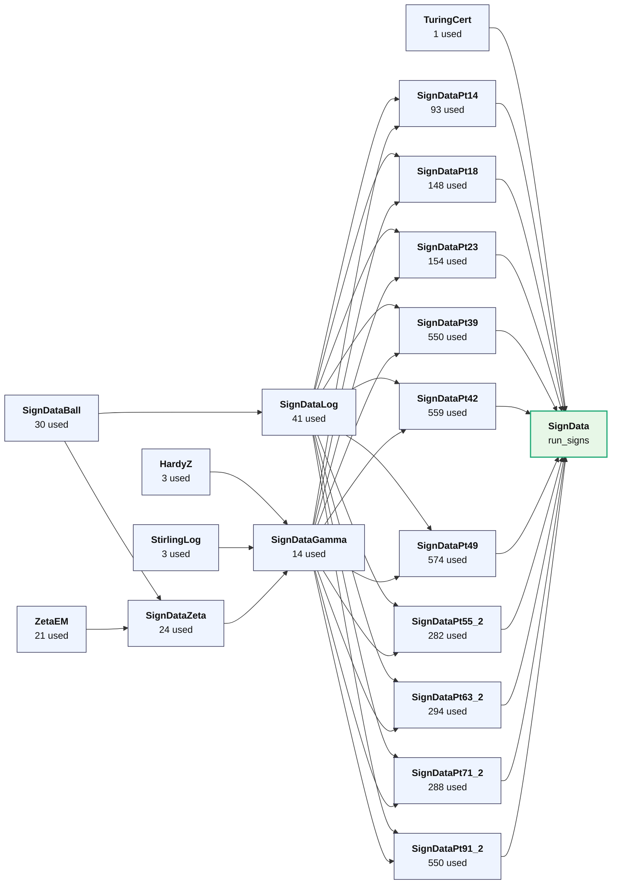

# What `SignData.run_signs` rests on

[`SignData.run_signs`](../lean_stage3/SignData.md#SignData-run_signs) in `lean_stage3/Stage3/SignData.lean`, line 102.

**Why.** Nine sign changes up to height 49.

**Proves**

```lean
Turing.StmtSignData 9 ![14, 18, 23, 55 / 2, 63 / 2, 71 / 2, 39, 42, 91 / 2, 49]
```

Behind it: 3612 theorems and 17 definitions in 19 files. Every one is listed below; Lean recorded each step.

## The files it passes through



An arrow A → B reads "B uses something proved or defined in A"; indirect arrows are left out. Green: the theorem itself. Yellow: a file in the other tree. The number is how many of that file's declarations are on the way.

## Every declaration on the way

Files in dependency order. ★ marks what the theorem's own proof uses directly.

### [`HardyZ`](../lean_stage3/HardyZ.md) — 3

- [`HardyZ.completedRiemannZeta_conj_of_re_pos`](../lean_stage3/HardyZ.md#HardyZ-completedRiemannZeta_conj_of_re_pos) — `` completedRiemannZeta (conj s) = conj (completedRiemannZeta s) ``
- [`HardyZ.re_line`](../lean_stage3/HardyZ.md#HardyZ-re_line) — `` ((1 / 2 : ℂ) + t * I).re = 1 / 2 ``
- [`HardyZ.xi_line_real`](../lean_stage3/HardyZ.md#HardyZ-xi_line_real) — `` (completedRiemannZeta (1/2 + t * Complex.I)).im = 0 ``

### [`SignDataBall`](../lean_stage3/SignDataBall.md) — 30

- [`SignData.cx`](../lean_stage3/SignDataBall.md#SignData-cx) — *def*
- [`SignData.cx_re`](../lean_stage3/SignDataBall.md#SignData-cx_re) — `` (cx a b).re = a ``
- [`SignData.cx_im`](../lean_stage3/SignDataBall.md#SignData-cx_im) — `` (cx a b).im = b ``
- [`SignData.norm_cx_le`](../lean_stage3/SignDataBall.md#SignData-norm_cx_le) — `` ‖cx a b‖ ≤ |a| + |b| ``
- [`SignData.ball_add`](../lean_stage3/SignDataBall.md#SignData-ball_add) — `` ‖z + w - cx e f‖ ≤ R ``
- [`SignData.ball_mul`](../lean_stage3/SignDataBall.md#SignData-ball_mul) — `` ‖z * w - cx e f‖ ≤ R ``
- [`SignData.ball_conj`](../lean_stage3/SignDataBall.md#SignData-ball_conj) — `` ‖(starRingEnd ℂ) z - cx a (-b)‖ ≤ r ``
- [`SignData.ball_ofReal`](../lean_stage3/SignDataBall.md#SignData-ball_ofReal) — `` ‖(x : ℂ) - cx c 0‖ ≤ e ``
- [`SignData.re_pos_of_ball`](../lean_stage3/SignDataBall.md#SignData-re_pos_of_ball) — `` 0 < z.re ``
- [`SignData.re_neg_of_ball`](../lean_stage3/SignDataBall.md#SignData-re_neg_of_ball) — `` z.re < 0 ``
- [`SignData.real_mul_ball`](../lean_stage3/SignDataBall.md#SignData-real_mul_ball) — `` |u * x - u * a| ≤ |u| * e ``
- [`SignData.neg_mul_ball`](../lean_stage3/SignDataBall.md#SignData-neg_mul_ball) — `` |-(t * x) - -(t * a)| ≤ |t| * e ``
- [`SignData.phase_ball`](../lean_stage3/SignDataBall.md#SignData-phase_ball) — `` |(t / 2) * (x - y) - (t / 2) * (a - b)| ≤ |t / 2| * (e₁ + e₂) ``
- [`SignData.cosP`](../lean_stage3/SignDataBall.md#SignData-cosP) — *def*
- [`SignData.sinP`](../lean_stage3/SignDataBall.md#SignData-sinP) — *def*
- [`SignData.taylor_eq`](../lean_stage3/SignDataBall.md#SignData-taylor_eq) — `` ∑ m ∈ Finset.range (2 * K), ((y : ℂ) * I) ^ m / (m.factorial : ℂ) = cx (cosP K y) (sinP K y) ``
- [`SignData.norm_exp_sub_exp_le`](../lean_stage3/SignDataBall.md#SignData-norm_exp_sub_exp_le) — `` ‖cexp ((y : ℂ) * I) - cexp ((y₀ : ℂ) * I)‖ ≤ |y - y₀| ``
- [`SignData.exp_ball_core`](../lean_stage3/SignDataBall.md#SignData-exp_ball_core) — `` ‖cexp ((y : ℂ) * I) - cx (cosP K y₀) (sinP K y₀)‖ ≤ ε + |y₀| ^ (2 * K) * ((2 * K + 1 : ℝ) / (((2 * K).factorial : ℝ) * (2 * K))) ``
- [`SignData.exp_reduce`](../lean_stage3/SignDataBall.md#SignData-exp_reduce) — `` cexp ((x : ℂ) * I) = cexp (((x - (j * (Real.pi / 2) + k * (2 * Real.pi)) : ℝ) : ℂ) * I) * I ^ j ``
- [`SignData.pi_ball`](../lean_stage3/SignDataBall.md#SignData-pi_ball) — `` |Real.pi - 3.14159265358979323846| ≤ 1 / 10 ^ 20 ``
- [`SignData.red_ball`](../lean_stage3/SignDataBall.md#SignData-red_ball) — `` |(x - (j * (Real.pi / 2) + k * (2 * Real.pi))) - y₀| ≤ ε' ``
- [`SignData.exp_ball_red`](../lean_stage3/SignDataBall.md#SignData-exp_ball_red) — `` ‖cexp (((x - (j * (Real.pi / 2) + k * (2 * Real.pi)) : ℝ) : ℂ) * I) - cx e f‖ ≤ R ``
- [`SignData.exp_ball0`](../lean_stage3/SignDataBall.md#SignData-exp_ball0) — `` ‖cexp ((x : ℂ) * I) - cx e f‖ ≤ R ``
- [`SignData.exp_ball1`](../lean_stage3/SignDataBall.md#SignData-exp_ball1) — `` ‖cexp ((x : ℂ) * I) - cx (-f) e‖ ≤ R ``
- [`SignData.exp_ball2`](../lean_stage3/SignDataBall.md#SignData-exp_ball2) — `` ‖cexp ((x : ℂ) * I) - cx (-e) (-f)‖ ≤ R ``
- [`SignData.exp_ball3`](../lean_stage3/SignDataBall.md#SignData-exp_ball3) — `` ‖cexp ((x : ℂ) * I) - cx f (-e)‖ ≤ R ``
- [`SignData.log_succ_ball`](../lean_stage3/SignDataBall.md#SignData-log_succ_ball) — `` |Real.log q - c| ≤ R ``
- [`SignData.log_pow_ball`](../lean_stage3/SignDataBall.md#SignData-log_pow_ball) — `` |Real.log (b ^ m) - m * a| ≤ m * e ``
- [`SignData.log_pi_ball`](../lean_stage3/SignDataBall.md#SignData-log_pi_ball) — `` |Real.log Real.pi - c| ≤ R ``
- [`SignData.inv_sqrt_ball`](../lean_stage3/SignDataBall.md#SignData-inv_sqrt_ball) — `` |(Real.sqrt m)⁻¹ - c| ≤ R ``

### [`SignDataLog`](../lean_stage3/SignDataLog.md) — 41

- [`SignData.log_ball_2`](../lean_stage3/SignDataLog.md#SignData-log_ball_2) — `` |Real.log ((2 : ℕ) : ℝ) - (0.69314718055)| ≤ (0.00000000025) ``
- [`SignData.log_ball_3`](../lean_stage3/SignDataLog.md#SignData-log_ball_3) — `` |Real.log (((3 : ℕ)) : ℝ) - (1.098612288658164142930964760306)| ≤ (0.000000000250007285403624428292) ``
- [`SignData.log_ball_4`](../lean_stage3/SignDataLog.md#SignData-log_ball_4) — `` |Real.log (((4 : ℕ)) : ℝ) - (1.386294361109944875563750019823)| ≤ (0.000000000250012022355196162294) ``
- [`SignData.log_ball_5`](../lean_stage3/SignDataLog.md#SignData-log_ball_5) — `` |Real.log (((5 : ℕ)) : ℝ) - (1.609437912424154507888186373287)| ≤ (0.000000000250014643795196162295) ``
- [`SignData.log_ball_6`](../lean_stage3/SignDataLog.md#SignData-log_ball_6) — `` |Real.log (((6 : ℕ)) : ℝ) - (1.791759469218109031470825672761)| ≤ (0.000000000250016613075280171998) ``
- [`SignData.log_ball_7`](../lean_stage3/SignDataLog.md#SignData-log_ball_7) — `` |Real.log (((7 : ℕ)) : ℝ) - (1.945910149045367043442249594592)| ≤ (0.000000000250021628181194999771) ``
- [`SignData.log_ball_8`](../lean_stage3/SignDataLog.md#SignData-log_ball_8) — `` |Real.log (((8 : ℕ)) : ℝ) - (2.079441541669889414922705144822)| ≤ (0.000000000250025688425399343201) ``
- [`SignData.log_ball_9`](../lean_stage3/SignDataLog.md#SignData-log_ball_9) — `` |Real.log (((9 : ℕ)) : ℝ) - (2.19722457732627250799617757113)| ≤ (0.000000000250031152478117664421) ``
- [`SignData.log_ball_10`](../lean_stage3/SignDataLog.md#SignData-log_ball_10) — `` |Real.log (((10 : ℕ)) : ℝ) - (2.302585092984098735657405232358)| ≤ (0.000000000250032263589228775533) ``
- [`SignData.log_ball_11`](../lean_stage3/SignDataLog.md#SignData-log_ball_11) — `` |Real.log (((11 : ℕ)) : ℝ) - (2.397895272788423390160638914682)| ≤ (0.000000000250035160233026142414) ``
- [`SignData.log_ball_12`](../lean_stage3/SignDataLog.md#SignData-log_ball_12) — `` |Real.log (((12 : ℕ)) : ℝ) - (2.484906649778053096001283444008)| ≤ (0.00000000025003600990465329859) ``
- [`SignData.log_ball_13`](../lean_stage3/SignDataLog.md#SignData-log_ball_13) — `` |Real.log (((13 : ℕ)) : ℝ) - (2.564949357451589248303973730065)| ≤ (0.000000000250039586736521464553) ``
- [`SignData.log_ball_14`](../lean_stage3/SignDataLog.md#SignData-log_ball_14) — `` |Real.log (((14 : ℕ)) : ℝ) - (2.639057329605311022970451423173)| ≤ (0.000000000250040943550219800809) ``
- [`SignData.log_ball_15`](../lean_stage3/SignDataLog.md#SignData-log_ball_15) — `` |Real.log (((15 : ℕ)) : ℝ) - (2.708050201092261790030957852678)| ≤ (0.00000000025004920142160829253) ``
- [`SignData.log_ball_16`](../lean_stage3/SignDataLog.md#SignData-log_ball_16) — `` |Real.log (((16 : ℕ)) : ℝ) - (2.772588722229832647511359697862)| ≤ (0.000000000250052990982865679732) ``
- [`SignData.log_ball_17`](../lean_stage3/SignDataLog.md#SignData-log_ball_17) — `` |Real.log (((17 : ℕ)) : ℝ) - (2.833213344046267338845182082273)| ≤ (0.000000000250054814634508383847) ``
- [`SignData.log_ball_18`](../lean_stage3/SignDataLog.md#SignData-log_ball_18) — `` |Real.log (((18 : ℕ)) : ℝ) - (2.890371757886215874872377017636)| ≤ (0.00000000025005572991355977543) ``
- [`SignData.log_ball_19`](../lean_stage3/SignDataLog.md#SignData-log_ball_19) — `` |Real.log (((19 : ℕ)) : ℝ) - (2.944438979156490822698758619737)| ≤ (0.000000000250064791233927153323) ``
- [`SignData.log_pi_ball'`](../lean_stage3/SignDataLog.md#SignData-log_pi_ball-) — `` |Real.log Real.pi - (1.144729885839454400081836469865)| ≤ (0.000000000250010002548919421399) ``
- [`SignData.log_pow2_ball_64`](../lean_stage3/SignDataLog.md#SignData-log_pow2_ball_64) — `` |Real.log (((64 : ℕ)) : ℝ) - (4.1588830833)| ≤ (0.0000000015) ``
- [`SignData.log_pow2_ball_128`](../lean_stage3/SignDataLog.md#SignData-log_pow2_ball_128) — `` |Real.log (((128 : ℕ)) : ℝ) - (4.85203026385)| ≤ (0.00000000175) ``
- [`SignData.log_pow2_ball_256`](../lean_stage3/SignDataLog.md#SignData-log_pow2_ball_256) — `` |Real.log (((256 : ℕ)) : ℝ) - (5.5451774444)| ≤ (0.000000002) ``
- [`SignData.log_pow2_ball_512`](../lean_stage3/SignDataLog.md#SignData-log_pow2_ball_512) — `` |Real.log (((512 : ℕ)) : ℝ) - (6.23832462495)| ≤ (0.00000000225) ``
- [`SignData.isqrt_ball_2`](../lean_stage3/SignDataLog.md#SignData-isqrt_ball_2) — `` |(Real.sqrt (((2 : ℕ)) : ℝ))⁻¹ - (0.707106781186547524400844362104)| ≤ (0.000000000000000000000000000001) ``
- [`SignData.isqrt_ball_3`](../lean_stage3/SignDataLog.md#SignData-isqrt_ball_3) — `` |(Real.sqrt (((3 : ℕ)) : ℝ))⁻¹ - (0.577350269189625764509148780502)| ≤ (0.000000000000000000000000000001) ``
- [`SignData.isqrt_ball_4`](../lean_stage3/SignDataLog.md#SignData-isqrt_ball_4) — `` |(Real.sqrt (((4 : ℕ)) : ℝ))⁻¹ - (0.5)| ≤ (0.000000000000000000000000000001) ``
- [`SignData.isqrt_ball_5`](../lean_stage3/SignDataLog.md#SignData-isqrt_ball_5) — `` |(Real.sqrt (((5 : ℕ)) : ℝ))⁻¹ - (0.447213595499957939281834733746)| ≤ (0.000000000000000000000000000001) ``
- [`SignData.isqrt_ball_6`](../lean_stage3/SignDataLog.md#SignData-isqrt_ball_6) — `` |(Real.sqrt (((6 : ℕ)) : ℝ))⁻¹ - (0.40824829046386301636621401245)| ≤ (0.000000000000000000000000000001) ``
- [`SignData.isqrt_ball_7`](../lean_stage3/SignDataLog.md#SignData-isqrt_ball_7) — `` |(Real.sqrt (((7 : ℕ)) : ℝ))⁻¹ - (0.377964473009227227214516536234)| ≤ (0.000000000000000000000000000001) ``
- [`SignData.isqrt_ball_8`](../lean_stage3/SignDataLog.md#SignData-isqrt_ball_8) — `` |(Real.sqrt (((8 : ℕ)) : ℝ))⁻¹ - (0.353553390593273762200422181052)| ≤ (0.000000000000000000000000000001) ``
- [`SignData.isqrt_ball_9`](../lean_stage3/SignDataLog.md#SignData-isqrt_ball_9) — `` |(Real.sqrt (((9 : ℕ)) : ℝ))⁻¹ - (0.333333333333333333333333333334)| ≤ (0.000000000000000000000000000001) ``
- [`SignData.isqrt_ball_10`](../lean_stage3/SignDataLog.md#SignData-isqrt_ball_10) — `` |(Real.sqrt (((10 : ℕ)) : ℝ))⁻¹ - (0.316227766016837933199889354444)| ≤ (0.000000000000000000000000000001) ``
- [`SignData.isqrt_ball_11`](../lean_stage3/SignDataLog.md#SignData-isqrt_ball_11) — `` |(Real.sqrt (((11 : ℕ)) : ℝ))⁻¹ - (0.30151134457776362264681206697)| ≤ (0.000000000000000000000000000001) ``
- [`SignData.isqrt_ball_12`](../lean_stage3/SignDataLog.md#SignData-isqrt_ball_12) — `` |(Real.sqrt (((12 : ℕ)) : ℝ))⁻¹ - (0.28867513459481288225457439025)| ≤ (0.000000000000000000000000000001) ``
- [`SignData.isqrt_ball_13`](../lean_stage3/SignDataLog.md#SignData-isqrt_ball_13) — `` |(Real.sqrt (((13 : ℕ)) : ℝ))⁻¹ - (0.277350098112614561009170866728)| ≤ (0.000000000000000000000000000001) ``
- [`SignData.isqrt_ball_14`](../lean_stage3/SignDataLog.md#SignData-isqrt_ball_14) — `` |(Real.sqrt (((14 : ℕ)) : ℝ))⁻¹ - (0.26726124191242438468455348088)| ≤ (0.000000000000000000000000000001) ``
- [`SignData.isqrt_ball_15`](../lean_stage3/SignDataLog.md#SignData-isqrt_ball_15) — `` |(Real.sqrt (((15 : ℕ)) : ℝ))⁻¹ - (0.258198889747161125678617693318)| ≤ (0.000000000000000000000000000001) ``
- [`SignData.isqrt_ball_16`](../lean_stage3/SignDataLog.md#SignData-isqrt_ball_16) — `` |(Real.sqrt (((16 : ℕ)) : ℝ))⁻¹ - (0.25)| ≤ (0.000000000000000000000000000001) ``
- [`SignData.isqrt_ball_17`](../lean_stage3/SignDataLog.md#SignData-isqrt_ball_17) — `` |(Real.sqrt (((17 : ℕ)) : ℝ))⁻¹ - (0.242535625036332973518906462116)| ≤ (0.000000000000000000000000000001) ``
- [`SignData.isqrt_ball_18`](../lean_stage3/SignDataLog.md#SignData-isqrt_ball_18) — `` |(Real.sqrt (((18 : ℕ)) : ℝ))⁻¹ - (0.235702260395515841466948120702)| ≤ (0.000000000000000000000000000001) ``
- [`SignData.isqrt_ball_19`](../lean_stage3/SignDataLog.md#SignData-isqrt_ball_19) — `` |(Real.sqrt (((19 : ℕ)) : ℝ))⁻¹ - (0.229415733870561765907209578098)| ≤ (0.000000000000000000000000000001) ``

### [`StirlingLog`](../lean_stage3/StirlingLog.md) — 3

- [`Stirling.logG`](../lean_stage3/StirlingLog.md#Stirling-logG) — *def*
- [`Stirling.tendsto_logG`](../lean_stage3/StirlingLog.md#Stirling-tendsto_logG) — `` Tendsto (Complex.logGammaSeq z) atTop (𝓝 (logG z)) ``
- [`Stirling.exp_logG`](../lean_stage3/StirlingLog.md#Stirling-exp_logG) — `` cexp (logG z) = Gamma z ``

### [`TuringCert`](../lean_stage3/TuringCert.md) — 1

- ★ [`Turing.StmtSignData`](../lean_stage3/TuringCert.md#Turing-StmtSignData) — *def*

### [`ZetaEM`](../lean_stage3/ZetaEM.md) — 21

- [`ZetaEM.emInt`](../lean_stage3/ZetaEM.md#ZetaEM-emInt) — *def*
- [`ZetaEM.emCoef`](../lean_stage3/ZetaEM.md#ZetaEM-emCoef) — *def*
- [`ZetaEM.emTerm`](../lean_stage3/ZetaEM.md#ZetaEM-emTerm) — *def*
- [`ZetaEM.emBoundary`](../lean_stage3/ZetaEM.md#ZetaEM-emBoundary) — *def*
- [`ZetaEM.emRem`](../lean_stage3/ZetaEM.md#ZetaEM-emRem) — *def*
- [`ZetaEM.bernBound`](../lean_stage3/ZetaEM.md#ZetaEM-bernBound) — *def*
- [`ZetaEM.hasDerivWithinAt_fract`](../lean_stage3/ZetaEM.md#ZetaEM-hasDerivWithinAt_fract) — `` HasDerivWithinAt Int.fract 1 (Ioi x) x ``
- [`ZetaEM.continuous_bernoulliFun_fract`](../lean_stage3/ZetaEM.md#ZetaEM-continuous_bernoulliFun_fract) — `` Continuous (fun x : ℝ ↦ bernoulliFun k (Int.fract x)) ``
- [`ZetaEM.abs_bernoulliFun_fract_le`](../lean_stage3/ZetaEM.md#ZetaEM-abs_bernoulliFun_fract_le) — `` |bernoulliFun k (Int.fract x)| ≤ bernBound k ``
- [`ZetaEM.measurable_bern`](../lean_stage3/ZetaEM.md#ZetaEM-measurable_bern) — `` Measurable (fun x : ℝ ↦ bernoulliFun k (Int.fract x)) ``
- [`ZetaEM.integrableOn_bern_cpow`](../lean_stage3/ZetaEM.md#ZetaEM-integrableOn_bern_cpow) — `` IntegrableOn (fun x : ℝ ↦ ((bernoulliFun k (Int.fract x) : ℝ) : ℂ) * (x:ℂ) ^ w) (Ioi a) ``
- [`ZetaEM.norm_integral_bern_cpow_le`](../lean_stage3/ZetaEM.md#ZetaEM-norm_integral_bern_cpow_le) — `` ‖∫ x in Ioi a, ((bernoulliFun k (Int.fract x) : ℝ) : ℂ) * (x:ℂ) ^ w‖ ≤ bernBound k * (-a ^ (w.re + 1) / (w.re + 1)) ``
- [`ZetaEM.interval_ibp`](../lean_stage3/ZetaEM.md#ZetaEM-interval_ibp) — `` ((k:ℂ) + 1) * ∫ x in a..b, ((bernoulliFun k (Int.fract x) : ℝ) : ℂ) * (x:ℂ) ^ (-(s + k)) = ((bernoulliFun (k+1) (Int.fract b) : ℝ) : ℂ) * (b:ℂ) ^ (-(s + k)) - (… ``
- [`ZetaEM.tail_ibp`](../lean_stage3/ZetaEM.md#ZetaEM-tail_ibp) — `` ((k:ℂ) + 1) * ∫ x in Ioi a, ((bernoulliFun k (Int.fract x) : ℝ) : ℂ) * (x:ℂ) ^ (-(s + k)) = -(((bernoulliFun (k+1) (Int.fract a) : ℝ) : ℂ) * (a:ℂ) ^ (-(s + k)))… ``
- [`ZetaEM.emInt_step`](../lean_stage3/ZetaEM.md#ZetaEM-emInt_step) — `` ((k:ℂ) + 1) * emInt k N s = -((bernoulliFun (k+1) 0 : ℂ) * (N:ℂ) ^ (-(s + k))) + (s + k) * emInt (k+1) N s ``
- [`ZetaEM.emRem_step`](../lean_stage3/ZetaEM.md#ZetaEM-emRem_step) — `` emRem k N s = emTerm k N s + emRem (k+1) N s ``
- [`ZetaEM.sum_range_succ_eq_sum_Icc`](../lean_stage3/ZetaEM.md#ZetaEM-sum_range_succ_eq_sum_Icc) — `` ∑ n ∈ Finset.range (N + 1), 1 / (n : ℂ) ^ s = ∑ n ∈ Finset.Icc 1 N, (n : ℂ) ^ (-s) ``
- [`ZetaEM.zeta_eq_em_one`](../lean_stage3/ZetaEM.md#ZetaEM-zeta_eq_em_one) — `` riemannZeta s = ∑ n ∈ Finset.Icc 1 N, (n : ℂ) ^ (-s) - (N:ℂ) ^ (1 - s) / (1 - s) - (N:ℂ) ^ (-s) / 2 - s * emInt 1 N s ``
- [`ZetaEM.zeta_eq_em`](../lean_stage3/ZetaEM.md#ZetaEM-zeta_eq_em) — `` riemannZeta s = ∑ n ∈ Finset.Icc 1 N, (n : ℂ) ^ (-s) - (N:ℂ) ^ (1 - s) / (1 - s) - (N:ℂ) ^ (-s) / 2 + emBoundary k N s + emRem k N s ``
- [`ZetaEM.norm_emInt_le`](../lean_stage3/ZetaEM.md#ZetaEM-norm_emInt_le) — `` ‖emInt k N s‖ ≤ bernBound k * ((N:ℝ) ^ (1 - s.re - k) / (s.re + k - 1)) ``
- [`ZetaEM.norm_remainder_le`](../lean_stage3/ZetaEM.md#ZetaEM-norm_remainder_le) — `` ‖emRem k N s‖ ≤ (∏ i ∈ Finset.range k, ‖s + i‖) / k.factorial * (bernBound k * ((N:ℝ) ^ (1 - s.re - k) / (s.re + k - 1))) ``

### [`SignDataZeta`](../lean_stage3/SignDataZeta.md) — 24

- [`SignData.lineS`](../lean_stage3/SignDataZeta.md#SignData-lineS) — *def*
- [`SignData.emB`](../lean_stage3/SignDataZeta.md#SignData-emB) — *def*
- [`SignData.Bre`](../lean_stage3/SignDataZeta.md#SignData-Bre) — *def*
- [`SignData.Bim`](../lean_stage3/SignDataZeta.md#SignData-Bim) — *def*
- [`SignData.lineS_re`](../lean_stage3/SignDataZeta.md#SignData-lineS_re) — `` (lineS t).re = 1 / 2 ``
- [`SignData.lineS_ne_zero`](../lean_stage3/SignDataZeta.md#SignData-lineS_ne_zero) — `` lineS t ≠ 0 ``
- [`SignData.lineS_ne_one`](../lean_stage3/SignDataZeta.md#SignData-lineS_ne_one) — `` lineS t ≠ 1 ``
- [`SignData.bernoulliFun_four`](../lean_stage3/SignDataZeta.md#SignData-bernoulliFun_four) — `` bernoulliFun 4 x = x ^ 4 - 2 * x ^ 3 + x ^ 2 - 1 / 30 ``
- [`SignData.bernBound_four_le`](../lean_stage3/SignDataZeta.md#SignData-bernBound_four_le) — `` bernBound 4 ≤ 1 / 30 ``
- [`SignData.bernoulliFun_three_zero`](../lean_stage3/SignDataZeta.md#SignData-bernoulliFun_three_zero) — `` bernoulliFun 3 0 = 0 ``
- [`SignData.bernoulliFun_four_zero`](../lean_stage3/SignDataZeta.md#SignData-bernoulliFun_four_zero) — `` bernoulliFun 4 0 = -1 / 30 ``
- [`SignData.cpow_neg_add_nat`](../lean_stage3/SignDataZeta.md#SignData-cpow_neg_add_nat) — `` (N : ℂ) ^ (-(s + j)) = (N : ℂ) ^ (-s) / (N : ℂ) ^ j ``
- [`SignData.emBoundary_four`](../lean_stage3/SignDataZeta.md#SignData-emBoundary_four) — `` emBoundary 4 N s = (N : ℂ) ^ (-s) * (s / (12 * N) - s * (s + 1) * (s + 2) / (720 * (N : ℂ) ^ 3)) ``
- [`SignData.zeta_em4`](../lean_stage3/SignDataZeta.md#SignData-zeta_em4) — `` ‖riemannZeta (lineS t) - (∑ m ∈ Finset.Icc 1 N, (m : ℂ) ^ (-lineS t) + (N : ℂ) ^ (-lineS t) * emB t N)‖ ≤ (∏ i ∈ Finset.range 4, ‖lineS t + i‖) / 24 * ((1 / 30)… ``
- [`SignData.emB_eq`](../lean_stage3/SignDataZeta.md#SignData-emB_eq) — `` emB t N = cx (Bre t N) (Bim t N) ``
- [`SignData.natCast_cpow_line`](../lean_stage3/SignDataZeta.md#SignData-natCast_cpow_line) — `` (m : ℂ) ^ (-lineS t) = (((Real.sqrt m)⁻¹ : ℝ) : ℂ) * cexp (((-(t * Real.log m)) : ℝ) * I) ``
- [`SignData.norm_le_of_sq`](../lean_stage3/SignDataZeta.md#SignData-norm_le_of_sq) — `` ‖cx a b‖ ≤ q ``
- [`SignData.lineS_add_nat`](../lean_stage3/SignDataZeta.md#SignData-lineS_add_nat) — `` lineS t + i = cx (1 / 2 + i) t ``
- [`SignData.rpow_neg_seven_half`](../lean_stage3/SignDataZeta.md#SignData-rpow_neg_seven_half) — `` N ^ (-(7 / 2) : ℝ) = 1 / (N ^ 3 * Real.sqrt N) ``
- [`SignData.rem_le`](../lean_stage3/SignDataZeta.md#SignData-rem_le) — `` (∏ i ∈ Finset.range 4, ‖lineS t + i‖) / 24 * ((1 / 30) * ((N : ℝ) ^ (-(7 / 2) : ℝ) / (7 / 2))) ≤ Q ``
- [`SignData.emB_ball`](../lean_stage3/SignDataZeta.md#SignData-emB_ball) — `` ‖emB t N - cx (Bre t N) (Bim t N)‖ ≤ 0 ``
- [`SignData.zeta_ball`](../lean_stage3/SignDataZeta.md#SignData-zeta_ball) — `` ‖riemannZeta (lineS t) - cx a b‖ ≤ R ``
- [`SignData.one_term_ball`](../lean_stage3/SignDataZeta.md#SignData-one_term_ball) — `` ‖((1 : ℕ) : ℂ) ^ (-lineS t) - cx 1 0‖ ≤ 0 ``
- [`SignData.sum_one_ball`](../lean_stage3/SignDataZeta.md#SignData-sum_one_ball) — `` ‖∑ m ∈ Finset.Icc 1 1, ((m : ℕ) : ℂ) ^ (-lineS t) - cx 1 0‖ ≤ 0 ``

### [`SignDataGamma`](../lean_stage3/SignDataGamma.md) — 14

- [`SignData.zz`](../lean_stage3/SignDataGamma.md#SignData-zz) — *def*
- [`SignData.gammaDir`](../lean_stage3/SignDataGamma.md#SignData-gammaDir) — *def*
- [`SignData.zz_re`](../lean_stage3/SignDataGamma.md#SignData-zz_re) — `` (zz t).re = 1 / 4 ``
- [`SignData.norm_zz_le`](../lean_stage3/SignDataGamma.md#SignData-norm_zz_le) — `` ‖zz t‖ ≤ 1 / 4 + |t| / 2 ``
- [`SignData.step_le`](../lean_stage3/SignDataGamma.md#SignData-step_le) — `` ‖Complex.logGammaSeq z (n + 1) - Complex.logGammaSeq z n‖ ≤ (2 * ‖z‖ + ‖z‖ ^ 2) * (1 / ((n : ℝ) + 1) ^ 2) ``
- [`SignData.tail_le`](../lean_stage3/SignDataGamma.md#SignData-tail_le) — `` ‖Stirling.logG z - Complex.logGammaSeq z n‖ ≤ (2 * ‖z‖ + ‖z‖ ^ 2) / n ``
- [`SignData.prod_shift`](../lean_stage3/SignDataGamma.md#SignData-prod_shift) — `` ∏ j ∈ Finset.range (n + 1), (z + j) = (n.factorial : ℂ) * (z * ∏ j ∈ Finset.range n, (1 + z / ((j : ℂ) + 1))) ``
- [`SignData.lineS_div_two`](../lean_stage3/SignDataGamma.md#SignData-lineS_div_two) — `` lineS t / 2 = zz t ``
- [`SignData.re_lambda_eq`](../lean_stage3/SignDataGamma.md#SignData-re_lambda_eq) — `` ∃ c : ℝ, 0 < c ∧ (completedRiemannZeta (lineS t)).re = c * (gammaDir t n * riemannZeta (lineS t)).re ``
- [`SignData.re_lambda_pos`](../lean_stage3/SignDataGamma.md#SignData-re_lambda_pos) — `` 0 < (completedRiemannZeta (lineS t)).re ``
- [`SignData.re_lambda_neg`](../lean_stage3/SignDataGamma.md#SignData-re_lambda_neg) — `` (completedRiemannZeta (lineS t)).re < 0 ``
- [`SignData.factor_ball`](../lean_stage3/SignDataGamma.md#SignData-factor_ball) — `` ‖(1 + zz t / ((j : ℂ) + 1)) - cx (1 + 1 / (4 * ((j : ℝ) + 1))) (t / (2 * ((j : ℝ) + 1)))‖ ≤ 0 ``
- [`SignData.prod_zero_ball`](../lean_stage3/SignDataGamma.md#SignData-prod_zero_ball) — `` ‖∏ j ∈ Finset.range 0, (1 + zz t / ((j : ℂ) + 1)) - cx 1 0‖ ≤ 0 ``
- [`SignData.zz_ball`](../lean_stage3/SignDataGamma.md#SignData-zz_ball) — `` ‖zz t - cx (1 / 4) (t / 2)‖ ≤ 0 ``

### [`SignDataPt14`](../lean_stage3/SignDataPt14.md) — 93

- [`SignData.p14_E2`](../lean_stage3/SignDataPt14.md#SignData-p14_E2) — `` ‖cexp ((((-((14 : ℝ) * Real.log (((2 : ℕ)) : ℝ))) : ℝ) : ℂ) * Complex.I) - cx (-(0.961253457642440241181855761014)) (-(-0.275666084548776774407564327852))‖ ≤ (0… ``
- [`SignData.p14_T2`](../lean_stage3/SignDataPt14.md#SignData-p14_T2) — `` ‖(((2 : ℕ)) : ℂ) ^ (-lineS (14 : ℝ)) - cx (-0.679708838337985220771914796136) (0.194925357727584208072744154227)‖ ≤ (0.000000002474873734174129538843) ``
- [`SignData.p14_E3`](../lean_stage3/SignDataPt14.md#SignData-p14_E3) — `` ‖cexp ((((-((14 : ℝ) * Real.log (((3 : ℕ)) : ℝ))) : ℝ) : ℂ) * Complex.I) - cx (-(0.94688447812141625126363548568)) (-(0.321573918551758778340741691955))‖ ≤ (0.0… ``
- [`SignData.p14_T3`](../lean_stage3/SignDataPt14.md#SignData-p14_T3) — `` ‖(((3 : ℕ)) : ℂ) ^ (-lineS (14 : ℝ)) - cx (-0.546684008334877980393651456295) (-0.185660788440220721249718589868)‖ ≤ (0.000000002020784829410994313809) ``
- [`SignData.p14_E4`](../lean_stage3/SignDataPt14.md#SignData-p14_E4) — `` ‖cexp ((((-((14 : ℝ) * Real.log (((4 : ℕ)) : ℝ))) : ℝ) : ℂ) * Complex.I) - cx (0.84801641958530651641591672347) (-0.52996995397259773949362267018)‖ ≤ (0.0000000… ``
- [`SignData.p14_T4`](../lean_stage3/SignDataPt14.md#SignData-p14_T4) — `` ‖(((4 : ℕ)) : ℂ) ^ (-lineS (14 : ℝ)) - cx (0.424008209792653258207958361735) (-0.26498497698629886974681133509)‖ ≤ (0.000000001750084156517625160689) ``
- [`SignData.p14_E5`](../lean_stage3/SignDataPt14.md#SignData-p14_E5) — `` ‖cexp ((((-((14 : ℝ) * Real.log (((5 : ℕ)) : ℝ))) : ℝ) : ℂ) * Complex.I) - cx (-(0.857203283964070490032921983389)) (-(-0.514978183966285247405887299478))‖ ≤ (0… ``
- [`SignData.p14_T5`](../lean_stage3/SignDataPt14.md#SignData-p14_T5) — `` ‖(((5 : ℕ)) : ℂ) ^ (-lineS (14 : ℝ)) - cx (-0.383352962695943402077332800096) (0.230305245255601215918736840507)‖ ≤ (0.000000001565339268943440107931) ``
- [`SignData.p14_E6`](../lean_stage3/SignDataPt14.md#SignData-p14_E6) — `` ‖cexp ((((-((14 : ℝ) * Real.log (((6 : ℕ)) : ℝ))) : ℝ) : ℂ) * Complex.I) - cx (0.998843001609035031450064349163) (0.048090104352696528263467439119)‖ ≤ (0.000000… ``
- [`SignData.p14_T6`](../lean_stage3/SignDataPt14.md#SignData-p14_T6) — `` ‖(((6 : ℕ)) : ℂ) ^ (-lineS (14 : ℝ)) - cx (0.407775947848682127742235136901) (0.019632702890217135414905060898)‖ ≤ (0.000000001428963968290971738045) ``
- [`SignData.p14_E7`](../lean_stage3/SignDataPt14.md#SignData-p14_E7) — `` ‖cexp ((((-((14 : ℝ) * Real.log (((7 : ℕ)) : ℝ))) : ℝ) : ℂ) * Complex.I) - cx (-0.51345354849746680672361505507) (-(0.858117389134703120953442154992))‖ ≤ (0.000… ``
- [`SignData.p14_T7`](../lean_stage3/SignDataPt14.md#SignData-p14_T7) — `` ‖(((7 : ℕ)) : ℂ) ^ (-lineS (14 : ℝ)) - cx (-0.194067199872562735994369932836) (-0.324337886764352035248896630922)‖ ≤ (0.000000001322990101142493007309) ``
- [`SignData.p14_E8`](../lean_stage3/SignDataPt14.md#SignData-p14_E8) — `` ‖cexp ((((-((14 : ℝ) * Real.log (((8 : ℕ)) : ℝ))) : ℝ) : ℂ) * Complex.I) - cx (-(0.6690639732203451906722617839)) (0.743204816816068014337900118218)‖ ≤ (0.00000… ``
- [`SignData.p14_T8`](../lean_stage3/SignDataPt14.md#SignData-p14_T8) — `` ‖(((8 : ℕ)) : ℂ) ^ (-lineS (14 : ℝ)) - cx (-0.23654983625586035967757123965) (0.262762582890573770697677455546)‖ ≤ (0.000000001237564018329688739307) ``
- [`SignData.p14_S2`](../lean_stage3/SignDataPt14.md#SignData-p14_S2) — `` ‖∑ m ∈ Finset.Icc 1 (1 + 1), ((m : ℕ) : ℂ) ^ (-lineS (14 : ℝ)) - cx (0.320291161662014779228085203864) (0.194925357727584208072744154227)‖ ≤ (0.0000000024748737… ``
- [`SignData.p14_S3`](../lean_stage3/SignDataPt14.md#SignData-p14_S3) — `` ‖∑ m ∈ Finset.Icc 1 (2 + 1), ((m : ℕ) : ℂ) ^ (-lineS (14 : ℝ)) - cx (-0.226392846672863201165566252431) (0.009264569287363486823025564359)‖ ≤ (0.000000004495658… ``
- [`SignData.p14_S4`](../lean_stage3/SignDataPt14.md#SignData-p14_S4) — `` ‖∑ m ∈ Finset.Icc 1 (3 + 1), ((m : ℕ) : ℂ) ^ (-lineS (14 : ℝ)) - cx (0.197615363119790057042392109304) (-0.255720407698935382923785770731)‖ ≤ (0.000000006245742… ``
- [`SignData.p14_S5`](../lean_stage3/SignDataPt14.md#SignData-p14_S5) — `` ‖∑ m ∈ Finset.Icc 1 (4 + 1), ((m : ℕ) : ℂ) ^ (-lineS (14 : ℝ)) - cx (-0.185737599576153345034940690792) (-0.025415162443334167005048930224)‖ ≤ (0.00000000781108… ``
- [`SignData.p14_S6`](../lean_stage3/SignDataPt14.md#SignData-p14_S6) — `` ‖∑ m ∈ Finset.Icc 1 (5 + 1), ((m : ℕ) : ℂ) ^ (-lineS (14 : ℝ)) - cx (0.222038348272528782707294446109) (-0.005782459553117031590143869326)‖ ≤ (0.000000009240045… ``
- [`SignData.p14_S7`](../lean_stage3/SignDataPt14.md#SignData-p14_S7) — `` ‖∑ m ∈ Finset.Icc 1 (6 + 1), ((m : ℕ) : ℂ) ^ (-lineS (14 : ℝ)) - cx (0.027971148399966046712924513273) (-0.330120346317469066839040500248)‖ ≤ (0.000000010563036… ``
- [`SignData.p14_S8`](../lean_stage3/SignDataPt14.md#SignData-p14_S8) — `` ‖∑ m ∈ Finset.Icc 1 (7 + 1), ((m : ℕ) : ℂ) ^ (-lineS (14 : ℝ)) - cx (-0.208578687855894312964646726377) (-0.067357763426895296141363044702)‖ ≤ (0.00000001180060… ``
- [`SignData.p14_NB`](../lean_stage3/SignDataPt14.md#SignData-p14_NB) — `` ‖(((8 : ℕ)) : ℂ) ^ (-lineS (14 : ℝ)) * emB (14 : ℝ) 8 - cx (0.231040241106962438163161808154) (-0.035947893512639355574654835797)‖ ≤ (0.000000001151464756321200… ``
- [`SignData.p14_Y`](../lean_stage3/SignDataPt14.md#SignData-p14_Y) — `` ‖(∑ m ∈ Finset.Icc 1 (7 + 1), ((m : ℕ) : ℂ) ^ (-lineS (14 : ℝ)) + (((7 + 1 : ℕ)) : ℂ) ^ (-lineS (14 : ℝ)) * emB (14 : ℝ) (7 + 1)) - cx (0.0224615532510681251985… ``
- [`SignData.p14_zeta`](../lean_stage3/SignDataPt14.md#SignData-p14_zeta) — `` ‖riemannZeta (lineS (14 : ℝ)) - cx (0.022461553251068125198515081777) (-0.103305656939534651716017880499)‖ ≤ (0.011092596427966542382196080116) ``
- [`SignData.p14_P1`](../lean_stage3/SignDataPt14.md#SignData-p14_P1) — `` ‖∏ j ∈ Finset.range (0 + 1), (1 + zz (14 : ℝ) / ((j : ℂ) + 1)) - cx (1.25) (7)‖ ≤ (0) ``
- [`SignData.p14_P2`](../lean_stage3/SignDataPt14.md#SignData-p14_P2) — `` ‖∏ j ∈ Finset.range (1 + 1), (1 + zz (14 : ℝ) / ((j : ℂ) + 1)) - cx (-23.09375) (12.25)‖ ≤ (0) ``
- [`SignData.p14_P3`](../lean_stage3/SignDataPt14.md#SignData-p14_P3) — `` ‖∏ j ∈ Finset.range (2 + 1), (1 + zz (14 : ℝ) / ((j : ℂ) + 1)) - cx (-53.6015625) (-40.614583333333333333333333333333)‖ ≤ (0.000000000000000000000000000001) ``
- [`SignData.p14_P4`](../lean_stage3/SignDataPt14.md#SignData-p14_P4) — `` ‖∏ j ∈ Finset.range (3 + 1), (1 + zz (14 : ℝ) / ((j : ℂ) + 1)) - cx (14.123860677083333333333333333333) (-136.955729166666666666666666666666)‖ ≤ (0.000000000000… ``
- [`SignData.p14_P5`](../lean_stage3/SignDataPt14.md#SignData-p14_P5) — `` ‖∏ j ∈ Finset.range (4 + 1), (1 + zz (14 : ℝ) / ((j : ℂ) + 1)) - cx (206.568074544270833333333333333332) (-124.030110677083333333333333333333)‖ ≤ (0.00000000000… ``
- [`SignData.p14_P6`](../lean_stage3/SignDataPt14.md#SignData-p14_P6) — `` ‖∏ j ∈ Finset.range (5 + 1), (1 + zz (14 : ℝ) / ((j : ℂ) + 1)) - cx (359.876873440212673611111111111109) (111.798055013020833333333333333332)‖ ≤ (0.000000000000… ``
- [`SignData.p14_P7`](../lean_stage3/SignDataPt14.md#SignData-p14_P7) — `` ‖∏ j ∈ Finset.range (6 + 1), (1 + zz (14 : ℝ) / ((j : ℂ) + 1)) - cx (260.931563907199435763888888888888) (475.667716132269965277777777777774)‖ ≤ (0.000000000000… ``
- [`SignData.p14_P8`](../lean_stage3/SignDataPt14.md#SignData-p14_P8) — `` ‖∏ j ∈ Finset.range (7 + 1), (1 + zz (14 : ℝ) / ((j : ℂ) + 1)) - cx (-147.123576336436801486545138888886) (718.847450680202907986111111111106)‖ ≤ (0.00000000000… ``
- [`SignData.p14_P9`](../lean_stage3/SignDataPt14.md#SignData-p14_P9) — `` ‖∏ j ∈ Finset.range (8 + 1), (1 + zz (14 : ℝ) / ((j : ℂ) + 1)) - cx (-710.313915097051196628146701388882) (624.385987159646587607301311728392)‖ ≤ (0.00000000000… ``
- [`SignData.p14_P10`](../lean_stage3/SignDataPt14.md#SignData-p14_P10) — `` ‖∏ j ∈ Finset.range (9 + 1), (1 + zz (14 : ℝ) / ((j : ℂ) + 1)) - cx (-1165.141953986230087868961287133478) (142.775896270701914657781153549384)‖ ≤ (0.0000000000… ``
- [`SignData.p14_P11`](../lean_stage3/SignDataPt14.md#SignData-p14_P11) — `` ‖∏ j ∈ Finset.range (10 + 1), (1 + zz (14 : ℝ) / ((j : ℂ) + 1)) - cx (-1282.479841476363808284571141372483) (-595.433167714383097743881002954889)‖ ≤ (0.00000000… ``
- [`SignData.p14_P12`](../lean_stage3/SignDataPt14.md#SignData-p14_P12) — `` ‖∏ j ∈ Finset.range (11 + 1), (1 + zz (14 : ℝ) / ((j : ℂ) + 1)) - cx (-961.862157007064580606569121760724) (-1355.951266236311633779545022983731)‖ ≤ (0.00000000… ``
- [`SignData.p14_P13`](../lean_stage3/SignDataPt14.md#SignData-p14_P13) — `` ‖∏ j ∈ Finset.range (12 + 1), (1 + zz (14 : ℝ) / ((j : ℂ) + 1)) - cx (-250.231901283801865890786592495652) (-1899.953028975429323986535031296885)‖ ≤ (0.00000000… ``
- [`SignData.p14_P14`](../lean_stage3/SignDataPt14.md#SignData-p14_P14) — `` ‖∏ j ∈ Finset.range (13 + 1), (1 + zz (14 : ℝ) / ((j : ℂ) + 1)) - cx (695.276186395273477068716876858225) (-2058.996712277605780574545024532155)‖ ≤ (0.000000000… ``
- [`SignData.p14_P15`](../lean_stage3/SignDataPt14.md#SignData-p14_P15) — `` ‖∏ j ∈ Finset.range (14 + 1), (1 + zz (14 : ℝ) / ((j : ℂ) + 1)) - cx (1667.729255231410732621316502920868) (-1768.851103831104920952052899073853)‖ ≤ (0.00000000… ``
- [`SignData.p14_P16`](../lean_stage3/SignDataPt14.md#SignData-p14_P16) — `` ‖∏ j ∈ Finset.range (15 + 1), (1 + zz (14 : ℝ) / ((j : ℂ) + 1)) - cx (2467.659882770509928235047716623817) (-1066.857853164723739820102755594002)‖ ≤ (0.00000000… ``
- [`SignData.p14_P17`](../lean_stage3/SignDataPt14.md#SignData-p14_P17) — `` ‖∏ j ∈ Finset.range (16 + 1), (1 + zz (14 : ℝ) / ((j : ℂ) + 1)) - cx (2943.243408820256614164428964759933) (-66.451693393995000838319912801754)‖ ≤ (0.0000000000… ``
- [`SignData.p14_P18`](../lean_stage3/SignDataPt14.md#SignData-p14_P18) — `` ‖∏ j ∈ Finset.range (17 + 1), (1 + zz (14 : ℝ) / ((j : ℂ) + 1)) - cx (3009.964114707091567464948222026725) (1077.220025405632640769536908038196)‖ ≤ (0.000000000… ``
- [`SignData.p14_P19`](../lean_stage3/SignDataPt14.md#SignData-p14_P19) — `` ‖∏ j ∈ Finset.range (18 + 1), (1 + zz (14 : ℝ) / ((j : ℂ) + 1)) - cx (2652.698370014320220437552364091952) (2200.328120632003647740432791259071)‖ ≤ (0.000000000… ``
- [`SignData.p14_P20`](../lean_stage3/SignDataPt14.md#SignData-p14_P20) — `` ‖∏ j ∈ Finset.range (19 + 1), (1 + zz (14 : ℝ) / ((j : ℂ) + 1)) - cx (1915.742257418297946483870291702427) (3156.276651644915770490331528581993)‖ ≤ (0.000000000… ``
- [`SignData.p14_P21`](../lean_stage3/SignDataPt14.md#SignData-p14_P21) — `` ‖∏ j ∈ Finset.range (20 + 1), (1 + zz (14 : ℝ) / ((j : ℂ) + 1)) - cx (886.456495648781950921424904695363) (3832.432126161073607062220810680207)‖ ≤ (0.0000000000… ``
- [`SignData.p14_P22`](../lean_stage3/SignDataPt14.md#SignData-p14_P22) — `` ‖∏ j ∈ Finset.range (21 + 1), (1 + zz (14 : ℝ) / ((j : ℂ) + 1)) - cx (-322.88035704282349279244734296771) (4158.036830755698246072017607750098)‖ ≤ (0.0000000000… ``
- [`SignData.p14_P23`](../lean_stage3/SignDataPt14.md#SignData-p14_P23) — `` ‖∏ j ∈ Finset.range (22 + 1), (1 + zz (14 : ℝ) / ((j : ℂ) + 1)) - cx (-1591.879396371110170866457564271737) (4104.964948511748685722925129539818)‖ ≤ (0.00000000… ``
- [`SignData.p14_P24`](../lean_stage3/SignDataPt14.md#SignData-p14_P24) — `` ‖∏ j ∈ Finset.range (23 + 1), (1 + zz (14 : ℝ) / ((j : ℂ) + 1)) - cx (-2805.742916732569268482169660015348) (3683.426842783838934696488810059934)‖ ≤ (0.00000000… ``
- [`SignData.p14_P25`](../lean_stage3/SignDataPt14.md#SignData-p14_P25) — `` ‖∏ j ∈ Finset.range (24 + 1), (1 + zz (14 : ℝ) / ((j : ℂ) + 1)) - cx (-3865.159861879369862882008223432283) (2934.653094526557928868446193356236)‖ ≤ (0.00000000… ``
- [`SignData.p14_P26`](../lean_stage3/SignDataPt14.md#SignData-p14_P26) — `` ‖∏ j ∈ Finset.range (25 + 1), (1 + zz (14 : ℝ) / ((j : ℂ) + 1)) - cx (-4692.42377061612940010507073917658) (1922.250949929482945870102115829816)‖ ≤ (0.000000000… ``
- [`SignData.p14_P27`](../lean_stage3/SignDataPt14.md#SignData-p14_P27) — `` ‖∏ j ∈ Finset.range (26 + 1), (1 + zz (14 : ℝ) / ((j : ℂ) + 1)) - cx (-5234.233496251700250887181201976686) (723.495258935759424971288425263942)‖ ≤ (0.000000000… ``
- [`SignData.p14_P28`](../lean_stage3/SignDataPt14.md#SignData-p14_P28) — `` ‖∏ j ∈ Finset.range (27 + 1), (1 + zz (14 : ℝ) / ((j : ℂ) + 1)) - cx (-5461.841538630744573655781711881749) (-578.603336029524928598977514290373)‖ ≤ (0.00000000… ``
- [`SignData.p14_P29`](../lean_stage3/SignDataPt14.md#SignData-p14_P29) — `` ‖∏ j ∈ Finset.range (28 + 1), (1 + zz (14 : ℝ) / ((j : ℂ) + 1)) - cx (-5369.263505266986354456509395603743) (-1901.96683963030400610726083710916)‖ ≤ (0.00000000… ``
- [`SignData.p14_P30`](../lean_stage3/SignDataPt14.md#SignData-p14_P30) — `` ‖∏ j ∈ Finset.range (29 + 1), (1 + zz (14 : ℝ) / ((j : ℂ) + 1)) - cx (-4970.215105230473639318619445241637) (-3170.644714522853355531340203059276)‖ ≤ (0.0000000… ``
- [`SignData.p14_P31`](../lean_stage3/SignDataPt14.md#SignData-p14_P31) — `` ‖∏ j ∈ Finset.range (30 + 1), (1 + zz (14 : ℝ) / ((j : ℂ) + 1)) - cx (-4294.345452799752507741531491689878) (-4318.521066627499446309184434267543)‖ ≤ (0.0000000… ``
- [`SignData.p14_P32`](../lean_stage3/SignDataPt14.md#SignData-p14_P32) — `` ‖∏ j ∈ Finset.range (31 + 1), (1 + zz (14 : ℝ) / ((j : ℂ) + 1)) - cx (-3383.21854332498507032812811147268) (-5291.647580260472646801934951467419)‖ ≤ (0.00000000… ``
- [`SignData.p14_P33`](../lean_stage3/SignDataPt14.md#SignData-p14_P33) — `` ‖∏ j ∈ Finset.range (32 + 1), (1 + zz (14 : ℝ) / ((j : ℂ) + 1)) - cx (-2286.378287991892274569597425642263) (-6049.388237785927606013976785351529)‖ ≤ (0.0000000… ``
- [`SignData.p14_P34`](../lean_stage3/SignDataPt14.md#SignData-p14_P34) — `` ‖∏ j ∈ Finset.range (33 + 1), (1 + zz (14 : ℝ) / ((j : ℂ) + 1)) - cx (-1057.727608800612269467966892081965) (-6564.593975297390189057820202287815)‖ ≤ (0.0000000… ``
- [`SignData.p14_P35`](../lean_stage3/SignDataPt14.md#SignData-p14_P35) — `` ‖∏ j ∈ Finset.range (34 + 1), (1 + zz (14 : ℝ) / ((j : ℂ) + 1)) - cx (247.635989053147109275968813432155) (-6823.029454023922572873255153577692)‖ ≤ (0.000000000… ``
- [`SignData.p14_P36`](../lean_stage3/SignDataPt14.md#SignData-p14_P36) — `` ‖∏ j ∈ Finset.range (35 + 1), (1 + zz (14 : ℝ) / ((j : ℂ) + 1)) - cx (1576.055855037334464482407098943318) (-6822.260160694310097270103267310174)‖ ≤ (0.00000000… ``
- [`SignData.p14_P37`](../lean_stage3/SignDataPt14.md#SignData-p14_P37) — `` ‖∏ j ∈ Finset.range (36 + 1), (1 + zz (14 : ℝ) / ((j : ℂ) + 1)) - cx (2877.402749324348094131361819102968) (-6570.183783800046212754986405802723)‖ ≤ (0.00000000… ``
- [`SignData.p14_P38`](../lean_stage3/SignDataPt14.md#SignData-p14_P38) — `` ‖∏ j ∈ Finset.range (37 + 1), (1 + zz (14 : ℝ) / ((j : ℂ) + 1)) - cx (4106.630043375174686573934063718621) (-6083.360802238982394183123612848247)‖ ≤ (0.00000000… ``
- [`SignData.p14_P39`](../lean_stage3/SignDataPt14.md#SignData-p14_P39) — `` ‖∏ j ∈ Finset.range (38 + 1), (1 + zz (14 : ℝ) / ((j : ℂ) + 1)) - cx (5224.839867132012389930994289510092) (-5385.269261134713747837693932263163)‖ ≤ (0.00000000… ``
- [`SignData.p14_P40`](../lean_stage3/SignDataPt14.md#SignData-p14_P40) — `` ‖∏ j ∈ Finset.range (39 + 1), (1 + zz (14 : ℝ) / ((j : ℂ) + 1)) - cx (6199.917237000162373239659441965584) (-4504.580217268703540523755518675542)‖ ≤ (0.00000000… ``
- [`SignData.p14_P41`](../lean_stage3/SignDataPt14.md#SignData-p14_P41) — `` ‖∏ j ∈ Finset.range (40 + 1), (1 + zz (14 : ℝ) / ((j : ℂ) + 1)) - cx (7006.79628163750299219029855150754) (-3473.524714715436205705543879307488)‖ ≤ (0.000000000… ``
- [`SignData.p14_P42`](../lean_stage3/SignDataPt14.md#SignData-p14_P42) — `` ‖∏ j ∈ Finset.range (41 + 1), (1 + zz (14 : ℝ) / ((j : ℂ) + 1)) - cx (7627.424188147441782380450498960619) (-2326.401076792015684422074739052109)‖ ≤ (0.00000000… ``
- [`SignData.p14_P43`](../lean_stage3/SignDataPt14.md#SignData-p14_P43) — `` ‖∏ j ∈ Finset.range (42 + 1), (1 + zz (14 : ℝ) / ((j : ℂ) + 1)) - cx (8050.486131974906206486255982637478) (-1098.252959400525252897478580727427)‖ ≤ (0.00000000… ``
- [`SignData.p14_P44`](../lean_stage3/SignDataPt14.md#SignData-p14_P44) — `` ‖∏ j ∈ Finset.range (43 + 1), (1 + zz (14 : ℝ) / ((j : ℂ) + 1)) - cx (8270.949592174847191074981302200009) (176.266124326161386470235560938039)‖ ≤ (0.0000000000… ``
- [`SignData.p14_P45`](../lean_stage3/SignDataPt14.md#SignData-p14_P45) — `` ‖∏ j ∈ Finset.range (44 + 1), (1 + zz (14 : ℝ) / ((j : ℂ) + 1)) - cx (8289.480137236193459796694555510759) (1463.837539355171846117845072174363)‖ ≤ (0.000000000… ``
- [`SignData.p14_P46`](../lean_stage3/SignDataPt14.md#SignData-p14_P46) — `` ‖∏ j ∈ Finset.range (45 + 1), (1 + zz (14 : ℝ) / ((j : ℂ) + 1)) - cx (8111.773773297559665060265384503306) (2733.235807735435915250591227753035)‖ ≤ (0.000000000… ``
- [`SignData.p14_P47`](../lean_stage3/SignDataPt14.md#SignData-p14_P47) — `` ‖∏ j ∈ Finset.range (46 + 1), (1 + zz (14 : ℝ) / ((j : ℂ) + 1)) - cx (7747.843832641737080156242570712978) (3955.910815501750311723665812826682)‖ ≤ (0.000000000… ``
- [`SignData.p14_P48`](../lean_stage3/SignDataPt14.md#SignData-p14_P48) — `` ‖∏ j ∈ Finset.range (47 + 1), (1 + zz (14 : ℝ) / ((j : ℂ) + 1)) - cx (7211.293525342740873655688403064884) (5106.40840992607525212001194716413)‖ ≤ (0.0000000000… ``
- [`SignData.p14_P49`](../lean_stage3/SignDataPt14.md#SignData-p14_P49) — `` ‖∏ j ∈ Finset.range (48 + 1), (1 + zz (14 : ℝ) / ((j : ℂ) + 1)) - cx (6518.598923543825740055154494301972) (6162.646303393028413928579739169134)‖ ≤ (0.000000000… ``
- [`SignData.p14_P50`](../lean_stage3/SignDataPt14.md#SignData-p14_P50) — `` ‖∏ j ∈ Finset.range (49 + 1), (1 + zz (14 : ℝ) / ((j : ℂ) + 1)) - cx (5688.421435686520890805429103289803) (7106.063384206129159605944267067256)‖ ≤ (0.000000000… ``
- [`SignData.p14_P51`](../lean_stage3/SignDataPt14.md#SignData-p14_P51) — `` ‖∏ j ∈ Finset.range (50 + 1), (1 + zz (14 : ℝ) / ((j : ℂ) + 1)) - cx (4740.963821362574343853659444590816) (7921.660754713132660106718576671088)‖ ≤ (0.000000000… ``
- [`SignData.p14_P52`](../lean_stage3/SignDataPt14.md#SignData-p14_P52) — `` ‖∏ j ∈ Finset.range (51 + 1), (1 + zz (14 : ℝ) / ((j : ℂ) + 1)) - cx (3697.379507369280400877051460445625) (8597.952330448061574952916571984617)‖ ≤ (0.000000000… ``
- [`SignData.p14_P53`](../lean_stage3/SignDataPt14.md#SignData-p14_P53) — `` ‖∏ j ∈ Finset.range (52 + 1), (1 + zz (14 : ℝ) / ((j : ℂ) + 1)) - cx (2579.241367061844345698727816317683) (9126.841851848004559856267314741514)‖ ≤ (0.000000000… ``
- [`SignData.p14_P54`](../lean_stage3/SignDataPt14.md#SignData-p14_P54) — `` ‖∏ j ∈ Finset.range (53 + 1), (1 + zz (14 : ℝ) / ((j : ℂ) + 1)) - cx (1408.07317037350044139189097837118) (9503.441852447910329483214750721313)‖ ≤ (0.0000000000… ``
- [`SignData.p14_P55`](../lean_stage3/SignDataPt14.md#SignData-p14_P55) — `` ‖∏ j ∈ Finset.range (54 + 1), (1 + zz (14 : ℝ) / ((j : ℂ) + 1)) - cx (204.9445399272823105548995145447) (9725.848628006573614430742760471833)‖ ≤ (0.000000000000… ``
- [`SignData.p14_P56`](../lean_stage3/SignDataPt14.md#SignData-p14_P56) — `` ‖∏ j ∈ Finset.range (55 + 1), (1 + zz (14 : ℝ) / ((j : ℂ) + 1)) - cx (-1009.871607591721166648251814824347) (9794.885662586798964028813872827741)‖ ≤ (0.00000000… ``
- [`SignData.p14_P57`](../lean_stage3/SignDataPt14.md#SignData-p14_P57) — `` ‖∏ j ∈ Finset.range (56 + 1), (1 + zz (14 : ℝ) / ((j : ℂ) + 1)) - cx (-2217.181564433923325242352868569966) (9713.826367192143728493190026589785)‖ ≤ (0.00000000… ``
- [`SignData.p14_P58`](../lean_stage3/SignDataPt14.md#SignData-p14_P58) — `` ‖∏ j ∈ Finset.range (57 + 1), (1 + zz (14 : ℝ) / ((j : ℂ) + 1)) - cx (-3399.096736183121375772748013453949) (9488.105429963877739793652568428711)‖ ≤ (0.00000000… ``
- [`SignData.p14_P59`](../lean_stage3/SignDataPt14.md#SignData-p14_P59) — `` ‖∏ j ∈ Finset.range (58 + 1), (1 + zz (14 : ℝ) / ((j : ℂ) + 1)) - cx (-4539.207112349103147340523521629618) (9125.026602916574685633299637037686)‖ ≤ (0.00000000… ``
- [`SignData.p14_P60`](../lean_stage3/SignDataPt14.md#SignData-p14_P60) — `` ‖∏ j ∈ Finset.range (59 + 1), (1 + zz (14 : ℝ) / ((j : ℂ) + 1)) - cx (-5622.706912324158123778327327290805) (8633.473383987998379633710641335221)‖ ≤ (0.00000000… ``
- [`SignData.p14_P61`](../lean_stage3/SignDataPt14.md#SignData-p14_P61) — `` ‖∏ j ∈ Finset.range (60 + 1), (1 + zz (14 : ℝ) / ((j : ℂ) + 1)) - cx (-6636.477247012633995718992185014891) (8023.627809557308096493712876897486)‖ ≤ (0.00000000… ``
- [`SignData.p14_P62`](../lean_stage3/SignDataPt14.md#SignData-p14_P62) — `` ‖∏ j ∈ Finset.range (61 + 1), (1 + zz (14 : ℝ) / ((j : ℂ) + 1)) - cx (-7569.130698281251982402633123475151) (7306.701458320225661882269053092972)‖ ≤ (0.00000000… ``
- [`SignData.p14_P63`](../lean_stage3/SignDataPt14.md#SignData-p14_P63) — `` ‖∏ j ∈ Finset.range (62 + 1), (1 + zz (14 : ℝ) / ((j : ℂ) + 1)) - cx (-8411.02264880207567492289568938816) (6494.681783345801733924366440377848)‖ ≤ (0.000000000… ``
- [`SignData.p14_P64`](../lean_stage3/SignDataPt14.md#SignData-p14_P64) — `` ‖∏ j ∈ Finset.range (63 + 1), (1 + zz (14 : ℝ) / ((j : ℂ) + 1)) - cx (-9154.23402607740584767604083009116) (5600.096031849269245002816780758744)‖ ≤ (0.000000000… ``
- [`SignData.p14_W`](../lean_stage3/SignDataPt14.md#SignData-p14_W) — `` ‖zz (14 : ℝ) * ∏ j ∈ Finset.range (63 + 1), (1 + zz (14 : ℝ) / ((j : ℂ) + 1)) - cx (-41489.230729464236176938727672833998) (-62679.61417457952362248158161544843… ``
- [`SignData.p14_phase`](../lean_stage3/SignDataPt14.md#SignData-p14_phase) — `` ‖cexp (((((14 : ℝ) / 2) * (Real.log (((64 : ℕ)) : ℝ) - Real.log Real.pi) : ℝ) : ℂ) * Complex.I) - cx (-(0.6277973203200831287054920208)) (0.77837685255852960721… ``
- [`SignData.p14_G`](../lean_stage3/SignDataPt14.md#SignData-p14_G) — `` ‖gammaDir (14 : ℝ) 64 - cx (-22741.532926692913019148935605107414) (-71644.350647772723613163941115458181)‖ ≤ (0.001276075643759393038301710258) ``
- [`SignData.p14_X`](../lean_stage3/SignDataPt14.md#SignData-p14_X) — `` ‖gammaDir (14 : ℝ) 64 * riemannZeta (lineS (14 : ℝ)) - cx (-7912.076862518368201589090303406906) (740.085601590925346170149545019006)‖ ≤ (1046.98468963204930167… ``
- ★ [`SignData.sign_14`](../lean_stage3/SignDataPt14.md#SignData-sign_14) — `` (completedRiemannZeta (lineS (14 : ℝ))).re < 0 ``

### [`SignDataPt18`](../lean_stage3/SignDataPt18.md) — 148

- [`SignData.p18_E2`](../lean_stage3/SignDataPt18.md#SignData-p18_E2) — `` ‖cexp ((((-((18 : ℝ) * Real.log (((2 : ℕ)) : ℝ))) : ℝ) : ℂ) * Complex.I) - cx (0.995977737708063064466978646882) (0.089601037884216125280980468076)‖ ≤ (0.000000… ``
- [`SignData.p18_T2`](../lean_stage3/SignDataPt18.md#SignData-p18_T2) — `` ‖(((2 : ℕ)) : ℂ) ^ (-lineS (18 : ℝ)) - cx (0.704262612244207972588033412246) (0.063357501489281966856773607032)‖ ≤ (0.000000003181980515367748131054) ``
- [`SignData.p18_E3`](../lean_stage3/SignDataPt18.md#SignData-p18_E3) — `` ‖cexp ((((-((18 : ℝ) * Real.log (((3 : ℕ)) : ℝ))) : ℝ) : ℂ) * Complex.I) - cx (0.601462949529781653519223575226) (-(0.798900694919547136211476519698))‖ ≤ (0.000… ``
- [`SignData.p18_T3`](../lean_stage3/SignDataPt18.md#SignData-p18_T3) — `` ‖(((3 : ℕ)) : ℂ) ^ (-lineS (18 : ℝ)) - cx (0.3472547958186057327991009419) (-0.461245531267579627490884968333)‖ ≤ (0.000000002598151923527790665535) ``
- [`SignData.p18_E4`](../lean_stage3/SignDataPt18.md#SignData-p18_E4) — `` ‖cexp ((((-((18 : ℝ) * Real.log (((4 : ℕ)) : ℝ))) : ℝ) : ℂ) * Complex.I) - cx (0.983943308052092067197798929696) (0.178481277840298572193831814911)‖ ≤ (0.000000… ``
- [`SignData.p18_T4`](../lean_stage3/SignDataPt18.md#SignData-p18_T4) — `` ‖(((4 : ℕ)) : ℂ) ^ (-lineS (18 : ℝ)) - cx (0.491971654026046033598899464848) (0.089240638920149286096915907456)‖ ≤ (0.000000002250108201238015282242) ``
- [`SignData.p18_E5`](../lean_stage3/SignDataPt18.md#SignData-p18_E5) — `` ‖cexp ((((-((18 : ℝ) * Real.log (((5 : ℕ)) : ℝ))) : ℝ) : ℂ) * Complex.I) - cx (-(0.767702308378372450788553004497)) (-(-0.640806652361317429190678761538))‖ ≤ (0… ``
- [`SignData.p18_T5`](../lean_stage3/SignDataPt18.md#SignData-p18_T5) — `` ‖(((5 : ℕ)) : ℂ) ^ (-lineS (18 : ℝ)) - cx (-0.343326909603509428044868072338) (0.286577447022796379837176706911)‖ ≤ (0.000000002012579060068804448516) ``
- [`SignData.p18_S2`](../lean_stage3/SignDataPt18.md#SignData-p18_S2) — `` ‖∑ m ∈ Finset.Icc 1 (1 + 1), ((m : ℕ) : ℂ) ^ (-lineS (18 : ℝ)) - cx (1.704262612244207972588033412246) (0.063357501489281966856773607032)‖ ≤ (0.0000000031819805… ``
- [`SignData.p18_S3`](../lean_stage3/SignDataPt18.md#SignData-p18_S3) — `` ‖∑ m ∈ Finset.Icc 1 (2 + 1), ((m : ℕ) : ℂ) ^ (-lineS (18 : ℝ)) - cx (2.051517408062813705387134354146) (-0.397888029778297660634111361301)‖ ≤ (0.000000005780132… ``
- [`SignData.p18_S4`](../lean_stage3/SignDataPt18.md#SignData-p18_S4) — `` ‖∑ m ∈ Finset.Icc 1 (3 + 1), ((m : ℕ) : ℂ) ^ (-lineS (18 : ℝ)) - cx (2.543489062088859738986033818994) (-0.308647390858148374537195453845)‖ ≤ (0.000000008030240… ``
- [`SignData.p18_S5`](../lean_stage3/SignDataPt18.md#SignData-p18_S5) — `` ‖∑ m ∈ Finset.Icc 1 (4 + 1), ((m : ℕ) : ℂ) ^ (-lineS (18 : ℝ)) - cx (2.200162152485350310941165746656) (-0.022069943835351994700018746934)‖ ≤ (0.000000010042819… ``
- [`SignData.p18_NB`](../lean_stage3/SignDataPt18.md#SignData-p18_NB) — `` ‖(((5 : ℕ)) : ℂ) ^ (-lineS (18 : ℝ)) * emB (18 : ℝ) 5 - cx (0.141224320466166103312657346197) (-0.168029309493868459311464770731)‖ ≤ (0.000000001145729041339163… ``
- [`SignData.p18_Y`](../lean_stage3/SignDataPt18.md#SignData-p18_Y) — `` ‖(∑ m ∈ Finset.Icc 1 (4 + 1), ((m : ℕ) : ℂ) ^ (-lineS (18 : ℝ)) + (((4 + 1 : ℕ)) : ℂ) ^ (-lineS (18 : ℝ)) * emB (18 : ℝ) (4 + 1)) - cx (2.3413864729515164142538… ``
- [`SignData.p18_zeta`](../lean_stage3/SignDataPt18.md#SignData-p18_zeta) — `` ‖riemannZeta (lineS (18 : ℝ)) - cx (2.341386472951516414253823092853) (-0.190099253329220454011483517665)‖ ≤ (0.153876495863139559208929366543) ``
- [`SignData.p18_P1`](../lean_stage3/SignDataPt18.md#SignData-p18_P1) — `` ‖∏ j ∈ Finset.range (0 + 1), (1 + zz (18 : ℝ) / ((j : ℂ) + 1)) - cx (1.25) (9)‖ ≤ (0) ``
- [`SignData.p18_P2`](../lean_stage3/SignDataPt18.md#SignData-p18_P2) — `` ‖∏ j ∈ Finset.range (1 + 1), (1 + zz (18 : ℝ) / ((j : ℂ) + 1)) - cx (-39.09375) (15.75)‖ ≤ (0) ``
- [`SignData.p18_P3`](../lean_stage3/SignDataPt18.md#SignData-p18_P3) — `` ‖∏ j ∈ Finset.range (2 + 1), (1 + zz (18 : ℝ) / ((j : ℂ) + 1)) - cx (-89.6015625) (-100.21875)‖ ≤ (0) ``
- [`SignData.p18_P4`](../lean_stage3/SignDataPt18.md#SignData-p18_P4) — `` ‖∏ j ∈ Finset.range (3 + 1), (1 + zz (18 : ℝ) / ((j : ℂ) + 1)) - cx (130.29052734375) (-308.0859375)‖ ≤ (0) ``
- [`SignData.p18_P5`](../lean_stage3/SignDataPt18.md#SignData-p18_P5) — `` ‖∏ j ∈ Finset.range (4 + 1), (1 + zz (18 : ℝ) / ((j : ℂ) + 1)) - cx (691.3597412109375) (-88.96728515625)‖ ≤ (0) ``
- [`SignData.p18_P6`](../lean_stage3/SignDataPt18.md#SignData-p18_P6) — `` ‖∏ j ∈ Finset.range (5 + 1), (1 + zz (18 : ℝ) / ((j : ℂ) + 1)) - cx (853.6173248291015625) (944.3653564453125)‖ ≤ (0) ``
- [`SignData.p18_P7`](../lean_stage3/SignDataPt18.md#SignData-p18_P7) — `` ‖∏ j ∈ Finset.range (6 + 1), (1 + zz (18 : ℝ) / ((j : ℂ) + 1)) - cx (-330.080371856689453125) (2075.600679670061383928571428571429)‖ ≤ (0.0000000000000000000000… ``
- [`SignData.p18_P8`](../lean_stage3/SignDataPt18.md#SignData-p18_P8) — `` ‖∏ j ∈ Finset.range (7 + 1), (1 + zz (18 : ℝ) / ((j : ℂ) + 1)) - cx (-2675.446148106030055454799107142858) (1769.122782570975167410714285714286)‖ ≤ (0.000000000… ``
- [`SignData.p18_P9`](../lean_stage3/SignDataPt18.md#SignData-p18_P9) — `` ‖∏ j ∈ Finset.range (8 + 1), (1 + zz (18 : ℝ) / ((j : ℂ) + 1)) - cx (-4518.886879235506057739257812500001) (-857.181066019194466727120535714286)‖ ≤ (0.000000000… ``
- [`SignData.p18_P10`](../lean_stage3/SignDataPt18.md#SignData-p18_P10) — `` ‖∏ j ∈ Finset.range (9 + 1), (1 + zz (18 : ℝ) / ((j : ℂ) + 1)) - cx (-3860.396091799118689128330775669644) (-4945.608783981629780360630580357144)‖ ≤ (0.00000000… ``
- [`SignData.p18_P11`](../lean_stage3/SignDataPt18.md#SignData-p18_P11) — `` ‖∏ j ∈ Finset.range (10 + 1), (1 + zz (18 : ℝ) / ((j : ℂ) + 1)) - cx (98.274820281325706413813999720982) (-8216.514876907763930110188273640424)‖ ≤ (0.0000000000… ``
- [`SignData.p18_P12`](../lean_stage3/SignDataPt18.md#SignData-p18_P12) — `` ‖∏ j ∈ Finset.range (11 + 1), (1 + zz (18 : ℝ) / ((j : ℂ) + 1)) - cx (6262.708370051342939546742996612154) (-8313.98615496568139884379002955053)‖ ≤ (0.000000000… ``
- [`SignData.p18_P13`](../lean_stage3/SignDataPt18.md#SignData-p18_P13) — `` ‖∏ j ∈ Finset.range (12 + 1), (1 + zz (18 : ℝ) / ((j : ℂ) + 1)) - cx (12138.981638297802041429881151620447) (-4138.149324833322467596886994002703)‖ ≤ (0.0000000… ``
- [`SignData.p18_P14`](../lean_stage3/SignDataPt18.md#SignData-p18_P14) — `` ‖∏ j ∈ Finset.range (13 + 1), (1 + zz (18 : ℝ) / ((j : ℂ) + 1)) - cx (15015.988019231684378481984954043978) (3591.586204700383800686663621431822)‖ ≤ (0.00000000… ``
- [`SignData.p18_P15`](../lean_stage3/SignDataPt18.md#SignData-p18_P15) — `` ‖∏ j ∈ Finset.range (14 + 1), (1 + zz (18 : ℝ) / ((j : ℂ) + 1)) - cx (13111.302763398648837711353197085618) (12661.038786317734157787298987548739)‖ ≤ (0.0000000… ``
- [`SignData.p18_P16`](../lean_stage3/SignDataPt18.md#SignData-p18_P16) — `` ‖∏ j ∈ Finset.range (15 + 1), (1 + zz (18 : ℝ) / ((j : ℂ) + 1)) - cx (6194.332551773027262045237410293915) (20233.975321765688725215361707589848)‖ ≤ (0.00000000… ``
- [`SignData.p18_P17`](../lean_stage3/SignDataPt18.md#SignData-p18_P17) — `` ‖∏ j ∈ Finset.range (16 + 1), (1 + zz (18 : ℝ) / ((j : ℂ) + 1)) - cx (-4426.678904576851662156347649455212) (23810.886309789139756963066244033536)‖ ≤ (0.0000000… ``
- [`SignData.p18_P18`](../lean_stage3/SignDataPt18.md#SignData-p18_P18) — `` ‖∏ j ∈ Finset.range (17 + 1), (1 + zz (18 : ℝ) / ((j : ℂ) + 1)) - cx (-16393.603710923877813723385599936636) (21928.253611803340866953823894917507)‖ ≤ (0.000000… ``
- [`SignData.p18_P19`](../lean_stage3/SignDataPt18.md#SignData-p18_P19) — `` ‖∏ j ∈ Finset.range (18 + 1), (1 + zz (18 : ℝ) / ((j : ℂ) + 1)) - cx (-26996.376523237616616671557255423042) (14451.392033099969019228981030406962)‖ ≤ (0.000000… ``
- [`SignData.p18_P20`](../lean_stage3/SignDataPt18.md#SignData-p18_P20) — `` ‖∏ j ∈ Finset.range (19 + 1), (1 + zz (18 : ℝ) / ((j : ℂ) + 1)) - cx (-33836.957644673072883032993184798963) (2483.66499805679115446714252834668)‖ ≤ (0.00000000… ``
- [`SignData.p18_P21`](../lean_stage3/SignDataPt18.md#SignData-p18_P21) — `` ‖∏ j ∈ Finset.range (20 + 1), (1 + zz (18 : ℝ) / ((j : ℂ) + 1)) - cx (-35304.206425324472340697875615814194) (-11988.320837778611614993817139801129)‖ ≤ (0.00000… ``
- [`SignData.p18_P22`](../lean_stage3/SignDataPt18.md#SignData-p18_P22) — `` ‖∏ j ∈ Finset.range (21 + 1), (1 + zz (18 : ℝ) / ((j : ℂ) + 1)) - cx (-30801.077519248272956617426281529803) (-26567.181657658834522722423268313767)‖ ≤ (0.00000… ``
- [`SignData.p18_P23`](../lean_stage3/SignDataPt18.md#SignData-p18_P23) — `` ‖∏ j ∈ Finset.range (22 + 1), (1 + zz (18 : ℝ) / ((j : ℂ) + 1)) - cx (-20740.018147982297197254493549162783) (-38908.550922339233011428399022698405)‖ ≤ (0.00000… ``
- [`SignData.p18_P24`](../lean_stage3/SignDataPt18.md#SignData-p18_P24) — `` ‖∏ j ∈ Finset.range (23 + 1), (1 + zz (18 : ℝ) / ((j : ℂ) + 1)) - cx (-6365.353407813233747106911556787993) (-47091.35513327362813760121326012089)‖ ≤ (0.0000000… ``
- [`SignData.p18_P25`](../lean_stage3/SignDataPt18.md#SignData-p18_P25) — `` ‖∏ j ∈ Finset.range (24 + 1), (1 + zz (18 : ℝ) / ((j : ℂ) + 1)) - cx (10523.880906087140044958456101287647) (-49853.795911419128567935713553165776)‖ ≤ (0.000000… ``
- [`SignData.p18_P26`](../lean_stage3/SignDataPt18.md#SignData-p18_P26) — `` ‖∏ j ∈ Finset.range (25 + 1), (1 + zz (18 : ℝ) / ((j : ℂ) + 1)) - cx (27882.155268752291665060803639895874) (-46690.2774815372255578340913791928)‖ ≤ (0.00000000… ``
- [`SignData.p18_P27`](../lean_stage3/SignDataPt18.md#SignData-p18_P27) — `` ‖∏ j ∈ Finset.range (26 + 1), (1 + zz (18 : ℝ) / ((j : ℂ) + 1)) - cx (43703.749200271665847904211911107325) (-37828.543109374769313534509530516331)‖ ≤ (0.000000… ``
- [`SignData.p18_P28`](../lean_stage3/SignDataPt18.md#SignData-p18_P28) — `` ‖∏ j ∈ Finset.range (27 + 1), (1 + zz (18 : ℝ) / ((j : ℂ) + 1)) - cx (56253.135817573124429468020437979604) (-24118.664287049722874150428108468587)‖ ≤ (0.000000… ``
- [`SignData.p18_P29`](../lean_stage3/SignDataPt18.md#SignData-p18_P29) — `` ‖∏ j ∈ Finset.range (28 + 1), (1 + zz (18 : ℝ) / ((j : ℂ) + 1)) - cx (64223.17935336073777342391209610761) (-6868.714070277457731161649594168612)‖ ≤ (0.00000000… ``
- [`SignData.p18_P30`](../lean_stage3/SignDataPt18.md#SignData-p18_P30) — `` ‖∏ j ∈ Finset.range (29 + 1), (1 + zz (18 : ℝ) / ((j : ℂ) + 1)) - cx (66818.986735721981240884272908492424) (12341.000451811784786439176954712266)‖ ≤ (0.0000000… ``
- [`SignData.p18_P31`](../lean_stage3/SignDataPt18.md#SignData-p18_P31) — `` ‖∏ j ∈ Finset.range (30 + 1), (1 + zz (18 : ℝ) / ((j : ℂ) + 1)) - cx (63774.978433064704861280030187031544) (31839.585314213422765941378581006133)‖ ≤ (0.0000000… ``
- [`SignData.p18_P32`](../lean_stage3/SignDataPt18.md#SignData-p18_P32) — `` ‖∏ j ∈ Finset.range (31 + 1), (1 + zz (18 : ℝ) / ((j : ℂ) + 1)) - cx (55318.337082450497715087767696959753) (50025.044758780163373535304091272865)‖ ≤ (0.0000000… ``
- [`SignData.p18_P33`](../lean_stage3/SignDataPt18.md#SignData-p18_P33) — `` ‖∏ j ∈ Finset.range (32 + 1), (1 + zz (18 : ℝ) / ((j : ℂ) + 1)) - cx (42094.221368559320565601531487953212) (65490.84157489378520017693243355941)‖ ≤ (0.00000000… ``
- [`SignData.p18_P34`](../lean_stage3/SignDataPt18.md#SignData-p18_P34) — `` ‖∏ j ∈ Finset.range (33 + 1), (1 + zz (18 : ℝ) / ((j : ℂ) + 1)) - cx (25067.926697032725369713531222363612) (77114.979889916059652837462330617315)‖ ≤ (0.0000000… ``
- [`SignData.p18_P35`](../lean_stage3/SignDataPt18.md#SignData-p18_P35) — `` ‖∏ j ∈ Finset.range (34 + 1), (1 + zz (18 : ℝ) / ((j : ℂ) + 1)) - cx (5417.417058890258068767566131793185) (84111.839468366732316855495090158082)‖ ≤ (0.00000000… ``
- [`SignData.p18_P36`](../lean_stage3/SignDataPt18.md#SignData-p18_P36) — `` ‖∏ j ∈ Finset.range (35 + 1), (1 + zz (18 : ℝ) / ((j : ℂ) + 1)) - cx (-15572.921856403575996079866209275549) (86050.303729397399141803327561232476)‖ ≤ (0.000000… ``
- [`SignData.p18_P37`](../lean_stage3/SignDataPt18.md#SignData-p18_P37) — `` ‖∏ j ∈ Finset.range (36 + 1), (1 + zz (18 : ℝ) / ((j : ℂ) + 1)) - cx (-36609.299262584048598113647685043418) (82843.716681416782001823112318173778)‖ ≤ (0.000000… ``
- [`SignData.p18_P38`](../lean_stage3/SignDataPt18.md#SignData-p18_P38) — `` ‖∏ j ∈ Finset.range (37 + 1), (1 + zz (18 : ℝ) / ((j : ℂ) + 1)) - cx (-56471.030182278707813006711442538809) (74718.117623708828268071347815914638)‖ ≤ (0.000000… ``
- [`SignData.p18_P39`](../lean_stage3/SignDataPt18.md#SignData-p18_P39) — `` ‖∏ j ∈ Finset.range (38 + 1), (1 + zz (18 : ℝ) / ((j : ℂ) + 1)) - cx (-74075.666494046634258286039858022564) (62165.303720258029210377948686969237)‖ ≤ (0.000000… ``
- [`SignData.p18_P40`](../lean_stage3/SignDataPt18.md#SignData-p18_P40) — `` ‖∏ j ∈ Finset.range (39 + 1), (1 + zz (18 : ℝ) / ((j : ℂ) + 1)) - cx (-88525.832746692482294735366061703283) (45886.811907349149184828451898207718)‖ ≤ (0.000000… ``
- [`SignData.p18_P41`](../lean_stage3/SignDataPt18.md#SignData-p18_P41) — `` ‖∏ j ∈ Finset.range (40 + 1), (1 + zz (18 : ℝ) / ((j : ℂ) + 1)) - cx (-99138.339218712371641982680905588534) (26734.109669705367395647691371847288)‖ ≤ (0.000000… ``
- [`SignData.p18_P42`](../lean_stage3/SignDataPt18.md#SignData-p18_P42) — `` ‖∏ j ∈ Finset.range (41 + 1), (1 + zz (18 : ℝ) / ((j : ℂ) + 1)) - cx (-105457.186167093952581776130728755742) (5649.311442300962564006448388339312)‖ ≤ (0.000000… ``
- [`SignData.p18_P43`](../lean_stage3/SignDataPt18.md#SignData-p18_P43) — `` ‖∏ j ∈ Finset.range (42 + 1), (1 + zz (18 : ℝ) / ((j : ℂ) + 1)) - cx (-107252.723365291211912508736965435806) (-16390.278037775091682388518227049452)‖ ≤ (0.0000… ``
- [`SignData.p18_P44`](../lean_stage3/SignDataPt18.md#SignData-p18_P44) — `` ‖∏ j ∈ Finset.range (43 + 1), (1 + zz (18 : ℝ) / ((j : ℂ) + 1)) - cx (-104509.556967594552317886703333570212) (-38421.461669526561685415240096269557)‖ ≤ (0.0000… ``
- [`SignData.p18_P45`](../lean_stage3/SignDataPt18.md#SignData-p18_P45) — `` ‖∏ j ∈ Finset.range (44 + 1), (1 + zz (18 : ℝ) / ((j : ℂ) + 1)) - cx (-97405.873283509209715903025888391691) (-59536.825627876175269467109874629541)‖ ≤ (0.00000… ``
- [`SignData.p18_P46`](../lean_stage3/SignDataPt18.md#SignData-p18_P46) — `` ‖∏ j ∈ Finset.range (45 + 1), (1 + zz (18 : ℝ) / ((j : ℂ) + 1)) - cx (-86286.743667639464607289368662314127) (-78918.066192192521601216979667329163)‖ ≤ (0.00000… ``
- [`SignData.p18_P47`](../lean_stage3/SignDataPt18.md#SignData-p18_P47) — `` ‖∏ j ∈ Finset.range (46 + 1), (1 + zz (18 : ℝ) / ((j : ℂ) + 1)) - cx (-71633.745586515574644329145793369788) (-95860.836608294719726023544834938938)‖ ≤ (0.00000… ``
- [`SignData.p18_P48`](../lean_stage3/SignDataPt18.md#SignData-p18_P48) — `` ‖∏ j ∈ Finset.range (47 + 1), (1 + zz (18 : ℝ) / ((j : ℂ) + 1)) - cx (-54032.931147390083313638945437825871) (-109791.439096434591637074965633877747)‖ ≤ (0.0000… ``
- [`SignData.p18_P49`](../lean_stage3/SignDataPt18.md#SignData-p18_P49) — `` ‖∏ j ∈ Finset.range (48 + 1), (1 + zz (18 : ℝ) / ((j : ℂ) + 1)) - cx (-34142.834839613270989041701471592335) (-120276.0154250186609785447462532431)‖ ≤ (0.000000… ``
- [`SignData.p18_P50`](../lean_stage3/SignDataPt18.md#SignData-p18_P50) — `` ‖∏ j ∈ Finset.range (49 + 1), (1 + zz (18 : ℝ) / ((j : ℂ) + 1)) - cx (-12663.866237307978367848855653366539) (-127023.105773274143061464976249395936)‖ ≤ (0.0000… ``
- [`SignData.p18_P51`](../lean_stage3/SignDataPt18.md#SignData-p18_P51) — `` ‖∏ j ∈ Finset.range (50 + 1), (1 + zz (18 : ℝ) / ((j : ℂ) + 1)) - cx (9689.898182302615611782959490382908) (-129880.567980707287004131759483565501)‖ ≤ (0.000000… ``
- [`SignData.p18_P52`](../lean_stage3/SignDataPt18.md#SignData-p18_P52) — `` ‖∏ j ∈ Finset.range (51 + 1), (1 + zz (18 : ℝ) / ((j : ℂ) + 1)) - cx (32215.813304839947091400874398549932) (-128827.89602598523472038149610774714)‖ ≤ (0.000000… ``
- [`SignData.p18_P53`](../lean_stage3/SignDataPt18.md#SignData-p18_P53) — `` ‖∏ j ∈ Finset.range (52 + 1), (1 + zz (18 : ℝ) / ((j : ℂ) + 1)) - cx (54244.209862577250850953396730047323) (-123964.964974342532547881260342463883)‖ ≤ (0.00000… ``
- [`SignData.p18_P54`](../lean_stage3/SignDataPt18.md#SignData-p18_P54) — `` ‖∏ j ∈ Finset.range (53 + 1), (1 + zz (18 : ℝ) / ((j : ℂ) + 1)) - cx (75156.167959516641696206539179393374) (-115498.175205460872834518107463115551)‖ ≤ (0.00000… ``
- [`SignData.p18_P55`](../lean_stage3/SignDataPt18.md#SignData-p18_P55) — `` ‖∏ j ∈ Finset.range (54 + 1), (1 + zz (18 : ℝ) / ((j : ℂ) + 1)) - cx (94397.488302044405622292259215082252) (-103724.884881201153615295756085865342)‖ ≤ (0.00000… ``
- [`SignData.p18_P56`](../lean_stage3/SignDataPt18.md#SignData-p18_P56) — `` ‖∏ j ∈ Finset.range (55 + 1), (1 + zz (18 : ℝ) / ((j : ℂ) + 1)) - cx (111488.976445014432121278596171806513) (-89016.917497306522147495641908824736)‖ ≤ (0.00000… ``
- [`SignData.p18_P57`](../lean_stage3/SignDataPt18.md#SignData-p18_P57) — `` ‖∏ j ∈ Finset.range (56 + 1), (1 + zz (18 : ℝ) / ((j : ℂ) + 1)) - cx (126033.265946540963829309831719567465) (-71803.81997746786848864242339884136)‖ ≤ (0.000000… ``
- [`SignData.p18_P58`](../lean_stage3/SignDataPt18.md#SignData-p18_P58) — `` ‖∏ j ∈ Finset.range (57 + 1), (1 + zz (18 : ℝ) / ((j : ℂ) + 1)) - cx (137718.484847986585507846198418178915) (-52556.433106355770086200563405282794)‖ ≤ (0.00000… ``
- [`SignData.p18_P59`](../lean_stage3/SignDataPt18.md#SignData-p18_P59) — `` ‖∏ j ∈ Finset.range (58 + 1), (1 + zz (18 : ℝ) / ((j : ℂ) + 1)) - cx (146319.120766108595290096480117366879) (-31771.225388469493356555382983040598)‖ ≤ (0.00000… ``
- [`SignData.p18_P60`](../lean_stage3/SignDataPt18.md#SignData-p18_P60) — `` ‖∏ j ∈ Finset.range (59 + 1), (1 + zz (18 : ℝ) / ((j : ℂ) + 1)) - cx (151694.467577571138440621856231978664) (-9955.737379338493618693225061198235)‖ ≤ (0.000000… ``
- [`SignData.p18_P61`](../lean_stage3/SignDataPt18.md#SignData-p18_P61) — `` ‖∏ j ∈ Finset.range (60 + 1), (1 + zz (18 : ℝ) / ((j : ℂ) + 1)) - cx (153785.045500660306099284060979663562) (12384.611372355041177387486411301903)‖ ≤ (0.000000… ``
- [`SignData.p18_P62`](../lean_stage3/SignDataPt18.md#SignData-p18_P62) — `` ‖∏ j ∈ Finset.range (61 + 1), (1 + zz (18 : ℝ) / ((j : ℂ) + 1)) - cx (152607.380323627559420708797069069994) (34758.184958629743035256896418072831)‖ ≤ (0.000000… ``
- [`SignData.p18_P63`](../lean_stage3/SignDataPt18.md#SignData-p18_P63) — `` ‖∏ j ∈ Finset.range (62 + 1), (1 + zz (18 : ℝ) / ((j : ℂ) + 1)) - cx (148247.510172091673746706656299301931) (56697.168595967925107402823366106929)‖ ≤ (0.000000… ``
- [`SignData.p18_P64`](../lean_stage3/SignDataPt18.md#SignData-p18_P64) — `` ‖∏ j ∈ Finset.range (63 + 1), (1 + zz (18 : ℝ) / ((j : ℂ) + 1)) - cx (140853.562674893417379051207139612292) (77765.948028746316435484239186970118)‖ ≤ (0.000000… ``
- [`SignData.p18_P65`](../lean_stage3/SignDataPt18.md#SignData-p18_P65) — `` ‖∏ j ∈ Finset.range (64 + 1), (1 + zz (18 : ℝ) / ((j : ℂ) + 1)) - cx (130627.714342739671324057432510414938) (97567.848814611352366566268787789397)‖ ≤ (0.000000… ``
- [`SignData.p18_P66`](../lean_stage3/SignDataPt18.md#SignData-p18_P66) — `` ‖∏ j ∈ Finset.range (65 + 1), (1 + zz (18 : ℝ) / ((j : ℂ) + 1)) - cx (117817.80963446971293817740128371038) (115750.294137161502063659578784617909)‖ ≤ (0.000000… ``
- [`SignData.p18_P67`](../lean_stage3/SignDataPt18.md#SignData-p18_P67) — `` ‖∏ j ∈ Finset.range (66 + 1), (1 + zz (18 : ℝ) / ((j : ℂ) + 1)) - cx (102708.881353487084724171552645790476) (132008.471155736394480965720668939519)‖ ≤ (0.00000… ``
- [`SignData.p18_P68`](../lean_stage3/SignDataPt18.md#SignData-p18_P68) — `` ‖∏ j ∈ Finset.range (67 + 1), (1 + zz (18 : ℝ) / ((j : ℂ) + 1)) - cx (85614.778117262735030823779147863887) (146087.618949417539497697858962753477)‖ ≤ (0.000000… ``
- [`SignData.p18_P69`](../lean_stage3/SignDataPt18.md#SignData-p18_P69) — `` ‖∏ j ∈ Finset.range (68 + 1), (1 + zz (18 : ℝ) / ((j : ℂ) + 1)) - cx (66870.069769212848484134289497460766) (157784.066888442452543376677471035555)‖ ≤ (0.000000… ``
- [`SignData.p18_P70`](../lean_stage3/SignDataPt18.md#SignData-p18_P70) — `` ‖∏ j ∈ Finset.range (69 + 1), (1 + zz (18 : ℝ) / ((j : ℂ) + 1)) - cx (46822.368561303150473143481999389983) (166945.161811942827536134574254534209)‖ ≤ (0.000000… ``
- [`SignData.p18_P71`](../lean_stage3/SignDataPt18.md#SignData-p18_P71) — `` ‖∏ j ∈ Finset.range (70 + 1), (1 + zz (18 : ℝ) / ((j : ℂ) + 1)) - cx (25825.173291343155258961435551629978) (173468.226706375419946589855684930595)‖ ≤ (0.000000… ``
- [`SignData.p18_P72`](../lean_stage3/SignDataPt18.md#SignData-p18_P72) — `` ‖∏ j ∈ Finset.range (71 + 1), (1 + zz (18 : ℝ) / ((j : ℂ) + 1)) - cx (4231.315693641169276953541908901258) (177298.693599412673450996805461123685)‖ ≤ (0.0000000… ``
- [`SignData.p18_P73`](../lean_stage3/SignDataPt18.md#SignData-p18_P73) — `` ‖∏ j ∈ Finset.range (72 + 1), (1 + zz (18 : ℝ) / ((j : ℂ) + 1)) - cx (-17612.936545691759061946908278398576) (178427.549964380121284631477769964675)‖ ≤ (0.00000… ``
- [`SignData.p18_P74`](../lean_stage3/SignDataPt18.md#SignData-p18_P74) — `` ‖∏ j ∈ Finset.range (73 + 1), (1 + zz (18 : ℝ) / ((j : ℂ) + 1)) - cx (-39373.08767833830002582758431892941) (176888.231837081056403058987161003918)‖ ≤ (0.000000… ``
- [`SignData.p18_P75`](../lean_stage3/SignDataPt18.md#SignData-p18_P75) — `` ‖∏ j ∈ Finset.range (74 + 1), (1 + zz (18 : ℝ) / ((j : ℂ) + 1)) - cx (-60730.919124382487794280754725979645) (172753.088755137397254636540333269069)‖ ≤ (0.00000… ``
- [`SignData.p18_P76`](../lean_stage3/SignDataPt18.md#SignData-p18_P76) — `` ‖∏ j ∈ Finset.range (75 + 1), (1 + zz (18 : ℝ) / ((j : ℂ) + 1)) - cx (-81388.294500400016705337321195465389) (166129.53612447084408575670273523618)‖ ≤ (0.000000… ``
- [`SignData.p18_P77`](../lean_stage3/SignDataPt18.md#SignData-p18_P77) — `` ‖∏ j ∈ Finset.range (76 + 1), (1 + zz (18 : ℝ) / ((j : ℂ) + 1)) - cx (-101070.280198391414120248290739828921) (157156.000196256786432164537604387096)‖ ≤ (0.0000… ``
- [`SignData.p18_P78`](../lean_stage3/SignDataPt18.md#SignData-p18_P78) — `` ‖∏ j ∈ Finset.range (77 + 1), (1 + zz (18 : ℝ) / ((j : ℂ) + 1)) - cx (-119527.608042185118369216789600398679) (145997.749917584241169674877575446538)‖ ≤ (0.0000… ``
- [`SignData.p18_P79`](../lean_stage3/SignDataPt18.md#SignData-p18_P79) — `` ‖∏ j ∈ Finset.range (78 + 1), (1 + zz (18 : ℝ) / ((j : ℂ) + 1)) - cx (-136538.51502027125064920891739253942) (132842.698842897279080680796727222152)‖ ≤ (0.00000… ``
- [`SignData.p18_P80`](../lean_stage3/SignDataPt18.md#SignData-p18_P80) — `` ‖∏ j ∈ Finset.range (79 + 1), (1 + zz (18 : ℝ) / ((j : ℂ) + 1)) - cx (-151910.001499535542204064284891203598) (117897.249337000817379771921010334036)‖ ≤ (0.0000… ``
- [`SignData.p18_P81`](../lean_stage3/SignDataPt18.md#SignData-p18_P81) — `` ‖∏ j ∈ Finset.range (80 + 1), (1 + zz (18 : ℝ) / ((j : ℂ) + 1)) - cx (-165478.553899632964944421857240781465) (101382.24068068514237370234590208405)‖ ≤ (0.00000… ``
- [`SignData.p18_P82`](../lean_stage3/SignDataPt18.md#SignData-p18_P82) — `` ‖∏ j ∈ Finset.range (81 + 1), (1 + zz (18 : ℝ) / ((j : ℂ) + 1)) - cx (-177110.380785011922537097791111866243) (83529.052571825076533380746771699755)‖ ≤ (0.00000… ``
- [`SignData.p18_P83`](../lean_stage3/SignDataPt18.md#SignData-p18_P83) — `` ‖∏ j ∈ Finset.range (82 + 1), (1 + zz (18 : ℝ) / ((j : ℂ) + 1)) - cx (-186701.212933718894457997805192869428) (64575.906018546148416506831912496487)‖ ≤ (0.00000… ``
- [`SignData.p18_P84`](../lean_stage3/SignDataPt18.md#SignData-p18_P84) — `` ‖∏ j ∈ Finset.range (83 + 1), (1 + zz (18 : ℝ) / ((j : ℂ) + 1)) - cx (-194175.718378961097545653292556091877) (44764.394829274320880580004070142907)‖ ≤ (0.00000… ``
- [`SignData.p18_P85`](../lean_stage3/SignDataPt18.md#SignData-p18_P85) — `` ‖∏ j ∈ Finset.range (84 + 1), (1 + zz (18 : ℝ) / ((j : ℂ) + 1)) - cx (-199486.582885528264161084273259271984) (24336.272868058658554806655458527717)‖ ≤ (0.00000… ``
- [`SignData.p18_P86`](../lean_stage3/SignDataPt18.md#SignData-p18_P86) — `` ‖∏ j ∈ Finset.range (85 + 1), (1 + zz (18 : ℝ) / ((j : ℂ) + 1)) - cx (-202613.30499638768268472998218301114) (3530.514987212847940724599697262416)‖ ≤ (0.0000000… ``
- [`SignData.p18_P87`](../lean_stage3/SignDataPt18.md#SignData-p18_P87) — `` ‖∏ j ∈ Finset.range (86 + 1), (1 + zz (18 : ℝ) / ((j : ℂ) + 1)) - cx (-203560.752825514263743784049916587169) (-17419.336923369748980854580644378787)‖ ≤ (0.0000… ``
- [`SignData.p18_P88`](../lean_stage3/SignDataPt18.md#SignData-p18_P88) — `` ‖∏ j ∈ Finset.range (87 + 1), (1 + zz (18 : ℝ) / ((j : ℂ) + 1)) - cx (-202357.527324333023120014217947038734) (-38287.537033147826377891740808133096)‖ ≤ (0.0000… ``
- [`SignData.p18_P89`](../lean_stage3/SignDataPt18.md#SignData-p18_P89) — `` ‖∏ j ∈ Finset.range (88 + 1), (1 + zz (18 : ℝ) / ((j : ℂ) + 1)) - cx (-199054.173937060582877081385219101226) (-58858.207035139783284347930658980083)‖ ≤ (0.0000… ``
- [`SignData.p18_P90`](../lean_stage3/SignDataPt18.md#SignData-p18_P90) — `` ‖∏ j ∈ Finset.range (89 + 1), (1 + zz (18 : ℝ) / ((j : ℂ) + 1)) - cx (-193721.281494482883945527373778811832) (-78927.119448387896525623702321609595)‖ ≤ (0.0000… ``
- [`SignData.p18_P91`](../lean_stage3/SignDataPt18.md#SignData-p18_P91) — `` ‖∏ j ∈ Finset.range (90 + 1), (1 + zz (18 : ℝ) / ((j : ℂ) + 1)) - cx (-186447.503970726066937349005894748278) (-98303.199814458697950251749459958044)‖ ≤ (0.0000… ``
- [`SignData.p18_P92`](../lean_stage3/SignDataPt18.md#SignData-p18_P92) — `` ‖∏ j ∈ Finset.range (91 + 1), (1 + zz (18 : ℝ) / ((j : ℂ) + 1)) - cx (-177337.537423579906450197609224466372) (-116809.757811090755308118097181889827)‖ ≤ (0.000… ``
- [`SignData.p18_P93`](../lean_stage3/SignDataPt18.md#SignData-p18_P93) — `` ‖∏ j ∈ Finset.range (92 + 1), (1 + zz (18 : ℝ) / ((j : ℂ) + 1)) - cx (-166510.081123107628803310367586499793) (-134285.459706413248285309581131520685)‖ ≤ (0.000… ``
- [`SignData.p18_P94`](../lean_stage3/SignDataPt18.md#SignData-p18_P94) — `` ‖∏ j ∈ Finset.range (93 + 1), (1 + zz (18 : ℝ) / ((j : ℂ) + 1)) - cx (-154095.808601012497661108679945148078) (-150585.056462100184150215120531109816)‖ ≤ (0.000… ``
- [`SignData.p18_P95`](../lean_stage3/SignDataPt18.md#SignData-p18_P95) — `` ‖∏ j ∈ Finset.range (94 + 1), (1 + zz (18 : ℝ) / ((j : ℂ) + 1)) - cx (-140235.371169342513103880691368372275) (-165579.883214991105465873351053626765)‖ ≤ (0.000… ``
- [`SignData.p18_P96`](../lean_stage3/SignDataPt18.md#SignData-p18_P96) — `` ‖∏ j ∈ Finset.range (95 + 1), (1 + zz (18 : ℝ) / ((j : ℂ) + 1)) - cx (-125077.453397023926427663087340866569) (-179158.146874656005406512877721113819)‖ ≤ (0.000… ``
- [`SignData.p18_P97`](../lean_stage3/SignDataPt18.md#SignData-p18_P97) — `` ‖∏ j ∈ Finset.range (96 + 1), (1 + zz (18 : ℝ) / ((j : ℂ) + 1)) - cx (-108776.897123594564911666178808342778) (-191225.01921787125632610665097367132)‖ ≤ (0.0000… ``
- [`SignData.p18_P98`](../lean_stage3/SignDataPt18.md#SignData-p18_P98) — `` ‖∏ j ∈ Finset.range (97 + 1), (1 + zz (18 : ℝ) / ((j : ℂ) + 1)) - cx (-91492.907851350251996288185807720776) (-201702.553186410224675969123137125431)‖ ≤ (0.0000… ``
- [`SignData.p18_P99`](../lean_stage3/SignDataPt18.md#SignData-p18_P99) — `` ‖∏ j ∈ Finset.range (98 + 1), (1 + zz (18 : ℝ) / ((j : ℂ) + 1)) - cx (-73387.354803725459480281619527092506) (-210529.440145589566333904334784133192)‖ ≤ (0.0000… ``
- [`SignData.p18_P100`](../lean_stage3/SignDataPt18.md#SignData-p18_P100) — `` ‖∏ j ∈ Finset.range (99 + 1), (1 + zz (18 : ℝ) / ((j : ℂ) + 1)) - cx (-54623.17357763171215893093344533825) (-217660.625678288831602964441378531851)‖ ≤ (0.00000… ``
- [`SignData.p18_P101`](../lean_stage3/SignDataPt18.md#SignData-p18_P101) — `` ‖∏ j ∈ Finset.range (100 + 1), (1 + zz (18 : ℝ) / ((j : ℂ) + 1)) - cx (-35362.878154758528432327495434987239) (-223066.801110152768408223050401825685)‖ ≤ (0.000… ``
- [`SignData.p18_P102`](../lean_stage3/SignDataPt18.md#SignData-p18_P102) — `` ‖∏ j ∈ Finset.range (101 + 1), (1 + zz (18 : ℝ) / ((j : ℂ) + 1)) - cx (-15767.187071889064867955676025598177) (-226733.787420646542408154454534329034)‖ ≤ (0.000… ``
- [`SignData.p18_P103`](../lean_stage3/SignDataPt18.md#SignData-p18_P103) — `` ‖∏ j ∈ Finset.range (102 + 1), (1 + zz (18 : ℝ) / ((j : ℂ) + 1)) - cx (4006.233219546339165601616904523782) (-228661.8275226092921111995001446588)‖ ≤ (0.0000000… ``
- [`SignData.p18_P104`](../lean_stage3/SignDataPt18.md#SignData-p18_P104) — `` ‖∏ j ∈ Finset.range (103 + 1), (1 + zz (18 : ℝ) / ((j : ℂ) + 1)) - cx (23803.906354242206605911192919216668) (-228864.802117847131250982051326345826)‖ ≤ (0.0000… ``
- [`SignData.p18_P105`](../lean_stage3/SignDataPt18.md#SignData-p18_P105) — `` ‖∏ j ∈ Finset.range (104 + 1), (1 + zz (18 : ℝ) / ((j : ℂ) + 1)) - cx (43477.56536042491834791420492080635) (-227369.383483002197187739620626904268)‖ ≤ (0.00000… ``
- [`SignData.p18_P106`](../lean_stage3/SignDataPt18.md#SignData-p18_P106) — `` ‖∏ j ∈ Finset.range (105 + 1), (1 + zz (18 : ℝ) / ((j : ℂ) + 1)) - cx (62885.054442378937256184347721488803) (-224214.140630426030057227423087936994)‖ ≤ (0.0000… ``
- [`SignData.p18_P107`](../lean_stage3/SignDataPt18.md#SignData-p18_P107) — `` ‖∏ j ∈ Finset.range (106 + 1), (1 + zz (18 : ℝ) / ((j : ℂ) + 1)) - cx (81891.115463728741039633814027300066) (-219448.608342353096152635345763437789)‖ ≤ (0.0000… ``
- [`SignData.p18_P108`](../lean_stage3/SignDataPt18.md#SignData-p18_P108) — `` ‖∏ j ∈ Finset.range (107 + 1), (1 + zz (18 : ℝ) / ((j : ℂ) + 1)) - cx (100368.062259535315582537763706723817) (-213132.331610057073973759924561541112)‖ ≤ (0.000… ``
- [`SignData.p18_P109`](../lean_stage3/SignDataPt18.md#SignData-p18_P109) — `` ‖∏ j ∈ Finset.range (108 + 1), (1 + zz (18 : ℝ) / ((j : ℂ) + 1)) - cx (118196.346663713274249138440422141716) (-205333.896037274472398077356743007818)‖ ≤ (0.000… ``
- [`SignData.p18_P110`](../lean_stage3/SignDataPt18.md#SignData-p18_P110) — `` ‖∏ j ∈ Finset.range (109 + 1), (1 + zz (18 : ℝ) / ((j : ℂ) + 1)) - cx (135265.020763725988523183720611165405) (-196129.953801237191942234387428339423)‖ ≤ (0.000… ``
- [`SignData.p18_P111`](../lean_stage3/SignDataPt18.md#SignData-p18_P111) — `` ‖∏ j ∈ Finset.range (110 + 1), (1 + zz (18 : ℝ) / ((j : ℂ) + 1)) - cx (151472.100397978837393552237881506361) (-185604.253815442375737521820863984434)‖ ≤ (0.000… ``
- [`SignData.p18_P112`](../lean_stage3/SignDataPt18.md#SignData-p18_P112) — `` ‖∏ j ∈ Finset.range (111 + 1), (1 + zz (18 : ℝ) / ((j : ℂ) + 1)) - cx (166724.835303679516777356563303347758) (-173846.683814299974464239770098649067)‖ ≤ (0.000… ``
- [`SignData.p18_P113`](../lean_stage3/SignDataPt18.md#SignData-p18_P113) — `` ‖∏ j ∈ Finset.range (112 + 1), (1 + zz (18 : ℝ) / ((j : ℂ) + 1)) - cx (180939.891614782345532865386946831639) (-160952.331187932358027247299946388292)‖ ≤ (0.000… ``
- [`SignData.p18_P114`](../lean_stage3/SignDataPt18.md#SignData-p18_P114) — `` ‖∏ j ∈ Finset.range (113 + 1), (1 + zz (18 : ℝ) / ((j : ℂ) + 1)) - cx (194043.452611230475433114878580640433) (-147020.568541124831533484346810117347)‖ ≤ (0.000… ``
- [`SignData.p18_P115`](../lean_stage3/SignDataPt18.md#SignData-p18_P115) — `` ‖∏ j ∈ Finset.range (114 + 1), (1 + zz (18 : ℝ) / ((j : ℂ) + 1)) - cx (205971.243741864658934503033719216226) (-132154.16913794402222031336576208922)‖ ≤ (0.0000… ``
- [`SignData.p18_P116`](../lean_stage3/SignDataPt18.md#SignData-p18_P116) — `` ‖∏ j ∈ Finset.range (115 + 1), (1 + zz (18 : ℝ) / ((j : ℂ) + 1)) - cx (216668.487993390196561368947945842149) (-116458.456625941471143973288503189015)‖ ≤ (0.000… ``
- [`SignData.p18_P117`](../lean_stage3/SignDataPt18.md#SignData-p18_P117) — `` ‖∏ j ∈ Finset.range (116 + 1), (1 + zz (18 : ℝ) / ((j : ℂ) + 1)) - cx (226089.797665457040915523664471612762) (-100040.49271325748480836365423492592)‖ ≤ (0.0000… ``
- [`SignData.p18_P118`](../lean_stage3/SignDataPt18.md#SignData-p18_P118) — `` ‖∏ j ∈ Finset.range (117 + 1), (1 + zz (18 : ℝ) / ((j : ℂ) + 1)) - cx (234199.008545420444504541917049852054) (-83008.30579960664585041770451724979)‖ ≤ (0.00000… ``
- [`SignData.p18_P119`](../lean_stage3/SignDataPt18.md#SignData-p18_P119) — `` ‖∏ j ∈ Finset.range (118 + 1), (1 + zz (18 : ℝ) / ((j : ℂ) + 1)) - cx (240968.96236334325899008725167100929) (-65470.162938607634597659109329692176)‖ ≤ (0.00000… ``
- [`SignData.p18_P120`](../lean_stage3/SignDataPt18.md#SignData-p18_P120) — `` ‖∏ j ∈ Finset.range (119 + 1), (1 + zz (18 : ℝ) / ((j : ℂ) + 1)) - cx (246381.243255329130041141033311717473) (-47533.886934145656078814355265470005)‖ ≤ (0.0000… ``
- [`SignData.p18_P121`](../lean_stage3/SignDataPt18.md#SignData-p18_P121) — `` ‖∏ j ∈ Finset.range (120 + 1), (1 + zz (18 : ℝ) / ((j : ℂ) + 1)) - cx (250425.873777817916712377516416817964) (-29306.219846836352307322076662254387)‖ ≤ (0.0000… ``
- [`SignData.p18_P122`](../lean_stage3/SignDataPt18.md#SignData-p18_P122) — `` ‖∏ j ∈ Finset.range (121 + 1), (1 + zz (18 : ℝ) / ((j : ℂ) + 1)) - cx (253100.975802948913843065984196035128) (-10892.233707175269009497755936141288)‖ ≤ (0.0000… ``
- [`SignData.p18_P123`](../lean_stage3/SignDataPt18.md#SignData-p18_P123) — `` ‖∏ j ∈ Finset.range (122 + 1), (1 + zz (18 : ℝ) / ((j : ℂ) + 1)) - cx (254412.401390878301237750913460053668) (7605.211201765758692414597062072377)‖ ≤ (0.000000… ``
- [`SignData.p18_P124`](../lean_stage3/SignDataPt18.md#SignData-p18_P124) — `` ‖∏ j ∈ Finset.range (123 + 1), (1 + zz (18 : ℝ) / ((j : ℂ) + 1)) - cx (254373.338483876912101280803418169491) (26085.960518849195392518321823411096)‖ ≤ (0.00000… ``
- [`SignData.p18_P125`](../lean_stage3/SignDataPt18.md#SignData-p18_P125) — `` ‖∏ j ∈ Finset.range (124 + 1), (1 + zz (18 : ℝ) / ((j : ℂ) + 1)) - cx (253003.896003487523857222045853720231) (44453.012810726031454595576313166122)‖ ≤ (0.00000… ``
- [`SignData.p18_P126`](../lean_stage3/SignDataPt18.md#SignData-p18_P126) — `` ‖∏ j ∈ Finset.range (125 + 1), (1 + zz (18 : ℝ) / ((j : ℂ) + 1)) - cx (250330.672659871155586372405573124477) (62612.920090361501475061031128735754)‖ ≤ (0.00000… ``
- [`SignData.p18_P127`](../lean_stage3/SignDataPt18.md#SignData-p18_P127) — `` ‖∏ j ∈ Finset.range (126 + 1), (1 + zz (18 : ℝ) / ((j : ℂ) + 1)) - cx (246386.313505160244370790073456861952) (80476.142798719224117943841427478307)‖ ≤ (0.00000… ``
- [`SignData.p18_P128`](../lean_stage3/SignDataPt18.md#SignData-p18_P128) — `` ‖∏ j ∈ Finset.range (127 + 1), (1 + zz (18 : ℝ) / ((j : ℂ) + 1)) - cx (241209.057983190065027283846468712817) (97957.360433454552284870377532701957)‖ ≤ (0.00000… ``
- [`SignData.p18_W`](../lean_stage3/SignDataPt18.md#SignData-p18_W) — `` ‖zz (18 : ℝ) * ∏ j ∈ Finset.range (127 + 1), (1 + zz (18 : ℝ) / ((j : ℂ) + 1)) - cx (-821313.979405293454307012436177139409) (2195370.86195707422331677221260159… ``
- [`SignData.p18_phase`](../lean_stage3/SignDataPt18.md#SignData-p18_phase) — `` ‖cexp (((((18 : ℝ) / 2) * (Real.log (((128 : ℕ)) : ℝ) - Real.log Real.pi) : ℝ) : ℂ) * Complex.I) - cx (-(0.369973539823533908439658508356)) (0.92904229173404370… ``
- [`SignData.p18_G`](../lean_stage3/SignDataPt18.md#SignData-p18_G) — `` ‖gammaDir (18 : ℝ) 128 - cx (2343456.817065872583834581598633805351) (49193.707363800559584241301880750782)‖ ≤ (0.054300598715689145304050253848) ``
- [`SignData.p18_X`](../lean_stage3/SignDataPt18.md#SignData-p18_X) — `` ‖gammaDir (18 : ℝ) 128 * riemannZeta (lineS (18 : ℝ)) - cx (5496289.77846240508848993652310620303) (-330307.910157555914499638555753912942)‖ ≤ (368172.824341117… ``
- ★ [`SignData.sign_18`](../lean_stage3/SignDataPt18.md#SignData-sign_18) — `` 0 < (completedRiemannZeta (lineS (18 : ℝ))).re ``

### [`SignDataPt23`](../lean_stage3/SignDataPt23.md) — 154

- [`SignData.p23_E2`](../lean_stage3/SignDataPt23.md#SignData-p23_E2) — `` ‖cexp ((((-((23 : ℝ) * Real.log (((2 : ℕ)) : ℝ))) : ℝ) : ℂ) * Complex.I) - cx (-(0.972648788901772903320750690992)) (-(-0.232280721214470169499063823606))‖ ≤ (0… ``
- [`SignData.p23_T2`](../lean_stage3/SignDataPt23.md#SignData-p23_T2) — `` ‖(((2 : ℕ)) : ℂ) ^ (-lineS (23 : ℝ)) - cx (-0.687766554345326386541265429274) (0.16424727310965380568360950344)‖ ≤ (0.000000004065863991858003604367) ``
- [`SignData.p23_E3`](../lean_stage3/SignDataPt23.md#SignData-p23_E3) — `` ‖cexp ((((-((23 : ℝ) * Real.log (((3 : ℕ)) : ℝ))) : ℝ) : ℂ) * Complex.I) - cx (0.990855322920647105540828705576) (-0.134928607195880246862654609362)‖ ≤ (0.00000… ``
- [`SignData.p23_T3`](../lean_stage3/SignDataPt23.md#SignData-p23_T3) — `` ‖(((3 : ℕ)) : ℂ) ^ (-lineS (23 : ℝ)) - cx (0.572070587416209170164856041729) (-0.077901067685922736511613470042)‖ ≤ (0.000000003319860791171905799637) ``
- [`SignData.p23_E4`](../lean_stage3/SignDataPt23.md#SignData-p23_E4) — `` ‖cexp ((((-((23 : ℝ) * Real.log (((4 : ℕ)) : ℝ))) : ℝ) : ℂ) * Complex.I) - cx (0.892091333000817386822689575823) (-0.451855124553019475434463635465)‖ ≤ (0.00000… ``
- [`SignData.p23_T4`](../lean_stage3/SignDataPt23.md#SignData-p23_T4) — `` ‖(((4 : ℕ)) : ℂ) ^ (-lineS (23 : ℝ)) - cx (0.446045666500408693411344787912) (-0.225927562276509737717231817732)‖ ≤ (0.000000002875138257136630695252) ``
- [`SignData.p23_E5`](../lean_stage3/SignDataPt23.md#SignData-p23_E5) — `` ‖cexp ((((-((23 : ℝ) * Real.log (((5 : ℕ)) : ℝ))) : ℝ) : ℂ) * Complex.I) - cx (0.776288453839965963953583023808) (0.630377852113123524540475398874)‖ ≤ (0.000000… ``
- [`SignData.p23_T5`](../lean_stage3/SignDataPt23.md#SignData-p23_T5) — `` ‖(((5 : ℕ)) : ℂ) ^ (-lineS (23 : ℝ)) - cx (0.347166750586874309087433346075) (0.281913545767050730000203132431)‖ ≤ (0.000000002571628798978214756386) ``
- [`SignData.p23_E6`](../lean_stage3/SignDataPt23.md#SignData-p23_E6) — `` ‖cexp ((((-((23 : ℝ) * Real.log (((6 : ℕ)) : ℝ))) : ℝ) : ℂ) * Complex.I) - cx (-(0.932412915541056797111659273843)) (-(-0.361394735617753685004218887114))‖ ≤ (0… ``
- [`SignData.p23_T6`](../lean_stage3/SignDataPt23.md#SignData-p23_T6) — `` ‖(((6 : ℕ)) : ℂ) ^ (-lineS (23 : ℝ)) - cx (-0.380655978776062729715402390405) (0.14753878299858768770669266713)‖ ≤ (0.000000002347583662191093746384) ``
- [`SignData.p23_E7`](../lean_stage3/SignDataPt23.md#SignData-p23_E7) — `` ‖cexp ((((-((23 : ℝ) * Real.log (((7 : ℕ)) : ℝ))) : ℝ) : ℂ) * Complex.I) - cx (0.715374587797404649879137841832) (-0.698741153170251870919384296803)‖ ≤ (0.00000… ``
- [`SignData.p23_T7`](../lean_stage3/SignDataPt23.md#SignData-p23_T7) — `` ‖(((7 : ℕ)) : ℂ) ^ (-lineS (23 : ℝ)) - cx (0.270386179081039203124415609482) (-0.264099331727853971053744326788)‖ ≤ (0.00000000217348373759206453894) ``
- [`SignData.p23_S2`](../lean_stage3/SignDataPt23.md#SignData-p23_S2) — `` ‖∑ m ∈ Finset.Icc 1 (1 + 1), ((m : ℕ) : ℂ) ^ (-lineS (23 : ℝ)) - cx (0.312233445654673613458734570726) (0.16424727310965380568360950344)‖ ≤ (0.00000000406586399… ``
- [`SignData.p23_S3`](../lean_stage3/SignDataPt23.md#SignData-p23_S3) — `` ‖∑ m ∈ Finset.Icc 1 (2 + 1), ((m : ℕ) : ℂ) ^ (-lineS (23 : ℝ)) - cx (0.884304033070882783623590612455) (0.086346205423731069171996033398)‖ ≤ (0.0000000073857247… ``
- [`SignData.p23_S4`](../lean_stage3/SignDataPt23.md#SignData-p23_S4) — `` ‖∑ m ∈ Finset.Icc 1 (3 + 1), ((m : ℕ) : ℂ) ^ (-lineS (23 : ℝ)) - cx (1.330349699571291477034935400367) (-0.139581356852778668545235784334)‖ ≤ (0.000000010260863… ``
- [`SignData.p23_S5`](../lean_stage3/SignDataPt23.md#SignData-p23_S5) — `` ‖∑ m ∈ Finset.Icc 1 (4 + 1), ((m : ℕ) : ℂ) ^ (-lineS (23 : ℝ)) - cx (1.677516450158165786122368746442) (0.142332188914272061454967348097)‖ ≤ (0.0000000128324918… ``
- [`SignData.p23_S6`](../lean_stage3/SignDataPt23.md#SignData-p23_S6) — `` ‖∑ m ∈ Finset.Icc 1 (5 + 1), ((m : ℕ) : ℂ) ^ (-lineS (23 : ℝ)) - cx (1.296860471382103056406966356037) (0.289870971912859749161660015227)‖ ≤ (0.0000000151800755… ``
- [`SignData.p23_S7`](../lean_stage3/SignDataPt23.md#SignData-p23_S7) — `` ‖∑ m ∈ Finset.Icc 1 (6 + 1), ((m : ℕ) : ℂ) ^ (-lineS (23 : ℝ)) - cx (1.567246650463142259531381965519) (0.025771640185005778107915688439)‖ ≤ (0.0000000173535592… ``
- [`SignData.p23_NB`](../lean_stage3/SignDataPt23.md#SignData-p23_NB) — `` ‖(((7 : ℕ)) : ℂ) ^ (-lineS (23 : ℝ)) * emB (23 : ℝ) 7 - cx (-0.127924691039384960057435801151) (0.134638546663625602357172089762)‖ ≤ (0.000000001107099082091607… ``
- [`SignData.p23_Y`](../lean_stage3/SignDataPt23.md#SignData-p23_Y) — `` ‖(∑ m ∈ Finset.Icc 1 (6 + 1), ((m : ℕ) : ℂ) ^ (-lineS (23 : ℝ)) + (((6 + 1 : ℕ)) : ℂ) ^ (-lineS (23 : ℝ)) * emB (23 : ℝ) (6 + 1)) - cx (1.4393219594237572994739… ``
- [`SignData.p23_zeta`](../lean_stage3/SignDataPt23.md#SignData-p23_zeta) — `` ‖riemannZeta (lineS (23 : ℝ)) - cx (1.439321959423757299473946164368) (0.160410186848631380465087778201)‖ ≤ (0.124799711374174359314624447664) ``
- [`SignData.p23_P1`](../lean_stage3/SignDataPt23.md#SignData-p23_P1) — `` ‖∏ j ∈ Finset.range (0 + 1), (1 + zz (23 : ℝ) / ((j : ℂ) + 1)) - cx (1.25) (11.5)‖ ≤ (0) ``
- [`SignData.p23_P2`](../lean_stage3/SignDataPt23.md#SignData-p23_P2) — `` ‖∏ j ∈ Finset.range (1 + 1), (1 + zz (23 : ℝ) / ((j : ℂ) + 1)) - cx (-64.71875) (20.125)‖ ≤ (0) ``
- [`SignData.p23_P3`](../lean_stage3/SignDataPt23.md#SignData-p23_P3) — `` ‖∏ j ∈ Finset.range (2 + 1), (1 + zz (23 : ℝ) / ((j : ℂ) + 1)) - cx (-147.2578125) (-226.286458333333333333333333333333)‖ ≤ (0.000000000000000000000000000001) ``
- [`SignData.p23_P4`](../lean_stage3/SignDataPt23.md#SignData-p23_P4) — `` ‖∏ j ∈ Finset.range (3 + 1), (1 + zz (23 : ℝ) / ((j : ℂ) + 1)) - cx (494.112141927083333333333333333332) (-663.795572916666666666666666666666)‖ ≤ (0.00000000000… ``
- [`SignData.p23_P5`](../lean_stage3/SignDataPt23.md#SignData-p23_P5) — `` ‖∏ j ∈ Finset.range (4 + 1), (1 + zz (23 : ℝ) / ((j : ℂ) + 1)) - cx (2045.54756673177083333333333333333) (439.472574869791666666666666666664)‖ ≤ (0.000000000000… ``
- [`SignData.p23_P6`](../lean_stage3/SignDataPt23.md#SignData-p23_P6) — `` ‖∏ j ∈ Finset.range (5 + 1), (1 + zz (23 : ℝ) / ((j : ℂ) + 1)) - cx (1288.456280178493923611111111111113) (4378.416768391927083333333333333324)‖ ≤ (0.0000000000… ``
- [`SignData.p23_P7`](../lean_stage3/SignDataPt23.md#SignData-p23_P7) — `` ‖∏ j ∈ Finset.range (6 + 1), (1 + zz (23 : ℝ) / ((j : ℂ) + 1)) - cx (-5858.640686459011501736111111111094) (6651.538398984878782242063492063486)‖ ≤ (0.000000000… ``
- [`SignData.p23_P8`](../lean_stage3/SignDataPt23.md#SignData-p23_P8) — `` ‖∏ j ∈ Finset.range (7 + 1), (1 + zz (23 : ℝ) / ((j : ℂ) + 1)) - cx (-15603.309656451618860638330853174577) (-1562.397012831672789558531746031728)‖ ≤ (0.0000000… ``
- [`SignData.p23_P9`](../lean_stage3/SignDataPt23.md#SignData-p23_P9) — `` ‖∏ j ∈ Finset.range (8 + 1), (1 + zz (23 : ℝ) / ((j : ℂ) + 1)) - cx (-14040.338741623693042331271701388885) (-21543.359268654065577861913718033458)‖ ≤ (0.000000… ``
- [`SignData.p23_P10`](../lean_stage3/SignDataPt23.md#SignData-p23_P10) — `` ‖∏ j ∈ Finset.range (9 + 1), (1 + zz (23 : ℝ) / ((j : ℂ) + 1)) - cx (10383.51594878789004615164728181487) (-38228.332803237664215989424017581512)‖ ≤ (0.00000000… ``
- [`SignData.p23_P11`](../lean_stage3/SignDataPt23.md#SignData-p23_P11) — `` ‖∏ j ∈ Finset.range (10 + 1), (1 + zz (23 : ℝ) / ((j : ℂ) + 1)) - cx (50585.48924191790013664403710205497) (-28241.664602305726081739734223356455)‖ ≤ (0.0000000… ``
- [`SignData.p23_P12`](../lean_stage3/SignDataPt23.md#SignData-p23_P12) — `` ‖∏ j ∈ Finset.range (11 + 1), (1 + zz (23 : ℝ) / ((j : ℂ) + 1)) - cx (78704.282178334177217824699839064385) (19647.727908650892255841223536459632)‖ ≤ (0.0000000… ``
- [`SignData.p23_P13`](../lean_stage3/SignDataPt23.md#SignData-p23_P13) — `` ‖∏ j ∈ Finset.range (12 + 1), (1 + zz (23 : ℝ) / ((j : ℂ) + 1)) - cx (62837.143685649429784154092476793641) (89648.587680035950799606173846717735)‖ ≤ (0.0000000… ``
- [`SignData.p23_P14`](../lean_stage3/SignDataPt23.md#SignData-p23_P14) — `` ‖∏ j ∈ Finset.range (13 + 1), (1 + zz (23 : ℝ) / ((j : ℂ) + 1)) - cx (-9680.675771422075697948227245924612) (142865.680487534338672297145771346757)‖ ≤ (0.000000… ``
- [`SignData.p23_P15`](../lean_stage3/SignDataPt23.md#SignData-p23_P15) — `` ‖∏ j ∈ Finset.range (14 + 1), (1 + zz (23 : ℝ) / ((j : ℂ) + 1)) - cx (-119372.375408055436608341842791389203) (137824.923737569652948408457312327)‖ ≤ (0.0000000… ``
- [`SignData.p23_P16`](../lean_stage3/SignDataPt23.md#SignData-p23_P16) — `` ‖∏ j ∈ Finset.range (15 + 1), (1 + zz (23 : ℝ) / ((j : ℂ) + 1)) - cx (-220299.232710184490862015762778239691) (54179.54334642933371348163995152112)‖ ≤ (0.000000… ``
- [`SignData.p23_P17`](../lean_stage3/SignDataPt23.md#SignData-p23_P17) — `` ‖∏ j ∈ Finset.range (16 + 1), (1 + zz (23 : ℝ) / ((j : ℂ) + 1)) - cx (-260189.794866742341474988868668654562) (-94049.650202424449315036646046236302)‖ ≤ (0.0000… ``
- [`SignData.p23_P18`](../lean_stage3/SignDataPt23.md#SignData-p23_P18) — `` ‖∏ j ∈ Finset.range (17 + 1), (1 + zz (23 : ℝ) / ((j : ℂ) + 1)) - cx (-203716.265499453698044201412426179349) (-261588.264286765729275655043335185554)‖ ≤ (0.000… ``
- [`SignData.p23_P19`](../lean_stage3/SignDataPt23.md#SignData-p23_P19) — `` ‖∏ j ∈ Finset.range (18 + 1), (1 + zz (23 : ℝ) / ((j : ℂ) + 1)) - cx (-48067.003766667252667412852149964137) (-388332.165303366200845509254058072865)‖ ≤ (0.0000… ``
- [`SignData.p23_P20`](../lean_stage3/SignDataPt23.md#SignData-p23_P20) — `` ‖∏ j ∈ Finset.range (19 + 1), (1 + zz (23 : ℝ) / ((j : ℂ) + 1)) - cx (174623.153735684972160412308281553209) (-420824.844535491948639840509720028155)‖ ≤ (0.0000… ``
- [`SignData.p23_P21`](../lean_stage3/SignDataPt23.md#SignData-p23_P21) — `` ‖∏ j ∈ Finset.range (20 + 1), (1 + zz (23 : ℝ) / ((j : ℂ) + 1)) - cx (407153.701382926812750806067274444261) (-330207.698972325082321517585062511257)‖ ≤ (0.0000… ``
- [`SignData.p23_P22`](../lean_stage3/SignDataPt23.md#SignData-p23_P22) — `` ‖∏ j ∈ Finset.range (21 + 1), (1 + zz (23 : ℝ) / ((j : ℂ) + 1)) - cx (584389.017906902728654676692048875648) (-121129.715283207942500886204272034839)‖ ≤ (0.0000… ``
- [`SignData.p23_P23`](../lean_stage3/SignDataPt23.md#SignData-p23_P23) — `` ‖∏ j ∈ Finset.range (22 + 1), (1 + zz (23 : ℝ) / ((j : ℂ) + 1)) - cx (651305.930090973033912235845185424325) (169748.166330208552886225117792924345)‖ ≤ (0.00000… ``
- [`SignData.p23_P24`](../lean_stage3/SignDataPt23.md#SignData-p23_P24) — `` ‖∏ j ∈ Finset.range (23 + 1), (1 + zz (23 : ℝ) / ((j : ℂ) + 1)) - cx (576752.70382952907142417209963032958) (483600.467898072804061736305254616463)‖ ≤ (0.000000… ``
- [`SignData.p23_P25`](../lean_stage3/SignDataPt23.md#SignData-p23_P25) — `` ‖∏ j ∈ Finset.range (24 + 1), (1 + zz (23 : ℝ) / ((j : ℂ) + 1)) - cx (360064.015634710872270015120209509303) (753742.716338636904957472834137114234)‖ ≤ (0.00000… ``
- [`SignData.p23_P26`](../lean_stage3/SignDataPt23.md#SignData-p23_P26) — `` ‖∏ j ∈ Finset.range (25 + 1), (1 + zz (23 : ℝ) / ((j : ℂ) + 1)) - cx (30139.968173724461156806127420107904) (920249.326295707453316878299173407909)‖ ≤ (0.000000… ``
- [`SignData.p23_P27`](../lean_stage3/SignDataPt23.md#SignData-p23_P27) — `` ‖∏ j ∈ Finset.range (26 + 1), (1 + zz (23 : ℝ) / ((j : ℂ) + 1)) - cx (-361539.004432097931356338276603564836) (941607.547242809607636600152511355793)‖ ≤ (0.0000… ``
- [`SignData.p23_P28`](../lean_stage3/SignDataPt23.md#SignData-p23_P28) — `` ‖∏ j ∈ Finset.range (27 + 1), (1 + zz (23 : ℝ) / ((j : ℂ) + 1)) - cx (-751498.70244639560887990921671183208) (801525.523522865900183430861696600198)‖ ≤ (0.00000… ``
- [`SignData.p23_P29`](../lean_stage3/SignDataPt23.md#SignData-p23_P29) — `` ‖∏ j ∈ Finset.range (28 + 1), (1 + zz (23 : ℝ) / ((j : ℂ) + 1)) - cx (-1075823.467830001014201613775804551401) (510427.120169319933732634369394465065)‖ ≤ (0.000… ``
- [`SignData.p23_P30`](../lean_stage3/SignDataPt23.md#SignData-p23_P30) — `` ‖∏ j ∈ Finset.range (29 + 1), (1 + zz (23 : ℝ) / ((j : ℂ) + 1)) - cx (-1280452.392793490330584137065537467604) (102281.68350256387773645437508100757)‖ ≤ (0.0000… ``
- [`SignData.p23_P31`](../lean_stage3/SignDataPt23.md#SignData-p23_P31) — `` ‖∏ j ∈ Finset.range (30 + 1), (1 + zz (23 : ℝ) / ((j : ℂ) + 1)) - cx (-1328721.826937937336281403503596046764) (-371899.997021613471692044420399980351)‖ ≤ (0.00… ``
- [`SignData.p23_P32`](../lean_stage3/SignDataPt23.md#SignData-p23_P32) — `` ‖∏ j ∈ Finset.range (31 + 1), (1 + zz (23 : ℝ) / ((j : ℂ) + 1)) - cx (-1205450.904781247630331773504886647941) (-852314.872304166057165767901539184503)‖ ≤ (0.00… ``
- [`SignData.p23_P33`](../lean_stage3/SignDataPt23.md#SignData-p23_P33) — `` ‖∏ j ∈ Finset.range (32 + 1), (1 + zz (23 : ℝ) / ((j : ℂ) + 1)) - cx (-917564.289469047698518943580902437038) (-1278853.17906357179241142963734467685)‖ ≤ (0.000… ``
- [`SignData.p23_P34`](../lean_stage3/SignDataPt23.md#SignData-p23_P34) — `` ‖∏ j ∈ Finset.range (33 + 1), (1 + zz (23 : ℝ) / ((j : ℂ) + 1)) - cx (-491757.804561288472398305200483667199) (-1598609.138582981835972332831159800237)‖ ≤ (0.00… ``
- [`SignData.p23_P35`](../lean_stage3/SignDataPt23.md#SignData-p23_P35) — `` ‖∏ j ∈ Finset.range (34 + 1), (1 + zz (23 : ℝ) / ((j : ℂ) + 1)) - cx (29986.928083396356046901978322526685) (-1771605.33964299791858872120296986089)‖ ≤ (0.00000… ``
- [`SignData.p23_P36`](../lean_stage3/SignDataPt23.md#SignData-p23_P36) — `` ‖∏ j ∈ Finset.range (35 + 1), (1 + zz (23 : ℝ) / ((j : ℂ) + 1)) - cx (596124.654136599832513069181898472016) (-1774328.996919433790397271412693011122)‖ ≤ (0.000… ``
- [`SignData.p23_P37`](../lean_stage3/SignDataPt23.md#SignData-p23_P37) — `` ‖∏ j ∈ Finset.range (36 + 1), (1 + zz (23 : ℝ) / ((j : ℂ) + 1)) - cx (1151633.157598968441910282385721289473) (-1601035.719261567854551299041377898273)‖ ≤ (0.00… ``
- [`SignData.p23_P38`](../lean_stage3/SignDataPt23.md#SignData-p23_P38) — `` ‖∏ j ∈ Finset.range (37 + 1), (1 + zz (23 : ℝ) / ((j : ℂ) + 1)) - cx (1643733.659201804558694953690254872434) (-1263048.288141232456700498444655520526)‖ ≤ (0.00… ``
- [`SignData.p23_P39`](../lean_stage3/SignDataPt23.md#SignData-p23_P39) — `` ‖∏ j ∈ Finset.range (38 + 1), (1 + zz (23 : ℝ) / ((j : ℂ) + 1)) - cx (2026707.729161410312329042678360057156) (-786454.057146733884628271705507644812)‖ ≤ (0.000… ``
- [`SignData.p23_P40`](../lean_stage3/SignDataPt23.md#SignData-p23_P40) — `` ‖∏ j ∈ Finset.range (39 + 1), (1 + zz (23 : ℝ) / ((j : ℂ) + 1)) - cx (2265480.193898355118611727310433255397) (-208690.92286999550661259863363855116)‖ ≤ (0.0000… ``
- [`SignData.p23_P41`](../lean_stage3/SignDataPt23.md#SignData-p23_P41) — `` ‖∏ j ∈ Finset.range (40 + 1), (1 + zz (23 : ℝ) / ((j : ℂ) + 1)) - cx (2337829.356373465779726308191273539597) (425476.138083994371128418791033956139)‖ ≤ (0.0000… ``
- [`SignData.p23_P42`](../lean_stage3/SignDataPt23.md#SignData-p23_P42) — `` ‖∏ j ∈ Finset.range (41 + 1), (1 + zz (23 : ℝ) / ((j : ℂ) + 1)) - cx (2235245.588543166522034754880581346485) (1068128.676960562348738767574305484577)‖ ≤ (0.000… ``
- [`SignData.p23_P43`](../lean_stage3/SignDataPt23.md#SignData-p23_P43) — `` ‖∏ j ∈ Finset.range (42 + 1), (1 + zz (23 : ℝ) / ((j : ℂ) + 1)) - cx (1962578.881847569420174588871642561927) (1672136.966204435734566311132916225408)‖ ≤ (0.000… ``
- [`SignData.p23_P44`](../lean_stage3/SignDataPt23.md#SignData-p23_P44) — `` ‖∏ j ∈ Finset.range (43 + 1), (1 + zz (23 : ℝ) / ((j : ℂ) + 1)) - cx (1536694.100236453088527567716855608479) (2194584.497631666581512887264896191738)‖ ≤ (0.000… ``
- [`SignData.p23_P45`](../lean_stage3/SignDataPt23.md#SignData-p23_P45) — `` ‖∏ j ∈ Finset.range (44 + 1), (1 + zz (23 : ℝ) / ((j : ℂ) + 1)) - cx (984393.029176340812632760792031335082) (2599487.348234491629589448388453159415)‖ ≤ (0.0000… ``
- [`SignData.p23_P46`](../lean_stage3/SignDataPt23.md#SignData-p23_P46) — `` ‖∏ j ∈ Finset.range (45 + 1), (1 + zz (23 : ℝ) / ((j : ℂ) + 1)) - cx (339871.154232806713999707177483432919) (2859713.2541602860263867116755286734)‖ ≤ (0.000000… ``
- [`SignData.p23_P47`](../lean_stage3/SignDataPt23.md#SignData-p23_P47) — `` ‖∏ j ∈ Finset.range (46 + 1), (1 + zz (23 : ℝ) / ((j : ℂ) + 1)) - cx (-358038.09330517387376512808792526678) (2958084.458143633871441888493825304186)‖ ≤ (0.0000… ``
- [`SignData.p23_P48`](../lean_stage3/SignDataPt23.md#SignData-p23_P48) — `` ‖∏ j ∈ Finset.range (47 + 1), (1 + zz (23 : ℝ) / ((j : ℂ) + 1)) - cx (-1068610.609804717269390607248362190006) (2887711.188175434057266086391998549146)‖ ≤ (0.00… ``
- [`SignData.p23_P49`](../lean_stage3/SignDataPt23.md#SignData-p23_P49) — `` ‖∏ j ∈ Finset.range (48 + 1), (1 + zz (23 : ℝ) / ((j : ℂ) + 1)) - cx (-1751790.840753057493388722458975942306) (2651648.040916038341272709621423742048)‖ ≤ (0.00… ``
- [`SignData.p23_P50`](../lean_stage3/SignDataPt23.md#SignData-p23_P50) — `` ‖∏ j ∈ Finset.range (49 + 1), (1 + zz (23 : ℝ) / ((j : ℂ) + 1)) - cx (-2370428.844367511599348389284198282689) (2261994.387747415309499667003966394028)‖ ≤ (0.00… ``
- [`SignData.p23_P51`](../lean_stage3/SignDataPt23.md#SignData-p23_P51) — `` ‖∏ j ∈ Finset.range (50 + 1), (1 + zz (23 : ℝ) / ((j : ℂ) + 1)) - cx (-2892106.151626083245604923948250500375) (1738574.130624091200379440336960734177)‖ ≤ (0.00… ``
- [`SignData.p23_P52`](../lean_stage3/SignDataPt23.md#SignData-p23_P52) — `` ‖∏ j ∈ Finset.range (51 + 1), (1 + zz (23 : ℝ) / ((j : ℂ) + 1)) - cx (-3290502.863935382661292708464829559377) (1107332.261180938613372483311563800124)‖ ≤ (0.00… ``
- [`SignData.p23_P53`](../lean_stage3/SignDataPt23.md#SignData-p23_P53) — `` ‖∏ j ∈ Finset.range (52 + 1), (1 + zz (23 : ℝ) / ((j : ℂ) + 1)) - cx (-3546294.311474338127690948751606749778) (398578.49004958642560789790557042309)‖ ≤ (0.0000… ``
- [`SignData.p23_P54`](../lean_stage3/SignDataPt23.md#SignData-p23_P54) — `` ‖∏ j ∈ Finset.range (53 + 1), (1 + zz (23 : ℝ) / ((j : ℂ) + 1)) - cx (-3647594.796908390505957866586828260018) (-354805.583273422682948471282708929071)‖ ≤ (0.00… ``
- [`SignData.p23_P55`](../lean_stage3/SignDataPt23.md#SignData-p23_P55) — `` ‖∏ j ∈ Finset.range (54 + 1), (1 + zz (23 : ℝ) / ((j : ℂ) + 1)) - cx (-3589988.151300803901822994712201976031) (-1119097.248005510800934881893058060389)‖ ≤ (0.0… ``
- [`SignData.p23_P56`](../lean_stage3/SignDataPt23.md#SignData-p23_P56) — `` ‖∏ j ∈ Finset.range (55 + 1), (1 + zz (23 : ℝ) / ((j : ℂ) + 1)) - cx (-3376200.270689407951192719835557026023) (-1861322.927504807632563420458479261094)‖ ≤ (0.0… ``
- [`SignData.p23_P57`](../lean_stage3/SignDataPt23.md#SignData-p23_P57) — `` ‖∏ j ∈ Finset.range (56 + 1), (1 + zz (23 : ℝ) / ((j : ℂ) + 1)) - cx (-3015478.102292338902303576759879442759) (-2550649.837062779445666177181699008717)‖ ≤ (0.0… ``
- [`SignData.p23_P58`](../lean_stage3/SignDataPt23.md#SignData-p23_P58) — `` ‖∏ j ∈ Finset.range (57 + 1), (1 + zz (23 : ℝ) / ((j : ℂ) + 1)) - cx (-2522743.557453565128172798425404119663) (-3159540.537677048277354240578837600853)‖ ≤ (0.0… ``
- [`SignData.p23_P59`](../lean_stage3/SignDataPt23.md#SignData-p23_P59) — `` ‖∏ j ∈ Finset.range (58 + 1), (1 + zz (23 : ℝ) / ((j : ℂ) + 1)) - cx (-1917590.501624367434824822712687486105) (-3664649.62318781541368179552861483435)‖ ≤ (0.00… ``
- [`SignData.p23_P60`](../lean_stage3/SignDataPt23.md#SignData-p23_P60) — `` ‖∏ j ∈ Finset.range (59 + 1), (1 + zz (23 : ℝ) / ((j : ℂ) + 1)) - cx (-1223189.284270137678180915331005840713) (-4047457.176095768402913560696582497663)‖ ≤ (0.0… ``
- [`SignData.p23_P61`](../lean_stage3/SignDataPt23.md#SignData-p23_P61) — `` ‖∏ j ∈ Finset.range (60 + 1), (1 + zz (23 : ℝ) / ((j : ℂ) + 1)) - cx (-465157.149777780264837296983826377386) (-4294646.373852006524221903589708936886)‖ ≤ (0.00… ``
- [`SignData.p23_P62`](../lean_stage3/SignDataPt23.md#SignData-p23_P62) — `` ‖∏ j ∈ Finset.range (61 + 1), (1 + zz (23 : ℝ) / ((j : ℂ) + 1)) - cx (329554.85041340731520048635545904487) (-4398242.645076320631910361512473946147)‖ ≤ (0.0000… ``
- [`SignData.p23_P63`](../lean_stage3/SignDataPt23.md#SignData-p23_P63) — `` ‖∏ j ∈ Finset.range (62 + 1), (1 + zz (23 : ℝ) / ((j : ℂ) + 1)) - cx (1133716.423921042856403173323432301091) (-4355539.151132112632436901152003144092)‖ ≤ (0.00… ``
- [`SignData.p23_P64`](../lean_stage3/SignDataPt23.md#SignData-p23_P64) — `` ‖∏ j ∈ Finset.range (63 + 1), (1 + zz (23 : ℝ) / ((j : ℂ) + 1)) - cx (1920780.944921035918702003894977523471) (-4168838.306017910059147412590573914771)‖ ≤ (0.00… ``
- [`SignData.p23_P65`](../lean_stage3/SignDataPt23.md#SignData-p23_P65) — `` ‖∏ j ∈ Finset.range (64 + 1), (1 + zz (23 : ℝ) / ((j : ℂ) + 1)) - cx (2665732.264235439375007707675982821944) (-3845041.824631949512219932719118560291)‖ ≤ (0.00… ``
- [`SignData.p23_P66`](../lean_stage3/SignDataPt23.md#SignData-p23_P66) — `` ‖∏ j ∈ Finset.range (65 + 1), (1 + zz (23 : ℝ) / ((j : ℂ) + 1)) - cx (3345799.143770686030072573633389778744) (-3395122.724896350035939119763148517681)‖ ≤ (0.00… ``
- [`SignData.p23_P67`](../lean_stage3/SignDataPt23.md#SignData-p23_P67) — `` ‖∏ j ∈ Finset.range (66 + 1), (1 + zz (23 : ℝ) / ((j : ℂ) + 1)) - cx (3941028.414252039715457917225696575729) (-2833512.135759950008523450855041124754)‖ ≤ (0.00… ``
- [`SignData.p23_P68`](../lean_stage3/SignDataPt23.md#SignData-p23_P68) — `` ‖∏ j ∈ Finset.range (67 + 1), (1 + zz (23 : ℝ) / ((j : ℂ) + 1)) - cx (4434714.394616781407029743168923003356) (-2177432.007378207814028815775897737406)‖ ≤ (0.00… ``
- [`SignData.p23_P69`](../lean_stage3/SignDataPt23.md#SignData-p23_P69) — `` ‖∏ j ∈ Finset.range (68 + 1), (1 + zz (23 : ℝ) / ((j : ℂ) + 1)) - cx (4813687.534957413076784653563344086414) (-1446202.188012288477400774580265272127)‖ ≤ (0.00… ``
- [`SignData.p23_P70`](../lean_stage3/SignDataPt23.md#SignData-p23_P70) — `` ‖∏ j ∈ Finset.range (69 + 1), (1 + zz (23 : ℝ) / ((j : ℂ) + 1)) - cx (5068469.635612851230489011721399610001) (-660547.100797900216491155689788262474)‖ ≤ (0.000… ``
- [`SignData.p23_P71`](../lean_stage3/SignDataPt23.md#SignData-p23_P71) — `` ‖∏ j ∈ Finset.range (70 + 1), (1 + zz (23 : ℝ) / ((j : ℂ) + 1)) - cx (5193306.383050584544535075712426580719) (158076.336305597165149701294347631179)‖ ≤ (0.0000… ``
- [`SignData.p23_P72`](../lean_stage3/SignDataPt23.md#SignData-p23_P72) — `` ‖∏ j ∈ Finset.range (71 + 1), (1 + zz (23 : ℝ) / ((j : ℂ) + 1)) - cx (5186090.393165143971436634101914204144) (988111.648655015520058601239021139319)‖ ≤ (0.0000… ``
- [`SignData.p23_P73`](../lean_stage3/SignDataPt23.md#SignData-p23_P73) — `` ‖∏ j ∈ Finset.range (72 + 1), (1 + zz (23 : ℝ) / ((j : ℂ) + 1)) - cx (5048189.552600193389411774434472223992) (1808482.435416151267339915519593312367)‖ ≤ (0.000… ``
- [`SignData.p23_P74`](../lean_stage3/SignDataPt23.md#SignData-p23_P74) — `` ‖∏ j ∈ Finset.range (73 + 1), (1 + zz (23 : ℝ) / ((j : ℂ) + 1)) - cx (4784196.300990251616073178693030264043) (2599108.117358803453759785585489648908)‖ ≤ (0.000… ``
- [`SignData.p23_P75`](../lean_stage3/SignDataPt23.md#SignData-p23_P75) — `` ‖∏ j ∈ Finset.range (74 + 1), (1 + zz (23 : ℝ) / ((j : ℂ) + 1)) - cx (4401613.710665202591883588832231952091) (3341348.577235171379736872270372588224)‖ ≤ (0.000… ``
- [`SignData.p23_P76`](../lean_stage3/SignDataPt23.md#SignData-p23_P76) — `` ‖∏ j ∈ Finset.range (75 + 1), (1 + zz (23 : ℝ) / ((j : ℂ) + 1)) - cx (3910493.905263384562686179175636862926) (4018373.509037258519889444502454964489)‖ ≤ (0.000… ``
- [`SignData.p23_P77`](../lean_stage3/SignDataPt23.md#SignData-p23_P77) — `` ‖∏ j ∈ Finset.range (76 + 1), (1 + zz (23 : ℝ) / ((j : ℂ) + 1)) - cx (3323043.621138545253101022461554747655) (4615454.980307235625095462965382726369)‖ ≤ (0.000… ``
- [`SignData.p23_P78`](../lean_stage3/SignDataPt23.md#SignData-p23_P78) — `` ‖∏ j ∈ Finset.range (77 + 1), (1 + zz (23 : ℝ) / ((j : ℂ) + 1)) - cx (2653210.654878948158545604916855867317) (5120184.023745313565056176094218947903)‖ ≤ (0.000… ``
- [`SignData.p23_P79`](../lean_stage3/SignDataPt23.md#SignData-p23_P79) — `` ‖∏ j ∈ Finset.range (78 + 1), (1 + zz (23 : ℝ) / ((j : ℂ) + 1)) - cx (1916263.647165639690716369171864678278) (5522614.005226886124733878633046760702)‖ ≤ (0.000… ``
- [`SignData.p23_P80`](../lean_stage3/SignDataPt23.md#SignData-p23_P80) — `` ‖∏ j ∈ Finset.range (79 + 1), (1 + zz (23 : ℝ) / ((j : ℂ) + 1)) - cx (1128376.207811667434319362772026283547) (5815335.073273280849414150072230579332)‖ ≤ (0.000… ``
- [`SignData.p23_P81`](../lean_stage3/SignDataPt23.md#SignData-p23_P81) — `` ‖∏ j ∈ Finset.range (80 + 1), (1 + zz (23 : ℝ) / ((j : ℂ) + 1)) - cx (306224.858543891966298586412302270073) (5993485.198682570919871263768481936192)‖ ≤ (0.0000… ``
- [`SignData.p23_P82`](../lean_stage3/SignDataPt23.md#SignData-p23_P82) — `` ‖∏ j ∈ Finset.range (81 + 1), (1 + zz (23 : ℝ) / ((j : ℂ) + 1)) - cx (-533391.282556273796956839035679031131) (6054704.188596295314290794984135553142)‖ ≤ (0.000… ``
- [`SignData.p23_P83`](../lean_stage3/SignDataPt23.md#SignData-p23_P83) — `` ‖∏ j ∈ Finset.range (82 + 1), (1 + zz (23 : ℝ) / ((j : ℂ) + 1)) - cx (-1373902.680020086623024108337805279552) (5999037.637966800436743434138782842663)‖ ≤ (0.00… ``
- [`SignData.p23_P84`](../lean_stage3/SignDataPt23.md#SignData-p23_P84) — `` ‖∏ j ∈ Finset.range (83 + 1), (1 + zz (23 : ℝ) / ((j : ℂ) + 1)) - cx (-2199288.49557512503586107881019163682) (5828798.097362761197986393813186830708)‖ ≤ (0.000… ``
- [`SignData.p23_P85`](../lean_stage3/SignDataPt23.md#SignData-p23_P85) — `` ‖∏ j ∈ Finset.range (84 + 1), (1 + zz (23 : ℝ) / ((j : ℂ) + 1)) - cx (-2994359.086675896036282358793182183436) (5548390.824718370049599266661846746993)‖ ≤ (0.00… ``
- [`SignData.p23_P86`](../lean_stage3/SignDataPt23.md#SignData-p23_P86) — `` ‖∏ j ∈ Finset.range (85 + 1), (1 + zz (23 : ℝ) / ((j : ℂ) + 1)) - cx (-3744999.601279735915113314099106987346) (5164111.385292867585589414226310311845)‖ ≤ (0.00… ``
- [`SignData.p23_P87`](../lean_stage3/SignDataPt23.md#SignData-p23_P87) — `` ‖∏ j ∈ Finset.range (86 + 1), (1 + zz (23 : ℝ) / ((j : ℂ) + 1)) - cx (-4438373.518879596963539251939651186577) (4683922.102897537170331876771331544299)‖ ≤ (0.00… ``
- [`SignData.p23_P88`](../lean_stage3/SignDataPt23.md#SignData-p23_P88) — `` ‖∏ j ∈ Finset.range (87 + 1), (1 + zz (23 : ℝ) / ((j : ℂ) + 1)) - cx (-5063085.991186887607854040528915113351) (4117213.978563548752285076451863865213)‖ ≤ (0.00… ``
- [`SignData.p23_P89`](../lean_stage3/SignDataPt23.md#SignData-p23_P89) — `` ‖∏ j ∈ Finset.range (88 + 1), (1 + zz (23 : ℝ) / ((j : ℂ) + 1)) - cx (-5609307.7018753992095758595101360485) (3474560.209979185602821591092655350188)‖ ≤ (0.0000… ``
- [`SignData.p23_P90`](../lean_stage3/SignDataPt23.md#SignData-p23_P90) — `` ‖∏ j ∈ Finset.range (89 + 1), (1 + zz (23 : ℝ) / ((j : ℂ) + 1)) - cx (-6068860.694544615701074106870614610048) (2767466.893100604552716957908284231075)‖ ≤ (0.00… ``
- [`SignData.p23_P91`](../lean_stage3/SignDataPt23.md#SignData-p23_P91) — `` ‖∏ j ∈ Finset.range (90 + 1), (1 + zz (23 : ℝ) / ((j : ℂ) + 1)) - cx (-6435268.215910474011859969976800569497) (2008125.890199638295308463517789759011)‖ ≤ (0.00… ``
- [`SignData.p23_P92`](../lean_stage3/SignDataPt23.md#SignData-p23_P92) — `` ‖∏ j ∈ Finset.range (91 + 1), (1 + zz (23 : ℝ) / ((j : ℂ) + 1)) - cx (-6703771.09407648986945793000885255179) (1209174.22704289327832408809546629043)‖ ≤ (0.0000… ``
- [`SignData.p23_P93`](../lean_stage3/SignDataPt23.md#SignData-p23_P93) — `` ‖∏ j ∈ Finset.range (92 + 1), (1 + zz (23 : ℝ) / ((j : ℂ) + 1)) - cx (-6871313.528318558634706225660466266606) (383463.753654517900053279782800292871)‖ ≤ (0.000… ``
- [`SignData.p23_P94`](../lean_stage3/SignDataPt23.md#SignData-p23_P94) — `` ‖∏ j ∈ Finset.range (93 + 1), (1 + zz (23 : ℝ) / ((j : ℂ) + 1)) - cx (-6936501.417138841565656111553203712719) (-456155.816954522470415957186876962371)‖ ≤ (0.00… ``
- [`SignData.p23_P95`](../lean_stage3/SignDataPt23.md#SignData-p23_P95) — `` ‖∏ j ∈ Finset.range (94 + 1), (1 + zz (23 : ℝ) / ((j : ℂ) + 1)) - cx (-6899536.506184185797041695976774405992) (-1297037.977494894140128054788546035391)‖ ≤ (0.0… ``
- [`SignData.p23_P96`](../lean_stage3/SignDataPt23.md#SignData-p23_P96) — `` ‖∏ j ∈ Finset.range (95 + 1), (1 + zz (23 : ℝ) / ((j : ℂ) + 1)) - cx (-6762129.708114964587018652163502678851) (-2126922.657864601017221924761775641409)‖ ≤ (0.0… ``
- [`SignData.p23_P97`](../lean_stage3/SignDataPt23.md#SignData-p23_P97) — `` ‖∏ j ∈ Finset.range (96 + 1), (1 + zz (23 : ℝ) / ((j : ℂ) + 1)) - cx (-6527396.943801416437005276166393975691) (-2934100.207429428264696357556319195194)‖ ≤ (0.0… ``
- [`SignData.p23_P98`](../lean_stage3/SignDataPt23.md#SignData-p23_P98) — `` ‖∏ j ∈ Finset.range (97 + 1), (1 + zz (23 : ℝ) / ((j : ℂ) + 1)) - cx (-6199740.789214803468283268076025891499) (-3707555.206465894041142630671651955594)‖ ≤ (0.0… ``
- [`SignData.p23_P99`](../lean_stage3/SignDataPt23.md#SignData-p23_P99) — `` ‖∏ j ∈ Finset.range (98 + 1), (1 + zz (23 : ℝ) / ((j : ℂ) + 1)) - cx (-5784721.095507186492464384887086588302) (-4437089.629471820439077410879149033787)‖ ≤ (0.0… ``
- [`SignData.p23_P100`](../lean_stage3/SignDataPt23.md#SignData-p23_P100) — `` ‖∏ j ∈ Finset.range (99 + 1), (1 + zz (23 : ℝ) / ((j : ℂ) + 1)) - cx (-5288917.590856695108201643598202165887) (-5113425.279528826436808508668361864026)‖ ≤ (0.0… ``
- [`SignData.p23_P101`](../lean_stage3/SignDataPt23.md#SignData-p23_P101) — `` ‖∏ j ∈ Finset.range (100 + 1), (1 + zz (23 : ℝ) / ((j : ℂ) + 1)) - cx (-4719787.280788701739426916481503048116) (-5728285.760862828420506736673771917231)‖ ≤ (0.… ``
- [`SignData.p23_P102`](../lean_stage3/SignDataPt23.md#SignData-p23_P102) — `` ‖∏ j ∈ Finset.range (101 + 1), (1 + zz (23 : ℝ) / ((j : ℂ) + 1)) - cx (-4085519.247163943392358575867503035507) (-6274458.556640139960786503572847682257)‖ ≤ (0.… ``
- [`SignData.p23_P103`](../lean_stage3/SignDataPt23.md#SignData-p23_P103) — `` ‖∏ j ∈ Finset.range (102 + 1), (1 + zz (23 : ℝ) / ((j : ℂ) + 1)) - cx (-3394889.212313743162252215215844078351) (-6745838.032189124271488641906532117489)‖ ≤ (0.… ``
- [`SignData.p23_P104`](../lean_stage3/SignDataPt23.md#SignData-p23_P104) — `` ‖∏ j ∈ Finset.range (103 + 1), (1 + zz (23 : ℝ) / ((j : ℂ) + 1)) - cx (-2657115.990514738418679558214679094394) (-7137450.392281963958351840324405578358)‖ ≤ (0.… ``
- [`SignData.p23_P105`](../lean_stage3/SignDataPt23.md#SignData-p23_P105) — `` ‖∏ j ∈ Finset.range (104 + 1), (1 + zz (23 : ℝ) / ((j : ℂ) + 1)) - cx (-1881721.699908891743285498460612481275) (-7445461.787415201889822343939166635312)‖ ≤ (0.… ``
- [`SignData.p23_P106`](../lean_stage3/SignDataPt23.md#SignData-p23_P106) — `` ‖∏ j ∈ Finset.range (105 + 1), (1 + zz (23 : ℝ) / ((j : ℂ) + 1)) - cx (-1078397.359057027603689879774902451221) (-7667170.891149221281522710149372627703)‖ ≤ (0.… ``
- [`SignData.p23_P107`](../lean_stage3/SignDataPt23.md#SignData-p23_P107) — `` ‖∏ j ∈ Finset.range (106 + 1), (1 + zz (23 : ℝ) / ((j : ℂ) + 1)) - cx (-256875.247763085661291854571406567055) (-7800987.361728128970894806363846658974)‖ ≤ (0.0… ``
- [`SignData.p23_P108`](../lean_stage3/SignDataPt23.md#SignData-p23_P108) — `` ‖∏ j ∈ Finset.range (107 + 1), (1 + zz (23 : ℝ) / ((j : ℂ) + 1)) - cx (573190.824902957966022657553976626801) (-7846397.659780976353742769596829410695)‖ ≤ (0.00… ``
- [`SignData.p23_P109`](../lean_stage3/SignDataPt23.md#SignData-p23_P109) — `` ‖∏ j ∈ Finset.range (108 + 1), (1 + zz (23 : ℝ) / ((j : ℂ) + 1)) - cx (1402336.42851494849409190080858242845) (-7803919.723345758257221440519109008351)‖ ≤ (0.00… ``
- [`SignData.p23_P110`](../lean_stage3/SignDataPt23.md#SignData-p23_P110) — `` ‖∏ j ∈ Finset.range (109 + 1), (1 + zz (23 : ℝ) / ((j : ℂ) + 1)) - cx (2221387.89147499355846980572832696666) (-7675048.005190435819787335981209729487)‖ ≤ (0.00… ``
- [`SignData.p23_P111`](../lean_stage3/SignDataPt23.md#SignData-p23_P111) — `` ‖∏ j ∈ Finset.range (110 + 1), (1 + zz (23 : ℝ) / ((j : ℂ) + 1)) - cx (3021553.648525072480246128387930512883) (-7462190.35878805008134178704534975035)‖ ≤ (0.00… ``
- [`SignData.p23_P112`](../lean_stage3/SignDataPt23.md#SignData-p23_P112) — `` ‖∏ j ∈ Finset.range (111 + 1), (1 + zz (23 : ℝ) / ((j : ℂ) + 1)) - cx (3794505.233687517516455879130060019644) (-7168598.221570716858105224280172398024)‖ ≤ (0.0… ``
- [`SignData.p23_P113`](../lean_stage3/SignDataPt23.md#SignData-p23_P113) — `` ‖∏ j ∈ Finset.range (112 + 1), (1 + zz (23 : ℝ) / ((j : ℂ) + 1)) - cx (4532447.763390925686786180448683892053) (-6798291.490313957811868796811803839383)‖ ≤ (0.0… ``
- [`SignData.p23_P114`](../lean_stage3/SignDataPt23.md#SignData-p23_P114) — `` ‖∏ j ∈ Finset.range (113 + 1), (1 + zz (23 : ℝ) / ((j : ℂ) + 1)) - cx (5228179.904438805039928177891209463333) (-6355979.416573456443929552285865999043)‖ ≤ (0.0… ``
- [`SignData.p23_P115`](../lean_stage3/SignDataPt23.md#SignData-p23_P115) — `` ‖∏ j ∈ Finset.range (114 + 1), (1 + zz (23 : ℝ) / ((j : ℂ) + 1)) - cx (5875143.454584061130060107419559562071) (-5846978.772687344323510494393018674447)‖ ≤ (0.0… ``
- [`SignData.p23_P116`](../lean_stage3/SignDataPt23.md#SignData-p23_P116) — `` ‖∏ j ∈ Finset.range (115 + 1), (1 + zz (23 : ℝ) / ((j : ℂ) + 1)) - cx (6467462.780011220397326363560719946956) (-5277130.453424026505279342567788671902)‖ ≤ (0.0… ``
- [`SignData.p23_P117`](../lean_stage3/SignDataPt23.md#SignData-p23_P117) — `` ‖∏ j ∈ Finset.range (116 + 1), (1 + zz (23 : ℝ) / ((j : ℂ) + 1)) - cx (6999974.454450358088865201427555414594) (-4652715.587126821138245724231837114449)‖ ≤ (0.0… ``
- [`SignData.p23_P118`](../lean_stage3/SignDataPt23.md#SignData-p23_P118) — `` ‖∏ j ∈ Finset.range (117 + 1), (1 + zz (23 : ℝ) / ((j : ℂ) + 1)) - cx (7468247.529582315992357083876903005016) (-3980372.135182775267589890457608911151)‖ ≤ (0.0… ``
- [`SignData.p23_P119`](../lean_stage3/SignDataPt23.md#SignData-p23_P119) — `` ‖∏ j ∈ Finset.range (118 + 1), (1 + zz (23 : ℝ) / ((j : ℂ) + 1)) - cx (7868594.936615908383746773046917527953) (-3267012.861599574090319226659541832749)‖ ≤ (0.0… ``
- [`SignData.p23_P120`](../lean_stage3/SignDataPt23.md#SignData-p23_P120) — `` ‖∏ j ∈ Finset.range (119 + 1), (1 + zz (23 : ℝ) / ((j : ℂ) + 1)) - cx (8198076.575303817376535171378971365108) (-2519745.456968881982898325964752948472)‖ ≤ (0.0… ``
- [`SignData.p23_P121`](../lean_stage3/SignDataPt23.md#SignData-p23_P121) — `` ‖∏ j ∈ Finset.range (120 + 1), (1 + zz (23 : ℝ) / ((j : ℂ) + 1)) - cx (8454494.690171322311638184118139974601) (-1745795.504475066451208822746844002508)‖ ≤ (0.0… ``
- [`SignData.p23_P122`](../lean_stage3/SignDataPt23.md#SignData-p23_P122) — `` ‖∏ j ∈ Finset.range (121 + 1), (1 + zz (23 : ℝ) / ((j : ℂ) + 1)) - cx (8636382.165368093580218602213371458392) (-952432.881025464484233110356090734416)‖ ≤ (0.00… ``
- [`SignData.p23_P123`](../lean_stage3/SignDataPt23.md#SignData-p23_P123) — `` ‖∏ j ∈ Finset.range (122 + 1), (1 + zz (23 : ℝ) / ((j : ℂ) + 1)) - cx (8742984.390352929880736776356854273924) (-146902.094997198548855422162068384108)‖ ≤ (0.00… ``
- [`SignData.p23_P124`](../lean_stage3/SignDataPt23.md#SignData-p23_P124) — `` ‖∏ j ∈ Finset.range (123 + 1), (1 + zz (23 : ℝ) / ((j : ℂ) + 1)) - cx (8774235.359627575169301466267765564131) (663643.025690780434945054229571188909)‖ ≤ (0.000… ``
- [`SignData.p23_P125`](../lean_stage3/SignDataPt23.md#SignData-p23_P125) — `` ‖∏ j ∈ Finset.range (124 + 1), (1 + zz (23 : ℝ) / ((j : ℂ) + 1)) - cx (8730728.67198327851962512421118054588) (1472199.964827898911390679234664763187)‖ ≤ (0.000… ``
- [`SignData.p23_P126`](../lean_stage3/SignDataPt23.md#SignData-p23_P126) — `` ‖∏ j ∈ Finset.range (125 + 1), (1 + zz (23 : ℝ) / ((j : ℂ) + 1)) - cx (8613684.089225143457314913654467453498) (2271973.216566110639196525252420655793)‖ ≤ (0.00… ``
- [`SignData.p23_P127`](../lean_stage3/SignDataPt23.md#SignData-p23_P127) — `` ‖∏ j ∈ Finset.range (126 + 1), (1 + zz (23 : ℝ) / ((j : ℂ) + 1)) - cx (8424910.302073930965295769465575952094) (3056424.872709659280290388546432316259)‖ ≤ (0.00… ``
- [`SignData.p23_P128`](../lean_stage3/SignDataPt23.md#SignData-p23_P128) — `` ‖∏ j ∈ Finset.range (127 + 1), (1 + zz (23 : ℝ) / ((j : ℂ) + 1)) - cx (8166764.532850160660748773169344876712) (3819319.987491125068735497499484906323)‖ ≤ (0.00… ``
- [`SignData.p23_W`](../lean_stage3/SignDataPt23.md#SignData-p23_W) — `` ‖zz (23 : ℝ) * ∏ j ∈ Finset.range (127 + 1), (1 + zz (23 : ℝ) / ((j : ℂ) + 1)) - cx (-41880488.722935398125271027951740203536) (94872622.12464962886579476582233… ``
- [`SignData.p23_phase`](../lean_stage3/SignDataPt23.md#SignData-p23_phase) — `` ‖cexp (((((23 : ℝ) / 2) * (Real.log (((128 : ℕ)) : ℝ) - Real.log Real.pi) : ℝ) : ℂ) * Complex.I) - cx (0.220623351312694027398965170429) (-(0.975359080982770975… ``
- [`SignData.p23_G`](../lean_stage3/SignDataPt23.md#SignData-p23_G) — `` ‖gammaDir (23 : ℝ) 128 - cx (-101774687.302591463534036638463898341445) (19917399.15094853046072994760116585167)‖ ≤ (3.145337280129405252605357131032) ``
- [`SignData.p23_X`](../lean_stage3/SignDataPt23.md#SignData-p23_X) — `` ‖gammaDir (23 : ℝ) 128 * riemannZeta (lineS (23 : ℝ)) - cx (-149681496.067448563501014129839080783573) (12341853.365898590518151749262532382063)‖ ≤ (15187142.69… ``
- ★ [`SignData.sign_23`](../lean_stage3/SignDataPt23.md#SignData-sign_23) — `` (completedRiemannZeta (lineS (23 : ℝ))).re < 0 ``

### [`SignDataPt39`](../lean_stage3/SignDataPt39.md) — 550

- [`SignData.p39_E2`](../lean_stage3/SignDataPt39.md#SignData-p39_E2) — `` ‖cexp ((((-((39 : ℝ) * Real.log (((2 : ℕ)) : ℝ))) : ℝ) : ℂ) * Complex.I) - cx (-0.323288443351135726138064255196) (-(0.946300471518216832441192256385))‖ ≤ (0.00… ``
- [`SignData.p39_T2`](../lean_stage3/SignDataPt39.md#SignData-p39_T2) — `` ‖(((2 : ℕ)) : ℂ) ^ (-lineS (39 : ℝ)) - cx (-0.228599450572831094778141159212) (-0.669135480450558497548582908066)‖ ≤ (0.00000000689429111662894243938) ``
- [`SignData.p39_E3`](../lean_stage3/SignDataPt39.md#SignData-p39_E3) — `` ‖cexp ((((-((39 : ℝ) * Real.log (((3 : ℕ)) : ℝ))) : ℝ) : ℂ) * Complex.I) - cx (-(-0.420846640600527012296684481949)) (0.907131801391204038374204218909)‖ ≤ (0.00… ``
- [`SignData.p39_T3`](../lean_stage3/SignDataPt39.md#SignData-p39_T3) — `` ‖(((3 : ℕ)) : ℂ) ^ (-lineS (39 : ℝ)) - cx (0.242975921238263958056239000811) (0.523732789723681787138601507538)‖ ≤ (0.000000005629329167638169366289) ``
- [`SignData.p39_E4`](../lean_stage3/SignDataPt39.md#SignData-p39_E4) — `` ‖cexp ((((-((39 : ℝ) * Real.log (((4 : ℕ)) : ℝ))) : ℝ) : ℂ) * Complex.I) - cx (-(0.790969164553890568469074716312)) (-(-0.611856013065917644998094181141))‖ ≤ (0… ``
- [`SignData.p39_T4`](../lean_stage3/SignDataPt39.md#SignData-p39_T4) — `` ‖(((4 : ℕ)) : ℂ) ^ (-lineS (39 : ℝ)) - cx (-0.395484582276945284234537358156) (0.30592800653295882249904709057)‖ ≤ (0.000000004875234436013250348627) ``
- [`SignData.p39_E5`](../lean_stage3/SignDataPt39.md#SignData-p39_E5) — `` ‖cexp ((((-((39 : ℝ) * Real.log (((5 : ℕ)) : ℝ))) : ℝ) : ℂ) * Complex.I) - cx (0.99796709654413695922274435856) (0.063731265602255394566687166799)‖ ≤ (0.0000000… ``
- [`SignData.p39_T5`](../lean_stage3/SignDataPt39.md#SignData-p39_T5) — `` ‖(((5 : ℕ)) : ℂ) ^ (-lineS (39 : ℝ)) - cx (0.446304453436157138765654437966) (0.028501488435747427330638520196)‖ ≤ (0.000000004360587963482115927141) ``
- [`SignData.p39_E6`](../lean_stage3/SignDataPt39.md#SignData-p39_E6) — `` ‖cexp ((((-((39 : ℝ) * Real.log (((6 : ℕ)) : ℝ))) : ℝ) : ℂ) * Complex.I) - cx (0.722364395788162937471023052711) (-0.691512602703379721564288096357)‖ ≤ (0.00000… ``
- [`SignData.p39_T6`](../lean_stage3/SignDataPt39.md#SignData-p39_T6) — `` ‖(((6 : ℕ)) : ℂ) ^ (-lineS (39 : ℝ)) - cx (0.294904029672478849009777006927) (-0.282308837887871270294537816339)‖ ≤ (0.000000003980685340237894315326) ``
- [`SignData.p39_E7`](../lean_stage3/SignDataPt39.md#SignData-p39_E7) — `` ‖cexp ((((-((39 : ℝ) * Real.log (((7 : ℕ)) : ℝ))) : ℝ) : ℂ) * Complex.I) - cx (0.881261260377417281929630834492) (-0.472629443600381228956714258371)‖ ≤ (0.00000… ``
- [`SignData.p39_T7`](../lean_stage3/SignDataPt39.md#SignData-p39_T7) — `` ‖(((7 : ℕ)) : ℂ) ^ (-lineS (39 : ℝ)) - cx (0.333085447861997901950478989471) (-0.178637138579062373066088090526)‖ ≤ (0.000000003685472424611726579325) ``
- [`SignData.p39_E8`](../lean_stage3/SignDataPt39.md#SignData-p39_E8) — `` ‖cexp ((((-((39 : ℝ) * Real.log (((8 : ℕ)) : ℝ))) : ℝ) : ℂ) * Complex.I) - cx (0.834710823826487110872881667866) (0.55068851503087223662614508045)‖ ≤ (0.0000000… ``
- [`SignData.p39_T8`](../lean_stage3/SignDataPt39.md#SignData-p39_T8) — `` ‖(((8 : ℕ)) : ℂ) ^ (-lineS (39 : ℝ)) - cx (0.295114841928759320641366980114) (0.194697791649939881028985067052)‖ ≤ (0.000000003447499765343995650559) ``
- [`SignData.p39_E9`](../lean_stage3/SignDataPt39.md#SignData-p39_E9) — `` ‖cexp ((((-((39 : ℝ) * Real.log (((9 : ℕ)) : ℝ))) : ℝ) : ℂ) * Complex.I) - cx (-(0.645776209894387196075598915748)) (0.763526742645233332288131130992)‖ ≤ (0.000… ``
- [`SignData.p39_T9`](../lean_stage3/SignDataPt39.md#SignData-p39_T9) — `` ‖(((9 : ℕ)) : ℂ) ^ (-lineS (39 : ℝ)) - cx (-0.21525873663146239869186630525) (0.254508914215077777429377043665)‖ ≤ (0.000000003250404982307626396133) ``
- [`SignData.p39_E10`](../lean_stage3/SignDataPt39.md#SignData-p39_E10) — `` ‖cexp ((((-((39 : ℝ) * Real.log (((10 : ℕ)) : ℝ))) : ℝ) : ℂ) * Complex.I) - cx (-0.26232230284178300430598266158) (-(0.964980315566998436140053063548))‖ ≤ (0.00… ``
- [`SignData.p39_T10`](../lean_stage3/SignDataPt39.md#SignData-p39_T10) — `` ‖(((10 : ℕ)) : ℂ) ^ (-lineS (39 : ℝ)) - cx (-0.082953595804049456320540365105) (-0.305153569441975212878787912416)‖ ≤ (0.000000003083618621821747474304) ``
- [`SignData.p39_E11`](../lean_stage3/SignDataPt39.md#SignData-p39_E11) — `` ‖cexp ((((-((39 : ℝ) * Real.log (((11 : ℕ)) : ℝ))) : ℝ) : ℂ) * Complex.I) - cx (0.745265110429877196894911811327) (0.666768261974085676375982609564)‖ ≤ (0.00000… ``
- [`SignData.p39_T11`](../lean_stage3/SignDataPt39.md#SignData-p39_T11) — `` ‖(((11 : ℕ)) : ℂ) ^ (-lineS (39 : ℝ)) - cx (0.224705885512607761424979779806) (0.201038195189585111959337934169)‖ ≤ (0.000000002940149056881650711751) ``
- [`SignData.p39_S2`](../lean_stage3/SignDataPt39.md#SignData-p39_S2) — `` ‖∑ m ∈ Finset.Icc 1 (1 + 1), ((m : ℕ) : ℂ) ^ (-lineS (39 : ℝ)) - cx (0.771400549427168905221858840788) (-0.669135480450558497548582908066)‖ ≤ (0.000000006894291… ``
- [`SignData.p39_S3`](../lean_stage3/SignDataPt39.md#SignData-p39_S3) — `` ‖∑ m ∈ Finset.Icc 1 (2 + 1), ((m : ℕ) : ℂ) ^ (-lineS (39 : ℝ)) - cx (1.014376470665432863278097841599) (-0.145402690726876710409981400528)‖ ≤ (0.000000012523620… ``
- [`SignData.p39_S4`](../lean_stage3/SignDataPt39.md#SignData-p39_S4) — `` ‖∑ m ∈ Finset.Icc 1 (3 + 1), ((m : ℕ) : ℂ) ^ (-lineS (39 : ℝ)) - cx (0.618891888388487579043560483443) (0.160525315806082112089065690042)‖ ≤ (0.0000000173988547… ``
- [`SignData.p39_S5`](../lean_stage3/SignDataPt39.md#SignData-p39_S5) — `` ‖∑ m ∈ Finset.Icc 1 (4 + 1), ((m : ℕ) : ℂ) ^ (-lineS (39 : ℝ)) - cx (1.065196341824644717809214921409) (0.189026804241829539419704210238)‖ ≤ (0.0000000217594426… ``
- [`SignData.p39_S6`](../lean_stage3/SignDataPt39.md#SignData-p39_S6) — `` ‖∑ m ∈ Finset.Icc 1 (5 + 1), ((m : ℕ) : ℂ) ^ (-lineS (39 : ℝ)) - cx (1.360100371497123566818991928336) (-0.093282033646041730874833606101)‖ ≤ (0.000000025740128… ``
- [`SignData.p39_S7`](../lean_stage3/SignDataPt39.md#SignData-p39_S7) — `` ‖∑ m ∈ Finset.Icc 1 (6 + 1), ((m : ℕ) : ℂ) ^ (-lineS (39 : ℝ)) - cx (1.693185819359121468769470917807) (-0.271919172225104103940921696627)‖ ≤ (0.000000029425600… ``
- [`SignData.p39_S8`](../lean_stage3/SignDataPt39.md#SignData-p39_S8) — `` ‖∑ m ∈ Finset.Icc 1 (7 + 1), ((m : ℕ) : ℂ) ^ (-lineS (39 : ℝ)) - cx (1.988300661287880789410837897921) (-0.077221380575164222911936629575)‖ ≤ (0.000000032873100… ``
- [`SignData.p39_S9`](../lean_stage3/SignDataPt39.md#SignData-p39_S9) — `` ‖∑ m ∈ Finset.Icc 1 (8 + 1), ((m : ℕ) : ℂ) ^ (-lineS (39 : ℝ)) - cx (1.773041924656418390718971592671) (0.17728753363991355451744041409)‖ ≤ (0.00000003612350519… ``
- [`SignData.p39_S10`](../lean_stage3/SignDataPt39.md#SignData-p39_S10) — `` ‖∑ m ∈ Finset.Icc 1 (9 + 1), ((m : ℕ) : ℂ) ^ (-lineS (39 : ℝ)) - cx (1.690088328852368934398431227566) (-0.127866035802061658361347498326)‖ ≤ (0.000000039207123… ``
- [`SignData.p39_S11`](../lean_stage3/SignDataPt39.md#SignData-p39_S11) — `` ‖∑ m ∈ Finset.Icc 1 (10 + 1), ((m : ℕ) : ℂ) ^ (-lineS (39 : ℝ)) - cx (1.914794214364976695823411007372) (0.073172159387523453597990435843)‖ ≤ (0.000000042147272… ``
- [`SignData.p39_NB`](../lean_stage3/SignDataPt39.md#SignData-p39_NB) — `` ‖(((11 : ℕ)) : ℂ) ^ (-lineS (39 : ℝ)) * emB (39 : ℝ) 11 - cx (-0.125810640464183443256507618937) (-0.082170289712010137231916972753)‖ ≤ (0.000000001669422219191… ``
- [`SignData.p39_Y`](../lean_stage3/SignDataPt39.md#SignData-p39_Y) — `` ‖(∑ m ∈ Finset.Icc 1 (10 + 1), ((m : ℕ) : ℂ) ^ (-lineS (39 : ℝ)) + (((10 + 1 : ℕ)) : ℂ) ^ (-lineS (39 : ℝ)) * emB (39 : ℝ) (10 + 1)) - cx (1.7889835739007932525… ``
- [`SignData.p39_zeta`](../lean_stage3/SignDataPt39.md#SignData-p39_zeta) — `` ‖riemannZeta (lineS (39 : ℝ)) - cx (1.788983573900793252566903388435) (-0.00899813032448668363392653691)‖ ≤ (0.209398031488025886253028166211) ``
- [`SignData.p39_P1`](../lean_stage3/SignDataPt39.md#SignData-p39_P1) — `` ‖∏ j ∈ Finset.range (0 + 1), (1 + zz (39 : ℝ) / ((j : ℂ) + 1)) - cx (1.25) (19.5)‖ ≤ (0) ``
- [`SignData.p39_P2`](../lean_stage3/SignDataPt39.md#SignData-p39_P2) — `` ‖∏ j ∈ Finset.range (1 + 1), (1 + zz (39 : ℝ) / ((j : ℂ) + 1)) - cx (-188.71875) (34.125)‖ ≤ (0) ``
- [`SignData.p39_P3`](../lean_stage3/SignDataPt39.md#SignData-p39_P3) — `` ‖∏ j ∈ Finset.range (2 + 1), (1 + zz (39 : ℝ) / ((j : ℂ) + 1)) - cx (-426.2578125) (-1189.703125)‖ ≤ (0) ``
- [`SignData.p39_P4`](../lean_stage3/SignDataPt39.md#SignData-p39_P4) — `` ‖∏ j ∈ Finset.range (3 + 1), (1 + zz (39 : ℝ) / ((j : ℂ) + 1)) - cx (5346.90380859375) (-3342.06640625)‖ ≤ (0) ``
- [`SignData.p39_P5`](../lean_stage3/SignDataPt39.md#SignData-p39_P5) — `` ‖∏ j ∈ Finset.range (4 + 1), (1 + zz (39 : ℝ) / ((j : ℂ) + 1)) - cx (18648.3079833984375) (17343.755126953125)‖ ≤ (0) ``
- [`SignData.p39_P6`](../lean_stage3/SignDataPt39.md#SignData-p39_P6) — `` ‖∏ j ∈ Finset.range (5 + 1), (1 + zz (39 : ℝ) / ((j : ℂ) + 1)) - cx (-36941.8833465576171875) (78673.41253662109375)‖ ≤ (0) ``
- [`SignData.p39_P7`](../lean_stage3/SignDataPt39.md#SignData-p39_P7) — `` ‖∏ j ∈ Finset.range (6 + 1), (1 + zz (39 : ℝ) / ((j : ℂ) + 1)) - cx (-257422.885532379150390625) (-21426.354909624372209821428571428571)‖ ≤ (0.00000000000000000… ``
- [`SignData.p39_P8`](../lean_stage3/SignDataPt39.md#SignData-p39_P8) — `` ‖∏ j ∈ Finset.range (7 + 1), (1 + zz (39 : ℝ) / ((j : ℂ) + 1)) - cx (-213240.610613056591578892299107142858) (-649564.211985724312918526785714285714)‖ ≤ (0.0000… ``
- [`SignData.p39_P9`](../lean_stage3/SignDataPt39.md#SignData-p39_P9) — `` ‖∏ j ∈ Finset.range (8 + 1), (1 + zz (39 : ℝ) / ((j : ℂ) + 1)) - cx (1188225.165061205625534057617187499998) (-1129628.985313617047809419177827380954)‖ ≤ (0.000… ``
- [`SignData.p39_P10`](../lean_stage3/SignDataPt39.md#SignData-p39_P10) — `` ‖∏ j ∈ Finset.range (9 + 1), (1 + zz (39 : ℝ) / ((j : ℂ) + 1)) - cx (3420707.315549289009400776454380580358) (1159169.361922893495786757696242559518)‖ ≤ (0.0000… ``
- [`SignData.p39_P11`](../lean_stage3/SignDataPt39.md#SignData-p39_P11) — `` ‖∏ j ∈ Finset.range (10 + 1), (1 + zz (39 : ℝ) / ((j : ℂ) + 1)) - cx (1443559.522039370744356087275913783493) (7249495.270440335228265105903922737414)‖ ≤ (0.000… ``
- [`SignData.p39_P12`](../lean_stage3/SignDataPt39.md#SignData-p39_P12) — `` ‖∏ j ∈ Finset.range (11 + 1), (1 + zz (39 : ℝ) / ((j : ℂ) + 1)) - cx (-10306796.135717020444400624666379127649) (9746310.645221819671765937433614359286)‖ ≤ (0.0… ``
- [`SignData.p39_P13`](../lean_stage3/SignDataPt39.md#SignData-p39_P13) — `` ‖∏ j ∈ Finset.range (12 + 1), (1 + zz (39 : ℝ) / ((j : ℂ) + 1)) - cx (-25124469.721544308037518773598846419033) (-5526454.507484060616531808461461748355)‖ ≤ (0.… ``
- [`SignData.p39_P14`](../lean_stage3/SignDataPt39.md#SignData-p39_P14) — `` ‖∏ j ∈ Finset.range (13 + 1), (1 + zz (39 : ℝ) / ((j : ℂ) + 1)) - cx (-17875559.331147657679448018484646955593) (-40619938.307268705036942453982381077514)‖ ≤ (0… ``
- [`SignData.p39_P15`](../lean_stage3/SignDataPt39.md#SignData-p39_P15) — `` ‖∏ j ∈ Finset.range (14 + 1), (1 + zz (39 : ℝ) / ((j : ℂ) + 1)) - cx (34632434.479449197907253038051037662582) (-64535164.409548471770840585578795137743)‖ ≤ (0.… ``
- [`SignData.p39_P16`](../lean_stage3/SignDataPt39.md#SignData-p39_P16) — `` ‖∏ j ∈ Finset.range (15 + 1), (1 + zz (39 : ℝ) / ((j : ℂ) + 1)) - cx (113825797.892327791595265830444741700184) (-23335246.831618956692795329603761660498)‖ ≤ (0… ``
- [`SignData.p39_P17`](../lean_stage3/SignDataPt39.md#SignData-p39_P17) — `` ‖∏ j ∈ Finset.range (16 + 1), (1 + zz (39 : ℝ) / ((j : ℂ) + 1)) - cx (142266607.462307297678108500143832159287) (106886473.59146852547982142694162203)‖ ≤ (0.000… ``
- [`SignData.p39_P18`](../lean_stage3/SignDataPt39.md#SignData-p39_P18) — `` ‖∏ j ∈ Finset.range (17 + 1), (1 + zz (39 : ℝ) / ((j : ℂ) + 1)) - cx (28448852.841859551987164572347961517888) (262493166.031071827484992044138296064089)‖ ≤ (0.… ``
- [`SignData.p39_P19`](../lean_stage3/SignDataPt39.md#SignData-p39_P19) — `` ‖∏ j ∈ Finset.range (18 + 1), (1 + zz (39 : ℝ) / ((j : ℂ) + 1)) - cx (-240577701.073689697905496149631500738442) (295144530.342862839096621368970918359607)‖ ≤ (… ``
- [`SignData.p39_P20`](../lean_stage3/SignDataPt39.md#SignData-p39_P20) — `` ‖∏ j ∈ Finset.range (19 + 1), (1 + zz (39 : ℝ) / ((j : ℂ) + 1)) - cx (-531350839.421402087248520686248539898289) (64270578.425301169127470390192341619121)‖ ≤ (0… ``
- [`SignData.p39_P21`](../lean_stage3/SignDataPt39.md#SignData-p39_P21) — `` ‖∏ j ∈ Finset.range (20 + 1), (1 + zz (39 : ℝ) / ((j : ℂ) + 1)) - cx (-597356267.476103197715082723406292114833) (-428361503.675223374161305123345679457634)‖ ≤ … ``
- [`SignData.p39_P22`](../lean_stage3/SignDataPt39.md#SignData-p39_P22) — `` ‖∏ j ∈ Finset.range (21 + 1), (1 + zz (39 : ℝ) / ((j : ℂ) + 1)) - cx (-224460346.803474561500688213206784096871) (-962704121.479896928660597822766548371436)‖ ≤ … ``
- [`SignData.p39_P23`](../lean_stage3/SignDataPt39.md#SignData-p39_P23) — `` ‖∏ j ∈ Finset.range (22 + 1), (1 + zz (39 : ℝ) / ((j : ℂ) + 1)) - cx (589305535.029443763216985068995215782207) (-1163471634.220667719157492153776284327168)‖ ≤ … ``
- [`SignData.p39_P24`](../lean_stage3/SignDataPt39.md#SignData-p39_P24) — `` ‖∏ j ∈ Finset.range (23 + 1), (1 + zz (39 : ℝ) / ((j : ℂ) + 1)) - cx (1540764837.156959657565957705073813629096) (-696780383.199043283618248995152841132533)‖ ≤ … ``
- [`SignData.p39_P25`](../lean_stage3/SignDataPt39.md#SignData-p39_P25) — `` ‖∏ j ∈ Finset.range (24 + 1), (1 + zz (39 : ℝ) / ((j : ℂ) + 1)) - cx (2099661184.423783015363851498343767848763) (498048385.951394816447015524853205086837)‖ ≤ (… ``
- [`SignData.p39_P26`](../lean_stage3/SignDataPt39.md#SignData-p39_P26) — `` ‖∏ j ∈ Finset.range (25 + 1), (1 + zz (39 : ℝ) / ((j : ℂ) + 1)) - cx (1746313944.810465585868626888341784878335) (2077583201.057226258897279297888465637706)‖ ≤ … ``
- [`SignData.p39_P27`](../lean_stage3/SignDataPt39.md#SignData-p39_P27) — `` ‖∏ j ∈ Finset.range (26 + 1), (1 + zz (39 : ℝ) / ((j : ℂ) + 1)) - cx (262006762.054417598756412459203279925902) (3358046820.46716646219959574778242569463)‖ ≤ (0… ``
- [`SignData.p39_P28`](../lean_stage3/SignDataPt39.md#SignData-p39_P28) — `` ‖∏ j ∈ Finset.range (27 + 1), (1 + zz (39 : ℝ) / ((j : ℂ) + 1)) - cx (-2074293641.824016030286552325330880112091) (3570498376.366378419031736529618481586728)‖ ≤… ``
- [`SignData.p39_P29`](../lean_stage3/SignDataPt39.md#SignData-p39_P29) — `` ‖∏ j ∈ Finset.range (28 + 1), (1 + zz (39 : ℝ) / ((j : ℂ) + 1)) - cx (-4493027840.086098208862086822189263248961) (2206494879.074077798830707694737531869863)‖ ≤… ``
- [`SignData.p39_P30`](../lean_stage3/SignDataPt39.md#SignData-p39_P30) — `` ‖∏ j ∈ Finset.range (29 + 1), (1 + zz (39 : ℝ) / ((j : ℂ) + 1)) - cx (-5964691410.151632929842564213953569491447) (-695585759.656268721939392842229343143046)‖ ≤… ``
- [`SignData.p39_P31`](../lean_stage3/SignDataPt39.md#SignData-p39_P31) — `` ‖∏ j ∈ Finset.range (30 + 1), (1 + zz (39 : ℝ) / ((j : ℂ) + 1)) - cx (-5575247879.159396418701999072986350171559) (-4453178628.619846441694710596508438009787)‖ … ``
- [`SignData.p39_P32`](../lean_stage3/SignDataPt39.md#SignData-p39_P32) — `` ‖∏ j ∈ Finset.range (31 + 1), (1 + zz (39 : ℝ) / ((j : ℂ) + 1)) - cx (-2905148776.40011027781539417099672662006) (-7885385763.018696184666981208144717317532)‖ ≤… ``
- [`SignData.p39_P33`](../lean_stage3/SignDataPt39.md#SignData-p39_P33) — `` ‖∏ j ∈ Finset.range (32 + 1), (1 + zz (39 : ℝ) / ((j : ℂ) + 1)) - cx (1732388653.441239662534675071914570532572) (-9661802356.368902986593251863795394542397)‖ ≤… ``
- [`SignData.p39_P34`](../lean_stage3/SignDataPt39.md#SignData-p39_P34) — `` ‖∏ j ∈ Finset.range (33 + 1), (1 + zz (39 : ℝ) / ((j : ℂ) + 1)) - cx (7286454627.339884314128853898737771597569) (-8739269175.397963349158609189195827579175)‖ ≤… ``
- [`SignData.p39_P35`](../lean_stage3/SignDataPt39.md#SignData-p39_P35) — `` ‖∏ j ∈ Finset.range (34 + 1), (1 + zz (39 : ℝ) / ((j : ℂ) + 1)) - cx (12207522129.542605925189570831995002474521) (-4742096377.132870398066523511250467886095)‖ … ``
- [`SignData.p39_P36`](../lean_stage3/SignDataPt39.md#SignData-p39_P36) — `` ‖∏ j ∈ Finset.range (35 + 1), (1 + zz (39 : ℝ) / ((j : ℂ) + 1)) - cx (14860932126.389178820844976420255637874451) (1837380218.194840655869032053918696871728)‖ ≤… ``
- [`SignData.p39_P37`](../lean_stage3/SignDataPt39.md#SignData-p39_P37) — `` ‖∏ j ∈ Finset.range (36 + 1), (1 + zz (39 : ℝ) / ((j : ℂ) + 1)) - cx (13992994796.032365359108898556840754643908) (9681907826.820183822637796870363686406045)‖ ≤… ``
- [`SignData.p39_P38`](../lean_stage3/SignDataPt39.md#SignData-p39_P38) — `` ‖∏ j ∈ Finset.range (37 + 1), (1 + zz (39 : ℝ) / ((j : ℂ) + 1)) - cx (9116706534.874852380117850811238604742411) (16926220339.434293571539980319731729489143)‖ ≤… ``
- [`SignData.p39_P39`](../lean_stage3/SignDataPt39.md#SignData-p39_P39) — `` ‖∏ j ∈ Finset.range (38 + 1), (1 + zz (39 : ℝ) / ((j : ℂ) + 1)) - cx (712036791.663313622425539182214013105163) (21593075019.303990874236982522272389100664)‖ ≤ … ``
- [`SignData.p39_P40`](../lean_stage3/SignDataPt39.md#SignData-p39_P40) — `` ‖∏ j ∈ Finset.range (39 + 1), (1 + zz (39 : ℝ) / ((j : ℂ) + 1)) - cx (-9810137050.299486218624830177504938999503) (22075149674.11050620813341401436592292131)‖ ≤… ``
- [`SignData.p39_P41`](../lean_stage3/SignDataPt39.md#SignData-p39_P41) — `` ‖∏ j ∈ Finset.range (40 + 1), (1 + zz (39 : ℝ) / ((j : ℂ) + 1)) - cx (-20369111511.463626282362824831761322699879) (17543957355.517521946885832673932878293018)‖… ``
- [`SignData.p39_P42`](../lean_stage3/SignDataPt39.md#SignData-p39_P42) — `` ‖∏ j ∈ Finset.range (41 + 1), (1 + zz (39 : ℝ) / ((j : ℂ) + 1)) - cx (-28635764995.045949723669121101990643113899) (8191298185.644633089282174910817102743628)‖ … ``
- [`SignData.p39_P43`](../lean_stage3/SignDataPt39.md#SignData-p39_P43) — `` ‖∏ j ∈ Finset.range (42 + 1), (1 + zz (39 : ℝ) / ((j : ℂ) + 1)) - cx (-32516910480.367620250923067405163460887834) (-4747064438.936410197676599920836694117654)‖… ``
- [`SignData.p39_P44`](../lean_stage3/SignDataPt39.md#SignData-p39_P44) — `` ‖∏ j ∈ Finset.range (43 + 1), (1 + zz (39 : ℝ) / ((j : ℂ) + 1)) - cx (-30597853004.477436301105728050503809295282) (-19184939904.320562412277030929493436409522)… ``
- [`SignData.p39_P45`](../lean_stage3/SignDataPt39.md#SignData-p39_P45) — `` ‖∏ j ∈ Finset.range (44 + 1), (1 + zz (39 : ℝ) / ((j : ℂ) + 1)) - cx (-22454367118.185622790791824248003896902796) (-32550592539.062565711713274367653383973086)… ``
- [`SignData.p39_P46`](../lean_stage3/SignDataPt39.md#SignData-p39_P46) — `` ‖∏ j ∈ Finset.range (45 + 1), (1 + zz (39 : ℝ) / ((j : ℂ) + 1)) - cx (-8777780971.834022232515500463063896614764) (-42246197037.74485453450390244217489126869)‖ … ``
- [`SignData.p39_P47`](../lean_stage3/SignDataPt39.md#SignData-p39_P47) — `` ‖∏ j ∈ Finset.range (46 + 1), (1 + zz (39 : ℝ) / ((j : ℂ) + 1)) - cx (8703206198.231215168861036186013643929614) (-46112756148.600166176369396796223608434755)‖ … ``
- [`SignData.p39_P48`](../lean_stage3/SignDataPt39.md#SignData-p39_P48) — `` ‖∏ j ∈ Finset.range (47 + 1), (1 + zz (39 : ℝ) / ((j : ℂ) + 1)) - cx (27481842582.5491535903489215312816392517) (-42817249235.509360879521524787302563548947)‖ ≤… ``
- [`SignData.p39_P49`](../lean_stage3/SignDataPt39.md#SignData-p39_P49) — `` ‖∏ j ∈ Finset.range (48 + 1), (1 + zz (39 : ℝ) / ((j : ℂ) + 1)) - cx (44661573618.019966356639879974857565762259) (-32099052948.757704659278186243156312028112)‖… ``
- [`SignData.p39_P50`](../lean_stage3/SignDataPt39.md#SignData-p39_P50) — `` ‖∏ j ∈ Finset.range (49 + 1), (1 + zz (39 : ℝ) / ((j : ℂ) + 1)) - cx (57403512136.125571005541572009562815282034) (-14841534502.473706303485023984177642940972)‖… ``
- [`SignData.p39_P51`](../lean_stage3/SignDataPt39.md#SignData-p39_P51) — `` ‖∏ j ∈ Finset.range (50 + 1), (1 + zz (39 : ℝ) / ((j : ℂ) + 1)) - cx (63359606270.091623273567912415324672952023) (7034114576.52296444224417990190922935833)‖ ≤ … ``
- [`SignData.p39_P52`](../lean_stage3/SignDataPt39.md#SignData-p39_P52) — `` ‖∏ j ∈ Finset.range (51 + 1), (1 + zz (39 : ℝ) / ((j : ℂ) + 1)) - cx (61026426795.578644411926190684874695947226) (30827784786.348298960419859461030545318023)‖ … ``
- [`SignData.p39_P53`](../lean_stage3/SignDataPt39.md#SignData-p39_P53) — `` ‖∏ j ∈ Finset.range (52 + 1), (1 + zz (39 : ℝ) / ((j : ℂ) + 1)) - cx (49971989123.222094060507214990178904254497) (53426318158.242084635375815748206285078408)‖ … ``
- [`SignData.p39_P54`](../lean_stage3/SignDataPt39.md#SignData-p39_P54) — `` ‖∏ j ∈ Finset.range (53 + 1), (1 + zz (39 : ℝ) / ((j : ℂ) + 1)) - cx (30910503812.01996208134607418754042586625) (71719102740.508591215722753641642214786413)‖ ≤… ``
- [`SignData.p39_P55`](../lean_stage3/SignDataPt39.md#SignData-p39_P55) — `` ‖∏ j ∈ Finset.range (54 + 1), (1 + zz (39 : ℝ) / ((j : ℂ) + 1)) - cx (5623324221.348825023414125506356097105005) (83004277286.317980459180556097414012206204)‖ ≤… ``
- [`SignData.p39_P56`](../lean_stage3/SignDataPt39.md#SignData-p39_P56) — `` ‖∏ j ∈ Finset.range (55 + 1), (1 + zz (39 : ℝ) / ((j : ℂ) + 1)) - cx (-23254846779.148735917624576502982906711865) (85332953922.708723014026459425955037145475)‖… ``
- [`SignData.p39_P57`](../lean_stage3/SignDataPt39.md#SignData-p39_P57) — `` ‖∏ j ∈ Finset.range (56 + 1), (1 + zz (39 : ℝ) / ((j : ℂ) + 1)) - cx (-52549694378.931319825570578308805169010369) (77751615787.397790213321676496978231503457)‖… ``
- [`SignData.p39_P58`](../lean_stage3/SignDataPt39.md#SignData-p39_P58) — `` ‖∏ j ∈ Finset.range (57 + 1), (1 + zz (39 : ℝ) / ((j : ℂ) + 1)) - cx (-78916831128.051832568952739278947872571921) (60419182400.46138867805795480909105498921)‖ … ``
- [`SignData.p39_P59`](../lean_stage3/SignDataPt39.md#SignData-p39_P59) — `` ‖∏ j ∈ Finset.range (58 + 1), (1 + zz (39 : ℝ) / ((j : ℂ) + 1)) - cx (-99220276290.611324727670846119575203765693) (34592514410.68350074712466790676544903319)‖ … ``
- [`SignData.p39_P60`](../lean_stage3/SignDataPt39.md#SignData-p39_P60) — `` ‖∏ j ∈ Finset.range (59 + 1), (1 + zz (39 : ℝ) / ((j : ℂ) + 1)) - cx (-110876261291.961009656851658381438871383837) (2490060092.946001463744662367515030513645)‖… ``
- [`SignData.p39_P61`](../lean_stage3/SignDataPt39.md#SignData-p39_P61) — `` ‖∏ j ∈ Finset.range (60 + 1), (1 + zz (39 : ℝ) / ((j : ℂ) + 1)) - cx (-112126675015.492768361068606426715966676657) (-32943785483.611427846790930629963317590558… ``
- [`SignData.p39_P62`](../lean_stage3/SignDataPt39.md#SignData-p39_P62) — `` ‖∏ j ∈ Finset.range (61 + 1), (1 + zz (39 : ℝ) / ((j : ℂ) + 1)) - cx (-102217446819.096806249420929077077165042033) (-68342271115.434199459735052532841578551727… ``
- [`SignData.p39_P63`](../lean_stage3/SignDataPt39.md#SignData-p39_P63) — `` ‖∏ j ∈ Finset.range (62 + 1), (1 + zz (39 : ℝ) / ((j : ℂ) + 1)) - cx (-81469511500.903271520810162535471744557935) (-100252204143.231759328443653804844993043117… ``
- [`SignData.p39_P64`](../lean_stage3/SignDataPt39.md#SignData-p39_P64) — `` ‖∏ j ∈ Finset.range (63 + 1), (1 + zz (39 : ℝ) / ((j : ℂ) + 1)) - cx (-51242158330.31274825480315146421222224229) (-125466556101.097723929817233225046715967187)… ``
- [`SignData.p39_P65`](../lean_stage3/SignDataPt39.md#SignData-p39_P65) — `` ‖∏ j ∈ Finset.range (64 + 1), (1 + zz (39 : ℝ) / ((j : ℂ) + 1)) - cx (-13799276724.330787799914916694637485229989) (-141321767277.503462729065168022868254624363… ``
- [`SignData.p39_P66`](../lean_stage3/SignDataPt39.md#SignData-p39_P66) — `` ‖∏ j ∈ Finset.range (65 + 1), (1 + zz (39 : ℝ) / ((j : ℂ) + 1)) - cx (27902611801.884891385945568870093902555883) (-145934136034.228102543922852379703830770437)… ``
- [`SignData.p39_P67`](../lean_stage3/SignDataPt39.md#SignData-p39_P67) — `` ‖∏ j ∈ Finset.range (66 + 1), (1 + zz (39 : ℝ) / ((j : ℂ) + 1)) - cx (70480093975.286670825542315342060293237413) (-138357756987.53857483661004820251121670854)‖… ``
- [`SignData.p39_P68`](../lean_stage3/SignDataPt39.md#SignData-p39_P68) — `` ‖∏ j ∈ Finset.range (67 + 1), (1 + zz (39 : ℝ) / ((j : ℂ) + 1)) - cx (110415333456.916433722899396500655643224558) (-118655221792.373788992655303538988453268063… ``
- [`SignData.p39_P69`](../lean_stage3/SignDataPt39.md#SignData-p39_P69) — `` ‖∏ j ∈ Finset.range (68 + 1), (1 + zz (39 : ℝ) / ((j : ℂ) + 1)) - cx (144348386475.981911893732777198270697565621) (-87880798648.000209132533935337857468781659)… ``
- [`SignData.p39_P70`](../lean_stage3/SignDataPt39.md#SignData-p39_P70) — `` ‖∏ j ∈ Finset.range (69 + 1), (1 + zz (39 : ℝ) / ((j : ℂ) + 1)) - cx (169344996051.05333412313056196095338778896) (-47983322410.576677280467425744545836848313)‖… ``
- [`SignData.p39_P71`](../lean_stage3/SignDataPt39.md#SignData-p39_P71) — `` ‖∏ j ∈ Finset.range (70 + 1), (1 + zz (39 : ℝ) / ((j : ℂ) + 1)) - cx (183119799375.264722017495314672346094345148) (-1642032376.873918884961382057187321317712)‖… ``
- [`SignData.p39_P72`](../lean_stage3/SignDataPt39.md#SignData-p39_P72) — `` ‖∏ j ∈ Finset.range (71 + 1), (1 + zz (39 : ℝ) / ((j : ℂ) + 1)) - cx (184200349114.054410889177547711002195585171) (47947211785.951686665315260867763401035079)‖… ``
- [`SignData.p39_P73`](../lean_stage3/SignDataPt39.md#SignData-p39_P73) — `` ‖∏ j ∈ Finset.range (72 + 1), (1 + zz (39 : ℝ) / ((j : ℂ) + 1)) - cx (172023355380.526406954227503875472938444243) (97315617411.575644665387740259290574516854)‖… ``
- [`SignData.p39_P74`](../lean_stage3/SignDataPt39.md#SignData-p39_P74) — `` ‖∏ j ∈ Finset.range (73 + 1), (1 + zz (39 : ℝ) / ((j : ℂ) + 1)) - cx (146960535101.058927640220692266185128059546) (142974865172.023737189357784321946587264043)… ``
- [`SignData.p39_P75`](../lean_stage3/SignDataPt39.md#SignData-p39_P75) — `` ‖∏ j ∈ Finset.range (74 + 1), (1 + zz (39 : ℝ) / ((j : ℂ) + 1)) - cx (110276938606.669619063121737316699632464427) (181661187182.205804166446356925561209183738)… ``
- [`SignData.p39_P76`](../lean_stage3/SignDataPt39.md#SignData-p39_P76) — `` ‖∏ j ∈ Finset.range (75 + 1), (1 + zz (39 : ℝ) / ((j : ℂ) + 1)) - cx (64029255509.283490425228006715130307846443) (210553497703.595396571347481490127434648899)‖… ``
- [`SignData.p39_P77`](../lean_stage3/SignDataPt39.md#SignData-p39_P77) — `` ‖∏ j ∈ Finset.range (76 + 1), (1 + zz (39 : ℝ) / ((j : ℂ) + 1)) - cx (10915153024.312200028669969216705601369925) (227452314026.41262920037063735139461467056)‖ … ``
- [`SignData.p39_P78`](../lean_stage3/SignDataPt39.md#SignData-p39_P78) — `` ‖∏ j ∈ Finset.range (77 + 1), (1 + zz (39 : ℝ) / ((j : ℂ) + 1)) - cx (-45912941017.469443809792337655704893318965) (230910116109.498411993436753493235741342114)… ``
- [`SignData.p39_P79`](../lean_stage3/SignDataPt39.md#SignData-p39_P79) — `` ‖∏ j ∈ Finset.range (78 + 1), (1 + zz (39 : ℝ) / ((j : ℂ) + 1)) - cx (-103055035946.451550073393157624464680401256) (220307903187.811329065682432025983380780288… ``
- [`SignData.p39_P80`](../lean_stage3/SignDataPt39.md#SignData-p39_P80) — `` ‖∏ j ∈ Finset.range (79 + 1), (1 + zz (39 : ℝ) / ((j : ℂ) + 1)) - cx (-157077134335.813222627132604048374581592705) (195876700373.32567413862310745510131299742)… ``
- [`SignData.p39_P81`](../lean_stage3/SignDataPt39.md#SignData-p39_P81) — `` ‖∏ j ∈ Finset.range (80 + 1), (1 + zz (39 : ℝ) / ((j : ℂ) + 1)) - cx (-204717442247.712036841452773756850745158728) (158666392417.090780031284465454119473333119… ``
- [`SignData.p39_P82`](../lean_stage3/SignDataPt39.md#SignData-p39_P82) — `` ‖∏ j ∈ Finset.range (81 + 1), (1 + zz (39 : ℝ) / ((j : ℂ) + 1)) - cx (-243073222890.336405375848020949467116089039) (110467325030.186974867863636528569965256754… ``
- [`SignData.p39_P83`](../lean_stage3/SignDataPt39.md#SignData-p39_P83) — `` ‖∏ j ∈ Finset.range (82 + 1), (1 + zz (39 : ℝ) / ((j : ℂ) + 1)) - cx (-269758537876.013876595936007907834358276135) (53692493522.909707866513389548058323420343)… ``
- [`SignData.p39_P84`](../lean_stage3/SignDataPt39.md#SignData-p39_P84) — `` ‖∏ j ∈ Finset.range (83 + 1), (1 + zz (39 : ℝ) / ((j : ℂ) + 1)) - cx (-283025719520.844147697674044790740261803108) (-8770225110.441996498416655771176859978818)… ``
- [`SignData.p39_P85`](../lean_stage3/SignDataPt39.md#SignData-p39_P85) — `` ‖∏ j ∈ Finset.range (84 + 1), (1 + zz (39 : ℝ) / ((j : ℂ) + 1)) - cx (-281846155288.215819523618676833795982930918) (-73725449662.607542136407809151908969627704… ``
- [`SignData.p39_P86`](../lean_stage3/SignDataPt39.md#SignData-p39_P86) — `` ‖∏ j ∈ Finset.range (85 + 1), (1 + zz (39 : ℝ) / ((j : ℂ) + 1)) - cx (-265948658432.415899561071611609914867675017) (-137846744901.39661616250857834431593369235… ``
- [`SignData.p39_P87`](../lean_stage3/SignDataPt39.md#SignData-p39_P87) — `` ‖∏ j ∈ Finset.range (86 + 1), (1 + zz (39 : ℝ) / ((j : ℂ) + 1)) - cx (-235816194513.23049679924805557759668388097) (-197852038299.758216110572067665918449819777… ``
- [`SignData.p39_P88`](../lean_stage3/SignDataPt39.md#SignData-p39_P88) — `` ‖∏ j ∈ Finset.range (87 + 1), (1 + zz (39 : ℝ) / ((j : ℂ) + 1)) - cx (-192643913851.673933277016881650426108875113) (-250668842874.56428703799229608273225604857… ``
- [`SignData.p39_P89`](../lean_stage3/SignDataPt39.md#SignData-p39_P89) — `` ‖∏ j ∈ Finset.range (88 + 1), (1 + zz (39 : ℝ) / ((j : ℂ) + 1)) - cx (-138263223316.942639862167493412216305889401) (-293581466816.43263277576001817491194354381… ``
- [`SignData.p39_P90`](../lean_stage3/SignDataPt39.md#SignData-p39_P90) — `` ‖∏ j ∈ Finset.range (89 + 1), (1 + zz (39 : ℝ) / ((j : ℂ) + 1)) - cx (-75037970015.929298982592176956019318971267) (-324354002609.59362872582897513137800966303)… ``
- [`SignData.p39_P91`](../lean_stage3/SignDataPt39.md#SignData-p39_P91) — `` ‖∏ j ∈ Finset.range (90 + 1), (1 + zz (39 : ℝ) / ((j : ℂ) + 1)) - cx (-5739689154.576623868218364089833974370319) (-341324650037.758680784532323421765056062541)… ``
- [`SignData.p39_P92`](../lean_stage3/SignDataPt39.md#SignData-p39_P92) — `` ‖∏ j ∈ Finset.range (91 + 1), (1 + zz (39 : ℝ) / ((j : ℂ) + 1)) - cx (66590699469.854355689730828472143852799539) (-343468727222.798722476123531906625966543376)… ``
- [`SignData.p39_P93`](../lean_stage3/SignDataPt39.md#SignData-p39_P93) — `` ‖∏ j ∈ Finset.range (92 + 1), (1 + zz (39 : ℝ) / ((j : ℂ) + 1)) - cx (138787343079.661223186578587389318501302719) (-330429464235.094848762889980592323293016976… ``
- [`SignData.p39_P94`](../lean_stage3/SignDataPt39.md#SignData-p39_P94) — `` ‖∏ j ∈ Finset.range (93 + 1), (1 + zz (39 : ℝ) / ((j : ℂ) + 1)) - cx (207702996147.259785491610494499931627251195) (-302517274618.130804720894661880157016930287… ``
- [`SignData.p39_P95`](../lean_stage3/SignDataPt39.md#SignData-p39_P95) — `` ‖∏ j ∈ Finset.range (94 + 1), (1 + zz (39 : ℝ) / ((j : ℂ) + 1)) - cx (270345234085.05310800140363692401630869281) (-260679599815.846245606092756856171464539069)… ``
- [`SignData.p39_P96`](../lean_stage3/SignDataPt39.md#SignData-p39_P96) — `` ‖∏ j ∈ Finset.range (95 + 1), (1 + zz (39 : ℝ) / ((j : ℂ) + 1)) - cx (323999801844.743369108894883464915763231196) (-206444577266.840265974573509660293598358079… ``
- [`SignData.p39_P97`](../lean_stage3/SignDataPt39.md#SignData-p39_P97) — `` ‖∏ j ∈ Finset.range (96 + 1), (1 + zz (39 : ℝ) / ((j : ℂ) + 1)) - cx (366336597794.893585900455782013801888064086) (-141842670136.368249158802305019563866570256… ``
- [`SignData.p39_P98`](../lean_stage3/SignDataPt39.md#SignData-p39_P98) — `` ‖∏ j ∈ Finset.range (97 + 1), (1 + zz (39 : ℝ) / ((j : ℂ) + 1)) - cx (395494926540.892608911392097252423784698127) (-69311006978.548526069320803254112378298755)… ``
- [`SignData.p39_P99`](../lean_stage3/SignDataPt39.md#SignData-p39_P99) — `` ‖∏ j ∈ Finset.range (98 + 1), (1 + zz (39 : ℝ) / ((j : ℂ) + 1)) - cx (410145819144.093815078862841573315676849645) (8414481059.863279408000567408602123792546)‖ … ``
- [`SignData.p39_P100`](../lean_stage3/SignDataPt39.md#SignData-p39_P100) — `` ‖∏ j ∈ Finset.range (99 + 1), (1 + zz (39 : ℝ) / ((j : ℂ) + 1)) - cx (409530359885.280710131999888032571551902223) (88413951995.611231546898822933920186087708)‖… ``
- [`SignData.p39_P101`](../lean_stage3/SignDataPt39.md#SignData-p39_P101) — `` ‖∏ j ∈ Finset.range (100 + 1), (1 + zz (39 : ℝ) / ((j : ℂ) + 1)) - cx (393474028460.101513719806550654321049518711) (167700541161.570406353440630086084793103701… ``
- [`SignData.p39_P102`](../lean_stage3/SignDataPt39.md#SignData-p39_P102) — `` ‖∏ j ∈ Finset.range (101 + 1), (1 + zz (39 : ℝ) / ((j : ℂ) + 1)) - cx (362378028013.674086803511054095349743605549) (243334547928.848564384073844745700299612434… ``
- [`SignData.p39_P103`](../lean_stage3/SignDataPt39.md#SignData-p39_P103) — `` ‖∏ j ∈ Finset.range (102 + 1), (1 + zz (39 : ℝ) / ((j : ℂ) + 1)) - cx (317189395221.35245103857355692042432218282) (312530714756.507368595379514804396853740699)… ``
- [`SignData.p39_P104`](../lean_stage3/SignDataPt39.md#SignData-p39_P104) — `` ‖∏ j ∈ Finset.range (103 + 1), (1 + zz (39 : ℝ) / ((j : ℂ) + 1)) - cx (259352360712.250955126551853560274009034763) (372755002117.137172801158642099102368125316… ``
- [`SignData.p39_P105`](../lean_stage3/SignDataPt39.md#SignData-p39_P105) — `` ‖∏ j ∈ Finset.range (104 + 1), (1 + zz (39 : ℝ) / ((j : ℂ) + 1)) - cx (190743937368.383220547114181583679459737763) (421807952444.929343450378173574817784965404… ``
- [`SignData.p39_P106`](../lean_stage3/SignDataPt39.md#SignData-p39_P106) — `` ‖∏ j ∈ Finset.range (105 + 1), (1 + zz (39 : ℝ) / ((j : ℂ) + 1)) - cx (113597059176.552782885363277439216941418037) (457892469112.803920210107617766095652051515… ``
- [`SignData.p39_P107`](../lean_stage3/SignDataPt39.md#SignData-p39_P107) — `` ‖∏ j ∈ Finset.range (106 + 1), (1 + zz (39 : ℝ) / ((j : ℂ) + 1)) - cx (30414779897.061771218300121111375250019439) (479664579124.214950549519868368957841496979)… ``
- [`SignData.p39_P108`](../lean_stage3/SignDataPt39.md#SignData-p39_P108) — `` ‖∏ j ∈ Finset.range (107 + 1), (1 + zz (39 : ℝ) / ((j : ℂ) + 1)) - cx (-56120920083.937544456802308545262102727656) (486266471279.527527182799797338995404790991… ``
- [`SignData.p39_P109`](../lean_stage3/SignDataPt39.md#SignData-p39_P109) — `` ‖∏ j ∈ Finset.range (108 + 1), (1 + zz (39 : ℝ) / ((j : ℂ) + 1)) - cx (-143242263386.430857907983928960369679967163) (477341780235.33578190654342057479483458923… ``
- [`SignData.p39_P110`](../lean_stage3/SignDataPt39.md#SignData-p39_P110) — `` ‖∏ j ∈ Finset.range (109 + 1), (1 + zz (39 : ℝ) / ((j : ℂ) + 1)) - cx (-228187493208.573180286662044264447786280634) (453033701226.45789296355205003312656140094… ``
- [`SignData.p39_P111`](../lean_stage3/SignDataPt39.md#SignData-p39_P111) — `` ‖∏ j ∈ Finset.range (110 + 1), (1 + zz (39 : ℝ) / ((j : ℂ) + 1)) - cx (-308288430570.898155132256012613205262802152) (413967055350.23660879824554687413151462506… ``
- [`SignData.p39_P112`](../lean_stage3/SignDataPt39.md#SignData-p39_P112) — `` ‖∏ j ∈ Finset.range (111 + 1), (1 + zz (39 : ℝ) / ((j : ℂ) + 1)) - cx (-381051195633.151176653227906963195136470807) (361215871133.31736886182205705949785617876… ``
- [`SignData.p39_P113`](../lean_stage3/SignDataPt39.md#SignData-p39_P113) — `` ‖∏ j ∈ Finset.range (112 + 1), (1 + zz (39 : ℝ) / ((j : ℂ) + 1)) - cx (-444227941527.02707476799637678090316283898) (296258399035.413664414720387400051566823578… ``
- [`SignData.p39_P114`](../lean_stage3/SignDataPt39.md#SignData-p39_P114) — `` ‖∏ j ∈ Finset.range (113 + 1), (1 + zz (39 : ℝ) / ((j : ℂ) + 1)) - cx (-495877904391.69657673974240001332624480187) (220921730087.885817556191885203756840651173… ``
- [`SignData.p39_P115`](../lean_stage3/SignDataPt39.md#SignData-p39_P115) — `` ‖∏ j ∈ Finset.range (114 + 1), (1 + zz (39 : ℝ) / ((j : ℂ) + 1)) - cx (-534416541024.841773144356985765296592227073) (137318350060.78919327761859103889664444705… ``
- [`SignData.p39_P116`](../lean_stage3/SignDataPt39.md#SignData-p39_P116) — `` ‖∏ j ∈ Finset.range (115 + 1), (1 + zz (39 : ℝ) / ((j : ℂ) + 1)) - cx (-558651988968.303839628836742417881150113059) (47777031418.813182260415517119383201452949… ``
- [`SignData.p39_P117`](../lean_stage3/SignDataPt39.md#SignData-p39_P117) — `` ‖∏ j ∈ Finset.range (116 + 1), (1 + zz (39 : ℝ) / ((j : ℂ) + 1)) - cx (-567808528369.234891030420603695081515205886) (-45229545735.26563463870595807607694065680… ``
- [`SignData.p39_P118`](../lean_stage3/SignDataPt39.md#SignData-p39_P118) — `` ‖∏ j ∈ Finset.range (117 + 1), (1 + zz (39 : ℝ) / ((j : ℂ) + 1)) - cx (-561537138456.138525329597205122541430765155) (-139158136325.3834039925439094453405743998… ``
- [`SignData.p39_P119`](../lean_stage3/SignDataPt39.md#SignData-p39_P119) — `` ‖∏ j ∈ Finset.range (118 + 1), (1 + zz (39 : ℝ) / ((j : ℂ) + 1)) - cx (-539913614307.139014854620676274612810234854) (-231467075266.3585896641849302625749697235… ``
- [`SignData.p39_P120`](../lean_stage3/SignDataPt39.md#SignData-p39_P120) — `` ‖∏ j ∈ Finset.range (119 + 1), (1 + zz (39 : ℝ) / ((j : ℂ) + 1)) - cx (-503425034606.162283648471084849183154342766) (-319685260664.7402599731945087619132492403… ``
- [`SignData.p39_P121`](../lean_stage3/SignDataPt39.md#SignData-p39_P121) — `` ‖∏ j ∈ Finset.range (120 + 1), (1 + zz (39 : ℝ) / ((j : ℂ) + 1)) - cx (-452945643496.154891098345670389307017387392) (-401476248185.2886037429340524127359750419… ``
- [`SignData.p39_P122`](../lean_stage3/SignDataPt39.md#SignData-p39_P122) — `` ‖∏ j ∈ Finset.range (121 + 1), (1 + zz (39 : ℝ) / ((j : ℂ) + 1)) - cx (-389703426867.145964457258558877413371822061) (-474695994990.3815752786182662299054080977… ``
- [`SignData.p39_P123`](../lean_stage3/SignDataPt39.md#SignData-p39_P123) — `` ‖∏ j ∈ Finset.range (122 + 1), (1 + zz (39 : ℝ) / ((j : ℂ) + 1)) - cx (-315238824870.433328466862286098845874952541) (-537443074849.3811013008637659426455471429… ``
- [`SignData.p39_P124`](../lean_stage3/SignDataPt39.md#SignData-p39_P124) — `` ‖∏ j ∈ Finset.range (123 + 1), (1 + zz (39 : ℝ) / ((j : ℂ) + 1)) - cx (-231357129278.938786989038674289516224141662) (-588100476895.2342882398075604621064822103… ``
- [`SignData.p39_P125`](../lean_stage3/SignDataPt39.md#SignData-p39_P125) — `` ‖∏ j ∈ Finset.range (124 + 1), (1 + zz (39 : ℝ) / ((j : ℂ) + 1)) - cx (-140076169141.840115597606772206006645365131) (-625368390016.5392075865772087721952261408… ``
- [`SignData.p39_P126`](../lean_stage3/SignDataPt39.md#SignData-p39_P126) — `` ‖∏ j ∈ Finset.range (125 + 1), (1 + zz (39 : ℝ) / ((j : ℂ) + 1)) - cx (-43570894832.02222258936190015833755609207) (-648287655062.332993745704005281799816546863… ``
- [`SignData.p39_P127`](../lean_stage3/SignDataPt39.md#SignData-p39_P127) — `` ‖∏ j ∈ Finset.range (126 + 1), (1 + zz (39 : ℝ) / ((j : ℂ) + 1)) - cx (55883566191.658783886180522109028680393291) (-656253831148.868557438058202560603220467588… ``
- [`SignData.p39_P128`](../lean_stage3/SignDataPt39.md#SignData-p39_P128) — `` ‖∏ j ∈ Finset.range (127 + 1), (1 + zz (39 : ℝ) / ((j : ℂ) + 1)) - cx (155968883370.962311745662397737614773902793) (-649022064875.82067348164409607243206060389… ``
- [`SignData.p39_P129`](../lean_stage3/SignDataPt39.md#SignData-p39_P129) — `` ‖∏ j ∈ Finset.range (128 + 1), (1 + zz (39 : ℝ) / ((j : ℂ) + 1)) - cx (254379135199.80916221720096729456693572645) (-626703167902.837650918310718306033765441468… ``
- [`SignData.p39_P130`](../lean_stage3/SignDataPt39.md#SignData-p39_P130) — `` ‖∏ j ∈ Finset.range (129 + 1), (1 + zz (39 : ℝ) / ((j : ℂ) + 1)) - cx (348873801029.84982747459603843911539849599) (-589751496022.679425914419632285514174631426… ``
- [`SignData.p39_P131`](../lean_stage3/SignDataPt39.md#SignData-p39_P131) — `` ‖∏ j ∈ Finset.range (130 + 1), (1 + zz (39 : ℝ) / ((j : ℂ) + 1)) - cx (437327027157.328539399785594463369637083294) (-538945379640.41681691231262586191591717330… ``
- [`SignData.p39_P132`](../lean_stage3/SignDataPt39.md#SignData-p39_P132) — `` ‖∏ j ∈ Finset.range (131 + 1), (1 + zz (39 : ℝ) / ((j : ℂ) + 1)) - cx (517772229125.339600495543492970363597645038) (-475360980514.22134483604186119850509184125… ``
- [`SignData.p39_P133`](../lean_stage3/SignDataPt39.md#SignData-p39_P133) — `` ‖∏ j ∈ Finset.range (132 + 1), (1 + zz (39 : ℝ) / ((j : ℂ) + 1)) - cx (588441268052.47231571679689271933683215869) (-400340542748.69076684014646535171964912608)… ``
- [`SignData.p39_P134`](../lean_stage3/SignDataPt39.md#SignData-p39_P134) — `` ‖∏ j ∈ Finset.range (133 + 1), (1 + zz (39 : ℝ) / ((j : ℂ) + 1)) - cx (647797618057.043868196737603894996290113901) (-315456068186.48153202844868332418876617971… ``
- [`SignData.p39_P135`](../lean_stage3/SignDataPt39.md#SignData-p39_P135) — `` ‖∏ j ∈ Finset.range (134 + 1), (1 + zz (39 : ℝ) / ((j : ℂ) + 1)) - cx (694563119791.493133690100075937925401321552) (-222469479037.84645760749111958254891087841… ``
- [`SignData.p39_P136`](../lean_stage3/SignDataPt39.md#SignData-p39_P136) — `` ‖∏ j ∈ Finset.range (135 + 1), (1 + zz (39 : ℝ) / ((j : ℂ) + 1)) - cx (727738087594.330480798692736605897350677871) (-123290335904.20929222105671737009370427509… ``
- [`SignData.p39_P137`](../lean_stage3/SignDataPt39.md#SignData-p39_P137) — `` ‖∏ j ∈ Finset.range (136 + 1), (1 + zz (39 : ℝ) / ((j : ℂ) + 1)) - cx (746614701258.787880933804263415155026378848) (-19932159815.790372129675372957885858201011… ``
- [`SignData.p39_P138`](../lean_stage3/SignDataPt39.md#SignData-p39_P138) — `` ‖∏ j ∈ Finset.range (137 + 1), (1 + zz (39 : ℝ) / ((j : ℂ) + 1)) - cx (750783764966.922730403094994129159106027503) (85531634637.777860371605527718607268971723)… ``
- [`SignData.p39_P139`](../lean_stage3/SignDataPt39.md#SignData-p39_P139) — `` ‖∏ j ∈ Finset.range (138 + 1), (1 + zz (39 : ℝ) / ((j : ℂ) + 1)) - cx (740135053210.124618211400504618507653017131) (191011248490.399714385657713095932840085243… ``
- [`SignData.p39_P140`](../lean_stage3/SignDataPt39.md#SignData-p39_P140) — `` ‖∏ j ∈ Finset.range (139 + 1), (1 + zz (39 : ℝ) / ((j : ℂ) + 1)) - cx (714851584765.408451954489966909821485385646) (294442579559.828499983648600726896286112781… ``
- [`SignData.p39_P141`](../lean_stage3/SignDataPt39.md#SignData-p39_P141) — `` ‖∏ j ∈ Finset.range (140 + 1), (1 + zz (39 : ℝ) / ((j : ℂ) + 1)) - cx (675398269834.732539637521702920835512280307) (393827094083.342130750375313527770350201776… ``
- [`SignData.p39_P142`](../lean_stage3/SignDataPt39.md#SignData-p39_P142) — `` ‖∏ j ∈ Finset.range (141 + 1), (1 + zz (39 : ℝ) / ((j : ℂ) + 1)) - cx (622505461615.250226857782701596460068964359) (487268805599.526074804032123635786090180765… ``
- [`SignData.p39_P143`](../lean_stage3/SignDataPt39.md#SignData-p39_P143) — `` ‖∏ j ∈ Finset.range (142 + 1), (1 + zz (39 : ℝ) / ((j : ℂ) + 1)) - cx (557148011658.698157613277941208357175668668) (573007782542.863563911918632111589711630766… ``
- [`SignData.p39_P144`](../lean_stage3/SignDataPt39.md#SignData-p39_P144) — `` ‖∏ j ∈ Finset.range (143 + 1), (1 + zz (39 : ℝ) / ((j : ℂ) + 1)) - cx (480520478626.259512079395345091177244537538) (649449714299.671410887174878719859589085257… ``
- [`SignData.p39_P145`](../lean_stage3/SignDataPt39.md#SignData-p39_P145) — `` ‖∏ j ∈ Finset.range (144 + 1), (1 + zz (39 : ℝ) / ((j : ℂ) + 1)) - cx (394009173045.659321498153543030732639875275) (715191174725.788502875243864574741804021487… ``
- [`SignData.p39_P146`](../lean_stage3/SignDataPt39.md#SignData-p39_P146) — `` ‖∏ j ∈ Finset.range (145 + 1), (1 + zz (39 : ℝ) / ((j : ℂ) + 1)) - cx (299161737334.073972349573289787925913721507) (769040329986.554282977523351254488187093906… ``
- [`SignData.p39_P147`](../lean_stage3/SignDataPt39.md#SignData-p39_P147) — `` ‖∏ j ∈ Finset.range (146 + 1), (1 + zz (39 : ℝ) / ((j : ℂ) + 1)) - cx (197654961821.119618438183412053126334334427) (810032941962.820140335081582469985992293517… ``
- [`SignData.p39_P148`](../lean_stage3/SignDataPt39.md#SignData-p39_P148) — `` ‖∏ j ∈ Finset.range (147 + 1), (1 + zz (39 : ℝ) / ((j : ℂ) + 1)) - cx (91261525146.662099303558107964265217671319) (837443617577.702151109597440109536397817806)… ``
- [`SignData.p39_P149`](../lean_stage3/SignDataPt39.md#SignData-p39_P149) — `` ‖∏ j ∈ Finset.range (148 + 1), (1 + zz (39 : ℝ) / ((j : ℂ) + 1)) - cx (-18183677279.368279366316123949458899463106) (850792346737.127228117629537192291806167102… ``
- [`SignData.p39_P150`](../lean_stage3/SignDataPt39.md#SignData-p39_P150) — `` ‖∏ j ∈ Finset.range (149 + 1), (1 + zz (39 : ℝ) / ((j : ℂ) + 1)) - cx (-128816988483.993766153885157324372599097268) (849846455935.37123051353782364084930224717… ``
- [`SignData.p39_P151`](../lean_stage3/SignDataPt39.md#SignData-p39_P151) — `` ‖∏ j ∈ Finset.range (150 + 1), (1 + zz (39 : ℝ) / ((j : ℂ) + 1)) - cx (-238778645026.11785513767627553846302653829) (834618180031.702120365376392436113849552906… ``
- [`SignData.p39_P152`](../lean_stage3/SignDataPt39.md#SignData-p39_P152) — `` ‖∏ j ∈ Finset.range (151 + 1), (1 + zz (39 : ℝ) / ((j : ℂ) + 1)) - cx (-346244100104.24101836734245133707378853116) (805358120604.061510858183344574988845900877… ``
- [`SignData.p39_P153`](../lean_stage3/SignDataPt39.md#SignData-p39_P153) — `` ‖∏ j ∈ Finset.range (152 + 1), (1 + zz (39 : ℝ) / ((j : ℂ) + 1)) - cx (-449453540475.517225663593502526920526715473) (762544915232.28579529969555395453661279707… ``
- [`SignData.p39_P154`](../lean_stage3/SignDataPt39.md#SignData-p39_P154) — `` ‖∏ j ∈ Finset.range (153 + 1), (1 + zz (39 : ℝ) / ((j : ℂ) + 1)) - cx (-546739184840.117565369827019914876332437692) (706871487891.60713002946731102735274190257… ``
- [`SignData.p39_P155`](../lean_stage3/SignDataPt39.md#SignData-p39_P155) — `` ‖∏ j ∈ Finset.range (154 + 1), (1 + zz (39 : ℝ) / ((j : ℂ) + 1)) - cx (-636550015872.997361672517789721405994051948) (639228286392.19170588621402031391241740541… ``
- [`SignData.p39_P156`](../lean_stage3/SignDataPt39.md#SignData-p39_P156) — `` ‖∏ j ∈ Finset.range (155 + 1), (1 + zz (39 : ℝ) / ((j : ℂ) + 1)) - cx (-717473663876.94600016738511564160883788476) (560683938713.182727513505408810778194458868… ``
- [`SignData.p39_P157`](../lean_stage3/SignDataPt39.md#SignData-p39_P157) — `` ‖∏ j ∈ Finset.range (156 + 1), (1 + zz (39 : ℝ) / ((j : ℂ) + 1)) - cx (-788255225793.355552311048821060211239167684) (472463776541.70405667665424064002228496754… ``
- [`SignData.p39_P158`](../lean_stage3/SignDataPt39.md#SignData-p39_P158) — `` ‖∏ j ∈ Finset.range (157 + 1), (1 + zz (39 : ℝ) / ((j : ℂ) + 1)) - cx (-847812867875.707248471001478640878880728817) (375926681865.53312467731064285195827488825… ``
- [`SignData.p39_P159`](../lean_stage3/SignDataPt39.md#SignData-p39_P159) — `` ‖∏ j ∈ Finset.range (158 + 1), (1 + zz (39 : ℝ) / ((j : ℂ) + 1)) - cx (-895250122676.630661951034861692912881235126) (272540711720.18779094136598138790702579712… ``
- [`SignData.p39_P160`](../lean_stage3/SignDataPt39.md#SignData-p39_P160) — `` ‖∏ j ∈ Finset.range (159 + 1), (1 + zz (39 : ℝ) / ((j : ℂ) + 1)) - cx (-929864850234.21078438131233264595922638108) (163857947881.036222439429491965001873124398… ``
- [`SignData.p39_P161`](../lean_stage3/SignDataPt39.md#SignData-p39_P161) — `` ‖∏ j ∈ Finset.range (160 + 1), (1 + zz (39 : ℝ) / ((j : ℂ) + 1)) - cx (-951154888720.165809435127259207940756396739) (51489003206.521618465356615482983522527193… ``
- [`SignData.p39_P162`](../lean_stage3/SignDataPt39.md#SignData-p39_P162) — `` ‖∏ j ∈ Finset.range (161 + 1), (1 + zz (39 : ℝ) / ((j : ℂ) + 1)) - cx (-958820470724.531321857554640792633126016365) (-62922404690.03148572827697958296770505987… ``
- [`SignData.p39_P163`](../lean_stage3/SignDataPt39.md#SignData-p39_P163) — `` ‖∏ j ∈ Finset.range (162 + 1), (1 + zz (39 : ℝ) / ((j : ℂ) + 1)) - cx (-952763527327.141867003339840536990721309841) (-177724427882.0613547322916098918762196830… ``
- [`SignData.p39_P164`](../lean_stage3/SignDataPt39.md#SignData-p39_P164) — `` ‖∏ j ∈ Finset.range (163 + 1), (1 + zz (39 : ℝ) / ((j : ℂ) + 1)) - cx (-933084042803.553995353773673264080120069032) (-291281256478.7063653740489257025121228566… ``
- [`SignData.p39_P165`](../lean_stage3/SignDataPt39.md#SignData-p39_P165) — `` ‖∏ j ∈ Finset.range (164 + 1), (1 + zz (39 : ℝ) / ((j : ℂ) + 1)) - cx (-900073658011.833476408588760337516687549715) (-401996160410.7607865906677066726647917782… ``
- [`SignData.p39_P166`](../lean_stage3/SignDataPt39.md#SignData-p39_P166) — `` ‖∏ j ∈ Finset.range (165 + 1), (1 + zz (39 : ℝ) / ((j : ℂ) + 1)) - cx (-854206750099.141446472348560999970999189547) (-508333120479.0345395220842594030849219298… ``
- [`SignData.p39_P167`](../lean_stage3/SignDataPt39.md#SignData-p39_P167) — `` ‖∏ j ∈ Finset.range (166 + 1), (1 + zz (39 : ℝ) / ((j : ℂ) + 1)) - cx (-796129240148.145110190536848915479003813296) (-608836802557.1963170136490378722478304009… ``
- [`SignData.p39_P168`](../lean_stage3/SignDataPt39.md#SignData-p39_P168) — `` ‖∏ j ∈ Finset.range (167 + 1), (1 + zz (39 : ℝ) / ((j : ℂ) + 1)) - cx (-726645398839.643372665426598759050652968862) (-702150667935.3399403944161855705805835673… ``
- [`SignData.p39_P169`](../lean_stage3/SignDataPt39.md#SignData-p39_P169) — `` ‖∏ j ∈ Finset.range (168 + 1), (1 + zz (39 : ℝ) / ((j : ℂ) + 1)) - cx (-646702933306.926106425635125570076932753943) (-787033052221.4753294599453141042736775246… ``
- [`SignData.p39_P170`](../lean_stage3/SignDataPt39.md#SignData-p39_P170) — `` ‖∏ j ∈ Finset.range (169 + 1), (1 + zz (39 : ℝ) / ((j : ℂ) + 1)) - cx (-557376646336.384709967620273548660359350751) (-862371084354.0660818579739686757005516898… ``
- [`SignData.p39_P171`](../lean_stage3/SignDataPt39.md#SignData-p39_P171) — `` ‖∏ j ∈ Finset.range (170 + 1), (1 + zz (39 : ℝ) / ((j : ℂ) + 1)) - cx (-459850962223.401128571488183953403074741893) (-927192355550.8381190792201021632315583873… ``
- [`SignData.p39_P172`](../lean_stage3/SignDataPt39.md#SignData-p39_P172) — `` ‖∏ j ∈ Finset.range (171 + 1), (1 + zz (39 : ℝ) / ((j : ℂ) + 1)) - cx (-355401612265.927331827872370312736419975225) (-980674284924.3499303403469894459767202888… ``
- [`SignData.p39_P173`](../lean_stage3/SignDataPt39.md#SignData-p39_P173) — `` ‖∏ j ∈ Finset.range (172 + 1), (1 + zz (39 : ℝ) / ((j : ℂ) + 1)) - cx (-245376767451.1392288875267159681216110698) (-1022151163597.27866128386489677811460681825… ``
- [`SignData.p39_P174`](../lean_stage3/SignDataPt39.md#SignData-p39_P174) — `` ‖∏ j ∈ Finset.range (173 + 1), (1 + zz (39 : ℝ) / ((j : ℂ) + 1)) - cx (-131177896771.34526861273657913949399940205) (-1051118892081.1667913334495932469243773215… ``
- [`SignData.p39_P175`](../lean_stage3/SignDataPt39.md#SignData-p39_P175) — `` ‖∏ j ∈ Finset.range (174 + 1), (1 + zz (39 : ℝ) / ((j : ℂ) + 1)) - cx (-14240617220.545747962170391005035988785371) (-1067237456138.6612166807737400556778863653… ``
- [`SignData.p39_P176`](../lean_stage3/SignDataPt39.md#SignData-p39_P176) — `` ‖∏ j ∈ Finset.range (175 + 1), (1 + zz (39 : ℝ) / ((j : ℂ) + 1)) - cx (103984213690.810827539446343843455260003991) (-1070331214092.2709177570948540307467571204… ``
- [`SignData.p39_P177`](../lean_stage3/SignDataPt39.md#SignData-p39_P177) — `` ‖∏ j ∈ Finset.range (176 + 1), (1 + zz (39 : ℝ) / ((j : ℂ) + 1)) - cx (222048929669.466113432939062711028285873202) (-1060387093394.8260397481686958870196899973… ``
- [`SignData.p39_P178`](../lean_stage3/SignDataPt39.md#SignData-p39_P178) — `` ‖∏ j ∈ Finset.range (177 + 1), (1 + zz (39 : ℝ) / ((j : ℂ) + 1)) - cx (338526797948.210351092756615157515033212619) (-1037550816118.3884964784761703314393717275… ``
- [`SignData.p39_P179`](../lean_stage3/SignDataPt39.md#SignData-p39_P179) — `` ‖∏ j ∈ Finset.range (178 + 1), (1 + zz (39 : ℝ) / ((j : ℂ) + 1)) - cx (452028879589.526710138027422281830376827086) (-1002121291783.4136097623357515996590180698… ``
- [`SignData.p39_P180`](../lean_stage3/SignDataPt39.md#SignData-p39_P180) — `` ‖∏ j ∈ Finset.range (179 + 1), (1 + zz (39 : ℝ) / ((j : ℂ) + 1)) - cx (561219837421.048638293027722347184868196917) (-954543331622.02517951094158050746025366094… ``
- [`SignData.p39_P181`](../lean_stage3/SignDataPt39.md#SignData-p39_P181) — `` ‖∏ j ∈ Finset.range (180 + 1), (1 + zz (39 : ℝ) / ((j : ℂ) + 1)) - cx (664832544194.445064591572571797363161917567) (-895398850976.69400740134873415031528202323… ``
- [`SignData.p39_P182`](../lean_stage3/SignDataPt39.md#SignData-p39_P182) — `` ‖∏ j ∈ Finset.range (181 + 1), (1 + zz (39 : ℝ) / ((j : ℂ) + 1)) - cx (761681366887.270033879892316076926287136976) (-825396736146.76265983164912993871636533704… ``
- [`SignData.p39_P183`](../lean_stage3/SignDataPt39.md#SignData-p39_P183) — `` ‖∏ j ∈ Finset.range (182 + 1), (1 + zz (39 : ℝ) / ((j : ℂ) + 1)) - cx (850674026431.443199864521447840992957606138) (-745361558713.62017351634864971458858660569… ``
- [`SignData.p39_P184`](../lean_stage3/SignDataPt39.md#SignData-p39_P184) — `` ‖∏ j ∈ Finset.range (183 + 1), (1 + zz (39 : ℝ) / ((j : ℂ) + 1)) - cx (930821955244.070668253298236055094727596424) (-656221324334.62703572298407867942165439554… ``
- [`SignData.p39_P185`](../lean_stage3/SignDataPt39.md#SignData-p39_P185) — `` ‖∏ j ∈ Finset.range (184 + 1), (1 + zz (39 : ℝ) / ((j : ℂ) + 1)) - cx (1001249097478.320640489306420343000111070003) (-558994444355.2988126310458647150730502088… ``
- [`SignData.p39_P186`](../lean_stage3/SignDataPt39.md#SignData-p39_P186) — `` ‖∏ j ∈ Finset.range (185 + 1), (1 + zz (39 : ℝ) / ((j : ℂ) + 1)) - cx (1061199118657.341645900208145972191909493878) (-454776117528.7481256074775113252357711588… ``
- [`SignData.p39_P187`](../lean_stage3/SignDataPt39.md#SignData-p39_P187) — `` ‖∏ j ∈ Finset.range (186 + 1), (1 + zz (39 : ℝ) / ((j : ℂ) + 1)) - cx (1110041012087.688832321710089861684666258426) (-344724305847.2723231280540382309767695954… ``
- [`SignData.p39_P188`](../lean_stage3/SignDataPt39.md#SignData-p39_P188) — `` ‖∏ j ∈ Finset.range (187 + 1), (1 + zz (39 : ℝ) / ((j : ℂ) + 1)) - cx (1147273108986.857622263611585967905241650324) (-230045483191.6972478648022656631836483208… ``
- [`SignData.p39_P189`](../lean_stage3/SignDataPt39.md#SignData-p39_P189) — `` ‖∏ j ∈ Finset.range (188 + 1), (1 + zz (39 : ℝ) / ((j : ℂ) + 1)) - cx (1172525517449.740218765884321824646286373438) (-111980328406.2697382236687981501764721298… ``
- [`SignData.p39_P190`](../lean_stage3/SignDataPt39.md#SignData-p39_P190) — `` ‖∏ j ∈ Finset.range (189 + 1), (1 + zz (39 : ℝ) / ((j : ℂ) + 1)) - cx (1185561032098.607034292479125216144195731988) (8210474268.300613520430291723734361903089)… ``
- [`SignData.p39_P191`](../lean_stage3/SignDataPt39.md#SignData-p39_P191) — `` ‖∏ j ∈ Finset.range (190 + 1), (1 + zz (39 : ℝ) / ((j : ℂ) + 1)) - cx (1186274571416.893891857530062874213389406453) (129260174501.23209164652165567475920696722… ``
- [`SignData.p39_P192`](../lean_stage3/SignDataPt39.md#SignData-p39_P192) — `` ‖∏ j ∈ Finset.range (191 + 1), (1 + zz (39 : ℝ) / ((j : ℂ) + 1)) - cx (1174691213292.311588138036366155779789466301) (249909493179.64219015763346109124801371288… ``
- [`SignData.p39_P193`](../lean_stage3/SignDataPt39.md#SignData-p39_P193) — `` ‖∏ j ∈ Finset.range (192 + 1), (1 + zz (39 : ℝ) / ((j : ℂ) + 1)) - cx (1150962911148.892184972029405535363254129333) (368919628063.03590267696567614467038624149… ``
- [`SignData.p39_P194`](../lean_stage3/SignDataPt39.md#SignData-p39_P194) — `` ‖∏ j ∈ Finset.range (193 + 1), (1 + zz (39 : ℝ) / ((j : ℂ) + 1)) - cx (1115363983213.624262003174646084655874138731) (485084610920.86660671110905154145260815944… ``
- [`SignData.p39_P195`](../lean_stage3/SignDataPt39.md#SignData-p39_P195) — `` ‖∏ j ∈ Finset.range (194 + 1), (1 + zz (39 : ℝ) / ((j : ℂ) + 1)) - cx (1068285475946.170452950016528938311454187067) (597242912589.56347727900486108779185276326… ``
- [`SignData.p39_P196`](../lean_stage3/SignDataPt39.md#SignData-p39_P196) — `` ‖∏ j ∈ Finset.range (195 + 1), (1 + zz (39 : ℝ) / ((j : ℂ) + 1)) - cx (1010228509484.385018288266066392508580384328) (704288206003.32732779862258317742971663999… ``
- [`SignData.p39_P197`](../lean_stage3/SignDataPt39.md#SignData-p39_P197) — `` ‖∏ j ∈ Finset.range (196 + 1), (1 + zz (39 : ℝ) / ((j : ℂ) + 1)) - cx (941796718166.142446524301224487118974651415) (805179211010.66915362893143566701486763824)… ``
- [`SignData.p39_P198`](../lean_stage3/SignDataPt39.md#SignData-p39_P198) — `` ‖∏ j ∈ Finset.range (197 + 1), (1 + zz (39 : ℝ) / ((j : ℂ) + 1)) - cx (863687902837.018644079184619995275488917663) (898948558520.732007142219853527699583409008… ``
- [`SignData.p39_P199`](../lean_stage3/SignDataPt39.md#SignData-p39_P199) — `` ‖∏ j ∈ Finset.range (198 + 1), (1 + zz (39 : ℝ) / ((j : ℂ) + 1)) - cx (776685013814.681862781428383870695976333511) (984710625078.279979812218120127145799136378… ``
- [`SignData.p39_P200`](../lean_stage3/SignDataPt39.md#SignData-p39_P200) — `` ‖∏ j ∈ Finset.range (199 + 1), (1 + zz (39 : ℝ) / ((j : ℂ) + 1)) - cx (681646584136.817917078213902638137630888131) (1061668302206.55931140817266020469758907781… ``
- [`SignData.p39_P201`](../lean_stage3/SignDataPt39.md#SignData-p39_P201) — `` ‖∏ j ∈ Finset.range (200 + 1), (1 + zz (39 : ℝ) / ((j : ℂ) + 1)) - cx (579496732161.72487183846358722355022502099) (1129118677660.388113452337905311637182110592… ``
- [`SignData.p39_P202`](../lean_stage3/SignDataPt39.md#SignData-p39_P202) — `` ‖∏ j ∈ Finset.range (201 + 1), (1 + zz (39 : ℝ) / ((j : ℂ) + 1)) - cx (471214850818.471718401033026546465880986825) (1186457617989.93629181477911534721707658305… ``
- [`SignData.p39_P203`](../lean_stage3/SignDataPt39.md#SignData-p39_P203) — `` ‖∏ j ∈ Finset.range (202 + 1), (1 + zz (39 : ℝ) / ((j : ℂ) + 1)) - cx (357825097921.431621057250098011322449838437) (1233183253435.54063950824630153683721918595… ``
- [`SignData.p39_P204`](../lean_stage3/SignDataPt39.md#SignData-p39_P204) — `` ‖∏ j ∈ Finset.range (203 + 1), (1 + zz (39 : ℝ) / ((j : ℂ) + 1)) - cx (240385798080.683167306532008033550414732229) (1268898377076.84849132439060784372445975774… ``
- [`SignData.p39_P205`](../lean_stage3/SignDataPt39.md#SignData-p39_P205) — `` ‖∏ j ∈ Finset.range (204 + 1), (1 + zz (39 : ℝ) / ((j : ℂ) + 1)) - cx (119978861966.154509799219891687480954431775) (1293311780280.95841271613925081257891928076… ``
- [`SignData.p39_P206`](../lean_stage3/SignDataPt39.md#SignData-p39_P206) — `` ‖∏ j ∈ Finset.range (205 + 1), (1 + zz (39 : ℝ) / ((j : ℂ) + 1)) - cx (-2300676868.734569912017537525739524633113) (1306238555782.949929921303438679613013170275… ``
- [`SignData.p39_P207`](../lean_stage3/SignDataPt39.md#SignData-p39_P207) — `` ‖∏ j ∈ Finset.range (206 + 1), (1 + zz (39 : ℝ) / ((j : ℂ) + 1)) - cx (-125354913617.452962549425370562618213705474) (1307599408150.1258399174193028241443297062… ``
- [`SignData.p39_P208`](../lean_stage3/SignDataPt39.md#SignData-p39_P208) — `` ‖∏ j ∈ Finset.range (207 + 1), (1 + zz (39 : ℝ) / ((j : ℂ) + 1)) - cx (-248093025095.009775621670720311231045353062) (1297419018902.5162182360037263805625071830… ``
- [`SignData.p39_P209`](../lean_stage3/SignDataPt39.md#SignData-p39_P209) — `` ‖∏ j ∈ Finset.range (208 + 1), (1 + zz (39 : ℝ) / ((j : ℂ) + 1)) - cx (-369440843874.30555887290273152892854129281) (1275823520172.24319636967081674193157532853… ``
- [`SignData.p39_P210`](../lean_stage3/SignDataPt39.md#SignData-p39_P210) — `` ‖∏ j ∈ Finset.range (209 + 1), (1 + zz (39 : ℝ) / ((j : ℂ) + 1)) - cx (-488349981275.864219439220858240118531074856) (1243037136479.3579697081032664532238436076… ``
- [`SignData.p39_P211`](../lean_stage3/SignDataPt39.md#SignData-p39_P211) — `` ‖∏ j ∈ Finset.range (210 + 1), (1 + zz (39 : ℝ) / ((j : ℂ) + 1)) - cx (-603806434624.994297468452227483710448530395) (1199378058987.6067242738009872159299791761… ``
- [`SignData.p39_P212`](../lean_stage3/SignDataPt39.md#SignData-p39_P212) — `` ‖∏ j ∈ Finset.range (211 + 1), (1 + zz (39 : ℝ) / ((j : ℂ) + 1)) - cx (-714838622167.044201702915587425132911766561) (1145253620494.9629171060350995313621902537… ``
- [`SignData.p39_P213`](../lean_stage3/SignDataPt39.md#SignData-p39_P213) — `` ‖∏ j ∈ Finset.range (212 + 1), (1 + zz (39 : ℝ) / ((j : ℂ) + 1)) - cx (-820524797074.056116885983255677329371568859) (1081154842433.3027236603527277947084286016… ``
- [`SignData.p39_P214`](../lean_stage3/SignDataPt39.md#SignData-p39_P214) — `` ‖∏ j ∈ Finset.range (213 + 1), (1 + zz (39 : ℝ) / ((j : ℂ) + 1)) - cx (-919999800002.64451473924668561151697297365) (1007650427328.92997320071915160891756113234… ``
- [`SignData.p39_P215`](../lean_stage3/SignDataPt39.md#SignData-p39_P215) — `` ‖∏ j ∈ Finset.range (214 + 1), (1 + zz (39 : ℝ) / ((j : ℂ) + 1)) - cx (-1012461117597.597052442031965275594980812366) (925380271546.5144590420441256483484840034… ``
- [`SignData.p39_P216`](../lean_stage3/SignDataPt39.md#SignData-p39_P216) — `` ‖∏ j ∈ Finset.range (215 + 1), (1 + zz (39 : ℝ) / ((j : ℂ) + 1)) - cx (-1097174222109.432382138468856208288009438621) (835048573744.3546724315852724471354515736… ``
- [`SignData.p39_P217`](../lean_stage3/SignDataPt39.md#SignData-p39_P217) — `` ‖∏ j ∈ Finset.range (216 + 1), (1 + zz (39 : ℝ) / ((j : ℂ) + 1)) - cx (-1173477174844.650235631328441585113877217636) (737416614354.0420328758606347607306943333… ``
- [`SignData.p39_P218`](../lean_stage3/SignDataPt39.md#SignData-p39_P218) — `` ‖∏ j ∈ Finset.range (217 + 1), (1 + zz (39 : ℝ) / ((j : ℂ) + 1)) - cx (-1240784483439.214374163379425476079597441507) (633295280611.4632755979159583744025386811… ``
- [`SignData.p39_P219`](../lean_stage3/SignDataPt39.md#SignData-p39_P219) — `` ‖∏ j ∈ Finset.range (218 + 1), (1 + zz (39 : ℝ) / ((j : ℂ) + 1)) - cx (-1298590209890.279842052421462209731969147642) (523537410260.2677757016309364237634906654… ``
- [`SignData.p39_P220`](../lean_stage3/SignDataPt39.md#SignData-p39_P220) — `` ‖∏ j ∈ Finset.range (219 + 1), (1 + zz (39 : ℝ) / ((j : ℂ) + 1)) - cx (-1346470332856.406167446489228690712973967023) (409030025077.1069121739181601556551610031… ``
- [`SignData.p39_P221`](../lean_stage3/SignDataPt39.md#SignData-p39_P221) — `` ‖∏ j ∈ Finset.range (220 + 1), (1 + zz (39 : ℝ) / ((j : ℂ) + 1)) - cx (-1384084373907.164929117317402583056656695771) (290686522885.1130500148092894795013637085… ``
- [`SignData.p39_P222`](../lean_stage3/SignDataPt39.md#SignData-p39_P222) — `` ‖∏ j ∈ Finset.range (221 + 1), (1 + zz (39 : ℝ) / ((j : ℂ) + 1)) - cx (-1411176303140.212207079335918328534317761045) (169438893783.9038704865030416056287084624… ``
- [`SignData.p39_P223`](../lean_stage3/SignDataPt39.md#SignData-p39_P223) — `` ‖∏ j ∈ Finset.range (222 + 1), (1 + zz (39 : ℝ) / ((j : ℂ) + 1)) - cx (-1427574744864.746639932504722323565229843815) (46230022986.64753833212894004955242138070… ``
- [`SignData.p39_P224`](../lean_stage3/SignDataPt39.md#SignData-p39_P224) — `` ‖∏ j ∈ Finset.range (223 + 1), (1 + zz (39 : ℝ) / ((j : ℂ) + 1)) - cx (-1433192508857.85295090330668889297220986339) (-77993861027.26271878439253249641692628272… ``
- [`SignData.p39_P225`](../lean_stage3/SignDataPt39.md#SignData-p39_P225) — `` ‖∏ j ∈ Finset.range (224 + 1), (1 + zz (39 : ℝ) / ((j : ℂ) + 1)) - cx (-1428025477023.110018554107454619830489818735) (-202290538307.195821994661770569914981055… ``
- [`SignData.p39_P226`](../lean_stage3/SignDataPt39.md#SignData-p39_P226) — `` ‖∏ j ∈ Finset.range (225 + 1), (1 + zz (39 : ℝ) / ((j : ℂ) + 1)) - cx (-1412150879112.780191013145606555855337127892) (-325728898645.812832248218234320929022191… ``
- [`SignData.p39_P227`](../lean_stage3/SignDataPt39.md#SignData-p39_P227) — `` ‖∏ j ∈ Finset.range (226 + 1), (1 + zz (39 : ℝ) / ((j : ℂ) + 1)) - cx (-1385724994514.475542638313143262378896165537) (-447395746079.119735035964462895463873863… ``
- [`SignData.p39_P228`](../lean_stage3/SignDataPt39.md#SignData-p39_P228) — `` ‖∏ j ∈ Finset.range (227 + 1), (1 + zz (39 : ℝ) / ((j : ℂ) + 1)) - cx (-1348980319953.448279710498543522703673287033) (-566402265068.383125453535065568008849493… ``
- [`SignData.p39_P229`](../lean_stage3/SignDataPt39.md#SignData-p39_P229) — `` ‖∏ j ∈ Finset.range (228 + 1), (1 + zz (39 : ℝ) / ((j : ℂ) + 1)) - cx (-1302222245329.670511691213350759841242514945) (-681890111379.995951810382687249601530024… ``
- [`SignData.p39_P230`](../lean_stage3/SignDataPt39.md#SignData-p39_P230) — `` ‖∏ j ∈ Finset.range (229 + 1), (1 + zz (39 : ℝ) / ((j : ℂ) + 1)) - cx (-1245825281805.420496767823528743853114146055) (-793037095344.228882097040322082772419639… ``
- [`SignData.p39_P231`](../lean_stage3/SignDataPt39.md#SignData-p39_P231) — `` ‖∏ j ∈ Finset.range (230 + 1), (1 + zz (39 : ℝ) / ((j : ℂ) + 1)) - cx (-1180228887698.229552712843743469272599408229) (-899062429842.245145765857719879421029296… ``
- [`SignData.p39_P232`](../lean_stage3/SignDataPt39.md#SignData-p39_P232) — `` ‖∏ j ∈ Finset.range (231 + 1), (1 + zz (39 : ℝ) / ((j : ℂ) + 1)) - cx (-1105932938732.715660668636783978835565264122) (-999231520004.210824922503915688130817856… ``
- [`SignData.p39_P233`](../lean_stage3/SignDataPt39.md#SignData-p39_P233) — `` ‖∏ j ∈ Finset.range (232 + 1), (1 + zz (39 : ℝ) / ((j : ℂ) + 1)) - cx (-1023492889782.505651351805594451265427680956) (-1092860276164.24948624983886532980174586… ``
- [`SignData.p39_P234`](../lean_stage3/SignDataPt39.md#SignData-p39_P234) — `` ‖∏ j ∈ Finset.range (233 + 1), (1 + zz (39 : ℝ) / ((j : ℂ) + 1)) - cx (-933514675411.74822156960941293281107858893) (-1179318936077.9243690401066807491698068790… ``
- [`SignData.p39_P235`](../lean_stage3/SignDataPt39.md#SignData-p39_P235) — `` ‖∏ j ∈ Finset.range (234 + 1), (1 + zz (39 : ℝ) / ((j : ℂ) + 1)) - cx (-836649396328.060612459440570714191468101721) (-1258035386735.577864414010554035880906811… ``
- [`SignData.p39_P236`](../lean_stage3/SignDataPt39.md#SignData-p39_P236) — `` ‖∏ j ∈ Finset.range (235 + 1), (1 + zz (39 : ℝ) / ((j : ℂ) + 1)) - cx (-733587838310.002336175718767065796850238139) (-1328497980274.057001740546968304676262128… ``
- [`SignData.p39_P237`](../lean_stage3/SignDataPt39.md#SignData-p39_P237) — `` ‖∏ j ∈ Finset.range (236 + 1), (1 + zz (39 : ℝ) / ((j : ℂ) + 1)) - cx (-625054869298.328872252103846432148167120239) (-1390257842477.067802609161536658512581306… ``
- [`SignData.p39_P238`](../lean_stage3/SignDataPt39.md#SignData-p39_P238) — `` ‖∏ j ∈ Finset.range (237 + 1), (1 + zz (39 : ℝ) / ((j : ℂ) + 1)) - cx (-511803759168.168200265483577511001283533298) (-1442930676140.667298237599836614779461155… ``
- [`SignData.p39_P239`](../lean_stage3/SignDataPt39.md#SignData-p39_P239) — `` ‖∏ j ∈ Finset.range (238 + 1), (1 + zz (39 : ℝ) / ((j : ℂ) + 1)) - cx (-394610465256.239454384450833077484759802532) (-1486198065148.259125558672345906069084143… ``
- [`SignData.p39_P240`](../lean_stage3/SignDataPt39.md#SignData-p39_P240) — `` ‖∏ j ∈ Finset.range (239 + 1), (1 + zz (39 : ℝ) / ((j : ℂ) + 1)) - cx (-274267925030.91864986445917459040569334063) (-1519808288434.8580178165325931206002095072… ``
- [`SignData.p39_P241`](../lean_stage3/SignDataPt39.md#SignData-p39_P241) — `` ‖∏ j ∈ Finset.range (240 + 1), (1 + zz (39 : ℝ) / ((j : ℂ) + 1)) - cx (-151580395390.993331669619876780430163622557) (-1543576656112.084690749358680476588014787… ``
- [`SignData.p39_P242`](../lean_stage3/SignDataPt39.md#SignData-p39_P242) — `` ‖∏ j ∈ Finset.range (241 + 1), (1 + zz (39 : ℝ) / ((j : ℂ) + 1)) - cx (-27357875988.770591435342648267627028302523) (-1557385382864.7805219073955700110406395573… ``
- [`SignData.p39_P243`](../lean_stage3/SignDataPt39.md#SignData-p39_P243) — `` ‖∏ j ∈ Finset.range (242 + 1), (1 + zz (39 : ℝ) / ((j : ℂ) + 1)) - cx (97589348278.167793459041623144506246241893) (-1561183016311.27114603688540759837186265115… ``
- [`SignData.p39_P244`](../lean_stage3/SignDataPt39.md#SignData-p39_P244) — `` ‖∏ j ∈ Finset.range (243 + 1), (1 + zz (39 : ℝ) / ((j : ℂ) + 1)) - cx (222456012848.410946311845007791860253960163) (-1554983440338.5397764223686440761658018476… ``
- [`SignData.p39_P245`](../lean_stage3/SignDataPt39.md#SignData-p39_P245) — `` ‖∏ j ∈ Finset.range (244 + 1), (1 + zz (39 : ℝ) / ((j : ℂ) + 1)) - cx (346446996888.466572339657864165056981305139) (-1538864475479.5219049571629890111770936771… ``
- [`SignData.p39_P246`](../lean_stage3/SignDataPt39.md#SignData-p39_P246) — `` ‖∏ j ∈ Finset.range (245 + 1), (1 + zz (39 : ℝ) / ((j : ℂ) + 1)) - cx (468782236811.526709696363525757574125906893) (-1512966100193.1185810369026735479014153762… ``
- [`SignData.p39_P247`](../lean_stage3/SignDataPt39.md#SignData-p39_P247) — `` ‖∏ j ∈ Finset.range (246 + 1), (1 + zz (39 : ℝ) / ((j : ℂ) + 1)) - cx (588701404880.225875719212485334997085952698) (-1477488318440.9870377420854140989713744801… ``
- [`SignData.p39_P248`](../lean_stage3/SignDataPt39.md#SignData-p39_P248) — `` ‖∏ j ∈ Finset.range (247 + 1), (1 + zz (39 : ℝ) / ((j : ℂ) + 1)) - cx (705468330528.690810013165988142511969315) (-1432688700233.10736912479056687918226023636)‖… ``
- [`SignData.p39_P249`](../lean_stage3/SignDataPt39.md#SignData-p39_P249) — `` ‖∏ j ∈ Finset.range (248 + 1), (1 + zz (39 : ℝ) / ((j : ℂ) + 1)) - cx (818375144734.224008408494130918333985648083) (-1378879622842.5403251369369960877798994468… ``
- [`SignData.p39_P250`](../lean_stage3/SignDataPt39.md#SignData-p39_P250) — `` ‖∏ j ∈ Finset.range (249 + 1), (1 + zz (39 : ℝ) / ((j : ℂ) + 1)) - cx (926746130460.676377777583710744099151790587) (-1316425241176.1133928062113908722376284657… ``
- [`SignData.p39_P251`](../lean_stage3/SignDataPt39.md#SignData-p39_P251) — `` ‖∏ j ∈ Finset.range (250 + 1), (1 + zz (39 : ℝ) / ((j : ℂ) + 1)) - cx (1029941264865.255581977446332456030062320587) (-1245738216340.698408668915257359122592398… ``
- [`SignData.p39_P252`](../lean_stage3/SignDataPt39.md#SignData-p39_P252) — `` ‖∏ j ∈ Finset.range (251 + 1), (1 + zz (39 : ℝ) / ((j : ℂ) + 1)) - cx (1127359441590.890236201804305081493943540259) (-1167276231774.082102135609802325182887767… ``
- [`SignData.p39_P253`](../lean_stage3/SignDataPt39.md#SignData-p39_P253) — `` ‖∏ j ∈ Finset.range (252 + 1), (1 + zz (39 : ℝ) / ((j : ℂ) + 1)) - cx (1218441364041.4527798804400450878632708025) (-1081538326425.94439826050592288444045228469… ``
- [`SignData.p39_P254`](../lean_stage3/SignDataPt39.md#SignData-p39_P254) — `` ‖∏ j ∈ Finset.range (253 + 1), (1 + zz (39 : ℝ) / ((j : ℂ) + 1)) - cx (1302672103042.697972640479318739511123705068) (-989061074389.7166694884450787958883906013… ``
- [`SignData.p39_P255`](../lean_stage3/SignDataPt39.md#SignData-p39_P255) — `` ‖∏ j ∈ Finset.range (254 + 1), (1 + zz (39 : ℝ) / ((j : ℂ) + 1)) - cx (1379583314714.698559103949118214823678205664) (-890414640112.3238016487696456754119403479… ``
- [`SignData.p39_P256`](../lean_stage3/SignDataPt39.md#SignData-p39_P256) — `` ‖∏ j ∈ Finset.range (255 + 1), (1 + zz (39 : ℝ) / ((j : ℂ) + 1)) - cx (1448755116710.280546494288943879762110847606) (-786198737858.7748135545711480434970624576… ``
- [`SignData.p39_P257`](../lean_stage3/SignDataPt39.md#SignData-p39_P257) — `` ‖∏ j ∈ Finset.range (256 + 1), (1 + zz (39 : ℝ) / ((j : ℂ) + 1)) - cx (1509817623198.310425875369526069715936706113) (-677038523495.4060316353104802666702651973… ``
- [`SignData.p39_P258`](../lean_stage3/SignDataPt39.md#SignData-p39_P258) — `` ‖∏ j ∈ Finset.range (257 + 1), (1 + zz (39 : ℝ) / ((j : ℂ) + 1)) - cx (1562452141081.876298834119125863194615603492) (-563580445892.7192029660822704283261055094… ``
- [`SignData.p39_P259`](../lean_stage3/SignDataPt39.md#SignData-p39_P259) — `` ‖∏ j ∈ Finset.range (258 + 1), (1 + zz (39 : ℝ) / ((j : ℂ) + 1)) - cx (1606392031931.986312473297249626971286303626) (-446488084349.7716816281525314834411113863… ``
- [`SignData.p39_P260`](../lean_stage3/SignDataPt39.md#SignData-p39_P260) — `` ‖∏ j ∈ Finset.range (259 + 1), (1 + zz (39 : ℝ) / ((j : ℂ) + 1)) - cx (1641423245981.230713895863782997486072817506) (-326437997420.5936425019130767339984967514… ``
- [`SignData.p39_P261`](../lean_stage3/SignDataPt39.md#SignData-p39_P261) — `` ‖∏ j ∈ Finset.range (260 + 1), (1 + zz (39 : ℝ) / ((j : ℂ) + 1)) - cx (1667384536254.01570894284183258393182839167) (-204115607392.70532637032738516592386535004… ``
- [`SignData.p39_P262`](../lean_stage3/SignDataPt39.md#SignData-p39_P262) — `` ‖∏ j ∈ Finset.range (261 + 1), (1 + zz (39 : ℝ) / ((j : ℂ) + 1)) - cx (1684167362506.768601276647536663632203702448) (-80211143441.92238746653794284113306501684… ``
- [`SignData.p39_P263`](../lean_stage3/SignDataPt39.md#SignData-p39_P263) — `` ‖∏ j ∈ Finset.range (262 + 1), (1 + zz (39 : ℝ) / ((j : ℂ) + 1)) - cx (1691715496110.358634378992220198111301872615) (44584334820.516803134328948714876610671156… ``
- [`SignData.p39_P264`](../lean_stage3/SignDataPt39.md#SignData-p39_P264) — `` ‖∏ j ∈ Finset.range (263 + 1), (1 + zz (39 : ℝ) / ((j : ℂ) + 1)) - cx (1690024338326.37193739973212002807127883239) (169582813069.975600752412018908217101349882… ``
- [`SignData.p39_P265`](../lean_stage3/SignDataPt39.md#SignData-p39_P265) — `` ‖∏ j ∈ Finset.range (264 + 1), (1 + zz (39 : ℝ) / ((j : ℂ) + 1)) - cx (1679139965608.323140304177020636738389562146) (294103078355.37841841083797870170557007655… ``
- [`SignData.p39_P266`](../lean_stage3/SignDataPt39.md#SignData-p39_P266) — `` ‖∏ j ∈ Finset.range (265 + 1), (1 + zz (39 : ℝ) / ((j : ℂ) + 1)) - cx (1659157916598.82013889840522992424187069334) (417474338125.871447886530314780998145223103… ``
- [`SignData.p39_P267`](../lean_stage3/SignDataPt39.md#SignData-p39_P267) — `` ‖∏ j ∈ Finset.range (266 + 1), (1 + zz (39 : ℝ) / ((j : ℂ) + 1)) - cx (1630221736395.431419051728301719191670827508) (539039686283.95556987338624947095307411758… ``
- [`SignData.p39_P268`](../lean_stage3/SignDataPt39.md#SignData-p39_P268) — `` ‖∏ j ∈ Finset.range (267 + 1), (1 + zz (39 : ℝ) / ((j : ℂ) + 1)) - cx (1592521294423.646808015280168177199928187262) (658159401885.75371003747971382129626758648… ``
- [`SignData.p39_P269`](../lean_stage3/SignDataPt39.md#SignData-p39_P269) — `` ‖∏ j ∈ Finset.range (268 + 1), (1 + zz (39 : ℝ) / ((j : ℂ) + 1)) - cx (1546290892887.712660640830226253515997942319) (774214067654.27620514457017184326921430227… ``
- [`SignData.p39_P270`](../lean_stage3/SignDataPt39.md#SignData-p39_P270) — `` ‖∏ j ∈ Finset.range (269 + 1), (1 + zz (39 : ℝ) / ((j : ℂ) + 1)) - cx (1491807183272.762816806908334422477588018583) (886607497018.06867156598621612069284120394… ``
- [`SignData.p39_P271`](../lean_stage3/SignDataPt39.md#SignData-p39_P271) — `` ‖∏ j ∈ Finset.range (270 + 1), (1 + zz (39 : ℝ) / ((j : ℂ) + 1)) - cx (1429386908748.651568130395404050714152570346) (994769459926.08856859781724591873153558277… ``
- [`SignData.p39_P272`](../lean_stage3/SignDataPt39.md#SignData-p39_P272) — `` ‖∏ j ∈ Finset.range (271 + 1), (1 + zz (39 : ℝ) / ((j : ℂ) + 1)) - cx (1359384490581.844346822951148740410526078722) (1098158199211.3099940415384396336896563879… ``
- [`SignData.p39_P273`](../lean_stage3/SignDataPt39.md#SignData-p39_P273) — `` ‖∏ j ∈ Finset.range (272 + 1), (1 + zz (39 : ℝ) / ((j : ℂ) + 1)) - cx (1282189476801.715834745646160514506329492472) (1196262730772.2945810802121832613322485954… ``
- [`SignData.p39_P274`](../lean_stage3/SignDataPt39.md#SignData-p39_P274) — `` ‖∏ j ∈ Finset.range (273 + 1), (1 + zz (39 : ℝ) / ((j : ℂ) + 1)) - cx (1198223871397.119793240617963312070737283575) (1288604922306.3330205795193116403403014686… ``
- [`SignData.p39_P275`](../lean_stage3/SignDataPt39.md#SignData-p39_P275) — `` ‖∏ j ∈ Finset.range (274 + 1), (1 + zz (39 : ℝ) / ((j : ℂ) + 1)) - cx (1107939362243.940833411561701180584852940604) (1374741346752.9527268461990575039601722046… ``
- [`SignData.p39_P276`](../lean_stage3/SignDataPt39.md#SignData-p39_P276) — `` ‖∏ j ∈ Finset.range (275 + 1), (1 + zz (39 : ℝ) / ((j : ℂ) + 1)) - cx (1011814465790.601728465373327281917906763957) (1454264907986.4494095753186333640956601589… ``
- [`SignData.p39_P277`](../lean_stage3/SignDataPt39.md#SignData-p39_P277) — `` ‖∏ j ∈ Finset.range (276 + 1), (1 + zz (39 : ℝ) / ((j : ℂ) + 1)) - cx (910351606262.48579686031061963289485298631) (1526806237625.125749132967043257014155093718… ``
- [`SignData.p39_P278`](../lean_stage3/SignDataPt39.md#SignData-p39_P278) — `` ‖∏ j ∈ Finset.range (277 + 1), (1 + zz (39 : ℝ) / ((j : ℂ) + 1)) - cx (804074146794.412664993843786220651859061558) (1592034863098.23637674469113981692675643187… ``
- [`SignData.p39_P279`](../lean_stage3/SignDataPt39.md#SignData-p39_P279) — `` ‖∏ j ∈ Finset.range (278 + 1), (1 + zz (39 : ℝ) / ((j : ℂ) + 1)) - cx (693523389469.262105207918996687050035457056) (1649660148324.99482140980270474974734044910… ``
- [`SignData.p39_P280`](../lean_stage3/SignDataPt39.md#SignData-p39_P280) — `` ‖∏ j ∈ Finset.range (279 + 1), (1 + zz (39 : ℝ) / ((j : ℂ) + 1)) - cx (579255560737.226092739386235996163211778866) (1699432009509.75146339875581586255059947240… ``
- [`SignData.p39_P281`](../lean_stage3/SignDataPt39.md#SignData-p39_P281) — `` ‖∏ j ∈ Finset.range (280 + 1), (1 + zz (39 : ℝ) / ((j : ℂ) + 1)) - cx (461838798120.657242158991603076872479085744) (1741141409640.54629142106087122159266452420… ``
- [`SignData.p39_P282`](../lean_stage3/SignDataPt39.md#SignData-p39_P282) — `` ‖∏ j ∈ Finset.range (281 + 1), (1 + zz (39 : ℝ) / ((j : ℂ) + 1)) - cx (341850153480.726432328598202055412057672798) (1774620636292.18796799891761405068632235507… ``
- [`SignData.p39_P283`](../lean_stage3/SignDataPt39.md#SignData-p39_P283) — `` ‖∏ j ∈ Finset.range (282 + 1), (1 + zz (39 : ℝ) / ((j : ℂ) + 1)) - cx (219872627440.699987919069071583770607950163) (1799743368277.86716383781300042380719410492… ``
- [`SignData.p39_P284`](../lean_stage3/SignDataPt39.md#SignData-p39_P284) — `` ‖∏ j ∈ Finset.range (283 + 1), (1 + zz (39 : ℝ) / ((j : ℂ) + 1)) - cx (96492248833.100569968866303131769559946436) (1816424537563.652785511690817839263104856876… ``
- [`SignData.p39_P285`](../lean_stage3/SignDataPt39.md#SignData-p39_P285) — `` ‖∏ j ∈ Finset.range (284 + 1), (1 + zz (39 : ℝ) / ((j : ℂ) + 1)) - cx (-27704787729.295760469680203436941626561362) (1824619993657.1137480056235042095414283487)… ``
- [`SignData.p39_P286`](../lean_stage3/SignDataPt39.md#SignData-p39_P286) — `` ‖∏ j ∈ Finset.range (285 + 1), (1 + zz (39 : ℝ) / ((j : ℂ) + 1)) - cx (-152134913859.526676645299358622065029566397) (1824325978404.2921085225558185767862662477… ``
- [`SignData.p39_P287`](../lean_stage3/SignDataPt39.md#SignData-p39_P287) — `` ‖∏ j ∈ Finset.range (286 + 1), (1 + zz (39 : ℝ) / ((j : ℂ) + 1)) - cx (-276219897508.824857082062993820332794197838) (1815578419778.3001323293408410907720798018… ``
- [`SignData.p39_P288`](../lean_stage3/SignDataPt39.md#SignData-p39_P288) — `` ‖∏ j ∈ Finset.range (287 + 1), (1 + zz (39 : ℝ) / ((j : ℂ) + 1)) - cx (-399389460564.568116785856959617989525984941) (1798452053818.3087792737231564754116754028… ``
- [`SignData.p39_P289`](../lean_stage3/SignDataPt39.md#SignData-p39_P289) — `` ‖∏ j ∈ Finset.range (288 + 1), (1 + zz (39 : ℝ) / ((j : ℂ) + 1)) - cx (-521083794179.094633135455803186069197444638) (1773059384380.4039312373709768095572019154… ``
- [`SignData.p39_P290`](../lean_stage3/SignDataPt39.md#SignData-p39_P290) — `` ‖∏ j ∈ Finset.range (289 + 1), (1 + zz (39 : ℝ) / ((j : ℂ) + 1)) - cx (-640755962951.379634229982003181182586191925) (1739549490792.8272265362259926098125120889… ``
- [`SignData.p39_P291`](../lean_stage3/SignDataPt39.md#SignData-p39_P291) — `` ‖∏ j ∈ Finset.range (290 + 1), (1 + zz (39 : ℝ) / ((j : ℂ) + 1)) - cx (-757874189965.805667996352801657768976680869) (1698106693868.9313637841621006377142052067… ``
- [`SignData.p39_P292`](../lean_stage3/SignDataPt39.md#SignData-p39_P292) — `` ‖∏ j ∈ Finset.range (291 + 1), (1 + zz (39 : ℝ) / ((j : ℂ) + 1)) - cx (-871924015575.174205704538586462049350809986) (1648949091023.4999333561386790378269911863… ``
- [`SignData.p39_P293`](../lean_stage3/SignDataPt39.md#SignData-p39_P293) — `` ‖∏ j ∈ Finset.range (292 + 1), (1 + zz (39 : ℝ) / ((j : ℂ) + 1)) - cx (-982410323694.123155369626773792606138065397) (1592326971463.9094144895875945113747536675… ``
- [`SignData.p39_P294`](../lean_stage3/SignDataPt39.md#SignData-p39_P294) — `` ‖∏ j ∈ Finset.range (293 + 1), (1 + zz (39 : ℝ) / ((j : ℂ) + 1)) - cx (-1088859230239.938680442379715243014162660748) (1528521122589.183481917868801346993882906… ``
- [`SignData.p39_P295`](../lean_stage3/SignDataPt39.md#SignData-p39_P295) — `` ‖∏ j ∈ Finset.range (294 + 1), (1 + zz (39 : ℝ) / ((j : ℂ) + 1)) - cx (-1190819829216.37618067122390695514004149917) (1457841038829.7546398902520649168175178174… ``
- [`SignData.p39_P296`](../lean_stage3/SignDataPt39.md#SignData-p39_P296) — `` ‖∏ j ∈ Finset.range (295 + 1), (1 + zz (39 : ℝ) / ((j : ℂ) + 1)) - cx (-1287865792778.823172303074316558574928687734) (1380623044201.336069406751040695884996095… ``
- [`SignData.p39_P297`](../lean_stage3/SignDataPt39.md#SignData-p39_P297) — `` ‖∏ j ∈ Finset.range (296 + 1), (1 + zz (39 : ℝ) / ((j : ℂ) + 1)) - cx (-1379596822442.529432055624531618202542007696) (1297228339830.505369600157567925789912390… ``
- [`SignData.p39_P298`](../lean_stage3/SignDataPt39.md#SignData-p39_P298) — `` ‖∏ j ∈ Finset.range (297 + 1), (1 + zz (39 : ℝ) / ((j : ℂ) + 1)) - cx (-1465639949396.574690663735198421751045118807) (1208040987640.331887779068175393664066447… ``
- [`SignData.p39_P299`](../lean_stage3/SignDataPt39.md#SignData-p39_P299) — `` ‖∏ j ∈ Finset.range (298 + 1), (1 + zz (39 : ℝ) / ((j : ℂ) + 1)) - cx (-1545650682661.911197300383235946105182433181) (1113465841264.669267391114766278695071921… ``
- [`SignData.p39_P300`](../lean_stage3/SignDataPt39.md#SignData-p39_P300) — `` ‖∏ j ∈ Finset.range (299 + 1), (1 + zz (39 : ℝ) / ((j : ℂ) + 1)) - cx (-1619314004579.666292345222681784175449760094) (1013926435092.698930622749118247430480956… ``
- [`SignData.p39_P301`](../lean_stage3/SignDataPt39.md#SignData-p39_P301) — `` ‖∏ j ∈ Finset.range (300 + 1), (1 + zz (39 : ℝ) / ((j : ℂ) + 1)) - cx (-1686345213833.661460850969902635573915677337) (909862842134.1264456789745168679302694943… ``
- [`SignData.p39_P302`](../lean_stage3/SignDataPt39.md#SignData-p39_P302) — `` ‖∏ j ∈ Finset.range (301 + 1), (1 + zz (39 : ℝ) / ((j : ℂ) + 1)) - cx (-1746490616896.820007393859788577903497578195) (801729511143.3222507280666709335703066190… ``
- [`SignData.p39_P303`](../lean_stage3/SignDataPt39.md#SignData-p39_P303) — `` ‖∏ j ∈ Finset.range (302 + 1), (1 + zz (39 : ℝ) / ((j : ℂ) + 1)) - cx (-1799528069443.087297463317758975095236368513) (689993093150.9058824722968715621652715493… ``
- [`SignData.p39_P304`](../lean_stage3/SignDataPt39.md#SignData-p39_P304) — `` ‖∏ j ∈ Finset.range (303 + 1), (1 + zz (39 : ℝ) / ((j : ℂ) + 1)) - cx (-1845267369883.230180794158609090904435724779) (575130267227.0490540844132462920211406569… ``
- [`SignData.p39_P305`](../lean_stage3/SignDataPt39.md#SignData-p39_P305) — `` ‖∏ j ∈ Finset.range (304 + 1), (1 + zz (39 : ℝ) / ((j : ℂ) + 1)) - cx (-1883550507763.224489318239258123583577861636) (457625574945.3565089632165591913666120947… ``
- [`SignData.p39_P306`](../lean_stage3/SignDataPt39.md#SignData-p39_P306) — `` ‖∏ j ∈ Finset.range (305 + 1), (1 + zz (39 : ℝ) / ((j : ℂ) + 1)) - cx (-1914251770306.934482936253253936533070771155) (337969272632.7861219878411951599547228291… ``
- [`SignData.p39_P307`](../lean_stage3/SignDataPt39.md#SignData-p39_P307) — `` ‖∏ j ∈ Finset.range (306 + 1), (1 + zz (39 : ℝ) / ((j : ℂ) + 1)) - cx (-1937277710889.722961761976272239800987262558) (216655210082.8609562329226995476667547531… ``
- [`SignData.p39_P308`](../lean_stage3/SignDataPt39.md#SignData-p39_P308) — `` ‖∏ j ∈ Finset.range (307 + 1), (1 + zz (39 : ℝ) / ((j : ℂ) + 1)) - cx (-1952566983696.015881849581748568500506627823) (94178743979.52042858584378190549401915920… ``
- [`SignData.p39_P309`](../lean_stage3/SignDataPt39.md#SignData-p39_P309) — `` ‖∏ j ∈ Finset.range (308 + 1), (1 + zz (39 : ℝ) / ((j : ℂ) + 1)) - cx (-1960090049241.403106211673493501507815690158) (-28965306169.5974665239309208505234124733… ``
- [`SignData.p39_P310`](../lean_stage3/SignDataPt39.md#SignData-p39_P310) — `` ‖∏ j ∈ Finset.range (309 + 1), (1 + zz (39 : ℝ) / ((j : ℂ) + 1)) - cx (-1959848755828.51020356437112387825030088594) (-152284652255.8870147102490365069493262122… ``
- [`SignData.p39_P311`](../lean_stage3/SignDataPt39.md#SignData-p39_P311) — `` ‖∏ j ∈ Finset.range (310 + 1), (1 + zz (39 : ℝ) / ((j : ℂ) + 1)) - cx (-1951875802355.736347500195035675948213149869) (-275291475090.999299993795014560816265758… ``
- [`SignData.p39_P312`](../lean_stage3/SignDataPt39.md#SignData-p39_P312) — `` ‖∏ j ∈ Finset.range (311 + 1), (1 + zz (39 : ℝ) / ((j : ℂ) + 1)) - cx (-1936234088209.308295375182362518842667864611) (-397504298856.094199356783001577871375447… ``
- [`SignData.p39_P313`](../lean_stage3/SignDataPt39.md#SignData-p39_P313) — `` ‖∏ j ∈ Finset.range (312 + 1), (1 + zz (39 : ℝ) / ((j : ℂ) + 1)) - cx (-1913015956242.402513223062640665364133825471) (-518449796603.044791400410004196120256811… ``
- [`SignData.p39_P314`](../lean_stage3/SignDataPt39.md#SignData-p39_P314) — `` ‖∏ j ∈ Finset.range (313 + 1), (1 + zz (39 : ℝ) / ((j : ℂ) + 1)) - cx (-1882342335080.941453337705222125052019257393) (-637664521430.680492692447660228042647492… ``
- [`SignData.p39_P315`](../lean_stage3/SignDataPt39.md#SignData-p39_P315) — `` ‖∏ j ∈ Finset.range (314 + 1), (1 + zz (39 : ℝ) / ((j : ℂ) + 1)) - cx (-1844361787194.82070970542489492214545220566) (-754696558460.6361386075535768835839968178… ``
- [`SignData.p39_P316`](../lean_stage3/SignDataPt39.md#SignData-p39_P316) — `` ‖∏ j ∈ Finset.range (315 + 1), (1 + zz (39 : ℝ) / ((j : ℂ) + 1)) - cx (-1799249469336.644445384472557816134845955984) (-869107093238.845514790805709305111630733… ``
- [`SignData.p39_P317`](../lean_stage3/SignDataPt39.md#SignData-p39_P317) — `` ‖∏ j ∈ Finset.range (316 + 1), (1 + zz (39 : ℝ) / ((j : ℂ) + 1)) - cx (-1747206012078.526696403164692857158053880883) (-980471892687.975729502777054115019855981… ``
- [`SignData.p39_P318`](../lean_stage3/SignDataPt39.md#SignData-p39_P318) — `` ‖∏ j ∈ Finset.range (317 + 1), (1 + zz (39 : ℝ) / ((j : ℂ) + 1)) - cx (-1688456325272.250296871078650775307117785994) (-1088382695231.06775627081921063779764533… ``
- [`SignData.p39_P319`](../lean_stage3/SignDataPt39.md#SignData-p39_P319) — `` ‖∏ j ∈ Finset.range (318 + 1), (1 + zz (39 : ℝ) / ((j : ℂ) + 1)) - cx (-1623248336320.251053381852302986143395827977) (-1192448507195.38326639010992691609839207… ``
- [`SignData.p39_P320`](../lean_stage3/SignDataPt39.md#SignData-p39_P320) — `` ‖∏ j ∈ Finset.range (319 + 1), (1 + zz (39 : ℝ) / ((j : ℂ) + 1)) - cx (-1551851668175.782581721659551426401574589193) (-1292296803086.14495813243382500971970712… ``
- [`SignData.p39_P321`](../lean_stage3/SignDataPt39.md#SignData-p39_P321) — `` ‖∏ j ∈ Finset.range (320 + 1), (1 + zz (39 : ℝ) / ((j : ℂ) + 1)) - cx (-1474556263991.558653253896172299196173046401) (-1387574627790.81566399880600478874544117… ``
- [`SignData.p39_P322`](../lean_stage3/SignDataPt39.md#SignData-p39_P322) — `` ‖∏ j ∈ Finset.range (321 + 1), (1 + zz (39 : ℝ) / ((j : ℂ) + 1)) - cx (-1391670965308.567921003389206304457859196491) (-1477949599234.24143311200686460561349004… ``
- [`SignData.p39_P323`](../lean_stage3/SignDataPt39.md#SignData-p39_P323) — `` ‖∏ j ∈ Finset.range (322 + 1), (1 + zz (39 : ℝ) / ((j : ℂ) + 1)) - cx (-1303522050622.064620800809371758843776871379) (-1563110810451.96785669666349382879717928… ``
- [`SignData.p39_P324`](../lean_stage3/SignDataPt39.md#SignData-p39_P324) — `` ‖∏ j ∈ Finset.range (323 + 1), (1 + zz (39 : ℝ) / ((j : ℂ) + 1)) - cx (-1210451741081.453950892214508219578856958069) (-1642769630482.03962234416333525705228096… ``
- [`SignData.p39_P325`](../lean_stage3/SignDataPt39.md#SignData-p39_P325) — `` ‖∏ j ∈ Finset.range (324 + 1), (1 + zz (39 : ℝ) / ((j : ℂ) + 1)) - cx (-1112816679976.440384283020257725863088451545) (-1716660403893.45150526103786985427089875… ``
- [`SignData.p39_P326`](../lean_stage3/SignDataPt39.md#SignData-p39_P326) — `` ‖∏ j ∈ Finset.range (325 + 1), (1 + zz (39 : ℝ) / ((j : ℂ) + 1)) - cx (-1010986392534.942855888788713561056902090801) (-1784541049171.10165976973159529328285565… ``
- [`SignData.p39_P327`](../lean_stage3/SignDataPt39.md#SignData-p39_P327) — `` ‖∏ j ∈ Finset.range (326 + 1), (1 + zz (39 : ℝ) / ((j : ℂ) + 1)) - cx (-905341732410.46962453852091866861423707628) (-1846193556561.6954246161346925815517556692… ``
- [`SignData.p39_P328`](../lean_stage3/SignDataPt39.md#SignData-p39_P328) — `` ‖∏ j ∈ Finset.range (327 + 1), (1 + zz (39 : ℝ) / ((j : ℂ) + 1)) - cx (-796273321069.462175227911173925708427087618) (-1901424386351.770368319351740103452260431… ``
- [`SignData.p39_P329`](../lean_stage3/SignDataPt39.md#SignData-p39_P329) — `` ‖∏ j ∈ Finset.range (328 + 1), (1 + zz (39 : ℝ) / ((j : ℂ) + 1)) - cx (-684179986104.136471159764118793380487964106) (-1950064768897.188164699364219819492313298… ``
- [`SignData.p39_P330`](../lean_stage3/SignDataPt39.md#SignData-p39_P330) — `` ‖∏ j ∈ Finset.range (329 + 1), (1 + zz (39 : ℝ) / ((j : ℂ) + 1)) - cx (-569467204295.139092087498478621314563760084) (-1991970908052.506219938122527005631078733… ``
- [`SignData.p39_P331`](../lean_stage3/SignDataPt39.md#SignData-p39_P331) — `` ‖∏ j ∈ Finset.range (330 + 1), (1 + zz (39 : ℝ) / ((j : ℂ) + 1)) - cx (-452545555032.450008958279401107856928127561) (-2027024089958.150748187943526899489210948… ``
- [`SignData.p39_P332`](../lean_stage3/SignDataPt39.md#SignData-p39_P332) — `` ‖∏ j ∈ Finset.range (331 + 1), (1 + zz (39 : ℝ) / ((j : ℂ) + 1)) - cx (-333829189473.938481586516362179353689026789) (-2055130699432.916750783526160042043676012… ``
- [`SignData.p39_P333`](../lean_stage3/SignDataPt39.md#SignData-p39_P333) — `` ‖∏ j ∈ Finset.range (332 + 1), (1 + zz (39 : ℝ) / ((j : ℂ) + 1)) - cx (-213734320580.32469173702047319954884440223) (-2076222146488.7726954641055912808061620631… ``
- [`SignData.p39_P334`](../lean_stage3/SignDataPt39.md#SignData-p39_P334) — `` ‖∏ j ∈ Finset.range (333 + 1), (1 + zz (39 : ℝ) / ((j : ℂ) + 1)) - cx (-92677738914.498385184278545320279883476687) (-2090254705734.0976196040395003383253357349… ``
- [`SignData.p39_P335`](../lean_stage3/SignDataPt39.md#SignData-p39_P335) — `` ‖∏ j ∈ Finset.range (334 + 1), (1 + zz (39 : ℝ) / ((j : ℂ) + 1)) - cx (28924641166.356178952983247576040337645586) (-2097209271660.26550890551544514080306427738… ``
- [`SignData.p39_P336`](../lean_stage3/SignDataPt39.md#SignData-p39_P336) — `` ‖∏ j ∈ Finset.range (335 + 1), (1 + zz (39 : ℝ) / ((j : ℂ) + 1)) - cx (150659200564.173936299399310052646497877194) (-2097091033014.9414639282630806573281064856… ``
- [`SignData.p39_P337`](../lean_stage3/SignDataPt39.md#SignData-p39_P337) — `` ‖∏ j ∈ Finset.range (336 + 1), (1 + zz (39 : ℝ) / ((j : ℂ) + 1)) - cx (272115995650.026761316241980380038366425976) (-2089929069653.6724538634078261295468759753… ``
- [`SignData.p39_P338`](../lean_stage3/SignDataPt39.md#SignData-p39_P338) — `` ‖∏ j ∈ Finset.range (337 + 1), (1 + zz (39 : ℝ) / ((j : ℂ) + 1)) - cx (392890095819.136582442471309091935329955932) (-2075775875429.5242179693224218074215463116… ``
- [`SignData.p39_P339`](../lean_stage3/SignDataPt39.md#SignData-p39_P339) — `` ‖∏ j ∈ Finset.range (338 + 1), (1 + zz (39 : ℝ) / ((j : ℂ) + 1)) - cx (512582874859.934536413009377093462480355834) (-2054706810828.8876920013700326574484385017… ``
- [`SignData.p39_P340`](../lean_stage3/SignDataPt39.md#SignData-p39_P340) — `` ‖∏ j ∈ Finset.range (339 + 1), (1 + zz (39 : ℝ) / ((j : ℂ) + 1)) - cx (630803252888.988341201626929979031922034873) (-2026819489190.4715110100366787011009200978… ``
- [`SignData.p39_P341`](../lean_stage3/SignDataPt39.md#SignData-p39_P341) — `` ‖∏ j ∈ Finset.range (340 + 1), (1 + zz (39 : ℝ) / ((j : ℂ) + 1)) - cx (747168885887.335677125369223137877159344016) (-1992233100454.2907052162559867218755615945… ``
- [`SignData.p39_P342`](../lean_stage3/SignDataPt39.md#SignData-p39_P342) — `` ‖∏ j ∈ Finset.range (341 + 1), (1 + zz (39 : ℝ) / ((j : ℂ) + 1)) - cx (861307300157.307907157528094619926991919831) (-1951087676478.5904916851430163870564513114… ``
- [`SignData.p39_P343`](../lean_stage3/SignDataPt39.md#SignData-p39_P343) — `` ‖∏ j ∈ Finset.range (342 + 1), (1 + zz (39 : ℝ) / ((j : ℂ) + 1)) - cx (972856969301.249136208984860926640060574504) (-1903543302035.5938253100686371130278442280… ``
- [`SignData.p39_P344`](../lean_stage3/SignDataPt39.md#SignData-p39_P344) — `` ‖∏ j ∈ Finset.range (343 + 1), (1 + zz (39 : ℝ) / ((j : ℂ) + 1)) - cx (1081468331603.631089341538886039825243648894) (-1849779275652.264000601499777727006843588… ``
- [`SignData.p39_P345`](../lean_stage3/SignDataPt39.md#SignData-p39_P345) — `` ‖∏ j ∈ Finset.range (344 + 1), (1 + zz (39 : ℝ) / ((j : ℂ) + 1)) - cx (1186804745974.993569875059553828771880636951) (-1789993224500.502434682631275311514552167… ``
- [`SignData.p39_P346`](../lean_stage3/SignDataPt39.md#SignData-p39_P346) — `` ‖∏ j ∈ Finset.range (345 + 1), (1 + zz (39 : ℝ) / ((j : ℂ) + 1)) - cx (1288543384889.021159091186937519615021496536) (-1724400177562.967032937275773921823300622… ``
- [`SignData.p39_P347`](../lean_stage3/SignDataPt39.md#SignData-p39_P347) — `` ‖∏ j ∈ Finset.range (346 + 1), (1 + zz (39 : ℝ) / ((j : ℂ) + 1)) - cx (1386376063012.076238146085134424097609731448) (-1653231601306.640892176342556808993222541… ``
- [`SignData.p39_P348`](../lean_stage3/SignDataPt39.md#SignData-p39_P348) — `` ‖∏ j ∈ Finset.range (347 + 1), (1 + zz (39 : ℝ) / ((j : ℂ) + 1)) - cx (1480010000486.882319919002379083239541461328) (-1576734402087.075299013111020940982719426… ``
- [`SignData.p39_P349`](../lean_stage3/SignDataPt39.md#SignData-p39_P349) — `` ‖∏ j ∈ Finset.range (348 + 1), (1 + zz (39 : ℝ) / ((j : ℂ) + 1)) - cx (1569168520088.084866941166893418826856401678) (-1495169899482.569750549881024846747976221… ``
- [`SignData.p39_P350`](../lean_stage3/SignDataPt39.md#SignData-p39_P350) — `` ‖∏ j ∈ Finset.range (349 + 1), (1 + zz (39 : ℝ) / ((j : ℂ) + 1)) - cx (1653591677716.462385091046812584159119974291) (-1408812774720.149714927837355802589585633… ``
- [`SignData.p39_P351`](../lean_stage3/SignDataPt39.md#SignData-p39_P351) — `` ‖∏ j ∈ Finset.range (350 + 1), (1 + zz (39 : ℝ) / ((j : ℂ) + 1)) - cx (1733036825940.029436479552767402667771540795) (-1317949998304.790800168454297379682305168… ``
- [`SignData.p39_P352`](../lean_stage3/SignDataPt39.md#SignData-p39_P352) — `` ‖∏ j ∈ Finset.range (351 + 1), (1 + zz (39 : ℝ) / ((j : ℂ) + 1)) - cx (1807279110523.632925009111707717311157602369) (-1222879740900.659049284053259339889404689… ``
- [`SignData.p39_P353`](../lean_stage3/SignDataPt39.md#SignData-p39_P353) — `` ‖∏ j ∈ Finset.range (352 + 1), (1 + zz (39 : ℝ) / ((j : ℂ) + 1)) - cx (1876111900113.416946800305238833620424403618) (-1123910271438.943249637150525669485452218… ``
- [`SignData.p39_P354`](../lean_stage3/SignDataPt39.md#SignData-p39_P354) — `` ‖∏ j ∈ Finset.range (353 + 1), (1 + zz (39 : ℝ) / ((j : ℂ) + 1)) - cx (1939347149458.297589751221938156398309783186) (-1021358846341.903999212866162602145828171… ``
- [`SignData.p39_P355`](../lean_stage3/SignDataPt39.md#SignData-p39_P355) — `` ‖∏ j ∈ Finset.range (354 + 1), (1 + zz (39 : ℝ) / ((j : ℂ) + 1)) - cx (1996815696756.978441531753475213527727323428) (-915550593657.8157541414700745644015166678… ``
- [`SignData.p39_P356`](../lean_stage3/SignDataPt39.md#SignData-p39_P356) — `` ‖∏ j ∈ Finset.range (355 + 1), (1 + zz (39 : ℝ) / ((j : ℂ) + 1)) - cx (2048367495915.733081464735511232654725938184) (-806817395797.2915247276110148789445214328… ``
- [`SignData.p39_P357`](../lean_stage3/SignDataPt39.md#SignData-p39_P357) — `` ‖∏ j ∈ Finset.range (356 + 1), (1 + zz (39 : ℝ) / ((j : ℂ) + 1)) - cx (2093871784688.915484833235787613460277337135) (-695496774448.8112104212232285615298687005… ``
- [`SignData.p39_P358`](../lean_stage3/SignDataPt39.md#SignData-p39_P358) — `` ‖∏ j ∈ Finset.range (357 + 1), (1 + zz (39 : ℝ) / ((j : ℂ) + 1)) - cx (2133217189850.714500124917804104670326244943) (-581930781130.8736429585338652896804470779… ``
- [`SignData.p39_P359`](../lean_stage3/SignDataPt39.md#SignData-p39_P359) — `` ‖∏ j ∈ Finset.range (358 + 1), (1 + zz (39 : ℝ) / ((j : ℂ) + 1)) - cx (2166311770712.872479686819307793179898110071) (-466464896710.8006225081264454743081594734… ``
- [`SignData.p39_P360`](../lean_stage3/SignDataPt39.md#SignData-p39_P360) — `` ‖∏ j ∈ Finset.range (359 + 1), (1 + zz (39 : ℝ) / ((j : ℂ) + 1)) - cx (2193083002458.813674850236448109005742788571) (-349446943086.5691969573877096670902956587… ``
- [`SignData.p39_P361`](../lean_stage3/SignDataPt39.md#SignData-p39_P361) — `` ‖∏ j ∈ Finset.range (360 + 1), (1 + zz (39 : ℝ) / ((j : ℂ) + 1)) - cx (2213477700909.790967812512402265613809827473) (-231226010088.8538940201570619919965576796… ``
- [`SignData.p39_P362`](../lean_stage3/SignDataPt39.md#SignData-p39_P362) — `` ‖∏ j ∈ Finset.range (361 + 1), (1 + zz (39 : ℝ) / ((j : ℂ) + 1)) - cx (2227461890473.216654760982542623100926753469) (-112151400516.4265172277842648133184633365… ``
- [`SignData.p39_P363`](../lean_stage3/SignDataPt39.md#SignData-p39_P363) — `` ‖∏ j ∈ Finset.range (362 + 1), (1 + zz (39 : ℝ) / ((j : ℂ) + 1)) - cx (2235020617147.289991536828379536366726386392) (7428403930.126149820513844043285223869683)… ``
- [`SignData.p39_P364`](../lean_stage3/SignDataPt39.md#SignData-p39_P364) — `` ‖∏ j ∈ Finset.range (363 + 1), (1 + zz (39 : ℝ) / ((j : ℂ) + 1)) - cx (2236157708569.403624988433289250762412694463) (127166753203.07858490958879421353240098644… ``
- [`SignData.p39_P365`](../lean_stage3/SignDataPt39.md#SignData-p39_P365) — `` ‖∏ j ∈ Finset.range (364 + 1), (1 + zz (39 : ℝ) / ((j : ℂ) + 1)) - cx (2230895483198.670251017228157292265998403882) (246719813491.85705157671714034762349728175… ``
- [`SignData.p39_P366`](../lean_stage3/SignDataPt39.md#SignData-p39_P366) — `` ‖∏ j ∈ Finset.range (365 + 1), (1 + zz (39 : ℝ) / ((j : ℂ) + 1)) - cx (2219274410815.360018932551443638015747864556) (365747523534.88173506778306480742156515934… ``
- [`SignData.p39_P367`](../lean_stage3/SignDataPt39.md#SignData-p39_P367) — `` ‖∏ j ∈ Finset.range (366 + 1), (1 + zz (39 : ℝ) / ((j : ℂ) + 1)) - cx (2201352726602.209191060375334910944313031747) (483914520515.21754107037624986775715773331… ``
- [`SignData.p39_P368`](../lean_stage3/SignDataPt39.md#SignData-p39_P368) — `` ‖∏ j ∈ Finset.range (367 + 1), (1 + zz (39 : ℝ) / ((j : ℂ) + 1)) - cx (2177206001144.61084933997521795797276820147) (600891033555.630268274030905012404857172319… ``
- [`SignData.p39_P369`](../lean_stage3/SignDataPt39.md#SignData-p39_P369) — `` ‖∏ j ∈ Finset.range (368 + 1), (1 + zz (39 : ℝ) / ((j : ℂ) + 1)) - cx (2146926668748.815083705805546296042140768381) (716353742988.44549626643747540924380078809… ``
- [`SignData.p39_P370`](../lean_stage3/SignDataPt39.md#SignData-p39_P370) — `` ‖∏ j ∈ Finset.range (369 + 1), (1 + zz (39 : ℝ) / ((j : ℂ) + 1)) - cx (2110623516529.659723148321547961160401362501) (829986603735.33470033759914438660902428858… ``
- [`SignData.p39_P371`](../lean_stage3/SignDataPt39.md#SignData-p39_P371) — `` ‖∏ j ∈ Finset.range (370 + 1), (1 + zz (39 : ℝ) / ((j : ℂ) + 1)) - cx (2068421136762.256457041054424164533485261998) (941481631291.29749892648504727431597868923… ``
- [`SignData.p39_P372`](../lean_stage3/SignDataPt39.md#SignData-p39_P372) — `` ‖∏ j ∈ Finset.range (371 + 1), (1 + zz (39 : ℝ) / ((j : ℂ) + 1)) - cx (2020459345025.724905657166803691931258882631) (1050539648965.1868142142059680620229194346… ``
- [`SignData.p39_P373`](../lean_stage3/SignDataPt39.md#SignData-p39_P373) — `` ‖∏ j ∈ Finset.range (372 + 1), (1 + zz (39 : ℝ) / ((j : ℂ) + 1)) - cx (1966892566691.771255118928935927088191552191) (1156870995185.6772495060780971880501721908… ``
- [`SignData.p39_P374`](../lean_stage3/SignDataPt39.md#SignData-p39_P374) — `` ‖∏ j ∈ Finset.range (373 + 1), (1 + zz (39 : ℝ) / ((j : ℂ) + 1)) - cx (1907889194326.937662735001688169908495536594) (1260196189836.1744655146225725219411675873… ``
- [`SignData.p39_P375`](../lean_stage3/SignDataPt39.md#SignData-p39_P375) — `` ‖∏ j ∈ Finset.range (374 + 1), (1 + zz (39 : ℝ) / ((j : ℂ) + 1)) - cx (1843630918585.007882303397982190880827152407) (1360246558734.3993402871857420217910368003… ``
- [`SignData.p39_P376`](../lean_stage3/SignDataPt39.md#SignData-p39_P376) — `` ‖∏ j ∈ Finset.range (375 + 1), (1 + zz (39 : ℝ) / ((j : ℂ) + 1)) - cx (1774312035165.66071431131215114333506914491) (1456764815521.87607842545185129899216416384… ``
- [`SignData.p39_P377`](../lean_stage3/SignDataPt39.md#SignData-p39_P377) — `` ‖∏ j ∈ Finset.range (376 + 1), (1 + zz (39 : ℝ) / ((j : ℂ) + 1)) - cx (1700138730407.344617890308217290431850487327) (1549505600374.9552639657090128642966254088… ``
- [`SignData.p39_P378`](../lean_stage3/SignDataPt39.md#SignData-p39_P378) — `` ‖∏ j ∈ Finset.range (377 + 1), (1 + zz (39 : ℝ) / ((j : ℂ) + 1)) - cx (1621328348066.842523993856501162042495373965) (1638235975091.9842556716678422039249196968… ``
- [`SignData.p39_P379`](../lean_stage3/SignDataPt39.md#SignData-p39_P379) — `` ‖∏ j ∈ Finset.range (378 + 1), (1 + zz (39 : ℝ) / ((j : ℂ) + 1)) - cx (1538108639815.452069232381411986089921996011) (1722735874250.4972511381536436108136001446… ``
- [`SignData.p39_P380`](../lean_stage3/SignDataPt39.md#SignData-p39_P380) — `` ‖∏ j ∈ Finset.range (379 + 1), (1 + zz (39 : ℝ) / ((j : ℂ) + 1)) - cx (1450717001952.476191916892199624473230621481) (1802798512263.5602502508272645177384866682… ``
- [`SignData.p39_P381`](../lean_stage3/SignDataPt39.md#SignData-p39_P381) — `` ‖∏ j ∈ Finset.range (380 + 1), (1 + zz (39 : ℝ) / ((j : ℂ) + 1)) - cx (1359399700801.160428578540733461245455864592) (1878230746295.4216040695729461681496746440… ``
- [`SignData.p39_P382`](../lean_stage3/SignDataPt39.md#SignData-p39_P382) — `` ‖∏ j ∈ Finset.range (381 + 1), (1 + zz (39 : ℝ) / ((j : ℂ) + 1)) - cx (1264411089210.688095666990897683984703792361) (1948853395123.1610903478424161656269620995… ``
- [`SignData.p39_P383`](../lean_stage3/SignDataPt39.md#SignData-p39_P383) — `` ‖∏ j ∈ Finset.range (382 + 1), (1 + zz (39 : ℝ) / ((j : ℂ) + 1)) - cx (1166012816540.716896612510011546102903309349) (2014501514152.8979262175376723245802479076… ``
- [`SignData.p39_P384`](../lean_stage3/SignDataPt39.md#SignData-p39_P384) — `` ‖∏ j ∈ Finset.range (383 + 1), (1 + zz (39 : ℝ) / ((j : ℂ) + 1)) - cx (1064473034452.575411359674446162137306672966) (2075024626916.1328323776895724371587678985… ``
- [`SignData.p39_P385`](../lean_stage3/SignDataPt39.md#SignData-p39_P385) — `` ‖∏ j ∈ Finset.range (384 + 1), (1 + zz (39 : ℝ) / ((j : ℂ) + 1)) - cx (960065600774.000225960908139536204679017504) (2130286913483.80621868835989475734309821564… ``
- [`SignData.p39_P386`](../lean_stage3/SignDataPt39.md#SignData-p39_P386) — `` ‖∏ j ∈ Finset.range (385 + 1), (1 + zz (39 : ℝ) / ((j : ℂ) + 1)) - cx (853069283642.547580344501945461375302733953) (2180167356342.52113050418838878492166561304… ``
- [`SignData.p39_P387`](../lean_stage3/SignDataPt39.md#SignData-p39_P387) — `` ‖∏ j ∈ Finset.range (386 + 1), (1 + zz (39 : ℝ) / ((j : ℂ) + 1)) - cx (743766968066.918316391671071831037760992943) (2224559844378.99479484357814339394763155546… ``
- [`SignData.p39_P388`](../lean_stage3/SignDataPt39.md#SignData-p39_P388) — `` ‖∏ j ∈ Finset.range (387 + 1), (1 + zz (39 : ℝ) / ((j : ℂ) + 1)) - cx (632444866975.749066596949793407779463634481) (2263373235715.07638213313608266341599044013… ``
- [`SignData.p39_P389`](../lean_stage3/SignDataPt39.md#SignData-p39_P389) — `` ‖∏ j ∈ Finset.range (388 + 1), (1 + zz (39 : ℝ) / ((j : ℂ) + 1)) - cx (519391738750.299060980119674735325306956656) (2296531380226.53107594849290783595468848250… ``
- [`SignData.p39_P390`](../lean_stage3/SignDataPt39.md#SignData-p39_P390) — `` ‖∏ j ∈ Finset.range (389 + 1), (1 + zz (39 : ℝ) / ((j : ℂ) + 1)) - cx (404898113161.248339914092541955537396447247) (2323973102664.1912412256710024110773350409)… ``
- [`SignData.p39_P391`](../lean_stage3/SignDataPt39.md#SignData-p39_P391) — `` ‖∏ j ∈ Finset.range (390 + 1), (1 + zz (39 : ℝ) / ((j : ℂ) + 1)) - cx (289255527550.861083855468343972092067331682) (2345652147375.98252111986850194748589914443… ``
- [`SignData.p39_P392`](../lean_stage3/SignDataPt39.md#SignData-p39_P392) — `` ‖∏ j ∈ Finset.range (391 + 1), (1 + zz (39 : ℝ) / ((j : ℂ) + 1)) - cx (172755775020.391839235892913609890659126367) (2361537085702.73197715420931784784984503156… ``
- [`SignData.p39_P393`](../lean_stage3/SignDataPt39.md#SignData-p39_P393) — `` ‖∏ j ∈ Finset.range (392 + 1), (1 + zz (39 : ℝ) / ((j : ℂ) + 1)) - cx (55690166299.149662150147090531950202858342) (2371611187189.559773234078183356386308935433… ``
- [`SignData.p39_P394`](../lean_stage3/SignDataPt39.md#SignData-p39_P394) — `` ‖∏ j ∈ Finset.range (393 + 1), (1 + zz (39 : ℝ) / ((j : ℂ) + 1)) - cx (-61651193113.595586993322421657939506465329) (2375872255818.06436296818069049144246511048… ``
- [`SignData.p39_P395`](../lean_stage3/SignDataPt39.md#SignData-p39_P395) — `` ‖∏ j ∈ Finset.range (394 + 1), (1 + zz (39 : ℝ) / ((j : ℂ) + 1)) - cx (-178980109029.369394524025849683249918987534) (2374332432522.4679127007686853023109214148… ``
- [`SignData.p39_P396`](../lean_stage3/SignDataPt39.md#SignData-p39_P396) — `` ‖∏ j ∈ Finset.range (395 + 1), (1 + zz (39 : ℝ) / ((j : ℂ) + 1)) - cx (-296010986457.261987065177354293896069107068) (2367017965305.4424424607603219247912353291… ``
- [`SignData.p39_P397`](../lean_stage3/SignDataPt39.md#SignData-p39_P397) — `` ‖∏ j ∈ Finset.range (396 + 1), (1 + zz (39 : ℝ) / ((j : ℂ) + 1)) - cx (-412461497968.774438261024005719858041666755) (2353968948316.5501297727105276470839921585… ``
- [`SignData.p39_P398`](../lean_stage3/SignDataPt39.md#SignData-p39_P398) — `` ‖∏ j ∈ Finset.range (397 + 1), (1 + zz (39 : ℝ) / ((j : ℂ) + 1)) - cx (-528053231302.103385849298154691084429499689) (2335239031298.1783608942010038289295680015… ``
- [`SignData.p39_P399`](../lean_stage3/SignDataPt39.md#SignData-p39_P399) — `` ‖∏ j ∈ Finset.range (398 + 1), (1 + zz (39 : ℝ) / ((j : ℂ) + 1)) - cx (-642512315056.84023768864463116561299512226) (2310895100840.61828211265272371484707681550… ``
- [`SignData.p39_P400`](../lean_stage3/SignDataPt39.md#SignData-p39_P400) — `` ‖∏ j ∈ Finset.range (399 + 1), (1 + zz (39 : ℝ) / ((j : ℂ) + 1)) - cx (-755570021419.730904090191854341190298238967) (2281016934919.6227069516517058978452227263… ``
- [`SignData.p39_P401`](../lean_stage3/SignDataPt39.md#SignData-p39_P401) — `` ‖∏ j ∈ Finset.range (400 + 1), (1 + zz (39 : ℝ) / ((j : ℂ) + 1)) - cx (-866963344951.620119829792243938679773096131) (2245696832216.4934128044675955906662962675… ``
- [`SignData.p39_P402`](../lean_stage3/SignDataPt39.md#SignData-p39_P402) — `` ‖∏ j ∈ Finset.range (401 + 1), (1 + zz (39 : ℝ) / ((j : ℂ) + 1)) - cx (-976435556554.753270525425493130228685336157) (2205039217742.6066740395923919640329902941… ``
- [`SignData.p39_P403`](../lean_stage3/SignDataPt39.md#SignData-p39_P403) — `` ‖∏ j ∈ Finset.range (402 + 1), (1 + zz (39 : ℝ) / ((j : ℂ) + 1)) - cx (-1083736731828.002695987964967116782532686204) (2159160226307.415514965806042043317230699… ``
- [`SignData.p39_P404`](../lean_stage3/SignDataPt39.md#SignData-p39_P404) — `` ‖∏ j ∈ Finset.range (403 + 1), (1 + zz (39 : ℝ) / ((j : ℂ) + 1)) - cx (-1188624253105.110624740019940041594120883775) (2108187265381.501656814756870389192403769… ``
- [`SignData.p39_P405`](../lean_stage3/SignDataPt39.md#SignData-p39_P405) — `` ‖∏ j ∈ Finset.range (404 + 1), (1 + zz (39 : ℝ) / ((j : ℂ) + 1)) - cx (-1290863284557.4947234167428140109759737325) (2052258558914.33059072036995776397317597658… ``
- [`SignData.p39_P406`](../lean_stage3/SignDataPt39.md#SignData-p39_P406) — `` ‖∏ j ∈ Finset.range (405 + 1), (1 + zz (39 : ℝ) / ((j : ℂ) + 1)) - cx (-1390227219828.353886470687148690533168128994) (1991522673670.137082200797562730049436583… ``
- [`SignData.p39_P407`](../lean_stage3/SignDataPt39.md#SignData-p39_P407) — `` ‖∏ j ∈ Finset.range (406 + 1), (1 + zz (39 : ℝ) / ((j : ℂ) + 1)) - cx (-1486498101748.562145867574677585885987061183) (1926138029644.988761523578398089305248820… ``
- [`SignData.p39_P408`](../lean_stage3/SignDataPt39.md#SignData-p39_P408) — `` ‖∏ j ∈ Finset.range (407 + 1), (1 + zz (39 : ℝ) / ((j : ℂ) + 1)) - cx (-1579467013766.9798453434978943313220749258) (1856272396123.70024521466464413488747814521… ``
- [`SignData.p39_P409`](../lean_stage3/SignDataPt39.md#SignData-p39_P409) — `` ‖∏ j ∈ Finset.range (408 + 1), (1 + zz (39 : ℝ) / ((j : ℂ) + 1)) - cx (-1668934442808.187424177292112018884755469964) (1782102374927.061658606120529762205183300… ``
- [`SignData.p39_P410`](../lean_stage3/SignDataPt39.md#SignData-p39_P410) — `` ‖∏ j ∈ Finset.range (409 + 1), (1 + zz (39 : ℝ) / ((j : ℂ) + 1)) - cx (-1754710613349.113641735496193380757248794905) (1703812872387.969245540740856464820545652… ``
- [`SignData.p39_P411`](../lean_stage3/SignDataPt39.md#SignData-p39_P411) — `` ‖∏ j ∈ Finset.range (410 + 1), (1 + zz (39 : ℝ) / ((j : ℂ) + 1)) - cx (-1836615792582.453492583375319291728513885936) (1621596561579.670647724543799148984630286… ``
- [`SignData.p39_P412`](../lean_stage3/SignDataPt39.md#SignData-p39_P412) — `` ‖∏ j ∈ Finset.range (411 + 1), (1 + zz (39 : ℝ) / ((j : ℂ) + 1)) - cx (-1914480566609.029198903216212285000679951629) (1535653336300.634420920066413769369436444… ``
- [`SignData.p39_P413`](../lean_stage3/SignDataPt39.md#SignData-p39_P413) — `` ‖∏ j ∈ Finset.range (412 + 1), (1 + zz (39 : ℝ) / ((j : ℂ) + 1)) - cx (-1988146087673.229267929044539455881924941093) (1446189758298.695169652795954844151104967… ``
- [`SignData.p39_P414`](../lean_stage3/SignDataPt39.md#SignData-p39_P414) — `` ‖∏ j ∈ Finset.range (413 + 1), (1 + zz (39 : ℝ) / ((j : ℂ) + 1)) - cx (-2057464292525.265169197672032823816507134564) (1353418499192.286239864865593658936950957… ``
- [`SignData.p39_P415`](../lean_stage3/SignDataPt39.md#SignData-p39_P415) — `` ‖∏ j ∈ Finset.range (414 + 1), (1 + zz (39 : ℝ) / ((j : ℂ) + 1)) - cx (-2122298092061.122754666742628208286928027219) (1257557778518.925759769953814763395534929… ``
- [`SignData.p39_P416`](../lean_stage3/SignDataPt39.md#SignData-p39_P416) — `` ‖∏ j ∈ Finset.range (415 + 1), (1 + zz (39 : ℝ) / ((j : ℂ) + 1)) - cx (-2182521532455.676439772946438412465496928998) (1158830799310.843638914042774387504318072… ``
- [`SignData.p39_P417`](../lean_stage3/SignDataPt39.md#SignData-p39_P417) — `` ‖∏ j ∈ Finset.range (416 + 1), (1 + zz (39 : ℝ) / ((j : ℂ) + 1)) - cx (-2238019928066.408742096128862177835882004875) (1057465182564.901241633841467779719663130… ``
- [`SignData.p39_P418`](../lean_stage3/SignDataPt39.md#SignData-p39_P418) — `` ‖∏ j ∈ Finset.range (417 + 1), (1 + zz (39 : ℝ) / ((j : ℂ) + 1)) - cx (-2288689966444.476149745372739778910026506193) (953692401938.9353441207647872880381564721… ``
- [`SignData.p39_P419`](../lean_stage3/SignDataPt39.md#SignData-p39_P419) — `` ‖∏ j ∈ Finset.range (418 + 1), (1 + zz (39 : ℝ) / ((j : ℂ) + 1)) - cx (-2334439785846.434045324826812659724994424648) (847747219969.5259143260044597728430825395… ``
- [`SignData.p39_P420`](../lean_stage3/SignDataPt39.md#SignData-p39_P420) — `` ‖∏ j ∈ Finset.range (419 + 1), (1 + zz (39 : ℝ) / ((j : ℂ) + 1)) - cx (-2375189025693.737292564560845204333021467807) (739867127067.1138133611172651730301620141… ``
- [`SignData.p39_P421`](../lean_stage3/SignDataPt39.md#SignData-p39_P421) — `` ‖∏ j ∈ Finset.range (420 + 1), (1 + zz (39 : ℝ) / ((j : ℂ) + 1)) - cx (-2410868850478.136707490173498131114901312565) (630291784503.5482581315005023103431397383… ``
- [`SignData.p39_P422`](../lean_stage3/SignDataPt39.md#SignData-p39_P422) — `` ‖∏ j ∈ Finset.range (421 + 1), (1 + zz (39 : ℝ) / ((j : ℂ) + 1)) - cx (-2441421947659.271127420118529338661038635376) (519262472564.6909625591651750876437208031… ``
- [`SignData.p39_P423`](../lean_stage3/SignDataPt39.md#SignData-p39_P423) — `` ‖∏ j ∈ Finset.range (422 + 1), (1 + zz (39 : ℝ) / ((j : ℂ) + 1)) - cx (-2466802500146.094511703236142923870773423367) (407021544996.8077137552585083539983796135… ``
- [`SignData.p39_P424`](../lean_stage3/SignDataPt39.md#SignData-p39_P424) — `` ‖∏ j ∈ Finset.range (423 + 1), (1 + zz (39 : ℝ) / ((j : ℂ) + 1)) - cx (-2486976133996.269686340390270161214962328604) (293811890830.2991263737153711843592746917… ``
- [`SignData.p39_P425`](../lean_stage3/SignDataPt39.md#SignData-p39_P425) — `` ‖∏ j ∈ Finset.range (424 + 1), (1 + zz (39 : ℝ) / ((j : ℂ) + 1)) - cx (-2501919842007.304746071855087350945102557007) (179876404618.0175167218467090070707995229… ``
- [`SignData.p39_P426`](../lean_stage3/SignDataPt39.md#SignData-p39_P426) — `` ‖∏ j ∈ Finset.range (425 + 1), (1 + zz (39 : ℝ) / ((j : ℂ) + 1)) - cx (-2511621883910.011712650714182650183639801929) (65457466078.13972759222062326507159341971… ``
- [`SignData.p39_P427`](../lean_stage3/SignDataPt39.md#SignData-p39_P427) — `` ‖∏ j ∈ Finset.range (426 + 1), (1 + zz (39 : ℝ) / ((j : ℂ) + 1)) - cx (-2516081663908.843627442777369299671794325664) (-49203569916.5340275946432441959642685891… ``
- [`SignData.p39_P428`](../lean_stage3/SignDataPt39.md#SignData-p39_P428) — `` ‖∏ j ∈ Finset.range (427 + 1), (1 + zz (39 : ℝ) / ((j : ℂ) + 1)) - cx (-2515309586344.836144659518376497110146454386) (-163866872109.762028160140486047348827132… ``
- [`SignData.p39_P429`](../lean_stage3/SignDataPt39.md#SignData-p39_P429) — `` ‖∏ j ∈ Finset.range (428 + 1), (1 + zz (39 : ℝ) / ((j : ℂ) + 1)) - cx (-2509326890285.26936024702919261879074180994) (-278294619549.7427865002352260548208202853… ``
- [`SignData.p39_P430`](../lean_stage3/SignDataPt39.md#SignData-p39_P430) — `` ‖∏ j ∈ Finset.range (429 + 1), (1 + zz (39 : ℝ) / ((j : ℂ) + 1)) - cx (-2498165463869.807343975650519107362117832935) (-392251475399.626945154751802944542040449… ``
- [`SignData.p39_P431`](../lean_stage3/SignDataPt39.md#SignData-p39_P431) — `` ‖∏ j ∈ Finset.range (430 + 1), (1 + zz (39 : ℝ) / ((j : ℂ) + 1)) - cx (-2481867639265.804388999957369391256017463335) (-505505047126.566968226245707987070339307… ``
- [`SignData.p39_P432`](../lean_stage3/SignDataPt39.md#SignData-p39_P432) — `` ‖∏ j ∈ Finset.range (431 + 1), (1 + zz (39 : ℝ) / ((j : ℂ) + 1)) - cx (-2460485969105.731229779675420401904032250086) (-617826332375.328142595587675880881126171… ``
- [`SignData.p39_P433`](../lean_stage3/SignDataPt39.md#SignData-p39_P433) — `` ‖∏ j ∈ Finset.range (432 + 1), (1 + zz (39 : ℝ) / ((j : ℂ) + 1)) - cx (-2434082985297.319068178823132123435889173227) (-728990149882.615881663376515642560915802… ``
- [`SignData.p39_P434`](../lean_stage3/SignDataPt39.md#SignData-p39_P434) — `` ‖∏ j ∈ Finset.range (433 + 1), (1 + zz (39 : ℝ) / ((j : ℂ) + 1)) - cx (-2402730941112.096303373774431035880407869396) (-838775554838.303383506470744226242114115… ``
- [`SignData.p39_P435`](../lean_stage3/SignDataPt39.md#SignData-p39_P435) — `` ‖∏ j ∈ Finset.range (434 + 1), (1 + zz (39 : ℝ) / ((j : ℂ) + 1)) - cx (-2366511537470.558620839216417461966037471025) (-946966238149.557300199954006504992064649… ``
- [`SignData.p39_P436`](../lean_stage3/SignDataPt39.md#SignData-p39_P436) — `` ‖∏ j ∈ Finset.range (435 + 1), (1 + zz (39 : ℝ) / ((j : ℂ) + 1)) - cx (-2325515634352.327594007360227043429675656139) (-1053350909113.34923238209783366585120627… ``
- [`SignData.p39_P437`](../lean_stage3/SignDataPt39.md#SignData-p39_P437) — `` ‖∏ j ∈ Finset.range (436 + 1), (1 + zz (39 : ℝ) / ((j : ℂ) + 1)) - cx (-2279842948267.3797035429458844811339294242) (-1157723661051.9046680599903940451723538146… ``
- [`SignData.p39_P438`](../lean_stage3/SignDataPt39.md#SignData-p39_P438) — `` ‖∏ j ∈ Finset.range (437 + 1), (1 + zz (39 : ℝ) / ((j : ℂ) + 1)) - cx (-2229601736729.833365412160322351543570024589) (-1259884319514.18065067666263684401574356… ``
- [`SignData.p39_P439`](../lean_stage3/SignDataPt39.md#SignData-p39_P439) — `` ‖∏ j ∈ Finset.range (438 + 1), (1 + zz (39 : ℝ) / ((j : ℂ) + 1)) - cx (-2174908470678.93572453097152659329659711552) (-1359638772694.386335843419566103847414528… ``
- [`SignData.p39_P440`](../lean_stage3/SignDataPt39.md#SignData-p39_P440) — `` ‖∏ j ∈ Finset.range (439 + 1), (1 + zz (39 : ℝ) / ((j : ℂ) + 1)) - cx (-2115887495792.865725399576211462895005220008) (-1456799283765.77916132595320169497297247… ``
- [`SignData.p39_P441`](../lean_stage3/SignDataPt39.md#SignData-p39_P441) — `` ‖∏ j ∈ Finset.range (440 + 1), (1 + zz (39 : ℝ) / ((j : ℂ) + 1)) - cx (-2052670683639.839699969856952097393306326591) (-1551184784874.40121673552967431164008323… ``
- [`SignData.p39_P442`](../lean_stage3/SignDataPt39.md#SignData-p39_P442) — `` ‖∏ j ∈ Finset.range (441 + 1), (1 + zz (39 : ℝ) / ((j : ℂ) + 1)) - cx (-1985397073607.846795441914951167409973076525) (-1642621152582.98826301063395708195021783… ``
- [`SignData.p39_P443`](../lean_stage3/SignDataPt39.md#SignData-p39_P443) — `` ‖∏ j ∈ Finset.range (442 + 1), (1 + zz (39 : ℝ) / ((j : ℂ) + 1)) - cx (-1914212506549.232101469348622893581131644053) (-1730941464599.91548553178519870053934205… ``
- [`SignData.p39_P444`](../lean_stage3/SignDataPt39.md#SignData-p39_P444) — `` ‖∏ j ∈ Finset.range (443 + 1), (1 + zz (39 : ℝ) / ((j : ℂ) + 1)) - cx (-1839269251069.364885382631338616695721988123) (-1815986237671.67225321204475826382755580… ``
- [`SignData.p39_P445`](../lean_stage3/SignDataPt39.md#SignData-p39_P445) — `` ‖∏ j ∈ Finset.range (444 + 1), (1 + zz (39 : ℝ) / ((j : ℂ) + 1)) - cx (-1760725623379.858665795464563444807040173145) (-1897603646559.92064271376233644942648494… ``
- [`SignData.p39_P446`](../lean_stage3/SignDataPt39.md#SignData-p39_P446) — `` ‖∏ j ∈ Finset.range (445 + 1), (1 + zz (39 : ℝ) / ((j : ℂ) + 1)) - cx (-1678745601626.330666094860304655787724710438) (-1975649724065.63190760992825477069575378… ``
- [`SignData.p39_P447`](../lean_stage3/SignDataPt39.md#SignData-p39_P447) — `` ‖∏ j ∈ Finset.range (446 + 1), (1 + zz (39 : ℝ) / ((j : ℂ) + 1)) - cx (-1593498435588.58292664996123107219797019657) (-2049988542103.058878450537333080495607413… ``
- [`SignData.p39_P448`](../lean_stage3/SignDataPt39.md#SignData-p39_P448) — `` ‖∏ j ∈ Finset.range (447 + 1), (1 + zz (39 : ℝ) / ((j : ℂ) + 1)) - cx (-1505158252637.438948082722419270185437044758) (-2120492373865.34265476590982937330360812… ``
- [`SignData.p39_P449`](../lean_stage3/SignDataPt39.md#SignData-p39_P449) — `` ‖∏ j ∈ Finset.range (448 + 1), (1 + zz (39 : ℝ) / ((j : ℂ) + 1)) - cx (-1413903660817.361393448168831145548746623247) (-2187041837161.32571746369282410183799994… ``
- [`SignData.p39_P450`](../lean_stage3/SignDataPt39.md#SignData-p39_P450) — `` ‖∏ j ∈ Finset.range (449 + 1), (1 + zz (39 : ℝ) / ((j : ℂ) + 1)) - cx (-1319917349907.491368687768902562883293707173) (-2249526019039.61211435614885835375724451… ``
- [`SignData.p39_P451`](../lean_stage3/SignDataPt39.md#SignData-p39_P451) — `` ‖∏ j ∈ Finset.range (450 + 1), (1 + zz (39 : ℝ) / ((j : ℂ) + 1)) - cx (-1223385691295.971272484281185240804478973932) (-2307842581851.04445297699260738826869360… ``
- [`SignData.p39_P452`](../lean_stage3/SignDataPt39.md#SignData-p39_P452) — `` ‖∏ j ∈ Finset.range (451 + 1), (1 + zz (39 : ℝ) / ((j : ℂ) + 1)) - cx (-1124498337483.423984840630111020094217014686) (-2361897850934.52719839001856151225708854… ``
- [`SignData.p39_P453`](../lean_stage3/SignDataPt39.md#SignData-p39_P453) — `` ‖∏ j ∈ Finset.range (452 + 1), (1 + zz (39 : ℝ) / ((j : ℂ) + 1)) - cx (-1023447822011.343577837550189559312782859231) (-2411606884143.49055270346181053051294175… ``
- [`SignData.p39_P454`](../lean_stage3/SignDataPt39.md#SignData-p39_P454) — `` ‖∏ j ∈ Finset.range (453 + 1), (1 + zz (39 : ℝ) / ((j : ℂ) + 1)) - cx (-920429160589.988445936100590973508434470363) (-2456893523461.237408223303427598881284270… ``
- [`SignData.p39_P455`](../lean_stage3/SignDataPt39.md#SignData-p39_P455) — `` ‖∏ j ∈ Finset.range (454 + 1), (1 + zz (39 : ℝ) / ((j : ℂ) + 1)) - cx (-815639454178.237605608912916928596768679903) (-2497690428982.929900636072191073349712387… ``
- [`SignData.p39_P456`](../lean_stage3/SignDataPt39.md#SignData-p39_P456) — `` ‖∏ j ∈ Finset.range (455 + 1), (1 + zz (39 : ℝ) / ((j : ℂ) + 1)) - cx (-709277494744.854768633033137330574465611068) (-2533939095570.038158935486269862551410671… ``
- [`SignData.p39_P457`](../lean_stage3/SignDataPt39.md#SignData-p39_P457) — `` ‖∏ j ∈ Finset.range (456 + 1), (1 + zz (39 : ℝ) / ((j : ℂ) + 1)) - cx (-601543374416.78139793919566691922411792685) (-2565589852509.6818734389392627409142989253… ``
- [`SignData.p39_P458`](../lean_stage3/SignDataPt39.md#SignData-p39_P458) — `` ‖∏ j ∈ Finset.range (457 + 1), (1 + zz (39 : ℝ) / ((j : ℂ) + 1)) - cx (-492638098695.526810204316809480975159849204) (-2592601846536.438768041939372611242025725… ``
- [`SignData.p39_P459`](../lean_stage3/SignDataPt39.md#SignData-p39_P459) — `` ‖∏ j ∈ Finset.range (458 + 1), (1 + zz (39 : ℝ) / ((j : ℂ) + 1)) - cx (-382763204397.516626600249840932938175727903) (-2614943008597.869884580054106005646875667… ``
- [`SignData.p39_P460`](../lean_stage3/SignDataPt39.md#SignData-p39_P460) — `` ‖∏ j ∈ Finset.range (459 + 1), (1 + zz (39 : ℝ) / ((j : ℂ) + 1)) - cx (-272120382948.475140529247683091901481094031) (-2632590004767.219975210162552581067975983… ``
- [`SignData.p39_P461`](../lean_stage3/SignDataPt39.md#SignData-p39_P461) — `` ‖∏ j ∈ Finset.range (460 + 1), (1 + zz (39 : ℝ) / ((j : ℂ) + 1)) - cx (-160911109635.625529398085301628652348422854) (-2645528171727.495615631253377870519919314… ``
- [`SignData.p39_P462`](../lean_stage3/SignDataPt39.md#SignData-p39_P462) — `` ‖∏ j ∈ Finset.range (461 + 1), (1 + zz (39 : ℝ) / ((j : ℂ) + 1)) - cx (-49336279394.765663332154739847119934268041) (-2653751437270.4102730493712928623518473967… ``
- [`SignData.p39_P463`](../lean_stage3/SignDataPt39.md#SignData-p39_P463) — `` ‖∏ j ∈ Finset.range (462 + 1), (1 + zz (39 : ℝ) / ((j : ℂ) + 1)) - cx (62404150317.813837550414809884746331478545) (-2657262226271.52373525939150938553635426515… ``
- [`SignData.p39_P464`](../lean_stage3/SignDataPt39.md#SignData-p39_P464) — `` ‖∏ j ∈ Finset.range (463 + 1), (1 + zz (39 : ℝ) / ((j : ℂ) + 1)) - cx (174111509045.990920086935797245714317450614) (-2656071352619.3050091852142660333678857839… ``
- [`SignData.p39_P465`](../lean_stage3/SignDataPt39.md#SignData-p39_P465) — `` ‖∏ j ∈ Finset.range (464 + 1), (1 + zz (39 : ℝ) / ((j : ℂ) + 1)) - cx (285588754752.094028493674317970363999928357) (-2650197897590.8275969499477187650171605821… ``
- [`SignData.p39_P466`](../lean_stage3/SignDataPt39.md#SignData-p39_P466) — `` ‖∏ j ∈ Finset.range (465 + 1), (1 + zz (39 : ℝ) / ((j : ℂ) + 1)) - cx (396640806665.633001986479895428326286690877) (-2639669075180.3809732237907181840496848129… ``
- [`SignData.p39_P467`](../lean_stage3/SignDataPt39.md#SignData-p39_P467) — `` ‖∏ j ∈ Finset.range (466 + 1), (1 + zz (39 : ℝ) / ((j : ℂ) + 1)) - cx (507074869123.200105259200535639131533854743) (-2624520084899.4714479659097539842502197823… ``
- [`SignData.p39_P468`](../lean_stage3/SignDataPt39.md#SignData-p39_P468) — `` ‖∏ j ∈ Finset.range (467 + 1), (1 + zz (39 : ℝ) / ((j : ℂ) + 1)) - cx (616700745988.201159237085237213068846182137) (-2604793952577.5109048236812646541925224421… ``
- [`SignData.p39_P469`](../lean_stage3/SignDataPt39.md#SignData-p39_P469) — `` ‖∏ j ∈ Finset.range (468 + 1), (1 + zz (39 : ℝ) / ((j : ℂ) + 1)) - cx (725331145267.003958669646124142834350231536) (-2580541359701.9766939944334143141257967066… ``
- [`SignData.p39_P470`](../lean_stage3/SignDataPt39.md#SignData-p39_P470) — `` ‖∏ j ∈ Finset.range (469 + 1), (1 + zz (39 : ℝ) / ((j : ℂ) + 1)) - cx (832781973565.951398079345832887858098366299) (-2551820461844.9956662911153482136859278123… ``
- [`SignData.p39_P471`](../lean_stage3/SignDataPt39.md#SignData-p39_P471) — `` ‖∏ j ∈ Finset.range (470 + 1), (1 + zz (39 : ℝ) / ((j : ℂ) + 1)) - cx (938872620061.426776725198456557473470164457) (-2518696696730.1871666181334694360642474807… ``
- [`SignData.p39_P472`](../lean_stage3/SignDataPt39.md#SignData-p39_P472) — `` ‖∏ j ∈ Finset.range (471 + 1), (1 + zz (39 : ℝ) / ((j : ℂ) + 1)) - cx (1043426229682.727637833746978312012921845422) (-2481242582499.222600189135934403200441111… ``
- [`SignData.p39_P473`](../lean_stage3/SignDataPt39.md#SignData-p39_P473) — `` ‖∏ j ∈ Finset.range (472 + 1), (1 + zz (39 : ℝ) / ((j : ℂ) + 1)) - cx (1146269965234.853478453507205511675526141687) (-2439537506741.953290912791786214017667610… ``
- [`SignData.p39_P474`](../lean_stage3/SignDataPt39.md#SignData-p39_P474) — `` ‖∏ j ∈ Finset.range (473 + 1), (1 + zz (39 : ℝ) / ((j : ℂ) + 1)) - cx (1247235258215.395255969146059166846967913731) (-2393667506857.155496593983363089705076170… ``
- [`SignData.p39_P475`](../lean_stage3/SignDataPt39.md#SignData-p39_P475) — `` ‖∏ j ∈ Finset.range (474 + 1), (1 + zz (39 : ℝ) / ((j : ℂ) + 1)) - cx (1346158048106.486584385093347787985832602783) (-2343725042312.974615294509989799218571738… ``
- [`SignData.p39_P476`](../lean_stage3/SignDataPt39.md#SignData-p39_P476) — `` ‖∏ j ∈ Finset.range (475 + 1), (1 + zz (39 : ℝ) / ((j : ℂ) + 1)) - cx (1442879009949.195884058074898498136585978928) (-2289808759377.053933064077862100865800534… ``
- [`SignData.p39_P477`](../lean_stage3/SignDataPt39.md#SignData-p39_P477) — `` ‖∏ j ∈ Finset.range (476 + 1), (1 + zz (39 : ℝ) / ((j : ℂ) + 1)) - cx (1537243770033.76580159636428431698651733516) (-2232023248886.1418654417163504547684274184… ``
- [`SignData.p39_P478`](../lean_stage3/SignDataPt39.md#SignData-p39_P478) — `` ‖∏ j ∈ Finset.range (477 + 1), (1 + zz (39 : ℝ) / ((j : ℂ) + 1)) - cx (1629103109564.703474873587212988424239017157) (-2170478797623.721577440108244897095739173… ``
- [`SignData.p39_P479`](../lean_stage3/SignDataPt39.md#SignData-p39_P479) — `` ‖∏ j ∈ Finset.range (478 + 1), (1 + zz (39 : ℝ) / ((j : ℂ) + 1)) - cx (1718313156184.857434432669692275982637709505) (-2105291133871.934964985672078734152109265… ``
- [`SignData.p39_P480`](../lean_stage3/SignDataPt39.md#SignData-p39_P480) — `` ‖∏ j ∈ Finset.range (479 + 1), (1 + zz (39 : ℝ) / ((j : ℂ) + 1)) - cx (1804735563267.251072298979635939284641438874) (-2036581167700.816764506108243359781018831… ``
- [`SignData.p39_P481`](../lean_stage3/SignDataPt39.md#SignData-p39_P481) — `` ‖∏ j ∈ Finset.range (480 + 1), (1 + zz (39 : ℝ) / ((j : ℂ) + 1)) - cx (1888237676907.547828382022994888350236090805) (-1964474726553.652124758283761363988700217… ``
- [`SignData.p39_P482`](../lean_stage3/SignDataPt39.md#SignData-p39_P482) — `` ‖∏ j ∈ Finset.range (481 + 1), (1 + zz (39 : ℝ) / ((j : ℂ) + 1)) - cx (1968692690573.570864460616436994822989645303) (-1889102286682.160901475586920160706890199… ``
- [`SignData.p39_P483`](../lean_stage3/SignDataPt39.md#SignData-p39_P483) — `` ‖∏ j ∈ Finset.range (482 + 1), (1 + zz (39 : ℝ) / ((j : ℂ) + 1)) - cx (2045979787391.263473766805047869320898768086) (-1810598700979.233175530218133843193698531… ``
- [`SignData.p39_P484`](../lean_stage3/SignDataPt39.md#SignData-p39_P484) — `` ‖∏ j ∈ Finset.range (483 + 1), (1 + zz (39 : ℝ) / ((j : ℂ) + 1)) - cx (2119984270068.831372095897929836076285846729) (-1729102923750.132288248048415041559485512… ``
- [`SignData.p39_P485`](../lean_stage3/SignDataPt39.md#SignData-p39_P485) — `` ‖∏ j ∈ Finset.range (484 + 1), (1 + zz (39 : ℝ) / ((j : ℂ) + 1)) - cx (2190597678482.531964804889514528384386957979) (-1644757732955.483466219578317045594335610… ``
- [`SignData.p39_P486`](../lean_stage3/SignDataPt39.md#SignData-p39_P486) — `` ‖∏ j ∈ Finset.range (485 + 1), (1 + zz (39 : ℝ) / ((j : ℂ) + 1)) - cx (2257717894968.648344604237250250650201034396) (-1557709450451.017411801593850061968621697… ``
- [`SignData.p39_P487`](../lean_stage3/SignDataPt39.md#SignData-p39_P487) — `` ‖∏ j ∈ Finset.range (486 + 1), (1 + zz (39 : ℝ) / ((j : ℂ) + 1)) - cx (2321249237386.588799668471622712192399542305) (-1468107660739.978626654094408753196164274… ``
- [`SignData.p39_P488`](../lean_stage3/SignDataPt39.md#SignData-p39_P488) — `` ‖∏ j ∈ Finset.range (487 + 1), (1 + zz (39 : ℝ) / ((j : ℂ) + 1)) - cx (2381102540037.769599708783013852285377622716) (-1376104928744.377218996570488587828433229… ``
- [`SignData.p39_P489`](../lean_stage3/SignDataPt39.md#SignData-p39_P489) — `` ‖∏ j ∈ Finset.range (488 + 1), (1 + zz (39 : ℝ) / ((j : ℂ) + 1)) - cx (2437195222543.955281038763218925753119529426) (-1281856517090.899892024030353315900810007… ``
- [`SignData.p39_P490`](../lean_stage3/SignDataPt39.md#SignData-p39_P490) — `` ‖∏ j ∈ Finset.range (489 + 1), (1 + zz (39 : ℝ) / ((j : ℂ) + 1)) - cx (2489451346807.033927395351550955123536009095) (-1185520103396.339885886785710089935074031… ``
- [`SignData.p39_P491`](../lean_stage3/SignDataPt39.md#SignData-p39_P491) — `` ‖∏ j ∈ Finset.range (490 + 1), (1 + zz (39 : ℝ) / ((j : ℂ) + 1)) - cx (2537801662189.784204903785683815597089629507) (-1087255498025.895737999336303132496326203… ``
- [`SignData.p39_P492`](../lean_stage3/SignDataPt39.md#SignData-p39_P492) — `` ‖∏ j ∈ Finset.range (491 + 1), (1 + zz (39 : ℝ) / ((j : ℂ) + 1)) - cx (2582183639074.037076737551952783153141729866) (-987224362785.6633842165639723222910026949… ``
- [`SignData.p39_P493`](../lean_stage3/SignDataPt39.md#SignData-p39_P493) — `` ‖∏ j ∈ Finset.range (492 + 1), (1 + zz (39 : ℝ) / ((j : ℂ) + 1)) - cx (2622541490968.7408196612991849301723361274) (-885589930998.143491416709769307704971228325… ``
- [`SignData.p39_P494`](../lean_stage3/SignDataPt39.md#SignData-p39_P494) — `` ‖∏ j ∈ Finset.range (493 + 1), (1 + zz (39 : ℝ) / ((j : ℂ) + 1)) - cx (2658826185355.797465992354175411412801760971) (-782516729396.6436733791770635105158329455… ``
- [`SignData.p39_P495`](../lean_stage3/SignDataPt39.md#SignData-p39_P495) — `` ‖∏ j ∈ Finset.range (494 + 1), (1 + zz (39 : ℝ) / ((j : ℂ) + 1)) - cx (2690995443476.147973057792642648398482453656) (-678170302261.1105629377505743092129628928… ``
- [`SignData.p39_P496`](../lean_stage3/SignDataPt39.md#SignData-p39_P496) — `` ‖∏ j ∈ Finset.range (495 + 1), (1 + zz (39 : ℝ) / ((j : ℂ) + 1)) - cx (2719013729272.439692756483336921970563899269) (-572716938204.2161923049027539703692790881… ``
- [`SignData.p39_P497`](../lean_stage3/SignDataPt39.md#SignData-p39_P497) — `` ‖∏ j ∈ Finset.range (496 + 1), (1 + zz (39 : ℝ) / ((j : ℂ) + 1)) - cx (2742852227717.711977813092440617448820605897) (-466323400002.4827517401639222168766559970… ``
- [`SignData.p39_P498`](../lean_stage3/SignDataPt39.md#SignData-p39_P498) — `` ‖∏ j ∈ Finset.range (497 + 1), (1 + zz (39 : ℝ) / ((j : ℂ) + 1)) - cx (2762488812771.884350611057238997736886865123) (-359156657852.8948744722517503062621322263… ``
- [`SignData.p39_P499`](../lean_stage3/SignDataPt39.md#SignData-p39_P499) — `` ‖∏ j ∈ Finset.range (498 + 1), (1 + zz (39 : ℝ) / ((j : ℂ) + 1)) - cx (2777908005219.428280751060592586357219129914) (-251383626420.8537499866855113826563130664… ``
- [`SignData.p39_P500`](../lean_stage3/SignDataPt39.md#SignData-p39_P500) — `` ‖∏ j ∈ Finset.range (499 + 1), (1 + zz (39 : ℝ) / ((j : ℂ) + 1)) - cx (2789100920652.45129114091685782657399394907) (-143170906030.50647391238749102747970967689… ``
- [`SignData.p39_P501`](../lean_stage3/SignDataPt39.md#SignData-p39_P501) — `` ‖∏ j ∈ Finset.range (500 + 1), (1 + zz (39 : ℝ) / ((j : ℂ) + 1)) - cx (2796065207873.525121608135990140930277057227) (-34684528333.47019934398473283414373571564… ``
- [`SignData.p39_P502`](../lean_stage3/SignDataPt39.md#SignData-p39_P502) — `` ‖∏ j ∈ Finset.range (501 + 1), (1 + zz (39 : ℝ) / ((j : ℂ) + 1)) - cx (2798804978001.953508396203193901490108562644) (73910293223.203849105263585143026791114413… ``
- [`SignData.p39_P503`](../lean_stage3/SignDataPt39.md#SignData-p39_P503) — `` ‖∏ j ∈ Finset.range (502 + 1), (1 + zz (39 : ℝ) / ((j : ℂ) + 1)) - cx (2797330724575.806417580192082347188617708588) (182449407824.28515005159018191711190804234… ``
- [`SignData.p39_P504`](../lean_stage3/SignDataPt39.md#SignData-p39_P504) — `` ‖∏ j ∈ Finset.range (503 + 1), (1 + zz (39 : ℝ) / ((j : ℂ) + 1)) - cx (2791659234949.954019124614779714655115620496) (290769966318.69843661969860086800368586442… ``
- [`SignData.p39_P505`](../lean_stage3/SignDataPt39.md#SignData-p39_P505) — `` ‖∏ j ∈ Finset.range (504 + 1), (1 + zz (39 : ℝ) / ((j : ℂ) + 1)) - cx (2781813493297.524056729955435116640446124553) (398710654582.27027420798555701583096443089… ``
- [`SignData.p39_P506`](../lean_stage3/SignDataPt39.md#SignData-p39_P506) — `` ‖∏ j ∈ Finset.range (505 + 1), (1 + zz (39 : ℝ) / ((j : ℂ) + 1)) - cx (2767822575528.690283344830475624487197715717) (506111920951.73131506724667830837730126989… ``
- [`SignData.p39_P507`](../lean_stage3/SignDataPt39.md#SignData-p39_P507) — `` ‖∏ j ∈ Finset.range (506 + 1), (1 + zz (39 : ℝ) / ((j : ℂ) + 1)) - cx (2749721536446.487940005629089809680026955689) (612816197486.34155836900408648244948012743… ``
- [`SignData.p39_P508`](../lean_stage3/SignDataPt39.md#SignData-p39_P508) — `` ‖∏ j ∈ Finset.range (507 + 1), (1 + zz (39 : ℝ) / ((j : ℂ) + 1)) - cx (2727551289464.456368345798041750712812672724) (718668114829.01498399833876812203485984332… ``
- [`SignData.p39_P509`](../lean_stage3/SignDataPt39.md#SignData-p39_P509) — `` ‖∏ j ∈ Finset.range (508 + 1), (1 + zz (39 : ℝ) / ((j : ℂ) + 1)) - cx (2701358479215.341087214400877766543850857839) (823514710454.28836892710624652315354071184… ``
- [`SignData.p39_P510`](../lean_stage3/SignDataPt39.md#SignData-p39_P510) — `` ‖∏ j ∈ Finset.range (509 + 1), (1 + zz (39 : ℝ) / ((j : ℂ) + 1)) - cx (2671195347383.861110896214658967014717365356) (927205630105.88194401124858706840529262734… ``
- [`SignData.p39_P511`](../lean_stage3/SignDataPt39.md#SignData-p39_P511) — `` ‖∏ j ∈ Finset.range (510 + 1), (1 + zz (39 : ℝ) / ((j : ℂ) + 1)) - cx (2637119592099.67572414377768483180503140275) (1029593322241.91278970298830917530135585979… ``
- [`SignData.p39_P512`](../lean_stage3/SignDataPt39.md#SignData-p39_P512) — `` ‖∏ j ∈ Finset.range (511 + 1), (1 + zz (39 : ℝ) / ((j : ℂ) + 1)) - cx (2599194221229.182793541878607472995607220298) (1130533225321.0224670823426293540396829131… ``
- [`SignData.p39_W`](../lean_stage3/SignDataPt39.md#SignData-p39_W) — `` ‖zz (39 : ℝ) * ∏ j ∈ Finset.range (511 + 1), (1 + zz (39 : ℝ) / ((j : ℂ) + 1)) - cx (-21395599338452.64240972021162053552491500139) (50966920620299.320090837218… ``
- [`SignData.p39_phase`](../lean_stage3/SignDataPt39.md#SignData-p39_phase) — `` ‖cexp (((((39 : ℝ) / 2) * (Real.log (((512 : ℕ)) : ℝ) - Real.log Real.pi) : ℝ) : ℂ) * Complex.I) - cx (0.35688280691913244314628183446) (-(0.9341491648155134075… ``
- [`SignData.p39_G`](../lean_stage3/SignDataPt39.md#SignData-p39_G) — `` ‖gammaDir (39 : ℝ) 512 - cx (-55246427878295.290611427558006230601021655805) (1797463561745.854899405425004395752738519039)‖ ≤ (3527703.987618140997964484217779… ``
- [`SignData.p39_X`](../lean_stage3/SignDataPt39.md#SignData-p39_X) — `` ‖gammaDir (39 : ℝ) 512 * riemannZeta (lineS (39 : ℝ)) - cx (-98818778179583.022388847764628817890919233551) (3712747344659.804032191760315126755564988032)‖ ≤ (1… ``
- ★ [`SignData.sign_39`](../lean_stage3/SignDataPt39.md#SignData-sign_39) — `` (completedRiemannZeta (lineS (39 : ℝ))).re < 0 ``

### [`SignDataPt42`](../lean_stage3/SignDataPt42.md) — 559

- [`SignData.p42_E2`](../lean_stage3/SignDataPt42.md#SignData-p42_E2) — `` ‖cexp ((((-((42 : ℝ) * Real.log (((2 : ℕ)) : ℝ))) : ℝ) : ℂ) * Complex.I) - cx (-(0.669063973427291916286815082708)) (0.743204816629765940682680217072)‖ ≤ (0.000… ``
- [`SignData.p42_T2`](../lean_stage3/SignDataPt42.md#SignData-p42_T2) — `` ‖(((2 : ℕ)) : ℂ) ^ (-lineS (42 : ℝ)) - cx (-0.47309967265805415238154490852) (0.525525165649412081764633272315)‖ ≤ (0.000000007424621202526535121128) ``
- [`SignData.p42_E3`](../lean_stage3/SignDataPt42.md#SignData-p42_E3) — `` ‖cexp ((((-((42 : ℝ) * Real.log (((3 : ℕ)) : ℝ))) : ℝ) : ℂ) * Complex.I) - cx (-0.555215996560694349992309630905) (-(0.831706196419814489120539581043))‖ ≤ (0.00… ``
- [`SignData.p42_T3`](../lean_stage3/SignDataPt42.md#SignData-p42_T3) — `` ‖(((3 : ℕ)) : ℂ) ^ (-lineS (42 : ℝ)) - cx (-0.320554105072703215610370699386) (-0.480185796389659655566944683421)‖ ≤ (0.000000006062354488224328899407) ``
- [`SignData.p42_E4`](../lean_stage3/SignDataPt42.md#SignData-p42_E4) — `` ‖cexp ((((-((42 : ℝ) * Real.log (((4 : ℕ)) : ℝ))) : ℝ) : ℂ) * Complex.I) - cx (-0.104706799338756850078504428178) (-(0.994503135325491725552585984738))‖ ≤ (0.00… ``
- [`SignData.p42_T4`](../lean_stage3/SignDataPt42.md#SignData-p42_T4) — `` ‖(((4 : ℕ)) : ℂ) ^ (-lineS (42 : ℝ)) - cx (-0.052353399669378425039252214089) (-0.497251567662745862776292992369)‖ ≤ (0.000000005250252469552868991893) ``
- [`SignData.p42_E5`](../lean_stage3/SignDataPt42.md#SignData-p42_E5) — `` ‖cexp ((((-((42 : ℝ) * Real.log (((5 : ℕ)) : ℝ))) : ℝ) : ℂ) * Complex.I) - cx (-(-0.052126634429256279260206725105)) (0.998640482848096176604862864199)‖ ≤ (0.00… ``
- [`SignData.p42_T5`](../lean_stage3/SignDataPt42.md#SignData-p42_T5) — `` ‖(((5 : ℕ)) : ℂ) ^ (-lineS (42 : ℝ)) - cx (0.023311739604419598555229496795) (0.446605600946311167933366205101)‖ ≤ (0.000000004696017806828081586736) ``
- [`SignData.p42_E6`](../lean_stage3/SignDataPt42.md#SignData-p42_E6) — `` ‖cexp ((((-((42 : ℝ) * Real.log (((6 : ℕ)) : ℝ))) : ℝ) : ℂ) * Complex.I) - cx (0.989603072029393904526882759668) (0.143825449173594516410114496309)‖ ≤ (0.000000… ``
- [`SignData.p42_T6`](../lean_stage3/SignDataPt42.md#SignData-p42_T6) — `` ‖(((6 : ℕ)) : ℂ) ^ (-lineS (42 : ℝ)) - cx (0.404003762393787157256349554612) (0.0587164937503171811616953366)‖ ≤ (0.000000004286891904872915214131) ``
- [`SignData.p42_E7`](../lean_stage3/SignDataPt42.md#SignData-p42_E7) — `` ‖cexp ((((-((42 : ℝ) * Real.log (((7 : ℕ)) : ℝ))) : ℝ) : ℂ) * Complex.I) - cx (0.998904271937240595115246264234) (-0.046800165657092404048224811706)‖ ≤ (0.00000… ``
- [`SignData.p42_T7`](../lean_stage3/SignDataPt42.md#SignData-p42_T7) — `` ‖(((7 : ℕ)) : ℂ) ^ (-lineS (42 : ℝ)) - cx (0.377550326729424947289656561696) (-0.017688799949327464970585362746)‖ ≤ (0.00000000396897030342936673222) ``
- [`SignData.p42_E8`](../lean_stage3/SignDataPt42.md#SignData-p42_E8) — `` ‖cexp ((((-((42 : ℝ) * Real.log (((8 : ℕ)) : ℝ))) : ℝ) : ℂ) * Complex.I) - cx (0.80917506778316193267140565464) (0.587567621366354131152771439893)‖ ≤ (0.0000000… ``
- [`SignData.p42_T8`](../lean_stage3/SignDataPt42.md#SignData-p42_T8) — `` ‖(((8 : ℕ)) : ℂ) ^ (-lineS (42 : ℝ)) - cx (0.286086588798279022957425337252) (0.207736524736899388284737030272)‖ ≤ (0.00000000371269205498541732975) ``
- [`SignData.p42_E9`](../lean_stage3/SignDataPt42.md#SignData-p42_E9) — `` ‖cexp ((((-((42 : ℝ) * Real.log (((9 : ℕ)) : ℝ))) : ℝ) : ℂ) * Complex.I) - cx (-(0.383470393940501328901777584338)) (0.923553169542023022607209780411)‖ ≤ (0.000… ``
- [`SignData.p42_T9`](../lean_stage3/SignDataPt42.md#SignData-p42_T9) — `` ‖(((9 : ℕ)) : ℂ) ^ (-lineS (42 : ℝ)) - cx (-0.127823464646833776300592528113) (0.307851056514007674202403260138)‖ ≤ (0.000000003500436134792161307219) ``
- [`SignData.p42_E10`](../lean_stage3/SignDataPt42.md#SignData-p42_E10) — `` ‖cexp ((((-((42 : ℝ) * Real.log (((10 : ℕ)) : ℝ))) : ℝ) : ℂ) * Complex.I) - cx (-(0.777070470349689674975876348873)) (-(0.629413603372624970549981269756))‖ ≤ (0… ``
- [`SignData.p42_T10`](../lean_stage3/SignDataPt42.md#SignData-p42_T10) — `` ‖(((10 : ℕ)) : ℂ) ^ (-lineS (42 : ℝ)) - cx (-0.24573125887633586538224215769) (-0.199038057695133284201526280421)‖ ≤ (0.000000003320820054270524843406) ``
- [`SignData.p42_E11`](../lean_stage3/SignDataPt42.md#SignData-p42_E11) — `` ‖cexp ((((-((42 : ℝ) * Real.log (((11 : ℕ)) : ℝ))) : ℝ) : ℂ) * Complex.I) - cx (0.983729533590200895749583239722) (-0.179655795181802603458386369665)‖ ≤ (0.0000… ``
- [`SignData.p42_T11`](../lean_stage3/SignDataPt42.md#SignData-p42_T11) — `` ‖(((11 : ℕ)) : ℂ) ^ (-lineS (42 : ℝ)) - cx (0.296605614373637756339193996245) (-0.054168260366452610365169079277)‖ ≤ (0.000000003166314368947642074332) ``
- [`SignData.p42_E12`](../lean_stage3/SignDataPt42.md#SignData-p42_E12) — `` ‖cexp ((((-((42 : ℝ) * Real.log (((12 : ℕ)) : ℝ))) : ℝ) : ℂ) * Complex.I) - cx (-(0.768999529800612943184183394889)) (-(-0.639249343500981787217671575856))‖ ≤ (… ``
- [`SignData.p42_T12`](../lean_stage3/SignDataPt42.md#SignData-p42_T12) — `` ‖(((12 : ℕ)) : ℂ) ^ (-lineS (42 : ℝ)) - cx (-0.221991042768539761428943584704) (0.184535390274791691043784287852)‖ ≤ (0.000000003031525510233054343725) ``
- [`SignData.p42_E13`](../lean_stage3/SignDataPt42.md#SignData-p42_E13) — `` ‖cexp ((((-((42 : ℝ) * Real.log (((13 : ℕ)) : ℝ))) : ℝ) : ℂ) * Complex.I) - cx (0.610802345930244156577169120903) (-(0.791783110584022466249406067019))‖ ≤ (0.00… ``
- [`SignData.p42_T13`](../lean_stage3/SignDataPt42.md#SignData-p42_T13) — `` ‖(((13 : ℕ)) : ℂ) ^ (-lineS (42 : ℝ)) - cx (0.169406090571168356040911369472) (-0.219601123404389775661369946165)‖ ≤ (0.000000002912637164459870153254) ``
- [`SignData.p42_E14`](../lean_stage3/SignDataPt42.md#SignData-p42_E14) — `` ‖cexp ((((-((42 : ℝ) * Real.log (((14 : ℕ)) : ℝ))) : ℝ) : ℂ) * Complex.I) - cx (-(0.633548752397269540432742662724)) (0.773702771311996305133390203999)‖ ≤ (0.00… ``
- [`SignData.p42_T14`](../lean_stage3/SignDataPt42.md#SignData-p42_T14) — `` ‖(((14 : ℕ)) : ℂ) ^ (-lineS (42 : ℝ)) - cx (-0.169323026377761312961299668545) (0.206780763531928605740446562248)‖ ≤ (0.000000002806702630387035475182) ``
- [`SignData.p42_S2`](../lean_stage3/SignDataPt42.md#SignData-p42_S2) — `` ‖∑ m ∈ Finset.Icc 1 (1 + 1), ((m : ℕ) : ℂ) ^ (-lineS (42 : ℝ)) - cx (0.52690032734194584761845509148) (0.525525165649412081764633272315)‖ ≤ (0.00000000742462120… ``
- [`SignData.p42_S3`](../lean_stage3/SignDataPt42.md#SignData-p42_S3) — `` ‖∑ m ∈ Finset.Icc 1 (2 + 1), ((m : ℕ) : ℂ) ^ (-lineS (42 : ℝ)) - cx (0.206346222269242632008084392094) (0.045339369259752426197688588894)‖ ≤ (0.0000000134869756… ``
- [`SignData.p42_S4`](../lean_stage3/SignDataPt42.md#SignData-p42_S4) — `` ‖∑ m ∈ Finset.Icc 1 (3 + 1), ((m : ℕ) : ℂ) ^ (-lineS (42 : ℝ)) - cx (0.153992822599864206968832178005) (-0.451912198402993436578604403475)‖ ≤ (0.000000018737228… ``
- [`SignData.p42_S5`](../lean_stage3/SignDataPt42.md#SignData-p42_S5) — `` ‖∑ m ∈ Finset.Icc 1 (4 + 1), ((m : ℕ) : ℂ) ^ (-lineS (42 : ℝ)) - cx (0.1773045622042838055240616748) (-0.005306597456682268645238198374)‖ ≤ (0.00000002343324596… ``
- [`SignData.p42_S6`](../lean_stage3/SignDataPt42.md#SignData-p42_S6) — `` ‖∑ m ∈ Finset.Icc 1 (5 + 1), ((m : ℕ) : ℂ) ^ (-lineS (42 : ℝ)) - cx (0.581308324598070962780411229412) (0.053409896293634912516457138226)‖ ≤ (0.0000000277201378… ``
- [`SignData.p42_S7`](../lean_stage3/SignDataPt42.md#SignData-p42_S7) — `` ‖∑ m ∈ Finset.Icc 1 (6 + 1), ((m : ℕ) : ℂ) ^ (-lineS (42 : ℝ)) - cx (0.958858651327495910070067791108) (0.03572109634430744754587177548)‖ ≤ (0.00000003168910817… ``
- [`SignData.p42_S8`](../lean_stage3/SignDataPt42.md#SignData-p42_S8) — `` ‖∑ m ∈ Finset.Icc 1 (7 + 1), ((m : ℕ) : ℂ) ^ (-lineS (42 : ℝ)) - cx (1.24494524012577493302749312836) (0.243457621081206835830608805752)‖ ≤ (0.00000003540180023… ``
- [`SignData.p42_S9`](../lean_stage3/SignDataPt42.md#SignData-p42_S9) — `` ‖∑ m ∈ Finset.Icc 1 (8 + 1), ((m : ℕ) : ℂ) ^ (-lineS (42 : ℝ)) - cx (1.117121775478941156726900600247) (0.55130867759521451003301206589)‖ ≤ (0.00000003890223636… ``
- [`SignData.p42_S10`](../lean_stage3/SignDataPt42.md#SignData-p42_S10) — `` ‖∑ m ∈ Finset.Icc 1 (9 + 1), ((m : ℕ) : ℂ) ^ (-lineS (42 : ℝ)) - cx (0.871390516602605291344658442557) (0.352270619900081225831485785469)‖ ≤ (0.0000000422230564… ``
- [`SignData.p42_S11`](../lean_stage3/SignDataPt42.md#SignData-p42_S11) — `` ‖∑ m ∈ Finset.Icc 1 (10 + 1), ((m : ℕ) : ℂ) ^ (-lineS (42 : ℝ)) - cx (1.167996130976243047683852438802) (0.298102359533628615466316706192)‖ ≤ (0.000000045389370… ``
- [`SignData.p42_S12`](../lean_stage3/SignDataPt42.md#SignData-p42_S12) — `` ‖∑ m ∈ Finset.Icc 1 (11 + 1), ((m : ℕ) : ℂ) ^ (-lineS (42 : ℝ)) - cx (0.946005088207703286254908854098) (0.482637749808420306510100994044)‖ ≤ (0.000000048420896… ``
- [`SignData.p42_S13`](../lean_stage3/SignDataPt42.md#SignData-p42_S13) — `` ‖∑ m ∈ Finset.Icc 1 (12 + 1), ((m : ℕ) : ℂ) ^ (-lineS (42 : ℝ)) - cx (1.11541117877887164229582022357) (0.263036626404030530848731047879)‖ ≤ (0.0000000513335334… ``
- [`SignData.p42_S14`](../lean_stage3/SignDataPt42.md#SignData-p42_S14) — `` ‖∑ m ∈ Finset.Icc 1 (13 + 1), ((m : ℕ) : ℂ) ^ (-lineS (42 : ℝ)) - cx (0.946088152401110329334520555025) (0.469817389935959136589177610127)‖ ≤ (0.000000054140236… ``
- [`SignData.p42_NB`](../lean_stage3/SignDataPt42.md#SignData-p42_NB) — `` ‖(((14 : ℕ)) : ℂ) ^ (-lineS (42 : ℝ)) * emB (42 : ℝ) 14 - cx (0.093642202758834304552988307489) (-0.094991447542465821744872222441)‖ ≤ (0.0000000015237109430718… ``
- [`SignData.p42_Y`](../lean_stage3/SignDataPt42.md#SignData-p42_Y) — `` ‖(∑ m ∈ Finset.Icc 1 (13 + 1), ((m : ℕ) : ℂ) ^ (-lineS (42 : ℝ)) + (((13 + 1 : ℕ)) : ℂ) ^ (-lineS (42 : ℝ)) * emB (42 : ℝ) (13 + 1)) - cx (1.0397303551599446338… ``
- [`SignData.p42_zeta`](../lean_stage3/SignDataPt42.md#SignData-p42_zeta) — `` ‖riemannZeta (lineS (42 : ℝ)) - cx (1.039730355159944633887508862514) (0.374825942393493314844305387686)‖ ≤ (0.120983747189808286619915382375) ``
- [`SignData.p42_P1`](../lean_stage3/SignDataPt42.md#SignData-p42_P1) — `` ‖∏ j ∈ Finset.range (0 + 1), (1 + zz (42 : ℝ) / ((j : ℂ) + 1)) - cx (1.25) (21)‖ ≤ (0) ``
- [`SignData.p42_P2`](../lean_stage3/SignDataPt42.md#SignData-p42_P2) — `` ‖∏ j ∈ Finset.range (1 + 1), (1 + zz (42 : ℝ) / ((j : ℂ) + 1)) - cx (-219.09375) (36.75)‖ ≤ (0) ``
- [`SignData.p42_P3`](../lean_stage3/SignDataPt42.md#SignData-p42_P3) — `` ‖∏ j ∈ Finset.range (2 + 1), (1 + zz (42 : ℝ) / ((j : ℂ) + 1)) - cx (-494.6015625) (-1493.84375)‖ ≤ (0) ``
- [`SignData.p42_P4`](../lean_stage3/SignDataPt42.md#SignData-p42_P4) — `` ‖∏ j ∈ Finset.range (3 + 1), (1 + zz (42 : ℝ) / ((j : ℂ) + 1)) - cx (7317.16552734375) (-4183.8671875)‖ ≤ (0) ``
- [`SignData.p42_P5`](../lean_stage3/SignDataPt42.md#SignData-p42_P5) — `` ‖∏ j ∈ Finset.range (4 + 1), (1 + zz (42 : ℝ) / ((j : ℂ) + 1)) - cx (25255.2659912109375) (26339.03466796875)‖ ≤ (0) ``
- [`SignData.p42_P6`](../lean_stage3/SignDataPt42.md#SignData-p42_P6) — `` ‖∏ j ∈ Finset.range (5 + 1), (1 + zz (42 : ℝ) / ((j : ℂ) + 1)) - cx (-65879.0525970458984375) (115829.9254150390625)‖ ≤ (0) ``
- [`SignData.p42_P7`](../lean_stage3/SignDataPt42.md#SignData-p42_P7) — `` ‖∏ j ∈ Finset.range (6 + 1), (1 + zz (42 : ℝ) / ((j : ℂ) + 1)) - cx (-415721.652149200439453125) (-77670.4493255615234375)‖ ≤ (0) ``
- [`SignData.p42_P8`](../lean_stage3/SignDataPt42.md#SignData-p42_P8) — `` ‖∏ j ∈ Finset.range (7 + 1), (1 + zz (42 : ℝ) / ((j : ℂ) + 1)) - cx (-224828.02429926395416259765625) (-1171366.987758636474609375)‖ ≤ (0) ``
- [`SignData.p42_P9`](../lean_stage3/SignDataPt42.md#SignData-p42_P9) — `` ‖∏ j ∈ Finset.range (8 + 1), (1 + zz (42 : ℝ) / ((j : ℂ) + 1)) - cx (2502116.3909070193767547607421875) (-1728503.683005770047505696614583333333)‖ ≤ (0.00000000… ``
- [`SignData.p42_P10`](../lean_stage3/SignDataPt42.md#SignData-p42_P10) — `` ‖∏ j ∈ Finset.range (9 + 1), (1 + zz (42 : ℝ) / ((j : ℂ) + 1)) - cx (6194527.034991811960935592651367187499) (3482728.145823826392491658528645833334)‖ ≤ (0.0000… ``
- [`SignData.p42_P11`](../lean_stage3/SignDataPt42.md#SignData-p42_P11) — `` ‖∏ j ∈ Finset.range (10 + 1), (1 + zz (42 : ℝ) / ((j : ℂ) + 1)) - cx (-313532.901694769971072673797607421877) (15387796.306849645281379873102361505681)‖ ≤ (0.00… ``
- [`SignData.p42_P12`](../lean_stage3/SignDataPt42.md#SignData-p42_P12) — `` ‖∏ j ∈ Finset.range (11 + 1), (1 + zz (42 : ℝ) / ((j : ℂ) + 1)) - cx (-27248708.374133623587884799097523544775) (15159692.818609832108698107979514382098)‖ ≤ (0.… ``
- [`SignData.p42_P13`](../lean_stage3/SignDataPt42.md#SignData-p42_P13) — `` ‖∏ j ∈ Finset.range (12 + 1), (1 + zz (42 : ℝ) / ((j : ℂ) + 1)) - cx (-52261456.54985207590939491197015299941) (-28565918.923863524608102373101494529037)‖ ≤ (0.… ``
- [`SignData.p42_P14`](../lean_stage3/SignDataPt42.md#SignData-p42_P14) — `` ‖∏ j ∈ Finset.range (13 + 1), (1 + zz (42 : ℝ) / ((j : ℂ) + 1)) - cx (-10345818.459589861781337690031663937987) (-107468209.443710629983053712004965001885)‖ ≤ (… ``
- [`SignData.p42_P15`](../lean_stage3/SignDataPt42.md#SignData-p42_P15) — `` ‖∏ j ∈ Finset.range (14 + 1), (1 + zz (42 : ℝ) / ((j : ℂ) + 1)) - cx (139937244.453945189165248545274759332352) (-123743492.111198280309977373249377265098)‖ ≤ (… ``
- [`SignData.p42_P16`](../lean_stage3/SignDataPt42.md#SignData-p42_P16) — `` ‖∏ j ∈ Finset.range (15 + 1), (1 + zz (42 : ℝ) / ((j : ℂ) + 1)) - cx (304537097.294485825652800856184485107361) (57990649.170367307339567945966722838847)‖ ≤ (0.… ``
- [`SignData.p42_P17`](../lean_stage3/SignDataPt42.md#SignData-p42_P17) — `` ‖∏ j ∈ Finset.range (16 + 1), (1 + zz (42 : ℝ) / ((j : ℂ) + 1)) - cx (237380076.220715708139993406110658146246) (435036337.727825787665668532223538601452)‖ ≤ (0… ``
- [`SignData.p42_P18`](../lean_stage3/SignDataPt42.md#SignData-p42_P18) — `` ‖∏ j ∈ Finset.range (17 + 1), (1 + zz (42 : ℝ) / ((j : ℂ) + 1)) - cx (-266865372.292015548190231084176377747861) (718021931.342658360879906235633522252648)‖ ≤ (… ``
- [`SignData.p42_P19`](../lean_stage3/SignDataPt42.md#SignData-p42_P19) — `` ‖∏ j ∈ Finset.range (18 + 1), (1 + zz (42 : ℝ) / ((j : ℂ) + 1)) - cx (-1063979946.04300657269157785887890731326) (432513124.221781417628596961486387929389)‖ ≤ (… ``
- [`SignData.p42_P20`](../lean_stage3/SignDataPt42.md#SignData-p42_P20) — `` ‖∏ j ∈ Finset.range (19 + 1), (1 + zz (42 : ℝ) / ((j : ℂ) + 1)) - cx (-1531418475.801414643360249391675600980534) (-679259405.070603215977202328317884900417)‖ ≤… ``
- [`SignData.p42_P21`](../lean_stage3/SignDataPt42.md#SignData-p42_P21) — `` ‖∏ j ∈ Finset.range (20 + 1), (1 + zz (42 : ℝ) / ((j : ℂ) + 1)) - cx (-870390243.061780649327811937068139901314) (-2218764302.360953611908608890568698796432)‖ ≤… ``
- [`SignData.p42_P22`](../lean_stage3/SignDataPt42.md#SignData-p42_P22) — `` ‖∏ j ∈ Finset.range (21 + 1), (1 + zz (42 : ℝ) / ((j : ℂ) + 1)) - cx (1237630338.247973018297135050098934632765) (-3074804583.264936886402299931526567552191)‖ ≤… ``
- [`SignData.p42_P23`](../lean_stage3/SignDataPt42.md#SignData-p42_P23) — `` ‖∏ j ∈ Finset.range (22 + 1), (1 + zz (42 : ℝ) / ((j : ℂ) + 1)) - cx (4058513113.601262925645942977254702122078) (-1978216063.378363009765810319822394273929)‖ ≤… ``
- [`SignData.p42_P24`](../lean_stage3/SignDataPt42.md#SignData-p42_P24) — `` ‖∏ j ∈ Finset.range (23 + 1), (1 + zz (42 : ℝ) / ((j : ℂ) + 1)) - cx (5831728347.324010381333172246445700258871) (1552376493.695884102155995927777320142536)‖ ≤ … ``
- [`SignData.p42_P25`](../lean_stage3/SignDataPt42.md#SignData-p42_P25) — `` ‖∏ j ∈ Finset.range (24 + 1), (1 + zz (42 : ℝ) / ((j : ℂ) + 1)) - cx (4586049376.092707839335467389577208341729) (6466552070.385011663497420574069481561413)‖ ≤ … ``
- [`SignData.p42_P26`](../lean_stage3/SignDataPt42.md#SignData-p42_P26) — `` ‖∏ j ∈ Finset.range (25 + 1), (1 + zz (42 : ℝ) / ((j : ℂ) + 1)) - cx (-592838359.832756313495762041502207454588) (10232847259.444362338186619432709433313977)‖ ≤… ``
- [`SignData.p42_P27`](../lean_stage3/SignDataPt42.md#SignData-p42_P27) — `` ‖∏ j ∈ Finset.range (26 + 1), (1 + zz (42 : ℝ) / ((j : ℂ) + 1)) - cx (-8557208805.695341431284389767327157508557) (9866499343.087814486376828765547618565168)‖ ≤… ``
- [`SignData.p42_P28`](../lean_stage3/SignDataPt42.md#SignData-p42_P28) — `` ‖∏ j ∈ Finset.range (27 + 1), (1 + zz (42 : ℝ) / ((j : ℂ) + 1)) - cx (-16033486963.062053558846336250124721053045) (3536686482.951021042256186696887497028082)‖ … ``
- [`SignData.p42_P29`](../lean_stage3/SignDataPt42.md#SignData-p42_P29) — `` ‖∏ j ∈ Finset.range (28 + 1), (1 + zz (42 : ℝ) / ((j : ℂ) + 1)) - cx (-18732755510.742638223573629515544328565217) (-8043280917.171922732751020702367581173881)‖… ``
- [`SignData.p42_P30`](../lean_stage3/SignDataPt42.md#SignData-p42_P30) — `` ‖∏ j ∈ Finset.range (29 + 1), (1 + zz (42 : ℝ) / ((j : ℂ) + 1)) - cx (-13258565164.64514762917769526984989114821) (-21223237115.668202178692153202435007679315)‖… ``
- [`SignData.p42_P31`](../lean_stage3/SignDataPt42.md#SignData-p42_P31) — `` ‖∏ j ∈ Finset.range (30 + 1), (1 + zz (42 : ℝ) / ((j : ℂ) + 1)) - cx (1011542517.221657494862330324784711705937) (-30376000913.618690912801980265901345293258)‖ … ``
- [`SignData.p42_P32`](../lean_stage3/SignDataPt42.md#SignData-p42_P32) — `` ‖∏ j ∈ Finset.range (31 + 1), (1 + zz (42 : ℝ) / ((j : ℂ) + 1)) - cx (20953695792.69971760556724182994485011484) (-29949488643.82962420455484146108873249634)‖ ≤… ``
- [`SignData.p42_P33`](../lean_stage3/SignDataPt42.md#SignData-p42_P33) — `` ‖∏ j ∈ Finset.range (32 + 1), (1 + zz (42 : ℝ) / ((j : ℂ) + 1)) - cx (40171201412.960233899417044288743322689138) (-16842208659.413361669228375762192681911869)‖… ``
- [`SignData.p42_P34`](../lean_stage3/SignDataPt42.md#SignData-p42_P34) — `` ‖∏ j ∈ Finset.range (33 + 1), (1 + zz (42 : ℝ) / ((j : ℂ) + 1)) - cx (50869118536.516723709083225232220738889771) (7845575973.15462572696135471201501238207)‖ ≤ … ``
- [`SignData.p42_P35`](../lean_stage3/SignDataPt42.md#SignData-p42_P35) — `` ‖∏ j ∈ Finset.range (34 + 1), (1 + zz (42 : ℝ) / ((j : ℂ) + 1)) - cx (46525123799.313353442257006870956165309742) (38423086923.444335850461013813576134375805)‖ … ``
- [`SignData.p42_P36`](../lean_stage3/SignDataPt42.md#SignData-p42_P36) — `` ‖∏ j ∈ Finset.range (35 + 1), (1 + zz (42 : ℝ) / ((j : ℂ) + 1)) - cx (24434747564.799389150614866916307282516285) (65829569465.56771102407246930645039840632)‖ ≤… ``
- [`SignData.p42_P37`](../lean_stage3/SignDataPt42.md#SignData-p42_P37) — `` ‖∏ j ∈ Finset.range (36 + 1), (1 + zz (42 : ℝ) / ((j : ℂ) + 1)) - cx (-12762881405.084991503922109805486813318949) (80142734093.329308319178694240749466850741)‖… ``
- [`SignData.p42_P38`](../lean_stage3/SignDataPt42.md#SignData-p42_P38) — `` ‖∏ j ∈ Finset.range (37 + 1), (1 + zz (42 : ℝ) / ((j : ℂ) + 1)) - cx (-57136253413.274115782309823134621300350404) (73616817620.080558463847914441932737561656)‖… ``
- [`SignData.p42_P39`](../lean_stage3/SignDataPt42.md#SignData-p42_P39) — `` ‖∏ j ∈ Finset.range (38 + 1), (1 + zz (42 : ℝ) / ((j : ℂ) + 1)) - cx (-97142336320.325660825550429777294193014055) (43323045382.292448417372419385097760049654)‖… ``
- [`SignData.p42_P40`](../lean_stage3/SignDataPt42.md#SignData-p42_P40) — `` ‖∏ j ∈ Finset.range (39 + 1), (1 + zz (42 : ℝ) / ((j : ℂ) + 1)) - cx (-120494074748.031231624830640140578605746461) (-7405912152.239195713432978626824830282415)… ``
- [`SignData.p42_P41`](../lean_stage3/SignDataPt42.md#SignData-p42_P41) — `` ‖∏ j ∈ Finset.range (40 + 1), (1 + zz (42 : ℝ) / ((j : ℂ) + 1)) - cx (-117435522638.030858403467594015501123197824) (-69167547463.134699690257410031918901703056… ``
- [`SignData.p42_P42`](../lean_stage3/SignDataPt42.md#SignData-p42_P42) — `` ‖∏ j ∈ Finset.range (41 + 1), (1 + zz (42 : ℝ) / ((j : ℂ) + 1)) - cx (-83550769874.547025572645243725824417127235) (-128297020374.192597342528453527954694859724… ``
- [`SignData.p42_P43`](../lean_stage3/SignDataPt42.md#SignData-p42_P43) — `` ‖∏ j ∈ Finset.range (42 + 1), (1 + zz (42 : ℝ) / ((j : ℂ) + 1)) - cx (-21379845795.723588647065331791973429039505) (-169846797640.681799350928040309915193310581… ``
- [`SignData.p42_P44`](../lean_stage3/SignDataPt42.md#SignData-p42_P44) — `` ‖∏ j ∈ Finset.range (43 + 1), (1 + zz (42 : ℝ) / ((j : ℂ) + 1)) - cx (59561922136.21702247129199806166806419373) (-181015853575.235567792430403439663393495973)‖… ``
- [`SignData.p42_P45`](../lean_stage3/SignDataPt42.md#SignData-p42_P45) — `` ‖∏ j ∈ Finset.range (44 + 1), (1 + zz (42 : ℝ) / ((j : ℂ) + 1)) - cx (144366886705.417048677044475211631359292927) (-154225933542.641154904674306585549760169432… ``
- [`SignData.p42_P46`](../lean_stage3/SignDataPt42.md#SignData-p42_P46) — `` ‖∏ j ∈ Finset.range (45 + 1), (1 + zz (42 : ℝ) / ((j : ℂ) + 1)) - cx (215558980750.456581615466682974662941975129) (-89157495772.465117220070710872552562232277)… ``
- [`SignData.p42_P47`](../lean_stage3/SignDataPt42.md#SignData-p42_P47) — `` ‖∏ j ∈ Finset.range (46 + 1), (1 + zz (42 : ℝ) / ((j : ℂ) + 1)) - cx (256541898971.932786020261397848434634366014) (6681849372.566200537797005398719430127715)‖ … ``
- [`SignData.p42_P48`](../lean_stage3/SignDataPt42.md#SignData-p42_P48) — `` ‖∏ j ∈ Finset.range (47 + 1), (1 + zz (42 : ℝ) / ((j : ℂ) + 1)) - cx (254954745595.247223212164069433622147405795) (118953731471.602243382795726360527913028095)… ``
- [`SignData.p42_P49`](../lean_stage3/SignDataPt42.md#SignData-p42_P49) — `` ‖∏ j ∈ Finset.range (48 + 1), (1 + zz (42 : ℝ) / ((j : ℂ) + 1)) - cx (205275364482.903645554293268694587848696845) (228826957805.644942327717040435960506370518)… ``
- [`SignData.p42_P50`](../lean_stage3/SignDataPt42.md#SignData-p42_P50) — `` ‖∏ j ∈ Finset.range (49 + 1), (1 + zz (42 : ℝ) / ((j : ℂ) + 1)) - cx (110194419026.947288004423578054957375264712) (316186745677.492698172158798489867205355045)… ``
- [`SignData.p42_P51`](../lean_stage3/SignDataPt42.md#SignData-p42_P51) — `` ‖∏ j ∈ Finset.range (50 + 1), (1 + zz (42 : ℝ) / ((j : ℂ) + 1)) - cx (-19459954590.123493164482870450404820198813) (363110853245.831251557177128661956846176569)… ``
- [`SignData.p42_P52`](../lean_stage3/SignDataPt42.md#SignData-p42_P52) — `` ‖∏ j ∈ Finset.range (51 + 1), (1 + zz (42 : ℝ) / ((j : ℂ) + 1)) - cx (-166194433567.238630779710570825668185097999) (356997750686.578644950160859483245076702897… ``
- [`SignData.p42_P53`](../lean_stage3/SignDataPt42.md#SignData-p42_P53) — `` ‖∏ j ∈ Finset.range (52 + 1), (1 + zz (42 : ℝ) / ((j : ℂ) + 1)) - cx (-308430308525.91714401835784803047127296659) (292831077719.779275419285731700825819761722)… ``
- [`SignData.p42_P54`](../lean_stage3/SignDataPt42.md#SignData-p42_P54) — `` ‖∏ j ∈ Finset.range (53 + 1), (1 + zz (42 : ℝ) / ((j : ℂ) + 1)) - cx (-423736979067.525367533350252247600162470994) (174241657171.366030872421039557961184995834… ``
- [`SignData.p42_P55`](../lean_stage3/SignDataPt42.md#SignData-p42_P55) — `` ‖∏ j ∈ Finset.range (54 + 1), (1 + zz (42 : ℝ) / ((j : ℂ) + 1)) - cx (-492191688983.262967355244423043583524753362) (13243181787.271645227289220697777310165981)… ``
- [`SignData.p42_P56`](../lean_stage3/SignDataPt42.md#SignData-p42_P56) — `` ‖∏ j ∈ Finset.range (55 + 1), (1 + zz (42 : ℝ) / ((j : ℂ) + 1)) - cx (-499355166479.307972562599507693837442515397) (-171269580234.18736197187703963688000576757… ``
- [`SignData.p42_P57`](../lean_stage3/SignDataPt42.md#SignData-p42_P57) — `` ‖∏ j ∈ Finset.range (56 + 1), (1 + zz (42 : ℝ) / ((j : ℂ) + 1)) - cx (-438446001684.604330312270245317503744962937) (-355993718674.95954204744824878564853724591… ``
- [`SignData.p42_P58`](../lean_stage3/SignDataPt42.md#SignData-p42_P58) — `` ‖∏ j ∈ Finset.range (57 + 1), (1 + zz (42 : ℝ) / ((j : ℂ) + 1)) - cx (-311441577688.862963063678078711137480378051) (-516275864624.01869415209544212813113687579… ``
- [`SignData.p42_P59`](../lean_stage3/SignDataPt42.md#SignData-p42_P59) — `` ‖∏ j ∈ Finset.range (58 + 1), (1 + zz (42 : ℝ) / ((j : ℂ) + 1)) - cx (-129002039338.317592954727489473629522678099) (-629315561193.88525174320160337331621945474… ``
- [`SignData.p42_P60`](../lean_stage3/SignDataPt42.md#SignData-p42_P60) — `` ‖∏ j ∈ Finset.range (59 + 1), (1 + zz (42 : ℝ) / ((j : ℂ) + 1)) - cx (90720898582.299255184748373834224364453235) (-677088423133.937597826286231369808703306471)… ``
- [`SignData.p42_P61`](../lean_stage3/SignDataPt42.md#SignData-p42_P61) — `` ‖∏ j ∈ Finset.range (60 + 1), (1 + zz (42 : ℝ) / ((j : ℂ) + 1)) - cx (324188720065.22162187570243862479057528191) (-648631590929.924483737382226571837236459072)… ``
- [`SignData.p42_P62`](../lean_stage3/SignDataPt42.md#SignData-p42_P62) — `` ‖∏ j ∈ Finset.range (61 + 1), (1 + zz (42 : ℝ) / ((j : ℂ) + 1)) - cx (545193729574.007421294314573587125730273216) (-541441184097.066855697778909564133320784792… ``
- [`SignData.p42_P63`](../lean_stage3/SignDataPt42.md#SignData-p42_P63) — `` ‖∏ j ∈ Finset.range (62 + 1), (1 + zz (42 : ℝ) / ((j : ℂ) + 1)) - cx (727837591453.878942325694506035436542480342) (-361858517033.100361519109682295266542919056… ``
- [`SignData.p42_P64`](../lean_stage3/SignDataPt42.md#SignData-p42_P64) — `` ‖∏ j ∈ Finset.range (63 + 1), (1 + zz (42 : ℝ) / ((j : ℂ) + 1)) - cx (849415532946.981713067612114702771800869721) (-124450317169.456881855675194698854812350971… ``
- [`SignData.p42_P65`](../lean_stage3/SignDataPt42.md#SignData-p42_P65) — `` ‖∏ j ∈ Finset.range (64 + 1), (1 + zz (42 : ℝ) / ((j : ℂ) + 1)) - cx (892889541313.063866102013378046643247171072) (149497584562.762375897493045456275866344051)… ``
- [`SignData.p42_P66`](../lean_stage3/SignDataPt42.md#SignData-p42_P66) — `` ‖∏ j ∈ Finset.range (65 + 1), (1 + zz (42 : ℝ) / ((j : ℂ) + 1)) - cx (848704285396.552594475924732439520029270583) (434165080982.687099868957503037239156604332)… ``
- [`SignData.p42_P67`](../lean_stage3/SignDataPt42.md#SignData-p42_P67) — `` ‖∏ j ∈ Finset.range (66 + 1), (1 + zz (42 : ℝ) / ((j : ℂ) + 1)) - cx (715789499884.801983302355681981726860891877) (701796890886.765850002713603887824685019755)… ``
- [`SignData.p42_P68`](../lean_stage3/SignDataPt42.md#SignData-p42_P68) — `` ‖∏ j ∈ Finset.range (67 + 1), (1 + zz (42 : ℝ) / ((j : ℂ) + 1)) - cx (501689686154.641948681305729611890292212585) (925429666185.332513412274599808239688695996)… ``
- [`SignData.p42_P69`](../lean_stage3/SignDataPt42.md#SignData-p42_P69) — `` ‖∏ j ∈ Finset.range (68 + 1), (1 + zz (42 : ℝ) / ((j : ℂ) + 1)) - cx (221854895308.941625572792104052903902508777) (1081470837573.648659074020816790873834473362… ``
- [`SignData.p42_P70`](../lean_stage3/SignDataPt42.md#SignData-p42_P70) — `` ‖∏ j ∈ Finset.range (69 + 1), (1 + zz (42 : ℝ) / ((j : ℂ) + 1)) - cx (-101794017051.335323486654169184169305324272) (1151889702014.80846338540852235242669749197… ``
- [`SignData.p42_P71`](../lean_stage3/SignDataPt42.md#SignData-p42_P71) — `` ‖∏ j ∈ Finset.range (70 + 1), (1 + zz (42 : ℝ) / ((j : ℂ) + 1)) - cx (-442852217707.304500415742091884127093685715) (1125837562119.39522849282562908088516597877… ``
- [`SignData.p42_P72`](../lean_stage3/SignDataPt42.md#SignData-p42_P72) — `` ‖∏ j ∈ Finset.range (71 + 1), (1 + zz (42 : ℝ) / ((j : ℂ) + 1)) - cx (-772759187970.278471574815338185094041727045) (1000581490156.56820485938983016010117048009… ``
- [`SignData.p42_P73`](../lean_stage3/SignDataPt42.md#SignData-p42_P73) — `` ‖∏ j ∈ Finset.range (72 + 1), (1 + zz (42 : ℝ) / ((j : ℂ) + 1)) - cx (-1063244134412.477128012361780211236481323123) (781707550775.24346716272853366219775152601… ``
- [`SignData.p42_P74`](../lean_stage3/SignDataPt42.md#SignData-p42_P74) — `` ‖∏ j ∈ Finset.range (73 + 1), (1 + zz (42 : ℝ) / ((j : ℂ) + 1)) - cx (-1288672101978.466750882907586318790020544434) (482617011113.51091552125670594570563436514… ``
- [`SignData.p42_P75`](../lean_stage3/SignDataPt42.md#SignData-p42_P75) — `` ‖∏ j ∈ Finset.range (74 + 1), (1 + zz (42 : ℝ) / ((j : ℂ) + 1)) - cx (-1428100438763.51136306513582260465023156849) (123397545929.918594992446770796263447393922… ``
- [`SignData.p42_P76`](../lean_stage3/SignDataPt42.md#SignData-p42_P76) — `` ‖∏ j ∈ Finset.range (75 + 1), (1 + zz (42 : ℝ) / ((j : ℂ) + 1)) - cx (-1466894827897.974104323131429741133059899602) (-270803241274.7032336341287631774021973572… ``
- [`SignData.p42_P77`](../lean_stage3/SignDataPt42.md#SignData-p42_P77) — `` ‖∏ j ∈ Finset.range (76 + 1), (1 + zz (42 : ℝ) / ((j : ℂ) + 1)) - cx (-1397802044004.541969514872713256845230295348) (-671744698367.8997531041845062340014805680… ``
- [`SignData.p42_P78`](../lean_stage3/SignDataPt42.md#SignData-p42_P78) — `` ‖∏ j ∈ Finset.range (77 + 1), (1 + zz (42 : ℝ) / ((j : ℂ) + 1)) - cx (-1221427836892.686080760909168992744976649768) (-1050229045786.968423592496981938517508854… ``
- [`SignData.p42_P79`](../lean_stage3/SignDataPt42.md#SignData-p42_P79) — `` ‖∏ j ∈ Finset.range (78 + 1), (1 + zz (42 : ℝ) / ((j : ℂ) + 1)) - cx (-946118305217.96246841594449394893888244999) (-1378235904472.95766159094276414525515299197… ``
- [`SignData.p42_P80`](../lean_stage3/SignDataPt42.md#SignData-p42_P80) — `` ‖∏ j ∈ Finset.range (79 + 1), (1 + zz (42 : ℝ) / ((j : ℂ) + 1)) - cx (-587287999997.617214962121844904399838797254) (-1630898946794.1508022425998899448055319881… ``
- [`SignData.p42_P81`](../lean_stage3/SignDataPt42.md#SignData-p42_P81) — `` ‖∏ j ∈ Finset.range (80 + 1), (1 + zz (42 : ℝ) / ((j : ℂ) + 1)) - cx (-166274964409.002862575034595180760132475615) (-1788192437370.0581999557506148272573591207… ``
- [`SignData.p42_P82`](../lean_stage3/SignDataPt42.md#SignData-p42_P82) — `` ‖∏ j ∈ Finset.range (81 + 1), (1 + zz (42 : ℝ) / ((j : ℂ) + 1)) - cx (291169821489.399228686270334850669312748988) (-1836226856418.00423244434408010168147036185… ``
- [`SignData.p42_P83`](../lean_stage3/SignDataPt42.md#SignData-p42_P83) — `` ‖∏ j ∈ Finset.range (82 + 1), (1 + zz (42 : ℝ) / ((j : ℂ) + 1)) - cx (756634356912.898489993532904318717242939183) (-1768088187295.43938010337310405543285349271… ``
- [`SignData.p42_P84`](../lean_stage3/SignDataPt42.md#SignData-p42_P84) — `` ‖∏ j ∈ Finset.range (83 + 1), (1 + zz (42 : ℝ) / ((j : ℂ) + 1)) - cx (1200908291703.761009096737885404952590963967) (-1584191765291.3083271886308693568709024409… ``
- [`SignData.p42_P85`](../lean_stage3/SignDataPt42.md#SignData-p42_P85) — `` ‖∏ j ∈ Finset.range (84 + 1), (1 + zz (42 : ℝ) / ((j : ℂ) + 1)) - cx (1595828928692.507069370095917497252909775739) (-1292156163121.2359259035210119902263532099… ``
- [`SignData.p42_P86`](../lean_stage3/SignDataPt42.md#SignData-p42_P86) — `` ‖∏ j ∈ Finset.range (85 + 1), (1 + zz (42 : ℝ) / ((j : ℂ) + 1)) - cx (1915994471224.124292757496675999218800994961) (-906233274030.97616456286829089203153324498… ``
- [`SignData.p42_P87`](../lean_stage3/SignDataPt42.md#SignData-p42_P87) — `` ‖∏ j ∈ Finset.range (86 + 1), (1 + zz (42 : ℝ) / ((j : ℂ) + 1)) - cx (2140246165160.40625286105539183522416764316) (-446355968545.93172655405549637179490177851)… ``
- [`SignData.p42_P88`](../lean_stage3/SignDataPt42.md#SignData-p42_P88) — `` ‖∏ j ∈ Finset.range (87 + 1), (1 + zz (42 : ℝ) / ((j : ℂ) + 1)) - cx (2252843175168.982023552537542650752565134745) (63116536865.796095928258700837827357256282)… ``
- [`SignData.p42_P89`](../lean_stage3/SignDataPt42.md#SignData-p42_P89) — `` ‖∏ j ∈ Finset.range (88 + 1), (1 + zz (42 : ℝ) / ((j : ℂ) + 1)) - cx (2244278720333.145253792927449033542606021282) (594863568469.898023103375027476875230370256… ``
- [`SignData.p42_P90`](../lean_stage3/SignDataPt42.md#SignData-p42_P90) — `` ‖∏ j ∈ Finset.range (89 + 1), (1 + zz (42 : ℝ) / ((j : ℂ) + 1)) - cx (2111711328579.98334077378696331403155950717) (1120181002015.603854608123029549915380748473… ``
- [`SignData.p42_P91`](../lean_stage3/SignDataPt42.md#SignData-p42_P91) — `` ‖∏ j ∈ Finset.range (90 + 1), (1 + zz (42 : ℝ) / ((j : ℂ) + 1)) - cx (1859009425171.382405481730514086342382519905) (1610576421253.88463614550277665960924442800… ``
- [`SignData.p42_P92`](../lean_stage3/SignDataPt42.md#SignData-p42_P92) — `` ‖∏ j ∈ Finset.range (91 + 1), (1 + zz (42 : ℝ) / ((j : ℂ) + 1)) - cx (1496429506801.396190724283495811014028852968) (2039292095535.54226303846708633328416121088… ``
- [`SignData.p42_P93`](../lean_stage3/SignDataPt42.md#SignData-p42_P93) — `` ‖∏ j ∈ Finset.range (92 + 1), (1 + zz (42 : ℝ) / ((j : ℂ) + 1)) - cx (1039966854870.79362646485620614385043876463) (2382677500553.963828317709776479677877836857… ``
- [`SignData.p42_P94`](../lean_stage3/SignDataPt42.md#SignData-p42_P94) — `` ‖∏ j ∈ Finset.range (93 + 1), (1 + zz (42 : ℝ) / ((j : ℂ) + 1)) - cx (510432431488.713392549370128967922004457366) (2621347429569.125074199001348534367012767883… ``
- [`SignData.p42_P95`](../lean_stage3/SignDataPt42.md#SignData-p42_P95) — `` ‖∏ j ∈ Finset.range (94 + 1), (1 + zz (42 : ℝ) / ((j : ℂ) + 1)) - cx (-67680072859.491325451068668789759329932226) (2741078144502.338363799912117433945474313111… ``
- [`SignData.p42_P96`](../lean_stage3/SignDataPt42.md#SignData-p42_P96) — `` ‖∏ j ∈ Finset.range (95 + 1), (1 + zz (42 : ℝ) / ((j : ℂ) + 1)) - cx (-667467167159.116101192328269136741567359918) (2733411352898.96614251321978394200318722979… ``
- [`SignData.p42_P97`](../lean_stage3/SignDataPt42.md#SignData-p42_P97) — `` ‖∏ j ∈ Finset.range (96 + 1), (1 + zz (42 : ℝ) / ((j : ℂ) + 1)) - cx (-1260956911516.518864265273604498249323273997) (2595953026382.2991673646570137782292478715… ``
- [`SignData.p42_P98`](../lean_stage3/SignDataPt42.md#SignData-p42_P98) — `` ‖∏ j ∈ Finset.range (97 + 1), (1 + zz (42 : ℝ) / ((j : ℂ) + 1)) - cx (-1820449286842.104703354295193176487859356862) (2332370303063.4081331021102643800794674961… ``
- [`SignData.p42_P99`](../lean_stage3/SignDataPt42.md#SignData-p42_P99) — `` ‖∏ j ∈ Finset.range (98 + 1), (1 + zz (42 : ℝ) / ((j : ℂ) + 1)) - cx (-2319791596802.125884879374883583314028874628) (1952104217730.8995802014570170001681020454… ``
- [`SignData.p42_P100`](../lean_stage3/SignDataPt42.md#SignData-p42_P100) — `` ‖∏ j ∈ Finset.range (99 + 1), (1 + zz (42 : ℝ) / ((j : ℂ) + 1)) - cx (-2735532961517.620111433879294362307615376362) (1469828242946.7803933272919339901725762369… ``
- [`SignData.p42_P101`](../lean_stage3/SignDataPt42.md#SignData-p42_P101) — `` ‖∏ j ∈ Finset.range (100 + 1), (1 + zz (42 : ℝ) / ((j : ℂ) + 1)) - cx (-3047911935203.380441015380288791854159978531) (904692251549.4207176661073577712526081295… ``
- [`SignData.p42_P102`](../lean_stage3/SignDataPt42.md#SignData-p42_P102) — `` ‖∏ j ∈ Finset.range (101 + 1), (1 + zz (42 : ℝ) / ((j : ℂ) + 1)) - cx (-3241642477030.230246713832245511405810083579) (279398353741.7380305885930516419768806048… ``
- [`SignData.p42_P103`](../lean_stage3/SignDataPt42.md#SignData-p42_P103) — `` ‖∏ j ∈ Finset.range (102 + 1), (1 + zz (42 : ℝ) / ((j : ℂ) + 1)) - cx (-3306475254193.667685587996441102273440619724) (-380840893143.693043909885869647625330964… ``
- [`SignData.p42_P104`](../lean_stage3/SignDataPt42.md#SignData-p42_P104) — `` ‖∏ j ∈ Finset.range (103 + 1), (1 + zz (42 : ℝ) / ((j : ℂ) + 1)) - cx (-3237522947054.541368273471401176075713791922) (-1049410033156.70212716301468436454502890… ``
- [`SignData.p42_P105`](../lean_stage3/SignDataPt42.md#SignData-p42_P105) — `` ‖∏ j ∈ Finset.range (104 + 1), (1 + zz (42 : ℝ) / ((j : ℂ) + 1)) - cx (-3035349328392.378422289138634305966888282042) (-1699413217884.65016778714471384824718363… ``
- [`SignData.p42_P106`](../lean_stage3/SignDataPt42.md#SignData-p42_P106) — `` ‖∏ j ∈ Finset.range (105 + 1), (1 + zz (42 : ℝ) / ((j : ℂ) + 1)) - cx (-2705831967604.835413629159819850903688901984) (-2304764059400.79270939109469025284498033… ``
- [`SignData.p42_P107`](../lean_stage3/SignDataPt42.md#SignData-p42_P107) — `` ‖∏ j ∈ Finset.range (106 + 1), (1 + zz (42 : ℝ) / ((j : ℂ) + 1)) - cx (-2259817133441.139730976770113866352112595833) (-2841200155985.38842774212394155594954773… ``
- [`SignData.p42_P108`](../lean_stage3/SignDataPt42.md#SignData-p42_P108) — `` ‖∏ j ∈ Finset.range (107 + 1), (1 + zz (42 : ℝ) / ((j : ℂ) + 1)) - cx (-1712592605734.353878663432981975534034130288) (-3287185895256.31695975552860245023086024… ``
- [`SignData.p42_P109`](../lean_stage3/SignDataPt42.md#SignData-p42_P109) — `` ‖∏ j ∈ Finset.range (108 + 1), (1 + zz (42 : ℝ) / ((j : ℂ) + 1)) - cx (-1083209526386.197294395540849810754542784633) (-3624674346579.57852573599626090985262567… ``
- [`SignData.p42_P110`](../lean_stage3/SignDataPt42.md#SignData-p42_P110) — `` ‖∏ j ∈ Finset.range (109 + 1), (1 + zz (42 : ℝ) / ((j : ℂ) + 1)) - cx (-393688081871.882751515022338295716210934369) (-3839706788768.260687679090414648519067085… ``
- [`SignData.p42_P111`](../lean_stage3/SignDataPt42.md#SignData-p42_P111) — `` ‖∏ j ∈ Finset.range (110 + 1), (1 + zz (42 : ℝ) / ((j : ℂ) + 1)) - cx (331856247350.328994010942915065049296777908) (-3922836306034.0408944694979976023224021881… ``
- [`SignData.p42_P112`](../lean_stage3/SignDataPt42.md#SignData-p42_P112) — `` ‖∏ j ∈ Finset.range (111 + 1), (1 + zz (42 : ℝ) / ((j : ℂ) + 1)) - cx (1068128805283.832931799891072908040660797071) (-3869369590696.108763660458473343702271547… ``
- [`SignData.p42_P113`](../lean_stage3/SignDataPt42.md#SignData-p42_P113) — `` ‖∏ j ∈ Finset.range (112 + 1), (1 + zz (42 : ℝ) / ((j : ℂ) + 1)) - cx (1789578306221.348350116878689796932323343006) (-3679428329516.582530236718668806242728990… ``
- [`SignData.p42_P114`](../lean_stage3/SignDataPt42.md#SignData-p42_P114) — `` ‖∏ j ∈ Finset.range (113 + 1), (1 + zz (42 : ℝ) / ((j : ℂ) + 1)) - cx (2471292249172.256860840565634686233467111837) (-3357838089619.484550237637328292786429798… ``
- [`SignData.p42_P115`](../lean_stage3/SignDataPt42.md#SignData-p42_P115) — `` ‖∏ j ∈ Finset.range (114 + 1), (1 + zz (42 : ℝ) / ((j : ℂ) + 1)) - cx (3089835057383.580684929265854710755844438311) (-2913858283443.723481193354989194197680216… ``
- [`SignData.p42_P116`](../lean_stage3/SignDataPt42.md#SignData-p42_P116) — `` ‖∏ j ∈ Finset.range (115 + 1), (1 + zz (42 : ℝ) / ((j : ℂ) + 1)) - cx (3624003011837.581445931789744682788950004344) (-2360771459011.014312975973573662927651655… ``
- [`SignData.p42_P117`](../lean_stage3/SignDataPt42.md#SignData-p42_P117) — `` ‖∏ j ∈ Finset.range (116 + 1), (1 + zz (42 : ℝ) / ((j : ℂ) + 1)) - cx (4055474818608.442094940152073598106710023633) (-1715353763422.668528477481340800339309456… ``
- [`SignData.p42_P118`](../lean_stage3/SignDataPt42.md#SignData-p42_P118) — `` ‖∏ j ∈ Finset.range (117 + 1), (1 + zz (42 : ℝ) / ((j : ℂ) + 1)) - cx (4369341748579.019634107627888642230881007545) (-997250943508.0785550738896186786430714642… ``
- [`SignData.p42_P119`](../lean_stage3/SignDataPt42.md#SignData-p42_P119) — `` ‖∏ j ∈ Finset.range (118 + 1), (1 + zz (42 : ℝ) / ((j : ℂ) + 1)) - cx (4554506498585.86336994862443456165997530168) (-228285699942.68029727984160811715409891561… ``
- [`SignData.p42_P120`](../lean_stage3/SignDataPt42.md#SignData-p42_P120) — `` ‖∏ j ∈ Finset.range (119 + 1), (1 + zz (42 : ℝ) / ((j : ℂ) + 1)) - cx (4603945051281.219637326656350220832067560458) (568277342101.63187517516799791422565905610… ``
- [`SignData.p42_P121`](../lean_stage3/SignDataPt42.md#SignData-p42_P121) — `` ‖∏ j ∈ Finset.range (120 + 1), (1 + zz (42 : ℝ) / ((j : ℂ) + 1)) - cx (4514830688295.153815265938467008902060756425) (1368483254601.0617954450322570391515254489… ``
- [`SignData.p42_P122`](../lean_stage3/SignDataPt42.md#SignData-p42_P122) — `` ‖∏ j ∈ Finset.range (121 + 1), (1 + zz (42 : ℝ) / ((j : ℂ) + 1)) - cx (4288523797520.166034523895903229640122074141) (2148430510894.9019230634418133624853873935… ``
- [`SignData.p42_P123`](../lean_stage3/SignDataPt42.md#SignData-p42_P123) — `` ‖∏ j ∈ Finset.range (122 + 1), (1 + zz (42 : ℝ) / ((j : ℂ) + 1)) - cx (3930435100126.565230656405625954804487076199) (2884984229396.0987702648050200386078582098… ``
- [`SignData.p42_P124`](../lean_stage3/SignDataPt42.md#SignData-p42_P124) — `` ‖∏ j ∈ Finset.range (123 + 1), (1 + zz (42 : ℝ) / ((j : ℂ) + 1)) - cx (3449773325591.997223657237851645755584651693) (3556438932299.3801778160204990713541984772… ``
- [`SignData.p42_P125`](../lean_stage3/SignDataPt42.md#SignData-p42_P125) — `` ‖∏ j ∈ Finset.range (124 + 1), (1 + zz (42 : ℝ) / ((j : ℂ) + 1)) - cx (2859191131616.885348231460883505059590476817) (4143113728863.4344717460684991459838450956… ``
- [`SignData.p42_P126`](../lean_stage3/SignDataPt42.md#SignData-p42_P126) — `` ‖∏ j ∈ Finset.range (125 + 1), (1 + zz (42 : ℝ) / ((j : ℂ) + 1)) - cx (2174345175083.330565932972206828953274211814) (4627866047880.6602727841414807205294590741… ``
- [`SignData.p42_P127`](../lean_stage3/SignDataPt42.md#SignData-p42_P127) — `` ‖∏ j ∈ Finset.range (126 + 1), (1 + zz (42 : ℝ) / ((j : ℂ) + 1)) - cx (1413387689164.251565248060962392544767739338) (4996513411571.3697763494048800401212002018… ``
- [`SignData.p42_P128`](../lean_stage3/SignDataPt42.md#SignData-p42_P128) — `` ‖∏ j ∈ Finset.range (127 + 1), (1 + zz (42 : ℝ) / ((j : ℂ) + 1)) - cx (596407730408.722640154111843328135322330712) (5238156144581.85513036734731308897643787823… ``
- [`SignData.p42_P129`](../lean_stage3/SignDataPt42.md#SignData-p42_P129) — `` ‖∏ j ∈ Finset.range (128 + 1), (1 + zz (42 : ℝ) / ((j : ℂ) + 1)) - cx (-255159533960.399662773607269958969106854251) (5345397240509.9841166140774335398530725946… ``
- [`SignData.p42_P130`](../lean_stage3/SignDataPt42.md#SignData-p42_P130) — `` ‖∏ j ∈ Finset.range (129 + 1), (1 + zz (42 : ℝ) / ((j : ℂ) + 1)) - cx (-1119137471915.782480962753638588404928401949) (5314458772025.054140544137177303288549703… ``
- [`SignData.p42_P131`](../lean_stage3/SignDataPt42.md#SignData-p42_P131) — `` ‖∏ j ∈ Finset.range (130 + 1), (1 + zz (42 : ℝ) / ((j : ℂ) + 1)) - cx (-1973209369476.889981509834318993108445775101) (5145197152046.236059894657848173283348490… ``
- [`SignData.p42_P132`](../lean_stage3/SignDataPt42.md#SignData-p42_P132) — `` ‖∏ j ∈ Finset.range (131 + 1), (1 + zz (42 : ℝ) / ((j : ℂ) + 1)) - cx (-2795500600805.224676609571238624829865697338) (4841022171205.303252343651361530768526337… ``
- [`SignData.p42_P133`](../lean_stage3/SignDataPt42.md#SignData-p42_P133) — `` ‖∏ j ∈ Finset.range (132 + 1), (1 + zz (42 : ℝ) / ((j : ℂ) + 1)) - cx (-3565127222951.936514717609369465449012460567) (4408727005234.563459894665773780853225224… ``
- [`SignData.p42_P134`](../lean_stage3/SignDataPt42.md#SignData-p42_P134) — `` ‖∏ j ∈ Finset.range (133 + 1), (1 + zz (42 : ℝ) / ((j : ℂ) + 1)) - cx (-4262698483516.591863870351038060704833227898) (3858238274408.578191655142413218694897199… ``
- [`SignData.p42_P135`](../lean_stage3/SignDataPt42.md#SignData-p42_P135) — `` ‖∏ j ∈ Finset.range (134 + 1), (1 + zz (42 : ℝ) / ((j : ℂ) + 1)) - cx (-4870762767838.512530468318285742984603964837) (3202296729332.679787259856589544842098876… ``
- [`SignData.p42_P136`](../lean_stage3/SignDataPt42.md#SignData-p42_P136) — `` ‖∏ j ∈ Finset.range (135 + 1), (1 + zz (42 : ℝ) / ((j : ℂ) + 1)) - cx (-5374188664955.761822123274667742083355636944) (2456080229757.123954958241002388838671240… ``
- [`SignData.p42_P137`](../lean_stage3/SignDataPt42.md#SignData-p42_P137) — `` ‖∏ j ∈ Finset.range (136 + 1), (1 + zz (42 : ℝ) / ((j : ℂ) + 1)) - cx (-5760475029854.58330759520079706398943545418) (1636781383723.3157996600716025933164756160… ``
- [`SignData.p42_P138`](../lean_stage3/SignDataPt42.md#SignData-p42_P138) — `` ‖∏ j ∈ Finset.range (137 + 1), (1 + zz (42 : ℝ) / ((j : ℂ) + 1)) - cx (-6019986100982.505609187666767018523082894758) (763152541107.2620278514904515955233667346… ``
- [`SignData.p42_P139`](../lean_stage3/SignDataPt42.md#SignData-p42_P139) — `` ‖∏ j ∈ Finset.range (138 + 1), (1 + zz (42 : ℝ) / ((j : ℂ) + 1)) - cx (-6146109841187.528119886790624394498776939006) (-144969185406.089067731086019587858675705… ``
- [`SignData.p42_P140`](../lean_stage3/SignDataPt42.md#SignData-p42_P140) — `` ‖∏ j ∈ Finset.range (139 + 1), (1 + zz (42 : ℝ) / ((j : ℂ) + 1)) - cx (-6135339659521.592488512639847571310151970646) (-1067144535129.58630190648155256772609702… ``
- [`SignData.p42_P141`](../lean_stage3/SignDataPt42.md#SignData-p42_P141) — `` ‖∏ j ∈ Finset.range (140 + 1), (1 + zz (42 : ℝ) / ((j : ℂ) + 1)) - cx (-5987281501203.571820300526708266136956938665) (-1982810627212.81920144011316382403421557… ``
- [`SignData.p42_P142`](../lean_stage3/SignDataPt42.md#SignData-p42_P142) — `` ‖∏ j ∈ Finset.range (141 + 1), (1 + zz (42 : ℝ) / ((j : ℂ) + 1)) - cx (-5704589932216.471043714841885989811715475069) (-2871744529903.51084247300815794054748775… ``
- [`SignData.p42_P143`](../lean_stage3/SignDataPt42.md#SignData-p42_P143) — `` ‖∏ j ∈ Finset.range (142 + 1), (1 + zz (42 : ℝ) / ((j : ℂ) + 1)) - cx (-5292838270363.886358882642859099923293698962) (-3714502045351.21552519069998762775855696… ``
- [`SignData.p42_P144`](../lean_stage3/SignDataPt42.md#SignData-p42_P144) — `` ‖∏ j ∈ Finset.range (143 + 1), (1 + zz (42 : ℝ) / ((j : ℂ) + 1)) - cx (-4760329010747.326953054281476979034759859931) (-4492823081385.79481281454148094724000701… ``
- [`SignData.p42_P145`](../lean_stage3/SignDataPt42.md#SignData-p42_P145) — `` ‖∏ j ∈ Finset.range (144 + 1), (1 + zz (42 : ℝ) / ((j : ℂ) + 1)) - cx (-4117851752427.224474910544920215950060154488) (-5189996288255.03836258932455947687131707… ``
- [`SignData.p42_P146`](../lean_stage3/SignDataPt42.md#SignData-p42_P146) — `` ‖∏ j ∈ Finset.range (145 + 1), (1 + zz (42 : ℝ) / ((j : ℂ) + 1)) - cx (-3378396553007.710779734872457757317798897695) (-5791177013412.81557877952164484950261222… ``
- [`SignData.p42_P147`](../lean_stage3/SignDataPt42.md#SignData-p42_P147) — `` ‖∏ j ∈ Finset.range (146 + 1), (1 + zz (42 : ℝ) / ((j : ℂ) + 1)) - cx (-2556831123460.655001099251801788608782523246) (-6283654032912.91850578038696474144852671… ``
- [`SignData.p42_P148`](../lean_stage3/SignDataPt42.md#SignData-p42_P148) — `` ‖∏ j ∈ Finset.range (147 + 1), (1 + zz (42 : ℝ) / ((j : ℂ) + 1)) - cx (-1669550536228.856860078215901051289411811014) (-6657061918729.82380746639632000324681431… ``
- [`SignData.p42_P149`](../lean_stage3/SignDataPt42.md#SignData-p42_P149) — `` ‖∏ j ∈ Finset.range (148 + 1), (1 + zz (42 : ℝ) / ((j : ℂ) + 1)) - cx (-734108169388.124741005902016857964843034709) (-6903537265981.424143127531440822561507950… ``
- [`SignData.p42_P150`](../lean_stage3/SignDataPt42.md#SignData-p42_P150) — `` ‖∏ j ∈ Finset.range (149 + 1), (1 + zz (42 : ℝ) / ((j : ℂ) + 1)) - cx (231163534233.62776446360921482909716000661) (-7017818305139.06398044023694225071418848842… ``
- [`SignData.p42_P151`](../lean_stage3/SignDataPt42.md#SignData-p42_P151) — `` ‖∏ j ∈ Finset.range (150 + 1), (1 + zz (42 : ℝ) / ((j : ℂ) + 1)) - cx (1207534231528.189026254078606160039360326203) (-6997288638631.637377402980423867612454627… ``
- [`SignData.p42_P152`](../lean_stage3/SignDataPt42.md#SignData-p42_P152) — `` ‖∏ j ∈ Finset.range (151 + 1), (1 + zz (42 : ℝ) / ((j : ℂ) + 1)) - cx (2176250974746.257659030566162428196408926575) (-6841966949799.834349725448150029494537172… ``
- [`SignData.p42_P153`](../lean_stage3/SignDataPt42.md#SignData-p42_P153) — `` ‖∏ j ∈ Finset.range (152 + 1), (1 + zz (42 : ℝ) / ((j : ℂ) + 1)) - cx (3118900443304.970637847507683285885522539955) (-6554445520177.471916704464310987110544014… ``
- [`SignData.p42_P154`](../lean_stage3/SignDataPt42.md#SignData-p42_P154) — `` ‖∏ j ∈ Finset.range (153 + 1), (1 + zz (42 : ℝ) / ((j : ℂ) + 1)) - cx (4017751618854.017085316700069334916644649914) (-6139781247908.900388031597133901027308057… ``
- [`SignData.p42_P155`](../lean_stage3/SignDataPt42.md#SignData-p42_P155) — `` ‖∏ j ∈ Finset.range (154 + 1), (1 + zz (42 : ℝ) / ((j : ℂ) + 1)) - cx (4856073193762.40684286504016500753150032972) (-5605343578980.1446867758371198845241292792… ``
- [`SignData.p42_P156`](../lean_stage3/SignDataPt42.md#SignData-p42_P156) — `` ‖∏ j ∈ Finset.range (155 + 1), (1 + zz (42 : ℝ) / ((j : ℂ) + 1)) - cx (5618420844127.942997563814777564114125906297) (-4960624340683.570920567684016133325215980… ``
- [`SignData.p42_P157`](../lean_stage3/SignDataPt42.md#SignData-p42_P157) — `` ‖∏ j ∈ Finset.range (156 + 1), (1 + zz (42 : ℝ) / ((j : ℂ) + 1)) - cx (6290890375117.668953495740370132208763276147) (-4217014903476.463212168332491771458557763… ``
- [`SignData.p42_P158`](../lean_stage3/SignDataPt42.md#SignData-p42_P158) — `` ‖∏ j ∈ Finset.range (157 + 1), (1 + zz (42 : ℝ) / ((j : ℂ) + 1)) - cx (6861333638198.587590798961366459637129756249) (-3387556396187.843387988785247152259067957… ``
- [`SignData.p42_P159`](../lean_stage3/SignDataPt42.md#SignData-p42_P159) — `` ‖∏ j ∈ Finset.range (158 + 1), (1 + zz (42 : ℝ) / ((j : ℂ) + 1)) - cx (7319535007566.476635110057155967890901514418) (-2486668865979.520252392678376813489791492… ``
- [`SignData.p42_P160`](../lean_stage3/SignDataPt42.md#SignData-p42_P160) — `` ‖∏ j ∈ Finset.range (159 + 1), (1 + zz (42 : ℝ) / ((j : ℂ) + 1)) - cx (7657347069675.611287978955657230861266181475) (-1529865316339.513194428846935056475188468… ``
- [`SignData.p42_P161`](../lean_stage3/SignDataPt42.md#SignData-p42_P161) — `` ‖∏ j ∈ Finset.range (160 + 1), (1 + zz (42 : ℝ) / ((j : ℂ) + 1)) - cx (7868785010113.801846395107983631443218196258) (-533456483208.4389164850527917764505437932… ``
- [`SignData.p42_P162`](../lean_stage3/SignDataPt42.md#SignData-p42_P162) — `` ‖∏ j ∈ Finset.range (161 + 1), (1 + zz (42 : ℝ) / ((j : ℂ) + 1)) - cx (7950079963199.639301381434438095722985012347) (485747967974.20138626294723574401979538070… ``
- [`SignData.p42_P163`](../lean_stage3/SignDataPt42.md#SignData-p42_P163) — `` ‖∏ j ∈ Finset.range (162 + 1), (1 + zz (42 : ℝ) / ((j : ℂ) + 1)) - cx (7899692310827.502373245382086309830439265465) (1510736411036.6920345793635548173092900684… ``
- [`SignData.p42_P164`](../lean_stage3/SignDataPt42.md#SignData-p42_P164) — `` ‖∏ j ∈ Finset.range (163 + 1), (1 + zz (42 : ℝ) / ((j : ℂ) + 1)) - cx (7718286569644.187390727971786739183869255579) (2524585329513.1354665720334615320090860873… ``
- [`SignData.p42_P165`](../lean_stage3/SignDataPt42.md#SignData-p42_P165) — `` ‖∏ j ∈ Finset.range (164 + 1), (1 + zz (42 : ℝ) / ((j : ℂ) + 1)) - cx (7408670083114.703766786573545857442082343338) (3510737840391.3549760988844669071961377593… ``
- [`SignData.p42_P166`](../lean_stage3/SignDataPt42.md#SignData-p42_P166) — `` ‖∏ j ∈ Finset.range (165 + 1), (1 + zz (42 : ℝ) / ((j : ℂ) + 1)) - cx (6975698232949.403895965007699962341128292971) (4453266492231.7562884274553438935400098295… ``
- [`SignData.p42_P167`](../lean_stage3/SignDataPt42.md#SignData-p42_P167) — `` ‖∏ j ∈ Finset.range (166 + 1), (1 + zz (42 : ℝ) / ((j : ℂ) + 1)) - cx (6426149300143.239039180664524532558164674125) (5337116668968.2558146991441195533157505278… ``
- [`SignData.p42_P168`](../lean_stage3/SignDataPt42.md#SignData-p42_P168) — `` ‖∏ j ∈ Finset.range (167 + 1), (1 + zz (42 : ℝ) / ((j : ℂ) + 1)) - cx (5768572438695.039263294433212749900478841295) (6148327469386.4110752733628162501731933598… ``
- [`SignData.p42_P169`](../lean_stage3/SignDataPt42.md#SignData-p42_P169) — `` ‖∏ j ∈ Finset.range (168 + 1), (1 + zz (42 : ℝ) / ((j : ℂ) + 1)) - cx (5013112475692.430548709125456311639165581844) (6874227487610.9224794035488409354421481173… ``
- [`SignData.p42_P170`](../lean_stage3/SignDataPt42.md#SignData-p42_P170) — `` ‖∏ j ∈ Finset.range (169 + 1), (1 + zz (42 : ℝ) / ((j : ℂ) + 1)) - cx (4171315422040.040757942671078102425193116736) (7503603480913.5329037726224985400202834952… ``
- [`SignData.p42_P171`](../lean_stage3/SignDataPt42.md#SignData-p42_P171) — `` ‖∏ j ∈ Finset.range (170 + 1), (1 + zz (42 : ℝ) / ((j : ℂ) + 1)) - cx (3255918672077.033852739516664653215721449361) (8026840467656.6278695196356462873064479766… ``
- [`SignData.p42_P172`](../lean_stage3/SignDataPt42.md#SignData-p42_P172) — `` ‖∏ j ∈ Finset.range (171 + 1), (1 + zz (42 : ℝ) / ((j : ℂ) + 1)) - cx (2280629892119.069162060868586712110305884546) (8436032341089.9526827458551745971282896187… ``
- [`SignData.p42_P173`](../lean_stage3/SignDataPt42.md#SignData-p42_P173) — `` ‖∏ j ∈ Finset.range (172 + 1), (1 + zz (42 : ℝ) / ((j : ℂ) + 1)) - cx (1259898552871.327895892384531684008187355516) (8725062605944.1315299942060654329872404625… ``
- [`SignData.p42_P174`](../lean_stage3/SignDataPt42.md#SignData-p42_P174) — `` ‖∏ j ∈ Finset.range (173 + 1), (1 + zz (42 : ℝ) / ((j : ℂ) + 1)) - cx (208683954672.425998444653317654285601132099) (8889655337333.69428112201426475323102635094… ``
- [`SignData.p42_P175`](../lean_stage3/SignDataPt42.md#SignData-p42_P175) — `` ‖∏ j ∈ Finset.range (174 + 1), (1 + zz (42 : ℝ) / ((j : ℂ) + 1)) - cx (-857776565872.370992435067460805167428314111) (8927396919519.1478213369755403928213428101… ``
- [`SignData.p42_P176`](../lean_stage3/SignDataPt42.md#SignData-p42_P176) — `` ‖∏ j ∈ Finset.range (175 + 1), (1 + zz (42 : ℝ) / ((j : ℂ) + 1)) - cx (-1924195767300.610748095210944972500042269178) (8837729540806.420526531281376802990032248… ``
- [`SignData.p42_P177`](../lean_stage3/SignDataPt42.md#SignData-p42_P177) — `` ‖∏ j ∈ Finset.range (176 + 1), (1 + zz (42 : ℝ) / ((j : ℂ) + 1)) - cx (-2975457740739.932690152729089882702955759464) (8621917796579.803461116780758157669391685… ``
- [`SignData.p42_P178`](../lean_stage3/SignDataPt42.md#SignData-p42_P178) — `` ‖∏ j ∈ Finset.range (177 + 1), (1 + zz (42 : ℝ) / ((j : ℂ) + 1)) - cx (-3996829303455.443116309979529173611567918663) (8282990082498.940339611566625022852848297… ``
- [`SignData.p42_P179`](../lean_stage3/SignDataPt42.md#SignData-p42_P179) — `` ‖∏ j ∈ Finset.range (178 + 1), (1 + zz (42 : ℝ) / ((j : ℂ) + 1)) - cx (-4974158907133.329194024618601842736219908794) (7825656742543.970672809294678339109106877… ``
- [`SignData.p42_P180`](../lean_stage3/SignDataPt42.md#SignData-p42_P180) — `` ‖∏ j ∈ Finset.range (179 + 1), (1 + zz (42 : ℝ) / ((j : ℂ) + 1)) - cx (-5894060747801.144285288514951262636082683275) (7256207171076.393337218657639621816421647… ``
- [`SignData.p42_P181`](../lean_stage3/SignDataPt42.md#SignData-p42_P181) — `` ‖∏ j ∈ Finset.range (180 + 1), (1 + zz (42 : ℝ) / ((j : ℂ) + 1)) - cx (-6744082105699.23570049798422844425930851352) (6582388254440.7307313802369237841926446812… ``
- [`SignData.p42_P182`](../lean_stage3/SignDataPt42.md#SignData-p42_P182) — `` ‖∏ j ∈ Finset.range (181 + 1), (1 + zz (42 : ℝ) / ((j : ℂ) + 1)) - cx (-7512852291796.379405355728577106781892938989) (5813266676660.105637821925882210657494584… ``
- [`SignData.p42_P183`](../lean_stage3/SignDataPt42.md#SignData-p42_P183) — `` ‖∏ j ∈ Finset.range (182 + 1), (1 + zz (42 : ℝ) / ((j : ℂ) + 1)) - cx (-8190211927221.577838391790739241757318400789) (4959077706941.204320319112665551150634595… ``
- [`SignData.p42_P184`](../lean_stage3/SignDataPt42.md#SignData-p42_P184) — `` ‖∏ j ∈ Finset.range (183 + 1), (1 + zz (42 : ℝ) / ((j : ℂ) + 1)) - cx (-8767321627371.418518752113096097108419792615) (4031063136044.911746807439690781101090965… ``
- [`SignData.p42_P185`](../lean_stage3/SignDataPt42.md#SignData-p42_P185) — `` ‖∏ j ∈ Finset.range (184 + 1), (1 + zz (42 : ℝ) / ((j : ℂ) + 1)) - cx (-9236749499067.559066388028024639959230685757) (3041301036635.243849742074744319782163706… ``
- [`SignData.p42_P186`](../lean_stage3/SignDataPt42.md#SignData-p42_P186) — `` ‖∏ j ∈ Finset.range (185 + 1), (1 + zz (42 : ℝ) / ((j : ℂ) + 1)) - cx (-9592537182638.026865372869834515633506199289) (2002529992434.921648496305551678066043795… ``
- [`SignData.p42_P187`](../lean_stage3/SignDataPt42.md#SignData-p42_P187) — `` ‖∏ j ∈ Finset.range (186 + 1), (1 + zz (42 : ℝ) / ((j : ℂ) + 1)) - cx (-9830244477487.186551655039000525624390136514) (927970375657.9706658187323423897837597356… ``
- [`SignData.p42_P188`](../lean_stage3/SignDataPt42.md#SignData-p42_P188) — `` ‖∏ j ∈ Finset.range (187 + 1), (1 + zz (42 : ℝ) / ((j : ℂ) + 1)) - cx (-9946972876466.91623580454505871879920424281) (-168854844732.0103177892524231710708479926… ``
- [`SignData.p42_P189`](../lean_stage3/SignDataPt42.md#SignData-p42_P189) — `` ‖∏ j ∈ Finset.range (188 + 1), (1 + zz (42 : ℝ) / ((j : ℂ) + 1)) - cx (-9941368598581.966565885903976063175987275691) (-1274297406197.55657985984903342973513900… ``
- [`SignData.p42_P190`](../lean_stage3/SignDataPt42.md#SignData-p42_P190) — `` ‖∏ j ∈ Finset.range (189 + 1), (1 + zz (42 : ℝ) / ((j : ℂ) + 1)) - cx (-9813605949210.897110435454746021025229790111) (-2374756958417.40230106284348477544108383… ``
- [`SignData.p42_P191`](../lean_stage3/SignDataPt42.md#SignData-p42_P191) — `` ‖∏ j ∈ Finset.range (190 + 1), (1 + zz (42 : ℝ) / ((j : ℂ) + 1)) - cx (-9565352050574.966618054769670137365510140666) (-3456848132098.20434239483437764264207910… ``
- [`SignData.p42_P192`](../lean_stage3/SignDataPt42.md#SignData-p42_P192) — `` ‖∏ j ∈ Finset.range (191 + 1), (1 + zz (42 : ℝ) / ((j : ℂ) + 1)) - cx (-9199714171609.245005889260141424026227413456) (-4507559616968.51085314873475090980528864… ``
- [`SignData.p42_P193`](../lean_stage3/SignDataPt42.md#SignData-p42_P193) — `` ‖∏ j ∈ Finset.range (192 + 1), (1 + zz (42 : ℝ) / ((j : ℂ) + 1)) - cx (-8721171045114.755800372933122078171799927648) (-5514403593694.08739634542722063846851195… ``
- [`SignData.p42_P194`](../lean_stage3/SignDataPt42.md#SignData-p42_P194) — `` ‖∏ j ∈ Finset.range (193 + 1), (1 + zz (42 : ℝ) / ((j : ℂ) + 1)) - cx (-8135489690958.584942779321068712768213324374) (-6465554072280.85746674191151119929956827… ``
- [`SignData.p42_P195`](../lean_stage3/SignDataPt42.md#SignData-p42_P195) — `` ‖∏ j ∈ Finset.range (194 + 1), (1 + zz (42 : ℝ) / ((j : ℂ) + 1)) - cx (-7449629367393.670273210678445799911295988743) (-7349972903194.70617528063571797246858043… ``
- [`SignData.p42_P196`](../lean_stage3/SignDataPt42.md#SignData-p42_P196) — `` ‖∏ j ∈ Finset.range (195 + 1), (1 + zz (42 : ℝ) / ((j : ℂ) + 1)) - cx (-6671634348897.545721615828035259238528819277) (-8157522443710.34776855229085211170967411… ``
- [`SignData.p42_P197`](../lean_stage3/SignDataPt42.md#SignData-p42_P197) — `` ‖∏ j ∈ Finset.range (196 + 1), (1 + zz (42 : ℝ) / ((j : ℂ) + 1)) - cx (-5810517279198.596905833116609444359881488089) (-8879064077912.25663706026273766232864124… ``
- [`SignData.p42_P198`](../lean_stage3/SignDataPt42.md#SignData-p42_P198) — `` ‖∏ j ∈ Finset.range (197 + 1), (1 + zz (42 : ℝ) / ((j : ℂ) + 1)) - cx (-4876134873560.42650102600934510825982342893) (-9506542001561.997036968144123938829346654… ``
- [`SignData.p42_P199`](../lean_stage3/SignDataPt42.md#SignData-p42_P199) — `` ‖∏ j ∈ Finset.range (198 + 1), (1 + zz (42 : ℝ) / ((j : ℂ) + 1)) - cx (-3879057746352.326847000509223166358560494867) (-10033051890231.1400308414518238295738875… ``
- [`SignData.p42_P200`](../lean_stage3/SignDataPt42.md#SignData-p42_P200) — `` ‖∏ j ∈ Finset.range (199 + 1), (1 + zz (42 : ℝ) / ((j : ℂ) + 1)) - cx (-2830436120060.997552320907418193211250507809) (-10452894268460.9232748150571070418285037… ``
- [`SignData.p42_P201`](../lean_stage3/SignDataPt42.md#SignData-p42_P201) — `` ‖∏ j ∈ Finset.range (200 + 1), (1 + zz (42 : ℝ) / ((j : ℂ) + 1)) - cx (-1741863131963.166013101822978425399828789668) (-10761612587308.6654609714890476329623016… ``
- [`SignData.p42_P202`](../lean_stage3/SignDataPt42.md#SignData-p42_P202) — `` ‖∏ j ∈ Finset.range (201 + 1), (1 + zz (42 : ℝ) / ((j : ℂ) + 1)) - cx (-625237396564.694809254665482110123302167965) (-10956016195813.88156315159377440940604908… ``
- [`SignData.p42_P203`](../lean_stage3/SignDataPt42.md#SignData-p42_P203) — `` ‖∏ j ∈ Finset.range (202 + 1), (1 + zz (42 : ℝ) / ((j : ℂ) + 1)) - cx (507373592415.356122390013349870517073227009) (-11034188557276.009944359159654054307235573… ``
- [`SignData.p42_P204`](../lean_stage3/SignDataPt42.md#SignData-p42_P204) — `` ‖∏ j ∈ Finset.range (203 + 1), (1 + zz (42 : ℝ) / ((j : ℂ) + 1)) - cx (1643867725262.905376616189114932321392910109) (-10995481212661.28702237827489702603624670… ``
- [`SignData.p42_P205`](../lean_stage3/SignDataPt42.md#SignData-p42_P205) — `` ‖∏ j ∈ Finset.range (204 + 1), (1 + zz (42 : ℝ) / ((j : ℂ) + 1)) - cx (2772238810127.309053758129700865393790612868) (-10840494130088.82023626439488390739117261… ``
- [`SignData.p42_P206`](../lean_stage3/SignDataPt42.md#SignData-p42_P206) — `` ‖∏ j ∈ Finset.range (205 + 1), (1 + zz (42 : ℝ) / ((j : ℂ) + 1)) - cx (3880702093789.430666500808462939527591935685) (-10571043200573.52273592529476256177747450… ``
- [`SignData.p42_P207`](../lean_stage3/SignDataPt42.md#SignData-p42_P207) — `` ‖∏ j ∈ Finset.range (206 + 1), (1 + zz (42 : ℝ) / ((j : ℂ) + 1)) - cx (4957813604588.905715394800695449345026054609) (-10190115745648.71759914976020202511257082… ``
- [`SignData.p42_P208`](../lean_stage3/SignDataPt42.md#SignData-p42_P208) — `` ‖∏ j ∈ Finset.range (207 + 1), (1 + zz (42 : ℝ) / ((j : ℂ) + 1)) - cx (5992582277953.185984678424082066603200303841) (-9701814991995.088557690609362823526189072… ``
- [`SignData.p42_P209`](../lean_stage3/SignDataPt42.md#SignData-p42_P209) — `` ‖∏ j ∈ Finset.range (208 + 1), (1 + zz (42 : ℝ) / ((j : ℂ) + 1)) - cx (6974573954514.837449786904477472396026957468) (-9111294541808.398923533555518887197071086… ``
- [`SignData.p42_P210`](../lean_stage3/SignDataPt42.md#SignData-p42_P210) — `` ‖∏ j ∈ Finset.range (209 + 1), (1 + zz (42 : ℝ) / ((j : ℂ) + 1)) - cx (7894006472927.242624818577772786678110288714) (-8424683925573.353748701928827710061274428… ``
- [`SignData.p42_P211`](../lean_stage3/SignDataPt42.md#SignData-p42_P211) — `` ‖∏ j ∈ Finset.range (210 + 1), (1 + zz (42 : ℝ) / ((j : ℂ) + 1)) - cx (8741835212525.68925694627990465922766616815) (-7649006366568.2411577824281119679156583263… ``
- [`SignData.p42_P212`](../lean_stage3/SignDataPt42.md#SignData-p42_P212) — `` ‖∏ j ∈ Finset.range (211 + 1), (1 + zz (42 : ℝ) / ((j : ℂ) + 1)) - cx (9509828573379.767024057919340166260853627562) (-6792089914344.668449733247588525218478727… ``
- [`SignData.p42_P213`](../lean_stage3/SignDataPt42.md#SignData-p42_P213) — `` ‖∏ j ∈ Finset.range (212 + 1), (1 + zz (42 : ℝ) / ((j : ℂ) + 1)) - cx (10190633011617.245799646711261265186455818571) (-5862473118277.11473896900817891789372142… ``
- [`SignData.p42_P214`](../lean_stage3/SignDataPt42.md#SignData-p42_P214) — `` ‖∏ j ∈ Finset.range (213 + 1), (1 + zz (42 : ℝ) / ((j : ℂ) + 1)) - cx (10777827374872.964121928304016277298907985745) (-4869306412836.02650014733208339527950580… ``
- [`SignData.p42_P215`](../lean_stage3/SignDataPt42.md#SignData-p42_P215) — `` ‖∏ j ∈ Finset.range (214 + 1), (1 + zz (42 : ℝ) / ((j : ℂ) + 1)) - cx (11265966405167.265505805401922116230044492164) (-3822250374374.98817486613417027446807700… ``
- [`SignData.p42_P216`](../lean_stage3/SignDataPt42.md#SignData-p42_P216) — `` ‖∏ j ∈ Finset.range (215 + 1), (1 + zz (42 : ℝ) / ((j : ℂ) + 1)) - cx (11650613393422.666283808365663117586003419386) (-2731371985879.99359811522256461765227184… ``
- [`SignData.p42_P217`](../lean_stage3/SignDataPt42.md#SignData-p42_P217) — `` ‖∏ j ∈ Finset.range (216 + 1), (1 + zz (42 : ℝ) / ((j : ℂ) + 1)) - cx (11928362080297.48440422943370584915325784151) (-1607040012306.694088620075683123113594407… ``
- [`SignData.p42_P218`](../lean_stage3/SignDataPt42.md#SignData-p42_P218) — `` ‖∏ j ∈ Finset.range (217 + 1), (1 + zz (42 : ℝ) / ((j : ℂ) + 1)) - cx (12096848001299.846546257318787372307724800353) (-459820545870.132166754648669810951025526… ``
- [`SignData.p42_P219`](../lean_stage3/SignDataPt42.md#SignData-p42_P219) — `` ‖∏ j ∈ Finset.range (218 + 1), (1 + zz (42 : ℝ) / ((j : ℂ) + 1)) - cx (12154749569626.77685282540989131236730684266) (699626270982.96940598377613551948607248416… ``
- [`SignData.p42_P220`](../lean_stage3/SignDataPt42.md#SignData-p42_P220) — `` ‖∏ j ∈ Finset.range (219 + 1), (1 + zz (42 : ℝ) / ((j : ℂ) + 1)) - cx (12101779277362.069292314260135071089508226948) (1860647396118.915116260274098026029640492… ``
- [`SignData.p42_P221`](../lean_stage3/SignDataPt42.md#SignData-p42_P221) — `` ‖∏ j ∈ Finset.range (220 + 1), (1 + zz (42 : ℝ) / ((j : ℂ) + 1)) - cx (11938665474198.464314403005877040415978483581) (3012695028126.305088738394149433266686116… ``
- [`SignData.p42_P222`](../lean_stage3/SignDataPt42.md#SignData-p42_P222) — `` ‖∏ j ∈ Finset.range (221 + 1), (1 + zz (42 : ℝ) / ((j : ℂ) + 1)) - cx (11667125252477.280572128656662315918246889786) (4145420923239.815570155726230312577732150… ``
- [`SignData.p42_P223`](../lean_stage3/SignDataPt42.md#SignData-p42_P223) — `` ‖∏ j ∈ Finset.range (222 + 1), (1 + zz (42 : ℝ) / ((j : ℂ) + 1)) - cx (11289829027926.084128943732506840648503331724) (5248766149844.447166152321393838193999495… ``
- [`SignData.p42_P224`](../lean_stage3/SignDataPt42.md#SignData-p42_P224) — `` ‖∏ j ∈ Finset.range (223 + 1), (1 + zz (42 : ℝ) / ((j : ℂ) + 1)) - cx (10810357456989.691854582291363341131039655106) (6313045619147.611802310162746481556352485… ``
- [`SignData.p42_P225`](../lean_stage3/SignDataPt42.md#SignData-p42_P225) — `` ‖∏ j ∈ Finset.range (224 + 1), (1 + zz (42 : ℝ) / ((j : ℂ) + 1)) - cx (10233151374154.792188427323164073231481244977) (7329026810265.702610740410121222819201022… ``
- [`SignData.p42_P226`](../lean_stage3/SignDataPt42.md#SignData-p42_P226) — `` ‖∏ j ∈ Finset.range (225 + 1), (1 + zz (42 : ℝ) / ((j : ℂ) + 1)) - cx (9563455466313.902556664306430645528404469917) (8288002188848.9639452964229043017730324668… ``
- [`SignData.p42_P227`](../lean_stage3/SignDataPt42.md#SignData-p42_P227) — `` ‖∏ j ∈ Finset.range (226 + 1), (1 + zz (42 : ℝ) / ((j : ℂ) + 1)) - cx (8807256426229.101820047307292395855049488919) (9181854899597.0000451919054627582996393037… ``
- [`SignData.p42_P228`](../lean_stage3/SignDataPt42.md#SignData-p42_P228) — `` ‖∏ j ∈ Finset.range (227 + 1), (1 + zz (42 : ℝ) / ((j : ℂ) + 1)) - cx (7971216343838.839866126174889348375537809061) (10003117393788.712274280902960591644073291… ``
- [`SignData.p42_P229`](../lean_stage3/SignDataPt42.md#SignData-p42_P229) — `` ‖∏ j ∈ Finset.range (228 + 1), (1 + zz (42 : ℝ) / ((j : ℂ) + 1)) - cx (7062602102862.406469648587909216989373378232) (10745022732518.244218635575006078385546270… ``
- [`SignData.p42_P230`](../lean_stage3/SignDataPt42.md#SignData-p42_P230) — `` ‖∏ j ∈ Finset.range (229 + 1), (1 + zz (42 : ℝ) / ((j : ℂ) + 1)) - cx (6089211551309.504178457566482476372638037633) (11401548384010.592466102006483665674125520… ``
- [`SignData.p42_P231`](../lean_stage3/SignDataPt42.md#SignData-p42_P231) — `` ‖∏ j ∈ Finset.range (230 + 1), (1 + zz (42 : ℝ) / ((j : ℂ) + 1)) - cx (5059297208554.547183896840315652303099178656) (11967452408571.208205773583963115545311365… ``
- [`SignData.p42_P232`](../lean_stage3/SignDataPt42.md#SignData-p42_P232) — `` ‖∏ j ∈ Finset.range (231 + 1), (1 + zz (42 : ℝ) / ((j : ℂ) + 1)) - cx (3981488259081.026772149982327951814410541237) (12438301996854.778433848053974406395532962… ``
- [`SignData.p42_P233`](../lean_stage3/SignDataPt42.md#SignData-p42_P233) — `` ‖∏ j ∈ Finset.range (232 + 1), (1 + zz (42 : ℝ) / ((j : ℂ) + 1)) - cx (2864711564363.5156544771426803958214809722) (12810494395738.53490090218119492394789993546… ``
- [`SignData.p42_P234`](../lean_stage3/SignDataPt42.md#SignData-p42_P234) — `` ‖∏ j ∈ Finset.range (233 + 1), (1 + zz (42 : ℝ) / ((j : ℂ) + 1)) - cx (1718112400177.967133086858409356061008628603) (13081270320740.964227693828808543790797693… ``
- [`SignData.p42_P235`](../lean_stage3/SignDataPt42.md#SignData-p42_P235) — `` ‖∏ j ∈ Finset.range (234 + 1), (1 + zz (42 : ℝ) / ((j : ℂ) + 1)) - cx (550975597473.644762881332067325930832035377) (13248720014289.5708270629670374740598567600… ``
- [`SignData.p42_P236`](../lean_stage3/SignDataPt42.md#SignData-p42_P236) — `` ‖∏ j ∈ Finset.range (235 + 1), (1 + zz (42 : ℝ) / ((j : ℂ) + 1)) - cx (-627352268631.069542955964435937305499676287) (13311782164927.362914890398033970725375560… ``
- [`SignData.p42_P237`](../lean_stage3/SignDataPt42.md#SignData-p42_P237) — `` ‖∏ j ∈ Finset.range (236 + 1), (1 + zz (42 : ℝ) / ((j : ℂ) + 1)) - cx (-1807539034583.104937886079836031691825674989) (13270235953534.87084875810835613869696142… ``
- [`SignData.p42_P238`](../lean_stage3/SignDataPt42.md#SignData-p42_P238) — `` ‖∏ j ∈ Finset.range (237 + 1), (1 + zz (42 : ℝ) / ((j : ℂ) + 1)) - cx (-2980340882410.323694433944522745643754861618) (13124686538669.90662193702369450999589378… ``
- [`SignData.p42_P239`](../lean_stage3/SignDataPt42.md#SignData-p42_P239) — `` ‖∏ j ∈ Finset.range (238 + 1), (1 + zz (42 : ℝ) / ((j : ℂ) + 1)) - cx (-4136673528990.535493531375416952322937741243) (12876544334084.34460968753173194082844659… ``
- [`SignData.p42_P240`](../lean_stage3/SignDataPt42.md#SignData-p42_P240) — `` ‖∏ j ∈ Finset.range (239 + 1), (1 + zz (42 : ℝ) / ((j : ℂ) + 1)) - cx (-5267680193148.947454684796292889804096545157) (12527998467312.34394630529422851160521917… ``
- [`SignData.p42_P241`](../lean_stage3/SignDataPt42.md#SignData-p42_P241) — `` ‖∏ j ∈ Finset.range (240 + 1), (1 + zz (42 : ℝ) / ((j : ℂ) + 1)) - cx (-6364795910418.019901722482508126178207029846) (12081984838933.50655808203946256323183858… ``
- [`SignData.p42_P242`](../lean_stage3/SignDataPt42.md#SignData-p42_P242) — `` ‖∏ j ∈ Finset.range (241 + 1), (1 + zz (42 : ℝ) / ((j : ℂ) + 1)) - cx (-7419807813704.003962446257092179316277947205) (11542149227739.10556098843771543509574607… ``
- [`SignData.p42_P243`](../lean_stage3/SignDataPt42.md#SignData-p42_P243) — `` ‖∏ j ∈ Finset.range (242 + 1), (1 + zz (42 : ℝ) / ((j : ℂ) + 1)) - cx (-8424911047185.268233110326048134797099910051) (10912805907653.30594444060113310214567240… ``
- [`SignData.p42_P244`](../lean_stage3/SignDataPt42.md#SignData-p42_P244) — `` ‖∏ j ∈ Finset.range (243 + 1), (1 + zz (42 : ℝ) / ((j : ℂ) + 1)) - cx (-9372760030064.431109714958037098644470383478) (10198892258005.85796735368844159577189093… ``
- [`SignData.p42_P245`](../lean_stage3/SignDataPt42.md#SignData-p42_P245) — `` ‖∏ j ∈ Finset.range (244 + 1), (1 + zz (42 : ℝ) / ((j : ℂ) + 1)) - cx (-10256514835883.366314171513942334505167637152) (9405919859773.81066607950192458078172397… ``
- [`SignData.p42_P246`](../lean_stage3/SignDataPt42.md#SignData-p42_P246) — `` ‖∏ j ∈ Finset.range (245 + 1), (1 + zz (42 : ℝ) / ((j : ℂ) + 1)) - cx (-11069882501591.58121484717418177263542168306) (8539922576893.293430587299008695093052875… ``
- [`SignData.p42_P247`](../lean_stage3/SignDataPt42.md#SignData-p42_P247) — `` ‖∏ j ∈ Finset.range (246 + 1), (1 + zz (42 : ℝ) / ((j : ℂ) + 1)) - cx (-11807153128069.949868070028727230287700896859) (7607402123900.58135708874098009164539865… ``
- [`SignData.p42_P248`](../lean_stage3/SignDataPt42.md#SignData-p42_P248) — `` ‖∏ j ∈ Finset.range (247 + 1), (1 + zz (42 : ℝ) / ((j : ℂ) + 1)) - cx (-12463230680021.279287287291097245336593223512) (6615271619229.23538172503768159643116329… ``
- [`SignData.p42_P249`](../lean_stage3/SignDataPt42.md#SignData-p42_P249) — `` ‖∏ j ∈ Finset.range (248 + 1), (1 + zz (42 : ℝ) / ((j : ℂ) + 1)) - cx (-13033658437747.461065753345772296888354579098) (5570797617720.64278659410654255324658230… ``
- [`SignData.p42_P250`](../lean_stage3/SignDataPt42.md#SignData-p42_P250) — `` ‖∏ j ∈ Finset.range (249 + 1), (1 + zz (42 : ℝ) / ((j : ℂ) + 1)) - cx (-13514639096073.742520893004067643657955847336) (4481541106567.57669985741960422286120710… ``
- [`SignData.p42_P251`](../lean_stage3/SignDataPt42.md#SignData-p42_P251) — `` ‖∏ j ∈ Finset.range (250 + 1), (1 + zz (42 : ℝ) / ((j : ℂ) + 1)) - cx (-13903049546320.505653670809098343223692254219) (3355297936285.07989203356012008158191717… ``
- [`SignData.p42_P252`](../lean_stage3/SignDataPt42.md#SignData-p42_P252) — `` ‖∏ j ∈ Finset.range (251 + 1), (1 + zz (42 : ℝ) / ((j : ℂ) + 1)) - cx (-14196450415560.850114568120466582505542190002) (2200039142679.28882554912122708480690901… ``
- [`SignData.p42_P253`](../lean_stage3/SignDataPt42.md#SignData-p42_P253) — `` ‖∏ j ∈ Finset.range (252 + 1), (1 + zz (42 : ℝ) / ((j : ℂ) + 1)) - cx (-14393090473268.973742493707723046642188335447) (1023851597457.51795519519533976677760206… ``
- [`SignData.p42_P254`](../lean_stage3/SignDataPt42.md#SignData-p42_P254) — `` ‖∏ j ∈ Finset.range (253 + 1), (1 + zz (42 : ℝ) / ((j : ℂ) + 1)) - cx (-14491906048721.4348468036389398413823071951) (-165120595610.5295609605883742058121284692… ``
- [`SignData.p42_P255`](../lean_stage3/SignDataPt42.md#SignData-p42_P255) — `` ‖∏ j ∈ Finset.range (254 + 1), (1 + zz (42 : ℝ) / ((j : ℂ) + 1)) - cx (-14492515633052.255387711594053083101094955666) (-1358733564912.6972636002611774615787225… ``
- [`SignData.p42_P256`](../lean_stage3/SignDataPt42.md#SignData-p42_P256) — `` ‖∏ j ∈ Finset.range (255 + 1), (1 + zz (42 : ℝ) / ((j : ℂ) + 1)) - cx (-14395209867603.413283458947231936919931286901) (-2548899626183.5001442949625071846666821… ``
- [`SignData.p42_P257`](../lean_stage3/SignDataPt42.md#SignData-p42_P257) — `` ‖∏ j ∈ Finset.range (256 + 1), (1 + zz (42 : ℝ) / ((j : ℂ) + 1)) - cx (-14200937145101.652000543268337606593976644396) (-3727641385429.4828446401439565911705157… ``
- [`SignData.p42_P258`](../lean_stage3/SignDataPt42.md#SignData-p42_P258) — `` ‖∏ j ∈ Finset.range (257 + 1), (1 + zz (42 : ℝ) / ((j : ℂ) + 1)) - cx (-13911285072203.420501561457461622047727277105) (-4887143673776.3513048051388057341405395… ``
- [`SignData.p42_P259`](../lean_stage3/SignDataPt42.md#SignData-p42_P259) — `` ‖∏ j ∈ Finset.range (258 + 1), (1 + zz (42 : ℝ) / ((j : ℂ) + 1)) - cx (-13528458061078.8933885285711660428529805638) (-6019803026806.142495380397073670420606761… ``
- [`SignData.p42_P260`](../lean_stage3/SignDataPt42.md#SignData-p42_P260) — `` ‖∏ j ∈ Finset.range (259 + 1), (1 + zz (42 : ℝ) / ((j : ℂ) + 1)) - cx (-13055251333972.511584467585797752206367114339) (-7118274450034.4436368532628188831802903… ``
- [`SignData.p42_P261`](../lean_stage3/SignDataPt42.md#SignData-p42_P261) — `` ‖∏ j ∈ Finset.range (260 + 1), (1 + zz (42 : ℝ) / ((j : ℂ) + 1)) - cx (-12495021638121.054923633096821709644165940276) (-8175515241704.6787103514720811725179485… ``
- [`SignData.p42_P262`](../lean_stage3/SignDataPt42.md#SignData-p42_P262) — `` ‖∏ j ∈ Finset.range (261 + 1), (1 + zz (42 : ℝ) / ((j : ℂ) + 1)) - cx (-11851654979089.497712997705067895921013733161) (-9184825673807.6112411678190326083792347… ``
- [`SignData.p42_P263`](../lean_stage3/SignDataPt42.md#SignData-p42_P263) — `` ‖∏ j ∈ Finset.range (262 + 1), (1 + zz (42 : ℝ) / ((j : ℂ) + 1)) - cx (-11129531688575.476946319854218398575068198892) (-10139886361941.950993195361850798365683… ``
- [`SignData.p42_P264`](../lean_stage3/SignDataPt42.md#SignData-p42_P264) — `` ‖∏ j ∈ Finset.range (263 + 1), (1 + zz (42 : ℝ) / ((j : ℂ) + 1)) - cx (-10333489148126.093985636056357367643115200025) (-11034792184103.202900850724650226659880… ``
- [`SignData.p42_P265`](../lean_stage3/SignDataPt42.md#SignData-p42_P265) — `` ‖∏ j ∈ Finset.range (264 + 1), (1 + zz (42 : ℝ) / ((j : ℂ) + 1)) - cx (-9468782493110.487429328674457120782938956138) (-11864082637524.6133703736297999144982589… ``
- [`SignData.p42_P266`](../lean_stage3/SignDataPt42.md#SignData-p42_P266) — `` ‖∏ j ∈ Finset.range (265 + 1), (1 + zz (42 : ℝ) / ((j : ℂ) + 1)) - cx (-8541043621814.475177747794542895503737061157) (-12622768551113.7163378867710444615473803… ``
- [`SignData.p42_P267`](../lean_stage3/SignDataPt42.md#SignData-p42_P267) — `` ‖∏ j ∈ Finset.range (266 + 1), (1 + zz (42 : ℝ) / ((j : ℂ) + 1)) - cx (-7556238832795.994187855714979981763590794555) (-13306355098663.8377154791881911354086737… ``
- [`SignData.p42_P268`](../lean_stage3/SignDataPt42.md#SignData-p42_P268) — `` ‖∏ j ∈ Finset.range (267 + 1), (1 + zz (42 : ℝ) / ((j : ℂ) + 1)) - cx (-6520625409796.958391295643997635315302548231) (-13910861084721.2326310532173389988448213… ``
- [`SignData.p42_P269`](../lean_stage3/SignDataPt42.md#SignData-p42_P269) — `` ‖∏ j ∈ Finset.range (268 + 1), (1 + zz (42 : ℝ) / ((j : ℂ) + 1)) - cx (-5440707467690.279411168158298306070274953022) (-14432834500620.5502309601758084601508903… ``
- [`SignData.p42_P270`](../lean_stage3/SignDataPt42.md#SignData-p42_P270) — `` ‖∏ j ∈ Finset.range (269 + 1), (1 + zz (42 : ℝ) / ((j : ℂ) + 1)) - cx (-4323191365297.283170437152178294638233735087) (-14869364372645.1835835241438388917898292… ``
- [`SignData.p42_P271`](../lean_stage3/SignDataPt42.md#SignData-p42_P271) — `` ‖∏ j ∈ Finset.range (270 + 1), (1 + zz (42 : ℝ) / ((j : ℂ) + 1)) - cx (-3174940981591.657582018710360685214149397266) (-15218088947421.5830022513070555113852180… ``
- [`SignData.p42_P272`](../lean_stage3/SignDataPt42.md#SignData-p42_P272) — `` ‖∏ j ∈ Finset.range (271 + 1), (1 + zz (42 : ℝ) / ((j : ℂ) + 1)) - cx (-2002933140964.98357962248693945150905365643) (-15477200281429.96610876952670381383868657… ``
- [`SignData.p42_P273`](../lean_stage3/SignDataPt42.md#SignData-p42_P273) — `` ‖∏ j ∈ Finset.range (272 + 1), (1 + zz (42 : ℝ) / ((j : ℂ) + 1)) - cx (-814213461020.705036072104378846279254554953) (-15645445321835.17543733826152947111029756… ``
- [`SignData.p42_P274`](../lean_stage3/SignDataPt42.md#SignData-p42_P274) — `` ‖∏ j ∈ Finset.range (273 + 1), (1 + zz (42 : ℝ) / ((j : ℂ) + 1)) - cx (384147117056.972000150835278176281863821423) (-15722123584652.305362947198600048262275370… ``
- [`SignData.p42_P275`](../lean_stage3/SignDataPt42.md#SignData-p42_P275) — `` ‖∏ j ∈ Finset.range (274 + 1), (1 + zz (42 : ℝ) / ((j : ℂ) + 1)) - cx (1585094869991.381656957849385160127602907747) (-15707081553517.63868781108681389666280783… ``
- [`SignData.p42_P276`](../lean_stage3/SignDataPt42.md#SignData-p42_P276) — `` ‖∏ j ∈ Finset.range (275 + 1), (1 + zz (42 : ℝ) / ((j : ℂ) + 1)) - cx (2781634675576.049257893618535298243366912567) (-15600703938005.17635040470251902387833697… ``
- [`SignData.p42_P277`](../lean_stage3/SignDataPt42.md#SignData-p42_P277) — `` ‖∏ j ∈ Finset.range (276 + 1), (1 + zz (42 : ℝ) / ((j : ℂ) + 1)) - cx (3966870023471.365920972940403649600788999711) (-15403901944494.00039254129163955995363978… ``
- [`SignData.p42_P278`](../lean_stage3/SignDataPt42.md#SignData-p42_P278) — `` ‖∏ j ∈ Finset.range (277 + 1), (1 + zz (42 : ℝ) / ((j : ℂ) + 1)) - cx (5134041456349.933725734128747288706640196562) (-15118098725045.16879454741960514717799892… ``
- [`SignData.p42_P279`](../lean_stage3/SignDataPt42.md#SignData-p42_P279) — `` ‖∏ j ∈ Finset.range (278 + 1), (1 + zz (42 : ℝ) / ((j : ℂ) + 1)) - cx (6276563261332.141711816312775585885545707193) (-14745212180593.24293059838788904762228227… ``
- [`SignData.p42_P280`](../lean_stage3/SignDataPt42.md#SignData-p42_P280) — `` ‖∏ j ∈ Finset.range (279 + 1), (1 + zz (42 : ℝ) / ((j : ℂ) + 1)) - cx (7388058249217.110058139599289385516043258142) (-14287635304011.71912625734156292247338624… ``
- [`SignData.p42_P281`](../lean_stage3/SignDataPt42.md#SignData-p42_P281) — `` ‖∏ j ∈ Finset.range (280 + 1), (1 + zz (42 : ℝ) / ((j : ℂ) + 1)) - cx (8462390476784.905001790628017654976257215285) (-13748214256297.99534889304530069341566894… ``
- [`SignData.p42_P282`](../lean_stage3/SignDataPt42.md#SignData-p42_P282) — `` ‖∏ j ∈ Finset.range (281 + 1), (1 + zz (42 : ℝ) / ((j : ℂ) + 1)) - cx (9493695785300.699783979286203183258076761755) (-13130224375275.27014960091789982256053601… ``
- [`SignData.p42_P283`](../lean_stage3/SignDataPt42.md#SignData-p42_P283) — `` ‖∏ j ∈ Finset.range (282 + 1), (1 + zz (42 : ℝ) / ((j : ℂ) + 1)) - cx (10476410046173.865324924919056353115270315141) (-12437344320867.1575067522790984377803965… ``
- [`SignData.p42_P284`](../lean_stage3/SignDataPt42.md#SignData-p42_P284) — `` ‖∏ j ∈ Finset.range (283 + 1), (1 + zz (42 : ℝ) / ((j : ℂ) + 1)) - cx (11405295022405.392698069387686040726774345192) (-11673628564214.2195403905353293926889332… ``
- [`SignData.p42_P285`](../lean_stage3/SignDataPt42.md#SignData-p42_P285) — `` ‖∏ j ∈ Finset.range (284 + 1), (1 + zz (42 : ℝ) / ((j : ℂ) + 1)) - cx (12275461771893.46272797366343635215361396351) (-10843478429724.88728855067740807862896821… ``
- [`SignData.p42_P286`](../lean_stage3/SignDataPt42.md#SignData-p42_P286) — `` ‖∏ j ∈ Finset.range (285 + 1), (1 + zz (42 : ℝ) / ((j : ℂ) + 1)) - cx (13082391535764.777408888200644144948182970182) (-9951611899646.80513657407159405284026663… ``
- [`SignData.p42_P287`](../lean_stage3/SignDataPt42.md#SignData-p42_P287) — `` ‖∏ j ∈ Finset.range (286 + 1), (1 + zz (42 : ℝ) / ((j : ℂ) + 1)) - cx (13821954071571.481597809028357162878087656702) (-9003032389973.81341426567892635761134058… ``
- [`SignData.p42_P288`](../lean_stage3/SignDataPt42.md#SignData-p42_P288) — `` ‖∏ j ∈ Finset.range (287 + 1), (1 + zz (42 : ℝ) / ((j : ℂ) + 1)) - cx (14490423407360.866848152887782658713357358783) (-8002996704538.02292745865401049361468431… ``
- [`SignData.p42_P289`](../lean_stage3/SignDataPt42.md#SignData-p42_P289) — `` ‖∏ j ∈ Finset.range (288 + 1), (1 + zz (42 : ℝ) / ((j : ℂ) + 1)) - cx (15084491008216.018052957974136174390127981493) (-6956982371048.59836663046722871780299977… ``
- [`SignData.p42_P290`](../lean_stage3/SignDataPt42.md#SignData-p42_P290) — `` ‖∏ j ∈ Finset.range (289 + 1), (1 + zz (42 : ℝ) / ((j : ℂ) + 1)) - cx (15601276361816.275191621695878716174474626933) (-5870654558704.54929931853674577820733791… ``
- [`SignData.p42_P291`](../lean_stage3/SignDataPt42.md#SignData-p42_P291) — `` ‖∏ j ∈ Finset.range (290 + 1), (1 + zz (42 : ℝ) / ((j : ℂ) + 1)) - cx (16038335003820.569363730268715936179277770934) (-4749832771905.69829691569832905451279450… ``
- [`SignData.p42_P292`](../lean_stage3/SignDataPt42.md#SignData-p42_P292) — `` ‖∏ j ∈ Finset.range (291 + 1), (1 + zz (42 : ℝ) / ((j : ℂ) + 1)) - cx (16393664017385.551578032194168296209461003993) (-3600457508593.17935149067532065589588822… ``
- [`SignData.p42_P293`](../lean_stage3/SignDataPt42.md#SignData-p42_P293) — `` ‖∏ j ∈ Finset.range (292 + 1), (1 + zz (42 : ℝ) / ((j : ℂ) + 1)) - cx (16665705053852.456541430870722138693645365507) (-2428557064948.30464739237017149529375610… ``
- [`SignData.p42_P294`](../lean_stage3/SignDataPt42.md#SignData-p42_P294) — `` ‖∏ j ∈ Finset.range (293 + 1), (1 + zz (42 : ℝ) / ((j : ℂ) + 1)) - cx (16853344933537.414064324059467995618279003761) (-1240214660646.72467729645114897135245300… ``
- [`SignData.p42_P295`](../lean_stage3/SignDataPt42.md#SignData-p42_P295) — `` ‖∏ j ∈ Finset.range (294 + 1), (1 + zz (42 : ℝ) / ((j : ℂ) + 1)) - cx (16955913896611.873629542047566285100672504764) (-41536050683.5924258338032301894367047111… ``
- [`SignData.p42_P296`](../lean_stage3/SignDataPt42.md#SignData-p42_P296) — `` ‖∏ j ∈ Finset.range (295 + 1), (1 + zz (42 : ℝ) / ((j : ℂ) + 1)) - cx (16973181584241.969607075477903195740692663755) (1161382218965.659088064590513339075980918… ``
- [`SignData.p42_P297`](../lean_stage3/SignDataPt42.md#SignData-p42_P297) — `` ‖∏ j ∈ Finset.range (296 + 1), (1 + zz (42 : ℝ) / ((j : ℂ) + 1)) - cx (16905350839453.355639238482848299034765303065) (2362483763827.015237965604599519026565232… ``
- [`SignData.p42_P298`](../lean_stage3/SignDataPt42.md#SignData-p42_P298) — `` ‖∏ j ∈ Finset.range (297 + 1), (1 + zz (42 : ℝ) / ((j : ℂ) + 1)) - cx (16753049425592.604024851006083608347519737452) (3555782383187.677057541106414834997997154… ``
- [`SignData.p42_P299`](../lean_stage3/SignDataPt42.md#SignData-p42_P299) — `` ‖∏ j ∈ Finset.range (298 + 1), (1 + zz (42 : ℝ) / ((j : ℂ) + 1)) - cx (16517319767764.700790061205136482485074719725) (4735391023767.080414685776663528924577133… ``
- [`SignData.p42_P300`](../lean_stage3/SignDataPt42.md#SignData-p42_P300) — `` ‖∏ j ∈ Finset.range (299 + 1), (1 + zz (42 : ℝ) / ((j : ℂ) + 1)) - cx (16199606829240.809078358251774315862425216) (5895549566697.082037002299170302305969511206… ``
- [`SignData.p42_P301`](../lean_stage3/SignDataPt42.md#SignData-p42_P301) — `` ‖∏ j ∈ Finset.range (300 + 1), (1 + zz (42 : ℝ) / ((j : ℂ) + 1)) - cx (15801744240558.654525177325795469452259922208) (7030651330171.272273396896718651836492507… ``
- [`SignData.p42_P302`](../lean_stage3/SignDataPt42.md#SignData-p42_P302) — `` ‖∏ j ∈ Finset.range (301 + 1), (1 + zz (42 : ℝ) / ((j : ℂ) + 1)) - cx (15325938803891.578187064608909234944964300754) (8135268190715.227780340847267938331381850… ``
- [`SignData.p42_P303`](../lean_stage3/SignDataPt42.md#SignData-p42_P303) — `` ‖∏ j ∈ Finset.range (302 + 1), (1 + zz (42 : ℝ) / ((j : ℂ) + 1)) - cx (14774753499257.760072079818016827696704308078) (9204174236686.851373982570036621230481176… ``
- [`SignData.p42_P304`](../lean_stage3/SignDataPt42.md#SignData-p42_P304) — `` ‖∏ j ∈ Finset.range (303 + 1), (1 + zz (42 : ℝ) / ((j : ℂ) + 1)) - cx (14151089122298.518496962666647535463428227074) (10232367878277.59043436800365787957567331… ``
- [`SignData.p42_P305`](../lean_stage3/SignDataPt42.md#SignData-p42_P305) — `` ‖∏ j ∈ Finset.range (304 + 1), (1 + zz (42 : ℝ) / ((j : ℂ) + 1)) - cx (13458164685697.68318713483907326140695844806) (11215092348893.453667301800380872082643517… ``
- [`SignData.p42_P306`](../lean_stage3/SignDataPt42.md#SignData-p42_P306) — `` ‖∏ j ∈ Finset.range (305 + 1), (1 + zz (42 : ℝ) / ((j : ℂ) + 1)) - cx (12699496717869.780879237603458130693285983188) (12147854543295.00500830394767052472175066… ``
- [`SignData.p42_P307`](../lean_stage3/SignDataPt42.md#SignData-p42_P307) — `` ‖∏ j ∈ Finset.range (306 + 1), (1 + zz (42 : ℝ) / ((j : ℂ) + 1)) - cx (11878877593342.98068394583309911933666239184) (13026442148217.119502493086626675782791200… ``
- [`SignData.p42_P308`](../lean_stage3/SignDataPt42.md#SignData-p42_P308) — `` ‖∏ j ∈ Finset.range (307 + 1), (1 + zz (42 : ℝ) / ((j : ℂ) + 1)) - cx (11000353029335.760669720611148192675608984006) (13846939031325.09636690375470050102634836… ``
- [`SignData.p42_P309`](../lean_stage3/SignDataPt42.md#SignData-p42_P309) — `` ‖∏ j ∈ Finset.range (308 + 1), (1 + zz (42 : ℝ) / ((j : ℂ) + 1)) - cx (10068198882408.598587074822488246159801820536) (14605738864250.28163601656626291905691269… ``
- [`SignData.p42_P310`](../lean_stage3/SignDataPt42.md#SignData-p42_P310) — `` ‖∏ j ∈ Finset.range (309 + 1), (1 + zz (42 : ℝ) / ((j : ℂ) + 1)) - cx (9086897377800.038055753599307926035107575108) (15299556965045.904670653906307496150848390… ``
- [`SignData.p42_P311`](../lean_stage3/SignDataPt42.md#SignData-p42_P311) — `` ‖∏ j ∈ Finset.range (310 + 1), (1 + zz (42 : ℝ) / ((j : ℂ) + 1)) - cx (8061112902168.160279001851293037168036709179) (15925440354676.329993285703934645092247011… ``
- [`SignData.p42_P312`](../lean_stage3/SignDataPt42.md#SignData-p42_P312) — `` ‖∏ j ∈ Finset.range (311 + 1), (1 + zz (42 : ℝ) / ((j : ℂ) + 1)) - cx (6995667487992.965119420923985972143532933332) (16480776031067.998096995192085726636483654… ``
- [`SignData.p42_P313`](../lean_stage3/SignDataPt42.md#SignData-p42_P313) — `` ‖∏ j ∈ Finset.range (312 + 1), (1 + zz (42 : ℝ) / ((j : ℂ) + 1)) - cx (5895516114892.550682497461357206116918640958) (16963297472779.241761634451516163846302544… ``
- [`SignData.p42_P314`](../lean_stage3/SignDataPt42.md#SignData-p42_P314) — `` ‖∏ j ∈ Finset.range (313 + 1), (1 + zz (42 : ℝ) / ((j : ℂ) + 1)) - cx (4765721949607.069984014343151791660730348689) (17371089392463.758878745455660687315783012… ``
- [`SignData.p42_P315`](../lean_stage3/SignDataPt42.md#SignData-p42_P315) — `` ‖∏ j ∈ Finset.range (314 + 1), (1 + zz (42 : ℝ) / ((j : ℂ) + 1)) - cx (3611431642450.444050815451141993293377140171) (17702590767987.137956154940010220003733117… ``
- [`SignData.p42_P316`](../lean_stage3/SignDataPt42.md#SignData-p42_P316) — `` ‖∏ j ∈ Finset.range (315 + 1), (1 + zz (42 : ℝ) / ((j : ℂ) + 1)) - cx (2437850793662.098208832698365318857443433872) (17956596186289.214252218747633588402979488… ``
- [`SignData.p42_P317`](../lean_stage3/SignDataPt42.md#SignData-p42_P317) — `` ‖∏ j ∈ Finset.range (316 + 1), (1 + zz (42 : ℝ) / ((j : ℂ) + 1)) - cx (1250219698350.874313739999546031706818170758) (18132255541852.231179501212468225920667365… ``
- [`SignData.p42_P318`](../lean_stage3/SignDataPt42.md#SignData-p42_P318) — `` ‖∏ j ∈ Finset.range (317 + 1), (1 + zz (42 : ℝ) / ((j : ℂ) + 1)) - cx (53789473651.788979805752810351718115937619) (18229072137924.02809265660647320617954581993… ``
- [`SignData.p42_P319`](../lean_stage3/SignDataPt42.md#SignData-p42_P319) — `` ‖∏ j ∈ Finset.range (318 + 1), (1 + zz (42 : ℝ) / ((j : ℂ) + 1)) - cx (-1146201333645.990464397498906685090162849949) (18246899244448.06751459731167896068620826… ``
- [`SignData.p42_P320`](../lean_stage3/SignDataPt42.md#SignData-p42_P320) — `` ‖∏ j ∈ Finset.range (319 + 1), (1 + zz (42 : ℝ) / ((j : ℂ) + 1)) - cx (-2344549566354.805825093258031637732921957306) (18185935171962.27444311700496295866520243… ``
- [`SignData.p42_P321`](../lean_stage3/SignDataPt42.md#SignData-p42_P321) — `` ‖∏ j ∈ Finset.range (320 + 1), (1 + zz (42 : ℝ) / ((j : ℂ) + 1)) - cx (-3536109616207.754313447558401513251309750322) (18046716925543.39483652454649746441995302… ``
- [`SignData.p42_P322`](../lean_stage3/SignDataPt42.md#SignData-p42_P322) — `` ‖∏ j ∈ Finset.range (321 + 1), (1 + zz (42 : ℝ) / ((j : ℂ) + 1)) - cx (-4715814842420.373040607115438926702029753129) (17830112507192.53461331564093905630761601… ``
- [`SignData.p42_P323`](../lean_stage3/SignDataPt42.md#SignData-p42_P323) — `` ‖∏ j ∈ Finset.range (322 + 1), (1 + zz (42 : ℝ) / ((j : ℂ) + 1)) - cx (-5878698174809.377127727178097068851055894743) (17537311938882.84513901402944065786592647… ``
- [`SignData.p42_P324`](../lean_stage3/SignDataPt42.md#SignData-p42_P324) — `` ‖∏ j ∈ Finset.range (323 + 1), (1 + zz (42 : ℝ) / ((j : ℂ) + 1)) - cx (-7019911833020.000869088988013050586849783559) (17169817081826.43708840440835214465171137… ``
- [`SignData.p42_P325`](../lean_stage3/SignDataPt42.md#SignData-p42_P325) — `` ‖∏ j ∈ Finset.range (324 + 1), (1 + zz (42 : ℝ) / ((j : ℂ) + 1)) - cx (-8134746099717.262958546725928122280181018523) (16729430330371.16506077743097926457121624… ``
- [`SignData.p42_P326`](../lean_stage3/SignDataPt42.md#SignData-p42_P326) — `` ‖∏ j ∈ Finset.range (325 + 1), (1 + zz (42 : ℝ) / ((j : ℂ) + 1)) - cx (-9218647091934.207075160108541762116271774409) (16218242261317.57692929188838188496464876… ``
- [`SignData.p42_P327`](../lean_stage3/SignDataPt42.md#SignData-p42_P327) — `` ‖∏ j ∈ Finset.range (326 + 1), (1 + zz (42 : ℝ) / ((j : ℂ) + 1)) - cx (-10267233481110.514926181269652327941307530073) (15638618321362.5648364905449345408264208… ``
- [`SignData.p42_P328`](../lean_stage3/SignDataPt42.md#SignData-p42_P328) — `` ‖∏ j ∈ Finset.range (327 + 1), (1 + zz (42 : ℝ) / ((j : ℂ) + 1)) - cx (-11276312118668.11093318690002134757344217563) (14993184636841.28382356163021970774239381… ``
- [`SignData.p42_P329`](../lean_stage3/SignDataPt42.md#SignData-p42_P329) — `` ‖∏ j ∈ Finset.range (328 + 1), (1 + zz (42 : ℝ) / ((j : ℂ) + 1)) - cx (-12241892530228.39661108383302930866609758779) (14284813030966.45097054936732337530437956… ``
- [`SignData.p42_P330`](../lean_stage3/SignDataPt42.md#SignData-p42_P330) — `` ‖∏ j ∈ Finset.range (329 + 1), (1 + zz (42 : ℝ) / ((j : ℂ) + 1)) - cx (-13160200247752.192276339310823394146577876482) (13516605334369.3154672459638331188251009… ``
- [`SignData.p42_P331`](../lean_stage3/SignDataPt42.md#SignData-p42_P331) — `` ‖∏ j ∈ Finset.range (330 + 1), (1 + zz (42 : ℝ) / ((j : ℂ) + 1)) - cx (-14027688954953.683735195051210709384836981297) (12691877074945.7393073175226357381683883… ``
- [`SignData.p42_P332`](../lean_stage3/SignDataPt42.md#SignData-p42_P332) — `` ‖∏ j ∈ Finset.range (331 + 1), (1 + zz (42 : ℝ) / ((j : ℂ) + 1)) - cx (-14841051427280.788995398264277435827253741933) (11814140632821.3690554733458442744257995… ``
- [`SignData.p42_P333`](../lean_stage3/SignDataPt42.md#SignData-p42_P333) — `` ‖∏ j ∈ Finset.range (332 + 1), (1 + zz (42 : ℝ) / ((j : ℂ) + 1)) - cx (-15597229253545.260308953188688244001123423774) (10887087945690.1641706700569152501502263… ``
- [`SignData.p42_P334`](../lean_stage3/SignDataPt42.md#SignData-p42_P334) — `` ‖∏ j ∈ Finset.range (333 + 1), (1 + zz (42 : ℝ) / ((j : ℂ) + 1)) - cx (-16293421331907.175766022977587622187216340176) (9914572848869.72128011511844751269068731… ``
- [`SignData.p42_P335`](../lean_stage3/SignDataPt42.md#SignData-p42_P335) — `` ‖∏ j ∈ Finset.range (334 + 1), (1 + zz (42 : ℝ) / ((j : ℂ) + 1)) - cx (-16927091138352.671111766032010889864981228898) (8900593133174.69662111077889608526454143… ``
- [`SignData.p42_P336`](../lean_stage3/SignDataPt42.md#SignData-p42_P336) — `` ‖∏ j ∈ Finset.range (335 + 1), (1 + zz (42 : ℝ) / ((j : ℂ) + 1)) - cx (-17495972771034.983007067424465712820402703211) (7849272402156.50489732563312970233046860… ``
- [`SignData.p42_P337`](../lean_stage3/SignDataPt42.md#SignData-p42_P337) — `` ‖∏ j ∈ Finset.range (336 + 1), (1 + zz (42 : ℝ) / ((j : ℂ) + 1)) - cx (-17998075778863.010747707202364348360892143373) (6764841808414.08496580015981962059858183… ``
- [`SignData.p42_P338`](../lean_stage3/SignDataPt42.md#SignData-p42_P338) — `` ‖∏ j ∈ Finset.range (337 + 1), (1 + zz (42 : ℝ) / ((j : ℂ) + 1)) - cx (-18431688787506.240147022972059032146869781365) (5651621746567.87282242619174359571565553… ``
- [`SignData.p42_P339`](../lean_stage3/SignDataPt42.md#SignData-p42_P339) — `` ‖∏ j ∈ Finset.range (338 + 1), (1 + zz (42 : ℝ) / ((j : ℂ) + 1)) - cx (-18795381940529.25456975956724968190517504314) (4514003578128.377026314463527360387763645… ``
- [`SignData.p42_P340`](../lean_stage3/SignDataPt42.md#SignData-p42_P340) — `` ‖∏ j ∈ Finset.range (339 + 1), (1 + zz (42 : ℝ) / ((j : ℂ) + 1)) - cx (-19088008177664.043485039107325820106996602895) (3356431460903.13510952513324394427037618… ``
- [`SignData.p42_P341`](../lean_stage3/SignDataPt42.md#SignData-p42_P341) — `` ‖∏ j ∈ Finset.range (340 + 1), (1 + zz (42 : ℝ) / ((j : ℂ) + 1)) - cx (-19308703376266.336294925581152665516687656072) (2183384352792.52182680243538314885636054… ``
- [`SignData.p42_P342`](../lean_stage3/SignDataPt42.md#SignData-p42_P342) — `` ‖∏ j ∈ Finset.range (341 + 1), (1 + zz (42 : ℝ) / ((j : ℂ) + 1)) - cx (-19456885385777.182910237226001596196110882306) (999358256846.922611197942414259415903380… ``
- [`SignData.p42_P343`](../lean_stage3/SignDataPt42.md#SignData-p42_P343) — `` ‖∏ j ∈ Finset.range (342 + 1), (1 + zz (42 : ℝ) / ((j : ℂ) + 1)) - cx (-19532251988518.37728505564027914676982224878) (-191151228684.007740003755138014506150126… ``
- [`SignData.p42_P344`](../lean_stage3/SignDataPt42.md#SignData-p42_P344) — `` ‖∏ j ∈ Finset.range (343 + 1), (1 + zz (42 : ℝ) / ((j : ℂ) + 1)) - cx (-19534777823386.881447210247988947589773710723) (-1383665994864.4057775652940468708601989… ``
- [`SignData.p42_P345`](../lean_stage3/SignDataPt42.md#SignData-p42_P345) — `` ‖∏ j ∈ Finset.range (344 + 1), (1 + zz (42 : ℝ) / ((j : ℂ) + 1)) - cx (-19464710311977.299415421643313622803783174208) (-2573742084110.3205944806752969567068665… ``
- [`SignData.p42_P346`](../lean_stage3/SignDataPt42.md#SignData-p42_P346) — `` ‖∏ j ∈ Finset.range (345 + 1), (1 + zz (42 : ℝ) / ((j : ℂ) + 1)) - cx (-19322564629352.090144814016809554349611928974) (-3756985876227.5196345745327490096492253… ``
- [`SignData.p42_P347`](../lean_stage3/SignDataPt42.md#SignData-p42_P347) — `` ‖∏ j ∈ Finset.range (346 + 1), (1 + zz (42 : ℝ) / ((j : ℂ) + 1)) - cx (-19109117764097.22014541960273599004400291) (-4929069748519.88497448732233456553900679214… ``
- [`SignData.p42_P348`](../lean_stage3/SignDataPt42.md#SignData-p42_P348) — `` ‖∏ j ∈ Finset.range (347 + 1), (1 + zz (42 : ℝ) / ((j : ℂ) + 1)) - cx (-18825401714448.101526373973803973150876065438) (-6085747163701.4125443075335070926433424… ``
- [`SignData.p42_P349`](../lean_stage3/SignDataPt42.md#SignData-p42_P349) — `` ‖∏ j ∈ Finset.range (348 + 1), (1 + zz (42 : ℝ) / ((j : ℂ) + 1)) - cx (-18472695869149.770185259748273319992645484729) (-7222867143054.8093500093396195860798159… ``
- [`SignData.p42_P350`](../lean_stage3/SignDataPt42.md#SignData-p42_P350) — `` ‖∏ j ∈ Finset.range (349 + 1), (1 + zz (42 : ℝ) / ((j : ℂ) + 1)) - cx (-18052518623330.160031534373430625770708419875) (-8336388086020.2632820892169014278408602… ``
- [`SignData.p42_P351`](../lean_stage3/SignDataPt42.md#SignData-p42_P351) — `` ‖∏ j ∈ Finset.range (350 + 1), (1 + zz (42 : ℝ) / ((j : ℂ) + 1)) - cx (-17566618281020.778296730983226716003713013851) (-9422390901152.5664914417643266942173419… ``
- [`SignData.p42_P352`](../lean_stage3/SignDataPt42.md#SignData-p42_P352) — `` ‖∏ j ∈ Finset.range (351 + 1), (1 + zz (42 : ℝ) / ((j : ℂ) + 1)) - cx (-17016963297060.696757679578950994698135590631) (-10477091417137.579235345773101815551524… ``
- [`SignData.p42_P353`](../lean_stage3/SignDataPt42.md#SignData-p42_P353) — `` ‖∏ j ∈ Finset.range (352 + 1), (1 + zz (42 : ℝ) / ((j : ℂ) + 1)) - cx (-16405731911973.9432456318697713902281427183) (-11496852046294.97024588432154727261256921… ``
- [`SignData.p42_P354`](../lean_stage3/SignDataPt42.md#SignData-p42_P354) — `` ‖∏ j ∈ Finset.range (353 + 1), (1 + zz (42 : ℝ) / ((j : ℂ) + 1)) - cx (-15735301234024.223219213330830571365693797835) (-12478192676699.000050177373370961914671… ``
- [`SignData.p42_P355`](../lean_stage3/SignDataPt42.md#SignData-p42_P355) — `` ‖∏ j ∈ Finset.range (354 + 1), (1 + zz (42 : ℝ) / ((j : ℂ) + 1)) - cx (-15008235823032.18675372341108949373930880083) (-13417800772709.3759307858924999330108916… ``
- [`SignData.p42_P356`](../lean_stage3/SignDataPt42.md#SignData-p42_P356) — `` ‖∏ j ∈ Finset.range (355 + 1), (1 + zz (42 : ℝ) / ((j : ℂ) + 1)) - cx (-14227275830697.527068728824320599863483243738) (-14312540667307.278362838948977473324875… ``
- [`SignData.p42_P357`](../lean_stage3/SignDataPt42.md#SignData-p42_P357) — `` ‖∏ j ∈ Finset.range (356 + 1), (1 + zz (42 : ℝ) / ((j : ℂ) + 1)) - cx (-13395324752109.912324044130420188687414579772) (-15159462033165.751438564481324747737940… ``
- [`SignData.p42_P358`](../lean_stage3/SignDataPt42.md#SignData-p42_P358) — `` ‖∏ j ∈ Finset.range (357 + 1), (1 + zz (42 : ℝ) / ((j : ℂ) + 1)) - cx (-12515436842868.422653293172109533225613169913) (-15955807522837.817351035341266521898192… ``
- [`SignData.p42_P359`](../lean_stage3/SignDataPt42.md#SignData-p42_P359) — `` ‖∏ j ∈ Finset.range (358 + 1), (1 + zz (42 : ℝ) / ((j : ℂ) + 1)) - cx (-11590804255768.486556612339592626327129477326) (-16699019571809.812699383295165176015776… ``
- [`SignData.p42_P360`](../lean_stage3/SignDataPt42.md#SignData-p42_P360) — `` ‖∏ j ∈ Finset.range (359 + 1), (1 + zz (42 : ℝ) / ((j : ℂ) + 1)) - cx (-10624743950368.308931479294832708161158596671) (-17386746361432.286785115808929721701536… ``
- [`SignData.p42_P361`](../lean_stage3/SignDataPt42.md#SignData-p42_P361) — `` ‖∏ j ∈ Finset.range (360 + 1), (1 + zz (42 : ℝ) / ((j : ℂ) + 1)) - cx (-9620684427923.749526342003520198524892742281) (-18016846941897.9171431693938153707370203… ``
- [`SignData.p42_P362`](../lean_stage3/SignDataPt42.md#SignData-p42_P362) — `` ‖∏ j ∈ Finset.range (361 + 1), (1 + zz (42 : ℝ) / ((j : ℂ) + 1)) - cx (-8582152343192.049740085175428367762886655672) (-18587395518477.6774175864502307796091391… ``
- [`SignData.p42_P363`](../lean_stage3/SignDataPt42.md#SignData-p42_P363) — `` ‖∏ j ∈ Finset.range (362 + 1), (1 + zz (42 : ℝ) / ((j : ℂ) + 1)) - cx (-7512759043461.379730899792064760931340651529) (-19096684907146.1415054547292846457742159… ``
- [`SignData.p42_P364`](../lean_stage3/SignDataPt42.md#SignData-p42_P364) — `` ‖∏ j ∈ Finset.range (363 + 1), (1 + zz (42 : ℝ) / ((j : ℂ) + 1)) - cx (-6416187083875.655481773900946735186764551756) (-19543229168518.3269717329142178357220228… ``
- [`SignData.p42_P365`](../lean_stage3/SignDataPt42.md#SignData-p42_P365) — `` ‖∏ j ∈ Finset.range (364 + 1), (1 + zz (42 : ℝ) / ((j : ℂ) + 1)) - cx (-5296176766703.283009072674307453361104855822) (-19925765431678.6512097060242135505106600… ``
- [`SignData.p42_P366`](../lean_stage3/SignDataPt42.md#SignData-p42_P366) — `` ‖∏ j ∈ Finset.range (365 + 1), (1 + zz (42 : ℝ) / ((j : ℂ) + 1)) - cx (-4156512750655.261548276066821366756231675004) (-20243254922002.9370184299386029218445694… ``
- [`SignData.p42_P367`](../lean_stage3/SignDataPt42.md#SignData-p42_P367) — `` ‖∏ j ∈ Finset.range (366 + 1), (1 + zz (42 : ℝ) / ((j : ℂ) + 1)) - cx (-3001010774703.223777159010434565619864096259) (-20494883209453.2400886435758996505430490… ``
- [`SignData.p42_P368`](../lean_stage3/SignDataPt42.md#SignData-p42_P368) — `` ‖∏ j ∈ Finset.range (367 + 1), (1 + zz (42 : ℝ) / ((j : ℂ) + 1)) - cx (-1833504539092.239440427419833250348127507752) (-20680059696059.5743531612392504679089537… ``
- [`SignData.p42_P369`](../lean_stage3/SignDataPt42.md#SignData-p42_P369) — `` ‖∏ j ∈ Finset.range (368 + 1), (1 + zz (42 : ℝ) / ((j : ℂ) + 1)) - cx (-657832784397.177105586554875793671973046501) (-20798416363390.06736627036154399331352801… ``
- [`SignData.p42_P370`](../lean_stage3/SignDataPt42.md#SignData-p42_P370) — `` ‖∏ j ∈ Finset.range (369 + 1), (1 + zz (42 : ℝ) / ((j : ℂ) + 1)) - cx (522173392454.423219860150404489871719102371) (-20849805802750.035571834916254203220122113… ``
- [`SignData.p42_P371`](../lean_stage3/SignDataPt42.md#SignData-p42_P371) — `` ‖∏ j ∈ Finset.range (370 + 1), (1 + zz (42 : ℝ) / ((j : ℂ) + 1)) - cx (1702702948265.378348737504256078524254127066) (-20834298552639.91325721468868161363386585… ``
- [`SignData.p42_P372`](../lean_stage3/SignDataPt42.md#SignData-p42_P372) — `` ‖∏ j ∈ Finset.range (371 + 1), (1 + zz (42 : ℝ) / ((j : ℂ) + 1)) - cx (2879976994885.014163223237692578271410703846) (-20752179769641.49130288892546331458655169… ``
- [`SignData.p42_P373`](../lean_stage3/SignDataPt42.md#SignData-p42_P373) — `` ‖∏ j ∈ Finset.range (372 + 1), (1 + zz (42 : ℝ) / ((j : ℂ) + 1)) - cx (4050260558990.088079849171323014600862280776) (-20603945260391.69257741448642798398319247… ``
- [`SignData.p42_P374`](../lean_stage3/SignDataPt42.md#SignData-p42_P374) — `` ‖∏ j ∈ Finset.range (373 + 1), (1 + zz (42 : ℝ) / ((j : ℂ) + 1)) - cx (5209873969706.593604302825087234967967247602) (-20390296903643.84785406561216013288527186… ``
- [`SignData.p42_P375`](../lean_stage3/SignDataPt42.md#SignData-p42_P375) — `` ‖∏ j ∈ Finset.range (374 + 1), (1 + zz (42 : ℝ) / ((j : ℂ) + 1)) - cx (6355203845623.786813200034584927232854450089) (-20112137492609.37451079403103002114898921… ``
- [`SignData.p42_P376`](../lean_stage3/SignDataPt42.md#SignData-p42_P376) — `` ‖∏ j ∈ Finset.range (375 + 1), (1 + zz (42 : ℝ) / ((j : ℂ) + 1)) - cx (7482713654948.794290407414000556690133670984) (-19770565028819.62137396024853394145057778… ``
- [`SignData.p42_P377`](../lean_stage3/SignDataPt42.md#SignData-p42_P377) — `` ‖∏ j ∈ Finset.range (376 + 1), (1 + zz (42 : ℝ) / ((j : ℂ) + 1)) - cx (8588953824760.330755727751063455654681859093) (-19366866499650.60340378766065097538922456… ``
- [`SignData.p42_P378`](../lean_stage3/SignDataPt42.md#SignData-p42_P378) — `` ‖∏ j ∈ Finset.range (377 + 1), (1 + zz (42 : ℝ) / ((j : ℂ) + 1)) - cx (9670571377535.073491623181781541228987114163) (-18902511172415.01003072063457380654028009… ``
- [`SignData.p42_P379`](../lean_stage3/SignDataPt42.md#SignData-p42_P379) — `` ‖∏ j ∈ Finset.range (378 + 1), (1 + zz (42 : ℝ) / ((j : ℂ) + 1)) - cx (10724319075332.168423069195294721499839696432) (-18379143438549.2243029728597485587456266… ``
- [`SignData.p42_P380`](../lean_stage3/SignDataPt42.md#SignData-p42_P380) — `` ‖∏ j ∈ Finset.range (379 + 1), (1 + zz (42 : ℝ) / ((j : ℂ) + 1)) - cx (11747064054222.607245353925172467326242641891) (-17798575241911.4921166341495215797671786… ``
- [`SignData.p42_P381`](../lean_stage3/SignDataPt42.md#SignData-p42_P381) — `` ‖∏ j ∈ Finset.range (380 + 1), (1 + zz (42 : ℝ) / ((j : ℂ) + 1)) - cx (12735795933733.622957324149900147882521677931) (-17162778125564.5186806150579435183002251… ``
- [`SignData.p42_P382`](../lean_stage3/SignDataPt42.md#SignData-p42_P382) — `` ‖∏ j ∈ Finset.range (381 + 1), (1 + zz (42 : ℝ) / ((j : ℂ) + 1)) - cx (13687634388236.995465261969937553435598531428) (-16473874931645.6313705793161021119495499… ``
- [`SignData.p42_P383`](../lean_stage3/SignDataPt42.md#SignData-p42_P383) — `` ‖∏ j ∈ Finset.range (382 + 1), (1 + zz (42 : ℝ) / ((j : ℂ) + 1)) - cx (14599836169337.82446695513215851620139343889) (-15734131189034.49430288256273484538516309… ``
- [`SignData.p42_P384`](../lean_stage3/SignDataPt42.md#SignData-p42_P384) — `` ‖∏ j ∈ Finset.range (383 + 1), (1 + zz (42 : ℝ) / ((j : ℂ) + 1)) - cx (15469801570410.894353614696222243759046494728) (-14945946223516.6930262410597800403620303… ``
- [`SignData.p42_P385`](../lean_stage3/SignDataPt42.md#SignData-p42_P385) — `` ‖∏ j ∈ Finset.range (384 + 1), (1 + zz (42 : ℝ) / ((j : ℂ) + 1)) - cx (16295080326479.604164366555779221443572206949) (-14111844025016.0446933336614534894299538… ``
- [`SignData.p42_P386`](../lean_stage3/SignDataPt42.md#SignData-p42_P386) — `` ‖∏ j ∈ Finset.range (385 + 1), (1 + zz (42 : ℝ) / ((j : ℂ) + 1)) - cx (17073376944632.342090794272176807151836256804) (-13234463906234.1336148923032773229067477… ``
- [`SignData.p42_P387`](../lean_stage3/SignDataPt42.md#SignData-p42_P387) — `` ‖∏ j ∈ Finset.range (386 + 1), (1 + zz (42 : ℝ) / ((j : ℂ) + 1)) - cx (17802555462118.323722410388292745091964583961) (-12316550986697.3877479595987814737608514… ``
- [`SignData.p42_P388`](../lean_stage3/SignDataPt42.md#SignData-p42_P388) — `` ‖∏ j ∈ Finset.range (387 + 1), (1 + zz (42 : ℝ) / ((j : ℂ) + 1)) - cx (18480643631154.856515291198013065028178171711) (-11360946535775.1958633368455483493317508… ``
- [`SignData.p42_P389`](../lean_stage3/SignDataPt42.md#SignData-p42_P389) — `` ‖∏ j ∈ Finset.range (388 + 1), (1 + zz (42 : ℝ) / ((j : ℂ) + 1)) - cx (19105836531306.70182958142052211027811085107) (-10370578207702.42417219216445095272954312… ``
- [`SignData.p42_P390`](../lean_stage3/SignDataPt42.md#SignData-p42_P390) — `` ‖∏ j ∈ Finset.range (389 + 1), (1 + zz (42 : ℝ) / ((j : ℂ) + 1)) - cx (19676499612062.028965667140544162931674782548) (-9348450201021.61614045328806671791503557… ``
- [`SignData.p42_P391`](../lean_stage3/SignDataPt42.md#SignData-p42_P391) — `` ‖∏ j ∈ Finset.range (390 + 1), (1 + zz (42 : ℝ) / ((j : ℂ) + 1)) - cx (20191171169925.12217843168232047269369183073) (-8297633374159.602830366595919887372615088… ``
- [`SignData.p42_P392`](../lean_stage3/SignDataPt42.md#SignData-p42_P392) — `` ‖∏ j ∈ Finset.range (391 + 1), (1 + zz (42 : ℝ) / ((j : ℂ) + 1)) - cx (20648564265970.614372264096695211859503922092) (-7221255348075.70572567406102256605954270… ``
- [`SignData.p42_P393`](../lean_stage3/SignDataPt42.md#SignData-p42_P393) — `` ‖∏ j ∈ Finset.range (392 + 1), (1 + zz (42 : ℝ) / ((j : ℂ) + 1)) - cx (21047568091355.048147918603834264506362122512) (-6122490626069.69052112920729395586225339… ``
- [`SignData.p42_P394`](../lean_stage3/SignDataPt42.md#SignData-p42_P394) — `` ‖∏ j ∈ Finset.range (393 + 1), (1 + zz (42 : ℝ) / ((j : ℂ) + 1)) - cx (21387248789756.830541270616535106230306061394) (-5004550759922.63826611395760183386817207… ``
- [`SignData.p42_P395`](../lean_stage3/SignDataPt42.md#SignData-p42_P395) — `` ‖∏ j ∈ Finset.range (394 + 1), (1 + zz (42 : ℝ) / ((j : ℂ) + 1)) - cx (21666849747113.323227912922266175313316669301) (-3870674590568.42869193635137946229255338… ``
- [`SignData.p42_P396`](../lean_stage3/SignDataPt42.md#SignData-p42_P396) — `` ‖∏ j ∈ Finset.range (395 + 1), (1 + zz (42 : ℝ) / ((j : ℂ) + 1)) - cx (21885791360342.402352502926330658272841796053) (-2724118590463.03050856971683465215112279… ``
- [`SignData.p42_P397`](../lean_stage3/SignDataPt42.md#SignData-p42_P397) — `` ‖∏ j ∈ Finset.range (396 + 1), (1 + zz (42 : ℝ) / ((j : ℂ) + 1)) - cx (22043670297974.163665520784731440035415572345) (-1568147333738.66100787596614514293023640… ``
- [`SignData.p42_P398`](../lean_stage3/SignDataPt42.md#SignData-p42_P398) — `` ‖∏ j ∈ Finset.range (397 + 1), (1 + zz (42 : ℝ) / ((j : ℂ) + 1)) - cx (22140258266775.684826530270875236169947779461) (-406024119105.437963343384517444550811361… ``
- [`SignData.p42_P399`](../lean_stage3/SignDataPt42.md#SignData-p42_P399) — `` ‖∏ j ∈ Finset.range (398 + 1), (1 + zz (42 : ℝ) / ((j : ℂ) + 1)) - cx (22175500299527.334246171483012041043655863517) (758998230700.3590839405749869429139284893… ``
- [`SignData.p42_P400`](../lean_stage3/SignDataPt42.md#SignData-p42_P400) — `` ‖∏ j ∈ Finset.range (399 + 1), (1 + zz (42 : ℝ) / ((j : ℂ) + 1)) - cx (22149512580102.769978168460002109066326902741) (1923686370319.731856292040704441908041627… ``
- [`SignData.p42_P401`](../lean_stage3/SignDataPt42.md#SignData-p42_P401) — `` ‖∏ j ∈ Finset.range (400 + 1), (1 + zz (42 : ℝ) / ((j : ℂ) + 1)) - cx (22062579822916.513927077211274446341134153485) (3084835212650.749568276107213719715697177… ``
- [`SignData.p42_P402`](../lean_stage3/SignDataPt42.md#SignData-p42_P402) — `` ‖∏ j ∈ Finset.range (401 + 1), (1 + zz (42 : ℝ) / ((j : ℂ) + 1)) - cx (21915152224633.089517992562148402802715354532) (4239276469079.628871412153142990370156733… ``
- [`SignData.p42_P403`](../lean_stage3/SignDataPt42.md#SignData-p42_P403) — `` ‖∏ j ∈ Finset.range (402 + 1), (1 + zz (42 : ℝ) / ((j : ℂ) + 1)) - cx (21707842006780.697622409045832110750425993353) (5383886930207.581196711649032325870031575… ``
- [`SignData.p42_P404`](../lean_stage3/SignDataPt42.md#SignData-p42_P404) — `` ‖∏ j ∈ Finset.range (403 + 1), (1 + zz (42 : ℝ) / ((j : ℂ) + 1)) - cx (21441419568581.034180019584524633484131298815) (6515596469502.003338716024959881333463392… ``
- [`SignData.p42_P405`](../lean_stage3/SignDataPt42.md#SignData-p42_P405) — `` ‖∏ j ∈ Finset.range (404 + 1), (1 + zz (42 : ℝ) / ((j : ℂ) + 1)) - cx (21116809269896.103781086173097407929485129907) (7631395753594.786594555754049405465562461… ``
- [`SignData.p42_P406`](../lean_stage3/SignDataPt42.md#SignData-p42_P406) — `` ‖∏ j ∈ Finset.range (405 + 1), (1 + zz (42 : ℝ) / ((j : ℂ) + 1)) - cx (20735084864703.944932464499964986346247591956) (8728343644250.493185815479600040731290486… ``
- [`SignData.p42_P407`](../lean_stage3/SignDataPt42.md#SignData-p42_P407) — `` ‖∏ j ∈ Finset.range (406 + 1), (1 + zz (42 : ℝ) / ((j : ℂ) + 1)) - cx (20297464605949.437879223691742358314870347908) (9803574278328.737576179627927226784003071… ``
- [`SignData.p42_P408`](../lean_stage3/SignDataPt42.md#SignData-p42_P408) — `` ‖∏ j ∈ Finset.range (407 + 1), (1 + zz (42 : ℝ) / ((j : ℂ) + 1)) - cx (19805306042975.378737973774429769655837634865) (10854303813364.32674249762408794083132728… ``
- [`SignData.p42_P409`](../lean_stage3/SignDataPt42.md#SignData-p42_P409) — `` ‖∏ j ∈ Finset.range (408 + 1), (1 + zz (42 : ℝ) / ((j : ℂ) + 1)) - cx (19260100533024.505835998330267815340326843838) (11877836827681.74492142934455015879704958… ``
- [`SignData.p42_P410`](../lean_stage3/SignDataPt42.md#SignData-p42_P410) — `` ‖∏ j ∈ Finset.range (409 + 1), (1 + zz (42 : ℝ) / ((j : ℂ) + 1)) - cx (18663467488517.04116065438721175099666108871) (12871572365243.781650176472042260411308430… ``
- [`SignData.p42_P411`](../lean_stage3/SignDataPt42.md#SignData-p42_P411) — `` ‖∏ j ∈ Finset.range (410 + 1), (1 + zz (42 : ℝ) / ((j : ℂ) + 1)) - cx (18017148381952.588230329466734659680631133067) (13833009616704.04639418203469300818754373… ``
- [`SignData.p42_P412`](../lean_stage3/SignDataPt42.md#SignData-p42_P412) — `` ‖∏ j ∈ Finset.range (411 + 1), (1 + zz (42 : ℝ) / ((j : ℂ) + 1)) - cx (17323000530362.06195066868915730650825671403) (14759753229386.523006889472338884656815918… ``
- [`SignData.p42_P413`](../lean_stage3/SignDataPt42.md#SignData-p42_P413) — `` ‖∏ j ∈ Finset.range (412 + 1), (1 + zz (42 : ℝ) / ((j : ℂ) + 1)) - cx (16582990681246.985757794568704940282673009168) (15649518240149.11364058381819938867095053… ``
- [`SignData.p42_P414`](../lean_stage3/SignDataPt42.md#SignData-p42_P414) — `` ‖∏ j ∈ Finset.range (413 + 1), (1 + zz (42 : ℝ) / ((j : ℂ) + 1)) - cx (15799188421892.348946169420057570893737519078) (16500134626299.41310754959572922826781978… ``
- [`SignData.p42_P415`](../lean_stage3/SignDataPt42.md#SignData-p42_P415) — `` ‖∏ j ∈ Finset.range (414 + 1), (1 + zz (42 : ℝ) / ((j : ℂ) + 1)) - cx (14973759433827.735481056169080945831325998386) (17309551470917.03764043259625968922164012… ``
- [`SignData.p42_P416`](../lean_stage3/SignDataPt42.md#SignData-p42_P416) — `` ‖∏ j ∈ Finset.range (415 + 1), (1 + zz (42 : ℝ) / ((j : ℂ) + 1)) - cx (14108958614042.15649889554292906304960337532) (18075840740095.190776279441691816108090262… ``
- [`SignData.p42_P417`](../lean_stage3/SignDataPt42.md#SignData-p42_P417) — `` ‖∏ j ∈ Finset.range (416 + 1), (1 + zz (42 : ℝ) / ((j : ℂ) + 1)) - cx (13207123084333.551062019896910367911695714221) (18797200670742.45476709689076120046796722… ``
- [`SignData.p42_P418`](../lean_stage3/SignDataPt42.md#SignData-p42_P418) — `` ‖∏ j ∈ Finset.range (417 + 1), (1 + zz (42 : ℝ) / ((j : ℂ) + 1)) - cx (12270665109896.928664068868843962127367035249) (19471958768681.90497282462295691344945670… ``
- [`SignData.p42_P419`](../lean_stage3/SignDataPt42.md#SignData-p42_P419) — `` ‖∏ j ∈ Finset.range (418 + 1), (1 + zz (42 : ℝ) / ((j : ℂ) + 1)) - cx (11302064947928.323002342616183140666969066232) (20098574417846.59704487391269787391016570… ``
- [`SignData.p42_P420`](../lean_stage3/SignDataPt42.md#SignData-p42_P420) — `` ‖∏ j ∈ Finset.range (419 + 1), (1 + zz (42 : ℝ) / ((j : ℂ) + 1)) - cx (10303863646647.855247124124486451221857786336) (20675641102396.49331227965893125586846068… ``
- [`SignData.p42_P421`](../lean_stage3/SignDataPt42.md#SignData-p42_P421) — `` ‖∏ j ∈ Finset.range (420 + 1), (1 + zz (42 : ℝ) / ((j : ℂ) + 1)) - cx (9278655814727.037204971887416534926294342234) (21201888244570.374745813332396691235743652… ``
- [`SignData.p42_P422`](../lean_stage3/SignDataPt42.md#SignData-p42_P422) — `` ‖∏ j ∈ Finset.range (421 + 1), (1 + zz (42 : ℝ) / ((j : ℂ) + 1)) - cx (8229082380645.766801273221519671461320306419) (21676182662035.802174701633270734852476157… ``
- [`SignData.p42_P423`](../lean_stage3/SignDataPt42.md#SignData-p42_P423) — `` ‖∏ j ∈ Finset.range (422 + 1), (1 + zz (42 : ℝ) / ((j : ℂ) + 1)) - cx (7157823361006.073174870346831005943503121484) (22097529649409.490244135233885937652478156… ``
- [`SignData.p42_P424`](../lean_stage3/SignDataPt42.md#SignData-p42_P424) — `` ‖∏ j ∈ Finset.range (423 + 1), (1 + zz (42 : ℝ) / ((j : ℂ) + 1)) - cx (6067590656295.347286112982857192407615938706) (22465073689488.452294213797781981542163734… ``
- [`SignData.p42_P425`](../lean_stage3/SignDataPt42.md#SignData-p42_P425) — `` ‖∏ j ∈ Finset.range (424 + 1), (1 + zz (42 : ℝ) / ((j : ℂ) + 1)) - cx (4961120892024.326906449544015528138713504748) (22778098800558.039132053623874796920858970… ``
- [`SignData.p42_P426`](../lean_stage3/SignDataPt42.md#SignData-p42_P426) — `` ‖∏ j ∈ Finset.range (425 + 1), (1 + zz (42 : ℝ) / ((j : ℂ) + 1)) - cx (3841168322567.254746715943744713929081204246) (23036028526925.763016603984978775301476807… ``
- [`SignData.p42_P427`](../lean_stage3/SignDataPt42.md#SignData-p42_P427) — `` ‖∏ j ∈ Finset.range (426 + 1), (1 + zz (42 : ℝ) / ((j : ℂ) + 1)) - cx (2710497814406.13247584473836153336034878585) (23238425580568.9569052109775194865106947804… ``
- [`SignData.p42_P428`](../lean_stage3/SignDataPt42.md#SignData-p42_P428) — `` ‖∏ j ∈ Finset.range (427 + 1), (1 + zz (42 : ℝ) / ((j : ℂ) + 1)) - cx (1571877924830.55639666139877433982440368493) (23384991142479.4032164704220287670532064585… ``
- [`SignData.p42_P429`](../lean_stage3/SignDataPt42.md#SignData-p42_P429) — `` ‖∏ j ∈ Finset.range (428 + 1), (1 + zz (42 : ℝ) / ((j : ℂ) + 1)) - cx (428074091471.908777904490818837439412461835) (23475563832938.7541142186900468750440590902… ``
- [`SignData.p42_P430`](../lean_stage3/SignDataPt42.md#SignData-p42_P430) — `` ‖∏ j ∈ Finset.range (429 + 1), (1 + zz (42 : ℝ) / ((j : ℂ) + 1)) - cx (-718158052641.68624350043096785945957681207) (23510118360564.6721906478737206129626374075… ``
- [`SignData.p42_P431`](../lean_stage3/SignDataPt42.md#SignData-p42_P431) — `` ‖∏ j ∈ Finset.range (430 + 1), (1 + zz (42 : ℝ) / ((j : ℂ) + 1)) - cx (-1864079224532.680530192961027893884357043537) (23488763860529.09390047189441227213801918… ``
- [`SignData.p42_P432`](../lean_stage3/SignDataPt42.md#SignData-p42_P432) — `` ‖∏ j ∈ Finset.range (431 + 1), (1 + zz (42 : ℝ) / ((j : ℂ) + 1)) - cx (-3006972883970.745673809762006863070397534642) (23411741932866.93182255769485675662057244… ``
- [`SignData.p42_P433`](../lean_stage3/SignDataPt42.md#SignData-p42_P433) — `` ‖∏ j ∈ Finset.range (432 + 1), (1 + zz (42 : ℝ) / ((j : ℂ) + 1)) - cx (-4144151460901.919472175036908695875939383765) (23279424392266.07979901412539156046509159… ``
- [`SignData.p42_P434`](../lean_stage3/SignDataPt42.md#SignData-p42_P434) — `` ‖∏ j ∈ Finset.range (433 + 1), (1 + zz (42 : ℝ) / ((j : ℂ) + 1)) - cx (-5272962405839.276973666604633234916805532209) (23092310741158.07567697282989908414417350… ``
- [`SignData.p42_P435`](../lean_stage3/SignDataPt42.md#SignData-p42_P435) — `` ‖∏ j ∈ Finset.range (434 + 1), (1 + zz (42 : ℝ) / ((j : ℂ) + 1)) - cx (-6390794052197.39055633291745861210245345157) (22851025378313.626717138909232824001146208… ``
- [`SignData.p42_P436`](../lean_stage3/SignDataPt42.md#SignData-p42_P436) — `` ‖∏ j ∈ Finset.range (435 + 1), (1 + zz (42 : ℝ) / ((j : ℂ) + 1)) - cx (-7495081280311.233466193009943139526879331689) (22556314555488.93223318545386740508336814… ``
- [`SignData.p42_P437`](../lean_stage3/SignDataPt42.md#SignData-p42_P437) — `` ‖∏ j ∈ Finset.range (436 + 1), (1 + zz (42 : ℝ) / ((j : ℂ) + 1)) - cx (-8583310973641.543272287844688451407045123123) (22209043094967.96273723177687578247743307… ``
- [`SignData.p42_P438`](../lean_stage3/SignDataPt42.md#SignData-p42_P438) — `` ‖∏ j ∈ Finset.range (437 + 1), (1 + zz (42 : ℝ) / ((j : ℂ) + 1)) - cx (-9653027258430.898530963505134943518638401467) (21810190881103.28141752004903505523102077… ``
- [`SignData.p42_P439`](../lean_stage3/SignDataPt42.md#SignData-p42_P439) — `` ‖∏ j ∈ Finset.range (438 + 1), (1 + zz (42 : ℝ) / ((j : ℂ) + 1)) - cx (-10701836518835.856695885286242050342627230265) (21360849139174.4134248187879972988526981… ``
- [`SignData.p42_P440`](../lean_stage3/SignDataPt42.md#SignData-p42_P440) — `` ‖∏ j ∈ Finset.range (439 + 1), (1 + zz (42 : ℝ) / ((j : ℂ) + 1)) - cx (-11727412180318.519527919754127286225564314406) (20862216515059.0511810520009198358243299… ``
- [`SignData.p42_P441`](../lean_stage3/SignDataPt42.md#SignData-p42_P441) — `` ‖∏ j ∈ Finset.range (440 + 1), (1 + zz (42 : ℝ) / ((j : ℂ) + 1)) - cx (-12727499254833.983710876833396783671975469969) (20315594969349.4726157661690911667726728… ``
- [`SignData.p42_P442`](../lean_stage3/SignDataPt42.md#SignData-p42_P442) — `` ‖∏ j ∈ Finset.range (441 + 1), (1 + zz (42 : ℝ) / ((j : ℂ) + 1)) - cx (-13699918642096.53443680174009195040985810325) (19722385499645.45386062030493039829887576… ``
- [`SignData.p42_P443`](../lean_stage3/SignDataPt42.md#SignData-p42_P443) — `` ‖∏ j ∈ Finset.range (442 + 1), (1 + zz (42 : ℝ) / ((j : ℂ) + 1)) - cx (-14642571181945.470474459137018725470532720726) (19084083704816.7498883682022990250279224… ``
- [`SignData.p42_P444`](../lean_stage3/SignDataPt42.md#SignData-p42_P444) — `` ‖∏ j ∈ Finset.range (443 + 1), (1 + zz (42 : ℝ) / ((j : ℂ) + 1)) - cx (-15553441453559.520283635594299207918627327488) (18402275205054.0231034773243106951211112… ``
- [`SignData.p42_P445`](../lean_stage3/SignDataPt42.md#SignData-p42_P445) — `` ‖∏ j ∈ Finset.range (444 + 1), (1 + zz (42 : ℝ) / ((j : ℂ) + 1)) - cx (-16430601317985.417733621959937633535532928071) (17678630931518.0985637459127394463738957… ``
- [`SignData.p42_P446`](../lean_stage3/SignDataPt42.md#SignData-p42_P446) — `` ‖∏ j ∈ Finset.range (445 + 1), (1 + zz (42 : ℝ) / ((j : ℂ) + 1)) - cx (-17272213201149.93886427682464057699346049136) (16914902299354.83791853262870243865494343… ``
- [`SignData.p42_P447`](../lean_stage3/SignDataPt42.md#SignData-p42_P447) — `` ‖∏ j ∈ Finset.range (446 + 1), (1 + zz (42 : ℝ) / ((j : ℂ) + 1)) - cx (-18076533115214.232110373590656038639997800545) (16112916277768.0146373912860619990415229… ``
- [`SignData.p42_P448`](../lean_stage3/SignDataPt42.md#SignData-p42_P448) — `` ‖∏ j ∈ Finset.range (447 + 1), (1 + zz (42 : ℝ) / ((j : ℂ) + 1)) - cx (-18841913416803.36573852718530998058091740411) (15274570370736.63769395713967302289938109… ``
- [`SignData.p42_P449`](../lean_stage3/SignDataPt42.md#SignData-p42_P449) — `` ‖∏ j ∈ Finset.range (448 + 1), (1 + zz (42 : ℝ) / ((j : ℂ) + 1)) - cx (-19566805301301.517705136832814348010833288989) (14401827521827.5363106930380993228181463… ``
- [`SignData.p42_P450`](../lean_stage3/SignDataPt42.md#SignData-p42_P450) — `` ‖∏ j ∈ Finset.range (449 + 1), (1 + zz (42 : ℝ) / ((j : ℂ) + 1)) - cx (-20249761033043.081353916472832768824575023912) (13496710956390.0363379592598113750903174… ``
- [`SignData.p42_P451`](../lean_stage3/SignDataPt42.md#SignData-p42_P451) — `` ‖∏ j ∈ Finset.range (450 + 1), (1 + zz (42 : ℝ) / ((j : ℂ) + 1)) - cx (-20889435911851.177880381270114913101964849262) (12561298974228.6013061460533489908296889… ``
- [`SignData.p42_P452`](../lean_stage3/SignDataPt42.md#SignData-p42_P452) — `` ‖∏ j ∈ Finset.range (451 + 1), (1 + zz (42 : ℝ) / ((j : ℂ) + 1)) - cx (-21484589976976.76067219357639335897740502228) (11597719705632.76594074457069616798138394… ``
- [`SignData.p42_P453`](../lean_stage3/SignDataPt42.md#SignData-p42_P453) — `` ‖∏ j ∈ Finset.range (452 + 1), (1 + zz (42 : ℝ) / ((j : ℂ) + 1)) - cx (-22034089450072.858409331952505318949487614322) (10608145843402.9562660627186838357594630… ``
- [`SignData.p42_P454`](../lean_stage3/SignDataPt42.md#SignData-p42_P454) — `` ‖∏ j ∈ Finset.range (453 + 1), (1 + zz (42 : ℝ) / ((j : ℂ) + 1)) - cx (-22536907919398.806198295939466743796813817679) (9594789363247.27501599783911788699514726… ``
- [`SignData.p42_P455`](../lean_stage3/SignDataPt42.md#SignData-p42_P455) — `` ‖∏ j ∈ Finset.range (454 + 1), (1 + zz (42 : ℝ) / ((j : ℂ) + 1)) - cx (-22992127267987.910543099299041122506368314452) (8559896244639.44400190945391124491166528… ``
- [`SignData.p42_P456`](../lean_stage3/SignDataPt42.md#SignData-p42_P456) — `` ‖∏ j ∈ Finset.range (455 + 1), (1 + zz (42 : ℝ) / ((j : ℂ) + 1)) - cx (-23398938349028.316906423582718526944463847264) (7505741203923.24606242566462092525945953… ``
- [`SignData.p42_P457`](../lean_stage3/SignDataPt42.md#SignData-p42_P457) — `` ‖∏ j ∈ Finset.range (456 + 1), (1 + zz (42 : ℝ) / ((j : ℂ) + 1)) - cx (-23756641412200.407161429151324039115546486797) (6434622451125.40395406835866702190165018… ``
- [`SignData.p42_P458`](../lean_stage3/SignDataPt42.md#SignData-p42_P458) — `` ‖∏ j ∈ Finset.range (457 + 1), (1 + zz (42 : ℝ) / ((j : ℂ) + 1)) - cx (-24064646285184.4324558086116293632852267061) (5348856481598.2703309209894789475218443659… ``
- [`SignData.p42_P459`](../lean_stage3/SignDataPt42.md#SignData-p42_P459) — `` ‖∏ j ∈ Finset.range (458 + 1), (1 + zz (42 : ℝ) / ((j : ℂ) + 1)) - cx (-24322472314998.941791458487298132868625482488) (4250772913257.36942898362434420483751037… ``
- [`SignData.p42_P460`](../lean_stage3/SignDataPt42.md#SignData-p42_P460) — `` ‖∏ j ∈ Finset.range (459 + 1), (1 + zz (42 : ℝ) / ((j : ℂ) + 1)) - cx (-24529748074253.625472885706283030335592600624) (3142709379808.10109145453232860757874568… ``
- [`SignData.p42_P461`](../lean_stage3/SignDataPt42.md#SignData-p42_P461) — `` ‖∏ j ∈ Finset.range (460 + 1), (1 + zz (42 : ℝ) / ((j : ℂ) + 1)) - cx (-24686210837799.251349867846425050979274938207) (2027006489972.14857592798959788852201519… ``
- [`SignData.p42_P462`](../lean_stage3/SignDataPt42.md#SignData-p42_P462) — `` ‖∏ j ∈ Finset.range (461 + 1), (1 + zz (42 : ℝ) / ((j : ℂ) + 1)) - cx (-24791705835632.292330240042838821372580431314) (906002862328.661040856035533978135793830… ``
- [`SignData.p42_P463`](../lean_stage3/SignDataPt42.md#SignData-p42_P463) — `` ‖∏ j ∈ Finset.range (462 + 1), (1 + zz (42 : ℝ) / ((j : ℂ) + 1)) - cx (-24846185288262.551412185046633472012310054547) (-217969755020.57432345244587149001602094… ``
- [`SignData.p42_P464`](../lean_stage3/SignDataPt42.md#SignData-p42_P464) — `` ‖∏ j ∈ Finset.range (463 + 1), (1 + zz (42 : ℝ) / ((j : ℂ) + 1)) - cx (-24849707231078.572052401738224758817626084068) (-1342591271167.7051924971637395305004229… ``
- [`SignData.p42_P465`](../lean_stage3/SignDataPt42.md#SignData-p42_P465) — `` ‖∏ j ∈ Finset.range (464 + 1), (1 + zz (42 : ℝ) / ((j : ℂ) + 1)) - cx (-24802434134547.922232983802732341719121837253) (-2465557937125.6448471177245861000010578… ``
- [`SignData.p42_P466`](../lean_stage3/SignDataPt42.md#SignData-p42_P466) — `` ‖∏ j ∈ Finset.range (465 + 1), (1 + zz (42 : ℝ) / ((j : ℂ) + 1)) - cx (-24704631327367.661371972587570056280082277468) (-3584586920623.0435125778947331508617913… ``
- [`SignData.p42_P467`](../lean_stage3/SignDataPt42.md#SignData-p42_P467) — `` ‖∏ j ∈ Finset.range (466 + 1), (1 + zz (42 : ℝ) / ((j : ℂ) + 1)) - cx (-24556665229934.594994197121526151239337954572) (-4697420763460.0384797932455097128951900… ``
- [`SignData.p42_P468`](../lean_stage3/SignDataPt42.md#SignData-p42_P468) — `` ‖∏ j ∈ Finset.range (467 + 1), (1 + zz (42 : ℝ) / ((j : ℂ) + 1)) - cx (-24359001405735.498499908427348111852608987053) (-5801831714356.3878483789033375475196556… ``
- [`SignData.p42_P469`](../lean_stage3/SignDataPt42.md#SignData-p42_P469) — `` ‖∏ j ∈ Finset.range (468 + 1), (1 + zz (42 : ℝ) / ((j : ℂ) + 1)) - cx (-24112202438464.602401420197362501042481873277) (-6895625930665.6299922172225276215831624… ``
- [`SignData.p42_P470`](../lean_stage3/SignDataPt42.md#SignData-p42_P470) — `` ‖∏ j ∈ Finset.range (469 + 1), (1 + zz (42 : ℝ) / ((j : ℂ) + 1)) - cx (-23816925642859.576700917630077949068044018934) (-7976647542772.9130941914319962267476048… ``
- [`SignData.p42_P471`](../lean_stage3/SignDataPt42.md#SignData-p42_P471) — `` ‖∏ j ∈ Finset.range (470 + 1), (1 + zz (42 : ℝ) / ((j : ℂ) + 1)) - cx (-23473920617408.374406219560726778634004336135) (-9042782575439.0369561719374943923253454… ``
- [`SignData.p42_P472`](../lean_stage3/SignDataPt42.md#SignData-p42_P472) — `` ‖∏ j ∈ Finset.range (471 + 1), (1 + zz (42 : ℝ) / ((j : ℂ) + 1)) - cx (-23084026647217.97677385079844457409126333348) (-10091962720798.0107311076446122650994882… ``
- [`SignData.p42_P473`](../lean_stage3/SignDataPt42.md#SignData-p42_P473) — `` ‖∏ j ∈ Finset.range (472 + 1), (1 + zz (42 : ℝ) / ((j : ℂ) + 1)) - cx (-22648169965452.746898248688852086937845916032) (-11122168958159.061502637546680952461415… ``
- [`SignData.p42_P474`](../lean_stage3/SignDataPt42.md#SignData-p42_P474) — `` ‖∏ j ∈ Finset.range (473 + 1), (1 + zz (42 : ℝ) / ((j : ℂ) + 1)) - cx (-22167360881845.200263584498328696684775754118) (-12131435016205.575110736453542901963124… ``
- [`SignData.p42_P475`](../lean_stage3/SignDataPt42.md#SignData-p42_P475) — `` ‖∏ j ∈ Finset.range (474 + 1), (1 + zz (42 : ℝ) / ((j : ℂ) + 1)) - cx (-21642690786856.03020619593117118349097698445) (-13117850673621.9974250795242340353439054… ``
- [`SignData.p42_P476`](../lean_stage3/SignDataPt42.md#SignData-p42_P476) — `` ‖∏ j ∈ Finset.range (475 + 1), (1 + zz (42 : ℝ) / ((j : ℂ) + 1)) - cx (-21075329040113.702604567525654120578478516868) (-14079564894614.396865597138594651650935… ``
- [`SignData.p42_P477`](../lean_stage3/SignDataPt42.md#SignData-p42_P477) — `` ‖∏ j ∈ Finset.range (476 + 1), (1 + zz (42 : ℝ) / ((j : ℂ) + 1)) - cx (-20466519751797.40510241574781539069477823472) (-15014788796220.3535823944495451447223421… ``
- [`SignData.p42_P478`](../lean_stage3/SignDataPt42.md#SignData-p42_P478) — `` ‖∏ j ∈ Finset.range (477 + 1), (1 + zz (42 : ℝ) / ((j : ℂ) + 1)) - cx (-19817578465641.174822175832536114143532437701) (-15921798444728.304619102251462528594247… ``
- [`SignData.p42_P479`](../lean_stage3/SignDataPt42.md#SignData-p42_P479) — `` ‖∏ j ∈ Finset.range (478 + 1), (1 + zz (42 : ℝ) / ((j : ℂ) + 1)) - cx (-19129888752232.230973959541674779964110052953) (-16798937478944.686137725358030637214629… ``
- [`SignData.p42_P480`](../lean_stage3/SignDataPt42.md#SignData-p42_P480) — `` ‖∏ j ∈ Finset.range (479 + 1), (1 + zz (42 : ℝ) / ((j : ℂ) + 1)) - cx (-18404898721253.52190906632785556186720132463) (-17644619558458.4632668661532695497949418… ``
- [`SignData.p42_P481`](../lean_stage3/SignDataPt42.md#SignData-p42_P481) — `` ‖∏ j ∈ Finset.range (480 + 1), (1 + zz (42 : ℝ) / ((j : ℂ) + 1)) - cx (-17644117461279.895405683952311493976916547297) (-18457330635456.256563970330864735214193… ``
- [`SignData.p42_P482`](../lean_stage3/SignDataPt42.md#SignData-p42_P482) — `` ‖∏ j ∈ Finset.range (481 + 1), (1 + zz (42 : ℝ) / ((j : ℂ) + 1)) - cx (-16849111415679.767990762881854893217572501172) (-19235631049036.633882767749083111889128… ``
- [`SignData.p42_P483`](../lean_stage3/SignDataPt42.md#SignData-p42_P483) — `` ‖∏ j ∈ Finset.range (482 + 1), (1 + zz (42 : ℝ) / ((j : ℂ) + 1)) - cx (-16021500703100.369710140869411245958012859919) (-19978157441358.651038620155824775523789… ``
- [`SignData.p42_P484`](../lean_stage3/SignDataPt42.md#SignData-p42_P484) — `` ‖∏ j ∈ Finset.range (483 + 1), (1 + zz (42 : ℝ) / ((j : ℂ) + 1)) - cx (-15162955390925.252810588208140652002413522218) (-20683624495336.848201166877511949819242… ``
- [`SignData.p42_P485`](../lean_stage3/SignDataPt42.md#SignData-p42_P485) — `` ‖∏ j ∈ Finset.range (484 + 1), (1 + zz (42 : ℝ) / ((j : ℂ) + 1)) - cx (-14275191729988.464152811182623712243231066994) (-21350826493962.135873481607595107921315… ``
- [`SignData.p42_P486`](../lean_stage3/SignDataPt42.md#SignData-p42_P486) — `` ‖∏ j ∈ Finset.range (485 + 1), (1 + zz (42 : ℝ) / ((j : ℂ) + 1)) - cx (-13359968358711.287738603546895643645933076711) (-21978638701684.868962324005202097086106… ``
- [`SignData.p42_P487`](../lean_stage3/SignDataPt42.md#SignData-p42_P487) — `` ‖∏ j ∈ Finset.range (486 + 1), (1 + zz (42 : ℝ) / ((j : ℂ) + 1)) - cx (-12419082484695.467561449228163569461340164589) (-22566018568642.483458733154044210106303… ``
- [`SignData.p42_P488`](../lean_stage3/SignDataPt42.md#SignData-p42_P488) — `` ‖∏ j ∈ Finset.range (487 + 1), (1 + zz (42 : ℝ) / ((j : ℂ) + 1)) - cx (-11454366051662.028451320060278554051776555394) (-23112006758848.970015403475929345375186… ``
- [`SignData.p42_P489`](../lean_stage3/SignDataPt42.md#SignData-p42_P489) — `` ‖∏ j ∈ Finset.range (488 + 1), (1 + zz (42 : ℝ) / ((j : ℂ) + 1)) - cx (-10467681899467.932616533469318540525465783933) (-23615728003786.832673852498699962903675… ``
- [`SignData.p42_P490`](../lean_stage3/SignDataPt42.md#SignData-p42_P490) — `` ‖∏ j ∈ Finset.range (489 + 1), (1 + zz (42 : ℝ) / ((j : ℂ) + 1)) - cx (-9460919924764.551998172716042276064555961042) (-24076391783153.7169455171231496860501256… ``
- [`SignData.p42_P491`](../lean_stage3/SignDataPt42.md#SignData-p42_P491) — `` ‖∏ j ∈ Finset.range (490 + 1), (1 + zz (42 : ℝ) / ((j : ℂ) + 1)) - cx (-8435993249683.010413943965722249917842113271) (-24493292834815.3137300344476256029928307… ``
- [`SignData.p42_P492`](../lean_stage3/SignDataPt42.md#SignData-p42_P492) — `` ‖∏ j ∈ Finset.range (491 + 1), (1 + zz (42 : ℝ) / ((j : ℂ) + 1)) - cx (-7394834405742.561560839824647641990260843101) (-24865811496303.2142323217075688421168610… ``
- [`SignData.p42_P493`](../lean_stage3/SignDataPt42.md#SignData-p42_P493) — `` ‖∏ j ∈ Finset.range (492 + 1), (1 + zz (42 : ℝ) / ((j : ℂ) + 1)) - cx (-6339391539980.022294128778191691130308478237) (-25193413880470.9010403049058335331763431… ``
- [`SignData.p42_P494`](../lean_stage3/SignDataPt42.md#SignData-p42_P494) — `` ‖∏ j ∈ Finset.range (493 + 1), (1 + zz (42 : ℝ) / ((j : ℂ) + 1)) - cx (-5271624650091.573070904343317285717513683052) (-25475651888182.8407031323968628528059596… ``
- [`SignData.p42_P495`](../lean_stage3/SignDataPt42.md#SignData-p42_P495) — `` ‖∏ j ∈ Finset.range (494 + 1), (1 + zz (42 : ℝ) / ((j : ℂ) + 1)) - cx (-4193501855163.660421413324633870389239391) (-25712163061160.5553388188096080623277157816… ``
- [`SignData.p42_P496`](../lean_stage3/SignDataPt42.md#SignData-p42_P496) — `` ‖∏ j ∈ Finset.range (495 + 1), (1 + zz (42 : ℝ) / ((j : ℂ) + 1)) - cx (-3106995708347.973431474127717316273746000742) (-25902670278345.4888220534558171617102882… ``
- [`SignData.p42_P497`](../lean_stage3/SignDataPt42.md#SignData-p42_P497) — `` ‖∏ j ∈ Finset.range (496 + 1), (1 + zz (42 : ℝ) / ((j : ℂ) + 1)) - cx (-2014079557607.192200276433471378513489225586) (-26046981299361.3717481429327709201251297… ``
- [`SignData.p42_P498`](../lean_stage3/SignDataPt42.md#SignData-p42_P498) — `` ‖∏ j ∈ Finset.range (497 + 1), (1 + zz (42 : ℝ) / ((j : ℂ) + 1)) - cx (-916723960424.085757182191544026148028676433) (-26144988158868.58335284743244178695005862… ``
- [`SignData.p42_P499`](../lean_stage3/SignDataPt42.md#SignData-p42_P499) — `` ‖∏ j ∈ Finset.range (498 + 1), (1 + zz (42 : ℝ) / ((j : ℂ) + 1)) - cx (183106841872.776425123420747339622340509933) (-26196666415799.691462544903144261891634011… ``
- [`SignData.p42_P500`](../lean_stage3/SignDataPt42.md#SignData-p42_P500) — `` ‖∏ j ∈ Finset.range (499 + 1), (1 + zz (42 : ℝ) / ((j : ℂ) + 1)) - cx (1283458384757.299854762868389772291600308669) (-26202074261648.93469842099192444575844152… ``
- [`SignData.p42_P501`](../lean_stage3/SignDataPt42.md#SignData-p42_P501) — `` ‖∏ j ∈ Finset.range (500 + 1), (1 + zz (42 : ℝ) / ((j : ℂ) + 1)) - cx (2382389370966.51533107131459238866685015327) (-26161351492158.932576114774383120196198021… ``
- [`SignData.p42_P502`](../lean_stage3/SignDataPt42.md#SignData-p42_P502) — `` ‖∏ j ∈ Finset.range (501 + 1), (1 + zz (42 : ℝ) / ((j : ℂ) + 1)) - cx (3477974985863.087468384418358710621604876372) (-26074718346905.43239920547375992421620837… ``
- [`SignData.p42_P503`](../lean_stage3/SignDataPt42.md#SignData-p42_P503) — `` ‖∏ j ∈ Finset.range (502 + 1), (1 + zz (42 : ℝ) / ((j : ℂ) + 1)) - cx (4568310133042.96789035342641745433173564586) (-25942474221425.514946449466966498884201115… ``
- [`SignData.p42_P504`](../lean_stage3/SignDataPt42.md#SignData-p42_P504) — `` ‖∏ j ∈ Finset.range (503 + 1), (1 + zz (42 : ℝ) / ((j : ℂ) + 1)) - cx (5651512585787.405501163004121622665368894562) (-25764996256666.49521041611460930659006342… ``
- [`SignData.p42_P505`](../lean_stage3/SignDataPt42.md#SignData-p42_P505) — `` ‖∏ j ∈ Finset.range (504 + 1), (1 + zz (42 : ℝ) / ((j : ℂ) + 1)) - cx (6725726050216.005997784844038109485285080825) (-25542737810651.90334562043330653084882533… ``
- [`SignData.p42_P506`](../lean_stage3/SignDataPt42.md#SignData-p42_P506) — `` ‖∏ j ∈ Finset.range (505 + 1), (1 + zz (42 : ℝ) / ((j : ℂ) + 1)) - cx (7789123136256.013847107917774170108203368192) (-25276226817367.56905685150718701767396609… ``
- [`SignData.p42_P507`](../lean_stage3/SignDataPt42.md#SignData-p42_P507) — `` ‖∏ j ∈ Finset.range (506 + 1), (1 + zz (42 : ℝ) / ((j : ℂ) + 1)) - cx (8839908232801.936832622037360700509939736506) (-24966064037965.13434575672731234150462924… ``
- [`SignData.p42_P508`](../lean_stage3/SignDataPt42.md#SignData-p42_P508) — `` ‖∏ j ∈ Finset.range (507 + 1), (1 + zz (42 : ℝ) / ((j : ℂ) + 1)) - cx (9876320283698.527985120160949085050736388341) (-24612921209462.47806642872809433633665173… ``
- [`SignData.p42_P509`](../lean_stage3/SignDataPt42.md#SignData-p42_P509) — `` ‖∏ j ∈ Finset.range (508 + 1), (1 + zz (42 : ℝ) / ((j : ℂ) + 1)) - cx (10896635461438.482152882996568374509149689911) (-24217539096190.7620189416628725147217572… ``
- [`SignData.p42_P510`](../lean_stage3/SignDataPt42.md#SignData-p42_P510) — `` ‖∏ j ∈ Finset.range (509 + 1), (1 + zz (42 : ℝ) / ((j : ℂ) + 1)) - cx (11899169735723.512786090831214384122452021862) (-23780725449296.3297940283148093426903617… ``
- [`SignData.p42_P511`](../lean_stage3/SignDataPt42.md#SignData-p42_P511) — `` ‖∏ j ∈ Finset.range (510 + 1), (1 + zz (42 : ℝ) / ((j : ℂ) + 1)) - cx (12882281334293.285396406129294227160667695857) (-23303352879652.7491950862397079733539646… ``
- [`SignData.p42_P512`](../lean_stage3/SignDataPt42.md#SignData-p42_P512) — `` ‖∏ j ∈ Finset.range (511 + 1), (1 + zz (42 : ℝ) / ((j : ℂ) + 1)) - cx (13844373093680.553080870802275068952119697597) (-22786356649574.1441051921827641222269421… ``
- [`SignData.p42_W`](../lean_stage3/SignDataPt42.md#SignData-p42_W) — `` ‖zz (42 : ℝ) * ∏ j ∈ Finset.range (511 + 1), (1 + zz (42 : ℝ) / ((j : ℂ) + 1)) - cx (481974582914477.164479253538615334003814962742) (285035245804898.0786719888… ``
- [`SignData.p42_phase`](../lean_stage3/SignDataPt42.md#SignData-p42_phase) — `` ‖cexp (((((42 : ℝ) / 2) * (Real.log (((512 : ℕ)) : ℝ) - Real.log Real.pi) : ℝ) : ℂ) * Complex.I) - cx (0.988570048824022088890565013104) (0.15076225843383543379… ``
- [`SignData.p42_G`](../lean_stage3/SignDataPt42.md#SignData-p42_G) — `` ‖gammaDir (42 : ℝ) 512 - cx (519438194354492.224299525237363557324468190541) (-209113730234022.780462066128810380532102517673)‖ ≤ (40268300.44277442876719736206… ``
- [`SignData.p42_X`](../lean_stage3/SignDataPt42.md#SignData-p42_X) — `` ‖gammaDir (42 : ℝ) 512 * riemannZeta (lineS (42 : ℝ)) - cx (618456909302222.872064299533619152715472558745) (-22722982290944.270773008607294388565788103402)‖ ≤ … ``
- ★ [`SignData.sign_42`](../lean_stage3/SignDataPt42.md#SignData-sign_42) — `` 0 < (completedRiemannZeta (lineS (42 : ℝ))).re ``

### [`SignDataPt49`](../lean_stage3/SignDataPt49.md) — 574

- [`SignData.p49_E2`](../lean_stage3/SignDataPt49.md#SignData-p49_E2) — `` ‖cexp ((((-((49 : ℝ) * Real.log (((2 : ℕ)) : ℝ))) : ℝ) : ℂ) * Complex.I) - cx (-(0.829096061353108815313364206236)) (-(0.559106180478057336877747965187))‖ ≤ (0.… ``
- [`SignData.p49_T2`](../lean_stage3/SignDataPt49.md#SignData-p49_T2) — `` ‖(((2 : ℕ)) : ℂ) ^ (-lineS (49 : ℝ)) - cx (-0.586259447237841096474869491187) (-0.395347771619344038458450246979)‖ ≤ (0.000000008662058069612997835312) ``
- [`SignData.p49_E3`](../lean_stage3/SignDataPt49.md#SignData-p49_E3) — `` ‖cexp ((((-((49 : ℝ) * Real.log (((3 : ℕ)) : ℝ))) : ℝ) : ℂ) * Complex.I) - cx (-(0.911068816247057217206025703191)) (-(-0.4122543050862972991915974641))‖ ≤ (0.0… ``
- [`SignData.p49_T3`](../lean_stage3/SignDataPt49.md#SignData-p49_T3) — `` ‖(((3 : ℕ)) : ℂ) ^ (-lineS (49 : ℝ)) - cx (-0.526005826310512175613583782468) (0.23801513401615585167641926642)‖ ≤ (0.000000007072746902930081675874) ``
- [`SignData.p49_E4`](../lean_stage3/SignDataPt49.md#SignData-p49_E4) — `` ‖cexp ((((-((49 : ℝ) * Real.log (((4 : ℕ)) : ℝ))) : ℝ) : ℂ) * Complex.I) - cx (-(-0.374800558354253429056317946331)) (0.927105464042435611244149114255)‖ ≤ (0.00… ``
- [`SignData.p49_T4`](../lean_stage3/SignDataPt49.md#SignData-p49_T4) — `` ‖(((4 : ℕ)) : ℂ) ^ (-lineS (49 : ℝ)) - cx (0.187400279177126714528158973166) (0.463552732021217805622074557128)‖ ≤ (0.000000006125294547811681462929) ``
- [`SignData.p49_E5`](../lean_stage3/SignDataPt49.md#SignData-p49_E5) — `` ‖cexp ((((-((49 : ℝ) * Real.log (((5 : ℕ)) : ℝ))) : ℝ) : ℂ) * Complex.I) - cx (-(0.948401221349430055776194616157)) (-(-0.317072741406304707550266781262))‖ ≤ (0… ``
- [`SignData.p49_T5`](../lean_stage3/SignDataPt49.md#SignData-p49_T5) — `` ‖(((5 : ℕ)) : ℂ) ^ (-lineS (49 : ℝ)) - cx (-0.424137920176230086682958764925) (0.141799240719341918324916625302)‖ ≤ (0.000000005478687441297565127905) ``
- [`SignData.p49_E6`](../lean_stage3/SignDataPt49.md#SignData-p49_E6) — `` ‖cexp ((((-((49 : ℝ) * Real.log (((6 : ℕ)) : ℝ))) : ℝ) : ℂ) * Complex.I) - cx (0.985857497156174296252574168149) (0.167585784901237340527590176717)‖ ≤ (0.000000… ``
- [`SignData.p49_T6`](../lean_stage3/SignDataPt49.md#SignData-p49_T6) — `` ‖(((6 : ℕ)) : ℂ) ^ (-lineS (49 : ℝ)) - cx (0.402474637854990851725176074064) (0.068416610191974810838923865093)‖ ≤ (0.000000005001373889016359841699) ``
- [`SignData.p49_E7`](../lean_stage3/SignDataPt49.md#SignData-p49_E7) — `` ‖cexp ((((-((49 : ℝ) * Real.log (((7 : ℕ)) : ℝ))) : ℝ) : ℂ) * Complex.I) - cx (0.45197542933921751807375912854) (-(0.892030386967635756881720870862))‖ ≤ (0.0000… ``
- [`SignData.p49_T7`](../lean_stage3/SignDataPt49.md#SignData-p49_T7) — `` ‖(((7 : ℕ)) : ℂ) ^ (-lineS (49 : ℝ)) - cx (0.170830654963316567433007967754) (-0.337155795118439483968559237898)‖ ≤ (0.000000004630465353999668015889) ``
- [`SignData.p49_E8`](../lean_stage3/SignDataPt49.md#SignData-p49_E8) — `` ‖cexp ((((-((49 : ℝ) * Real.log (((8 : ℕ)) : ℝ))) : ℝ) : ℂ) * Complex.I) - cx (0.207604727699979652297942031267) (-(0.978212797420181628482487297357))‖ ≤ (0.000… ``
- [`SignData.p49_T8`](../lean_stage3/SignDataPt49.md#SignData-p49_T8) — `` ‖(((8 : ℕ)) : ℂ) ^ (-lineS (49 : ℝ)) - cx (0.073399355381521146854119823143) (-0.345850451249636455723774531458)‖ ≤ (0.000000004331474064148458809095) ``
- [`SignData.p49_E9`](../lean_stage3/SignDataPt49.md#SignData-p49_E9) — `` ‖cexp ((((-((49 : ℝ) * Real.log (((9 : ℕ)) : ℝ))) : ℝ) : ℂ) * Complex.I) - cx (0.660092775509601089415384514153) (-(0.751184083777093469527807872819))‖ ≤ (0.000… ``
- [`SignData.p49_T9`](../lean_stage3/SignDataPt49.md#SignData-p49_T9) — `` ‖(((9 : ℕ)) : ℂ) ^ (-lineS (49 : ℝ)) - cx (0.220030925169867029805128171385) (-0.250394694592364489842602624274)‖ ≤ (0.000000004083842157258695839116) ``
- [`SignData.p49_E10`](../lean_stage3/SignDataPt49.md#SignData-p49_E10) — `` ‖cexp ((((-((49 : ℝ) * Real.log (((10 : ℕ)) : ℝ))) : ℝ) : ℂ) * Complex.I) - cx (0.963593046714958390139362185665) (0.267373222897477184248616449246)‖ ≤ (0.00000… ``
- [`SignData.p49_T10`](../lean_stage3/SignDataPt49.md#SignData-p49_T10) — `` ‖(((10 : ℕ)) : ℂ) ^ (-lineS (49 : ℝ)) - cx (0.304714876512029845849191264163) (0.084550836969591269477497215954)‖ ≤ (0.000000003874290063315539475378) ``
- [`SignData.p49_E11`](../lean_stage3/SignDataPt49.md#SignData-p49_E11) — `` ‖cexp ((((-((49 : ℝ) * Real.log (((11 : ℕ)) : ℝ))) : ℝ) : ℂ) * Complex.I) - cx (-(0.307777389324773362727021086033)) (0.951458395632949829771669541356)‖ ≤ (0.00… ``
- [`SignData.p49_T11`](../lean_stage3/SignDataPt49.md#SignData-p49_T11) — `` ‖(((11 : ℕ)) : ℂ) ^ (-lineS (49 : ℝ)) - cx (-0.0927983744859462485162829545) (0.286875500177092483317644144247)‖ ≤ (0.000000003694033430438698757343) ``
- [`SignData.p49_E12`](../lean_stage3/SignDataPt49.md#SignData-p49_E12) — `` ‖cexp ((((-((49 : ℝ) * Real.log (((12 : ℕ)) : ℝ))) : ℝ) : ℂ) * Complex.I) - cx (-(0.723672320185348540337092735067)) (-(0.690143733578415086643778195624))‖ ≤ (0… ``
- [`SignData.p49_T12`](../lean_stage3/SignDataPt49.md#SignData-p49_T12) — `` ‖(((12 : ℕ)) : ℂ) ^ (-lineS (49 : ℝ)) - cx (-0.20890620443204601329581702957) (-0.199227335180515657984224451727)‖ ≤ (0.000000003536779761939967637452) ``
- [`SignData.p49_E13`](../lean_stage3/SignDataPt49.md#SignData-p49_E13) — `` ‖cexp ((((-((49 : ℝ) * Real.log (((13 : ℕ)) : ℝ))) : ℝ) : ℂ) * Complex.I) - cx (0.999823052557238879120030502138) (-0.018811261922708483189881440846)‖ ≤ (0.0000… ``
- [`SignData.p49_T13`](../lean_stage3/SignDataPt49.md#SignData-p49_T13) — `` ‖(((13 : ℕ)) : ℂ) ^ (-lineS (49 : ℝ)) - cx (0.277301021722003987883933241242) (-0.005217305339885288241599317569)‖ ≤ (0.000000003398076691869426634091) ``
- [`SignData.p49_E14`](../lean_stage3/SignDataPt49.md#SignData-p49_E14) — `` ‖cexp ((((-((49 : ℝ) * Real.log (((14 : ℕ)) : ℝ))) : ℝ) : ℂ) * Complex.I) - cx (-(0.873470750584130800088945823713)) (-(-0.486876624899979320782963188341))‖ ≤ (… ``
- [`SignData.p49_T14`](../lean_stage3/SignDataPt49.md#SignData-p49_T14) — `` ‖(((14 : ℕ)) : ℂ) ^ (-lineS (49 : ℝ)) - cx (-0.233444877575292284679775199433) (0.130123251428898079038447615086)‖ ≤ (0.000000003274486402117264835227) ``
- [`SignData.p49_E15`](../lean_stage3/SignDataPt49.md#SignData-p49_E15) — `` ‖cexp ((((-((49 : ℝ) * Real.log (((15 : ℕ)) : ℝ))) : ℝ) : ℂ) * Complex.I) - cx (0.733344175060589132142689672711) (-0.679857573984951645728051097535)‖ ≤ (0.0000… ``
- [`SignData.p49_T15`](../lean_stage3/SignDataPt49.md#SignData-p49_T15) — `` ‖(((15 : ℕ)) : ℂ) ^ (-lineS (49 : ℝ)) - cx (0.189348651803191880952843714588) (-0.175538470789112967925434972854)‖ ≤ (0.000000003163558883381518831866) ``
- [`SignData.p49_E16`](../lean_stage3/SignDataPt49.md#SignData-p49_E16) — `` ‖cexp ((((-((49 : ℝ) * Real.log (((16 : ℕ)) : ℝ))) : ℝ) : ℂ) * Complex.I) - cx (-(0.719049082576094237195420023918)) (-(-0.694959291503090280729952259963))‖ ≤ (… ``
- [`SignData.p49_T16`](../lean_stage3/SignDataPt49.md#SignData-p49_T16) — `` ‖(((16 : ℕ)) : ℂ) ^ (-lineS (49 : ℝ)) - cx (-0.17976227064402355929885500598) (0.173739822875772570182488064991)‖ ≤ (0.000000003063149139649003333886) ``
- [`SignData.p49_E17`](../lean_stage3/SignDataPt49.md#SignData-p49_E17) — `` ‖cexp ((((-((49 : ℝ) * Real.log (((17 : ℕ)) : ℝ))) : ℝ) : ℂ) * Complex.I) - cx (0.826813774787536530903078968627) (-0.562475761096942577239946576211)‖ ≤ (0.0000… ``
- [`SignData.p49_T17`](../lean_stage3/SignDataPt49.md#SignData-p49_T17) — `` ‖(((17 : ℕ)) : ℂ) ^ (-lineS (49 : ℝ)) - cx (0.200531795656745017717332728298) (-0.136420410285434070492963190086)‖ ≤ (0.000000002971712837383189161068) ``
- [`SignData.p49_E18`](../lean_stage3/SignDataPt49.md#SignData-p49_E18) — `` ‖cexp ((((-((49 : ℝ) * Real.log (((18 : ℕ)) : ℝ))) : ℝ) : ℂ) * Complex.I) - cx (-(0.967271984095542522771977112434)) (-(-0.25374181520567817691486354267))‖ ≤ (0… ``
- [`SignData.p49_T18`](../lean_stage3/SignDataPt49.md#SignData-p49_T18) — `` ‖(((18 : ℕ)) : ℂ) ^ (-lineS (49 : ℝ)) - cx (-0.227988193068574821260409430495) (0.059807519400839618687937820471)‖ ≤ (0.00000000288799633761525279644) ``
- [`SignData.p49_E19`](../lean_stage3/SignDataPt49.md#SignData-p49_E19) — `` ‖cexp ((((-((49 : ℝ) * Real.log (((19 : ℕ)) : ℝ))) : ℝ) : ℂ) * Complex.I) - cx (0.972338948248275751342291868744) (0.233574334462151320908032602483)‖ ≤ (0.00000… ``
- [`SignData.p49_T19`](../lean_stage3/SignDataPt49.md#SignData-p49_T19) — `` ‖(((19 : ℕ)) : ℂ) ^ (-lineS (49 : ℝ)) - cx (0.223069853383308359327695426272) (0.053585627353962491123006178135)‖ ≤ (0.000000002811071082315611820794) ``
- [`SignData.p49_S2`](../lean_stage3/SignDataPt49.md#SignData-p49_S2) — `` ‖∑ m ∈ Finset.Icc 1 (1 + 1), ((m : ℕ) : ℂ) ^ (-lineS (49 : ℝ)) - cx (0.413740552762158903525130508813) (-0.395347771619344038458450246979)‖ ≤ (0.000000008662058… ``
- [`SignData.p49_S3`](../lean_stage3/SignDataPt49.md#SignData-p49_S3) — `` ‖∑ m ∈ Finset.Icc 1 (2 + 1), ((m : ℕ) : ℂ) ^ (-lineS (49 : ℝ)) - cx (-0.112265273548353272088453273655) (-0.157332637603188186782030980559)‖ ≤ (0.00000001573480… ``
- [`SignData.p49_S4`](../lean_stage3/SignDataPt49.md#SignData-p49_S4) — `` ‖∑ m ∈ Finset.Icc 1 (3 + 1), ((m : ℕ) : ℂ) ^ (-lineS (49 : ℝ)) - cx (0.075135005628773442439705699511) (0.306220094418029618840043576569)‖ ≤ (0.0000000218600995… ``
- [`SignData.p49_S5`](../lean_stage3/SignDataPt49.md#SignData-p49_S5) — `` ‖∑ m ∈ Finset.Icc 1 (4 + 1), ((m : ℕ) : ℂ) ^ (-lineS (49 : ℝ)) - cx (-0.349002914547456644243253065414) (0.448019335137371537164960201871)‖ ≤ (0.000000027338786… ``
- [`SignData.p49_S6`](../lean_stage3/SignDataPt49.md#SignData-p49_S6) — `` ‖∑ m ∈ Finset.Icc 1 (5 + 1), ((m : ℕ) : ℂ) ^ (-lineS (49 : ℝ)) - cx (0.05347172330753420748192300865) (0.516435945329346348003884066964)‖ ≤ (0.00000003234016085… ``
- [`SignData.p49_S7`](../lean_stage3/SignDataPt49.md#SignData-p49_S7) — `` ‖∑ m ∈ Finset.Icc 1 (6 + 1), ((m : ℕ) : ℂ) ^ (-lineS (49 : ℝ)) - cx (0.224302378270850774914930976404) (0.179280150210906864035324829066)‖ ≤ (0.0000000369706262… ``
- [`SignData.p49_S8`](../lean_stage3/SignDataPt49.md#SignData-p49_S8) — `` ‖∑ m ∈ Finset.Icc 1 (7 + 1), ((m : ℕ) : ℂ) ^ (-lineS (49 : ℝ)) - cx (0.297701733652371921769050799547) (-0.166570301038729591688449702392)‖ ≤ (0.000000041302100… ``
- [`SignData.p49_S9`](../lean_stage3/SignDataPt49.md#SignData-p49_S9) — `` ‖∑ m ∈ Finset.Icc 1 (8 + 1), ((m : ℕ) : ℂ) ^ (-lineS (49 : ℝ)) - cx (0.517732658822238951574178970932) (-0.416964995631094081531052326666)‖ ≤ (0.000000045385942… ``
- [`SignData.p49_S10`](../lean_stage3/SignDataPt49.md#SignData-p49_S10) — `` ‖∑ m ∈ Finset.Icc 1 (9 + 1), ((m : ℕ) : ℂ) ^ (-lineS (49 : ℝ)) - cx (0.822447535334268797423370235095) (-0.332414158661502812053555110712)‖ ≤ (0.000000049260232… ``
- [`SignData.p49_S11`](../lean_stage3/SignDataPt49.md#SignData-p49_S11) — `` ‖∑ m ∈ Finset.Icc 1 (10 + 1), ((m : ℕ) : ℂ) ^ (-lineS (49 : ℝ)) - cx (0.729649160848322548907087280595) (-0.045538658484410328735910966465)‖ ≤ (0.00000005295426… ``
- [`SignData.p49_S12`](../lean_stage3/SignDataPt49.md#SignData-p49_S12) — `` ‖∑ m ∈ Finset.Icc 1 (11 + 1), ((m : ℕ) : ℂ) ^ (-lineS (49 : ℝ)) - cx (0.520742956416276535611270251025) (-0.244765993664925986720135418192)‖ ≤ (0.00000005649104… ``
- [`SignData.p49_S13`](../lean_stage3/SignDataPt49.md#SignData-p49_S13) — `` ‖∑ m ∈ Finset.Icc 1 (12 + 1), ((m : ℕ) : ℂ) ^ (-lineS (49 : ℝ)) - cx (0.798043978138280523495203492267) (-0.249983299004811274961734735761)‖ ≤ (0.00000005988912… ``
- [`SignData.p49_S14`](../lean_stage3/SignDataPt49.md#SignData-p49_S14) — `` ‖∑ m ∈ Finset.Icc 1 (13 + 1), ((m : ℕ) : ℂ) ^ (-lineS (49 : ℝ)) - cx (0.564599100562988238815428292834) (-0.119860047575913195923287120675)‖ ≤ (0.00000006316360… ``
- [`SignData.p49_S15`](../lean_stage3/SignDataPt49.md#SignData-p49_S15) — `` ‖∑ m ∈ Finset.Icc 1 (14 + 1), ((m : ℕ) : ℂ) ^ (-lineS (49 : ℝ)) - cx (0.753947752366180119768272007422) (-0.295398518365026163848722093529)‖ ≤ (0.00000006632716… ``
- [`SignData.p49_S16`](../lean_stage3/SignDataPt49.md#SignData-p49_S16) — `` ‖∑ m ∈ Finset.Icc 1 (15 + 1), ((m : ℕ) : ℂ) ^ (-lineS (49 : ℝ)) - cx (0.574185481722156560469417001442) (-0.121658695489253593666234028538)‖ ≤ (0.00000006939031… ``
- [`SignData.p49_S17`](../lean_stage3/SignDataPt49.md#SignData-p49_S17) — `` ‖∑ m ∈ Finset.Icc 1 (16 + 1), ((m : ℕ) : ℂ) ^ (-lineS (49 : ℝ)) - cx (0.77471727737890157818674972974) (-0.258079105774687664159197218624)‖ ≤ (0.000000072362029… ``
- [`SignData.p49_S18`](../lean_stage3/SignDataPt49.md#SignData-p49_S18) — `` ‖∑ m ∈ Finset.Icc 1 (17 + 1), ((m : ℕ) : ℂ) ^ (-lineS (49 : ℝ)) - cx (0.546729084310326756926340299245) (-0.198271586373848045471259398153)‖ ≤ (0.00000007525002… ``
- [`SignData.p49_S19`](../lean_stage3/SignDataPt49.md#SignData-p49_S19) — `` ‖∑ m ∈ Finset.Icc 1 (18 + 1), ((m : ℕ) : ℂ) ^ (-lineS (49 : ℝ)) - cx (0.769798937693635116254035725517) (-0.144685959019885554348253220018)‖ ≤ (0.00000007806109… ``
- [`SignData.p49_NB`](../lean_stage3/SignDataPt49.md#SignData-p49_NB) — `` ‖(((19 : ℕ)) : ℂ) ^ (-lineS (49 : ℝ)) * emB (49 : ℝ) 19 - cx (-0.103454092891434811027331957505) (-0.060015654778742832778070322644)‖ ≤ (0.000000001823295665475… ``
- [`SignData.p49_Y`](../lean_stage3/SignDataPt49.md#SignData-p49_Y) — `` ‖(∑ m ∈ Finset.Icc 1 (18 + 1), ((m : ℕ) : ℂ) ^ (-lineS (49 : ℝ)) + (((18 + 1 : ℕ)) : ℂ) ^ (-lineS (49 : ℝ)) * emB (49 : ℝ) (18 + 1)) - cx (0.6663448448022003052… ``
- [`SignData.p49_zeta`](../lean_stage3/SignDataPt49.md#SignData-p49_zeta) — `` ‖riemannZeta (lineS (49 : ℝ)) - cx (0.666344844802200305226703768012) (-0.204701613798628387126323542662)‖ ≤ (0.076849708918704680267843517608) ``
- [`SignData.p49_P1`](../lean_stage3/SignDataPt49.md#SignData-p49_P1) — `` ‖∏ j ∈ Finset.range (0 + 1), (1 + zz (49 : ℝ) / ((j : ℂ) + 1)) - cx (1.25) (24.5)‖ ≤ (0) ``
- [`SignData.p49_P2`](../lean_stage3/SignDataPt49.md#SignData-p49_P2) — `` ‖∏ j ∈ Finset.range (1 + 1), (1 + zz (49 : ℝ) / ((j : ℂ) + 1)) - cx (-298.71875) (42.875)‖ ≤ (0) ``
- [`SignData.p49_P3`](../lean_stage3/SignDataPt49.md#SignData-p49_P3) — `` ‖∏ j ∈ Finset.range (2 + 1), (1 + zz (49 : ℝ) / ((j : ℂ) + 1)) - cx (-673.7578125) (-2393.088541666666666666666666666667)‖ ≤ (0.000000000000000000000000000001) ``
- [`SignData.p49_P4`](../lean_stage3/SignDataPt49.md#SignData-p49_P4) — `` ‖∏ j ∈ Finset.range (3 + 1), (1 + zz (49 : ℝ) / ((j : ℂ) + 1)) - cx (13941.799641927083333333333333333335) (-6669.423177083333333333333333333334)‖ ≤ (0.00000000… ``
- [`SignData.p49_P5`](../lean_stage3/SignDataPt49.md#SignData-p49_P5) — `` ‖∏ j ∈ Finset.range (4 + 1), (1 + zz (49 : ℝ) / ((j : ℂ) + 1)) - cx (47319.063191731770833333333333333338) (61311.923909505208333333333333333341)‖ ≤ (0.00000000… ``
- [`SignData.p49_P6`](../lean_stage3/SignDataPt49.md#SignData-p49_P6) — `` ‖∏ j ∈ Finset.range (5 + 1), (1 + zz (49 : ℝ) / ((j : ℂ) + 1)) - cx (-201066.331805759006076388888888888915) (257086.095438639322916666666666666694)‖ ≤ (0.00000… ``
- [`SignData.p49_P7`](../lean_stage3/SignDataPt49.md#SignData-p49_P7) — `` ‖∏ j ∈ Finset.range (6 + 1), (1 + zz (49 : ℝ) / ((j : ℂ) + 1)) - cx (-1108048.606262630886501736111111111234) (-437464.419615851508246527777777777841)‖ ≤ (0.000… ``
- [`SignData.p49_P8`](../lean_stage3/SignDataPt49.md#SignData-p49_P8) — `` ‖∏ j ∈ Finset.range (7 + 1), (1 + zz (49 : ℝ) / ((j : ℂ) + 1)) - cx (197059.659865207142300075954861111178) (-3844534.039408153957790798611111111553)‖ ≤ (0.0000… ``
- [`SignData.p49_P9`](../lean_stage3/SignDataPt49.md#SignData-p49_P9) — `` ‖∏ j ∈ Finset.range (8 + 1), (1 + zz (49 : ℝ) / ((j : ℂ) + 1)) - cx (10668209.535472548670238918728298612383) (-3414886.466425316569245891806520062)‖ ≤ (0.00000… ``
- [`SignData.p49_P10`](../lean_stage3/SignDataPt49.md#SignData-p49_P10) — `` ‖∏ j ∈ Finset.range (9 + 1), (1 + zz (49 : ℝ) / ((j : ℂ) + 1)) - cx (19301386.616601387981647326622480229593) (22636854.733821794758608311782648536788)‖ ≤ (0.00… ``
- [`SignData.p49_P11`](../lean_stage3/SignDataPt49.md#SignData-p49_P11) — `` ‖∏ j ∈ Finset.range (10 + 1), (1 + zz (49 : ℝ) / ((j : ℂ) + 1)) - cx (-30678394.685624396072033746742907869853) (66140780.714748108780427546345960151263)‖ ≤ (0.… ``
- [`SignData.p49_P12`](../lean_stage3/SignDataPt49.md#SignData-p49_P12) — `` ‖∏ j ∈ Finset.range (11 + 1), (1 + zz (49 : ℝ) / ((j : ℂ) + 1)) - cx (-166354955.20085229308357402358972042597) (4883657.829822219066284220628064086798)‖ ≤ (0.0… ``
- [`SignData.p49_P13`](../lean_stage3/SignDataPt49.md#SignData-p49_P13) — `` ‖∏ j ∈ Finset.range (12 + 1), (1 + zz (49 : ℝ) / ((j : ℂ) + 1)) - cx (-178757905.633995173113947632150105059281) (-308537533.551979752147638281125100098938)‖ ≤ … ``
- [`SignData.p49_P14`](../lean_stage3/SignDataPt49.md#SignData-p49_P14) — `` ‖∏ j ∈ Finset.range (13 + 1), (1 + zz (49 : ℝ) / ((j : ℂ) + 1)) - cx (357990672.624219479338813152101853952088) (-626873467.224899514956825892407875025875)‖ ≤ (… ``
- [`SignData.p49_P15`](../lean_stage3/SignDataPt49.md#SignData-p49_P15) — `` ‖∏ j ∈ Finset.range (14 + 1), (1 + zz (49 : ℝ) / ((j : ℂ) + 1)) - cx (1387850513.635292345090608995569747393552) (-52603259.725756023952711508848311487896)‖ ≤ (… ``
- [`SignData.p49_P16`](../lean_stage3/SignDataPt49.md#SignData-p49_P16) — `` ‖∏ j ∈ Finset.range (15 + 1), (1 + zz (49 : ℝ) / ((j : ℂ) + 1)) - cx (1490084419.365907699660239259049501662417) (2071720913.345070441593022398292109341482)‖ ≤ … ``
- [`SignData.p49_P17`](../lean_stage3/SignDataPt49.md#SignData-p49_P17) — `` ‖∏ j ∈ Finset.range (16 + 1), (1 + zz (49 : ℝ) / ((j : ℂ) + 1)) - cx (-1473718008.40543047058176009056192795233) (4249662001.745129632891499895132451580575)‖ ≤ … ``
- [`SignData.p49_P18`](../lean_stage3/SignDataPt49.md#SignData-p49_P18) — `` ‖∏ j ∈ Finset.range (17 + 1), (1 + zz (49 : ℝ) / ((j : ℂ) + 1)) - cx (-7278448483.119710116331048282416680491895) (2302791129.217531626167597270411111472967)‖ ≤… ``
- [`SignData.p49_P19`](../lean_stage3/SignDataPt49.md#SignData-p49_P19) — `` ‖∏ j ∈ Finset.range (18 + 1), (1 + zz (49 : ℝ) / ((j : ℂ) + 1)) - cx (-10343606103.467576030551516450610175292456) (-7052276768.368179686651812392831304010359)‖… ``
- [`SignData.p49_P20`](../lean_stage3/SignDataPt49.md#SignData-p49_P20) — `` ‖∏ j ∈ Finset.range (19 + 1), (1 + zz (49 : ℝ) / ((j : ℂ) + 1)) - cx (-1833862138.509900614784940225024455070922) (-19811347704.720562570160567699739160043747)‖… ``
- [`SignData.p49_P21`](../lean_stage3/SignDataPt49.md#SignData-p49_P21) — `` ‖∏ j ∈ Finset.range (20 + 1), (1 + zz (49 : ℝ) / ((j : ℂ) + 1)) - cx (21257545158.205637852607329945801892895939) (-22186702910.419262841816338053931252388915)‖… ``
- [`SignData.p49_P22`](../lean_stage3/SignDataPt49.md#SignData-p49_P22) — `` ‖∏ j ∈ Finset.range (21 + 1), (1 + zz (49 : ℝ) / ((j : ℂ) + 1)) - cx (46207027321.606699174773335164336718202866) (1234350755.418614961748457362371636831688)‖ ≤… ``
- [`SignData.p49_P23`](../lean_stage3/SignDataPt49.md#SignData-p49_P23) — `` ‖∏ j ∈ Finset.range (22 + 1), (1 + zz (49 : ℝ) / ((j : ℂ) + 1)) - cx (45394425726.939116923940992921422765036534) (50468296714.906388158373841095712615317694)‖ … ``
- [`SignData.p49_P24`](../lean_stage3/SignDataPt49.md#SignData-p49_P24) — `` ‖∏ j ∈ Finset.range (23 + 1), (1 + zz (49 : ℝ) / ((j : ℂ) + 1)) - cx (-5652435234.872205186441251187519042631148) (97334151068.603678228213332214412027702048)‖ … ``
- [`SignData.p49_P25`](../lean_stage3/SignDataPt49.md#SignData-p49_P25) — `` ‖∏ j ∈ Finset.range (24 + 1), (1 + zz (49 : ℝ) / ((j : ℂ) + 1)) - cx (-101096427634.452531901954729269518020205467) (92768106049.114953927783039372787486200543)… ``
- [`SignData.p49_P26`](../lean_stage3/SignDataPt49.md#SignData-p49_P26) — `` ‖∏ j ∈ Finset.range (25 + 1), (1 + zz (49 : ℝ) / ((j : ℂ) + 1)) - cx (-189484608600.29597437142292722915928624257) (-1603834355.954595807445618598750768548834)‖… ``
- [`SignData.p49_P27`](../lean_stage3/SignDataPt49.md#SignData-p49_P27) — `` ‖∏ j ∈ Finset.range (26 + 1), (1 + zz (49 : ℝ) / ((j : ℂ) + 1)) - cx (-189783764542.117692753291004123155434098652) (-173558422107.66718917973166014556892429254… ``
- [`SignData.p49_P28`](../lean_stage3/SignDataPt49.md#SignData-p49_P28) — `` ‖∏ j ∈ Finset.range (27 + 1), (1 + zz (49 : ℝ) / ((j : ℂ) + 1)) - cx (-39614643095.606381620608756889739370289985) (-341168844850.838627385108892861772508810048… ``
- [`SignData.p49_P29`](../lean_stage3/SignDataPt49.md#SignData-p49_P29) — `` ‖∏ j ∈ Finset.range (28 + 1), (1 + zz (49 : ℝ) / ((j : ℂ) + 1)) - cx (248272703044.795162363184887451329306374625) (-377577498887.220213817908608965705532924087… ``
- [`SignData.p49_P30`](../lean_stage3/SignDataPt49.md#SignData-p49_P30) — `` ‖∏ j ∈ Finset.range (29 + 1), (1 + zz (49 : ℝ) / ((j : ℂ) + 1)) - cx (558696599661.398296667503458835416569149085) (-177967937224.697666336456855955167478825844… ``
- [`SignData.p49_P31`](../lean_stage3/SignDataPt49.md#SignData-p49_P31) — `` ‖∏ j ∈ Finset.range (30 + 1), (1 + zz (49 : ℝ) / ((j : ℂ) + 1)) - cx (703854296820.122245035570195468011968294906) (262147375917.176006301276064286087813898224)… ``
- [`SignData.p49_P32`](../lean_stage3/SignDataPt49.md#SignData-p49_P32) — `` ‖∏ j ∈ Finset.range (31 + 1), (1 + zz (49 : ℝ) / ((j : ℂ) + 1)) - cx (508646573827.441570250496100901069829281382) (803083848294.435037705863214443519538170091)… ``
- [`SignData.p49_P33`](../lean_stage3/SignDataPt49.md#SignData-p49_P33) — `` ‖∏ j ∈ Finset.range (32 + 1), (1 + zz (49 : ℝ) / ((j : ℂ) + 1)) - cx (-83728960710.643218574686466633504753380645) (1186799364077.644953783548677343128347319678… ``
- [`SignData.p49_P34`](../lean_stage3/SignDataPt49.md#SignData-p49_P34) — `` ‖∏ j ∈ Finset.range (33 + 1), (1 + zz (49 : ℝ) / ((j : ℂ) + 1)) - cx (-939538274242.406811878822178738358303312329) (1135191725948.48767094137422842591998346685… ``
- [`SignData.p49_P35`](../lean_stage3/SignDataPt49.md#SignData-p49_P35) — `` ‖∏ j ∈ Finset.range (34 + 1), (1 + zz (49 : ℝ) / ((j : ℂ) + 1)) - cx (-1740883470079.508230194061439913204851048503) (485623446307.00638599006566208354002817299… ``
- [`SignData.p49_P36`](../lean_stage3/SignDataPt49.md#SignData-p49_P36) — `` ‖∏ j ∈ Finset.range (35 + 1), (1 + zz (49 : ℝ) / ((j : ℂ) + 1)) - cx (-2083466672913.995272258092664386122403909625) (-695772085786.6380596559618063151442452615… ``
- [`SignData.p49_P37`](../lean_stage3/SignDataPt49.md#SignData-p49_P37) — `` ‖∏ j ∈ Finset.range (36 + 1), (1 + zz (49 : ℝ) / ((j : ℂ) + 1)) - cx (-1636830201737.126795406564526855730419911472) (-2080066045457.977078175887771964841135994… ``
- [`SignData.p49_P38`](../lean_stage3/SignDataPt49.md#SignData-p49_P38) — `` ‖∏ j ∈ Finset.range (37 + 1), (1 + zz (49 : ℝ) / ((j : ℂ) + 1)) - cx (-306503607966.43846076294322997613370341472) (-3149075425824.40078230759311014790970367378… ``
- [`SignData.p49_P39`](../lean_stage3/SignDataPt49.md#SignData-p49_P39) — `` ‖∏ j ∈ Finset.range (38 + 1), (1 + zz (49 : ℝ) / ((j : ℂ) + 1)) - cx (1669796956923.464348245910498001552304640512) (-3361808945097.0634101093625309671982462270… ``
- [`SignData.p49_P40`](../lean_stage3/SignDataPt49.md#SignData-p49_P40) — `` ‖∏ j ∈ Finset.range (39 + 1), (1 + zz (49 : ℝ) / ((j : ℂ) + 1)) - cx (3739341166776.187339114431988831470932358611) (-2360069614888.2981431219258667597924486737… ``
- [`SignData.p49_P41`](../lean_stage3/SignDataPt49.md#SignData-p49_P41) — `` ‖∏ j ∈ Finset.range (40 + 1), (1 + zz (49 : ℝ) / ((j : ℂ) + 1)) - cx (5172427529128.80566451115861646129490127557) (-139975927515.261185255508738474887821097663… ``
- [`SignData.p49_P42`](../lean_stage3/SignDataPt49.md#SignData-p49_P42) — `` ‖∏ j ∈ Finset.range (41 + 1), (1 + zz (49 : ℝ) / ((j : ℂ) + 1)) - cx (5284868412614.665199151343229479153837994895) (2876440274431.80842151138433101756463428274… ``
- [`SignData.p49_P43`](../lean_stage3/SignDataPt49.md#SignData-p49_P43) — `` ‖∏ j ∈ Finset.range (42 + 1), (1 + zz (49 : ℝ) / ((j : ℂ) + 1)) - cx (3676692374930.347989215504152675420231473302) (5904309720424.07003743198328927323115031636… ``
- [`SignData.p49_P44`](../lean_stage3/SignDataPt49.md#SignData-p49_P44) — `` ‖∏ j ∈ Finset.range (43 + 1), (1 + zz (49 : ℝ) / ((j : ℂ) + 1)) - cx (409955669097.231422856874276561208683180517) (7985106098058.150565730570733883824410740794… ``
- [`SignData.p49_P45`](../lean_stage3/SignDataPt49.md#SignData-p49_P45) — `` ‖∏ j ∈ Finset.range (44 + 1), (1 + zz (49 : ℝ) / ((j : ℂ) + 1)) - cx (-3935213452794.999266136120488127977892205135) (8252665885111.4107324289276774220592738654… ``
- [`SignData.p49_P46`](../lean_stage3/SignDataPt49.md#SignData-p49_P46) — `` ‖∏ j ∈ Finset.range (45 + 1), (1 + zz (49 : ℝ) / ((j : ℂ) + 1)) - cx (-8352042095152.136500071832623320857167917176) (6201588425933.1579207500641982964083273315… ``
- [`SignData.p49_P47`](../lean_stage3/SignDataPt49.md#SignData-p49_P47) — `` ‖∏ j ∈ Finset.range (46 + 1), (1 + zz (49 : ℝ) / ((j : ℂ) + 1)) - cx (-11629210753857.464227378099240641968195823587) (1880851527534.348244759162427620091337286… ``
- [`SignData.p49_P48`](../lean_stage3/SignDataPt49.md#SignData-p49_P48) — `` ‖∏ j ∈ Finset.range (47 + 1), (1 + zz (49 : ℝ) / ((j : ℂ) + 1)) - cx (-12649797527046.12877015818266328473340024991) (-4045095359707.824390856955088813725286950… ``
- [`SignData.p49_P49`](../lean_stage3/SignDataPt49.md#SignData-p49_P49) — `` ‖∏ j ∈ Finset.range (48 + 1), (1 + zz (49 : ℝ) / ((j : ℂ) + 1)) - cx (-10691789630493.472333761124418180343886367738) (-10390632364862.0511452771533341745293609… ``
- [`SignData.p49_P50`](../lean_stage3/SignDataPt49.md#SignData-p49_P50) — `` ‖∏ j ∈ Finset.range (49 + 1), (1 + zz (49 : ℝ) / ((j : ℂ) + 1)) - cx (-5653838719863.534634244124906525726218915195) (-15681562445628.16284454649006575377051211… ``
- [`SignData.p49_P51`](../lean_stage3/SignDataPt49.md#SignData-p49_P51) — `` ‖∏ j ∈ Finset.range (50 + 1), (1 + zz (49 : ℝ) / ((j : ℂ) + 1)) - cx (1851745990683.996856595639316696547231909434) (-18474492626962.744006313503452544333943318… ``
- [`SignData.p49_P52`](../lean_stage3/SignDataPt49.md#SignData-p49_P52) — `` ‖∏ j ∈ Finset.range (51 + 1), (1 + zz (49 : ℝ) / ((j : ℂ) + 1)) - cx (10564976872573.578152150057478552514893818717) (-17690855057443.18175660168061800723156455… ``
- [`SignData.p49_P53`](../lean_stage3/SignDataPt49.md#SignData-p49_P53) — `` ‖∏ j ∈ Finset.range (52 + 1), (1 + zz (49 : ℝ) / ((j : ℂ) + 1)) - cx (18792659761733.980936579844073096199838251485) (-12890492423222.58044927100159781789558327… ``
- [`SignData.p49_P54`](../lean_stage3/SignDataPt49.md#SignData-p49_P54) — `` ‖∏ j ∈ Finset.range (53 + 1), (1 + zz (49 : ℝ) / ((j : ℂ) + 1)) - cx (24728126971167.068274381408890963097833619607) (-4423871292543.378822717512164643776654734… ``
- [`SignData.p49_P55`](../lean_stage3/SignDataPt49.md#SignData-p49_P55) — `` ‖∏ j ∈ Finset.range (54 + 1), (1 + zz (49 : ℝ) / ((j : ℂ) + 1)) - cx (26811161124078.060060293670713808794242699755) (6571276761464.9362321309449224004952136287… ``
- [`SignData.p49_P56`](../lean_stage3/SignDataPt49.md#SignData-p49_P56) — `` ‖∏ j ∈ Finset.range (55 + 1), (1 + zz (49 : ℝ) / ((j : ℂ) + 1)) - cx (24055920224526.784655434121911659509703892086) (18330495810219.913116688581863809702048442… ``
- [`SignData.p49_P57`](../lean_stage3/SignDataPt49.md#SignData-p49_P57) — `` ‖∏ j ∈ Finset.range (56 + 1), (1 + zz (49 : ℝ) / ((j : ℂ) + 1)) - cx (16282531324627.553511661986382090688251947174) (28750718081333.267543658899974364270702081… ``
- [`SignData.p49_P58`](../lean_stage3/SignDataPt49.md#SignData-p49_P58) — `` ‖∏ j ∈ Finset.range (57 + 1), (1 + zz (49 : ℝ) / ((j : ℂ) + 1)) - cx (4208014770118.792021287373403187206180601993) (35752609408466.1706112732687908265625960168… ``
- [`SignData.p49_P59`](../lean_stage3/SignDataPt49.md#SignData-p49_P59) — `` ‖∏ j ∈ Finset.range (58 + 1), (1 + zz (49 : ℝ) / ((j : ℂ) + 1)) - cx (-10620577209794.622927371495105701844362741442) (37651499479992.05107185562413956882008879… ``
- [`SignData.p49_P60`](../lean_stage3/SignDataPt49.md#SignData-p49_P60) — `` ‖∏ j ∈ Finset.range (59 + 1), (1 + zz (49 : ℝ) / ((j : ℂ) + 1)) - cx (-26039191902498.854710576589525632870250509737) (33471645033825.88025597832873865543705770… ``
- [`SignData.p49_P61`](../lean_stage3/SignDataPt49.md#SignData-p49_P61) — `` ‖∏ j ∈ Finset.range (60 + 1), (1 + zz (49 : ℝ) / ((j : ℂ) + 1)) - cx (-39589439464865.392086791560041673303455042712) (23150459946075.62664376305232564983932208… ``
- [`SignData.p49_P62`](../lean_stage3/SignDataPt49.md#SignData-p49_P62) — `` ‖∏ j ∈ Finset.range (61 + 1), (1 + zz (49 : ℝ) / ((j : ℂ) + 1)) - cx (-48897239925269.734035080151525364261346250097) (7599594592806.542781417044939527525212117… ``
- [`SignData.p49_P63`](../lean_stage3/SignDataPt49.md#SignData-p49_P63) — `` ‖∏ j ∈ Finset.range (62 + 1), (1 + zz (49 : ℝ) / ((j : ℂ) + 1)) - cx (-52046674488842.396442278368015836728537257083) (-11385841590064.9944910291368245445783066… ``
- [`SignData.p49_P64`](../lean_stage3/SignDataPt49.md#SignData-p49_P64) — `` ‖∏ j ∈ Finset.range (63 + 1), (1 + zz (49 : ℝ) / ((j : ℂ) + 1)) - cx (-47891339327367.681349783926450252619375104972) (-31354435111536.1657638194071463279532087… ``
- [`SignData.p49_P65`](../lean_stage3/SignDataPt49.md#SignData-p49_P65) — `` ‖∏ j ∈ Finset.range (64 + 1), (1 + zz (49 : ℝ) / ((j : ℂ) + 1)) - cx (-36257326628893.925336305011166060747086310247) (-49526380069972.9693716757309896782787932… ``
- [`SignData.p49_P66`](../lean_stage3/SignDataPt49.md#SignData-p49_P66) — `` ‖∏ j ∈ Finset.range (65 + 1), (1 + zz (49 : ℝ) / ((j : ℂ) + 1)) - cx (-18009872385604.31521097199364400616157624935) (-63173139121872.88472140893866113142838894… ``
- [`SignData.p49_P67`](../lean_stage3/SignDataPt49.md#SignData-p49_P67) — `` ‖∏ j ∈ Finset.range (66 + 1), (1 + zz (49 : ℝ) / ((j : ℂ) + 1)) - cx (5023552097820.828025920185442362770589944204) (-69994559393929.212241545745809540888324989… ``
- [`SignData.p49_P68`](../lean_stage3/SignDataPt49.md#SignData-p49_P68) — `` ‖∏ j ∈ Finset.range (67 + 1), (1 + zz (49 : ℝ) / ((j : ℂ) + 1)) - cx (30260649056287.311951278285717279571422440371) (-68441936062339.09483603606776710702571657… ``
- [`SignData.p49_P69`](../lean_stage3/SignDataPt49.md#SignData-p49_P69) — `` ‖∏ j ∈ Finset.range (68 + 1), (1 + zz (49 : ℝ) / ((j : ℂ) + 1)) - cx (54672135951814.553276940651394430905087826404) (-57945190875912.21992158231438838858015975… ``
- [`SignData.p49_P70`](../lean_stage3/SignDataPt49.md#SignData-p49_P70) — `` ‖∏ j ∈ Finset.range (69 + 1), (1 + zz (49 : ℝ) / ((j : ℂ) + 1)) - cx (75148210386783.167939769249471061304233338823) (-39016890403048.24134580159466601057973672… ``
- [`SignData.p49_P71`](../lean_stage3/SignDataPt49.md#SignData-p49_P71) — `` ‖∏ j ∈ Finset.range (70 + 1), (1 + zz (49 : ℝ) / ((j : ℂ) + 1)) - cx (88876391618774.403220854902734230663805284095) (-13222849109028.16311780305644946833595105… ``
- [`SignData.p49_P72`](../lean_stage3/SignDataPt49.md#SignData-p49_P72) — `` ‖∏ j ∈ Finset.range (71 + 1), (1 + zz (49 : ℝ) / ((j : ℂ) + 1)) - cx (93684431911495.008737401966743890829037953101) (16973899257398.445745134365118257833205079… ``
- [`SignData.p49_P73`](../lean_stage3/SignDataPt49.md#SignData-p49_P73) — `` ‖∏ j ∈ Finset.range (72 + 1), (1 + zz (49 : ℝ) / ((j : ℂ) + 1)) - cx (88308549393297.910537793179706749127582268665) (48474064416932.381710923841508735775256190… ``
- [`SignData.p49_P74`](../lean_stage3/SignDataPt49.md#SignData-p49_P74) — `` ‖∏ j ∈ Finset.range (73 + 1), (1 + zz (49 : ℝ) / ((j : ℂ) + 1)) - cx (72558043435642.250074506884814352651746037443) (77875118149905.785813676055876202499169429… ``
- [`SignData.p49_P75`](../lean_stage3/SignDataPt49.md#SignData-p49_P75) — `` ‖∏ j ∈ Finset.range (74 + 1), (1 + zz (49 : ℝ) / ((j : ℂ) + 1)) - cx (47360698318125.167542287729510841010856510707) (101836996066048.60679072722510181170707036… ``
- [`SignData.p49_P76`](../lean_stage3/SignDataPt49.md#SignData-p49_P76) — `` ‖∏ j ∈ Finset.range (75 + 1), (1 + zz (49 : ℝ) / ((j : ℂ) + 1)) - cx (14687458462353.331035876610002726845455065401) (117439579721450.95884972368798722036092236… ``
- [`SignData.p49_P77`](../lean_stage3/SignDataPt49.md#SignData-p49_P77) — `` ‖∏ j ∈ Finset.range (76 + 1), (1 + zz (49 : ℝ) / ((j : ℂ) + 1)) - cx (-22631993986477.320380477431597094156249275354) (122494159296230.4309288328810659685791545… ``
- [`SignData.p49_P78`](../lean_stage3/SignDataPt49.md#SignData-p49_P78) — `` ‖∏ j ∈ Finset.range (77 + 1), (1 + zz (49 : ℝ) / ((j : ℂ) + 1)) - cx (-61180261951275.58817344570011011343481785634) (115778001439247.90860076251114465685244535… ``
- [`SignData.p49_P79`](../lean_stage3/SignDataPt49.md#SignData-p49_P79) — `` ‖∏ j ∈ Finset.range (78 + 1), (1 + zz (49 : ℝ) / ((j : ℂ) + 1)) - cx (-97279706264559.0395375221931236782606864101) (97170761977900.5676754558146267883089019896… ``
- [`SignData.p49_P80`](../lean_stage3/SignDataPt49.md#SignData-p49_P80) — `` ‖∏ j ∈ Finset.range (79 + 1), (1 + zz (49 : ℝ) / ((j : ℂ) + 1)) - cx (-127342251202367.835386685293206643674852289452) (67682510565560.3010910754424033705550320… ``
- [`SignData.p49_P81`](../lean_stage3/SignDataPt49.md#SignData-p49_P81) — `` ‖∏ j ∈ Finset.range (80 + 1), (1 + zz (49 : ℝ) / ((j : ℂ) + 1)) - cx (-148207153321587.827183944795208918236790553721) (29374306530787.1913169887655766800933639… ``
- [`SignData.p49_P82`](../lean_stage3/SignDataPt49.md#SignData-p49_P82) — `` ‖∏ j ∈ Finset.range (81 + 1), (1 + zz (49 : ℝ) / ((j : ℂ) + 1)) - cx (-157435474032986.402111532733689782771505351456) (-14817543222215.308294930750169958038075… ``
- [`SignData.p49_P83`](../lean_stage3/SignDataPt49.md#SignData-p49_P83) — `` ‖∏ j ∈ Finset.range (82 + 1), (1 + zz (49 : ℝ) / ((j : ℂ) + 1)) - cx (-153535824148214.974970593936150728238493637879) (-61334091410332.424907054661771670898453… ``
- [`SignData.p49_P84`](../lean_stage3/SignDataPt49.md#SignData-p49_P84) — `` ‖∏ j ∈ Finset.range (83 + 1), (1 + zz (49 : ℝ) / ((j : ℂ) + 1)) - cx (-136103666011118.657512496427467772822392520949) (-106297915392283.02006189174630900136949… ``
- [`SignData.p49_P85`](../lean_stage3/SignDataPt49.md#SignData-p49_P85) — `` ‖∏ j ∈ Finset.range (84 + 1), (1 + zz (49 : ℝ) / ((j : ℂ) + 1)) - cx (-105865160003963.900722634972435965877132515352) (-145840436523112.17140391098642120942233… ``
- [`SignData.p49_P86`](../lean_stage3/SignDataPt49.md#SignData-p49_P86) — `` ‖∏ j ∈ Finset.range (85 + 1), (1 + zz (49 : ℝ) / ((j : ℂ) + 1)) - cx (-64625341343321.37485966799075909797738975189) (-176423651979250.4692010683651570985658834… ``
- [`SignData.p49_P87`](../lean_stage3/SignDataPt49.md#SignData-p49_P87) — `` ‖∏ j ∈ Finset.range (86 + 1), (1 + zz (49 : ℝ) / ((j : ℂ) + 1)) - cx (-15128523663369.580012412152268763030610477563) (-195129706874723.874963851501535112072636… ``
- [`SignData.p49_P88`](../lean_stage3/SignDataPt49.md#SignData-p49_P88) — `` ‖∏ j ∈ Finset.range (87 + 1), (1 + zz (49 : ℝ) / ((j : ℂ) + 1)) - cx (39154381876572.380687715788066953503729779914) (-199895971152806.0985893635538756628938651… ``
- [`SignData.p49_P89`](../lean_stage3/SignDataPt49.md#SignData-p49_P89) — `` ‖∏ j ∈ Finset.range (88 + 1), (1 + zz (49 : ℝ) / ((j : ℂ) + 1)) - cx (94291908716043.083054135293875610574242455801) (-189679023251819.3367668725884917140723155… ``
- [`SignData.p49_P90`](../lean_stage3/SignDataPt49.md#SignData-p49_P90) — `` ‖∏ j ∈ Finset.range (89 + 1), (1 + zz (49 : ℝ) / ((j : ℂ) + 1)) - cx (146188675903249.577738045429892453878856804898) (-164537556499262.662315377071238052621750… ``
- [`SignData.p49_P91`](../lean_stage3/SignDataPt49.md#SignData-p49_P91) — `` ‖∏ j ∈ Finset.range (90 + 1), (1 + zz (49 : ℝ) / ((j : ℂ) + 1)) - cx (190888866048389.661487070150802403359105150338) (-125631093087122.014084571919979199798931… ``
- [`SignData.p49_P92`](../lean_stage3/SignDataPt49.md#SignData-p49_P92) — `` ‖∏ j ∈ Finset.range (91 + 1), (1 + zz (49 : ℝ) / ((j : ℂ) + 1)) - cx (224863692104330.821926676450554479401644164028) (-75137946946754.9901398754448198075994926… ``
- [`SignData.p49_P93`](../lean_stage3/SignDataPt49.md#SignData-p49_P93) — `` ‖∏ j ∈ Finset.range (92 + 1), (1 + zz (49 : ℝ) / ((j : ℂ) + 1)) - cx (245262569773380.06885042502593860742355793167) (-16101646196008.57734773991603077756249898… ``
- [`SignData.p49_P94`](../lean_stage3/SignDataPt49.md#SignData-p49_P94) — `` ‖∏ j ∈ Finset.range (93 + 1), (1 + zz (49 : ℝ) / ((j : ℂ) + 1)) - cx (250111569499396.613129491347207104254803831271) (47780348994404.29012564814946377762352808… ``
- [`SignData.p49_P95`](../lean_stage3/SignDataPt49.md#SignData-p49_P95) — `` ‖∏ j ∈ Finset.range (94 + 1), (1 + zz (49 : ℝ) / ((j : ℂ) + 1)) - cx (238447457310048.655710586012206464510459229401) (112408544152128.6911172686762420933987762… ``
- [`SignData.p49_P96`](../lean_stage3/SignDataPt49.md#SignData-p49_P96) — `` ‖∏ j ∈ Finset.range (95 + 1), (1 + zz (49 : ℝ) / ((j : ℂ) + 1)) - cx (210380817024635.731039279386530634592309193718) (173555052903526.8602598590352849986472756… ``
- [`SignData.p49_P97`](../lean_stage3/SignDataPt49.md#SignData-p49_P97) — `` ‖∏ j ∈ Finset.range (96 + 1), (1 + zz (49 : ℝ) / ((j : ℂ) + 1)) - cx (167086965561952.750177354370882698425193967481) (227139782597644.9749560168675408934634962… ``
- [`SignData.p49_P98`](../lean_stage3/SignDataPt49.md#SignData-p49_P98) — `` ‖∏ j ∈ Finset.range (97 + 1), (1 + zz (49 : ℝ) / ((j : ℂ) + 1)) - cx (110728262171628.120596965853923196228771932452) (269490962209045.5221303452992093764714873… ``
- [`SignData.p49_P99`](../lean_stage3/SignDataPt49.md#SignData-p49_P99) — `` ‖∏ j ∈ Finset.range (98 + 1), (1 + zz (49 : ℝ) / ((j : ℂ) + 1)) - cx (44315671175883.592697529304760075779335099043) (297573943661137.94975820640775402951919221… ``
- [`SignData.p49_P100`](../lean_stage3/SignDataPt49.md#SignData-p49_P100) — `` ‖∏ j ∈ Finset.range (99 + 1), (1 + zz (49 : ℝ) / ((j : ℂ) + 1)) - cx (-28479155843155.496011487441877761263418656331) (309175217958382.2748434966034396331589272… ``
- [`SignData.p49_P101`](../lean_stage3/SignDataPt49.md#SignData-p49_P101) — `` ‖∏ j ∈ Finset.range (100 + 1), (1 + zz (49 : ℝ) / ((j : ℂ) + 1)) - cx (-103547597713859.997077512576974201389256017039) (303032193070583.12550121375022037333057… ``
- [`SignData.p49_P102`](../lean_stage3/SignDataPt49.md#SignData-p49_P102) — `` ‖∏ j ∈ Finset.range (101 + 1), (1 + zz (49 : ℝ) / ((j : ℂ) + 1)) - cx (-176588535259524.228195641155647169006376546176) (278903192132132.88876568674337416900994… ``
- [`SignData.p49_P103`](../lean_stage3/SignDataPt49.md#SignData-p49_P103) — `` ‖∏ j ∈ Finset.range (102 + 1), (1 + zz (49 : ℝ) / ((j : ℂ) + 1)) - cx (-243358198764884.77996076965566249845293159847) (237576072561013.370623921824660459316701… ``
- [`SignData.p49_P104`](../lean_stage3/SignDataPt49.md#SignData-p49_P104) — `` ‖∏ j ∈ Finset.range (103 + 1), (1 + zz (49 : ℝ) / ((j : ℂ) + 1)) - cx (-299910634605616.018184580012567276124781833216) (180817593218711.21902408647747232376605… ``
- [`SignData.p49_P105`](../lean_stage3/SignDataPt49.md#SignData-p49_P105) — `` ‖∏ j ∈ Finset.range (104 + 1), (1 + zz (49 : ℝ) / ((j : ℂ) + 1)) - cx (-342815479296185.816952544428769311851443266459) (111268963223159.65101678944234346486971… ``
- [`SignData.p49_P106`](../lean_stage3/SignDataPt49.md#SignData-p49_P106) — `` ‖∏ j ∈ Finset.range (105 + 1), (1 + zz (49 : ℝ) / ((j : ℂ) + 1)) - cx (-369341832775350.514161501763152398806828166055) (32295736789661.890615061695699481151382… ``
- [`SignData.p49_P107`](../lean_stage3/SignDataPt49.md#SignData-p49_P107) — `` ‖∏ j ∈ Finset.range (106 + 1), (1 + zz (49 : ℝ) / ((j : ℂ) + 1)) - cx (-377599599219654.756671869865819925796646592756) (-52197730208456.54045319090031275156337… ``
- [`SignData.p49_P108`](../lean_stage3/SignDataPt49.md#SignData-p49_P108) — `` ‖∏ j ∈ Finset.range (107 + 1), (1 + zz (49 : ℝ) / ((j : ℂ) + 1)) - cx (-366632520605744.834894691999234671798001942331) (-137977726629138.5374307289506615142477… ``
- [`SignData.p49_P109`](../lean_stage3/SignDataPt49.md#SignData-p49_P109) — `` ‖∏ j ∈ Finset.range (108 + 1), (1 + zz (49 : ℝ) / ((j : ℂ) + 1)) - cx (-336460078658382.835276993042432851329014733582) (-220702416413524.1621030008425781641340… ``
- [`SignData.p49_P110`](../lean_stage3/SignDataPt49.md#SignData-p49_P110) — `` ‖∏ j ∈ Finset.range (109 + 1), (1 + zz (49 : ℝ) / ((j : ℂ) + 1)) - cx (-288068313363230.596525136020773243979445519985) (-296142848515649.2576012924766713404849… ``
- [`SignData.p49_P111`](../lean_stage3/SignDataPt49.md#SignData-p49_P111) — `` ‖∏ j ∈ Finset.range (110 + 1), (1 + zz (49 : ℝ) / ((j : ℂ) + 1)) - cx (-223352252910144.117587294744437617575066900122) (-360392482655541.7074145010859336135715… ``
- [`SignData.p49_P112`](../lean_stage3/SignDataPt49.md#SignData-p49_P112) — `` ‖∏ j ∈ Finset.range (111 + 1), (1 + zz (49 : ℝ) / ((j : ℂ) + 1)) - cx (-145014951465204.512209987129087045002656758757) (-410055235485563.2815907720369175870892… ``
- [`SignData.p49_P113`](../lean_stage3/SignDataPt49.md#SignData-p49_P113) — `` ‖∏ j ∈ Finset.range (112 + 1), (1 + zz (49 : ℝ) / ((j : ℂ) + 1)) - cx (-56429999858744.341670859535085194361624826892) (-442403732120686.30256017360923494991527… ``
- [`SignData.p49_P114`](../lean_stage3/SignDataPt49.md#SignData-p49_P114) — `` ‖∏ j ∈ Finset.range (113 + 1), (1 + zz (49 : ℝ) / ((j : ℂ) + 1)) - cx (38524245202590.117340601329322568571127263437) (-455501415713400.407354700819865616576136… ``
- [`SignData.p49_P115`](../lean_stage3/SignDataPt49.md#SignData-p49_P115) — `` ‖∏ j ∈ Finset.range (114 + 1), (1 + zz (49 : ℝ) / ((j : ℂ) + 1)) - cx (135649599518059.313075604115575075077719631016) (-448284296987008.16585030032105312504701… ``
- [`SignData.p49_P116`](../lean_stage3/SignDataPt49.md#SignData-p49_P116) — `` ‖∏ j ∈ Finset.range (115 + 1), (1 + zz (49 : ℝ) / ((j : ℂ) + 1)) - cx (230622682932380.13110664945087417277100735868) (-420600296004717.638877113030093417649239… ``
- [`SignData.p49_P117`](../lean_stage3/SignDataPt49.md#SignData-p49_P117) — `` ‖∏ j ∈ Finset.range (116 + 1), (1 + zz (49 : ℝ) / ((j : ℂ) + 1)) - cx (319189887401172.24380123006284004692142710416) (-373206230553075.469625885395145606722082… ``
- [`SignData.p49_P118`](../lean_stage3/SignDataPt49.md#SignData-p49_P118) — `` ‖∏ j ∈ Finset.range (117 + 1), (1 + zz (49 : ℝ) / ((j : ℂ) + 1)) - cx (397353871472364.125723132602643245026692937564) (-307724445098071.64669602382573209190941… ``
- [`SignData.p49_P119`](../lean_stage3/SignDataPt49.md#SignData-p49_P119) — `` ‖∏ j ∈ Finset.range (118 + 1), (1 + zz (49 : ℝ) / ((j : ℂ) + 1)) - cx (461543681327581.32215576593777851446398199468) (-226562775015732.124271294894569684512975… ``
- [`SignData.p49_P120`](../lean_stage3/SignDataPt49.md#SignData-p49_P120) — `` ‖∏ j ∈ Finset.range (119 + 1), (1 + zz (49 : ℝ) / ((j : ℂ) + 1)) - cx (508761797229392.425282313157790196957181044585) (-132802945859300.37959005787997025798598… ``
- [`SignData.p49_P121`](../lean_stage3/SignDataPt49.md#SignData-p49_P121) — `` ‖∏ j ∈ Finset.range (120 + 1), (1 + zz (49 : ℝ) / ((j : ℂ) + 1)) - cx (536702810641460.255086255276374650427394479188) (-30063579779504.600048577236202759961563… ``
- [`SignData.p49_P122`](../lean_stage3/SignDataPt49.md#SignData-p49_P122) — `` ‖∏ j ∈ Finset.range (121 + 1), (1 + zz (49 : ℝ) / ((j : ℂ) + 1)) - cx (543839969717347.36791381024445711994924010058) (77655296989109.33519405481266714368991778… ``
- [`SignData.p49_P123`](../lean_stage3/SignDataPt49.md#SignData-p49_P123) — `` ‖∏ j ∈ Finset.range (122 + 1), (1 + zz (49 : ℝ) / ((j : ℂ) + 1)) - cx (529477410499429.954334331461130040758868753347) (186138980585225.496557362655694511370233… ``
- [`SignData.p49_P124`](../lean_stage3/SignDataPt49.md#SignData-p49_P124) — `` ‖∏ j ∈ Finset.range (123 + 1), (1 + zz (49 : ℝ) / ((j : ℂ) + 1)) - cx (493767445404968.928712784669200742223538032915) (291128749152825.014745511538449427712450… ``
- [`SignData.p49_P125`](../lean_stage3/SignDataPt49.md#SignData-p49_P125) — `` ‖∏ j ∈ Finset.range (124 + 1), (1 + zz (49 : ℝ) / ((j : ℂ) + 1)) - cx (437693745461825.16368008997700305587634486772) (388489425950504.5748027083566896720436885… ``
- [`SignData.p49_P126`](../lean_stage3/SignDataPt49.md#SignData-p49_P126) — `` ‖∏ j ∈ Finset.range (125 + 1), (1 + zz (49 : ℝ) / ((j : ℂ) + 1)) - cx (363022574831492.578031309562363006661255315061) (474367355476713.643484159797370206067350… ``
- [`SignData.p49_P127`](../lean_stage3/SignDataPt49.md#SignData-p49_P127) — `` ‖∏ j ∈ Finset.range (126 + 1), (1 + zz (49 : ℝ) / ((j : ℂ) + 1)) - cx (272225373528566.506213560840748996448776833731) (545333063525853.380276585972387814057252… ``
- [`SignData.p49_P128`](../lean_stage3/SignDataPt49.md#SignData-p49_P128) — `` ‖∏ j ∈ Finset.range (127 + 1), (1 + zz (49 : ℝ) / ((j : ℂ) + 1)) - cx (168376907020744.114102443917988729298069855369) (598503805067504.495489878059039746608106… ``
- [`SignData.p49_P129`](../lean_stage3/SignDataPt49.md#SignData-p49_P129) — `` ‖∏ j ∈ Finset.range (128 + 1), (1 + zz (49 : ℝ) / ((j : ℂ) + 1)) - cx (55033891537033.462079371038399763332379162352) (631642256023125.4793610590319504737744226… ``
- [`SignData.p49_P130`](../lean_stage3/SignDataPt49.md#SignData-p49_P130) — `` ‖∏ j ∈ Finset.range (129 + 1), (1 + zz (49 : ℝ) / ((j : ℂ) + 1)) - cx (-63900545383599.73698852206562474948793052353) (643228724535918.5654440194565564877750910… ``
- [`SignData.p49_P131`](../lean_stage3/SignDataPt49.md#SignData-p49_P131) — `` ‖∏ j ∈ Finset.range (130 + 1), (1 + zz (49 : ℝ) / ((j : ℂ) + 1)) - cx (-184320994906316.5674284121969380329830581035) (632505394911764.2607504485730170431910412… ``
- [`SignData.p49_P132`](../lean_stage3/SignDataPt49.md#SignData-p49_P132) — `` ‖∏ j ∈ Finset.range (131 + 1), (1 + zz (49 : ℝ) / ((j : ℂ) + 1)) - cx (-302066922361352.957809041690030094092348062091) (599492228044515.66350189943148880419644… ``
- [`SignData.p49_P133`](../lean_stage3/SignDataPt49.md#SignData-p49_P133) — `` ‖∏ j ∈ Finset.range (132 + 1), (1 + zz (49 : ℝ) / ((j : ℂ) + 1)) - cx (-413067496178503.123186852189984855192618015839) (544975186384049.35861132765293342747303… ``
- [`SignData.p49_P134`](../lean_stage3/SignDataPt49.md#SignData-p49_P134) — `` ‖∏ j ∈ Finset.range (133 + 1), (1 + zz (49 : ℝ) / ((j : ℂ) + 1)) - cx (-513479130062486.966968749507480117781330307823) (470468396385711.19310069297575883347787… ``
- [`SignData.p49_P135`](../lean_stage3/SignDataPt49.md#SignData-p49_P135) — `` ‖∏ j ∈ Finset.range (134 + 1), (1 + zz (49 : ℝ) / ((j : ℂ) + 1)) - cx (-599811318906676.196396224805872424815799248442) (378152680923233.39389729157065273586844… ``
- [`SignData.p49_P136`](../lean_stage3/SignDataPt49.md#SignData-p49_P136) — `` ‖∏ j ∈ Finset.range (135 + 1), (1 + zz (49 : ℝ) / ((j : ℂ) + 1)) - cx (-669037006497454.778746097597655219925952747672) (270793569577771.93460881227027618275065… ``
- [`SignData.p49_P137`](../lean_stage3/SignDataPt49.md#SignData-p49_P137) — `` ‖∏ j ∈ Finset.range (136 + 1), (1 + zz (49 : ℝ) / ((j : ℂ) + 1)) - cx (-718684464207526.137086261283941207388525475955) (151642414345704.78792540213834199411927… ``
- [`SignData.p49_P138`](../lean_stage3/SignDataPt49.md#SignData-p49_P138) — `` ‖∏ j ∈ Finset.range (137 + 1), (1 + zz (49 : ℝ) / ((j : ℂ) + 1)) - cx (-746908451653335.186640202716625005633231667651) (24324597175429.685304880030211747144720… ``
- [`SignData.p49_P139`](../lean_stage3/SignDataPt49.md#SignData-p49_P139) — `` ‖∏ j ∈ Finset.range (138 + 1), (1 + zz (49 : ℝ) / ((j : ℂ) + 1)) - cx (-752539241176438.503810199921080718269591027577) (-107280984955598.0459998591535994737274… ``
- [`SignData.p49_P140`](../lean_stage3/SignDataPt49.md#SignData-p49_P140) — `` ‖∏ j ∈ Finset.range (139 + 1), (1 + zz (49 : ℝ) / ((j : ℂ) + 1)) - cx (-735108888882738.200231314211917025935630430617) (-239166925348895.4949630724597057413419… ``
- [`SignData.p49_P141`](../lean_stage3/SignDataPt49.md#SignData-p49_P141) — `` ‖∏ j ∈ Finset.range (140 + 1), (1 + zz (49 : ℝ) / ((j : ℂ) + 1)) - cx (-694854899883963.341532467072131129436379224642) (-367322666547223.9331149020079815822693… ``
- [`SignData.p49_P142`](../lean_stage3/SignDataPt49.md#SignData-p49_P142) — `` ‖∏ j ∈ Finset.range (141 + 1), (1 + zz (49 : ℝ) / ((j : ℂ) + 1)) - cx (-632702142099202.809659706632500735188212529062) (-487856298334504.9743178891119900897817… ``
- [`SignData.p49_P143`](../lean_stage3/SignDataPt49.md#SignData-p49_P143) — `` ‖∏ j ∈ Finset.range (142 + 1), (1 + zz (49 : ℝ) / ((j : ℂ) + 1)) - cx (-550224493332275.73855220064239142039202275814) (-597109211313624.52033356942509684177162… ``
- [`SignData.p49_P144`](../lean_stage3/SignDataPt49.md#SignData-p49_P144) — `` ‖∏ j ∈ Finset.range (143 + 1), (1 + zz (49 : ℝ) / ((j : ℂ) + 1)) - cx (-449588246430534.545402656192708956723224874104) (-691760443184938.1434211548979778418414… ``
- [`SignData.p49_P145`](../lean_stage3/SignDataPt49.md#SignData-p49_P145) — `` ‖∏ j ∈ Finset.range (144 + 1), (1 + zz (49 : ℝ) / ((j : ℂ) + 1)) - cx (-333479737489683.849695982875796681647821017159) (-768918044208002.4944433643148458687391… ``
- [`SignData.p49_P146`](../lean_stage3/SignDataPt49.md#SignData-p49_P146) — `` ‖∏ j ∈ Finset.range (145 + 1), (1 + zz (49 : ℝ) / ((j : ℂ) + 1)) - cx (-205019996745001.382905308697750280184134488858) (-826195325574778.2132184493938577192019… ``
- [`SignData.p49_P147`](../lean_stage3/SignDataPt49.md#SignData-p49_P147) — `` ‖∏ j ∈ Finset.range (146 + 1), (1 + zz (49 : ℝ) / ((j : ℂ) + 1)) - cx (-67669449279723.723870440106083092766442814821) (-861770419123392.01209249480503694569382… ``
- [`SignData.p49_P148`](../lean_stage3/SignDataPt49.md#SignData-p49_P148) — `` ‖∏ j ∈ Finset.range (147 + 1), (1 + zz (49 : ℝ) / ((j : ℂ) + 1)) - cx (74874185221649.069138333628355315316713002317) (-874428149610784.439375257685444344404642… ``
- [`SignData.p49_P149`](../lean_stage3/SignDataPt49.md#SignData-p49_P149) — `` ‖∏ j ∈ Finset.range (148 + 1), (1 + zz (49 : ℝ) / ((j : ℂ) + 1)) - cx (218781622884532.498883155082720921133779651661) (-863583783835430.70726757070911317568545… ``
- [`SignData.p49_P150`](../lean_stage3/SignDataPt49.md#SignData-p49_P150) — `` ‖∏ j ∈ Finset.range (149 + 1), (1 + zz (49 : ℝ) / ((j : ℂ) + 1)) - cx (360198276949127.068568330223680608030961033015) (-829288758404016.11696210133011728052641… ``
- [`SignData.p49_P151`](../lean_stage3/SignDataPt49.md#SignData-p49_P151) — `` ‖∏ j ∈ Finset.range (150 + 1), (1 + zz (49 : ℝ) / ((j : ℂ) + 1)) - cx (495348105757972.609182327343838181043576820518) (-772218986247376.32126221017019909789974… ``
- [`SignData.p49_P152`](../lean_stage3/SignDataPt49.md#SignData-p49_P152) — `` ‖∏ j ∈ Finset.range (151 + 1), (1 + zz (49 : ℝ) / ((j : ℂ) + 1)) - cx (620632330688895.063282457153087111594923926115) (-693646789901925.76307371367426827118203… ``
- [`SignData.p49_P153`](../lean_stage3/SignDataPt49.md#SignData-p49_P153) — `` ‖∏ j ∈ Finset.range (152 + 1), (1 + zz (49 : ℝ) / ((j : ℂ) + 1)) - cx (732720594971701.631655833619151454221450572902) (-595397898369883.62183415961000639427824… ``
- [`SignData.p49_P154`](../lean_stage3/SignDataPt49.md#SignData-p49_P154) — `` ‖∏ j ∈ Finset.range (153 + 1), (1 + zz (49 : ℝ) / ((j : ℂ) + 1)) - cx (828632469379526.788427592507787457619972081845) (-479795267836025.05644383893619659538307… ``
- [`SignData.p49_P155`](../lean_stage3/SignDataPt49.md#SignData-p49_P155) — `` ‖∏ j ∈ Finset.range (154 + 1), (1 + zz (49 : ℝ) / ((j : ℂ) + 1)) - cx (905807580213897.727653276069489157305716016291) (-349591740849964.41094470953808857239698… ``
- [`SignData.p49_P156`](../lean_stage3/SignDataPt49.md#SignData-p49_P156) — `` ‖∏ j ∈ Finset.range (155 + 1), (1 + zz (49 : ℝ) / ((j : ℂ) + 1)) - cx (962163026020805.43598698570218494136374553199) (-207893742260041.313350035907845224891276… ``
- [`SignData.p49_P157`](../lean_stage3/SignDataPt49.md#SignData-p49_P157) — `` ‖∏ j ∈ Finset.range (156 + 1), (1 + zz (49 : ℝ) / ((j : ℂ) + 1)) - cx (996137149854411.89163076039115152891264496651) (-58078323776316.9639656815083129334442131… ``
- [`SignData.p49_P158`](../lean_stage3/SignDataPt49.md#SignData-p49_P158) — `` ‖∏ j ∈ Finset.range (157 + 1), (1 + zz (49 : ℝ) / ((j : ℂ) + 1)) - cx (1006719132259369.920681816638312634935501826843) (96294085024246.403780914752485384435525… ``
- [`SignData.p49_P159`](../lean_stage3/SignDataPt49.md#SignData-p49_P159) — `` ‖∏ j ∈ Finset.range (158 + 1), (1 + zz (49 : ℝ) / ((j : ℂ) + 1)) - cx (993464256158557.377207213133430158457913743564) (251568879122426.433074309320578346083504… ``
- [`SignData.p49_P160`](../lean_stage3/SignDataPt49.md#SignData-p49_P160) — `` ‖∏ j ∈ Finset.range (159 + 1), (1 + zz (49 : ℝ) / ((j : ℂ) + 1)) - cx (956495059443183.575544595789237583836467555418) (404086169720334.322760842439948242763128… ``
- [`SignData.p49_P161`](../lean_stage3/SignDataPt49.md#SignData-p49_P161) — `` ‖∏ j ∈ Finset.range (160 + 1), (1 + zz (49 : ℝ) / ((j : ℂ) + 1)) - cx (896488926565622.11583183497662005245921582965) (550267228719018.0568076300638383537239000… ``
- [`SignData.p49_P162`](../lean_stage3/SignDataPt49.md#SignData-p49_P162) — `` ‖∏ j ∈ Finset.range (161 + 1), (1 + zz (49 : ℝ) / ((j : ℂ) + 1)) - cx (814652970565779.295690915360447924970816160265) (686696521978508.775030357622129408499713… ``
- [`SignData.p49_P163`](../lean_stage3/SignDataPt49.md#SignData-p49_P163) — `` ‖∏ j ∈ Finset.range (162 + 1), (1 + zz (49 : ℝ) / ((j : ℂ) + 1)) - cx (712687316910368.129038639084975173271427979575) (810197576637135.891215541767752147848854… ``
- [`SignData.p49_P164`](../lean_stage3/SignDataPt49.md#SignData-p49_P164) — `` ‖∏ j ∈ Finset.range (163 + 1), (1 + zz (49 : ℝ) / ((j : ℂ) + 1)) - cx (592738116920232.535730583514617345045945868783) (917901166018009.690814630444726719691001… ``
- [`SignData.p49_P165`](../lean_stage3/SignDataPt49.md#SignData-p49_P165) — `` ‖∏ j ∈ Finset.range (164 + 1), (1 + zz (49 : ℝ) / ((j : ℂ) + 1)) - cx (457341789415922.358209215029664919008563736708) (1007304554842556.35474252713393463868220… ``
- [`SignData.p49_P166`](../lean_stage3/SignDataPt49.md#SignData-p49_P166) — `` ‖∏ j ∈ Finset.range (165 + 1), (1 + zz (49 : ℝ) / ((j : ℂ) + 1)) - cx (309362113835870.2491631932765083984184320481) (1076320819778705.3720004271339965313049774… ``
- [`SignData.p49_P167`](../lean_stage3/SignDataPt49.md#SignData-p49_P167) — `` ‖∏ j ∈ Finset.range (166 + 1), (1 + zz (49 : ℝ) / ((j : ℂ) + 1)) - cx (151921876972880.344661877908461764182699483363) (1123317538305193.38066808187685853665873… ``
- [`SignData.p49_P168`](../lean_stage3/SignDataPt49.md#SignData-p49_P168) — `` ‖∏ j ∈ Finset.range (167 + 1), (1 + zz (49 : ℝ) / ((j : ℂ) + 1)) - cx (-11669189808274.522839327665978228121427767706) (1147144415510025.92108107609844501199588… ``
- [`SignData.p49_P169`](../lean_stage3/SignDataPt49.md#SignData-p49_P169) — `` ‖∏ j ∈ Finset.range (168 + 1), (1 + zz (49 : ℝ) / ((j : ℂ) + 1)) - cx (-177988452988438.450041672022950993511543328669) (1147149687424669.5936888082949429094161… ``
- [`SignData.p49_P170`](../lean_stage3/SignDataPt49.md#SignData-p49_P170) — `` ‖∏ j ∈ Finset.range (169 + 1), (1 + zz (49 : ℝ) / ((j : ℂ) + 1)) - cx (-343574714489329.712735120383138281917857658455) (1123185395210783.8605852861626572411003… ``
- [`SignData.p49_P171`](../lean_stage3/SignDataPt49.md#SignData-p49_P171) — `` ‖∏ j ∈ Finset.range (170 + 1), (1 + zz (49 : ℝ) / ((j : ℂ) + 1)) - cx (-505001239993929.344387303371915398744986055234) (1075601862133673.4395509930173576879032… ``
- [`SignData.p49_P172`](../lean_stage3/SignDataPt49.md#SignData-p49_P172) — `` ‖∏ j ∈ Finset.range (171 + 1), (1 + zz (49 : ℝ) / ((j : ℂ) + 1)) - cx (-658945983786217.028137862411265644113099988409) (1005231920771360.3547974977594647353027… ``
- [`SignData.p49_P173`](../lean_stage3/SignDataPt49.md#SignData-p49_P173) — `` ‖∏ j ∈ Finset.range (172 + 1), (1 + zz (49 : ℝ) / ((j : ℂ) + 1)) - cx (-802257651733297.276401291085888201488514726815) (913365628155351.81664328819509397173663… ``
- [`SignData.p49_P174`](../lean_stage3/SignDataPt49.md#SignData-p49_P174) — `` ‖∏ j ∈ Finset.range (173 + 1), (1 + zz (49 : ℝ) / ((j : ℂ) + 1)) - cx (-932016400599615.919084399612044950671961532471) (801716369187380.86654173181833829677379… ``
- [`SignData.p49_P175`](../lean_stage3/SignDataPt49.md#SignData-p49_P175) — `` ‖∏ j ∈ Finset.range (174 + 1), (1 + zz (49 : ℝ) / ((j : ℂ) + 1)) - cx (-1045588144286705.834570362637486662149824303019) (672379382202273.7533935469181067726751… ``
- [`SignData.p49_P176`](../lean_stage3/SignDataPt49.md#SignData-p49_P176) — `` ‖∏ j ∈ Finset.range (175 + 1), (1 + zz (49 : ℝ) / ((j : ℂ) + 1)) - cx (-1140671620991406.87671118360426500076390217422) (527783844193900.31868544749828349693930… ``
- [`SignData.p49_P177`](../lean_stage3/SignDataPt49.md#SignData-p49_P177) — `` ‖∏ j ∈ Finset.range (176 + 1), (1 + zz (49 : ℝ) / ((j : ℂ) + 1)) - cx (-1215337564991397.890987857387366763053190136119) (370639726943951.2034326077444421317162… ``
- [`SignData.p49_P178`](../lean_stage3/SignDataPt49.md#SignData-p49_P178) — `` ‖∏ j ∈ Finset.range (177 + 1), (1 + zz (49 : ℝ) / ((j : ℂ) + 1)) - cx (-1268059518369907.182880249826050324389209450503) (203880679693651.9869812349688557544023… ``
- [`SignData.p49_P179`](../lean_stage3/SignDataPt49.md#SignData-p49_P179) — `` ‖∏ j ∈ Finset.range (178 + 1), (1 + zz (49 : ℝ) / ((j : ℂ) + 1)) - cx (-1297736007375979.531912430380203835919683792112) (30604210251532.92003251534876626273232… ``
- [`SignData.p49_P180`](../lean_stage3/SignDataPt49.md#SignData-p49_P180) — `` ‖∏ j ∈ Finset.range (179 + 1), (1 + zz (49 : ℝ) / ((j : ℂ) + 1)) - cx (-1303703991559349.262044512233758415897027322056) (-145989573793737.164977742514999306236… ``
- [`SignData.p49_P181`](../lean_stage3/SignDataPt49.md#SignData-p49_P181) — `` ‖∏ j ∈ Finset.range (180 + 1), (1 + zz (49 : ℝ) / ((j : ℂ) + 1)) - cx (-1285743668023124.271843166578736076677056668632) (-322659436703419.436863571163374063230… ``
- [`SignData.p49_P182`](../lean_stage3/SignDataPt49.md#SignData-p49_P182) — `` ‖∏ j ∈ Finset.range (181 + 1), (1 + zz (49 : ℝ) / ((j : ℂ) + 1)) - cx (-1244074875263629.793078349535560359479313661673) (-496183528603102.950706282558812950013… ``
- [`SignData.p49_P183`](../lean_stage3/SignDataPt49.md#SignData-p49_P183) — `` ‖∏ j ∈ Finset.range (182 + 1), (1 + zz (49 : ℝ) / ((j : ℂ) + 1)) - cx (-1179345488750186.54256450070874600327462893347) (-663417847325013.9106412341121513764873… ``
- [`SignData.p49_P184`](../lean_stage3/SignDataPt49.md#SignData-p49_P184) — `` ‖∏ j ∈ Finset.range (183 + 1), (1 + zz (49 : ℝ) / ((j : ℂ) + 1)) - cx (-1092612331754125.161178255542601860757661096753) (-821351645891377.083306943763740044554… ``
- [`SignData.p49_P185`](../lean_stage3/SignDataPt49.md#SignData-p49_P185) — `` ‖∏ j ∈ Finset.range (184 + 1), (1 + zz (49 : ℝ) / ((j : ℂ) + 1)) - cx (-985315238557367.284147306578677641155521707725) (-967158889347857.6817917761785221018501… ``
- [`SignData.p49_P186`](../lean_stage3/SignDataPt49.md#SignData-p49_P186) — `` ‖∏ j ∈ Finset.range (185 + 1), (1 + zz (49 : ℝ) / ((j : ℂ) + 1)) - cx (-859245002109070.663809340504865156827346703072) (-1098244981105881.675781329701222277838… ``
- [`SignData.p49_P187`](../lean_stage3/SignDataPt49.md#SignData-p49_P187) — `` ‖∏ j ∈ Finset.range (186 + 1), (1 + zz (49 : ℝ) / ((j : ℂ) + 1)) - cx (-716506013945611.661720087870887993630398946716) (-1212288103014698.262317555234882715868… ``
- [`SignData.p49_P188`](../lean_stage3/SignDataPt49.md#SignData-p49_P188) — `` ‖∏ j ∈ Finset.range (187 + 1), (1 + zz (49 : ℝ) / ((j : ℂ) + 1)) - cx (-559474460645751.53134056616191509713902059665) (-1307274642203108.6893267123712948250332… ``
- [`SignData.p49_P189`](../lean_stage3/SignDataPt49.md#SignData-p49_P189) — `` ‖∏ j ∈ Finset.range (188 + 1), (1 + zz (49 : ℝ) / ((j : ℂ) + 1)) - cx (-390752978535620.711204749698654544551558172995) (-1381528308586027.682396424271081828134… ``
- [`SignData.p49_P190`](../lean_stage3/SignDataPt49.md#SignData-p49_P190) — `` ‖∏ j ∈ Finset.range (189 + 1), (1 + zz (49 : ℝ) / ((j : ℂ) + 1)) - cx (-213122687400232.432042059134355380587550132439) (-1433732677276918.284212821501001863916… ``
- [`SignData.p49_P191`](../lean_stage3/SignDataPt49.md#SignData-p49_P191) — `` ‖∏ j ∈ Finset.range (190 + 1), (1 + zz (49 : ℝ) / ((j : ℂ) + 1)) - cx (-29493525507905.521805391008748276813690162925) (-1462947017646682.2850300134076351481592… ``
- [`SignData.p49_P192`](../lean_stage3/SignDataPt49.md#SignData-p49_P192) — `` ‖∏ j ∈ Finset.range (191 + 1), (1 + zz (49 : ℝ) / ((j : ℂ) + 1)) - cx (157146206528379.580292442224245858919118324853) (-1468615393320408.0967773549861051563310… ``
- [`SignData.p49_P193`](../lean_stage3/SignDataPt49.md#SignData-p49_P193) — `` ‖∏ j ∈ Finset.range (192 + 1), (1 + zz (49 : ℝ) / ((j : ℂ) + 1)) - cx (343780215274400.788925179569922738685129769267) (-1450569133156598.7823060052672062068261… ``
- [`SignData.p49_P194`](../lean_stage3/SignDataPt49.md#SignData-p49_P194) — `` ‖∏ j ∈ Finset.range (193 + 1), (1 + zz (49 : ℝ) / ((j : ℂ) + 1)) - cx (527413662780355.79080006835311362915890780404) (-1409022880626012.85636224032830772462990… ``
- [`SignData.p49_P195`](../lean_stage3/SignDataPt49.md#SignData-p49_P195) — `` ‖∏ j ∈ Finset.range (194 + 1), (1 + zz (49 : ℝ) / ((j : ℂ) + 1)) - cx (705120914016419.400690196071738335111330474446) (-1344564526687745.0940006448689784580492… ``
- [`SignData.p49_P196`](../lean_stage3/SignDataPt49.md#SignData-p49_P196) — `` ‖∏ j ∈ Finset.range (195 + 1), (1 + zz (49 : ℝ) / ((j : ℂ) + 1)) - cx (874090868773326.847900340705962349427572662082) (-1258139418209529.0784730446519358835812… ``
- [`SignData.p49_P197`](../lean_stage3/SignDataPt49.md#SignData-p49_P197) — `` ‖∏ j ∈ Finset.range (196 + 1), (1 + zz (49 : ℝ) / ((j : ℂ) + 1)) - cx (1031669236607473.011019958366616764326547878056) (-1151029309425802.553072333554813581093… ``
- [`SignData.p49_P198`](../lean_stage3/SignDataPt49.md#SignData-p49_P198) — `` ‖∏ j ∈ Finset.range (197 + 1), (1 + zz (49 : ℝ) / ((j : ℂ) + 1)) - cx (1175397193123048.924166560193306597295607471498) (-1024826587357486.198871722965957988514… ``
- [`SignData.p49_P199`](../lean_stage3/SignDataPt49.md#SignData-p49_P199) — `` ‖∏ j ∈ Finset.range (198 + 1), (1 + zz (49 : ℝ) / ((j : ℂ) + 1)) - cx (1303045940301637.738756504176795528792693112532) (-881404353263640.3340859802825684300386… ``
- [`SignData.p49_P200`](../lean_stage3/SignDataPt49.md#SignData-p49_P200) — `` ‖∏ j ∈ Finset.range (199 + 1), (1 + zz (49 : ℝ) / ((j : ℂ) + 1)) - cx (1412646781001810.726855482391631155883422487698) (-722882981018269.2615059159962641882991… ``
- [`SignData.p49_P201`](../lean_stage3/SignDataPt49.md#SignData-p49_P201) — `` ‖∏ j ∈ Finset.range (200 + 1), (1 + zz (49 : ℝ) / ((j : ℂ) + 1)) - cx (1502516406525184.107893337180220113108792745411) (-551593799977026.4978612252520059929156… ``
- [`SignData.p49_P202`](../lean_stage3/SignDataPt49.md#SignData-p49_P202) — `` ‖∏ j ∈ Finset.range (201 + 1), (1 + zz (49 : ℝ) / ((j : ℂ) + 1)) - cx (1571277184748295.222866472590958736151920335939) (-370040564779636.6264804259717961351288… ``
- [`SignData.p49_P203`](../lean_stage3/SignDataPt49.md#SignData-p49_P203) — `` ‖∏ j ∈ Finset.range (202 + 1), (1 + zz (49 : ℝ) / ((j : ℂ) + 1)) - cx (1617872323335921.681755571381386051396726265451) (-180859378153339.4648862955679264799469… ``
- [`SignData.p49_P204`](../lean_stage3/SignDataPt49.md#SignData-p49_P204) — `` ‖∏ j ∈ Finset.range (203 + 1), (1 + zz (49 : ℝ) / ((j : ℂ) + 1)) - cx (1641575866696660.884256322039521077237650530747) (13222274185835.762254831515171444755209… ``
- [`SignData.p49_P205`](../lean_stage3/SignDataPt49.md#SignData-p49_P205) — `` ‖∏ j ∈ Finset.range (204 + 1), (1 + zz (49 : ℝ) / ((j : ℂ) + 1)) - cx (1641997565472861.806431057202390247348903071717) (209426734198590.15544919052905953867477… ``
- [`SignData.p49_P206`](../lean_stage3/SignDataPt49.md#SignData-p49_P206) — `` ‖∏ j ∈ Finset.range (205 + 1), (1 + zz (49 : ℝ) / ((j : ℂ) + 1)) - cx (1619082732480156.741591749417626358340675847836) (404967011080312.30009202159260723743553… ``
- [`SignData.p49_P207`](../lean_stage3/SignDataPt49.md#SignData-p49_P207) — `` ‖∏ j ∈ Finset.range (206 + 1), (1 + zz (49 : ℝ) / ((j : ℂ) + 1)) - cx (1573107268285240.740785678926493649511760312637) (597086666628785.33508729147729321612493… ``
- [`SignData.p49_P208`](../lean_stage3/SignDataPt49.md#SignData-p49_P208) — `` ‖∏ j ∈ Finset.range (207 + 1), (1 + zz (49 : ℝ) / ((j : ℂ) + 1)) - cx (1504668102346135.30557201440023374382578433959) (783098203838619.923947969153102916687769… ``
- [`SignData.p49_P209`](../lean_stage3/SignDataPt49.md#SignData-p49_P209) — `` ‖∏ j ∈ Finset.range (208 + 1), (1 + zz (49 : ℝ) / ((j : ℂ) + 1)) - cx (1414669351300873.801694826645922915965047897471) (960419462491442.74675898037364838296960… ``
- [`SignData.p49_P210`](../lean_stage3/SignDataPt49.md#SignData-p49_P210) — `` ‖∏ j ∈ Finset.range (209 + 1), (1 + zz (49 : ℝ) / ((j : ℂ) + 1)) - cx (1304304544190325.569098772776909084280457064758) (1126607576646177.3602266613161175426690… ``
- [`SignData.p49_P211`](../lean_stage3/SignDataPt49.md#SignData-p49_P211) — `` ‖∏ j ∈ Finset.range (210 + 1), (1 + zz (49 : ℝ) / ((j : ℂ) + 1)) - cx (1175035304892772.185528732449654806914002413979) (1279390103787525.7999564082277919594962… ``
- [`SignData.p49_P212`](../lean_stage3/SignDataPt49.md#SignData-p49_P212) — `` ‖∏ j ∈ Finset.range (211 + 1), (1 + zz (49 : ℝ) / ((j : ℂ) + 1)) - cx (1028566914720266.57679028990970910264074835973) (1416692992918751.27163302637436502911544… ``
- [`SignData.p49_P213`](../lean_stage3/SignDataPt49.md#SignData-p49_P213) — `` ‖∏ j ∈ Finset.range (212 + 1), (1 + zz (49 : ℝ) / ((j : ℂ) + 1)) - cx (866821202993368.269227794258561140492071390599) (1536665118077794.55308499989258786607308… ``
- [`SignData.p49_P214`](../lean_stage3/SignDataPt49.md#SignData-p49_P214) — `` ‖∏ j ∈ Finset.range (213 + 1), (1 + zz (49 : ℝ) / ((j : ℂ) + 1)) - cx (691907230600108.341735852441721129119793215894) (1637699163651892.54950720647813877686081… ``
- [`SignData.p49_P215`](../lean_stage3/SignDataPt49.md#SignData-p49_P215) — `` ‖∏ j ∈ Finset.range (214 + 1), (1 + zz (49 : ℝ) / ((j : ℂ) + 1)) - cx (506090241289311.409747514787749176790444559946) (1718448707561732.67746025385693739247779… ``
- [`SignData.p49_P216`](../lean_stage3/SignDataPt49.md#SignData-p49_P216) — `` ‖∏ j ∈ Finset.range (215 + 1), (1 + zz (49 : ℝ) / ((j : ℂ) + 1)) - cx (311759358071996.0266672400618323766908693561) (1777841407045429.7270351574484378053457776… ``
- [`SignData.p49_P217`](../lean_stage3/SignDataPt49.md#SignData-p49_P217) — `` ‖∏ j ∈ Finset.range (216 + 1), (1 + zz (49 : ℝ) / ((j : ℂ) + 1)) - cx (111394498011650.269498140764729758548939236144) (1815088248633103.73664394164602767944837… ``
- [`SignData.p49_P218`](../lean_stage3/SignDataPt49.md#SignData-p49_P218) — `` ‖∏ j ∈ Finset.range (217 + 1), (1 + zz (49 : ℝ) / ((j : ℂ) + 1)) - cx (-92467031653524.634081685084520221757702296578) (1829688878281928.08314332437147440423878… ``
- [`SignData.p49_P219`](../lean_stage3/SignDataPt49.md#SignData-p49_P219) — `` ‖∏ j ∈ Finset.range (218 + 1), (1 + zz (49 : ℝ) / ((j : ℂ) + 1)) - cx (-297263809168687.278810141104484847142587014716) (1821433078939732.3228044410222603547775… ``
- [`SignData.p49_P220`](../lean_stage3/SignDataPt49.md#SignData-p49_P220) — `` ‖∏ j ∈ Finset.range (219 + 1), (1 + zz (49 : ℝ) / ((j : ℂ) + 1)) - cx (-500443020015576.43212110174230984670547992014) (1790398510508378.20803104399133165629440… ``
- [`SignData.p49_P221`](../lean_stage3/SignDataPt49.md#SignData-p49_P221) — `` ‖∏ j ∈ Finset.range (220 + 1), (1 + zz (49 : ℝ) / ((j : ℂ) + 1)) - cx (-699492224823083.94435997438132886499004698256) (1736944870857905.23049729181174451452874… ``
- [`SignData.p49_P222`](../lean_stage3/SignDataPt49.md#SignData-p49_P222) — `` ‖∏ j ∈ Finset.range (221 + 1), (1 + zz (49 : ℝ) / ((j : ℂ) + 1)) - cx (-891969803166437.318834179980351715540505609226) (1661704675855873.3371225393370164917196… ``
- [`SignData.p49_P223`](../lean_stage3/SignDataPt49.md#SignData-p49_P223) — `` ‖∏ j ∈ Finset.range (222 + 1), (1 + zz (49 : ℝ) / ((j : ℂ) + 1)) - cx (-1075533735943390.260938264100315805119052982977) (1565570891063883.444848293710629214106… ``
- [`SignData.p49_P224`](../lean_stage3/SignDataPt49.md#SignData-p49_P224) — `` ‖∏ j ∈ Finset.range (223 + 1), (1 + zz (49 : ℝ) / ((j : ℂ) + 1)) - cx (-1247968424626653.617920486251813549301551793994) (1449681677635994.647831439259602071597… ``
- [`SignData.p49_P225`](../lean_stage3/SignDataPt49.md#SignData-p49_P225) — `` ‖∏ j ∈ Finset.range (224 + 1), (1 + zz (49 : ℝ) / ((j : ℂ) + 1)) - cx (-1407209283329935.983593154622583345485856728807) (1315402539929576.803488799022470820753… ``
- [`SignData.p49_P226`](../lean_stage3/SignDataPt49.md#SignData-p49_P226) — `` ‖∏ j ∈ Finset.range (225 + 1), (1 + zz (49 : ℝ) / ((j : ℂ) + 1)) - cx (-1551364878679967.46890896818323016382579938011) (1164306182378244.7796075596928350939426… ``
- [`SignData.p49_P227`](../lean_stage3/SignDataPt49.md#SignData-p49_P227) — `` ‖∏ j ∈ Finset.range (226 + 1), (1 + zz (49 : ℝ) / ((j : ℂ) + 1)) - cx (-1678736432371319.843215630978473632295183536869) (998150398316286.0051874370912230664525… ``
- [`SignData.p49_P228`](../lean_stage3/SignDataPt49.md#SignData-p49_P228) — `` ‖∏ j ∈ Finset.range (227 + 1), (1 + zz (49 : ℝ) / ((j : ℂ) + 1)) - cx (-1787834541436415.619916929734963033769572904769) (818854323783311.1601984629697327233620… ``
- [`SignData.p49_P229`](../lean_stage3/SignDataPt49.md#SignData-p49_P229) — `` ‖∏ j ∈ Finset.range (228 + 1), (1 + zz (49 : ℝ) / ((j : ℂ) + 1)) - cx (-1877393011165892.595156412596064310978366571395) (628473395031143.6715612788528586572201… ``
- [`SignData.p49_P230`](../lean_stage3/SignDataPt49.md#SignData-p49_P230) — `` ‖∏ j ∈ Finset.range (229 + 1), (1 + zz (49 : ℝ) / ((j : ℂ) + 1)) - cx (-1946379734779172.999947892748429759585485591937) (429173349705897.6599810971620310008954… ``
- [`SignData.p49_P231`](../lean_stage3/SignDataPt49.md#SignData-p49_P231) — `` ‖∏ j ∈ Finset.range (230 + 1), (1 + zz (49 : ℝ) / ((j : ℂ) + 1)) - cx (-1994004591928477.267997779560797149030661842486) (223203608733329.4171943954388880512867… ``
- [`SignData.p49_P232`](../lean_stage3/SignDataPt49.md#SignData-p49_P232) — `` ‖∏ j ∈ Finset.range (231 + 1), (1 + zz (49 : ℝ) / ((j : ℂ) + 1)) - cx (-2019724374523083.690576495651930582409035591237) (12870369077879.58654074457518198172454… ``
- [`SignData.p49_P233`](../lean_stage3/SignDataPt49.md#SignData-p49_P233) — `` ‖∏ j ∈ Finset.range (232 + 1), (1 + zz (49 : ℝ) / ((j : ℂ) + 1)) - cx (-2023244782832263.178958007952380973816132135937) (-199490272911588.570208135070004729750… ``
- [`SignData.p49_P234`](../lean_stage3/SignDataPt49.md#SignData-p49_P234) — `` ‖∏ j ∈ Finset.range (233 + 1), (1 + zz (49 : ℝ) / ((j : ℂ) + 1)) - cx (-2004519567060357.819234248092436441186117956052) (-411538861576624.232716781346076674369… ``
- [`SignData.p49_P235`](../lean_stage3/SignDataPt49.md#SignData-p49_P235) — `` ‖∏ j ∈ Finset.range (234 + 1), (1 + zz (49 : ℝ) / ((j : ℂ) + 1)) - cx (-1963746919329029.29052466264156082666800984702) (-620958496080338.7970972846379967253381… ``
- [`SignData.p49_P236`](../lean_stage3/SignDataPt49.md#SignData-p49_P236) — `` ‖∏ j ∈ Finset.range (235 + 1), (1 + zz (49 : ℝ) / ((j : ℂ) + 1)) - cx (-1901363248040317.243040542692533159023438273641) (-825479848400598.552678337840868502603… ``
- [`SignData.p49_P237`](../lean_stage3/SignDataPt49.md#SignData-p49_P237) — `` ‖∏ j ∈ Finset.range (236 + 1), (1 + zz (49 : ℝ) / ((j : ℂ) + 1)) - cx (-1818034490766880.174560124374270943732133520408) (-1022905036329239.57416636687220723476… ``
- [`SignData.p49_P238`](../lean_stage3/SignDataPt49.md#SignData-p49_P238) — `` ‖∏ j ∈ Finset.range (237 + 1), (1 + zz (49 : ℝ) / ((j : ℂ) + 1)) - cx (-1714645143004801.815217956486558718875991016308) (-1211130125753066.77656243678350004959… ``
- [`SignData.p49_P239`](../lean_stage3/SignDataPt49.md#SignData-p49_P239) — `` ‖∏ j ∈ Finset.range (238 + 1), (1 + zz (49 : ℝ) / ((j : ℂ) + 1)) - cx (-1592285198255015.473912620871185867263558025833) (-1388166061046187.74378829679654006476… ``
- [`SignData.p49_P240`](../lean_stage3/SignDataPt49.md#SignData-p49_P240) — `` ‖∏ j ∈ Finset.range (239 + 1), (1 + zz (49 : ℝ) / ((j : ℂ) + 1)) - cx (-1452235209938066.116186224553279887597471659929) (-1552157848014977.01898332298630335127… ``
- [`SignData.p49_P241`](../lean_stage3/SignDataPt49.md#SignData-p49_P241) — `` ‖∏ j ∈ Finset.range (240 + 1), (1 + zz (49 : ℝ) / ((j : ℂ) + 1)) - cx (-1295949697598305.035538735519976517744979272008) (-1701401840153924.58786841980083419395… ``
- [`SignData.p49_P242`](../lean_stage3/SignDataPt49.md#SignData-p49_P242) — `` ‖∏ j ∈ Finset.range (241 + 1), (1 + zz (49 : ℝ) / ((j : ℂ) + 1)) - cx (-1125039128757926.621721001630553196991349545293) (-1834361005654738.44951166825203102549… ``
- [`SignData.p49_P243`](../lean_stage3/SignDataPt49.md#SignData-p49_P243) — `` ‖∏ j ∈ Finset.range (242 + 1), (1 + zz (49 : ℝ) / ((j : ℂ) + 1)) - cx (-941250713711212.17580492911299302487055331053) (-1949678079341910.8233575219845888900316… ``
- [`SignData.p49_P244`](../lean_stage3/SignDataPt49.md#SignData-p49_P244) — `` ‖∏ j ∈ Finset.range (243 + 1), (1 + zz (49 : ℝ) / ((j : ℂ) + 1)) - cx (-746448253606912.945770879701746387372367330415) (-2046186530185190.233247112737721989752… ``
- [`SignData.p49_P245`](../lean_stage3/SignDataPt49.md#SignData-p49_P245) — `` ‖∏ j ∈ Finset.range (244 + 1), (1 + zz (49 : ℝ) / ((j : ℂ) + 1)) - cx (-542591282479829.547901036672567807159764733628) (-2122919300984846.007654044700486140723… ``
- [`SignData.p49_P246`](../lean_stage3/SignDataPt49.md#SignData-p49_P246) — `` ‖∏ j ∈ Finset.range (245 + 1), (1 + zz (49 : ℝ) / ((j : ℂ) + 1)) - cx (-331713741611907.719443521079097203517704190186) (-2179115301984854.281741397991758631823… ``
- [`SignData.p49_P247`](../lean_stage3/SignDataPt49.md#SignData-p49_P247) — `` ‖∏ j ∈ Finset.range (246 + 1), (1 + zz (49 : ℝ) / ((j : ℂ) + 1)) - cx (-115902419898442.322792495287484603603506080175) (-2214223664312740.729906586720243737670… ``
- [`SignData.p49_P248`](../lean_stage3/SignDataPt49.md#SignData-p49_P248) — `` ‖∏ j ∈ Finset.range (247 + 1), (1 + zz (49 : ℝ) / ((j : ℂ) + 1)) - cx (102724613047878.392134977498096446485325018116) (-2227905782069152.1093053479348543575202… ``
- [`SignData.p49_P249`](../lean_stage3/SignDataPt49.md#SignData-p49_P249) — `` ‖∏ j ∈ Finset.range (248 + 1), (1 + zz (49 : ℝ) / ((j : ℂ) + 1)) - cx (322039363304730.586014554882748879701661536273) (-2220035193417924.2676186788114822717792… ``
- [`SignData.p49_P250`](../lean_stage3/SignDataPt49.md#SignData-p49_P250) — `` ‖∏ j ∈ Finset.range (249 + 1), (1 + zz (49 : ℝ) / ((j : ℂ) + 1)) - cx (539924851622991.894827199961156891215730495049) (-2190695371007478.5944568711117843638402… ``
- [`SignData.p49_P251`](../lean_stage3/SignDataPt49.md#SignData-p49_P251) — `` ‖∏ j ∈ Finset.range (250 + 1), (1 + zz (49 : ℝ) / ((j : ℂ) + 1)) - cx (754295440477928.0443805869819895849882032417) (-2140175510362014.722844711027041743346946… ``
- [`SignData.p49_P252`](../lean_stage3/SignDataPt49.md#SignData-p49_P252) — `` ‖∏ j ∈ Finset.range (251 + 1), (1 + zz (49 : ℝ) / ((j : ℂ) + 1)) - cx (963116368509629.801209120977656331449501819273) (-2068964421417099.1140883094266370433613… ``
- [`SignData.p49_P253`](../lean_stage3/SignDataPt49.md#SignData-p49_P253) — `` ‖∏ j ∈ Finset.range (252 + 1), (1 + zz (49 : ℝ) / ((j : ℂ) + 1)) - cx (1164422326678982.906922424776854045462209607284) (-1977742643064800.081080003550763838382… ``
- [`SignData.p49_P254`](../lean_stage3/SignDataPt49.md#SignData-p49_P254) — `` ‖∏ j ∈ Finset.range (253 + 1), (1 + zz (49 : ℝ) / ((j : ℂ) + 1)) - cx (1356334926429996.086895616482318327161950375967) (-1867372913368465.903129887778538511003… ``
- [`SignData.p49_P255`](../lean_stage3/SignDataPt49.md#SignData-p49_P255) — `` ‖∏ j ∈ Finset.range (254 + 1), (1 + zz (49 : ℝ) / ((j : ℂ) + 1)) - cx (1537078926857976.140418777873278221677155097367) (-1738889138979474.578999848045706493796… ``
- [`SignData.p49_P256`](../lean_stage3/SignDataPt49.md#SignData-p49_P256) — `` ‖∏ j ∈ Finset.range (255 + 1), (1 + zz (49 : ℝ) / ((j : ℂ) + 1)) - cx (1704997105126380.910811750418544349229659191668) (-1593484016232304.474329886733660049235… ``
- [`SignData.p49_P257`](../lean_stage3/SignDataPt49.md#SignData-p49_P257) — `` ‖∏ j ∈ Finset.range (256 + 1), (1 + zz (49 : ℝ) / ((j : ℂ) + 1)) - cx (1858563671951178.789600797743755661656049355803) (-1432495463424762.621425974618598097703… ``
- [`SignData.p49_P258`](../lean_stage3/SignDataPt49.md#SignData-p49_P258) — `` ‖∏ j ∈ Finset.range (257 + 1), (1 + zz (49 : ℝ) / ((j : ℂ) + 1)) - cx (1996396151687203.901702877501862608590723522599) (-1257392028940469.250535032560197461322… ``
- [`SignData.p49_P259`](../lean_stage3/SignDataPt49.md#SignData-p49_P259) — `` ‖∏ j ∈ Finset.range (258 + 1), (1 + zz (49 : ℝ) / ((j : ℂ) + 1)) - cx (2117265664223741.730326560965570343936512739881) (-1069757443191043.079573307692801381998… ``
- [`SignData.p49_P260`](../lean_stage3/SignDataPt49.md#SignData-p49_P260) — `` ‖∏ j ∈ Finset.range (259 + 1), (1 + zz (49 : ℝ) / ((j : ℂ) + 1)) - cx (2220105563355420.54141166742216659949396072731) (-871274483911489.57333058685921187014826… ``
- [`SignData.p49_P261`](../lean_stage3/SignDataPt49.md#SignData-p49_P261) — `` ‖∏ j ∈ Finset.range (260 + 1), (1 + zz (49 : ℝ) / ((j : ℂ) + 1)) - cx (2304018403380977.436744817977362892476742401115) (-663708324213290.6044752105943525647074… ``
- [`SignData.p49_P262`](../lean_stage3/SignDataPt49.md#SignData-p49_P262) — `` ‖∏ j ∈ Finset.range (261 + 1), (1 + zz (49 : ℝ) / ((j : ℂ) + 1)) - cx (2368281222251476.918305233489026932776172150327) (-448889531076723.3352037249539067527818… ``
- [`SignData.p49_P263`](../lean_stage3/SignDataPt49.md#SignData-p49_P263) — `` ‖∏ j ∈ Finset.range (262 + 1), (1 + zz (49 : ℝ) / ((j : ℂ) + 1)) - cx (2412349145509813.765993703335958385918182085302) (-228696878748236.6292543816488014935999… ``
- [`SignData.p49_P264`](../lean_stage3/SignDataPt49.md#SignData-p49_P264) — `` ‖∏ j ∈ Finset.range (263 + 1), (1 + zz (49 : ℝ) / ((j : ℂ) + 1)) - cx (2435857330417803.35257791082167666693969469699) (-5040136909966.2576273659809273266242507… ``
- [`SignData.p49_P265`](../lean_stage3/SignDataPt49.md#SignData-p49_P265) — `` ‖∏ j ∈ Finset.range (264 + 1), (1 + zz (49 : ℝ) / ((j : ℂ) + 1)) - cx (2438621283953269.85880438230936775625678551983) (220157012376858.989820754674302282841283… ``
- [`SignData.p49_P266`](../lean_stage3/SignDataPt49.md#SignData-p49_P266) — `` ‖∏ j ∈ Finset.range (265 + 1), (1 + zz (49 : ℝ) / ((j : ℂ) + 1)) - cx (2420635601689191.934797211655446463059239514654) (444973781963134.65255820788952064975482… ``
- [`SignData.p49_P267`](../lean_stage3/SignDataPt49.md#SignData-p49_P267) — `` ‖∏ j ∈ Finset.range (266 + 1), (1 + zz (49 : ℝ) / ((j : ℂ) + 1)) - cx (2382071186866440.99470741094241502372130563053) (667508672176153.326961470951433827685122… ``
- [`SignData.p49_P268`](../lean_stage3/SignDataPt49.md#SignData-p49_P268) — `` ‖∏ j ∈ Finset.range (267 + 1), (1 + zz (49 : ℝ) / ((j : ℂ) + 1)) - cx (2323271020181369.553431742339525004981174368861) (885895318617466.17286472444332571775263… ``
- [`SignData.p49_P269`](../lean_stage3/SignDataPt49.md#SignData-p49_P269) — `` ‖∏ j ∈ Finset.range (268 + 1), (1 + zz (49 : ℝ) / ((j : ℂ) + 1)) - cx (2244744560883664.79935431552437036247673474153) (1098317674840878.51711117005086919006295… ``
- [`SignData.p49_P270`](../lean_stage3/SignDataPt49.md#SignData-p49_P270) — `` ‖∏ j ∈ Finset.range (269 + 1), (1 + zz (49 : ℝ) / ((j : ℂ) + 1)) - cx (2147160868685958.845764000385980723343685529889) (1303024419879248.9141980534688684166488… ``
- [`SignData.p49_P271`](../lean_stage3/SignDataPt49.md#SignData-p49_P271) — `` ‖∏ j ∈ Finset.range (270 + 1), (1 + zz (49 : ℝ) / ((j : ℂ) + 1)) - cx (2031340543704888.334006025072730608852684245255) (1498342491420857.0468540221877752241251… ``
- [`SignData.p49_P272`](../lean_stage3/SignDataPt49.md#SignData-p49_P272) — `` ‖∏ j ∈ Finset.range (271 + 1), (1 + zz (49 : ℝ) / ((j : ℂ) + 1)) - cx (1898246588175900.188548591111950056136309540477) (1682689656654772.4087836586577342084006… ``
- [`SignData.p49_P273`](../lean_stage3/SignDataPt49.md#SignData-p49_P273) — `` ‖∏ j ∈ Finset.range (272 + 1), (1 + zz (49 : ℝ) / ((j : ℂ) + 1)) - cx (1748974299014735.540313929978849321367879108874) (1854586044290205.5506211546171012777319… ``
- [`SignData.p49_P274`](../lean_stage3/SignDataPt49.md#SignData-p49_P274) — `` ‖∏ j ∈ Finset.range (273 + 1), (1 + zz (49 : ℝ) / ((j : ℂ) + 1)) - cx (1584740304451391.189565244556862938250762311036) (2012664572892152.8941443172927804152974… ``
- [`SignData.p49_P275`](../lean_stage3/SignDataPt49.md#SignData-p49_P275) — `` ‖∏ j ∈ Finset.range (274 + 1), (1 + zz (49 : ℝ) / ((j : ℂ) + 1)) - cx (1406870860961409.741895628329466922104493423932) (2155680222354996.9754820793690216410827… ``
- [`SignData.p49_P276`](../lean_stage3/SignDataPt49.md#SignData-p49_P276) — `` ‖∏ j ∈ Finset.range (275 + 1), (1 + zz (49 : ℝ) / ((j : ℂ) + 1)) - cx (1216789528597434.838041146309689155887097411955) (2282518106953342.2215701714484208983357… ``
- [`SignData.p49_P277`](../lean_stage3/SignDataPt49.md#SignData-p49_P277) — `` ‖∏ j ∈ Finset.range (276 + 1), (1 + zz (49 : ℝ) / ((j : ℂ) + 1)) - cx (1016004343621956.405842738678249120795926311571) (2392200319868055.1785643975402963118513… ``
- [`SignData.p49_P278`](../lean_stage3/SignDataPt49.md#SignData-p49_P278) — `` ‖∏ j ∈ Finset.range (277 + 1), (1 + zz (49 : ℝ) / ((j : ℂ) + 1)) - cx (806094607108064.813132785242753806550749731513) (2483891530295051.38625428314102356918035… ``
- [`SignData.p49_P279`](../lean_stage3/SignDataPt49.md#SignData-p49_P279) — `` ‖∏ j ∈ Finset.range (278 + 1), (1 + zz (49 : ℝ) / ((j : ℂ) + 1)) - cx (588697406963076.487828316638293630947592117324) (2556903325122009.63273570539633799266705… ``
- [`SignData.p49_P280`](../lean_stage3/SignDataPt49.md#SignData-p49_P280) — `` ‖∏ j ∈ Finset.range (279 + 1), (1 + zz (49 : ℝ) / ((j : ℂ) + 1)) - cx (365493988699689.106113789127398247331142689758) (2610697297628709.19116419712486398715413… ``
- [`SignData.p49_P281`](../lean_stage3/SignDataPt49.md#SignData-p49_P281) — `` ‖∏ j ∈ Finset.range (280 + 1), (1 + zz (49 : ℝ) / ((j : ℂ) + 1)) - cx (138196087294961.515697439012532346535970289733) (2644886895662693.39186732482202581297762… ``
- [`SignData.p49_P282`](../lean_stage3/SignDataPt49.md#SignData-p49_P282) — `` ‖∏ j ∈ Finset.range (281 + 1), (1 + zz (49 : ℝ) / ((j : ℂ) + 1)) - cx (-91467671293379.788280664173235381589270191281) (2659238051203977.89712460881852421348604… ``
- [`SignData.p49_P283`](../lean_stage3/SignDataPt49.md#SignData-p49_P283) — `` ‖∏ j ∈ Finset.range (282 + 1), (1 + zz (49 : ℝ) / ((j : ℂ) + 1)) - cx (-321765194870485.100742229834356060302363913364) (2653668622108971.5001684423166173732190… ``
- [`SignData.p49_P284`](../lean_stage3/SignDataPt49.md#SignData-p49_P284) — `` ‖∏ j ∈ Finset.range (283 + 1), (1 + zz (49 : ℝ) / ((j : ℂ) + 1)) - cx (-550974077054947.857887696011171956988779046842) (2628246685070944.5913897714702702988031… ``
- [`SignData.p49_P285`](../lean_stage3/SignDataPt49.md#SignData-p49_P285) — `` ‖∏ j ∈ Finset.range (284 + 1), (1 + zz (49 : ℝ) / ((j : ℂ) + 1)) - cx (-777394383383024.627900051537573414216586152327) (2583187726416283.2357041535425294378504… ``
- [`SignData.p49_P286`](../lean_stage3/SignDataPt49.md#SignData-p49_P286) — `` ‖∏ j ∈ Finset.range (285 + 1), (1 + zz (49 : ℝ) / ((j : ℂ) + 1)) - cx (-999360984407656.43010888641406419946445473574) (2518850784243975.42949917024083392635100… ``
- [`SignData.p49_P287`](../lean_stage3/SignDataPt49.md#SignData-p49_P287) — `` ‖∏ j ∈ Finset.range (286 + 1), (1 + zz (49 : ℝ) / ((j : ℂ) + 1)) - cx (-1215255355348699.329517447015123249100223960195) (2435733601589178.953261215799773423196… ``
- [`SignData.p49_P288`](../lean_stage3/SignDataPt49.md#SignData-p49_P288) — `` ‖∏ j ∈ Finset.range (287 + 1), (1 + zz (49 : ℝ) / ((j : ℂ) + 1)) - cx (-1423516768813185.646139944059735157713396659688) (2334466855736242.012862388897271422338… ``
- [`SignData.p49_P289`](../lean_stage3/SignDataPt49.md#SignData-p49_P289) — `` ‖∏ j ∈ Finset.range (288 + 1), (1 + zz (49 : ℝ) / ((j : ℂ) + 1)) - cx (-1622652814341701.998135319540697384830080327741) (2215807533514826.830069264218243071098… ``
- [`SignData.p49_P290`](../lean_stage3/SignDataPt49.md#SignData-p49_P290) — `` ‖∏ j ∈ Finset.range (289 + 1), (1 + zz (49 : ℝ) / ((j : ℂ) + 1)) - cx (-1811249185978594.00791542575873921099600413155) (2080631526383816.5119768572779240188205… ``
- [`SignData.p49_P291`](../lean_stage3/SignDataPt49.md#SignData-p49_P291) — `` ‖∏ j ∈ Finset.range (290 + 1), (1 + zz (49 : ℝ) / ((j : ℂ) + 1)) - cx (-1987978686641474.25893058678880389575151359067) (1929925522346429.5736059510347294151618… ``
- [`SignData.p49_P292`](../lean_stage3/SignDataPt49.md#SignData-p49_P292) — `` ‖∏ j ∈ Finset.range (291 + 1), (1 + zz (49 : ℝ) / ((j : ℂ) + 1)) - cx (-2151609405713898.550430855443078113715221452128) (1764778274256944.943638834977993068955… ``
- [`SignData.p49_P293`](../lean_stage3/SignDataPt49.md#SignData-p49_P293) — `` ‖∏ j ∈ Finset.range (292 + 1), (1 + zz (49 : ℝ) / ((j : ℂ) + 1)) - cx (-2301012033941624.23560750790322009227443363999) (1586371325890302.3557560832728363607006… ``
- [`SignData.p49_P294`](../lean_stage3/SignDataPt49.md#SignData-p49_P294) — `` ‖∏ j ∈ Finset.range (293 + 1), (1 + zz (49 : ℝ) / ((j : ℂ) + 1)) - cx (-2435166287318487.547767119866350350302446256638) (1395969278270924.062615114147629955358… ``
- [`SignData.p49_P295`](../lean_stage3/SignDataPt49.md#SignData-p49_P295) — `` ‖∏ j ∈ Finset.range (294 + 1), (1 + zz (49 : ℝ) / ((j : ℂ) + 1)) - cx (-2553166419147190.128855296397141948586729900622) (1194909679220974.184972264458854782160… ``
- [`SignData.p49_P296`](../lean_stage3/SignDataPt49.md#SignData-p49_P296) — `` ‖∏ j ∈ Finset.range (295 + 1), (1 + zz (49 : ℝ) / ((j : ℂ) + 1)) - cx (-2654225806801584.267585142016537987945075968954) (984592618919281.9058820222439383495762… ``
- [`SignData.p49_P297`](../lean_stage3/SignDataPt49.md#SignData-p49_P297) — `` ‖∏ j ∈ Finset.range (296 + 1), (1 + zz (49 : ℝ) / ((j : ℂ) + 1)) - cx (-2737680606852839.495736676799301031923542083337) (766470113491978.8955137883252710225821… ``
- [`SignData.p49_P298`](../lean_stage3/SignDataPt49.md#SignData-p49_P298) — `` ‖∏ j ∈ Finset.range (297 + 1), (1 + zz (49 : ℝ) / ((j : ℂ) + 1)) - cx (-2802992479108767.995112589494498902095496993558) (542035357319087.7112128818336550577281… ``
- [`SignData.p49_P299`](../lean_stage3/SignDataPt49.md#SignData-p49_P299) — `` ‖∏ j ∈ Finset.range (298 + 1), (1 + zz (49 : ℝ) / ((j : ℂ) + 1)) - cx (-2849750386714436.359405210739643295539856309532) (312811922874823.3501678810906556953973… ``
- [`SignData.p49_P300`](../lean_stage3/SignDataPt49.md#SignData-p49_P300) — `` ‖∏ j ∈ Finset.range (299 + 1), (1 + zz (49 : ℝ) / ((j : ℂ) + 1)) - cx (-2877671485738142.296635092037663213410256486636) (80342984562206.73360826211449370600776… ``
- [`SignData.p49_P301`](../lean_stage3/SignDataPt49.md#SignData-p49_P301) — `` ‖∏ j ∈ Finset.range (300 + 1), (1 + zz (49 : ℝ) / ((j : ℂ) + 1)) - cx (-2886601123589333.660580478066947305106411591565) (-153819359804716.637103225225686112271… ``
- [`SignData.p49_P302`](../lean_stage3/SignDataPt49.md#SignData-p49_P302) — `` ‖∏ j ∈ Finset.range (301 + 1), (1 + zz (49 : ℝ) / ((j : ℂ) + 1)) - cx (-2876511971157816.361925233369885805356827153465) (-388124599433490.987578382573191511288… ``
- [`SignData.p49_P303`](../lean_stage3/SignDataPt49.md#SignData-p49_P303) — `` ‖∏ j ∈ Finset.range (302 + 1), (1 + zz (49 : ℝ) / ((j : ℂ) + 1)) - cx (-2847502318704578.490290946027639202798306629661) (-621034086044794.200826114629975340031… ``
- [`SignData.p49_P304`](../lean_stage3/SignDataPt49.md#SignData-p49_P304) — `` ‖∏ j ∈ Finset.range (303 + 1), (1 + zz (49 : ℝ) / ((j : ℂ) + 1)) - cx (-2799793570255824.170232830659456682962551278243) (-851031011471680.291491689321865650240… ``
- [`SignData.p49_P305`](../lean_stage3/SignDataPt49.md#SignData-p49_P305) — `` ‖∏ j ∈ Finset.range (304 + 1), (1 + zz (49 : ℝ) / ((j : ℂ) + 1)) - cx (-2733726975539456.264990246460371947683365991156) (-1076630028599993.77425751644805304415… ``
- [`SignData.p49_P306`](../lean_stage3/SignDataPt49.md#SignData-p49_P306) — `` ‖∏ j ∈ Finset.range (305 + 1), (1 + zz (49 : ℝ) / ((j : ℂ) + 1)) - cx (-2649759642347250.436875666096443167961226875633) (-1296386461305440.43091054068789332513… ``
- [`SignData.p49_P307`](../lean_stage3/SignDataPt49.md#SignData-p49_P307) — `` ‖∏ j ∈ Finset.range (306 + 1), (1 + zz (49 : ℝ) / ((j : ℂ) + 1)) - cx (-2548459875600030.638999153619800576189672340363) (-1508905053659948.56058865617497746502… ``
- [`SignData.p49_P308`](../lean_stage3/SignDataPt49.md#SignData-p49_P308) — `` ‖∏ j ∈ Finset.range (307 + 1), (1 + zz (49 : ℝ) / ((j : ℂ) + 1)) - cx (-2430501892334547.74265281502278110297823254781) (-1712848213450908.748236793927343888673… ``
- [`SignData.p49_P309`](../lean_stage3/SignDataPt49.md#SignData-p49_P309) — `` ‖∏ j ∈ Finset.range (308 + 1), (1 + zz (49 : ℝ) / ((j : ℂ) + 1)) - cx (-2296659964320102.346548807749434080335034455035) (-1906943709941391.42423049349543441616… ``
- [`SignData.p49_P310`](../lean_stage3/SignDataPt49.md#SignData-p49_P310) — `` ‖∏ j ∈ Finset.range (309 + 1), (1 + zz (49 : ℝ) / ((j : ℂ) + 1)) - cx (-2147802042054024.719752001656850903960932863763) (-2089991790758578.05438050450586987930… ``
- [`SignData.p49_P311`](../lean_stage3/SignDataPt49.md#SignData-p49_P311) — `` ‖∏ j ∈ Finset.range (310 + 1), (1 + zz (49 : ℝ) / ((j : ℂ) + 1)) - cx (-1984882915484662.481319897605469555675067558928) (-2260871687793990.43427606452747539253… ``
- [`SignData.p49_P312`](../lean_stage3/SignDataPt49.md#SignData-p49_P312) — `` ‖∏ j ∈ Finset.range (311 + 1), (1 + zz (49 : ℝ) / ((j : ℂ) + 1)) - cx (-1808936967977990.686385815533284364238225303655) (-2418547486996947.89709948282063524177… ``
- [`SignData.p49_P313`](../lean_stage3/SignDataPt49.md#SignData-p49_P313) — `` ‖∏ j ∈ Finset.range (312 + 1), (1 + zz (49 : ℝ) / ((j : ℂ) + 1)) - cx (-1621070580791311.051218592289762823239891264957) (-2562073341908161.98269286093971072335… ``
- [`SignData.p49_P314`](../lean_stage3/SignDataPt49.md#SignData-p49_P314) — `` ‖∏ j ∈ Finset.range (313 + 1), (1 + zz (49 : ℝ) / ((j : ℂ) + 1)) - cx (-1422454245658979.39257792208291418624492996643) (-2690598015681614.725528939685997719694… ``
- [`SignData.p49_P315`](../lean_stage3/SignDataPt49.md#SignData-p49_P315) — `` ‖∏ j ∈ Finset.range (314 + 1), (1 + zz (49 : ℝ) / ((j : ℂ) + 1)) - cx (-1214314443046964.103919780680418263749837353565) (-2803368741150076.30901954706997517046… ``
- [`SignData.p49_P316`](../lean_stage3/SignDataPt49.md#SignData-p49_P316) — `` ‖∏ j ∈ Finset.range (315 + 1), (1 + zz (49 : ℝ) / ((j : ℂ) + 1)) - cx (-997925343213371.924979910560024950109102964189) (-2899734393175197.004029956922626250384… ``
- [`SignData.p49_P317`](../lean_stage3/SignDataPt49.md#SignData-p49_P317) — `` ‖∏ j ∈ Finset.range (316 + 1), (1 + zz (49 : ℝ) / ((j : ℂ) + 1)) - cx (-774600386440536.014514645680011269046313627295) (-2979147972061699.879149878998182300354… ``
- [`SignData.p49_P318`](../lean_stage3/SignDataPt49.md#SignData-p49_P318) — `` ‖∏ j ∈ Finset.range (317 + 1), (1 + zz (49 : ℝ) / ((j : ℂ) + 1)) - cx (-545683797701852.011258219975497232752546781489) (-3041168401183739.367594521416137714400… ``
- [`SignData.p49_P319`](../lean_stage3/SignDataPt49.md#SignData-p49_P319) — `` ‖∏ j ∈ Finset.range (318 + 1), (1 + zz (49 : ℝ) / ((j : ℂ) + 1)) - cx (-312542089615406.395260567249160243114221900344) (-3085461646149229.364828769126964412303… ``
- [`SignData.p49_P320`](../lean_stage3/SignDataPt49.md#SignData-p49_P320) — `` ‖∏ j ∈ Finset.range (319 + 1), (1 + zz (49 : ℝ) / ((j : ℂ) + 1)) - cx (-76555605839618.058262161931040436737168076985) (-3111801166796463.0024071787828586843640… ``
- [`SignData.p49_P321`](../lean_stage3/SignDataPt49.md#SignData-p49_P321) — `` ‖∏ j ∈ Finset.range (320 + 1), (1 + zz (49 : ℝ) / ((j : ℂ) + 1)) - cx (160889844892635.6459260322736239796420681619) (-3120067717060543.245952427262628794554549… ``
- [`SignData.p49_P322`](../lean_stage3/SignDataPt49.md#SignData-p49_P322) — `` ‖∏ j ∈ Finset.range (321 + 1), (1 + zz (49 : ℝ) / ((j : ℂ) + 1)) - cx (398411216101351.386414591205309729522493559227) (-3110248511251212.6946676456356470234284… ``
- [`SignData.p49_P323`](../lean_stage3/SignDataPt49.md#SignData-p49_P323) — `` ‖∏ j ∈ Finset.range (322 + 1), (1 + zz (49 : ℝ) / ((j : ℂ) + 1)) - cx (634636266657636.36742375828232112118310829628) (-3082435778537063.14112742714301180170265… ``
- [`SignData.p49_P324`](../lean_stage3/SignDataPt49.md#SignData-p49_P324) — `` ‖∏ j ∈ Finset.range (323 + 1), (1 + zz (49 : ℝ) / ((j : ℂ) + 1)) - cx (868211376660174.812020912308785224337462654222) (-3036824730424477.2608292783123602136824… ``
- [`SignData.p49_P325`](../lean_stage3/SignDataPt49.md#SignData-p49_P325) — `` ‖∏ j ∈ Finset.range (324 + 1), (1 + zz (49 : ℝ) / ((j : ℂ) + 1)) - cx (1097809095858835.540000366298723752156857467006) (-2973710968745805.988277570521630527704… ``
- [`SignData.p49_P326`](../lean_stage3/SignDataPt49.md#SignData-p49_P326) — `` ‖∏ j ∈ Finset.range (325 + 1), (1 + zz (49 : ℝ) / ((j : ℂ) + 1)) - cx (1322135387295145.219748220805946540091818728995) (-2893487364125085.070385117817065115753… ``
- [`SignData.p49_P327`](../lean_stage3/SignDataPt49.md#SignData-p49_P327) — `` ‖∏ j ∈ Finset.range (326 + 1), (1 + zz (49 : ℝ) / ((j : ℂ) + 1)) - cx (1539936531845262.560816638058911622571909893014) (-2796640437067899.178592349834522534856… ``
- [`SignData.p49_P328`](../lean_stage3/SignDataPt49.md#SignData-p49_P328) — `` ‖∏ j ∈ Finset.range (327 + 1), (1 + zz (49 : ℝ) / ((j : ℂ) + 1)) - cx (1750005662458448.065437725651779092113476733582) (-2683746275723563.940954058538837461322… ``
- [`SignData.p49_P329`](../lean_stage3/SignDataPt49.md#SignData-p49_P329) — `` ‖∏ j ∈ Finset.range (328 + 1), (1 + zz (49 : ℝ) / ((j : ℂ) + 1)) - cx (1951188900059791.313370047431762261035742508286) (-2555466025993165.501385712752108347670… ``
- [`SignData.p49_P330`](../lean_stage3/SignDataPt49.md#SignData-p49_P330) — `` ‖∏ j ∈ Finset.range (329 + 1), (1 + zz (49 : ℝ) / ((j : ℂ) + 1)) - cx (2142391066307814.048558812505351943106004191422) (-2412540991008418.241378986285774564917… ``
- [`SignData.p49_P331`](../lean_stage3/SignDataPt49.md#SignData-p49_P331) — `` ‖∏ j ∈ Finset.range (330 + 1), (1 + zz (49 : ℝ) / ((j : ℂ) + 1)) - cx (2322580951644017.070993630835043226569018668184) (-2255787378087604.526486701815050459283… ``
- [`SignData.p49_P332`](../lean_stage3/SignDataPt49.md#SignData-p49_P332) — `` ‖∏ j ∈ Finset.range (331 + 1), (1 + zz (49 : ℝ) / ((j : ℂ) + 1)) - cx (2490796120321900.550411319395818820120493159896) (-2086090732091349.956885128682505891704… ``
- [`SignData.p49_P333`](../lean_stage3/SignDataPt49.md#SignData-p49_P333) — `` ‖∏ j ∈ Finset.range (332 + 1), (1 + zz (49 : ℝ) / ((j : ℂ) + 1)) - cx (2646147237337872.169274047571705754209982243445) (-1904400094659326.755696371796539121074… ``
- [`SignData.p49_P334`](../lean_stage3/SignDataPt49.md#SignData-p49_P334) — `` ‖∏ j ∈ Finset.range (333 + 1), (1 + zz (49 : ℝ) / ((j : ℂ) + 1)) - cx (2787821905387237.359564106316939691050910039817) (-1711721929117072.155521850621216797128… ``
- [`SignData.p49_P335`](../lean_stage3/SignDataPt49.md#SignData-p49_P335) — `` ‖∏ j ∈ Finset.range (334 + 1), (1 + zz (49 : ℝ) / ((j : ℂ) + 1)) - cx (2915088003117730.127176573083504008819296814582) (-1509113850908988.432326506913426593452… ``
- [`SignData.p49_P336`](../lean_stage3/SignDataPt49.md#SignData-p49_P336) — `` ‖∏ j ∈ Finset.range (335 + 1), (1 + zz (49 : ℝ) / ((j : ℂ) + 1)) - cx (3027296519034544.559092625353295162217479216408) (-1297678203249294.560279648538969773310… ``
- [`SignData.p49_P337`](../lean_stage3/SignDataPt49.md#SignData-p49_P337) — `` ‖∏ j ∈ Finset.range (336 + 1), (1 + zz (49 : ℝ) / ((j : ℂ) + 1)) - cx (3123883878409518.899943143292592145115580115103) (-1078555517298155.040820599847512832565… ``
- [`SignData.p49_P338`](../lean_stage3/SignDataPt49.md#SignData-p49_P338) — `` ‖∏ j ∈ Finset.range (337 + 1), (1 + zz (49 : ℝ) / ((j : ℂ) + 1)) - cx (3204373763449185.107709683180424134565688717576) (-852917895577123.4600856830998600830177… ``
- [`SignData.p49_P339`](../lean_stage3/SignDataPt49.md#SignData-p49_P339) — `` ‖∏ j ∈ Finset.range (338 + 1), (1 + zz (49 : ℝ) / ((j : ℂ) + 1)) - cx (3268378429769249.476585868008570677537888354926) (-621962356548773.1524931585655077931177… ``
- [`SignData.p49_P340`](../lean_stage3/SignDataPt49.md#SignData-p49_P340) — `` ‖∏ j ∈ Finset.range (339 + 1), (1 + zz (49 : ℝ) / ((j : ℂ) + 1)) - cx (3315599524895388.460718894043444452834265913092) (-386904177312863.0969395395167766029665… ``
- [`SignData.p49_P341`](../lean_stage3/SignDataPt49.md#SignData-p49_P341) — `` ‖∏ j ∈ Finset.range (340 + 1), (1 + zz (49 : ℝ) / ((j : ℂ) + 1)) - cx (3345828417051954.422566983315209519948309093235) (-148970270228966.3183079324223918670612… ``
- [`SignData.p49_P342`](../lean_stage3/SignDataPt49.md#SignData-p49_P342) — `` ‖∏ j ∈ Finset.range (341 + 1), (1 + zz (49 : ℝ) / ((j : ℂ) + 1)) - cx (3358946044902459.286321913403447540775759566872) (90607372023126.201497079589646247769051… ``
- [`SignData.p49_P343`](../lean_stage3/SignDataPt49.md#SignData-p49_P343) — `` ‖∏ j ∈ Finset.range (342 + 1), (1 + zz (49 : ℝ) / ((j : ℂ) + 1)) - cx (3354922301160940.402604426605793105833637611703) (330598129874776.44658530451175084342779… ``
- [`SignData.p49_P344`](../lean_stage3/SignDataPt49.md#SignData-p49_P344) — `` ‖∏ j ∈ Finset.range (343 + 1), (1 + zz (49 : ℝ) / ((j : ℂ) + 1)) - cx (3333814965095121.251904749704960409939676767035) (569779077290217.53372325444770976436901… ``
- [`SignData.p49_P345`](../lean_stage3/SignDataPt49.md#SignData-p49_P345) — `` ‖∏ j ∈ Finset.range (344 + 1), (1 + zz (49 : ℝ) / ((j : ℂ) + 1)) - cx (3295768200885450.094619985801938238564152101054) (806941139360226.30199889845171978606355… ``
- [`SignData.p49_P346`](../lean_stage3/SignDataPt49.md#SignData-p49_P346) — `` ‖∏ j ∈ Finset.range (345 + 1), (1 + zz (49 : ℝ) / ((j : ℂ) + 1)) - cx (3241010640584570.956252014658537515445897819555) (1040895059032288.6831945324885996033795… ``
- [`SignData.p49_P347`](../lean_stage3/SignDataPt49.md#SignData-p49_P347) — `` ‖∏ j ∈ Finset.range (346 + 1), (1 + zz (49 : ℝ) / ((j : ℂ) + 1)) - cx (3169853072036602.858271602432871648287576034871) (1270477146810617.3880907082587907245013… ``
- [`SignData.p49_P348`](../lean_stage3/SignDataPt49.md#SignData-p49_P348) — `` ‖∏ j ∈ Finset.range (347 + 1), (1 + zz (49 : ℝ) / ((j : ℂ) + 1)) - cx (3082685753562893.159151905732491893005358570426) (1494554789200270.9064087454331299574443… ``
- [`SignData.p49_P349`](../lean_stage3/SignDataPt49.md#SignData-p49_P349) — `` ‖∏ j ∈ Finset.range (348 + 1), (1 + zz (49 : ℝ) / ((j : ℂ) + 1)) - cx (2979975378499810.311251543879544726861701774808) (1712031693669012.8838466361976122894443… ``
- [`SignData.p49_P350`](../lean_stage3/SignDataPt49.md#SignData-p49_P350) — `` ‖∏ j ∈ Finset.range (349 + 1), (1 + zz (49 : ℝ) / ((j : ℂ) + 1)) - cx (2862261713784764.98817603044848296997692577161) (1921852849945191.75769413472360728624571… ``
- [`SignData.p49_P351`](../lean_stage3/SignDataPt49.md#SignData-p49_P351) — `` ‖∏ j ∈ Finset.range (350 + 1), (1 + zz (49 : ℝ) / ((j : ℂ) + 1)) - cx (2730153937730032.77502371622308052618625372001) (2123009189546938.31082728651753530500924… ``
- [`SignData.p49_P352`](../lean_stage3/SignDataPt49.md#SignData-p49_P352) — `` ‖∏ j ∈ Finset.range (351 + 1), (1 + zz (49 : ℝ) / ((j : ℂ) + 1)) - cx (2584326702902000.160189873636080966978356449011) (2314541927534928.4743664566001911479575… ``
- [`SignData.p49_P353`](../lean_stage3/SignDataPt49.md#SignData-p49_P353) — `` ‖∏ j ∈ Finset.range (352 + 1), (1 + zz (49 : ℝ) / ((j : ℂ) + 1)) - cx (2425515950638883.311515848938359542380010463128) (2495546572585871.0693898093430637583767… ``
- [`SignData.p49_P354`](../lean_stage3/SignDataPt49.md#SignData-p49_P354) — `` ‖∏ j ∈ Finset.range (353 + 1), (1 + zz (49 : ℝ) / ((j : ℂ) + 1)) - cx (2254514504196244.553402370501437304542058944849) (2665176593585303.5804053058157348734273… ``
- [`SignData.p49_P355`](../lean_stage3/SignDataPt49.md#SignData-p49_P355) — `` ‖∏ j ∈ Finset.range (354 + 1), (1 + zz (49 : ℝ) / ((j : ℂ) + 1)) - cx (2072167467810918.140496513037042529689006904469) (2822646733025315.7422460365304930359051… ``
- [`SignData.p49_P356`](../lean_stage3/SignDataPt49.md#SignData-p49_P356) — `` ‖∏ j ∈ Finset.range (355 + 1), (1 + zz (49 : ℝ) / ((j : ℂ) + 1)) - cx (1879367459125054.359176558636093600623686403706) (2967235959555157.9427452670881901292657… ``
- [`SignData.p49_P357`](../lean_stage3/SignDataPt49.md#SignData-p49_P357) — `` ‖∏ j ∈ Finset.range (356 + 1), (1 + zz (49 : ℝ) / ((j : ℂ) + 1)) - cx (1677049702418275.350752287196313111080678047624) (3098290054060627.4701556648566952854214… ``
- [`SignData.p49_P358`](../lean_stage3/SignDataPt49.md#SignData-p49_P358) — `` ‖∏ j ∈ Finset.range (357 + 1), (1 + zz (49 : ℝ) / ((j : ℂ) + 1)) - cx (1466187009963301.037397187427626082547004310006) (3215223825632590.8862477596961473665466… ``
- [`SignData.p49_P359`](../lean_stage3/SignDataPt49.md#SignData-p49_P359) — `` ‖∏ j ∈ Finset.range (358 + 1), (1 + zz (49 : ℝ) / ((j : ℂ) + 1)) - cx (1247784678555201.729726655907573982380551033154) (3317522955717574.2376065146596595555829… ``
- [`SignData.p49_P360`](../lean_stage3/SignDataPt49.md#SignData-p49_P360) — `` ‖∏ j ∈ Finset.range (359 + 1), (1 + zz (49 : ℝ) / ((j : ℂ) + 1)) - cx (1022875327873419.039757411615394077891139537781) (3404745470616273.7818779165996608818530… ``
- [`SignData.p49_P361`](../lean_stage3/SignDataPt49.md#SignData-p49_P361) — `` ‖∏ j ∈ Finset.range (360 + 1), (1 + zz (49 : ℝ) / ((j : ℂ) + 1)) - cx (792513706825966.53866026589853024662818440996) (3476522844302015.706862753341287114896801… ``
- [`SignData.p49_P362`](../lean_stage3/SignDataPt49.md#SignData-p49_P362) — `` ‖∏ j ∈ Finset.range (361 + 1), (1 + zz (49 : ℝ) / ((j : ℂ) + 1)) - cx (557771493404162.966330231670942120237812642486) (3532560735264202.67958068760330179119822… ``
- [`SignData.p49_P363`](../lean_stage3/SignDataPt49.md#SignData-p49_P363) — `` ‖∏ j ∈ Finset.range (362 + 1), (1 + zz (49 : ℝ) / ((j : ℂ) + 1)) - cx (319732112851485.487244434733302565542779560736) (3572639362735877.73011783869927674269581… ``
- [`SignData.p49_P364`](../lean_stage3/SignDataPt49.md#SignData-p49_P364) — `` ‖∏ j ∈ Finset.range (363 + 1), (1 + zz (49 : ℝ) / ((j : ℂ) + 1)) - cx (79485598129463.143793676657893349733269188113) (3596613529234628.729760745596641391161397… ``
- [`SignData.p49_P365`](../lean_stage3/SignDataPt49.md#SignData-p49_P365) — `` ‖∏ j ∈ Finset.range (364 + 1), (1 + zz (49 : ℝ) / ((j : ℂ) + 1)) - cx (-161876484245101.344132870870745666009253896893) (3604412297827726.0015563216638127539456… ``
- [`SignData.p49_P366`](../lean_stage3/SignDataPt49.md#SignData-p49_P366) — `` ‖∏ j ∈ Finset.range (365 + 1), (1 + zz (49 : ℝ) / ((j : ℂ) + 1)) - cx (-403266020905867.907996704473153040020649971617) (3596038333921857.0085758127678638041403… ``
- [`SignData.p49_P367`](../lean_stage3/SignDataPt49.md#SignData-p49_P367) — `` ‖∏ j ∈ Finset.range (366 + 1), (1 + zz (49 : ℝ) / ((j : ℂ) + 1)) - cx (-643603229860396.419405714252256449997336425344) (3571566922671957.0099551716060101705450… ``
- [`SignData.p49_P368`](../lean_stage3/SignDataPt49.md#SignData-p49_P368) — `` ‖∏ j ∈ Finset.range (367 + 1), (1 + zz (49 : ℝ) / ((j : ℂ) + 1)) - cx (-881821410330309.587472978200382301331177552685) (3531144674299914.2843493259367743540170… ``
- [`SignData.p49_P369`](../lean_stage3/SignDataPt49.md#SignData-p49_P369) — `` ‖∏ j ∈ Finset.range (368 + 1), (1 + zz (49 : ℝ) / ((j : ℂ) + 1)) - cx (-1116871545487302.751059500503908228834568780251) (3474987930710435.676430625030473072732… ``
- [`SignData.p49_P370`](../lean_stage3/SignDataPt49.md#SignData-p49_P370) — `` ‖∏ j ∈ Finset.range (369 + 1), (1 + zz (49 : ℝ) / ((j : ℂ) + 1)) - cx (-1347726740592106.804465757769780032453888754568) (3403380887786756.464317516635640279926… ``
- [`SignData.p49_P371`](../lean_stage3/SignDataPt49.md#SignData-p49_P371) — `` ‖∏ j ∈ Finset.range (370 + 1), (1 + zz (49 : ℝ) / ((j : ℂ) + 1)) - cx (-1573386480311577.316802403583838339371148364157) (3316673448642390.082664331497633000343… ``
- [`SignData.p49_P372`](../lean_stage3/SignDataPt49.md#SignData-p49_P372) — `` ‖∏ j ∈ Finset.range (371 + 1), (1 + zz (49 : ℝ) / ((j : ℂ) + 1)) - cx (-1792880690289578.53012088939724685575087771007) (3215278823896494.7957261787962092609228… ``
- [`SignData.p49_P373`](../lean_stage3/SignDataPt49.md#SignData-p49_P373) — `` ‖∏ j ∈ Finset.range (372 + 1), (1 + zz (49 : ℝ) / ((j : ℂ) + 1)) - cx (-2005273589372786.350838909780239988744300358177) (3099670895729951.765460682159390237730… ``
- [`SignData.p49_P374`](../lean_stage3/SignDataPt49.md#SignData-p49_P374) — `` ‖∏ j ∈ Finset.range (373 + 1), (1 + zz (49 : ℝ) / ((j : ℂ) + 1)) - cx (-2209667320235692.807634354807914108588117824285) (2970381363067650.220930767402502451193… ``
- [`SignData.p49_P375`](../lean_stage3/SignDataPt49.md#SignData-p49_P375) — `` ‖∏ j ∈ Finset.range (374 + 1), (1 + zz (49 : ℝ) / ((j : ℂ) + 1)) - cx (-2405205347502936.417273587848082878138503157239) (2827996685720963.390979276733320397733… ``
- [`SignData.p49_P376`](../lean_stage3/SignDataPt49.md#SignData-p49_P376) — `` ‖∏ j ∈ Finset.range (375 + 1), (1 + zz (49 : ℝ) / ((j : ℂ) + 1)) - cx (-2591075613824849.548080265180339182564048052382) (2673154845714602.483065824384664279608… ``
- [`SignData.p49_P377`](../lean_stage3/SignDataPt49.md#SignData-p49_P377) — `` ‖∏ j ∈ Finset.range (376 + 1), (1 + zz (49 : ℝ) / ((j : ℂ) + 1)) - cx (-2766513445717326.930632341476677006558879288339) (2506541944315981.360235055045613500025… ``
- [`SignData.p49_P378`](../lean_stage3/SignDataPt49.md#SignData-p49_P378) — `` ‖∏ j ∈ Finset.range (377 + 1), (1 + zz (49 : ℝ) / ((j : ℂ) + 1)) - cx (-2930804202323599.086871539714737059474906784212) (2328888653485305.396054013769377565407… ``
- [`SignData.p49_P379`](../lean_stage3/SignDataPt49.md#SignData-p49_P379) — `` ‖∏ j ∈ Finset.range (378 + 1), (1 + zz (49 : ℝ) / ((j : ℂ) + 1)) - cx (-3083285661587374.501053706528136623109052089278) (2140966540573545.893997709759961434626… ``
- [`SignData.p49_P380`](../lean_stage3/SignDataPt49.md#SignData-p49_P380) — `` ‖∏ j ∈ Finset.range (379 + 1), (1 + zz (49 : ℝ) / ((j : ℂ) + 1)) - cx (-3223350139638555.337970041569586858119917985135) (1943584285116316.186623192963910495396… ``
- [`SignData.p49_P381`](../lean_stage3/SignDataPt49.md#SignData-p49_P381) — `` ‖∏ j ∈ Finset.range (380 + 1), (1 + zz (49 : ℝ) / ((j : ℂ) + 1)) - cx (-3350446340479131.152685949018427288176976605453) (1737583806507745.250314504721879260750… ``
- [`SignData.p49_P382`](../lean_stage3/SignDataPt49.md#SignData-p49_P382) — `` ‖∏ j ∈ Finset.range (381 + 1), (1 + zz (49 : ℝ) / ((j : ℂ) + 1)) - cx (-3464080934313056.653787720884764064905848290504) (1523836321193316.514900297588970887071… ``
- [`SignData.p49_P383`](../lean_stage3/SignDataPt49.md#SignData-p49_P383) — `` ‖∏ j ∈ Finset.range (382 + 1), (1 + zz (49 : ℝ) / ((j : ℂ) + 1)) - cx (-3563819864085418.32161671362928358905595385687) (1303238347798090.5125789553245336106531… ``
- [`SignData.p49_P384`](../lean_stage3/SignDataPt49.md#SignData-p49_P384) — `` ‖∏ j ∈ Finset.range (383 + 1), (1 + zz (49 : ℝ) / ((j : ℂ) + 1)) - cx (-3649289380978841.686560954733081491030604290595) (1076707678310738.360882432550871333233… ``
- [`SignData.p49_P385`](../lean_stage3/SignDataPt49.md#SignData-p49_P385) — `` ‖∏ j ∈ Finset.range (384 + 1), (1 + zz (49 : ℝ) / ((j : ℂ) + 1)) - cx (-3720176810755095.713218772489392187230536886231) (845179333078520.3434005551928900898646… ``
- [`SignData.p49_P386`](../lean_stage3/SignDataPt49.md#SignData-p49_P386) — `` ‖∏ j ∈ Finset.range (385 + 1), (1 + zz (49 : ℝ) / ((j : ℂ) + 1)) - cx (-3776231053923781.004259234394439221553053448876) (609601516938027.5587165920136364990234… ``
- [`SignData.p49_P387`](../lean_stage3/SignDataPt49.md#SignData-p49_P387) — `` ‖∏ j ∈ Finset.range (386 + 1), (1 + zz (49 : ℝ) / ((j : ℂ) + 1)) - cx (-3817262823764769.687565749414937164786810473082) (370931593315551.7765081369886743496609… ``
- [`SignData.p49_P388`](../lean_stage3/SignDataPt49.md#SignData-p49_P388) — `` ‖∏ j ∈ Finset.range (387 + 1), (1 + zz (49 : ℝ) / ((j : ℂ) + 1)) - cx (-3843144627223976.416808895790133700503023746904) (130132092583830.2058864003226465353572… ``
- [`SignData.p49_P389`](../lean_stage3/SignDataPt49.md#SignData-p49_P389) — `` ‖∏ j ∈ Finset.range (388 + 1), (1 + zz (49 : ℝ) / ((j : ℂ) + 1)) - cx (-3853810494640711.208964214638083246881886243308) (-111833229636841.939770017021254786052… ``
- [`SignData.p49_P390`](../lean_stage3/SignDataPt49.md#SignData-p49_P390) — `` ‖∏ j ∈ Finset.range (389 + 1), (1 + zz (49 : ℝ) / ((j : ℂ) + 1)) - cx (-3849255465147269.030189536783310884198367155119) (-354003269190961.516961211285071076424… ``
- [`SignData.p49_P391`](../lean_stage3/SignDataPt49.md#SignData-p49_P391) — `` ‖∏ j ∈ Finset.range (390 + 1), (1 + zz (49 : ℝ) / ((j : ℂ) + 1)) - cx (-3829534835405857.930680579514031053887984035759) (-595423370759774.385551707331138555790… ``
- [`SignData.p49_P392`](../lean_stage3/SignDataPt49.md#SignData-p49_P392) — `` ‖∏ j ∈ Finset.range (391 + 1), (1 + zz (49 : ℝ) / ((j : ℂ) + 1)) - cx (-3794763180113095.155263878787667822119117616233) (-835149032265216.892944722955951171757… ``
- [`SignData.p49_P393`](../lean_stage3/SignDataPt49.md#SignData-p49_P393) — `` ‖∏ j ∈ Finset.range (392 + 1), (1 + zz (49 : ℝ) / ((j : ℂ) + 1)) - cx (-3745113153407065.791171436694222817659733251296) (-1072249503437830.46934981509599404563… ``
- [`SignData.p49_P394`](../lean_stage3/SignDataPt49.md#SignData-p49_P394) — `` ‖∏ j ∈ Finset.range (393 + 1), (1 + zz (49 : ℝ) / ((j : ℂ) + 1)) - cx (-3680814080955606.197132661032602770924418494306) (-1305811266469131.40716970761574647595… ``
- [`SignData.p49_P395`](../lean_stage3/SignDataPt49.md#SignData-p49_P395) — `` ‖∏ j ∈ Finset.range (394 + 1), (1 + zz (49 : ℝ) / ((j : ℂ) + 1)) - cx (-3602150353086606.658078547940634067207676624225) (-1534941387481864.65952804336815838609… ``
- [`SignData.p49_P396`](../lean_stage3/SignDataPt49.md#SignData-p49_P396) — `` ‖∏ j ∈ Finset.range (395 + 1), (1 + zz (49 : ℝ) / ((j : ℂ) + 1)) - cx (-3509459629841571.222487847371101941090113193871) (-1758770728384623.06682048386156135135… ``
- [`SignData.p49_P397`](../lean_stage3/SignDataPt49.md#SignData-p49_P397) — `` ‖∏ j ∈ Finset.range (396 + 1), (1 + zz (49 : ℝ) / ((j : ℂ) + 1)) - cx (-3403130869292546.355154144870433231712370319109) (-1976457009526221.68323775686296535109… ``
- [`SignData.p49_P398`](../lean_stage3/SignDataPt49.md#SignData-p49_P398) — `` ‖∏ j ∈ Finset.range (397 + 1), (1 + zz (49 : ℝ) / ((j : ℂ) + 1)) - cx (-3283602190860211.443971892340470812632469446448) (-2187187714425842.13831837492462704836… ``
- [`SignData.p49_P399`](../lean_stage3/SignDataPt49.md#SignData-p49_P399) — `` ‖∏ j ∈ Finset.range (398 + 1), (1 + zz (49 : ℝ) / ((j : ℂ) + 1)) - cx (-3151358585708035.806057588549572955535317959603) (-2390182828723289.85990206153132552373… ``
- [`SignData.p49_P400`](../lean_stage3/SignDataPt49.md#SignData-p49_P400) — `` ‖∏ j ∈ Finset.range (399 + 1), (1 + zz (49 : ℝ) / ((j : ℂ) + 1)) - cx (-3006929486564801.824517373273622750303971312401) (-2584697406365859.10918552761844394571… ``
- [`SignData.p49_P401`](../lean_stage3/SignDataPt49.md#SignData-p49_P401) — `` ‖∏ j ∈ Finset.range (400 + 1), (1 + zz (49 : ℝ) / ((j : ℂ) + 1)) - cx (-2850886209546541.605766959100721326407889464244) (-2770023956920545.16773408628953713366… ``
- [`SignData.p49_P402`](../lean_stage3/SignDataPt49.md#SignData-p49_P402) — `` ‖∏ j ∈ Finset.range (401 + 1), (1 + zz (49 : ℝ) / ((j : ℂ) + 1)) - cx (-2683839280710305.980871328816346999434918443695) (-2945494648769103.39070230524361687689… ``
- [`SignData.p49_P403`](../lean_stage3/SignDataPt49.md#SignData-p49_P403) — `` ‖∏ j ∈ Finset.range (402 + 1), (1 + zz (49 : ℝ) / ((j : ℂ) + 1)) - cx (-2506435660177637.354129421505516908283227690736) (-3110483323805318.70677928572081639477… ``
- [`SignData.p49_P404`](../lean_stage3/SignDataPt49.md#SignData-p49_P404) — `` ‖∏ j ∈ Finset.range (403 + 1), (1 + zz (49 : ℝ) / ((j : ℂ) + 1)) - cx (-2319355876716781.168541401345161407181832930754) (-3264407320105574.75839528980080493030… ``
- [`SignData.p49_P405`](../lean_stage3/SignDataPt49.md#SignData-p49_P405) — `` ‖∏ j ∈ Finset.range (404 + 1), (1 + zz (49 : ℝ) / ((j : ℂ) + 1)) - cx (-2123311085671330.832026464925943060414985943773) (-3406729099882334.09745421117217938884… ``
- [`SignData.p49_P406`](../lean_stage3/SignDataPt49.md#SignData-p49_P406) — `` ‖∏ j ∈ Finset.range (405 + 1), (1 + zz (49 : ℝ) / ((j : ℂ) + 1)) - cx (-1919040063071086.120992914291738850411329630231) (-3536957680852575.94205768886547655590… ``
- [`SignData.p49_P407`](../lean_stage3/SignDataPt49.md#SignData-p49_P407) — `` ‖∏ j ∈ Finset.range (406 + 1), (1 + zz (49 : ℝ) / ((j : ℂ) + 1)) - cx (-1707306148660471.037331574860212459976399009807) (-3654649869956887.37682388253221849932… ``
- [`SignData.p49_P408`](../lean_stage3/SignDataPt49.md#SignData-p49_P408) — `` ‖∏ j ∈ Finset.range (407 + 1), (1 + zz (49 : ℝ) / ((j : ℂ) + 1)) - cx (-1488894150433072.451613799790790155764284530099) (-3759411299147256.89216415104866031279… ``
- [`SignData.p49_P409`](../lean_stage3/SignDataPt49.md#SignData-p49_P409) — `` ‖∏ j ∈ Finset.range (408 + 1), (1 + zz (49 : ℝ) / ((j : ℂ) + 1)) - cx (-1264607223069992.926564610913664287489173797714) (-3850897263720354.90998219293774716828… ``
- [`SignData.p49_P410`](../lean_stage3/SignDataPt49.md#SignData-p49_P410) — `` ‖∏ j ∈ Finset.range (409 + 1), (1 + zz (49 : ℝ) / ((j : ℂ) + 1)) - cx (-1035263732447111.958118458293551142242747024347) (-3928813364406074.21590494541486719714… ``
- [`SignData.p49_P411`](../lean_stage3/SignDataPt49.md#SignData-p49_P411) — `` ‖∏ j ∈ Finset.range (410 + 1), (1 + zz (49 : ℝ) / ((j : ℂ) + 1)) - cx (-801694118104442.760307894916201121452982602432) (-3992915955126404.535924114428360432633… ``
- [`SignData.p49_P412`](../lean_stage3/SignDataPt49.md#SignData-p49_P412) — `` ‖∏ j ∈ Finset.range (411 + 1), (1 + zz (49 : ℝ) / ((j : ℂ) + 1)) - cx (-564737765262037.904870846785701654658887619935) (-4043012399015580.382432668928491543274… ``
- [`SignData.p49_P413`](../lean_stage3/SignDataPt49.md#SignData-p49_P413) — `` ‖∏ j ∈ Finset.range (412 + 1), (1 + zz (49 : ℝ) / ((j : ℂ) + 1)) - cx (-325239897623863.062513988003494348613971860903) (-4078961135937308.769272726830384553988… ``
- [`SignData.p49_P414`](../lean_stage3/SignDataPt49.md#SignData-p49_P414) — `` ‖∏ j ∈ Finset.range (413 + 1), (1 + zz (49 : ℝ) / ((j : ℂ) + 1)) - cx (-84048501836283.113041637012326358310688914857) (-4100671565347378.7504899028878560701224… ``
- [`SignData.p49_P415`](../lean_stage3/SignDataPt49.md#SignData-p49_P415) — `` ‖∏ j ∈ Finset.range (414 + 1), (1 + zz (49 : ℝ) / ((j : ℂ) + 1)) - cx (157988705936130.64264207915996133356502605152) (-4108103748928886.65641072838791380457095… ``
- [`SignData.p49_P416`](../lean_stage3/SignDataPt49.md#SignData-p49_P416) — `` ‖∏ j ∈ Finset.range (415 + 1), (1 + zz (49 : ℝ) / ((j : ℂ) + 1)) - cx (400027261285269.478562087249610080068342816922) (-4101267937971667.9566976796924280492315… ``
- [`SignData.p49_P417`](../lean_stage3/SignDataPt49.md#SignData-p49_P417) — `` ‖∏ j ∈ Finset.range (416 + 1), (1 + zz (49 : ℝ) / ((j : ℂ) + 1)) - cx (641228871106917.397767683590801662145536377491) (-4080223930976473.2678832990744608071467… ``
- [`SignData.p49_P418`](../lean_stage3/SignDataPt49.md#SignData-p49_P418) — `` ‖∏ j ∈ Finset.range (417 + 1), (1 + zz (49 : ℝ) / ((j : ℂ) + 1)) - cx (880764262319119.130812139926260968821687392739) (-4045080267437297.7704470851433459135563… ``
- [`SignData.p49_P419`](../lean_stage3/SignDataPt49.md#SignData-p49_P419) — `` ‖∏ j ∈ Finset.range (418 + 1), (1 + zz (49 : ℝ) / ((j : ℂ) + 1)) - cx (1117815951144402.126417525656555813987166736607) (-3995993264191572.008484589542134559719… ``
- [`SignData.p49_P420`](../lean_stage3/SignDataPt49.md#SignData-p49_P420) — `` ‖∏ j ∈ Finset.range (419 + 1), (1 + zz (49 : ℝ) / ((j : ℂ) + 1)) - cx (1351580924859829.780559137145118756050543926052) (-3933165901127310.201115284229753407807… ``
- [`SignData.p49_P421`](../lean_stage3/SignDataPt49.md#SignData-p49_P421) — `` ‖∏ j ∈ Finset.range (420 + 1), (1 + zz (49 : ℝ) / ((j : ℂ) + 1)) - cx (1581273228443758.6579284108931359488778760966) (-3856846563398607.10830431026538768056021… ``
- [`SignData.p49_P422`](../lean_stage3/SignDataPt49.md#SignData-p49_P422) — `` ‖∏ j ∈ Finset.range (421 + 1), (1 + zz (49 : ℝ) / ((j : ℂ) + 1)) - cx (1806126449084462.008207884125897281012816278019) (-3767327647626042.095645139674592695187… ``
- [`SignData.p49_P423`](../lean_stage3/SignDataPt49.md#SignData-p49_P423) — `` ‖∏ j ∈ Finset.range (422 + 1), (1 + zz (49 : ℝ) / ((j : ℂ) + 1)) - cx (2025396092061079.376636626189866537164925504891) (-3664944039846697.394280643513444148589… ``
- [`SignData.p49_P424`](../lean_stage3/SignDataPt49.md#SignData-p49_P424) — `` ‖∏ j ∈ Finset.range (423 + 1), (1 + zz (49 : ℝ) / ((j : ℂ) + 1)) - cx (2238361842059332.574759350063986462341165059981) (-3550071473229870.105650862426714504430… ``
- [`SignData.p49_P425`](../lean_stage3/SignDataPt49.md#SignData-p49_P425) — `` ‖∏ j ∈ Finset.range (424 + 1), (1 + zz (49 : ℝ) / ((j : ℂ) + 1)) - cx (2444329704540854.105893787633328819927342561087) (-3423124773789526.151403353342100411015… ``
- [`SignData.p49_P426`](../lean_stage3/SignDataPt49.md#SignData-p49_P426) — `` ‖∏ j ∈ Finset.range (425 + 1), (1 + zz (49 : ℝ) / ((j : ℂ) + 1)) - cx (2642634022343620.782503777313586548272088173936) (-3284556002503602.339064041232520526073… ``
- [`SignData.p49_P427`](../lean_stage3/SignDataPt49.md#SignData-p49_P427) — `` ‖∏ j ∈ Finset.range (426 + 1), (1 + zz (49 : ℝ) / ((j : ℂ) + 1)) - cx (2832639363249766.362135381422544743882998734687) (-3134852502394017.307245360825319729114… ``
- [`SignData.p49_P428`](../lean_stage3/SignDataPt49.md#SignData-p49_P428) — `` ‖∏ j ∈ Finset.range (427 + 1), (1 + zz (49 : ℝ) / ((j : ℂ) + 1)) - cx (3013742274813938.94535511316454467273647032032) (-2974534859230417.3737278245995112798325… ``
- [`SignData.p49_P429`](../lean_stage3/SignDataPt49.md#SignData-p49_P429) — `` ‖∏ j ∈ Finset.range (428 + 1), (1 + zz (49 : ℝ) / ((j : ℂ) + 1)) - cx (3185372903298434.773776256476850412885843559454) (-2804154784596072.618907851834053315585… ``
- [`SignData.p49_P430`](../lean_stage3/SignDataPt49.md#SignData-p49_P430) — `` ‖∏ j ∈ Finset.range (429 + 1), (1 + zz (49 : ℝ) / ((j : ℂ) + 1)) - cx (3346996474108733.350187155160695805525517915849) (-2624292930096857.191459499925392102127… ``
- [`SignData.p49_P431`](../lean_stage3/SignDataPt49.md#SignData-p49_P431) — `` ‖∏ j ∈ Finset.range (430 + 1), (1 + zz (49 : ℝ) / ((j : ℂ) + 1)) - cx (3498114631663026.121714543877545644164744082807) (-2435556641504885.607279174109949644564… ``
- [`SignData.p49_P432`](../lean_stage3/SignDataPt49.md#SignData-p49_P432) — `` ‖∏ j ∈ Finset.range (431 + 1), (1 + zz (49 : ℝ) / ((j : ℂ) + 1)) - cx (3638266637160214.672429285548062201347294932281) (-2238577661608200.610565779361170985140… ``
- [`SignData.p49_P433`](../lean_stage3/SignDataPt49.md#SignData-p49_P433) — `` ‖∏ j ∈ Finset.range (432 + 1), (1 + zz (49 : ℝ) / ((j : ℂ) + 1)) - cx (3767030423231094.507595495515119256050031828096) (-2034009790488054.630607636056119642908… ``
- [`SignData.p49_P434`](../lean_stage3/SignDataPt49.md#SignData-p49_P434) — `` ‖∏ j ∈ Finset.range (433 + 1), (1 + zz (49 : ℝ) / ((j : ℂ) + 1)) - cx (3884023504965576.332657214310634719334044782451) (-1822526511866995.179505244970621044146… ``
- [`SignData.p49_P435`](../lean_stage3/SignDataPt49.md#SignData-p49_P435) — `` ‖∏ j ∈ Finset.range (434 + 1), (1 + zz (49 : ℝ) / ((j : ℂ) + 1)) - cx (3988903747303467.771694094322951671659160731971) (-1604818594065409.268343807178970709979… ``
- [`SignData.p49_P436`](../lean_stage3/SignDataPt49.md#SignData-p49_P436) — `` ‖∏ j ∈ Finset.range (435 + 1), (1 + zz (49 : ℝ) / ((j : ℂ) + 1)) - cx (4081369989256285.189165073220808369623415501076) (-1381591673972706.038780918740627652002… ``
- [`SignData.p49_P437`](../lean_stage3/SignDataPt49.md#SignData-p49_P437) — `` ‖∏ j ∈ Finset.range (436 + 1), (1 + zz (49 : ℝ) / ((j : ℂ) + 1)) - cx (4161162525891629.283552770652045393802956429637) (-1153563832283264.824536412872836695153… ``
- [`SignData.p49_P438`](../lean_stage3/SignDataPt49.md#SignData-p49_P438) — `` ‖∏ j ∈ Finset.range (437 + 1), (1 + zz (49 : ℝ) / ((j : ℂ) + 1)) - cx (4228063449458782.013055122953523728003224052706) (-921463168068027.1504704110971360034313… ``
- [`SignData.p49_P439`](../lean_stage3/SignDataPt49.md#SignData-p49_P439) — `` ‖∏ j ∈ Finset.range (438 + 1), (1 + zz (49 : ℝ) / ((j : ℂ) + 1)) - cx (4281896851463409.258362159064271365853041837043) (-686025380551573.5000553019636803147406… ``
- [`SignData.p49_P440`](../lean_stage3/SignDataPt49.md#SignData-p49_P440) — `` ‖∏ j ∈ Finset.range (439 + 1), (1 + zz (49 : ℝ) / ((j : ℂ) + 1)) - cx (4322528887909726.083512035059444628472610240334) (-447991365743128.8785669858918991138663… ``
- [`SignData.p49_P441`](../lean_stage3/SignDataPt49.md#SignData-p49_P441) — `` ‖∏ j ∈ Finset.range (440 + 1), (1 + zz (49 : ℝ) / ((j : ℂ) + 1)) - cx (4349867710319440.571144164681023742864545376121) (-208104835329631.1306613098998732213059… ``
- [`SignData.p49_P442`](../lean_stage3/SignDataPt49.md#SignData-p49_P442) — `` ‖∏ j ∈ Finset.range (441 + 1), (1 + zz (49 : ℝ) / ((j : ℂ) + 1)) - cx (4363863265507575.916945042811605529872945633688) (32890035018771.326828207537253732076033… ``
- [`SignData.p49_P443`](../lean_stage3/SignDataPt49.md#SignData-p49_P443) — `` ‖∏ j ∈ Finset.range (442 + 1), (1 + zz (49 : ℝ) / ((j : ℂ) + 1)) - cx (4364506967445311.800628891967452448488307736893) (274250921054189.61756604185050124655663… ``
- [`SignData.p49_P444`](../lean_stage3/SignDataPt49.md#SignData-p49_P444) — `` ‖∏ j ∈ Finset.range (443 + 1), (1 + zz (49 : ℝ) / ((j : ℂ) + 1)) - cx (4351831244868811.085132921691899706532191816683) (515239622479130.35297099537226973822240… ``
- [`SignData.p49_P445`](../lean_stage3/SignDataPt49.md#SignData-p49_P445) — `` ‖∏ j ∈ Finset.range (444 + 1), (1 + zz (49 : ℝ) / ((j : ℂ) + 1)) - cx (4325908968600223.465185716846511765723616743198) (755124286310379.01403616240663964888441… ``
- [`SignData.p49_P446`](../lean_stage3/SignDataPt49.md#SignData-p49_P446) — `` ‖∏ j ∈ Finset.range (445 + 1), (1 + zz (49 : ℝ) / ((j : ℂ) + 1)) - cx (4286852762832388.868823408438998215373308921963) (993181575104735.67244548775045399456255… ``
- [`SignData.p49_P447`](../lean_stage3/SignDataPt49.md#SignData-p49_P447) — `` ‖∏ j ∈ Finset.range (446 + 1), (1 + zz (49 : ℝ) / ((j : ℂ) + 1)) - cx (4234814204891990.82238558159833518782758351848) (1228698774395943.08006133759093066072650… ``
- [`SignData.p49_P448`](../lean_stage3/SignDataPt49.md#SignData-p49_P448) — `` ‖∏ j ∈ Finset.range (447 + 1), (1 + zz (49 : ℝ) / ((j : ℂ) + 1)) - cx (4169982918236906.876501862009990952580167179971) (1460975834024185.8499686190274416981527… ``
- [`SignData.p49_P449`](../lean_stage3/SignDataPt49.md#SignData-p49_P449) — `` ‖∏ j ∈ Finset.range (448 + 1), (1 + zz (49 : ℝ) / ((j : ℂ) + 1)) - cx (4092585563662222.407448174480659496307121839657) (1689327338378997.1304514425775567065330… ``
- [`SignData.p49_P450`](../lean_stage3/SignDataPt49.md#SignData-p49_P450) — `` ‖∏ j ∈ Finset.range (449 + 1), (1 + zz (49 : ℝ) / ((j : ℂ) + 1)) - cx (4002884733885844.90946106714837066422715997902) (1913084400921928.68215164954515792172450… ``
- [`SignData.p49_P451`](../lean_stage3/SignDataPt49.md#SignData-p49_P451) — `` ‖∏ j ∈ Finset.range (450 + 1), (1 + zz (49 : ℝ) / ((j : ℂ) + 1)) - cx (3901177756858980.626788450414292446009435725376) (2131596478705595.3838197960141631783852… ``
- [`SignData.p49_P452`](../lean_stage3/SignDataPt49.md#SignData-p49_P452) — `` ‖∏ j ∈ Finset.range (451 + 1), (1 + zz (49 : ℝ) / ((j : ℂ) + 1)) - cx (3787795413299086.065401530304240621321523442399) (2344233102959403.8444442915543262441415… ``
- [`SignData.p49_P453`](../lean_stage3/SignDataPt49.md#SignData-p49_P453) — `` ‖∏ j ∈ Finset.range (452 + 1), (1 + zz (49 : ℝ) / ((j : ℂ) + 1)) - cx (3663100574073521.776941188669571895436012206483) (2550385522168162.0333260764667820427803… ``
- [`SignData.p49_P454`](../lean_stage3/SignDataPt49.md#SignData-p49_P454) — `` ‖∏ j ∈ Finset.range (453 + 1), (1 + zz (49 : ℝ) / ((j : ℂ) + 1)) - cx (3527486763171315.632949440704222188223984605139) (2749468254426627.5047872893335688422272… ``
- [`SignData.p49_P455`](../lean_stage3/SignDataPt49.md#SignData-p49_P455) — `` ‖∏ j ∈ Finset.range (454 + 1), (1 + zz (49 : ℝ) / ((j : ℂ) + 1)) - cx (3381376652088547.402270207234999372647035665691) (2940920546209712.9770586258601333165614… ``
- [`SignData.p49_P456`](../lean_stage3/SignDataPt49.md#SignData-p49_P456) — `` ‖∏ j ∈ Finset.range (455 + 1), (1 + zz (49 : ℝ) / ((j : ℂ) + 1)) - cx (3225220491520310.930587380959199994549243970919) (3124207735053401.2217952151884721717346… ``
- [`SignData.p49_P457`](../lean_stage3/SignDataPt49.md#SignData-p49_P457) — `` ‖∏ j ∈ Finset.range (456 + 1), (1 + zz (49 : ℝ) / ((j : ℂ) + 1)) - cx (3059494486299461.363407214817235512691778790161) (3298822513994344.2592237483116614888230… ``
- [`SignData.p49_P458`](../lean_stage3/SignDataPt49.md#SignData-p49_P458) — `` ‖∏ j ∈ Finset.range (457 + 1), (1 + zz (49 : ℝ) / ((j : ℂ) + 1)) - cx (2884699119549927.369935315188564338897037983155) (3464286095965600.5681064616306575268866… ``
- [`SignData.p49_P459`](../lean_stage3/SignDataPt49.md#SignData-p49_P459) — `` ‖∏ j ∈ Finset.range (458 + 1), (1 + zz (49 : ℝ) / ((j : ℂ) + 1)) - cx (2701357432030821.199834826122869418801178416884) (3620149276691013.6851117815381248268533… ``
- [`SignData.p49_P460`](../lean_stage3/SignDataPt49.md#SignData-p49_P460) — `` ‖∏ j ∈ Finset.range (459 + 1), (1 + zz (49 : ℝ) / ((j : ℂ) + 1)) - cx (2510013262637512.221605956685579547272468001206) (3765993394960422.1042796754194179398258… ``
- [`SignData.p49_P461`](../lean_stage3/SignDataPt49.md#SignData-p49_P461) — `` ‖∏ j ∈ Finset.range (460 + 1), (1 + zz (49 : ℝ) / ((j : ℂ) + 1)) - cx (2311229455997878.895142940289474678207576886562) (3901431189501331.3341178876919809623705… ``
- [`SignData.p49_P462`](../lean_stage3/SignDataPt49.md#SignData-p49_P462) — `` ‖∏ j ∈ Finset.range (461 + 1), (1 + zz (49 : ℝ) / ((j : ℂ) + 1)) - cx (2105586043056789.830289904546225403513794381823) (4026107551989044.2470281290534855616274… ``
- [`SignData.p49_P463`](../lean_stage3/SignDataPt49.md#SignData-p49_P463) — `` ‖∏ j ∈ Finset.range (462 + 1), (1 + zz (49 : ℝ) / ((j : ℂ) + 1)) - cx (1893678400480186.403519674123603719045123738177) (4139700176055758.3116152990181635179481… ``
- [`SignData.p49_P464`](../lean_stage3/SignDataPt49.md#SignData-p49_P464) — `` ‖∏ j ∈ Finset.range (463 + 1), (1 + zz (49 : ℝ) / ((j : ℂ) + 1)) - cx (1676115394632673.40344705578865952667450004547) (4241920102469074.05830524695088513862942… ``
- [`SignData.p49_P465`](../lean_stage3/SignDataPt49.md#SignData-p49_P465) — `` ‖∏ j ∈ Finset.range (464 + 1), (1 + zz (49 : ℝ) / ((j : ℂ) + 1)) - cx (1453517515790019.325860783129843352449226319637) (4332512160951047.7505612236789709013997… ``
- [`SignData.p49_P466`](../lean_stage3/SignDataPt49.md#SignData-p49_P466) — `` ‖∏ j ∈ Finset.range (465 + 1), (1 + zz (49 : ℝ) / ((j : ℂ) + 1)) - cx (1226515008141192.791403090459559390547551238562) (4411255309399745.6806496989849814268511… ``
- [`SignData.p49_P467`](../lean_stage3/SignDataPt49.md#SignData-p49_P467) — `` ‖∏ j ∈ Finset.range (466 + 1), (1 + zz (49 : ℝ) / ((j : ℂ) + 1)) - cx (995746001014300.990593525464875974893984869469) (4477962871555653.94576648301283035709764… ``
- [`SignData.p49_P468`](../lean_stage3/SignDataPt49.md#SignData-p49_P468) — `` ‖∏ j ∈ Finset.range (467 + 1), (1 + zz (49 : ℝ) / ((j : ℂ) + 1)) - cx (761854646627848.113619956122038101485504569366) (4532482674424754.98798012189027195746981… ``
- [`SignData.p49_P469`](../lean_stage3/SignDataPt49.md#SignData-p49_P469) — `` ‖∏ j ∈ Finset.range (468 + 1), (1 + zz (49 : ℝ) / ((j : ℂ) + 1)) - cx (525489269523904.541813755701395983292244136494) (4574697087028141.91235258234968027618146… ``
- [`SignData.p49_P470`](../lean_stage3/SignDataPt49.md#SignData-p49_P470) — `` ‖∏ j ∈ Finset.range (469 + 1), (1 + zz (49 : ℝ) / ((j : ℂ) + 1)) - cx (287300532683886.45518144755534956250368498117) (4604522962294296.586294125243875215882964… ``
- [`SignData.p49_P471`](../lean_stage3/SignDataPt49.md#SignData-p49_P471) — `` ‖∏ j ∈ Finset.range (470 + 1), (1 + zz (49 : ℝ) / ((j : ℂ) + 1)) - cx (47939625161510.033206053273850400298787505808) (4621911484144251.559327074280854054705280… ``
- [`SignData.p49_P472`](../lean_stage3/SignDataPt49.md#SignData-p49_P472) — `` ‖∏ j ∈ Finset.range (471 + 1), (1 + zz (49 : ℝ) / ((j : ℂ) + 1)) - cx (-191943524108074.258521090384120916947408864957) (4626847922041482.6159020320642853011480… ``
- [`SignData.p49_P473`](../lean_stage3/SignDataPt49.md#SignData-p49_P473) — `` ‖∏ j ∈ Finset.range (472 + 1), (1 + zz (49 : ℝ) / ((j : ℂ) + 1)) - cx (-431702001848123.608741449915137872776932284182) (4619351295487280.8216530020296237976809… ``
- [`SignData.p49_P474`](../lean_stage3/SignDataPt49.md#SignData-p49_P474) — `` ‖∏ j ∈ Finset.range (473 + 1), (1 + zz (49 : ℝ) / ((j : ℂ) + 1)) - cx (-670693631046225.741721795721476622800938028842) (4599473951138320.4667822166447852492978… ``
- [`SignData.p49_P475`](../lean_stage3/SignDataPt49.md#SignData-p49_P475) — `` ‖∏ j ∈ Finset.range (474 + 1), (1 + zz (49 : ℝ) / ((j : ℂ) + 1)) - cx (-908282652542331.863556732051429481250406391653) (4567301055406008.9919285567689642367793… ``
- [`SignData.p49_P476`](../lean_stage3/SignDataPt49.md#SignData-p49_P476) — `` ‖∏ j ∈ Finset.range (475 + 1), (1 + zz (49 : ℝ) / ((j : ℂ) + 1)) - cx (-1143841363720026.828405763193976710602099713125) (4522950005566858.512077384928485704780… ``
- [`SignData.p49_P477`](../lean_stage3/SignDataPt49.md#SignData-p49_P477) — `` ‖∏ j ∈ Finset.range (476 + 1), (1 + zz (49 : ℝ) / ((j : ℂ) + 1)) - cx (-1376751710632643.264994856216086551157178877499) (4466569762569481.273779854840392815926… ``
- [`SignData.p49_P478`](../lean_stage3/SignDataPt49.md#SignData-p49_P478) — `` ‖∏ j ∈ Finset.range (477 + 1), (1 + zz (49 : ℝ) / ((j : ℂ) + 1)) - cx (-1606406830110907.808977816796930998077635666301) (4398340108866850.751449459414484819483… ``
- [`SignData.p49_P479`](../lean_stage3/SignDataPt49.md#SignData-p49_P479) — `` ‖∏ j ∈ Finset.range (478 + 1), (1 + zz (49 : ℝ) / ((j : ℂ) + 1)) - cx (-1832212538617725.283639103247565884981340622408) (4318470834732194.115474315058177537128… ``
- [`SignData.p49_P480`](../lean_stage3/SignDataPt49.md#SignData-p49_P480) — `` ‖∏ j ∈ Finset.range (479 + 1), (1 + zz (49 : ℝ) / ((j : ℂ) + 1)) - cx (-2053588764837711.090201666778268470670723562171) (4227200856633337.405223712035675829216… ``
- [`SignData.p49_P481`](../lean_stage3/SignDataPt49.md#SignData-p49_P481) — `` ‖∏ j ∈ Finset.range (480 + 1), (1 + zz (49 : ℝ) / ((j : ℂ) + 1)) - cx (-2269970923213441.223674704952007815646777876899) (4124797271343596.059363764201874044239… ``
- [`SignData.p49_P482`](../lean_stage3/SignDataPt49.md#SignData-p49_P482) — `` ‖∏ j ∈ Finset.range (481 + 1), (1 + zz (49 : ℝ) / ((j : ℂ) + 1)) - cx (-2480811225866390.318613150800937102032213322738) (4011554349557510.144498226172260511101… ``
- [`SignData.p49_P483`](../lean_stage3/SignDataPt49.md#SignData-p49_P483) — `` ‖∏ j ∈ Finset.range (482 + 1), (1 + zz (49 : ℝ) / ((j : ℂ) + 1)) - cx (-2685579930567478.50933749827282243701669971105) (3887792472857019.0776868438988031738928… ``
- [`SignData.p49_P484`](../lean_stage3/SignDataPt49.md#SignData-p49_P484) — `` ‖∏ j ∈ Finset.range (483 + 1), (1 + zz (49 : ℝ) / ((j : ℂ) + 1)) - cx (-2883766522649376.932954568624245749763867401985) (3753857017938240.216717118698990262914… ``
- [`SignData.p49_P485`](../lean_stage3/SignDataPt49.md#SignData-p49_P485) — `` ‖∏ j ∈ Finset.range (484 + 1), (1 + zz (49 : ℝ) / ((j : ℂ) + 1)) - cx (-3074880828979581.529950049140289714462528651212) (3610117192061074.907844525602868049917… ``
- [`SignData.p49_P486`](../lean_stage3/SignDataPt49.md#SignData-p49_P486) — `` ‖∏ j ∈ Finset.range (485 + 1), (1 + zz (49 : ℝ) / ((j : ℂ) + 1)) - cx (-3258454062339131.387202473810156668478170312799) (3456964823723658.284888115988595661045… ``
- [`SignData.p49_P487`](../lean_stage3/SignDataPt49.md#SignData-p49_P487) — `` ‖∏ j ∈ Finset.range (486 + 1), (1 + zz (49 : ℝ) / ((j : ℂ) + 1)) - cx (-3434039794776121.963848386459382813986874025346) (3294813112591465.668019042930378639562… ``
- [`SignData.p49_P488`](../lean_stage3/SignDataPt49.md#SignData-p49_P488) — `` ‖∏ j ∈ Finset.range (487 + 1), (1 + zz (49 : ℝ) / ((j : ℂ) + 1)) - cx (-3601214858725271.429744756640549048357305735629) (3124095342726983.861262320169062483245… ``
- [`SignData.p49_P489`](../lean_stage3/SignDataPt49.md#SignData-p49_P489) — `` ‖∏ j ∈ Finset.range (488 + 1), (1 + zz (49 : ℝ) / ((j : ℂ) + 1)) - cx (-3759580174904192.539066562434623011755244734748) (2945263563170567.902032400010266601723… ``
- [`SignData.p49_P490`](../lean_stage3/SignDataPt49.md#SignData-p49_P490) — `` ‖∏ j ∈ Finset.range (489 + 1), (1 + zz (49 : ℝ) / ((j : ℂ) + 1)) - cx (-3908761506213182.256892195987398904602527287205) (2758787239916771.830131129235479464708… ``
- [`SignData.p49_P491`](../lean_stage3/SignDataPt49.md#SignData-p49_P491) — `` ‖∏ j ∈ Finset.range (490 + 1), (1 + zz (49 : ℝ) / ((j : ℂ) + 1)) - cx (-4048410137077773.306591657729285048414139593267) (2565151883313424.024965495794782105652… ``
- [`SignData.p49_P492`](../lean_stage3/SignDataPt49.md#SignData-p49_P492) — `` ‖∏ j ∈ Finset.range (491 + 1), (1 + zz (49 : ℝ) / ((j : ℂ) + 1)) - cx (-4178203477881530.078823980008562452581981282356) (2364857654883389.289182458720760178498… ``
- [`SignData.p49_P493`](../lean_stage3/SignDataPt49.md#SignData-p49_P493) — `` ‖∏ j ∈ Finset.range (492 + 1), (1 + zz (49 : ℝ) / ((j : ℂ) + 1)) - cx (-4297845594340177.989786812125521407929544758455) (2158417957531712.535411886924554113500… ``
- [`SignData.p49_P494`](../lean_stage3/SignDataPt49.md#SignData-p49_P494) — `` ‖∏ j ∈ Finset.range (493 + 1), (1 + zz (49 : ℝ) / ((j : ℂ) + 1)) - cx (-4407067661866720.503177577171438323178033762654) (1946358013054078.056432283836812947577… ``
- [`SignData.p49_P495`](../lean_stage3/SignDataPt49.md#SignData-p49_P495) — `` ‖∏ j ∈ Finset.range (494 + 1), (1 + zz (49 : ℝ) / ((j : ℂ) + 1)) - cx (-4505628345170339.881982396056882316706226354872) (1729213430806661.626505531170669441151… ``
- [`SignData.p49_P496`](../lean_stage3/SignDataPt49.md#SignData-p49_P496) — `` ‖∏ j ∈ Finset.range (495 + 1), (1 + zz (49 : ℝ) / ((j : ℂ) + 1)) - cx (-4593314103519242.694119253138929941479201282298) (1507528771332928.437590324879135268976… ``
- [`SignData.p49_P497`](../lean_stage3/SignDataPt49.md#SignData-p49_P497) — `` ‖∏ j ∈ Finset.range (496 + 1), (1 + zz (49 : ℝ) / ((j : ℂ) + 1)) - cx (-4669939422278873.594309379442397842033106126764) (1281856108670175.492124481577960219179… ``
- [`SignData.p49_P498`](../lean_stage3/SignDataPt49.md#SignData-p49_P498) — `` ‖∏ j ∈ Finset.range (497 + 1), (1 + zz (49 : ℝ) / ((j : ℂ) + 1)) - cx (-4735346971511783.26891907250167620514637568007) (1052753594978077.3813061107427307873020… ``
- [`SignData.p49_P499`](../lean_stage3/SignDataPt49.md#SignData-p49_P499) — `` ‖∏ j ∈ Finset.range (498 + 1), (1 + zz (49 : ℝ) / ((j : ℂ) + 1)) - cx (-4789407692593628.64298566464861472887420486211) (820784031043620.12530773248901258223338… ``
- [`SignData.p49_P500`](../lean_stage3/SignDataPt49.md#SignData-p49_P500) — `` ‖∏ j ∈ Finset.range (499 + 1), (1 + zz (49 : ℝ) / ((j : ℂ) + 1)) - cx (-4832020813961062.843447236372900652768078023984) (586513446122054.1318640887874749668096… ``
- [`SignData.p49_P501`](../lean_stage3/SignDataPt49.md#SignData-p49_P501) — `` ‖∏ j ∈ Finset.range (500 + 1), (1 + zz (49 : ℝ) / ((j : ℂ) + 1)) - cx (-4863113797261423.30640438604233450875615971122) (350509690472322.54277927587542068087929… ``
- [`SignData.p49_P502`](../lean_stage3/SignDataPt49.md#SignData-p49_P502) — `` ‖∏ j ∈ Finset.range (501 + 1), (1 + zz (49 : ℝ) / ((j : ℂ) + 1)) - cx (-4882642215320959.677170707467550425705824800173) (113341043838285.1117609240047666165480… ``
- [`SignData.p49_P503`](../lean_stage3/SignDataPt49.md#SignData-p49_P503) — `` ‖∏ j ∈ Finset.range (502 + 1), (1 + zz (49 : ℝ) / ((j : ℂ) + 1)) - cx (-4890589563487695.7112809168412754151926096088) (-124425156985579.58170377202297452415905… ``
- [`SignData.p49_P504`](../lean_stage3/SignDataPt49.md#SignData-p49_P504) — `` ‖∏ j ∈ Finset.range (503 + 1), (1 + zz (49 : ℝ) / ((j : ℂ) + 1)) - cx (-4886967006036753.695757261711607643390826403567) (-362223868482990.176588312510309824363… ``
- [`SignData.p49_P505`](../lean_stage3/SignDataPt49.md#SignData-p49_P505) — `` ‖∏ j ∈ Finset.range (504 + 1), (1 + zz (49 : ℝ) / ((j : ℂ) + 1)) - cx (-4871813059449973.357336520442152814111482440484) (-599493665740457.925281777837165200045… ``
- [`SignData.p49_P506`](../lean_stage3/SignDataPt49.md#SignData-p49_P506) — `` ‖∏ j ∈ Finset.range (505 + 1), (1 + zz (49 : ℝ) / ((j : ℂ) + 1)) - cx (-4845193214497841.488107134222982835460127280576) (-835678039995318.521598112215212700531… ``
- [`SignData.p49_P507`](../lean_stage3/SignDataPt49.md#SignData-p49_P507) — `` ‖∏ j ∈ Finset.range (506 + 1), (1 + zz (49 : ℝ) / ((j : ℂ) + 1)) - cx (-4807199499160048.897560532712692962769501722655) (-1070226665764935.77226679923003889903… ``
- [`SignData.p49_P508`](../lean_stage3/SignDataPt49.md#SignData-p49_P508) — `` ‖∏ j ∈ Finset.range (507 + 1), (1 + zz (49 : ℝ) / ((j : ℂ) + 1)) - cx (-4757949984521365.995599614508051663978590851717) (-1302596635048129.53591502708686662997… ``
- [`SignData.p49_P509`](../lean_stage3/SignDataPt49.md#SignData-p49_P509) — `` ‖∏ j ∈ Finset.range (508 + 1), (1 + zz (49 : ℝ) / ((j : ℂ) + 1)) - cx (-4697588235871957.681000364488402902646029395481) (-1532253656225998.88616290392816129092… ``
- [`SignData.p49_P510`](../lean_stage3/SignDataPt49.md#SignData-p49_P510) — `` ‖∏ j ∈ Finset.range (509 + 1), (1 + zz (49 : ℝ) / ((j : ℂ) + 1)) - cx (-4626282711325743.988273421243073783230440815974) (-1758673215427801.75460613854766699962… ``
- [`SignData.p49_P511`](../lean_stage3/SignDataPt49.md#SignData-p49_P511) — `` ‖∏ j ∈ Finset.range (510 + 1), (1 + zz (49 : ℝ) / ((j : ℂ) + 1)) - cx (-4544226110346977.438389307663607886860615179433) (-1981341698267992.90558725470244630381… ``
- [`SignData.p49_P512`](../lean_stage3/SignDataPt49.md#SignData-p49_P512) — `` ‖∏ j ∈ Finset.range (511 + 1), (1 + zz (49 : ℝ) / ((j : ℂ) + 1)) - cx (-4451634674643893.294195381075142979689461595423) (-2199757470002500.61157736183415334444… ``
- [`SignData.p49_W`](../lean_stage3/SignDataPt49.md#SignData-p49_W) — `` ‖zz (49 : ℝ) * ∏ j ∈ Finset.range (511 + 1), (1 + zz (49 : ℝ) / ((j : ℂ) + 1)) - cx (52781149346400291.660096519667971193929127918354) (-109614988896276010.8606… ``
- [`SignData.p49_phase`](../lean_stage3/SignDataPt49.md#SignData-p49_phase) — `` ‖cexp (((((49 : ℝ) / 2) * (Real.log (((512 : ℕ)) : ℝ) - Real.log Real.pi) : ℝ) : ℂ) * Complex.I) - cx (0.644341041333508658791099247021) (-(0.764738270556175111… ``
- [`SignData.p49_G`](../lean_stage3/SignDataPt49.md#SignData-p49_G) — `` ‖gammaDir (49 : ℝ) 512 - cx (117835837768211458.56378046185613297994930599767) (30265671222054122.375222260840010679095140771824)‖ ≤ (48074858728.54393326122728… ``
- [`SignData.p49_X`](../lean_stage3/SignDataPt49.md#SignData-p49_X) — `` ‖gammaDir (49 : ℝ) 512 * riemannZeta (lineS (49 : ℝ)) - cx (84714734771649301.756870393115531211244300660294) (-3953812161172176.529697093158843023560024662638)… ``
- ★ [`SignData.sign_49`](../lean_stage3/SignDataPt49.md#SignData-sign_49) — `` 0 < (completedRiemannZeta (lineS (49 : ℝ))).re ``

### [`SignDataPt55_2`](../lean_stage3/SignDataPt55_2.md) — 282

- [`SignData.p55_2_E2`](../lean_stage3/SignDataPt55_2.md#SignData-p55_2_E2) — `` ‖cexp ((((-((55/2 : ℝ) * Real.log (((2 : ℕ)) : ℝ))) : ℝ) : ℂ) * Complex.I) - cx (0.977613818467166943782778721833) (-0.210407276352423602850609864343)‖ ≤ (0.000… ``
- [`SignData.p55_2_T2`](../lean_stage3/SignDataPt55_2.md#SignData-p55_2_T2) — `` ‖(((2 : ℕ)) : ℂ) ^ (-lineS (55/2 : ℝ)) - cx (0.691277360419808209462955081335) (-0.148780411919790631879586110045)‖ ≤ (0.00000000486135912069994063713) ``
- [`SignData.p55_2_E3`](../lean_stage3/SignDataPt55_2.md#SignData-p55_2_E3) — `` ‖cexp ((((-((55/2 : ℝ) * Real.log (((3 : ℕ)) : ℝ))) : ℝ) : ℂ) * Complex.I) - cx (-(-0.358544003442452455420244945517)) (0.933512826690377426758841068033)‖ ≤ (0.… ``
- [`SignData.p55_2_T3`](../lean_stage3/SignDataPt55_2.md#SignData-p55_2_T3) — `` ‖(((3 : ℕ)) : ℂ) ^ (-lineS (55/2 : ℝ)) - cx (0.207005476903826031919534846342) (0.538963881781657870491004017047)‖ ≤ (0.000000003969398772052361543057) ``
- [`SignData.p55_2_E4`](../lean_stage3/SignDataPt55_2.md#SignData-p55_2_E4) — `` ‖cexp ((((-((55/2 : ℝ) * Real.log (((4 : ℕ)) : ℝ))) : ℝ) : ℂ) * Complex.I) - cx (0.911457556003399944544216690754) (-0.411394121985607681713749324234)‖ ≤ (0.000… ``
- [`SignData.p55_2_T4`](../lean_stage3/SignDataPt55_2.md#SignData-p55_2_T4) — `` ‖(((4 : ℕ)) : ℂ) ^ (-lineS (55/2 : ℝ)) - cx (0.455728778001699972272108345377) (-0.205697060992803840856874662117)‖ ≤ (0.000000003437665307445510011715) ``
- [`SignData.p55_2_E5`](../lean_stage3/SignDataPt55_2.md#SignData-p55_2_E5) — `` ‖cexp ((((-((55/2 : ℝ) * Real.log (((5 : ℕ)) : ℝ))) : ℝ) : ℂ) * Complex.I) - cx (0.961813029128074808553648430004) (-0.273707319959618763346933483926)‖ ≤ (0.000… ``
- [`SignData.p55_2_T5`](../lean_stage3/SignDataPt55_2.md#SignData-p55_2_T5) — `` ‖(((5 : ℕ)) : ℂ) ^ (-lineS (55/2 : ℝ)) - cx (0.430135862955072110579505432048) (-0.122405634673798509639201145366)‖ ≤ (0.000000003074773563995290404203) ``
- [`SignData.p55_2_E6`](../lean_stage3/SignDataPt55_2.md#SignData-p55_2_E6) — `` ‖cexp ((((-((55/2 : ℝ) * Real.log (((6 : ℕ)) : ℝ))) : ℝ) : ℂ) * Complex.I) - cx (-(-0.546935463826809627328058233329)) (0.837174771722459764690739432477)‖ ≤ (0.… ``
- [`SignData.p55_2_T6`](../lean_stage3/SignDataPt55_2.md#SignData-p55_2_T6) — `` ‖(((6 : ℕ)) : ℂ) ^ (-lineS (55/2 : ℝ)) - cx (0.223285468101355020520575288926) (0.341775169375168968365673585807)‖ ≤ (0.000000002806893509141794506374) ``
- [`SignData.p55_2_E7`](../lean_stage3/SignDataPt55_2.md#SignData-p55_2_E7) — `` ‖cexp ((((-((55/2 : ℝ) * Real.log (((7 : ℕ)) : ℝ))) : ℝ) : ℂ) * Complex.I) - cx (-(0.994444879097530489168354563331)) (-(-0.105258645424962447551098501849))‖ ≤ … ``
- [`SignData.p55_2_T7`](../lean_stage3/SignDataPt55_2.md#SignData-p55_2_T7) — `` ‖(((7 : ℕ)) : ℂ) ^ (-lineS (55/2 : ℝ)) - cx (-0.375864834664822795791694680709) (0.039784028447711037971069445818)‖ ≤ (0.000000002598730555816352311668) ``
- [`SignData.p55_2_S2`](../lean_stage3/SignDataPt55_2.md#SignData-p55_2_S2) — `` ‖∑ m ∈ Finset.Icc 1 (1 + 1), ((m : ℕ) : ℂ) ^ (-lineS (55/2 : ℝ)) - cx (1.691277360419808209462955081335) (-0.148780411919790631879586110045)‖ ≤ (0.0000000048613… ``
- [`SignData.p55_2_S3`](../lean_stage3/SignDataPt55_2.md#SignData-p55_2_S3) — `` ‖∑ m ∈ Finset.Icc 1 (2 + 1), ((m : ℕ) : ℂ) ^ (-lineS (55/2 : ℝ)) - cx (1.898282837323634241382489927677) (0.390183469861867238611417907002)‖ ≤ (0.00000000883075… ``
- [`SignData.p55_2_S4`](../lean_stage3/SignDataPt55_2.md#SignData-p55_2_S4) — `` ‖∑ m ∈ Finset.Icc 1 (3 + 1), ((m : ℕ) : ℂ) ^ (-lineS (55/2 : ℝ)) - cx (2.354011615325334213654598273054) (0.184486408869063397754543244885)‖ ≤ (0.00000001226842… ``
- [`SignData.p55_2_S5`](../lean_stage3/SignDataPt55_2.md#SignData-p55_2_S5) — `` ‖∑ m ∈ Finset.Icc 1 (4 + 1), ((m : ℕ) : ℂ) ^ (-lineS (55/2 : ℝ)) - cx (2.784147478280406324234103705102) (0.062080774195264888115342099519)‖ ≤ (0.00000001534319… ``
- [`SignData.p55_2_S6`](../lean_stage3/SignDataPt55_2.md#SignData-p55_2_S6) — `` ‖∑ m ∈ Finset.Icc 1 (5 + 1), ((m : ℕ) : ℂ) ^ (-lineS (55/2 : ℝ)) - cx (3.007432946381761344754678994028) (0.403855943570433856481015685326)‖ ≤ (0.00000001815009… ``
- [`SignData.p55_2_S7`](../lean_stage3/SignDataPt55_2.md#SignData-p55_2_S7) — `` ‖∑ m ∈ Finset.Icc 1 (6 + 1), ((m : ℕ) : ℂ) ^ (-lineS (55/2 : ℝ)) - cx (2.631568111716938548962984313319) (0.443639972018144894452085131144)‖ ≤ (0.00000002074882… ``
- [`SignData.p55_2_NB`](../lean_stage3/SignDataPt55_2.md#SignData-p55_2_NB) — `` ‖(((7 : ℕ)) : ℂ) ^ (-lineS (55/2 : ℝ)) * emB (55/2 : ℝ) 7 - cx (0.176031666960284200105681476898) (-0.078110748622932837988127592591)‖ ≤ (0.00000000166680644107… ``
- [`SignData.p55_2_Y`](../lean_stage3/SignDataPt55_2.md#SignData-p55_2_Y) — `` ‖(∑ m ∈ Finset.Icc 1 (6 + 1), ((m : ℕ) : ℂ) ^ (-lineS (55/2 : ℝ)) + (((6 + 1 : ℕ)) : ℂ) ^ (-lineS (55/2 : ℝ)) * emB (55/2 : ℝ) (6 + 1)) - cx (2.8075997786772227… ``
- [`SignData.p55_2_zeta`](../lean_stage3/SignDataPt55_2.md#SignData-p55_2_zeta) — `` ‖riemannZeta (lineS (55/2 : ℝ)) - cx (2.807599778677222749068665790217) (0.365529223395212056463957538553)‖ ≤ (0.253559844189895670491212890792) ``
- [`SignData.p55_2_P1`](../lean_stage3/SignDataPt55_2.md#SignData-p55_2_P1) — `` ‖∏ j ∈ Finset.range (0 + 1), (1 + zz (55/2 : ℝ) / ((j : ℂ) + 1)) - cx (1.25) (13.75)‖ ≤ (0) ``
- [`SignData.p55_2_P2`](../lean_stage3/SignDataPt55_2.md#SignData-p55_2_P2) — `` ‖∏ j ∈ Finset.range (1 + 1), (1 + zz (55/2 : ℝ) / ((j : ℂ) + 1)) - cx (-93.125) (24.0625)‖ ≤ (0) ``
- [`SignData.p55_2_P3`](../lean_stage3/SignDataPt55_2.md#SignData-p55_2_P3) — `` ‖∏ j ∈ Finset.range (2 + 1), (1 + zz (55/2 : ℝ) / ((j : ℂ) + 1)) - cx (-211.171875) (-400.755208333333333333333333333333)‖ ≤ (0.000000000000000000000000000001) ``
- [`SignData.p55_2_P4`](../lean_stage3/SignDataPt55_2.md#SignData-p55_2_P4) — `` ‖∏ j ∈ Finset.range (3 + 1), (1 + zz (55/2 : ℝ) / ((j : ℂ) + 1)) - cx (1153.225911458333333333333333333332) (-1151.705729166666666666666666666666)‖ ≤ (0.0000000… ``
- [`SignData.p55_2_P5`](../lean_stage3/SignDataPt55_2.md#SignData-p55_2_P5) — `` ‖∏ j ∈ Finset.range (4 + 1), (1 + zz (55/2 : ℝ) / ((j : ℂ) + 1)) - cx (4378.07796223958333333333333333333) (1962.080240885416666666666666666664)‖ ≤ (0.000000000… ``
- [`SignData.p55_2_P6`](../lean_stage3/SignDataPt55_2.md#SignData-p55_2_P6) — `` ‖∏ j ∈ Finset.range (5 + 1), (1 + zz (55/2 : ℝ) / ((j : ℂ) + 1)) - cx (64.063991970486111111111111111114) (12076.928914388020833333333333333323)‖ ≤ (0.000000000… ``
- [`SignData.p55_2_P7`](../lean_stage3/SignDataPt55_2.md#SignData-p55_2_P7) — `` ‖∏ j ∈ Finset.range (6 + 1), (1 + zz (55/2 : ℝ) / ((j : ℂ) + 1)) - cx (-23656.186947292751736111111111111088) (12634.087788415333581349206349206344)‖ ≤ (0.00000… ``
- [`SignData.p55_2_P8`](../lean_stage3/SignDataPt55_2.md#SignData-p55_2_P8) — `` ‖∏ j ∈ Finset.range (7 + 1), (1 + zz (55/2 : ℝ) / ((j : ℂ) + 1)) - cx (-46110.281175734504820808531746031713) (-27630.16828385610429067460317460314)‖ ≤ (0.00000… ``
- [`SignData.p55_2_P9`](../lean_stage3/SignDataPt55_2.md#SignData-p55_2_P9) — `` ‖∏ j ∈ Finset.range (8 + 1), (1 + zz (55/2 : ℝ) / ((j : ℂ) + 1)) - cx (-5178.365219169192843967013888888908) (-98843.935865779822886095265652557233)‖ ≤ (0.00000… ``
- [`SignData.p55_2_P10`](../lean_stage3/SignDataPt55_2.md#SignData-p55_2_P10) — `` ‖∏ j ∈ Finset.range (9 + 1), (1 + zz (55/2 : ℝ) / ((j : ℂ) + 1)) - cx (130602.587465798833803314801036155065) (-108435.286438781958618702291391093412)‖ ≤ (0.000… ``
- [`SignData.p55_2_P11`](../lean_stage3/SignDataPt55_2.md#SignData-p55_2_P11) — `` ‖∏ j ∈ Finset.range (10 + 1), (1 + zz (55/2 : ℝ) / ((j : ℂ) + 1)) - cx (269114.936138498982844949819844025354) (52353.509565312448212288885099757387)‖ ≤ (0.0000… ``
- [`SignData.p55_2_P12`](../lean_stage3/SignDataPt55_2.md#SignData-p55_2_P12) — `` ‖∏ j ∈ Finset.range (11 + 1), (1 + zz (55/2 : ℝ) / ((j : ℂ) + 1)) - cx (214733.100931130531410971926913970543) (361805.072006619875393216572110614717)‖ ≤ (0.000… ``
- [`SignData.p55_2_P13`](../lean_stage3/SignDataPt55_2.md#SignData-p55_2_P13) — `` ‖∏ j ∈ Finset.range (12 + 1), (1 + zz (55/2 : ℝ) / ((j : ℂ) + 1)) - cx (-163815.857904118749650873064223910974) (595884.410914673704296998736579441536)‖ ≤ (0.00… ``
- [`SignData.p55_2_P14`](../lean_stage3/SignDataPt55_2.md#SignData-p55_2_P14) — `` ‖∏ j ∈ Finset.range (13 + 1), (1 + zz (55/2 : ℝ) / ((j : ℂ) + 1)) - cx (-751984.758943603972614905270939860893) (445634.629239461962752337668798447571)‖ ≤ (0.00… ``
- [`SignData.p55_2_P15`](../lean_stage3/SignDataPt55_2.md#SignData-p55_2_P15) — `` ‖∏ j ∈ Finset.range (14 + 1), (1 + zz (55/2 : ℝ) / ((j : ℂ) + 1)) - cx (-1173016.248395504171348129888520768848) (-236257.489304850646098786535083117455)‖ ≤ (0.… ``
- [`SignData.p55_2_P16`](../lean_stage3/SignDataPt55_2.md#SignData-p55_2_P16) — `` ‖∏ j ∈ Finset.range (15 + 1), (1 + zz (55/2 : ℝ) / ((j : ℂ) + 1)) - cx (-988310.847405327900034299739441851798) (-1248009.851040125334696379197641326894)‖ ≤ (0.… ``
- [`SignData.p55_2_P17`](../lean_stage3/SignDataPt55_2.md#SignData-p55_2_P17) — `` ‖∏ j ∈ Finset.range (16 + 1), (1 + zz (55/2 : ℝ) / ((j : ℂ) + 1)) - cx (6574.902003518651557855497776253016) (-2065732.004839142391116715445684608891)‖ ≤ (0.000… ``
- [`SignData.p55_2_P18`](../lean_stage3/SignDataPt55_2.md#SignData-p55_2_P18) — `` ‖∏ j ∈ Finset.range (17 + 1), (1 + zz (55/2 : ℝ) / ((j : ℂ) + 1)) - cx (1584655.946005690181599205567365554989) (-2089400.232542553732164419099406701849)‖ ≤ (0.… ``
- [`SignData.p55_2_P19`](../lean_stage3/SignDataPt55_2.md#SignData-p55_2_P19) — `` ‖∏ j ∈ Finset.range (18 + 1), (1 + zz (55/2 : ℝ) / ((j : ℂ) + 1)) - cx (3117572.639898402621739235252033109682) (-970101.853624522070903999532226454184)‖ ≤ (0.0… ``
- [`SignData.p55_2_P20`](../lean_stage3/SignDataPt55_2.md#SignData-p55_2_P20) — `` ‖∏ j ∈ Finset.range (19 + 1), (1 + zz (55/2 : ℝ) / ((j : ℂ) + 1)) - cx (3823487.322263991578257475371089210805) (1161103.063135323205655424709393478045)‖ ≤ (0.0… ``
- [`SignData.p55_2_P21`](../lean_stage3/SignDataPt55_2.md#SignData-p55_2_P21) — `` ‖∏ j ∈ Finset.range (20 + 1), (1 + zz (55/2 : ℝ) / ((j : ℂ) + 1)) - cx (3108758.975238053664771869613404066976) (3678399.560607404872438955306051812239)‖ ≤ (0.0… ``
- [`SignData.p55_2_P22`](../lean_stage3/SignDataPt55_2.md#SignData-p55_2_P22) — `` ‖∏ j ∈ Finset.range (21 + 1), (1 + zz (55/2 : ℝ) / ((j : ℂ) + 1)) - cx (845086.05639522168386993015636491236) (5663173.915138090741017271033816306511)‖ ≤ (0.000… ``
- [`SignData.p55_2_P23`](../lean_stage3/SignDataPt55_2.md#SignData-p55_2_P23) — `` ‖∏ j ∈ Finset.range (22 + 1), (1 + zz (55/2 : ℝ) / ((j : ℂ) + 1)) - cx (-2531321.327041732327783113068673478355) (6229944.643582387299211438747228116145)‖ ≤ (0.… ``
- [`SignData.p55_2_P24`](../lean_stage3/SignDataPt55_2.md#SignData-p55_2_P24) — `` ‖∏ j ∈ Finset.range (23 + 1), (1 + zz (55/2 : ℝ) / ((j : ℂ) + 1)) - cx (-6126928.376250826429704073945404935296) (4844603.723335378020785816038584228714)‖ ≤ (0.… ``
- [`SignData.p55_2_P25`](../lean_stage3/SignDataPt55_2.md#SignData-p55_2_P25) — `` ‖∏ j ∈ Finset.range (24 + 1), (1 + zz (55/2 : ℝ) / ((j : ℂ) + 1)) - cx (-8852729.707847792605433313506080310442) (1523239.153630777264656433528997356588)‖ ≤ (0.… ``
- [`SignData.p55_2_P26`](../lean_stage3/SignDataPt55_2.md#SignData-p55_2_P26) — `` ‖∏ j ∈ Finset.range (25 + 1), (1 + zz (55/2 : ℝ) / ((j : ℂ) + 1)) - cx (-9743411.276670297818525016944550838546) (-3143846.373080740197210641560477833005)‖ ≤ (0… ``
- [`SignData.p55_2_P27`](../lean_stage3/SignDataPt55_2.md#SignData-p55_2_P27) — `` ‖∏ j ∈ Finset.range (26 + 1), (1 + zz (55/2 : ℝ) / ((j : ℂ) + 1)) - cx (-8232595.172570571771968903343794079502) (-8134878.471135806125137369092984999237)‖ ≤ (0… ``
- [`SignData.p55_2_P28`](../lean_stage3/SignDataPt55_2.md#SignData-p55_2_P28) — `` ‖∏ j ∈ Finset.range (27 + 1), (1 + zz (55/2 : ℝ) / ((j : ℂ) + 1)) - cx (-4311294.094535761369195810515487107372) (-12250303.586872567317846539209071243628)‖ ≤ (… ``
- [`SignData.p55_2_P29`](../lean_stage3/SignDataPt55_2.md#SignData-p55_2_P29) — `` ‖∏ j ∈ Finset.range (28 + 1), (1 + zz (55/2 : ℝ) / ((j : ℂ) + 1)) - cx (1459873.17428713036453146401885281756) (-14400057.714341010788739781601837296637)‖ ≤ (0.… ``
- [`SignData.p55_2_P30`](../lean_stage3/SignDataPt55_2.md#SignData-p55_2_P30) — `` ‖∏ j ∈ Finset.range (29 + 1), (1 + zz (55/2 : ℝ) / ((j : ℂ) + 1)) - cx (8072065.236479153062408292786518685332) (-13850949.657078917794902358773211732727)‖ ≤ (0… ``
- [`SignData.p55_2_P31`](../lean_stage3/SignDataPt55_2.md#SignData-p55_2_P31) — `` ‖∏ j ∈ Finset.range (30 + 1), (1 + zz (55/2 : ℝ) / ((j : ℂ) + 1)) - cx (14280728.916929311383231180087431298117) (-10382299.347810575047825312446717249174)‖ ≤ (… ``
- [`SignData.p55_2_P32`](../lean_stage3/SignDataPt55_2.md#SignData-p55_2_P32) — `` ‖∏ j ∈ Finset.range (31 + 1), (1 + zz (55/2 : ℝ) / ((j : ℂ) + 1)) - cx (18853441.362605178094275112623813173138) (-4327160.354972281680404300006389091774)‖ ≤ (0… ``
- [`SignData.p55_2_P33`](../lean_stage3/SignDataPt55_2.md#SignData-p55_2_P33) — `` ‖∏ j ∈ Finset.range (32 + 1), (1 + zz (55/2 : ℝ) / ((j : ℂ) + 1)) - cx (20799253.945075486204248685449382970265) (3495658.694939176755237570404999813005)‖ ≤ (0.… ``
- [`SignData.p55_2_P34`](../lean_stage3/SignDataPt55_2.md#SignData-p55_2_P34) — `` ‖∏ j ∈ Finset.range (33 + 1), (1 + zz (55/2 : ℝ) / ((j : ℂ) + 1)) - cx (19538504.134218285944441202458018214787) (11932825.060189845269861947391184101075)‖ ≤ (0… ``
- [`SignData.p55_2_P35`](../lean_stage3/SignDataPt55_2.md#SignData-p55_2_P35) — `` ‖∏ j ∈ Finset.range (34 + 1), (1 + zz (55/2 : ℝ) / ((j : ℂ) + 1)) - cx (14990169.318673834488027160286181733756) (19693900.43477695649996286226677114332)‖ ≤ (0.… ``
- [`SignData.p55_2_P36`](../lean_stage3/SignDataPt55_2.md#SignData-p55_2_P36) — `` ‖∏ j ∈ Finset.range (35 + 1), (1 + zz (55/2 : ℝ) / ((j : ℂ) + 1)) - cx (7572291.856215093008791533450166239667) (25556075.524789719370389644752929244014)‖ ≤ (0.… ``
- [`SignData.p55_2_P37`](../lean_stage3/SignDataPt55_2.md#SignData-p55_2_P37) — `` ‖∏ j ∈ Finset.range (36 + 1), (1 + zz (55/2 : ℝ) / ((j : ℂ) + 1)) - cx (-1873734.238428281804469540387407693989) (28542779.089766880416699941945578382025)‖ ≤ (0… ``
- [`SignData.p55_2_P38`](../lean_stage3/SignDataPt55_2.md#SignData-p55_2_P38) — `` ‖∏ j ∈ Finset.range (37 + 1), (1 + zz (55/2 : ℝ) / ((j : ℂ) + 1)) - cx (-12214040.713267799598699582146580185472) (28052564.589610376345455699976092561055)‖ ≤ (… ``
- [`SignData.p55_2_P39`](../lean_stage3/SignDataPt55_2.md#SignData-p55_2_P39) — `` ‖∏ j ∈ Finset.range (38 + 1), (1 + zz (55/2 : ℝ) / ((j : ℂ) + 1)) - cx (-22182663.105202661769204473690372948571) (23926156.418840385309667101783234755671)‖ ≤ (… ``
- [`SignData.p55_2_P40`](../lean_stage3/SignDataPt55_2.md#SignData-p55_2_P40) — `` ‖∏ j ∈ Finset.range (39 + 1), (1 + zz (55/2 : ℝ) / ((j : ℂ) + 1)) - cx (-30545921.018586560855460067888924726761) (16450404.454044722734688483338314271823)‖ ≤ (… ``
- [`SignData.p55_2_P41`](../lean_stage3/SignDataPt55_2.md#SignData-p55_2_P41) — `` ‖∏ j ∈ Finset.range (40 + 1), (1 + zz (55/2 : ℝ) / ((j : ℂ) + 1)) - cx (-36249080.567312452997309620641950395523) (6306652.920092185391300585469091432189)‖ ≤ (0… ``
- [`SignData.p55_2_P42`](../lean_stage3/SignDataPt55_2.md#SignData-p55_2_P42) — `` ‖∏ j ∈ Finset.range (41 + 1), (1 + zz (55/2 : ℝ) / ((j : ℂ) + 1)) - cx (-38529526.943338540196826536245771700082) (-5523065.998253604665013274946612022106)‖ ≤ (… ``
- [`SignData.p55_2_P43`](../lean_stage3/SignDataPt55_2.md#SignData-p55_2_P43) — `` ‖∏ j ∈ Finset.range (42 + 1), (1 + zz (55/2 : ℝ) / ((j : ℂ) + 1)) - cx (-36987439.1354280185899724456305514122) (-17875665.113845891382981139879542577493)‖ ≤ (0… ``
- [`SignData.p55_2_P44`](../lean_stage3/SignDataPt55_2.md#SignData-p55_2_P44) — `` ‖∏ j ∈ Finset.range (43 + 1), (1 + zz (55/2 : ℝ) / ((j : ℂ) + 1)) - cx (-31611449.691529745820233864677458853394) (-29535806.122723089757023558342950931178)‖ ≤ … ``
- [`SignData.p55_2_P45`](../lean_stage3/SignDataPt55_2.md#SignData-p55_2_P45) — `` ‖∏ j ∈ Finset.range (44 + 1), (1 + zz (55/2 : ℝ) / ((j : ℂ) + 1)) - cx (-22762239.207872855871255743320876395831) (-39358948.006927862589634036762968641555)‖ ≤ … ``
- [`SignData.p55_2_P46`](../lean_stage3/SignDataPt55_2.md#SignData-p55_2_P46) — `` ‖∏ j ∈ Finset.range (45 + 1), (1 + zz (55/2 : ℝ) / ((j : ℂ) + 1)) - cx (-11121044.092801336379089350502167706213) (-46376785.531057943760876971107594567709)‖ ≤ … ``
- [`SignData.p55_2_P47`](../lean_stage3/SignDataPt55_2.md#SignData-p55_2_P47) — `` ‖∏ j ∈ Finset.range (46 + 1), (1 + zz (55/2 : ℝ) / ((j : ℂ) + 1)) - cx (2387478.035471991123406096627702152924) (-49876967.502521408891785435196567006057)‖ ≤ (0… ``
- [`SignData.p55_2_P48`](../lean_stage3/SignDataPt55_2.md#SignData-p55_2_P48) — `` ‖∏ j ∈ Finset.range (47 + 1), (1 + zz (55/2 : ℝ) / ((j : ℂ) + 1)) - cx (16687585.799399852999299872838321358581) (-49452830.396019127105871112908405279991)‖ ≤ (… ``
- [`SignData.p55_2_P49`](../lean_stage3/SignDataPt55_2.md#SignData-p55_2_P49) — `` ‖∏ j ∈ Finset.range (48 + 1), (1 + zz (55/2 : ℝ) / ((j : ℂ) + 1)) - cx (30649796.297259301182066255913834683877) (-45022399.84208559247395467467779676243)‖ ≤ (0… ``
- [`SignData.p55_2_P50`](../lean_stage3/SignDataPt55_2.md#SignData-p55_2_P50) — `` ‖∏ j ∈ Finset.range (49 + 1), (1 + zz (55/2 : ℝ) / ((j : ℂ) + 1)) - cx (43184205.235319135618314122729797966965) (-36818817.859549712611256227674881208176)‖ ≤ (… ``
- [`SignData.p55_2_P51`](../lean_stage3/SignDataPt55_2.md#SignData-p55_2_P51) — `` ‖∏ j ∈ Finset.range (50 + 1), (1 + zz (55/2 : ℝ) / ((j : ℂ) + 1)) - cx (53322534.585861063702811214126112988615) (-25356501.829731071697550244721626272025)‖ ≤ (… ``
- [`SignData.p55_2_P52`](../lean_stage3/SignDataPt55_2.md#SignData-p55_2_P52) — `` ‖∏ j ∈ Finset.range (51 + 1), (1 + zz (55/2 : ℝ) / ((j : ℂ) + 1)) - cx (60283737.159039284890638496211764709528) (-11378699.423997285966987424855209983074)‖ ≤ (… ``
- [`SignData.p55_2_P53`](../lean_stage3/SignDataPt55_2.md#SignData-p55_2_P53) — `` ‖∏ j ∈ Finset.range (52 + 1), (1 + zz (55/2 : ℝ) / ((j : ℂ) + 1)) - cx (63520115.486769898159859943679917133012) (4207276.256772352632154697157959116176)‖ ≤ (0.… ``
- [`SignData.p55_2_P54`](../lean_stage3/SignDataPt55_2.md#SignData-p55_2_P54) — `` ‖∏ j ∈ Finset.range (53 + 1), (1 + zz (55/2 : ℝ) / ((j : ℂ) + 1)) - cx (62742892.900493465305190275161362344787) (20400857.868018263518379010118854493175)‖ ≤ (0… ``
- [`SignData.p55_2_P55`](../lean_stage3/SignDataPt55_2.md#SignData-p55_2_P55) — `` ‖∏ j ∈ Finset.range (54 + 1), (1 + zz (55/2 : ℝ) / ((j : ℂ) + 1)) - cx (57927873.401218415176982751155109459424) (36179312.265268985587941938046098963432)‖ ≤ (0… ``
- [`SignData.p55_2_P56`](../lean_stage3/SignDataPt55_2.md#SignData-p55_2_P56) — `` ‖∏ j ∈ Finset.range (55 + 1), (1 + zz (55/2 : ℝ) / ((j : ℂ) + 1)) - cx (49303166.699483701819126394720375827597) (50564188.824788100857236550776353960002)‖ ≤ (0… ``
- [`SignData.p55_2_P57`](../lean_stage3/SignDataPt55_2.md#SignData-p55_2_P57) — `` ‖∏ j ∈ Finset.range (56 + 1), (1 + zz (55/2 : ℝ) / ((j : ℂ) + 1)) - cx (37321906.968501851620315500430993845261) (62679269.339245959194557551918446172624)‖ ≤ (0… ``
- [`SignData.p55_2_P58`](../lean_stage3/SignDataPt55_2.md#SignData-p55_2_P58) — `` ‖∏ j ∈ Finset.range (57 + 1), (1 + zz (55/2 : ℝ) / ((j : ℂ) + 1)) - cx (22623467.71552760203376226829701304505) (71797304.479792716945901991899580257374)‖ ≤ (0.… ``
- [`SignData.p55_2_P59`](../lean_stage3/SignDataPt55_2.md#SignData-p55_2_P59) — `` ‖∏ j ∈ Finset.range (58 + 1), (1 + zz (55/2 : ℝ) / ((j : ℂ) + 1)) - cx (5986907.212675602754140034033538887802) (77373948.669766491644219054392102705404)‖ ≤ (0.… ``
- [`SignData.p55_2_P60`](../lean_stage3/SignDataPt55_2.md#SignData-p55_2_P60) — `` ‖∏ j ∈ Finset.range (59 + 1), (1 + zz (55/2 : ℝ) / ((j : ℂ) + 1)) - cx (-11719677.244093069902851249122844903487) (79068339.692128677657227058251422461798)‖ ≤ (… ``
- [`SignData.p55_2_P61`](../lean_stage3/SignDataPt55_2.md#SignData-p55_2_P61) — `` ‖∏ j ∈ Finset.range (60 + 1), (1 + zz (55/2 : ℝ) / ((j : ℂ) + 1)) - cx (-29590490.196188030316991984585759167021) (76750659.738304947464605781023942760036)‖ ≤ (… ``
- [`SignData.p55_2_P62`](../lean_stage3/SignDataPt55_2.md#SignData-p55_2_P62) — `` ‖∏ j ∈ Finset.range (61 + 1), (1 + zz (55/2 : ℝ) / ((j : ℂ) + 1)) - cx (-46731122.356683837336630331121656791896) (70497731.105030605851823710978810455898)‖ ≤ (… ``
- [`SignData.p55_2_P63`](../lean_stage3/SignDataPt55_2.md#SignData-p55_2_P63) — `` ‖∏ j ∈ Finset.range (62 + 1), (1 + zz (55/2 : ℝ) / ((j : ℂ) + 1)) - cx (-62302972.884990849873086420149260886603) (60578231.110933064392844169309317149952)‖ ≤ (… ``
- [`SignData.p55_2_P64`](../lean_stage3/SignDataPt55_2.md#SignData-p55_2_P64) — `` ‖∏ j ∈ Finset.range (63 + 1), (1 + zz (55/2 : ℝ) / ((j : ℂ) + 1)) - cx (-75561198.213062370933553278478017543376) (47429460.495450393773207806266738901463)‖ ≤ (… ``
- [`SignData.p55_2_P65`](../lean_stage3/SignDataPt55_2.md#SignData-p55_2_P65) — `` ‖∏ j ∈ Finset.range (64 + 1), (1 + zz (55/2 : ℝ) / ((j : ℂ) + 1)) - cx (-85884973.310996347966091673182435455391) (31627781.875362009128699258151261109216)‖ ≤ (… ``
- [`SignData.p55_2_P66`](../lean_stage3/SignDataPt55_2.md#SignData-p55_2_P66) — `` ‖∏ j ∈ Finset.range (65 + 1), (1 + zz (55/2 : ℝ) / ((j : ℂ) + 1)) - cx (-92799416.403632358761714971938124078354) (13854881.306311110912766141610038802635)‖ ≤ (… ``
- [`SignData.p55_2_P67`](../lean_stage3/SignDataPt55_2.md#SignData-p55_2_P67) — `` ‖∏ j ∈ Finset.range (66 + 1), (1 + zz (55/2 : ℝ) / ((j : ℂ) + 1)) - cx (-95989035.389642595548893527014580265754) (-5138077.726873473493881460311553680599)‖ ≤ (… ``
- [`SignData.p55_2_P68`](../lean_stage3/SignDataPt55_2.md#SignData-p55_2_P68) — `` ‖∏ j ∈ Finset.range (67 + 1), (1 + zz (55/2 : ℝ) / ((j : ℂ) + 1)) - cx (-95302986.714685248318692840286194706316) (-24566515.315686768452274936216382608162)‖ ≤ … ``
- [`SignData.p55_2_P69`](../lean_stage3/SignDataPt55_2.md#SignData-p55_2_P69) — `` ‖∏ j ∈ Finset.range (68 + 1), (1 + zz (55/2 : ℝ) / ((j : ℂ) + 1)) - cx (-90752786.150742904055807229229619167394) (-43647061.636785954778290809955357577204)‖ ≤ … ``
- [`SignData.p55_2_P70`](../lean_stage3/SignDataPt55_2.md#SignData-p55_2_P70) — `` ‖∏ j ∈ Finset.range (69 + 1), (1 + zz (55/2 : ℝ) / ((j : ℂ) + 1)) - cx (-82503373.279769744738842274521351140327) (-61629384.136527546484889697161016190718)‖ ≤ … ``
- [`SignData.p55_2_P71`](../lean_stage3/SignDataPt55_2.md#SignData-p55_2_P71) — `` ‖∏ j ∈ Finset.range (70 + 1), (1 + zz (55/2 : ℝ) / ((j : ℂ) + 1)) - cx (-70858610.060652683781341953854680227126) (-77824154.962315798270527777428041996735)‖ ≤ … ``
- [`SignData.p55_2_P72`](../lean_stage3/SignDataPt55_2.md#SignData-p55_2_P72) — `` ‖∏ j ∈ Finset.range (71 + 1), (1 + zz (55/2 : ℝ) / ((j : ℂ) + 1)) - cx (-56242395.085421030235863878143959291038) (-91626403.949462372597765052564970658154)‖ ≤ … ``
- [`SignData.p55_2_P73`](../lean_stage3/SignDataPt55_2.md#SignData-p55_2_P73) — `` ‖∏ j ∈ Finset.range (72 + 1), (1 + zz (55/2 : ℝ) / ((j : ℂ) + 1)) - cx (-39176608.023314833445996706866803719437) (-102533794.81811860217163586883374713646)‖ ≤ … ``
- [`SignData.p55_2_P74`](../lean_stage3/SignDataPt55_2.md#SignData-p55_2_P74) — `` ‖∏ j ∈ Finset.range (73 + 1), (1 + zz (55/2 : ℝ) / ((j : ℂ) + 1)) - cx (-20257073.878135075723044084978326392458) (-110159630.075214664474681324058436162492)‖ ≤… ``
- [`SignData.p55_2_P75`](../lean_stage3/SignDataPt55_2.md#SignData-p55_2_P75) — `` ‖∏ j ∈ Finset.range (74 + 1), (1 + zz (55/2 : ℝ) / ((j : ℂ) + 1)) - cx (-128665.277272837488429322517540850643) (-114240625.719790143905488344051324121651)‖ ≤ (… ``
- [`SignData.p55_2_P76`](../lean_stage3/SignDataPt55_2.md#SignData-p55_2_P76) — `` ‖∏ j ∈ Finset.range (75 + 1), (1 + zz (55/2 : ℝ) / ((j : ℂ) + 1)) - cx (20539445.740198166055364853799252852779) (-114639695.509164473529728808138548039108)‖ ≤ … ``
- [`SignData.p55_2_P77`](../lean_stage3/SignDataPt55_2.md#SignData-p55_2_P77) — `` ‖∏ j ∈ Finset.range (76 + 1), (1 + zz (55/2 : ℝ) / ((j : ℂ) + 1)) - cx (41077506.45040675115338579308957556383) (-111344144.14487312723260108686965077007)‖ ≤ (0… ``
- [`SignData.p55_2_P78`](../lean_stage3/SignDataPt55_2.md#SignData-p55_2_P78) — `` ‖∏ j ∈ Finset.range (77 + 1), (1 + zz (55/2 : ℝ) / ((j : ℂ) + 1)) - cx (60837139.253029920220521836586115204592) (-104459789.30311832535374333836626293276)‖ ≤ (… ``
- [`SignData.p55_2_P79`](../lean_stage3/SignDataPt55_2.md#SignData-p55_2_P79) — `` ‖∏ j ∈ Finset.range (78 + 1), (1 + zz (55/2 : ℝ) / ((j : ℂ) + 1)) - cx (79210954.287601242418864891797287915055) (-94201615.66510083393989853560085130833)‖ ≤ (0… ``
- [`SignData.p55_2_P80`](../lean_stage3/SignDataPt55_2.md#SignData-p55_2_P80) — `` ‖∏ j ∈ Finset.range (79 + 1), (1 + zz (55/2 : ℝ) / ((j : ℂ) + 1)) - cx (95649391.212189202134843905390550758409) (-80881612.945872810505218315246945108268)‖ ≤ (… ``
- [`SignData.p55_2_P81`](../lean_stage3/SignDataPt55_2.md#SignData-p55_2_P81) — `` ‖∏ j ∈ Finset.range (80 + 1), (1 + zz (55/2 : ℝ) / ((j : ℂ) + 1)) - cx (109674508.814766960714849619106515362462) (-64894468.181290917582652894008570581712)‖ ≤ … ``
- [`SignData.p55_2_P82`](../lean_stage3/SignDataPt55_2.md#SignData-p55_2_P82) — `` ‖∏ j ∈ Finset.range (81 + 1), (1 + zz (55/2 : ℝ) / ((j : ℂ) + 1)) - cx (120890576.676918690677534859318643098305) (-46701774.533026003187122174018174928195)‖ ≤ … ``
- [`SignData.p55_2_P83`](../lean_stage3/SignDataPt55_2.md#SignData-p55_2_P83) — `` ‖∏ j ∈ Finset.range (82 + 1), (1 + zz (55/2 : ℝ) / ((j : ℂ) + 1)) - cx (128991444.676898657141297673867794496344) (-26815389.163455214078455622546767712898)‖ ≤ … ``
- [`SignData.p55_2_P84`](../lean_stage3/SignDataPt55_2.md#SignData-p55_2_P84) — `` ‖∏ j ∈ Finset.range (83 + 1), (1 + zz (55/2 : ℝ) / ((j : ℂ) + 1)) - cx (133764771.60745501259206064087356836154) (-5780525.865639824409726704570035779606)‖ ≤ (0… ``
- [`SignData.p55_2_P85`](../lean_stage3/SignDataPt55_2.md#SignData-p55_2_P85) — `` ‖∏ j ∈ Finset.range (84 + 1), (1 + zz (55/2 : ℝ) / ((j : ℂ) + 1)) - cx (135093282.472801028342434256733055232834) (15840891.524196604614254497028423703056)‖ ≤ (… ``
- [`SignData.p55_2_P86`](../lean_stage3/SignDataPt55_2.md#SignData-p55_2_P86) — `` ‖∏ j ∈ Finset.range (85 + 1), (1 + zz (55/2 : ℝ) / ((j : ℂ) + 1)) - cx (132953294.823504481175452968710292882732) (37486157.30189501497311536510210527721)‖ ≤ (0… ``
- [`SignData.p55_2_P87`](../lean_stage3/SignDataPt55_2.md#SignData-p55_2_P87) — `` ‖∏ j ∈ Finset.range (86 + 1), (1 + zz (55/2 : ℝ) / ((j : ℂ) + 1)) - cx (127410808.166088615249171669538150648928) (58606609.521994559454790734769255316944)‖ ≤ (… ``
- [`SignData.p55_2_P88`](../lean_stage3/SignDataPt55_2.md#SignData-p55_2_P88) — `` ‖∏ j ∈ Finset.range (87 + 1), (1 + zz (55/2 : ℝ) / ((j : ℂ) + 1)) - cx (118615487.951476080718591218564369706363) (78681044.347724299222288554540185831171)‖ ≤ (… ``
- [`SignData.p55_2_P89`](../lean_stage3/SignDataPt55_2.md#SignData-p55_2_P89) — `` ‖∏ j ∈ Finset.range (88 + 1), (1 + zz (55/2 : ℝ) / ((j : ℂ) + 1)) - cx (106792898.20098911336885167002182518106) (97227485.026597638376066098291816504433)‖ ≤ (0… ``
- [`SignData.p55_2_P90`](../lean_stage3/SignDataPt55_2.md#SignData-p55_2_P90) — `` ‖∏ j ∈ Finset.range (89 + 1), (1 + zz (55/2 : ℝ) / ((j : ℂ) + 1)) - cx (92235346.039150555042977270755080507275) (113813143.043489301914018620373739286274)‖ ≤ (… ``
- [`SignData.p55_2_P91`](../lean_stage3/SignDataPt55_2.md#SignData-p55_2_P91) — `` ‖∏ j ∈ Finset.range (90 + 1), (1 + zz (55/2 : ℝ) / ((j : ℂ) + 1)) - cx (75291699.002467145564328790398485506622) (128062475.942381526719726775626220514808)‖ ≤ (… ``
- [`SignData.p55_2_P92`](../lean_stage3/SignDataPt55_2.md#SignData-p55_2_P92) — `` ‖∏ j ∈ Finset.range (91 + 1), (1 + zz (55/2 : ℝ) / ((j : ℂ) + 1)) - cx (56356523.790976610716446605971736477253) (139663307.249658903167438216516282806599)‖ ≤ (… ``
- [`SignData.p55_2_P93`](../lean_stage3/SignDataPt55_2.md#SignData-p55_2_P93) — `` ‖∏ j ∈ Finset.range (92 + 1), (1 + zz (55/2 : ℝ) / ((j : ℂ) + 1)) - cx (35858874.933610312158670650857693956055) (148371027.99093140986790058626080374492)‖ ≤ (0… ``
- [`SignData.p55_2_P94`](../lean_stage3/SignDataPt55_2.md#SignData-p55_2_P94) — `` ‖∏ j ∈ Finset.range (93 + 1), (1 + zz (55/2 : ℝ) / ((j : ℂ) + 1)) - cx (14251035.400185798247564635981400041123) (154010945.941302416725865443663553668665)‖ ≤ (… ``
- [`SignData.p55_2_P95`](../lean_stage3/SignDataPt55_2.md#SignData-p55_2_P95) — `` ‖∏ j ∈ Finset.range (94 + 1), (1 + zz (55/2 : ℝ) / ((j : ℂ) + 1)) - cx (-8002519.84026537838842229761205798976) (156478887.764859051779396813196818289535)‖ ≤ (0… ``
- [`SignData.p55_2_P96`](../lean_stage3/SignDataPt55_2.md#SignData-p55_2_P96) — `` ‖∏ j ∈ Finset.range (95 + 1), (1 + zz (55/2 : ℝ) / ((j : ℂ) + 1)) - cx (-30435700.431170360748462003402258677037) (155740190.620458695634647257062791281339)‖ ≤ … ``
- [`SignData.p55_2_P97`](../lean_stage3/SignDataPt55_2.md#SignData-p55_2_P97) — `` ‖∏ j ∈ Finset.range (96 + 1), (1 + zz (55/2 : ℝ) / ((j : ℂ) + 1)) - cx (-52590716.370748707708910614592608623302) (151827243.885680574125547352603870054649)‖ ≤ … ``
- [`SignData.p55_2_P98`](../lean_stage3/SignDataPt55_2.md#SignData-p55_2_P98) — `` ‖∏ j ∈ Finset.range (97 + 1), (1 + zz (55/2 : ℝ) / ((j : ℂ) + 1)) - cx (-74027168.233205800271701469204357249907) (144835758.792554302824872514721243513254)‖ ≤ … ``
- [`SignData.p55_2_P99`](../lean_stage3/SignDataPt55_2.md#SignData-p55_2_P99) — `` ‖∏ j ∈ Finset.range (98 + 1), (1 + zz (55/2 : ℝ) / ((j : ℂ) + 1)) - cx (-94330183.136800983240488564605551064248) (134919954.514691260622552544288116227316)‖ ≤ … ``
- [`SignData.p55_2_P100`](../lean_stage3/SignDataPt55_2.md#SignData-p55_2_P100) — `` ‖∏ j ∈ Finset.range (99 + 1), (1 + zz (55/2 : ℝ) / ((j : ℂ) + 1)) - cx (-113117502.340413034034190760856680923165) (122286854.21966785357854174801557324655)‖ ≤ … ``
- [`SignData.p55_2_P101`](../lean_stage3/SignDataPt55_2.md#SignData-p55_2_P101) — `` ‖∏ j ∈ Finset.range (100 + 1), (1 + zz (55/2 : ℝ) / ((j : ℂ) + 1)) - cx (-130045458.98502230378877983734607005555) (107189884.480798920364923059651459688314)‖ ≤… ``
- [`SignData.p55_2_P102`](../lean_stage3/SignDataPt55_2.md#SignData-p55_2_P102) — `` ‖∏ j ∈ Finset.range (101 + 1), (1 + zz (55/2 : ℝ) / ((j : ℂ) + 1)) - cx (-144813814.635583487425690494498463077395) (89921966.93252581304134960868483617516)‖ ≤ … ``
- [`SignData.p55_2_P103`](../lean_stage3/SignDataPt55_2.md#SignData-p55_2_P103) — `` ‖∏ j ∈ Finset.range (102 + 1), (1 + zz (55/2 : ℝ) / ((j : ℂ) + 1)) - cx (-157169450.548021602000204860935755438345) (70808282.859650652858408765022868619137)‖ ≤… ``
- [`SignData.p55_2_P104`](../lean_stage3/SignDataPt55_2.md#SignData-p55_2_P104) — `` ‖∏ j ∈ Finset.range (103 + 1), (1 + zz (55/2 : ℝ) / ((j : ℂ) + 1)) - cx (-166908933.739917773897350742996316807313) (50198880.221954649355637470343917464113)‖ ≤… ``
- [`SignData.p55_2_P105`](../lean_stage3/SignDataPt55_2.md#SignData-p55_2_P105) — `` ‖∏ j ∈ Finset.range (104 + 1), (1 + zz (55/2 : ℝ) / ((j : ℂ) + 1)) - cx (-173879998.849316401250820770643725800964) (28461279.089874832891354962261885304737)‖ ≤… ``
- [`SignData.p55_2_P106`](../lean_stage3/SignDataPt55_2.md#SignData-p55_2_P106) — `` ‖∏ j ∈ Finset.range (105 + 1), (1 + zz (55/2 : ℝ) / ((j : ℂ) + 1)) - cx (-177982004.388921194199583373698082917854) (5973216.218123589410449803245038527029)‖ ≤ … ``
- [`SignData.p55_2_P107`](../lean_stage3/SignDataPt55_2.md#SignData-p55_2_P107) — `` ‖∏ j ∈ Finset.range (106 + 1), (1 + zz (55/2 : ℝ) / ((j : ℂ) + 1)) - cx (-179165436.389822405909336463773258623238) (-16884346.924802910803490934488955683146)‖ … ``
- [`SignData.p55_2_P108`](../lean_stage3/SignDataPt55_2.md#SignData-p55_2_P108) — `` ‖∏ j ∈ Finset.range (107 + 1), (1 + zz (55/2 : ℝ) / ((j : ℂ) + 1)) - cx (-177430543.694279957556830294946593567799) (-39733845.41638864051603027810473850713)‖ ≤… ``
- [`SignData.p55_2_P109`](../lean_stage3/SignDataPt55_2.md#SignData-p55_2_P109) — `` ‖∏ j ∈ Finset.range (108 + 1), (1 + zz (55/2 : ℝ) / ((j : ℂ) + 1)) - cx (-172825197.469034326201727462375919200083) (-62207271.445291820117272701270260031754)‖ … ``
- [`SignData.p55_2_P110`](../lean_stage3/SignDataPt55_2.md#SignData-p55_2_P110) — `` ‖∏ j ∈ Finset.range (109 + 1), (1 + zz (55/2 : ℝ) / ((j : ℂ) + 1)) - cx (-165442073.078075199428435937131627421568) (-83951801.291296774120027890206500522746)‖ … ``
- [`SignData.p55_2_P111`](../lean_stage3/SignDataPt55_2.md#SignData-p55_2_P111) — `` ‖∏ j ∈ Finset.range (110 + 1), (1 + zz (55/2 : ℝ) / ((j : ℂ) + 1)) - cx (-155415255.515139957587955986626614130285) (-104634832.418741442459406278567865407226)‖… ``
- [`SignData.p55_2_P112`](../lean_stage3/SignDataPt55_2.md#SignData-p55_2_P112) — `` ‖∏ j ∈ Finset.range (111 + 1), (1 + zz (55/2 : ℝ) / ((j : ℂ) + 1)) - cx (-142916370.409078262548493064004725774778) (-123948390.199436619043774549869275323683)‖… ``
- [`SignData.p55_2_P113`](../lean_stage3/SignDataPt55_2.md#SignData-p55_2_P113) — `` ‖∏ j ∈ Finset.range (112 + 1), (1 + zz (55/2 : ℝ) / ((j : ℂ) + 1)) - cx (-128150341.447662475413849021573740338876) (-141612878.612486931121674755776640794781)‖… ``
- [`SignData.p55_2_P114`](../lean_stage3/SignDataPt55_2.md#SignData-p55_2_P114) — `` ‖∏ j ∈ Finset.range (113 + 1), (1 + zz (55/2 : ℝ) / ((j : ℂ) + 1)) - cx (-111350872.188366162395694937042728270073) (-157380162.950719218575366358720352109327)‖… ``
- [`SignData.p55_2_P115`](../lean_stage3/SignDataPt55_2.md#SignData-p55_2_P115) — `` ‖∏ j ∈ Finset.range (114 + 1), (1 + zz (55/2 : ℝ) / ((j : ℂ) + 1)) - cx (-92775745.905537486614717861406692101067) (-171035984.979655866728276332407461689682)‖ … ``
- [`SignData.p55_2_P116`](../lean_stage3/SignDataPt55_2.md#SignData-p55_2_P116) — `` ‖∏ j ∈ Finset.range (115 + 1), (1 + zz (55/2 : ℝ) / ((j : ℂ) + 1)) - cx (-72702031.621107453891785791533839297551) (-182401722.069708059897538743419908946683)‖ … ``
- [`SignData.p55_2_P117`](../lean_stage3/SignDataPt55_2.md#SignData-p55_2_P117) — `` ‖∏ j ∈ Finset.range (116 + 1), (1 + zz (55/2 : ℝ) / ((j : ℂ) + 1)) - cx (-51421278.026635582437783985771956492487) (-191335511.516782030034174976919441148204)‖ … ``
- [`SignData.p55_2_P118`](../lean_stage3/SignDataPt55_2.md#SignData-p55_2_P118) — `` ‖∏ j ∈ Finset.range (117 + 1), (1 + zz (55/2 : ℝ) / ((j : ℂ) + 1)) - cx (-29234769.858422921273712291397385927532) (-197732769.573946731441192549365155233448)‖ … ``
- [`SignData.p55_2_P119`](../lean_stage3/SignDataPt55_2.md#SignData-p55_2_P119) — `` ‖∏ j ∈ Finset.range (118 + 1), (1 + zz (55/2 : ℝ) / ((j : ℂ) + 1)) - cx (-6448913.646850132811544480633339389902) (-201526141.65753330161240130687822536212)‖ ≤ … ``
- [`SignData.p55_2_P120`](../lean_stage3/SignDataPt55_2.md#SignData-p55_2_P120) — `` ‖∏ j ∈ Finset.range (119 + 1), (1 + zz (55/2 : ℝ) / ((j : ℂ) + 1)) - cx (16629188.181311286888185784778471142445) (-202684925.808021407042083281340125136717)‖ ≤… ``
- [`SignData.p55_2_P121`](../lean_stage3/SignDataPt55_2.md#SignData-p55_2_P121) — `` ‖∏ j ∈ Finset.range (120 + 1), (1 + zz (55/2 : ℝ) / ((j : ℂ) + 1)) - cx (39695923.940861883322489020849721873151) (-201214015.840740209992892920014761938994)‖ ≤… ``
- [`SignData.p55_2_P122`](../lean_stage3/SignDataPt55_2.md#SignData-p55_2_P122) — `` ‖∏ j ∈ Finset.range (121 + 1), (1 + zz (55/2 : ℝ) / ((j : ℂ) + 1)) - cx (62455077.209676582980135741385913734868) (-197152413.789701965376614224878040748247)‖ ≤… ``
- [`SignData.p55_2_P123`](../lean_stage3/SignDataPt55_2.md#SignData-p55_2_P123) — `` ‖∏ j ∈ Finset.range (122 + 1), (1 + zz (55/2 : ℝ) / ((j : ℂ) + 1)) - cx (84621414.273992202245773786324283968381) (-190571363.316648083062527128228961043634)‖ ≤… ``
- [`SignData.p55_2_P124`](../lean_stage3/SignDataPt55_2.md#SignData-p55_2_P124) — `` ‖∏ j ∈ Finset.range (123 + 1), (1 + zz (55/2 : ℝ) / ((j : ℂ) + 1)) - cx (105923927.170543889283444685193068527591) (-181572156.821178480158383920326528266986)‖ … ``
- [`SignData.p55_2_P125`](../lean_stage3/SignDataPt55_2.md#SignData-p55_2_P125) — `` ‖∏ j ∈ Finset.range (124 + 1), (1 + zz (55/2 : ℝ) / ((j : ℂ) + 1)) - cx (126108712.275214609879433805799372774015) (-170283669.146061009297521772795943785485)‖ … ``
- [`SignData.p55_2_P126`](../lean_stage3/SignDataPt55_2.md#SignData-p55_2_P126) — `` ‖∏ j ∈ Finset.range (125 + 1), (1 + zz (55/2 : ℝ) / ((j : ℂ) + 1)) - cx (144941471.234160185516820971096151109284) (-156859670.12623810744420562687100418472)‖ ≤… ``
- [`SignData.p55_2_P127`](../lean_stage3/SignDataPt55_2.md#SignData-p55_2_P127) — `` ‖∏ j ∈ Finset.range (126 + 1), (1 + zz (55/2 : ℝ) / ((j : ℂ) + 1)) - cx (162209627.391989429798214928672925481861) (-141475966.88263068205841635958081263585)‖ ≤… ``
- [`SignData.p55_2_P128`](../lean_stage3/SignDataPt55_2.md#SignData-p55_2_P128) — `` ‖∏ j ∈ Finset.range (127 + 1), (1 + zz (55/2 : ℝ) / ((j : ℂ) + 1)) - cx (177724056.700459501952533512082334896809) (-124327424.812949455580206584742081993533)‖ … ``
- [`SignData.p55_2_P129`](../lean_stage3/SignDataPt55_2.md#SignData-p55_2_P129) — `` ‖∏ j ∈ Finset.range (128 + 1), (1 + zz (55/2 : ℝ) / ((j : ℂ) + 1)) - cx (191320437.362111981717773619975545835842) (-105624913.77862324792166174640916273514)‖ ≤… ``
- [`SignData.p55_2_P130`](../lean_stage3/SignDataPt55_2.md#SignData-p55_2_P130) — `` ‖∏ j ∈ Finset.range (129 + 1), (1 + zz (55/2 : ℝ) / ((j : ℂ) + 1)) - cx (202860227.160547348289714330884160251743) (-85592223.12258952533213119380868993084)‖ ≤ … ``
- [`SignData.p55_2_P131`](../lean_stage3/SignDataPt55_2.md#SignData-p55_2_P131) — `` ‖∏ j ∈ Finset.range (130 + 1), (1 + zz (55/2 : ℝ) / ((j : ℂ) + 1)) - cx (212231281.547766759056044349949736790766) (-64462985.964750756953119443799491221079)‖ ≤… ``
- [`SignData.p55_2_P132`](../lean_stage3/SignDataPt55_2.md#SignData-p55_2_P132) — `` ‖∏ j ∈ Finset.range (131 + 1), (1 + zz (55/2 : ℝ) / ((j : ℂ) + 1)) - cx (219348129.103844521161115588129512839914) (-42477649.792094656591132095686922978141)‖ ≤… ``
- [`SignData.p55_2_P133`](../lean_stage3/SignDataPt55_2.md#SignData-p55_2_P133) — `` ‖∏ j ∈ Finset.range (132 + 1), (1 + zz (55/2 : ℝ) / ((j : ℂ) + 1)) - cx (224151923.967884090021403897999644938857) (-19880526.764050758081225657244373573598)‖ ≤… ``
- [`SignData.p55_2_P134`](../lean_stage3/SignDataPt55_2.md#SignData-p55_2_P134) — `` ‖∏ j ∈ Finset.range (133 + 1), (1 + zz (55/2 : ℝ) / ((j : ℂ) + 1)) - cx (226610097.281299529917838254429570669243) (3083046.540929790786490739645059445177)‖ ≤ (… ``
- [`SignData.p55_2_P135`](../lean_stage3/SignDataPt55_2.md#SignData-p55_2_P135) — `` ‖∏ j ∈ Finset.range (134 + 1), (1 + zz (55/2 : ℝ) / ((j : ℂ) + 1)) - cx (226715731.610059087393136120307258264029) (26169413.94280461289068998915111767898)‖ ≤ (… ``
- [`SignData.p55_2_P136`](../lean_stage3/SignDataPt55_2.md#SignData-p55_2_P136) — `` ‖∏ j ∈ Finset.range (135 + 1), (1 + zz (55/2 : ℝ) / ((j : ℂ) + 1)) - cx (224486683.751154317868145654713500517559) (49139146.759892948220677446147533712437)‖ ≤ … ``
- [`SignData.p55_2_P137`](../lean_stage3/SignDataPt55_2.md#SignData-p55_2_P137) — `` ‖∏ j ∈ Finset.range (136 + 1), (1 + zz (55/2 : ℝ) / ((j : ℂ) + 1)) - cx (219964482.313119723280063330108754434226) (71759414.557472109591058264496785650718)‖ ≤ … ``
- [`SignData.p55_2_P138`](../lean_stage3/SignDataPt55_2.md#SignData-p55_2_P138) — `` ‖∏ j ∈ Finset.range (137 + 1), (1 + zz (55/2 : ℝ) / ((j : ℂ) + 1)) - cx (213213027.026257682873852929352931143727) (93806164.451999386565686056925188331032)‖ ≤ … ``
- [`SignData.p55_2_P139`](../lean_stage3/SignDataPt55_2.md#SignData-p55_2_P139) — `` ‖∏ j ∈ Finset.range (138 + 1), (1 + zz (55/2 : ℝ) / ((j : ℂ) + 1)) - cx (204317116.922240221402200267119959152606) (115066097.277352213804224900758527182176)‖ ≤… ``
- [`SignData.p55_2_P140`](../lean_stage3/SignDataPt55_2.md#SignData-p55_2_P140) — `` ‖∏ j ∈ Finset.range (139 + 1), (1 + zz (55/2 : ℝ) / ((j : ℂ) + 1)) - cx (193380834.362718557941789250558175159986) (135338432.148781793073734257173449111775)‖ ≤… ``
- [`SignData.p55_2_P141`](../lean_stage3/SignDataPt55_2.md#SignData-p55_2_P141) — `` ‖∏ j ∈ Finset.range (140 + 1), (1 + zz (55/2 : ℝ) / ((j : ℂ) + 1)) - cx (180525811.430413096840524011384449050079) (154436453.996473818747266425680316280057)‖ ≤… ``
- [`SignData.p55_2_P142`](../lean_stage3/SignDataPt55_2.md#SignData-p55_2_P142) — `` ‖∏ j ∈ Finset.range (141 + 1), (1 + zz (55/2 : ℝ) / ((j : ℂ) + 1)) - cx (165889404.461441887449222727227700905091) (172188841.465961836608139818377191304765)‖ ≤… ``
- [`SignData.p55_2_P143`](../lean_stage3/SignDataPt55_2.md#SignData-p55_2_P143) — `` ‖∏ j ∈ Finset.range (142 + 1), (1 + zz (55/2 : ℝ) / ((j : ℂ) + 1)) - cx (149622801.531080944921253378829942477019) (188440775.184222790535264625747647145822)‖ ≤… ``
- [`SignData.p55_2_P144`](../lean_stage3/SignDataPt55_2.md#SignData-p55_2_P144) — `` ‖∏ j ∈ Finset.range (143 + 1), (1 + zz (55/2 : ℝ) / ((j : ℂ) + 1)) - cx (131889086.542190020382159106195757319826) (203054828.759559031440133029326457012804)‖ ≤… ``
- [`SignData.p55_2_P145`](../lean_stage3/SignDataPt55_2.md#SignData-p55_2_P145) — `` ‖∏ j ∈ Finset.range (144 + 1), (1 + zz (55/2 : ℝ) / ((j : ℂ) + 1)) - cx (112861282.240063198470391593253068736405) (215911647.015731462737475932550755477637)‖ ≤… ``
- [`SignData.p55_2_P146`](../lean_stage3/SignDataPt55_2.md#SignData-p55_2_P146) — `` ‖∏ j ∈ Finset.range (145 + 1), (1 + zz (55/2 : ℝ) / ((j : ℂ) + 1)) - cx (92720393.021526953175715592059509690971) (226910417.855147913728244791388888244726)‖ ≤ … ``
- [`SignData.p55_2_P147`](../lean_stage3/SignDataPt55_2.md#SignData-p55_2_P147) — `` ‖∏ j ∈ Finset.range (146 + 1), (1 + zz (55/2 : ℝ) / ((j : ℂ) + 1)) - cx (71653466.849738503682726224824255704969) (235969145.804194053759524727366204437325)‖ ≤ … ``
- [`SignData.p55_2_P148`](../lean_stage3/SignDataPt55_2.md#SignData-p55_2_P148) — `` ‖∏ j ∈ Finset.range (147 + 1), (1 + zz (55/2 : ℝ) / ((j : ℂ) + 1)) - cx (49851693.957203141430883093438585116543) (243024736.720646438483020448806576512005)‖ ≤ … ``
- [`SignData.p55_2_P149`](../lean_stage3/SignDataPt55_2.md#SignData-p55_2_P149) — `` ‖∏ j ∈ Finset.range (148 + 1), (1 + zz (55/2 : ℝ) / ((j : ℂ) + 1)) - cx (27508558.34364886127126020486321074902) (248032904.345422980793727815564846240062)‖ ≤ (… ``
- [`SignData.p55_2_P150`](../lean_stage3/SignDataPt55_2.md#SignData-p55_2_P150) — `` ‖∏ j ∈ Finset.range (149 + 1), (1 + zz (55/2 : ℝ) / ((j : ℂ) + 1)) - cx (4818056.375891169467287255444538528263) (250967910.367499831378249547369915302456)‖ ≤ (… ``
- [`SignData.p55_2_P151`](../lean_stage3/SignDataPt55_2.md#SignData-p55_2_P151) — `` ‖∏ j ∈ Finset.range (150 + 1), (1 + zz (55/2 : ℝ) / ((j : ℂ) + 1)) - cx (-18027004.905295253639230025763906509993) (251822150.452005649510830753656040359338)‖ ≤… ``
- [`SignData.p55_2_P152`](../lean_stage3/SignDataPt55_2.md#SignData-p55_2_P152) — `` ‖∏ j ∈ Finset.range (151 + 1), (1 + zz (55/2 : ℝ) / ((j : ℂ) + 1)) - cx (-40836618.852278158206228251877140270311) (250605599.268881910529503745986042303926)‖ ≤… ``
- [`SignData.p55_2_P153`](../lean_stage3/SignDataPt55_2.md#SignData-p55_2_P153) — `` ‖∏ j ∈ Finset.range (152 + 1), (1 + zz (55/2 : ℝ) / ((j : ℂ) + 1)) - cx (-63425090.38600492820186376540836488957) (247345127.96560345172098569025523074745)‖ ≤ (… ``
- [`SignData.p55_2_P154`](../lean_stage3/SignDataPt55_2.md#SignData-p55_2_P154) — `` ‖∏ j ∈ Finset.range (153 + 1), (1 + zz (55/2 : ℝ) / ((j : ℂ) + 1)) - cx (-85612439.620573426209747006852270824634) (242083707.765498471851859843814963153004)‖ ≤… ``
- [`SignData.p55_2_P155`](../lean_stage3/SignDataPt55_2.md#SignData-p55_2_P155) — `` ‖∏ j ∈ Finset.range (154 + 1), (1 + zz (55/2 : ℝ) / ((j : ℂ) + 1)) - cx (-107225691.82496534456145997204045670244) (234879513.456843568674949802632608423646)‖ ≤… ``
- [`SignData.p55_2_P156`](../lean_stage3/SignDataPt55_2.md#SignData-p55_2_P156) — `` ‖∏ j ∈ Finset.range (155 + 1), (1 + zz (55/2 : ℝ) / ((j : ℂ) + 1)) - cx (-128100049.08770791126287615652256234347) (225804940.481016244344492513114030682924)‖ ≤… ``
- [`SignData.p55_2_P157`](../lean_stage3/SignDataPt55_2.md#SignData-p55_2_P157) — `` ‖∏ j ∈ Finset.range (156 + 1), (1 + zz (55/2 : ℝ) / ((j : ℂ) + 1)) - cx (-148079940.450038486661299666678285671343) (214945549.144482934033801914235643902338)‖ … ``
- [`SignData.p55_2_P158`](../lean_stage3/SignDataPt55_2.md#SignData-p55_2_P158) — `` ‖∏ j ∈ Finset.range (157 + 1), (1 + zz (55/2 : ℝ) / ((j : ℂ) + 1)) - cx (-167019948.588324245931110434003663361691) (202398949.183078450121875205765596326355)‖ … ``
- [`SignData.p55_2_P159`](../lean_stage3/SignDataPt55_2.md#SignData-p55_2_P159) — `` ‖∏ j ∈ Finset.range (158 + 1), (1 + zz (55/2 : ℝ) / ((j : ℂ) + 1)) - cx (-184785612.351936885872359249650065030419) (188273637.511420030190917346230319772005)‖ … ``
- [`SignData.p55_2_P160`](../lean_stage3/SignDataPt55_2.md#SignData-p55_2_P160) — `` ‖∏ j ∈ Finset.range (159 + 1), (1 + zz (55/2 : ℝ) / ((j : ℂ) + 1)) - cx (-201254105.594874446101066770419311362436) (172687801.508537047858434781567002183097)‖ … ``
- [`SignData.p55_2_P161`](../lean_stage3/SignDataPt55_2.md#SignData-p55_2_P161) — `` ‖∏ j ∈ Finset.range (160 + 1), (1 + zz (55/2 : ℝ) / ((j : ℂ) + 1)) - cx (-216314793.77587508597422667687366606963) (155768099.635540840579397145555363793732)‖ ≤… ``
- [`SignData.p55_2_P162`](../lean_stage3/SignDataPt55_2.md#SignData-p55_2_P162) — `` ‖∏ j ∈ Finset.range (161 + 1), (1 + zz (55/2 : ℝ) / ((j : ℂ) + 1)) - cx (-229869670.741508760847438204161349209638) (137648430.564495178715194876909536216516)‖ … ``
- [`SignData.p55_2_P163`](../lean_stage3/SignDataPt55_2.md#SignData-p55_2_P163) — `` ‖∏ j ∈ Finset.range (162 + 1), (1 + zz (55/2 : ℝ) / ((j : ℂ) + 1)) - cx (-241833678.949773705004160836729118904604) (118468701.33103124210799563403842475898)‖ ≤… ``
- [`SignData.p55_2_P164`](../lean_stage3/SignDataPt55_2.md#SignData-p55_2_P164) — `` ‖∏ j ∈ Finset.range (163 + 1), (1 + zz (55/2 : ℝ) / ((j : ℂ) + 1)) - cx (-252134917.139036650158038764638939759251) (98373604.317454226051408971864548059294)‖ ≤… ``
- [`SignData.p55_2_P165`](../lean_stage3/SignDataPt55_2.md#SignData-p55_2_P165) — `` ‖∏ j ∈ Finset.range (164 + 1), (1 + zz (55/2 : ℝ) / ((j : ℂ) + 1)) - cx (-260714740.10055031543528957102862018807) (77511412.138167011608013936889885727931)‖ ≤ … ``
- [`SignData.p55_2_P166`](../lean_stage3/SignDataPt55_2.md#SignData-p55_2_P166) — `` ‖∏ j ∈ Finset.range (165 + 1), (1 + zz (55/2 : ℝ) / ((j : ℂ) + 1)) - cx (-267527755.774796905727271583227373704974) (56032798.74450420989516316509819261857)‖ ≤ … ``
- [`SignData.p55_2_P167`](../lean_stage3/SignDataPt55_2.md#SignData-p55_2_P167) — `` ‖∏ j ∈ Finset.range (166 + 1), (1 + zz (55/2 : ℝ) / ((j : ℂ) + 1)) - cx (-272541725.365698894424818358172924554864) (34089694.300089051803688952654469024027)‖ ≤… ``
- [`SignData.p55_2_P168`](../lean_stage3/SignDataPt55_2.md#SignData-p55_2_P168) — `` ‖∏ j ∈ Finset.range (167 + 1), (1 + zz (55/2 : ℝ) / ((j : ℂ) + 1)) - cx (-275737372.555982520531407213461866103787) (11834180.608402518854936987257361313471)‖ ≤… ``
- [`SignData.p55_2_P169`](../lean_stage3/SignDataPt55_2.md#SignData-p55_2_P169) — `` ‖∏ j ∈ Finset.range (168 + 1), (1 + zz (55/2 : ℝ) / ((j : ℂ) + 1)) - cx (-277108108.215772640439029908007157136841) (-10582566.89155404343851339699285358948)‖ ≤… ``
- [`SignData.p55_2_P170`](../lean_stage3/SignDataPt55_2.md#SignData-p55_2_P170) — `` ‖∏ j ∈ Finset.range (169 + 1), (1 + zz (55/2 : ℝ) / ((j : ℂ) + 1)) - cx (-276659677.229273081985089897820980974658) (-33011285.301493821773197453371363142591)‖ … ``
- [`SignData.p55_2_P171`](../lean_stage3/SignDataPt55_2.md#SignData-p55_2_P171) — `` ‖∏ j ∈ Finset.range (170 + 1), (1 + zz (55/2 : ℝ) / ((j : ℂ) + 1)) - cx (-274409734.225833188541316842210448822804) (-55305574.092300127812602631490552202165)‖ … ``
- [`SignData.p55_2_P172`](../lean_stage3/SignDataPt55_2.md#SignData-p55_2_P172) — `` ‖∏ j ∈ Finset.range (171 + 1), (1 + zz (55/2 : ℝ) / ((j : ℂ) + 1)) - cx (-270387355.096689767260572906324155331094) (-77322784.784906414873045987526984233352)‖ … ``
- [`SignData.p55_2_P173`](../lean_stage3/SignDataPt55_2.md#SignData-p55_2_P173) — `` ‖∏ j ∈ Finset.range (172 + 1), (1 + zz (55/2 : ℝ) / ((j : ℂ) + 1)) - cx (-264632491.212190976724796957758172704644) (-98924847.378985668650798235843971989773)‖ … ``
- [`SignData.p55_2_P174`](../lean_stage3/SignDataPt55_2.md#SignData-p55_2_P174) — `` ‖∏ j ∈ Finset.range (173 + 1), (1 + zz (55/2 : ℝ) / ((j : ℂ) + 1)) - cx (-257195373.231397843392801115784522867384) (-119979031.091700452254985923936706861533)‖… ``
- [`SignData.p55_2_P175`](../lean_stage3/SignDataPt55_2.md#SignData-p55_2_P175) — `` ‖∏ j ∈ Finset.range (174 + 1), (1 + zz (55/2 : ℝ) / ((j : ℂ) + 1)) - cx (-248135871.321666233349041937640616646646) (-140358637.60429842631049884863968609663)‖ … ``
- [`SignData.p55_2_P176`](../lean_stage3/SignDataPt55_2.md#SignData-p55_2_P176) — `` ‖∏ j ∈ Finset.range (175 + 1), (1 + zz (55/2 : ℝ) / ((j : ℂ) + 1)) - cx (-237522818.485139603784086831479335228083) (-159943625.616082433782811072246040644446)‖… ``
- [`SignData.p55_2_P177`](../lean_stage3/SignDataPt55_2.md#SignData-p55_2_P177) — `` ‖∏ j ∈ Finset.range (176 + 1), (1 + zz (55/2 : ℝ) / ((j : ℂ) + 1)) - cx (-225433303.526948368961670839753271809698) (-178621166.071306671977595799369782845278)‖… ``
- [`SignData.p55_2_P178`](../lean_stage3/SignDataPt55_2.md#SignData-p55_2_P178) — `` ‖∏ j ∈ Finset.range (177 + 1), (1 + zz (55/2 : ℝ) / ((j : ℂ) + 1)) - cx (-211951940.00111280914452744350947295481) (-196286127.953404237939491153282422918844)‖ … ``
- [`SignData.p55_2_P179`](../lean_stage3/SignDataPt55_2.md#SignData-p55_2_P179) — `` ‖∏ j ∈ Finset.range (178 + 1), (1 + zz (55/2 : ℝ) / ((j : ℂ) + 1)) - cx (-197170117.239330518254125926767819620199) (-212841495.03163693171168179650351710241)‖ … ``
- [`SignData.p55_2_P180`](../lean_stage3/SignDataPt55_2.md#SignData-p55_2_P180) — `` ‖∏ j ∈ Finset.range (179 + 1), (1 + zz (55/2 : ℝ) / ((j : ℂ) + 1)) - cx (-181185239.30946843391261429776653403546) (-228198714.397185286483471529515647097151)‖ … ``
- [`SignData.p55_2_P181`](../lean_stage3/SignDataPt55_2.md#SignData-p55_2_P181) — `` ‖∏ j ∈ Finset.range (180 + 1), (1 + zz (55/2 : ℝ) / ((j : ℂ) + 1)) - cx (-164099957.468949480428251977565437272604) (-242277978.038646542217832382977905410752)‖… ``
- [`SignData.p55_2_P182`](../lean_stage3/SignDataPt55_2.md#SignData-p55_2_P182) — `` ‖∏ j ∈ Finset.range (181 + 1), (1 + zz (55/2 : ℝ) / ((j : ℂ) + 1)) - cx (-146021401.377388202486558943106344744694) (-255008439.080996635577408881809055074768)‖… ``
- [`SignData.p55_2_P183`](../lean_stage3/SignDataPt55_2.md#SignData-p55_2_P183) — `` ‖∏ j ∈ Finset.range (182 + 1), (1 + zz (55/2 : ℝ) / ((j : ℂ) + 1)) - cx (-127060414.016626690527172427318924410859) (-266328364.64771432379098559048754963219)‖ … ``
- [`SignData.p55_2_P184`](../lean_stage3/SignDataPt55_2.md#SignData-p55_2_P184) — `` ‖∏ j ∈ Finset.range (183 + 1), (1 + zz (55/2 : ℝ) / ((j : ℂ) + 1)) - cx (-107330794.938355411834268847088630517707) (-276185227.603641201919770195233512121632)‖… ``
- [`SignData.p55_2_P185`](../lean_stage3/SignDataPt55_2.md#SignData-p55_2_P185) — `` ‖∏ j ∈ Finset.range (184 + 1), (1 + zz (55/2 : ℝ) / ((j : ℂ) + 1)) - cx (-86948556.123136613599467371560583847204) (-284535739.697172538207343920618793460275)‖ … ``
- [`SignData.p55_2_P186`](../lean_stage3/SignDataPt55_2.md#SignData-p55_2_P186) — `` ‖∏ j ∈ Finset.range (185 + 1), (1 + zz (55/2 : ℝ) / ((j : ℂ) + 1)) - cx (-66031194.39300038646532160776693726593) (-291345828.845653299344680008463485536964)‖ ≤… ``
- [`SignData.p55_2_P187`](../lean_stage3/SignDataPt55_2.md#SignData-p55_2_P187) — `` ‖∏ j ∈ Finset.range (186 + 1), (1 + zz (55/2 : ℝ) / ((j : ℂ) + 1)) - cx (-44696983.975730425131776047796716988835) (-296590563.498675591530425153430925423546)‖ … ``
- [`SignData.p55_2_P188`](../lean_stage3/SignDataPt55_2.md#SignData-p55_2_P188) — `` ‖∏ j ∈ Finset.range (187 + 1), (1 + zz (55/2 : ℝ) / ((j : ℂ) + 1)) - cx (-23064292.475130123125071782649238024332) (-300254027.171765816229598169098811540314)‖ … ``
- [`SignData.p55_2_P189`](../lean_stage3/SignDataPt55_2.md#SignData-p55_2_P189) — `` ‖∏ j ∈ Finset.range (188 + 1), (1 + zz (55/2 : ℝ) / ((j : ℂ) + 1)) - cx (-1250923.160352358879697672175976917595) (-302329146.369257777324979843986122258407)‖ ≤… ``
- [`SignData.p55_2_P190`](../lean_stage3/SignDataPt55_2.md#SignData-p55_2_P190) — `` ‖∏ j ∈ Finset.range (189 + 1), (1 + zz (55/2 : ℝ) / ((j : ℂ) + 1)) - cx (20626513.84905399032292626696489248674) (-302817475.211611247740385570056733906731)‖ ≤ … ``
- [`SignData.p55_2_P191`](../lean_stage3/SignDataPt55_2.md#SignData-p55_2_P191) — `` ‖∏ j ∈ Finset.range (190 + 1), (1 + zz (55/2 : ℝ) / ((j : ℂ) + 1)) - cx (42453199.255451467569057330603747535637) (-301728940.150765229127793215196770094082)‖ ≤… ``
- [`SignData.p55_2_P192`](../lean_stage3/SignDataPt55_2.md#SignData-p55_2_P192) — `` ‖∏ j ∈ Finset.range (191 + 1), (1 + zz (55/2 : ℝ) / ((j : ℂ) + 1)) - cx (64116669.187153992399262648528781523541) (-299081548.199073737608040142321757926939)‖ ≤… ``
- [`SignData.p55_2_P193`](../lean_stage3/SignDataPt55_2.md#SignData-p55_2_P193) — `` ‖∏ j ∈ Finset.range (192 + 1), (1 + zz (55/2 : ℝ) / ((j : ℂ) + 1)) - cx (85507345.119972916700870770907311921864) (-294901062.114754572006548684385538722447)‖ ≤… ``
- [`SignData.p55_2_P194`](../lean_stage3/SignDataPt55_2.md#SignData-p55_2_P194) — `` ‖∏ j ∈ Finset.range (193 + 1), (1 + zz (55/2 : ℝ) / ((j : ℂ) + 1)) - cx (106519027.802229971310485524015703599256) (-289220645.981399216534201591968635865514)‖ … ``
- [`SignData.p55_2_P195`](../lean_stage3/SignDataPt55_2.md#SignData-p55_2_P195) — `` ‖∏ j ∈ Finset.range (194 + 1), (1 + zz (55/2 : ℝ) / ((j : ℂ) + 1)) - cx (127049354.157075082695987540787871132849) (-282080484.59275658934760864039312937565)‖ ≤… ``
- [`SignData.p55_2_P196`](../lean_stage3/SignDataPt55_2.md#SignData-p55_2_P196) — `` ‖∏ j ∈ Finset.range (195 + 1), (1 + zz (55/2 : ℝ) / ((j : ℂ) + 1)) - cx (147000216.410593816748046804515434891514) (-273527380.008513766695910035669991897422)‖ … ``
- [`SignData.p55_2_P197`](../lean_stage3/SignDataPt55_2.md#SignData-p55_2_P197) — `` ‖∏ j ∈ Finset.range (196 + 1), (1 + zz (55/2 : ℝ) / ((j : ℂ) + 1)) - cx (166278142.954856317998076117670720410866) (-263614328.583927286804480258750348588874)‖ … ``
- [`SignData.p55_2_P198`](../lean_stage3/SignDataPt55_2.md#SignData-p55_2_P198) — `` ‖∏ j ∈ Finset.range (197 + 1), (1 + zz (55/2 : ℝ) / ((j : ℂ) + 1)) - cx (184794640.701157905235758554979987952279) (-252400081.697648031497548811511536374216)‖ … ``
- [`SignData.p55_2_P199`](../lean_stage3/SignDataPt55_2.md#SignData-p55_2_P199) — `` ‖∏ j ∈ Finset.range (198 + 1), (1 + zz (55/2 : ℝ) / ((j : ℂ) + 1)) - cx (202466498.909790819353347679588171983101) (-239948693.309625372255753369661802955873)‖ … ``
- [`SignData.p55_2_P200`](../lean_stage3/SignDataPt55_2.md#SignData-p55_2_P200) — `` ‖∏ j ∈ Finset.range (199 + 1), (1 + zz (55/2 : ℝ) / ((j : ℂ) + 1)) - cx (219216054.698464802220122408351906151296) (-226329057.37621428514053040840219338573)‖ ≤… ``
- [`SignData.p55_2_P201`](../lean_stage3/SignDataPt55_2.md#SignData-p55_2_P201) — `` ‖∏ j ∈ Finset.range (200 + 1), (1 + zz (55/2 : ℝ) / ((j : ℂ) + 1)) - cx (234971420.631786009290954864658464039811) (-211614438.034125541562214236697028404467)‖ … ``
- [`SignData.p55_2_P202`](../lean_stage3/SignDataPt55_2.md#SignData-p55_2_P202) — `` ‖∏ j ∈ Finset.range (201 + 1), (1 + zz (55/2 : ℝ) / ((j : ℂ) + 1)) - cx (249666674.978950230572158748177022240659) (-195881995.34017244135251089100455502107)‖ ≤… ``
- [`SignData.p55_2_P203`](../lean_stage3/SignDataPt55_2.md#SignData-p55_2_P203) — `` ‖∏ j ∈ Finset.range (202 + 1), (1 + zz (55/2 : ℝ) / ((j : ℂ) + 1)) - cx (263242015.396054213952651676444790157407) (-179212309.221327502633155939947003705534)‖ … ``
- [`SignData.p55_2_P204`](../lean_stage3/SignDataPt55_2.md#SignData-p55_2_P204) — `` ‖∏ j ∈ Finset.range (203 + 1), (1 + zz (55/2 : ℝ) / ((j : ℂ) + 1)) - cx (275643876.943320227259975485726076914713) (-161688904.15078625966163304011303746172)‖ ≤… ``
- [`SignData.p55_2_P205`](../lean_stage3/SignDataPt55_2.md#SignData-p55_2_P205) — `` ‖∏ j ∈ Finset.range (204 + 1), (1 + zz (55/2 : ℝ) / ((j : ℂ) + 1)) - cx (286825015.486291647392475232911373423627) (-143397776.921845008149880578314475031418)‖ … ``
- [`SignData.p55_2_P206`](../lean_stage3/SignDataPt55_2.md#SignData-p55_2_P206) — `` ‖∏ j ∈ Finset.range (205 + 1), (1 + zz (55/2 : ℝ) / ((j : ℂ) + 1)) - cx (296744557.65399524823669356669803301119) (-124426929.743660304753720071965189760462)‖ ≤… ``
- [`SignData.p55_2_P207`](../lean_stage3/SignDataPt55_2.md#SignData-p55_2_P207) — `` ‖∏ j ∈ Finset.range (206 + 1), (1 + zz (55/2 : ℝ) / ((j : ℂ) + 1)) - cx (305368018.636549972886079191727964738046) (-104865910.732517698052917624988829101217)‖ … ``
- [`SignData.p55_2_P208`](../lean_stage3/SignDataPt55_2.md#SignData-p55_2_P208) — `` ‖∏ j ∈ Finset.range (207 + 1), (1 + zz (55/2 : ℝ) / ((j : ℂ) + 1)) - cx (312667289.200161779816123120293005080961) (-84805363.720164656213156281334923774905)‖ ≤… ``
- [`SignData.p55_2_P209`](../lean_stage3/SignDataPt55_2.md#SignData-p55_2_P209) — `` ‖∏ j ∈ Finset.range (208 + 1), (1 + zz (55/2 : ℝ) / ((j : ℂ) + 1)) - cx (318620593.379359408849065367414672321034) (-64336589.148048946603498846723942488209)‖ ≤… ``
- [`SignData.p55_2_P210`](../lean_stage3/SignDataPt55_2.md#SignData-p55_2_P210) — `` ‖∏ j ∈ Finset.range (209 + 1), (1 + zz (55/2 : ℝ) / ((j : ℂ) + 1)) - cx (323212418.375218993934829060197090784335) (-43551117.663862376912909446294081732056)‖ ≤… ``
- [`SignData.p55_2_P211`](../lean_stage3/SignDataPt55_2.md#SignData-p55_2_P211) — `` ‖∏ j ∈ Finset.range (210 + 1), (1 + zz (55/2 : ℝ) / ((j : ℂ) + 1)) - cx (326433418.244754123939740018261512094818) (-22540297.885458132494067397876373306219)‖ ≤… ``
- [`SignData.p55_2_P212`](../lean_stage3/SignDataPt55_2.md#SignData-p55_2_P212) — `` ‖∏ j ∈ Finset.range (211 + 1), (1 + zz (55/2 : ℝ) / ((j : ℂ) + 1)) - cx (328280293.011198642113222856588707901347) (-1394899.647750563291011226170586995006)‖ ≤ … ``
- [`SignData.p55_2_P213`](../lean_stage3/SignDataPt55_2.md#SignData-p55_2_P213) — `` ‖∏ j ∈ Finset.range (212 + 1), (1 + zz (55/2 : ℝ) / ((j : ℂ) + 1)) - cx (328755644.858190989088714453180223150909) (19795266.098690956372059484963460361307)‖ ≤ … ``
- [`SignData.p55_2_P214`](../lean_stage3/SignDataPt55_2.md#SignData-p55_2_P214) — `` ‖∏ j ∈ Finset.range (213 + 1), (1 + zz (55/2 : ℝ) / ((j : ℂ) + 1)) - cx (327867813.093506629729632026521566495861) (40941709.712358240666745646657240423995)‖ ≤ … ``
- [`SignData.p55_2_P215`](../lean_stage3/SignDataPt55_2.md#SignData-p55_2_P215) — `` ‖∏ j ∈ Finset.range (214 + 1), (1 + zz (55/2 : ℝ) / ((j : ℂ) + 1)) - cx (325630689.580615703442490888684791313508) (61957606.723817802150229957244849025968)‖ ≤ … ``
- [`SignData.p55_2_P216`](../lean_stage3/SignDataPt55_2.md#SignData-p55_2_P216) — `` ‖∏ j ∈ Finset.range (215 + 1), (1 + zz (55/2 : ℝ) / ((j : ℂ) + 1)) - cx (322063516.339609495786449040583191886292) (82758122.38777345202463647210006704827)‖ ≤ (… ``
- [`SignData.p55_2_P217`](../lean_stage3/SignDataPt55_2.md#SignData-p55_2_P217) — `` ‖∏ j ∈ Finset.range (216 + 1), (1 + zz (55/2 : ℝ) / ((j : ℂ) + 1)) - cx (317190667.013586534535794021084435554761) (103260716.306052594559520497104877671305)‖ ≤… ``
- [`SignData.p55_2_P218`](../lean_stage3/SignDataPt55_2.md#SignData-p55_2_P218) — `` ‖∏ j ∈ Finset.range (217 + 1), (1 + zz (55/2 : ℝ) / ((j : ℂ) + 1)) - cx (311041413.883059807280934120488467852505) (123385426.629508227580195028821332755231)‖ ≤… ``
- [`SignData.p55_2_P219`](../lean_stage3/SignDataPt55_2.md#SignData-p55_2_P219) — `` ‖∏ j ∈ Finset.range (218 + 1), (1 + zz (55/2 : ℝ) / ((j : ℂ) + 1)) - cx (303649682.089977737977703763793622151951) (143055133.467633567338221937104080545919)‖ ≤… ``
- [`SignData.p55_2_P220`](../lean_stage3/SignDataPt55_2.md#SignData-p55_2_P220) — `` ‖∏ j ∈ Finset.range (219 + 1), (1 + zz (55/2 : ℝ) / ((j : ℂ) + 1)) - cx (295053792.705171069266766828819837143004) (162195801.249924941379258219996982021945)‖ ≤… ``
- [`SignData.p55_2_P221`](../lean_stage3/SignDataPt55_2.md#SignData-p55_2_P221) — `` ‖∏ j ∈ Finset.range (220 + 1), (1 + zz (55/2 : ℝ) / ((j : ℂ) + 1)) - cx (285296196.239061679327182626024572240217) (180736699.892497717115741742400927751455)‖ ≤… ``
- [`SignData.p55_2_P222`](../lean_stage3/SignDataPt55_2.md#SignData-p55_2_P222) — `` ‖∏ j ∈ Finset.range (221 + 1), (1 + zz (55/2 : ℝ) / ((j : ℂ) + 1)) - cx (274423198.155899164955517521062830737864) (198610604.727003223962713348452450725513)‖ ≤… ``
- [`SignData.p55_2_P223`](../lean_stage3/SignDataPt55_2.md#SignData-p55_2_P223) — `` ‖∏ j ∈ Finset.range (222 + 1), (1 + zz (55/2 : ℝ) / ((j : ℂ) + 1)) - cx (262484677.907211633393865372358994460773) (215753975.246399476537283053617145951195)‖ ≤… ``
- [`SignData.p55_2_P224`](../lean_stage3/SignDataPt55_2.md#SignData-p55_2_P224) — `` ‖∏ j ∈ Finset.range (223 + 1), (1 + zz (55/2 : ℝ) / ((j : ℂ) + 1)) - cx (249533802.951134892795476195376199781247) (232107112.813523404342193632337415863353)‖ ≤… ``
- [`SignData.p55_2_P225`](../lean_stage3/SignDataPt55_2.md#SignData-p55_2_P225) — `` ‖∏ j ∈ Finset.range (224 + 1), (1 + zz (55/2 : ℝ) / ((j : ℂ) + 1)) - cx (235626739.171365279077670446950442367132) (247614297.563663340462297392757447423166)‖ ≤… ``
- [`SignData.p55_2_P226`](../lean_stage3/SignDataPt55_2.md#SignData-p55_2_P226) — `` ‖∏ j ∈ Finset.range (225 + 1), (1 + zz (55/2 : ℝ) / ((j : ℂ) + 1)) - cx (220822359.053190369291886502089038422545) (262223904.81143851047306528211035868159)‖ ≤ … ``
- [`SignData.p55_2_P227`](../lean_stage3/SignDataPt55_2.md#SignData-p55_2_P227) — `` ‖∏ j ∈ Finset.range (226 + 1), (1 + zz (55/2 : ℝ) / ((j : ℂ) + 1)) - cx (205181948.914890889438663259782892289214) (275888501.345289731642147686181952813662)‖ ≤… ``
- [`SignData.p55_2_P228`](../lean_stage3/SignDataPt55_2.md#SignData-p55_2_P228) — `` ‖∏ j ∈ Finset.range (227 + 1), (1 + zz (55/2 : ℝ) / ((j : ℂ) + 1)) - cx (188768916.431254875896032273510716288707) (288564922.059833907794306268390550432873)‖ ≤… ``
- [`SignData.p55_2_P229`](../lean_stage3/SignDataPt55_2.md#SignData-p55_2_P229) — `` ‖∏ j ∈ Finset.range (228 + 1), (1 + zz (55/2 : ℝ) / ((j : ℂ) + 1)) - cx (171648499.622456174965037936733456946437) (300214327.437321737578232121350681378628)‖ ≤… ``
- [`SignData.p55_2_P230`](../lean_stage3/SignDataPt55_2.md#SignData-p55_2_P230) — `` ‖∏ j ∈ Finset.range (229 + 1), (1 + zz (55/2 : ℝ) / ((j : ℂ) + 1)) - cx (153887478.416553740843475188105680838961) (310802242.444574358622422685091649654098)‖ ≤… ``
- [`SignData.p55_2_P231`](../lean_stage3/SignDataPt55_2.md#SignData-p55_2_P231) — `` ‖∏ j ∈ Finset.range (230 + 1), (1 + zz (55/2 : ℝ) / ((j : ℂ) + 1)) - cx (135553889.827771234367945131296227321497) (320298577.461192356571571557419467939593)‖ ≤… ``
- [`SignData.p55_2_P232`](../lean_stage3/SignDataPt55_2.md#SignData-p55_2_P232) — `` ‖∏ j ∈ Finset.range (231 + 1), (1 + zz (55/2 : ℝ) / ((j : ℂ) + 1)) - cx (116716747.725898596030586844090651341587) (328677631.89868008313063249899135583897)‖ ≤ … ``
- [`SignData.p55_2_P233`](../lean_stage3/SignDataPt55_2.md#SignData-p55_2_P233) — `` ‖∏ j ∈ Finset.range (232 + 1), (1 + zz (55/2 : ℝ) / ((j : ℂ) + 1)) - cx (97445768.104974233395228259755421813903) (335918081.208576116247384547193048091788)‖ ≤ … ``
- [`SignData.p55_2_P234`](../lean_stage3/SignDataPt55_2.md#SignData-p55_2_P234) — `` ‖∏ j ∈ Finset.range (233 + 1), (1 + zz (55/2 : ℝ) / ((j : ℂ) + 1)) - cx (77811100.692189284506114027024799780533) (342002948.010907482650146233981233185652)‖ ≤ … ``
- [`SignData.p55_2_P235`](../lean_stage3/SignDataPt55_2.md#SignData-p55_2_P235) — `` ‖∏ j ∈ Finset.range (234 + 1), (1 + zz (55/2 : ℝ) / ((j : ℂ) + 1)) - cx (57883067.671010856568611975065285923692) (346919558.102483353001727529428408952796)‖ ≤ … ``
- [`SignData.p55_2_P236`](../lean_stage3/SignDataPt55_2.md#SignData-p55_2_P236) — `` ‖∏ j ∈ Finset.range (235 + 1), (1 + zz (55/2 : ℝ) / ((j : ℂ) + 1)) - cx (37731910.226132071019325532116666001573) (350659482.127915641629137896121225832834)‖ ≤ … ``
- [`SignData.p55_2_P237`](../lean_stage3/SignDataPt55_2.md#SignData-p55_2_P237) — `` ‖∏ j ∈ Finset.range (236 + 1), (1 + zz (55/2 : ℝ) / ((j : ℂ) + 1)) - cx (17427543.552282674164279900519038623087) (353218463.715009712881977603043734119669)‖ ≤ … ``
- [`SignData.p55_2_P238`](../lean_stage3/SignDataPt55_2.md#SignData-p55_2_P238) — `` ‖∏ j ∈ Finset.range (237 + 1), (1 + zz (55/2 : ℝ) / ((j : ℂ) + 1)) - cx (-2960679.095588388371796242618447026029) (354596334.89052500362978996872817829865)‖ ≤ (… ``
- [`SignData.p55_2_P239`](../lean_stage3/SignDataPt55_2.md#SignData-p55_2_P239) — `` ‖∏ j ∈ Finset.range (238 + 1), (1 + zz (55/2 : ℝ) / ((j : ℂ) + 1)) - cx (-23364192.796503099237915745257221349723) (354796919.60248437982558599030214649098)‖ ≤ … ``
- [`SignData.p55_2_P240`](../lean_stage3/SignDataPt55_2.md#SignData-p55_2_P240) — `` ‖∏ j ∈ Finset.range (239 + 1), (1 + zz (55/2 : ℝ) / ((j : ℂ) + 1)) - cx (-43715437.349558457560462771519591431341) (353827926.181437310994065386136682920414)‖ ≤… ``
- [`SignData.p55_2_P241`](../lean_stage3/SignDataPt55_2.md#SignData-p55_2_P241) — `` ‖∏ j ∈ Finset.range (240 + 1), (1 + zz (55/2 : ℝ) / ((j : ℂ) + 1)) - cx (-63948063.259650377230830052649298020609) (351700829.575582250978680129863404034726)‖ ≤… ``
- [`SignData.p55_2_P242`](../lean_stage3/SignDataPt55_2.md#SignData-p55_2_P242) — `` ‖∏ j ∈ Finset.range (241 + 1), (1 + zz (55/2 : ℝ) / ((j : ℂ) + 1)) - cx (-83997126.988903139814567900991381202355) (348430744.19365540335810474477471809764)‖ ≤ … ``
- [`SignData.p55_2_P243`](../lean_stage3/SignDataPt55_2.md#SignData-p55_2_P243) — `` ‖∏ j ∈ Finset.range (242 + 1), (1 + zz (55/2 : ℝ) / ((j : ℂ) + 1)) - cx (-103799275.196351648378878938916896507471) (344036288.18522328680826613385933615522)‖ ≤… ``
- [`SignData.p55_2_P244`](../lean_stage3/SignDataPt55_2.md#SignData-p55_2_P244) — `` ‖∏ j ∈ Finset.range (243 + 1), (1 + zz (55/2 : ℝ) / ((j : ℂ) + 1)) - cx (-123292917.742851271762929672832040344607) (338539439.980700625564382859774735774323)‖ … ``
- [`SignData.p55_2_P245`](../lean_stage3/SignDataPt55_2.md#SignData-p55_2_P245) — `` ‖∏ j ∈ Finset.range (244 + 1), (1 + zz (55/2 : ℝ) / ((j : ℂ) + 1)) - cx (-142418389.290485338781097006465144944538) (331965387.903276014011937197380870995569)‖ … ``
- [`SignData.p55_2_P246`](../lean_stage3/SignDataPt55_2.md#SignData-p55_2_P246) — `` ‖∏ j ∈ Finset.range (245 + 1), (1 + zz (55/2 : ℝ) / ((j : ℂ) + 1)) - cx (-161118099.375821381575240952463532190169) (324342373.652185142447965248033104632811)‖ … ``
- [`SignData.p55_2_P247`](../lean_stage3/SignDataPt55_2.md#SignData-p55_2_P247) — `` ‖∏ j ∈ Finset.range (246 + 1), (1 + zz (55/2 : ℝ) / ((j : ℂ) + 1)) - cx (-179336670.884167539688817196992160011014) (315701530.441640617302023661861585234201)‖ … ``
- [`SignData.p55_2_P248`](../lean_stage3/SignDataPt55_2.md#SignData-p55_2_P248) — `` ‖∏ j ∈ Finset.range (247 + 1), (1 + zz (55/2 : ℝ) / ((j : ℂ) + 1)) - cx (-197021066.897448186353434252031856934292) (306076716.562419272477847329026194896125)‖ … ``
- [`SignData.p55_2_P249`](../lean_stage3/SignDataPt55_2.md#SignData-p55_2_P249) — `` ‖∏ j ∈ Finset.range (248 + 1), (1 + zz (55/2 : ℝ) / ((j : ℂ) + 1)) - cx (-214120705.931414560020738506397793255799) (295504345.113827675111420585519441947842)‖ … ``
- [`SignData.p55_2_P250`](../lean_stage3/SignDataPt55_2.md#SignData-p55_2_P250) — `` ‖∏ j ∈ Finset.range (249 + 1), (1 + zz (55/2 : ℝ) / ((j : ℂ) + 1)) - cx (-230587565.618606496711887377107760356186) (284023210.632713701985391388253082760721)‖ … ``
- [`SignData.p55_2_P251`](../lean_stage3/SignDataPt55_2.md#SignData-p55_2_P251) — `` ‖∏ j ∈ Finset.range (250 + 1), (1 + zz (55/2 : ℝ) / ((j : ℂ) + 1)) - cx (-246376274.931771696020561095963365248811) (271674313.323559674478251533320140791767)‖ … ``
- [`SignData.p55_2_P252`](../lean_stage3/SignDataPt55_2.md#SignData-p55_2_P252) — `` ‖∏ j ∈ Finset.range (251 + 1), (1 + zz (55/2 : ℝ) / ((j : ℂ) + 1)) - cx (-261444195.078326808909771805713931824998) (258500681.569666932804985056390909692667)‖ … ``
- [`SignData.p55_2_P253`](../lean_stage3/SignDataPt55_2.md#SignData-p55_2_P253) — `` ‖∏ j ∈ Finset.range (252 + 1), (1 + zz (55/2 : ℝ) / ((j : ℂ) + 1)) - cx (-275751489.229917726017661084278372501798) (244547193.380202202017205941511586233495)‖ … ``
- [`SignData.p55_2_P254`](../lean_stage3/SignDataPt55_2.md#SignData-p55_2_P254) — `` ‖∏ j ∈ Finset.range (253 + 1), (1 + zz (55/2 : ℝ) / ((j : ℂ) + 1)) - cx (-289261181.282221898101287056588820942097) (229860397.401594650118629018584618810891)‖ … ``
- [`SignData.p55_2_P255`](../lean_stage3/SignDataPt55_2.md#SignData-p55_2_P255) — `` ‖∏ j ∈ Finset.range (254 + 1), (1 + zz (55/2 : ℝ) / ((j : ℂ) + 1)) - cx (-301939203.86885908207641047137190217302) (214488334.094613660172107293982853582455)‖ ≤… ``
- [`SignData.p55_2_P256`](../lean_stage3/SignDataPt55_2.md#SignData-p55_2_P256) — `` ‖∏ j ∈ Finset.range (255 + 1), (1 + zz (55/2 : ℝ) / ((j : ℂ) + 1)) - cx (-313754435.879672178161901010083258471075) (198480357.650577882970905664459931936035)‖ … ``
- [`SignData.p55_2_W`](../lean_stage3/SignDataPt55_2.md#SignData-p55_2_W) — `` ‖zz (55/2 : ℝ) * ∏ j ∈ Finset.range (255 + 1), (1 + zz (55/2 : ℝ) / ((j : ℂ) + 1)) - cx (-2807543526.66536393539042813884487873825) (-4264503403.932847978983412… ``
- [`SignData.p55_2_phase`](../lean_stage3/SignDataPt55_2.md#SignData-p55_2_phase) — `` ‖cexp (((((55/2 : ℝ) / 2) * (Real.log (((256 : ℕ)) : ℝ) - Real.log Real.pi) : ℝ) : ℂ) * Complex.I) - cx (-0.685217888200965880868050328667) (-(0.728338139664131… ``
- [`SignData.p55_2_G`](../lean_stage3/SignDataPt55_2.md#SignData-p55_2_G) — `` ‖gammaDir (55/2 : ℝ) 256 - cx (5029779522.18574168643663545419746989029) (-877272987.431169181540207114866605853007)‖ ≤ (218.792424574186853917203124718538) ``
- [`SignData.p55_2_X`](../lean_stage3/SignDataPt55_2.md#SignData-p55_2_X) — `` ‖gammaDir (55/2 : ℝ) 256 * riemannZeta (lineS (55/2 : ℝ)) - cx (14442276787.085228447181641367836635391299) (-624500042.757561679759322969432067313171)‖ ≤ (1497… ``
- ★ [`SignData.sign_55_2`](../lean_stage3/SignDataPt55_2.md#SignData-sign_55_2) — `` 0 < (completedRiemannZeta (lineS (55/2 : ℝ))).re ``

### [`SignDataPt63_2`](../lean_stage3/SignDataPt63_2.md) — 294

- [`SignData.p63_2_E2`](../lean_stage3/SignDataPt63_2.md#SignData-p63_2_E2) — `` ‖cexp ((((-((63/2 : ℝ) * Real.log (((2 : ℕ)) : ℝ))) : ℝ) : ℂ) * Complex.I) - cx (-(0.987698857778222911592159765792)) (-(0.156368047706664771330863712727))‖ ≤ (… ``
- [`SignData.p63_2_T2`](../lean_stage3/SignDataPt63_2.md#SignData-p63_2_T2) — `` ‖(((2 : ℕ)) : ℂ) ^ (-lineS (63/2 : ℝ)) - cx (-0.698408560105188791688448820701) (-0.110568906894284230896939567582)‖ ≤ (0.000000005568465901893559229343) ``
- [`SignData.p63_2_E3`](../lean_stage3/SignDataPt63_2.md#SignData-p63_2_E3) — `` ‖cexp ((((-((63/2 : ℝ) * Real.log (((3 : ℕ)) : ℝ))) : ℝ) : ℂ) * Complex.I) - cx (-(0.998811081469169557695102555835)) (-(-0.048748574690835142327980997527))‖ ≤ … ``
- [`SignData.p63_2_T3`](../lean_stage3/SignDataPt63_2.md#SignData-p63_2_T3) — `` ‖(((3 : ℕ)) : ℂ) ^ (-lineS (63/2 : ℝ)) - cx (-0.576663846755806274265679444499) (0.028145002720364247002194070166)‖ ≤ (0.000000004546765866171400179552) ``
- [`SignData.p63_2_E4`](../lean_stage3/SignDataPt63_2.md#SignData-p63_2_E4) — `` ‖cexp ((((-((63/2 : ℝ) * Real.log (((4 : ℕ)) : ℝ))) : ℝ) : ℂ) * Complex.I) - cx (0.951098067409576120675543678621) (0.30888908392782254082391134591)‖ ≤ (0.00000… ``
- [`SignData.p63_2_T4`](../lean_stage3/SignDataPt63_2.md#SignData-p63_2_T4) — `` ‖(((4 : ℕ)) : ℂ) ^ (-lineS (63/2 : ℝ)) - cx (0.47554903370478806033777183931) (0.154444541963911270411955672955)‖ ≤ (0.00000000393768935216527674394) ``
- [`SignData.p63_2_E5`](../lean_stage3/SignDataPt63_2.md#SignData-p63_2_E5) — `` ‖cexp ((((-((63/2 : ℝ) * Real.log (((5 : ℕ)) : ℝ))) : ℝ) : ℂ) * Complex.I) - cx (0.908208978402447965136397275808) (-0.418516966859387679960953377083)‖ ≤ (0.000… ``
- [`SignData.p63_2_T5`](../lean_stage3/SignDataPt63_2.md#SignData-p63_2_T5) — `` ‖(((5 : ℕ)) : ℂ) ^ (-lineS (63/2 : ℝ)) - cx (0.40616340269670240056843112388) (-0.187166477526923504159550804591)‖ ≤ (0.000000003522013355120170566344) ``
- [`SignData.p63_2_E6`](../lean_stage3/SignDataPt63_2.md#SignData-p63_2_E6) — `` ‖cexp ((((-((63/2 : ℝ) * Real.log (((6 : ℕ)) : ℝ))) : ℝ) : ℂ) * Complex.I) - cx (0.994147283790061660896213468875) (0.108033226985231738984842785025)‖ ≤ (0.0000… ``
- [`SignData.p63_2_T6`](../lean_stage3/SignDataPt63_2.md#SignData-p63_2_T6) — `` ‖(((6 : ℕ)) : ℂ) ^ (-lineS (63/2 : ℝ)) - cx (0.405858929076585549826575594756) (0.044104380230015331231433866342)‖ ≤ (0.000000003215168928653665789873) ``
- [`SignData.p63_2_E7`](../lean_stage3/SignDataPt63_2.md#SignData-p63_2_E7) — `` ‖cexp ((((-((63/2 : ℝ) * Real.log (((7 : ℕ)) : ℝ))) : ℝ) : ℂ) * Complex.I) - cx (-(-0.035105735134207031316291331562)) (0.9993836037081491472736622479)‖ ≤ (0.00… ``
- [`SignData.p63_2_T7`](../lean_stage3/SignDataPt63_2.md#SignData-p63_2_T7) — `` ‖(((7 : ℕ)) : ℂ) ^ (-lineS (63/2 : ℝ)) - cx (0.013268720679602073458972513894) (0.377731497109612977840566581276)‖ ≤ (0.000000002976727727571080137983) ``
- [`SignData.p63_2_E8`](../lean_stage3/SignDataPt63_2.md#SignData-p63_2_E8) — `` ‖cexp ((((-((63/2 : ℝ) * Real.log (((8 : ℕ)) : ℝ))) : ℝ) : ℂ) * Complex.I) - cx (-(0.89109809194597743106306398457)) (-(0.453810743074950080237245658096))‖ ≤ (0… ``
- [`SignData.p63_2_T8`](../lean_stage3/SignDataPt63_2.md#SignData-p63_2_T8) — `` ‖(((8 : ℕ)) : ℂ) ^ (-lineS (63/2 : ℝ)) - cx (-0.315050751758697135114245329945) (-0.160446326901801631819695027659)‖ ≤ (0.000000002784519041239786540306) ``
- [`SignData.p63_2_E9`](../lean_stage3/SignDataPt63_2.md#SignData-p63_2_E9) — `` ‖cexp ((((-((63/2 : ℝ) * Real.log (((9 : ℕ)) : ℝ))) : ℝ) : ℂ) * Complex.I) - cx (0.995247152900720145401407499874) (-0.097381233525821474208801478449)‖ ≤ (0.000… ``
- [`SignData.p63_2_T9`](../lean_stage3/SignDataPt63_2.md#SignData-p63_2_T9) — `` ‖(((9 : ℕ)) : ℂ) ^ (-lineS (63/2 : ℝ)) - cx (0.331749050966906715133802499959) (-0.032460411175273824736267159483)‖ ≤ (0.000000002625327101093704312891) ``
- [`SignData.p63_2_E10`](../lean_stage3/SignDataPt63_2.md#SignData-p63_2_E10) — `` ‖cexp ((((-((63/2 : ℝ) * Real.log (((10 : ℕ)) : ℝ))) : ℝ) : ℂ) * Complex.I) - cx (-(0.962479651546942202210620118392)) (-(-0.271353865566858507023342933339))‖ ≤… ``
- [`SignData.p63_2_T10`](../lean_stage3/SignDataPt63_2.md#SignData-p63_2_T10) — `` ‖(((10 : ℕ)) : ℂ) ^ (-lineS (63/2 : ℝ)) - cx (-0.304362790045354144815184856883) (0.085809626708241027576033565237)‖ ≤ (0.000000002490615040702363091419) ``
- [`SignData.p63_2_E11`](../lean_stage3/SignDataPt63_2.md#SignData-p63_2_E11) — `` ‖cexp ((((-((63/2 : ℝ) * Real.log (((11 : ℕ)) : ℝ))) : ℝ) : ℂ) * Complex.I) - cx (0.990836963971714526489686808895) (-0.13506335856669376262131880847)‖ ≤ (0.000… ``
- [`SignData.p63_2_T11`](../lean_stage3/SignDataPt63_2.md#SignData-p63_2_T11) — `` ‖(((11 : ℕ)) : ℂ) ^ (-lineS (63/2 : ℝ)) - cx (0.298748585264460778622895666961) (-0.040723134844632445336709123978)‖ ≤ (0.000000002374735776710053645171) ``
- [`SignData.p63_2_S2`](../lean_stage3/SignDataPt63_2.md#SignData-p63_2_S2) — `` ‖∑ m ∈ Finset.Icc 1 (1 + 1), ((m : ℕ) : ℂ) ^ (-lineS (63/2 : ℝ)) - cx (0.301591439894811208311551179299) (-0.110568906894284230896939567582)‖ ≤ (0.0000000055684… ``
- [`SignData.p63_2_S3`](../lean_stage3/SignDataPt63_2.md#SignData-p63_2_S3) — `` ‖∑ m ∈ Finset.Icc 1 (2 + 1), ((m : ℕ) : ℂ) ^ (-lineS (63/2 : ℝ)) - cx (-0.2750724068609950659541282652) (-0.082423904173919983894745497416)‖ ≤ (0.00000001011523… ``
- [`SignData.p63_2_S4`](../lean_stage3/SignDataPt63_2.md#SignData-p63_2_S4) — `` ‖∑ m ∈ Finset.Icc 1 (3 + 1), ((m : ℕ) : ℂ) ^ (-lineS (63/2 : ℝ)) - cx (0.20047662684379299438364357411) (0.072020637789991286517210175539)‖ ≤ (0.000000014052921… ``
- [`SignData.p63_2_S5`](../lean_stage3/SignDataPt63_2.md#SignData-p63_2_S5) — `` ‖∑ m ∈ Finset.Icc 1 (4 + 1), ((m : ℕ) : ℂ) ^ (-lineS (63/2 : ℝ)) - cx (0.60664002954049539495207469799) (-0.115145839736932217642340629052)‖ ≤ (0.00000001757493… ``
- [`SignData.p63_2_S6`](../lean_stage3/SignDataPt63_2.md#SignData-p63_2_S6) — `` ‖∑ m ∈ Finset.Icc 1 (5 + 1), ((m : ℕ) : ℂ) ^ (-lineS (63/2 : ℝ)) - cx (1.012498958617080944778650292746) (-0.07104145950691688641090676271)‖ ≤ (0.00000002079010… ``
- [`SignData.p63_2_S7`](../lean_stage3/SignDataPt63_2.md#SignData-p63_2_S7) — `` ‖∑ m ∈ Finset.Icc 1 (6 + 1), ((m : ℕ) : ℂ) ^ (-lineS (63/2 : ℝ)) - cx (1.02576767929668301823762280664) (0.306690037602696091429659818566)‖ ≤ (0.000000023766831… ``
- [`SignData.p63_2_S8`](../lean_stage3/SignDataPt63_2.md#SignData-p63_2_S8) — `` ‖∑ m ∈ Finset.Icc 1 (7 + 1), ((m : ℕ) : ℂ) ^ (-lineS (63/2 : ℝ)) - cx (0.710716927537985883123377476695) (0.146243710700894459609964790907)‖ ≤ (0.00000002655135… ``
- [`SignData.p63_2_S9`](../lean_stage3/SignDataPt63_2.md#SignData-p63_2_S9) — `` ‖∑ m ∈ Finset.Icc 1 (8 + 1), ((m : ℕ) : ℂ) ^ (-lineS (63/2 : ℝ)) - cx (1.042465978504892598257179976654) (0.113783299525620634873697631424)‖ ≤ (0.00000002917667… ``
- [`SignData.p63_2_S10`](../lean_stage3/SignDataPt63_2.md#SignData-p63_2_S10) — `` ‖∑ m ∈ Finset.Icc 1 (9 + 1), ((m : ℕ) : ℂ) ^ (-lineS (63/2 : ℝ)) - cx (0.738103188459538453441995119771) (0.199592926233861662449731196661)‖ ≤ (0.00000003166729… ``
- [`SignData.p63_2_S11`](../lean_stage3/SignDataPt63_2.md#SignData-p63_2_S11) — `` ‖∑ m ∈ Finset.Icc 1 (10 + 1), ((m : ℕ) : ℂ) ^ (-lineS (63/2 : ℝ)) - cx (1.036851773723999232064890786732) (0.158869791389229217113022072683)‖ ≤ (0.0000000340420… ``
- [`SignData.p63_2_NB`](../lean_stage3/SignDataPt63_2.md#SignData-p63_2_NB) — `` ‖(((11 : ℕ)) : ℂ) ^ (-lineS (63/2 : ℝ)) * emB (63/2 : ℝ) 11 - cx (-0.151685495193662027780047831677) (-0.00307572378251140778329469221)‖ ≤ (0.000000001365834175… ``
- [`SignData.p63_2_Y`](../lean_stage3/SignDataPt63_2.md#SignData-p63_2_Y) — `` ‖(∑ m ∈ Finset.Icc 1 (10 + 1), ((m : ℕ) : ℂ) ^ (-lineS (63/2 : ℝ)) + (((10 + 1 : ℕ)) : ℂ) ^ (-lineS (63/2 : ℝ)) * emB (63/2 : ℝ) (10 + 1)) - cx (0.8851662785303… ``
- [`SignData.p63_2_zeta`](../lean_stage3/SignDataPt63_2.md#SignData-p63_2_zeta) — `` ‖riemannZeta (lineS (63/2 : ℝ)) - cx (0.885166278530337204284842955055) (0.155794067606717809329727380473)‖ ≤ (0.089442079873898592238317248591) ``
- [`SignData.p63_2_P1`](../lean_stage3/SignDataPt63_2.md#SignData-p63_2_P1) — `` ‖∏ j ∈ Finset.range (0 + 1), (1 + zz (63/2 : ℝ) / ((j : ℂ) + 1)) - cx (1.25) (15.75)‖ ≤ (0) ``
- [`SignData.p63_2_P2`](../lean_stage3/SignDataPt63_2.md#SignData-p63_2_P2) — `` ‖∏ j ∈ Finset.range (1 + 1), (1 + zz (63/2 : ℝ) / ((j : ℂ) + 1)) - cx (-122.625) (27.5625)‖ ≤ (0) ``
- [`SignData.p63_2_P3`](../lean_stage3/SignDataPt63_2.md#SignData-p63_2_P3) — `` ‖∏ j ∈ Finset.range (2 + 1), (1 + zz (63/2 : ℝ) / ((j : ℂ) + 1)) - cx (-277.546875) (-613.921875)‖ ≤ (0) ``
- [`SignData.p63_2_P4`](../lean_stage3/SignDataPt63_2.md#SignData-p63_2_P4) — `` ‖∏ j ∈ Finset.range (3 + 1), (1 + zz (63/2 : ℝ) / ((j : ℂ) + 1)) - cx (2122.423828125) (-1745.1328125)‖ ≤ (0) ``
- [`SignData.p63_2_P5`](../lean_stage3/SignDataPt63_2.md#SignData-p63_2_P5) — `` ‖∏ j ∈ Finset.range (4 + 1), (1 + zz (63/2 : ℝ) / ((j : ℂ) + 1)) - cx (7725.71337890625) (4853.24560546875)‖ ≤ (0) ``
- [`SignData.p63_2_P6`](../lean_stage3/SignDataPt63_2.md#SignData-p63_2_P6) — `` ‖∏ j ∈ Finset.range (5 + 1), (1 + zz (63/2 : ℝ) / ((j : ℂ) + 1)) - cx (-4692.151611328125) (25335.4617919921875)‖ ≤ (0) ``
- [`SignData.p63_2_P7`](../lean_stage3/SignDataPt63_2.md#SignData-p63_2_P7) — `` ‖∏ j ∈ Finset.range (6 + 1), (1 + zz (63/2 : ℝ) / ((j : ℂ) + 1)) - cx (-61864.517486572265625) (15682.958587646484375)‖ ≤ (0) ``
- [`SignData.p63_2_P8`](../lean_stage3/SignDataPt63_2.md#SignData-p63_2_P8) — `` ‖∏ j ∈ Finset.range (7 + 1), (1 + zz (63/2 : ℝ) / ((j : ℂ) + 1)) - cx (-94673.6083774566650390625) (-105622.7177581787109375)‖ ≤ (0) ``
- [`SignData.p63_2_P9`](../lean_stage3/SignDataPt63_2.md#SignData-p63_2_P9) — `` ‖∏ j ∈ Finset.range (8 + 1), (1 + zz (63/2 : ℝ) / ((j : ℂ) + 1)) - cx (87536.325244426727294921875) (-274235.496800899505615234375)‖ ≤ (0) ``
- [`SignData.p63_2_P10`](../lean_stage3/SignDataPt63_2.md#SignData-p63_2_P10) — `` ‖∏ j ∈ Finset.range (9 + 1), (1 + zz (63/2 : ℝ) / ((j : ℂ) + 1)) - cx (521645.6408369541168212890625) (-143221.67196094989776611328125)‖ ≤ (0) ``
- [`SignData.p63_2_P11`](../lean_stage3/SignDataPt63_2.md#SignData-p63_2_P11) — `` ‖∏ j ∈ Finset.range (10 + 1), (1 + zz (63/2 : ℝ) / ((j : ℂ) + 1)) - cx (738568.6175273358821868896484375) (600425.003056485544551502574573863636)‖ ≤ (0.00000000… ``
- [`SignData.p63_2_P12`](../lean_stage3/SignDataPt63_2.md#SignData-p63_2_P12) — `` ‖∏ j ∈ Finset.range (11 + 1), (1 + zz (63/2 : ℝ) / ((j : ℂ) + 1)) - cx (-34102.352785815230824730613014914772) (1582305.167791457338766618208451704545)‖ ≤ (0.00… ``
- [`SignData.p63_2_P13`](../lean_stage3/SignDataPt63_2.md#SignData-p63_2_P13) — `` ‖∏ j ∈ Finset.range (12 + 1), (1 + zz (63/2 : ℝ) / ((j : ℂ) + 1)) - cx (-1951781.735932884991846301338889382101) (1571417.801296939988705244931307705966)‖ ≤ (0.… ``
- [`SignData.p63_2_P14`](../lean_stage3/SignDataPt63_2.md#SignData-p63_2_P14) — `` ‖∏ j ∈ Finset.range (13 + 1), (1 + zz (63/2 : ℝ) / ((j : ℂ) + 1)) - cx (-3754480.007676458282565528696233575993) (-596275.619461538841609250415455211291)‖ ≤ (0.… ``
- [`SignData.p63_2_P15`](../lean_stage3/SignDataPt63_2.md#SignData-p63_2_P15) — `` ‖∏ j ∈ Finset.range (14 + 1), (1 + zz (63/2 : ℝ) / ((j : ℂ) + 1)) - cx (-3190965.274036450136918574571609497071) (-4548417.554512845685663209720091386272)‖ ≤ (0… ``
- [`SignData.p63_2_P16`](../lean_stage3/SignDataPt63_2.md#SignData-p63_2_P16) — `` ‖∏ j ∈ Finset.range (15 + 1), (1 + zz (63/2 : ℝ) / ((j : ℂ) + 1)) - cx (1236524.423780312801516794768924062899) (-7760593.020431739503030919215895912862)‖ ≤ (0.… ``
- [`SignData.p63_2_P17`](../lean_stage3/SignDataPt63_2.md#SignData-p63_2_P17) — `` ‖∏ j ∈ Finset.range (16 + 1), (1 + zz (63/2 : ℝ) / ((j : ℂ) + 1)) - cx (8444669.787177076058758922789076512505) (-6729115.878112210576670225815508853306)‖ ≤ (0.… ``
- [`SignData.p63_2_P18`](../lean_stage3/SignDataPt63_2.md#SignData-p63_2_P18) — `` ‖∏ j ∈ Finset.range (17 + 1), (1 + zz (63/2 : ℝ) / ((j : ℂ) + 1)) - cx (14449933.260902719703050355416383932933) (566510.242916172494512300710828805507)‖ ≤ (0.0… ``
- [`SignData.p63_2_P19`](../lean_stage3/SignDataPt63_2.md#SignData-p63_2_P19) — `` ‖∏ j ∈ Finset.range (18 + 1), (1 + zz (63/2 : ℝ) / ((j : ℂ) + 1)) - cx (14170456.786655138815534242398412474854) (12552198.475544955570652888762710602616)‖ ≤ (0… ``
- [`SignData.p63_2_P20`](../lean_stage3/SignDataPt63_2.md#SignData-p63_2_P20) — `` ‖∏ j ∈ Finset.range (19 + 1), (1 + zz (63/2 : ℝ) / ((j : ℂ) + 1)) - cx (4462731.19699667553883927052775803123) (23868335.675980189332519265760994309096)‖ ≤ (0.0… ``
- [`SignData.p63_2_P21`](../lean_stage3/SignDataPt63_2.md#SignData-p63_2_P21) — `` ‖∏ j ∈ Finset.range (20 + 1), (1 + zz (63/2 : ℝ) / ((j : ℂ) + 1)) - cx (-13385392.807643267942230663667657247839) (27499530.927013174431083471820634193341)‖ ≤ (… ``
- [`SignData.p63_2_P22`](../lean_stage3/SignDataPt63_2.md#SignData-p63_2_P22) — `` ‖∏ j ∈ Finset.range (21 + 1), (1 + zz (63/2 : ℝ) / ((j : ℂ) + 1)) - cx (-33224663.73047819131837258853547101407) (18229301.200257348227339740692886779472)‖ ≤ (0… ``
- [`SignData.p63_2_P23`](../lean_stage3/SignDataPt63_2.md#SignData-p63_2_P23) — `` ‖∏ j ∈ Finset.range (22 + 1), (1 + zz (63/2 : ℝ) / ((j : ℂ) + 1)) - cx (-46068909.810333529684033199972289906687) (-4324226.123871659433857360796697862995)‖ ≤ (… ``
- [`SignData.p63_2_P24`](../lean_stage3/SignDataPt63_2.md#SignData-p63_2_P24) — `` ‖∏ j ∈ Finset.range (23 + 1), (1 + zz (63/2 : ℝ) / ((j : ℂ) + 1)) - cx (-43711020.893733727448106319449168287291) (-34601992.209026701408106829120145383665)‖ ≤ … ``
- [`SignData.p63_2_P25`](../lean_stage3/SignDataPt63_2.md#SignData-p63_2_P25) — `` ‖∏ j ∈ Finset.range (24 + 1), (1 + zz (63/2 : ℝ) / ((j : ℂ) + 1)) - cx (-22348876.010984242835480080297968378455) (-62485955.294169216714494878664322858495)‖ ≤ … ``
- [`SignData.p63_2_P26`](../lean_stage3/SignDataPt63_2.md#SignData-p63_2_P26) — `` ‖∏ j ∈ Finset.range (25 + 1), (1 + zz (63/2 : ℝ) / ((j : ℂ) + 1)) - cx (15288300.022878030339305470428515964879) (-76625043.217113221669780839601210653698)‖ ≤ (… ``
- [`SignData.p63_2_P27`](../lean_stage3/SignDataPt63_2.md#SignData-p63_2_P27) — `` ‖∏ j ∈ Finset.range (26 + 1), (1 + zz (63/2 : ℝ) / ((j : ℂ) + 1)) - cx (60127800.233072576594263788625782512544) (-68416359.344666900468795063699402365423)‖ ≤ (… ``
- [`SignData.p63_2_P28`](../lean_stage3/SignDataPt63_2.md#SignData-p63_2_P28) — `` ‖∏ j ∈ Finset.range (27 + 1), (1 + zz (63/2 : ℝ) / ((j : ℂ) + 1)) - cx (99148857.723671570398981224355140829814) (-35205332.064855244888707352809001508951)‖ ≤ (… ``
- [`SignData.p63_2_P29`](../lean_stage3/SignDataPt63_2.md#SignData-p63_2_P29) — `` ‖∏ j ∈ Finset.range (28 + 1), (1 + zz (63/2 : ℝ) / ((j : ℂ) + 1)) - cx (119123726.497891846247149711004470449588) (18339260.21554521795825049013552323906)‖ ≤ (0… ``
- [`SignData.p63_2_P30`](../lean_stage3/SignDataPt63_2.md#SignData-p63_2_P30) — `` ‖∏ j ∈ Finset.range (29 + 1), (1 + zz (63/2 : ℝ) / ((j : ℂ) + 1)) - cx (110488312.605546372204461117941691336161) (81032043.795401314054322842497332918753)‖ ≤ (… ``
- [`SignData.p63_2_P31`](../lean_stage3/SignDataPt63_2.md#SignData-p63_2_P31) — `` ‖∏ j ∈ Finset.range (30 + 1), (1 + zz (63/2 : ℝ) / ((j : ℂ) + 1)) - cx (70209841.262766239839800811817576154344) (137820719.101407949239285530181396524373)‖ ≤ (… ``
- [`SignData.p63_2_P32`](../lean_stage3/SignDataPt63_2.md#SignData-p63_2_P32) — `` ‖∏ j ∈ Finset.range (31 + 1), (1 + zz (63/2 : ℝ) / ((j : ℂ) + 1)) - cx (2924720.46490737607233840877374486621) (173453849.715905457513869410452401948186)‖ ≤ (0.… ``
- [`SignData.p63_2_P33`](../lean_stage3/SignDataPt63_2.md#SignData-p63_2_P33) — `` ‖∏ j ∈ Finset.range (32 + 1), (1 + zz (63/2 : ℝ) / ((j : ℂ) + 1)) - cx (-79837914.471737597013278518875706481286) (176163783.344731746529560237446328679394)‖ ≤ … ``
- [`SignData.p63_2_P34`](../lean_stage3/SignDataPt63_2.md#SignData-p63_2_P34) — `` ‖∏ j ∈ Finset.range (33 + 1), (1 + zz (63/2 : ℝ) / ((j : ℂ) + 1)) - cx (-162030239.951074638398393029743312461309) (140475365.489035151931714748830717064382)‖ ≤… ``
- [`SignData.p63_2_P35`](../lean_stage3/SignDataPt63_2.md#SignData-p63_2_P35) — `` ‖∏ j ∈ Finset.range (34 + 1), (1 + zz (63/2 : ℝ) / ((j : ℂ) + 1)) - cx (-226401513.277933847041938902643873086433) (68565152.978830387166235847937874435824)‖ ≤ … ``
- [`SignData.p63_2_P36`](../lean_stage3/SignDataPt63_2.md#SignData-p63_2_P36) — `` ‖∏ j ∈ Finset.range (35 + 1), (1 + zz (63/2 : ℝ) / ((j : ℂ) + 1)) - cx (-257971000.437268904253847217385053381873) (-30009362.184579348781513561913695911464)‖ ≤… ``
- [`SignData.p63_2_P37`](../lean_stage3/SignDataPt63_2.md#SignData-p63_2_P37) — `` ‖∏ j ∈ Finset.range (36 + 1), (1 + zz (63/2 : ℝ) / ((j : ℂ) + 1)) - cx (-246939792.213003836220188385066284537006) (-140024108.061150432002958752840534147744)‖ … ``
- [`SignData.p63_2_P38`](../lean_stage3/SignDataPt63_2.md#SignData-p63_2_P38) — `` ‖∏ j ∈ Finset.range (37 + 1), (1 + zz (63/2 : ℝ) / ((j : ℂ) + 1)) - cx (-190528088.162744142930936983461762387198) (-243295364.755100380120556298972221384449)‖ … ``
- [`SignData.p63_2_P39`](../lean_stage3/SignDataPt63_2.md#SignData-p63_2_P39) — `` ‖∏ j ∈ Finset.range (38 + 1), (1 + zz (63/2 : ℝ) / ((j : ℂ) + 1)) - cx (-93495524.756278887772833715181068894678) (-321798986.030792568484463903184165306102)‖ ≤… ``
- [`SignData.p63_2_P40`](../lean_stage3/SignDataPt63_2.md#SignData-p63_2_P40) — `` ‖∏ j ∈ Finset.range (39 + 1), (1 + zz (63/2 : ℝ) / ((j : ℂ) + 1)) - cx (32628478.963618943019343735977814514008) (-360624092.566269834098045077931612216545)‖ ≤ … ``
- [`SignData.p63_2_P41`](../lean_stage3/SignDataPt63_2.md#SignData-p63_2_P41) — `` ‖∏ j ∈ Finset.range (40 + 1), (1 + zz (63/2 : ℝ) / ((j : ℂ) + 1)) - cx (171359858.906537348453466806987993685693) (-350288909.138576397658285259098254276509)‖ ≤… ``
- [`SignData.p63_2_P42`](../lean_stage3/SignDataPt63_2.md#SignData-p63_2_P42) — `` ‖∏ j ∈ Finset.range (41 + 1), (1 + zz (63/2 : ℝ) / ((j : ℂ) + 1)) - cx (303738198.993661457982784891096196144656) (-288114015.079211656260010713972389110306)‖ ≤… ``
- [`SignData.p63_2_P43`](../lean_stage3/SignDataPt63_2.md#SignData-p63_2_P43) — `` ‖∏ j ∈ Finset.range (42 + 1), (1 + zz (63/2 : ℝ) / ((j : ℂ) + 1)) - cx (411034252.185428875438386401976177017295) (-178536151.581993864418990728942807900986)‖ ≤… ``
- [`SignData.p63_2_P44`](../lean_stage3/SignDataPt63_2.md#SignData-p63_2_P44) — `` ‖∏ j ∈ Finset.range (43 + 1), (1 + zz (63/2 : ℝ) / ((j : ℂ) + 1)) - cx (477277501.059582525062447778824887669451) (-32418982.626880084372403498286237763551)‖ ≤ … ``
- [`SignData.p63_2_P45`](../lean_stage3/SignDataPt63_2.md#SignData-p63_2_P45) — `` ‖∏ j ∈ Finset.range (44 + 1), (1 + zz (63/2 : ℝ) / ((j : ℂ) + 1)) - cx (491275686.651543790843135935329653595969) (134448037.284935576708495427089771599848)‖ ≤ … ``
- [`SignData.p63_2_P46`](../lean_stage3/SignDataPt63_2.md#SignData-p63_2_P46) — `` ‖∏ j ∈ Finset.range (45 + 1), (1 + zz (63/2 : ℝ) / ((j : ℂ) + 1)) - cx (447911824.356438369420352913746360350347) (303387256.286740981055376184442260448467)‖ ≤ … ``
- [`SignData.p63_2_P47`](../lean_stage3/SignDataPt63_2.md#SignData-p63_2_P47) — `` ‖∏ j ∈ Finset.range (46 + 1), (1 + zz (63/2 : ℝ) / ((j : ℂ) + 1)) - cx (348627327.964373244755095750415955840224) (455099129.64175352496249112992344641932)‖ ≤ (… ``
- [`SignData.p63_2_P48`](../lean_stage3/SignDataPt63_2.md#SignData-p63_2_P48) — `` ‖∏ j ∈ Finset.range (47 + 1), (1 + zz (63/2 : ℝ) / ((j : ℂ) + 1)) - cx (201113693.383820646693211138776574753886) (571862779.596947628840269897663699879494)‖ ≤ … ``
- [`SignData.p63_2_P49`](../lean_stage3/SignDataPt63_2.md#SignData-p63_2_P49) — `` ‖∏ j ∈ Finset.range (48 + 1), (1 + zz (63/2 : ℝ) / ((j : ℂ) + 1)) - cx (18326747.35716819786543668768455170463) (639424133.998874406240844242768740233445)‖ ≤ (0… ``
- [`SignData.p63_2_P50`](../lean_stage3/SignDataPt63_2.md#SignData-p63_2_P50) — `` ‖∏ j ∈ Finset.range (49 + 1), (1 + zz (63/2 : ℝ) / ((j : ℂ) + 1)) - cx (-183000221.115691399111102065349178710382) (648394180.086376760599661020603217721571)‖ ≤… ``
- [`SignData.p63_2_P51`](../lean_stage3/SignDataPt63_2.md#SignData-p63_2_P51) — `` ‖∏ j ∈ Finset.range (50 + 1), (1 + zz (63/2 : ℝ) / ((j : ℂ) + 1)) - cx (-384136660.167443493801738076934237020036) (595057808.761856263622211172091477324353)‖ ≤… ``
- [`SignData.p63_2_P52`](../lean_stage3/SignDataPt63_2.md#SignData-p63_2_P52) — `` ‖∏ j ∈ Finset.range (51 + 1), (1 + zz (63/2 : ℝ) / ((j : ℂ) + 1)) - cx (-566217326.572079975061358470774127926066) (481569579.041726052824676135193566483305)‖ ≤… ``
- [`SignData.p63_2_P53`](../lean_stage3/SignDataPt63_2.md#SignData-p63_2_P53) — `` ‖∏ j ∈ Finset.range (52 + 1), (1 + zz (63/2 : ℝ) / ((j : ℂ) + 1)) - cx (-711996103.959819698188792220717377059907) (315578437.555880239730143552535186800009)‖ ≤… ``
- [`SignData.p63_2_P54`](../lean_stage3/SignDataPt63_2.md#SignData-p63_2_P54) — `` ‖∏ j ∈ Finset.range (53 + 1), (1 + zz (63/2 : ℝ) / ((j : ℂ) + 1)) - cx (-807336093.172691340786884054191609214817) (109373918.519247088127533523124725837166)‖ ≤… ``
- [`SignData.p63_2_P55`](../lean_stage3/SignDataPt63_2.md#SignData-p63_2_P55) — `` ‖∏ j ∈ Finset.range (54 + 1), (1 + zz (63/2 : ℝ) / ((j : ℂ) + 1)) - cx (-842326515.7176243312087999451509243828) (-121320626.714208854515403576379577138726)‖ ≤ … ``
- [`SignData.p63_2_P56`](../lean_stage3/SignDataPt63_2.md#SignData-p63_2_P56) — `` ‖∏ j ∈ Finset.range (55 + 1), (1 + zz (63/2 : ℝ) / ((j : ℂ) + 1)) - cx (-811965475.685135342354953403335020653528) (-358766569.200479130054108041204969162186)‖ … ``
- [`SignData.p63_2_P57`](../lean_stage3/SignDataPt63_2.md#SignData-p63_2_P57) — `` ‖∏ j ∈ Finset.range (56 + 1), (1 + zz (63/2 : ℝ) / ((j : ℂ) + 1)) - cx (-716393859.966078106166120713893888914211) (-584698988.224005470836635113359843154881)‖ … ``
- [`SignData.p63_2_P58`](../lean_stage3/SignDataPt63_2.md#SignData-p63_2_P58) — `` ‖∏ j ∈ Finset.range (57 + 1), (1 + zz (63/2 : ℝ) / ((j : ℂ) + 1)) - cx (-560705746.180964888249991871532784475231) (-781757230.319207738764662010293786451218)‖ … ``
- [`SignData.p63_2_P59`](../lean_stage3/SignDataPt63_2.md#SignData-p63_2_P59) — `` ‖∏ j ∈ Finset.range (58 + 1), (1 + zz (63/2 : ℝ) / ((j : ℂ) + 1)) - cx (-354392187.859231317682518503833734636453) (-934749684.724800940877010103161833944399)‖ … ``
- [`SignData.p63_2_P60`](../lean_stage3/SignDataPt63_2.md#SignData-p63_2_P60) — `` ‖∏ j ∈ Finset.range (59 + 1), (1 + zz (63/2 : ℝ) / ((j : ℂ) + 1)) - cx (-110497029.7350512011926471788530604537) (-1031672424.390869165688992085848030261236)‖ ≤… ``
- [`SignData.p63_2_P61`](../lean_stage3/SignDataPt63_2.md#SignData-p63_2_P61) — `` ‖∏ j ∈ Finset.range (60 + 1), (1 + zz (63/2 : ℝ) / ((j : ℂ) + 1)) - cx (155424551.030890217812327633563221702055) (-1064430560.856849062577622267625041895844)‖ … ``
- [`SignData.p63_2_P62`](../lean_stage3/SignDataPt63_2.md#SignData-p63_2_P62) — `` ‖∏ j ∈ Finset.range (61 + 1), (1 + zz (63/2 : ℝ) / ((j : ℂ) + 1)) - cx (426450961.857553045071208804909757432459) (-1029239769.912940858305045579532872842079)‖ … ``
- [`SignData.p63_2_P63`](../lean_stage3/SignDataPt63_2.md#SignData-p63_2_P63) — `` ‖∏ j ∈ Finset.range (62 + 1), (1 + zz (63/2 : ℝ) / ((j : ℂ) + 1)) - cx (685453170.057445216175530552193411188346) (-926711314.249794425840041178224214725401)‖ ≤… ``
- [`SignData.p63_2_P64`](../lean_stage3/SignDataPt63_2.md#SignData-p63_2_P64) — `` ‖∏ j ∈ Finset.range (63 + 1), (1 + zz (63/2 : ℝ) / ((j : ℂ) + 1)) - cx (916188583.99414245853528885211653204338) (-761645539.25225827664778186724780577954)‖ ≤ (… ``
- [`SignData.p63_2_P65`](../lean_stage3/SignDataPt63_2.md#SignData-p63_2_P65) — `` ‖∏ j ∈ Finset.range (64 + 1), (1 + zz (63/2 : ℝ) / ((j : ℂ) + 1)) - cx (1104264959.212936358102002492457794720897) (-542575403.666186289682107191032060729719)‖ … ``
- [`SignData.p63_2_P66`](../lean_stage3/SignDataPt63_2.md#SignData-p63_2_P66) — `` ‖∏ j ∈ Finset.range (65 + 1), (1 + zz (63/2 : ℝ) / ((j : ℂ) + 1)) - cx (1237926002.357567693738649293698240253826) (-281112839.170925667444440335600966007421)‖ … ``
- [`SignData.p63_2_P67`](../lean_stage3/SignDataPt63_2.md#SignData-p63_2_P67) — `` ‖∏ j ∈ Finset.range (66 + 1), (1 + zz (63/2 : ℝ) / ((j : ℂ) + 1)) - cx (1308627625.007291144271255228163013010249) (8843225.416222985682762892635557014906)‖ ≤ (… ``
- [`SignData.p63_2_P68`](../lean_stage3/SignDataPt63_2.md#SignData-p63_2_P68) — `` ‖∏ j ∈ Finset.range (67 + 1), (1 + zz (63/2 : ℝ) / ((j : ℂ) + 1)) - cx (1311390508.918266302529553731810523749481) (311976988.654736092575306430381532664393)‖ ≤… ``
- [`SignData.p63_2_P69`](../lean_stage3/SignDataPt63_2.md#SignData-p63_2_P69) — `` ‖∏ j ∈ Finset.range (68 + 1), (1 + zz (63/2 : ℝ) / ((j : ℂ) + 1)) - cx (1244929785.09098330423348579201984971286) (612446477.968161864864933935941114290776)‖ ≤ … ``
- [`SignData.p63_2_P70`](../lean_stage3/SignDataPt63_2.md#SignData-p63_2_P70) — `` ‖∏ j ∈ Finset.range (69 + 1), (1 + zz (63/2 : ℝ) / ((j : ℂ) + 1)) - cx (1111575505.352043253582566677118884174981) (894742988.463519400691985860345370170065)‖ ≤… ``
- [`SignData.p63_2_P71`](../lean_stage3/SignDataPt63_2.md#SignData-p63_2_P71) — `` ‖∏ j ∈ Finset.range (70 + 1), (1 + zz (63/2 : ℝ) / ((j : ℂ) + 1)) - cx (917007784.338488045871254907665928412519) (1144475382.215780824552527010059578174269)‖ ≤… ``
- [`SignData.p63_2_P72`](../lean_stage3/SignDataPt63_2.md#SignData-p63_2_P72) — `` ‖∏ j ∈ Finset.range (71 + 1), (1 + zz (63/2 : ℝ) / ((j : ℂ) + 1)) - cx (669837849.285516851770775925978124604997) (1349044707.894740990227671406563095772057)‖ ≤… ``
- [`SignData.p63_2_P73`](../lean_stage3/SignDataPt63_2.md#SignData-p63_2_P73) — `` ‖∏ j ∈ Finset.range (72 + 1), (1 + zz (63/2 : ℝ) / ((j : ℂ) + 1)) - cx (381070798.778382723234568656500395464468) (1498184533.966255725336529470752085312765)‖ ≤… ``
- [`SignData.p63_2_P74`](../lean_stage3/SignDataPt63_2.md#SignData-p63_2_P74) — `` ‖∏ j ∈ Finset.range (73 + 1), (1 + zz (63/2 : ℝ) / ((j : ℂ) + 1)) - cx (63487843.234140399001572751092013777847) (1584352253.077756966178132020854372473489)‖ ≤ … ``
- [`SignData.p63_2_P75`](../lean_stage3/SignDataPt63_2.md#SignData-p63_2_P75) — `` ‖∏ j ∈ Finset.range (74 + 1), (1 + zz (63/2 : ℝ) / ((j : ℂ) + 1)) - cx (-269014503.76807476256582973078376439566) (1602965874.333852306522389405319876608415)‖ ≤… ``
- [`SignData.p63_2_P76`](../lean_stage3/SignDataPt63_2.md#SignData-p63_2_P76) — `` ‖∏ j ∈ Finset.range (75 + 1), (1 + zz (63/2 : ℝ) / ((j : ℂ) + 1)) - cx (-602093005.698340453597001975079606470416) (1552489072.152750800814741761786793449474)‖ … ``
- [`SignData.p63_2_P77`](../lean_stage3/SignDataPt63_2.md#SignData-p63_2_P77) — `` ‖∏ j ∈ Finset.range (76 + 1), (1 + zz (63/2 : ℝ) / ((j : ℂ) + 1)) - cx (-921602436.05977435263896864055898177492) (1434374233.559105678166052207669168728088)‖ ≤… ``
- [`SignData.p63_2_P78`](../lean_stage3/SignDataPt63_2.md#SignData-p63_2_P78) — `` ‖∏ j ∈ Finset.range (77 + 1), (1 + zz (63/2 : ℝ) / ((j : ℂ) + 1)) - cx (-1214189548.720939199039931005058073478909) (1252878787.282802221313202937965493461768)‖… ``
- [`SignData.p63_2_P79`](../lean_stage3/SignDataPt63_2.md#SignData-p63_2_P79) — `` ‖∏ j ∈ Finset.range (78 + 1), (1 + zz (63/2 : ℝ) / ((j : ℂ) + 1)) - cx (-1467814716.909348943159461752200111964891) (1014774158.225408653850536955748110120915)‖… ``
- [`SignData.p63_2_P80`](../lean_stage3/SignDataPt63_2.md#SignData-p63_2_P80) — `` ‖∏ j ∈ Finset.range (79 + 1), (1 + zz (63/2 : ℝ) / ((j : ℂ) + 1)) - cx (-1672185300.300317987333659533338646494836) (728969305.078334982709300851270425921955)‖ … ``
- [`SignData.p63_2_P81`](../lean_stage3/SignDataPt63_2.md#SignData-p63_2_P81) — `` ‖∏ j ∈ Finset.range (80 + 1), (1 + zz (63/2 : ℝ) / ((j : ℂ) + 1)) - cx (-1819090397.584995215413966981373755999706) (406072068.615860605489204401427634862533)‖ … ``
- [`SignData.p63_2_P82`](../lean_stage3/SignDataPt63_2.md#SignData-p63_2_P82) — `` ‖∏ j ∈ Finset.range (81 + 1), (1 + zz (63/2 : ℝ) / ((j : ℂ) + 1)) - cx (-1902631954.659337329320167726103374147082) (57911632.703547075106305878790076956683)‖ ≤… ``
- [`SignData.p63_2_P83`](../lean_stage3/SignDataPt63_2.md#SignData-p63_2_P83) — `` ‖∏ j ∈ Finset.range (82 + 1), (1 + zz (63/2 : ℝ) / ((j : ℂ) + 1)) - cx (-1919352029.403261434925641937217465178462) (-302955540.521858661857743099721135375574)‖… ``
- [`SignData.p63_2_P84`](../lean_stage3/SignDataPt63_2.md#SignData-p63_2_P84) — `` ‖∏ j ∈ Finset.range (83 + 1), (1 + zz (63/2 : ℝ) / ((j : ℂ) + 1)) - cx (-1868260222.785779785336022373690042370478) (-663735699.429380474542782341222389666106)‖… ``
- [`SignData.p63_2_P85`](../lean_stage3/SignDataPt63_2.md#SignData-p63_2_P85) — `` ‖∏ j ∈ Finset.range (84 + 1), (1 + zz (63/2 : ℝ) / ((j : ℂ) + 1)) - cx (-1750768785.017352755598201005680276174613) (-1011865492.767420200868406434997963369065)… ``
- [`SignData.p63_2_P86`](../lean_stage3/SignDataPt63_2.md#SignData-p63_2_P86) — `` ‖∏ j ∈ Finset.range (85 + 1), (1 + zz (63/2 : ℝ) / ((j : ℂ) + 1)) - cx (-1570545653.449532639612412039403556941833) (-1335441943.200154630529903730907426631768)… ``
- [`SignData.p63_2_P87`](../lean_stage3/SignDataPt63_2.md#SignData-p63_2_P87) — `` ‖∏ j ∈ Finset.range (86 + 1), (1 + zz (63/2 : ℝ) / ((j : ℂ) + 1)) - cx (-1333297674.23068146408433295030078590488) (-1623602340.069467018248615978646885005237)‖… ``
- [`SignData.p63_2_P88`](../lean_stage3/SignDataPt63_2.md#SignData-p63_2_P88) — `` ‖∏ j ∈ Finset.range (87 + 1), (1 + zz (63/2 : ℝ) / ((j : ℂ) + 1)) - cx (-1046497532.895040155318485013640408150832) (-1866844828.184814743406461410032102042205)… ``
- [`SignData.p63_2_P89`](../lean_stage3/SignDataPt63_2.md#SignData-p63_2_P89) — `` ‖∏ j ∈ Finset.range (88 + 1), (1 + zz (63/2 : ℝ) / ((j : ℂ) + 1)) - cx (-719068525.471589906219359778195514834798) (-2057283562.456085374104413705732601524072)‖… ``
- [`SignData.p63_2_P90`](../lean_stage3/SignDataPt63_2.md#SignData-p63_2_P90) — `` ‖∏ j ∈ Finset.range (89 + 1), (1 + zz (63/2 : ℝ) / ((j : ℂ) + 1)) - cx (-361041314.612529382157252267965074887071) (-2188835230.975991622620869482766073846617)‖… ``
- [`SignData.p63_2_P91`](../lean_stage3/SignDataPt63_2.md#SignData-p63_2_P91) — `` ‖∏ j ∈ Finset.range (90 + 1), (1 + zz (63/2 : ℝ) / ((j : ℂ) + 1)) - cx (16803680.54372046081790576815112724878) (-2257336434.414357948715725972778617230496)‖ ≤ … ``
- [`SignData.p63_2_P92`](../lean_stage3/SignDataPt63_2.md#SignData-p63_2_P92) — `` ‖∏ j ∈ Finset.range (91 + 1), (1 + zz (63/2 : ℝ) / ((j : ℂ) + 1)) - cx (403295525.78461250220352707807831206609) (-2260593783.762618733816779403700512884184)‖ ≤… ``
- [`SignData.p63_2_P93`](../lean_stage3/SignDataPt63_2.md#SignData-p63_2_P93) — `` ‖∏ j ∈ Finset.range (92 + 1), (1 + zz (63/2 : ℝ) / ((j : ℂ) + 1)) - cx (787222149.179315708474120168162211592353) (-2198370600.051145699125904601240208724831)‖ … ``
- [`SignData.p63_2_P94`](../lean_stage3/SignDataPt63_2.md#SignData-p63_2_P94) — `` ‖∏ j ∈ Finset.range (93 + 1), (1 + zz (63/2 : ℝ) / ((j : ℂ) + 1)) - cx (1157659835.222936705158710886370443936121) (-2072315746.864321912065416127854625954636)‖… ``
- [`SignData.p63_2_P95`](../lean_stage3/SignDataPt63_2.md#SignData-p63_2_P95) — `` ‖∏ j ∈ Finset.range (94 + 1), (1 + zz (63/2 : ℝ) / ((j : ℂ) + 1)) - cx (1504274445.453660960856815957268369933695) (-1885841394.569109568610328312819143475633)‖… ``
- [`SignData.p63_2_P96`](../lean_stage3/SignDataPt63_2.md#SignData-p63_2_P96) — `` ‖∏ j ∈ Finset.range (95 + 1), (1 + zz (63/2 : ℝ) / ((j : ℂ) + 1)) - cx (1817587680.618524408209179237645647040202) (-1643957413.660225373388013008144434719521)‖… ``
- [`SignData.p63_2_P97`](../lean_stage3/SignDataPt63_2.md#SignData-p63_2_P97) — `` ‖∏ j ∈ Finset.range (96 + 1), (1 + zz (63/2 : ℝ) / ((j : ℂ) + 1)) - cx (2089203414.48762936421859676019911362363) (-1353070644.419743898275151464423993150415)‖ … ``
- [`SignData.p63_2_P98`](../lean_stage3/SignDataPt63_2.md#SignData-p63_2_P98) — `` ‖∏ j ∈ Finset.range (97 + 1), (1 + zz (63/2 : ℝ) / ((j : ℂ) + 1)) - cx (2311990797.173679096248069053614702098374) (-1020757520.776119137949905432719604974042)‖… ``
- [`SignData.p63_2_P99`](../lean_stage3/SignDataPt63_2.md#SignData-p63_2_P99) — `` ‖∏ j ∈ Finset.range (98 + 1), (1 + zz (63/2 : ℝ) / ((j : ℂ) + 1)) - cx (2480222399.714257845710422870066595571765) (-655518473.550953319955767945484739753781)‖ … ``
- [`SignData.p63_2_P100`](../lean_stage3/SignDataPt63_2.md#SignData-p63_2_P100) — `` ‖∏ j ∈ Finset.range (99 + 1), (1 + zz (63/2 : ℝ) / ((j : ℂ) + 1)) - cx (2589667115.297818638217732378655608571915) (-266522241.779835092556265763312962800612)‖ … ``
- [`SignData.p63_2_P101`](../lean_stage3/SignDataPt63_2.md#SignData-p63_2_P101) — `` ‖∏ j ∈ Finset.range (100 + 1), (1 + zz (63/2 : ℝ) / ((j : ℂ) + 1)) - cx (2637638819.128084552745609793178807247683) (136652278.076557826045617588399884667779)‖ … ``
- [`SignData.p63_2_P102`](../lean_stage3/SignDataPt63_2.md#SignData-p63_2_P102) — `` ‖∏ j ∈ Finset.range (101 + 1), (1 + zz (63/2 : ℝ) / ((j : ℂ) + 1)) - cx (2623002900.746479017235491415051322132922) (544269674.848974209989291692710337465014)‖ … ``
- [`SignData.p63_2_P103`](../lean_stage3/SignDataPt63_2.md#SignData-p63_2_P103) — `` ‖∏ j ∈ Finset.range (102 + 1), (1 + zz (63/2 : ℝ) / ((j : ℂ) + 1)) - cx (2546143709.934005968177020819843312574274) (946680967.135083802940323854945637542293)‖ … ``
- [`SignData.p63_2_P104`](../lean_stage3/SignDataPt63_2.md#SignData-p63_2_P104) — `` ‖∏ j ∈ Finset.range (103 + 1), (1 + zz (63/2 : ℝ) / ((j : ℂ) + 1)) - cx (2408896697.386947618136003074550687928625) (1334550521.685510388993431151832835450278)‖… ``
- [`SignData.p63_2_P105`](../lean_stage3/SignDataPt63_2.md#SignData-p63_2_P105) — `` ‖∏ j ∈ Finset.range (104 + 1), (1 + zz (63/2 : ℝ) / ((j : ℂ) + 1)) - cx (2214449587.461232839830169361477073772818) (1699062527.535660889782863591948373962072)‖… ``
- [`SignData.p63_2_P106`](../lean_stage3/SignDataPt63_2.md#SignData-p63_2_P106) — `` ‖∏ j ∈ Finset.range (105 + 1), (1 + zz (63/2 : ℝ) / ((j : ℂ) + 1)) - cx (1967217300.557257832244107481922190551503) (2032103533.520550818554287019696024956529)‖… ``
- [`SignData.p63_2_P107`](../lean_stage3/SignDataPt63_2.md#SignData-p63_2_P107) — `` ‖∏ j ∈ Finset.range (106 + 1), (1 + zz (63/2 : ℝ) / ((j : ℂ) + 1)) - cx (1672695559.175861935663088849307874239097) (2326418471.531363421941981081333394184803)‖… ``
- [`SignData.p63_2_P108`](../lean_stage3/SignDataPt63_2.md#SignData-p63_2_P108) — `` ‖∏ j ∈ Finset.range (107 + 1), (1 + zz (63/2 : ℝ) / ((j : ℂ) + 1)) - cx (1337298179.205260005925399684320152110848) (2575738468.521202925110306494730916108988)‖… ``
- [`SignData.p63_2_P109`](../lean_stage3/SignDataPt63_2.md#SignData-p63_2_P109) — `` ‖∏ j ∈ Finset.range (108 + 1), (1 + zz (63/2 : ℝ) / ((j : ℂ) + 1)) - cx (968182983.476749629145528332293254031134) (2774879578.058938207904825959425642024338)‖ … ``
- [`SignData.p63_2_P110`](../lean_stage3/SignDataPt63_2.md#SignData-p63_2_P110) — `` ‖∏ j ∈ Finset.range (109 + 1), (1 + zz (63/2 : ℝ) / ((j : ℂ) + 1)) - cx (573071096.126212453079940816130703591356) (2919812322.461424946186810302366325310669)‖ … ``
- [`SignData.p63_2_P111`](../lean_stage3/SignDataPt63_2.md#SignData-p63_2_P111) — `` ‖∏ j ∈ Finset.range (110 + 1), (1 + zz (63/2 : ℝ) / ((j : ℂ) + 1)) - cx (160064102.389853085609920302092532890949) (3007702618.358751093687312738669479931313)‖ … ``
- [`SignData.p63_2_P112`](../lean_stage3/SignDataPt63_2.md#SignData-p63_2_P112) — `` ‖∏ j ∈ Finset.range (111 + 1), (1 + zz (63/2 : ℝ) / ((j : ℂ) + 1)) - cx (-262536792.374011793445193051108549034903) (3036925254.673303538971045532800058172521)‖… ``
- [`SignData.p63_2_P113`](../lean_stage3/SignDataPt63_2.md#SignData-p63_2_P113) — `` ‖∏ j ∈ Finset.range (112 + 1), (1 + zz (63/2 : ℝ) / ((j : ℂ) + 1)) - cx (-686405880.508507666782850267076496410796) (3007051598.335052566740788637474751687949)‖… ``
- [`SignData.p63_2_P114`](../lean_stage3/SignDataPt63_2.md#SignData-p63_2_P114) — `` ‖∏ j ∈ Finset.range (113 + 1), (1 + zz (63/2 : ℝ) / ((j : ℂ) + 1)) - cx (-1103359074.753281393474632140822079421216) (2918813618.348866315774607106359961069106)… ``
- [`SignData.p63_2_P115`](../lean_stage3/SignDataPt63_2.md#SignData-p63_2_P115) — `` ‖∏ j ∈ Finset.range (114 + 1), (1 + zz (63/2 : ℝ) / ((j : ℂ) + 1)) - cx (-1505508242.211394131055664488303600348988) (2774046644.237762269093895763391632715916)… ``
- [`SignData.p63_2_P116`](../lean_stage3/SignDataPt63_2.md#SignData-p63_2_P116) — `` ‖∏ j ∈ Finset.range (115 + 1), (1 + zz (63/2 : ℝ) / ((j : ℂ) + 1)) - cx (-1885401446.58464934028836081929923927453) (2575613513.601813846707229886237031014902)‖… ``
- [`SignData.p63_2_P117`](../lean_stage3/SignDataPt63_2.md#SignData-p63_2_P117) — `` ‖∏ j ∈ Finset.range (116 + 1), (1 + zz (63/2 : ℝ) / ((j : ℂ) + 1)) - cx (-2236147285.90836498490982202368435079849) (2327312920.3940550975801796688660587002)‖ ≤… ``
- [`SignData.p63_2_P118`](../lean_stage3/SignDataPt63_2.md#SignData-p63_2_P118) — `` ‖∏ j ∈ Finset.range (117 + 1), (1 + zz (63/2 : ℝ) / ((j : ℂ) + 1)) - cx (-2551521991.990428197054866814282329715675) (2033774856.640171752343445330257482340868)… ``
- [`SignData.p63_2_P119`](../lean_stage3/SignDataPt63_2.md#SignData-p63_2_P119) — `` ‖∏ j ∈ Finset.range (118 + 1), (1 + zz (63/2 : ℝ) / ((j : ℂ) + 1)) - cx (-2826058416.276817374774807828190950970277) (1700346052.777237288767577338724857782577)… ``
- [`SignData.p63_2_P120`](../lean_stage3/SignDataPt63_2.md#SignData-p63_2_P120) — `` ‖∏ j ∈ Finset.range (119 + 1), (1 + zz (63/2 : ℝ) / ((j : ℂ) + 1)) - cx (-3055116457.404406471789666536873986368762) (1332968273.250857586013316264063805588109)… ``
- [`SignData.p63_2_P121`](../lean_stage3/SignDataPt63_2.md#SignData-p63_2_P121) — `` ‖∏ j ∈ Finset.range (120 + 1), (1 + zz (63/2 : ℝ) / ((j : ℂ) + 1)) - cx (-3234934882.346985881687659493842775084505) (938052222.541711408044854124479100349175)‖… ``
- [`SignData.p63_2_P122`](../lean_stage3/SignDataPt63_2.md#SignData-p63_2_P122) — `` ‖∏ j ∈ Finset.range (121 + 1), (1 + zz (63/2 : ℝ) / ((j : ℂ) + 1)) - cx (-3362664851.409434251746088734285451512953) (522349670.56359993440084245647169106644)‖ … ``
- [`SignData.p63_2_P123`](../lean_stage3/SignDataPt63_2.md#SignData-p63_2_P123) — `` ‖∏ j ∈ Finset.range (122 + 1), (1 + zz (63/2 : ℝ) / ((j : ℂ) + 1)) - cx (-3436385774.370646101581452887724479945267) (92826223.473700019917910042236911078128)‖ … ``
- [`SignData.p63_2_P124`](../lean_stage3/SignDataPt63_2.md#SignData-p63_2_P124) — `` ‖∏ j ∈ Finset.range (123 + 1), (1 + zz (63/2 : ℝ) / ((j : ℂ) + 1)) - cx (-3455104399.074706076090343584395145021612) (-343463045.804277811492802905110680303875)… ``
- [`SignData.p63_2_P125`](../lean_stage3/SignDataPt63_2.md#SignData-p63_2_P125) — `` ‖∏ j ∈ Finset.range (124 + 1), (1 + zz (63/2 : ℝ) / ((j : ℂ) + 1)) - cx (-3418738264.101516483994431105519989593367) (-779493126.179299332703171802554689937206)… ``
- [`SignData.p63_2_P126`](../lean_stage3/SignDataPt63_2.md#SignData-p63_2_P126) — `` ‖∏ j ∈ Finset.range (125 + 1), (1 + zz (63/2 : ℝ) / ((j : ℂ) + 1)) - cx (-3328084834.170575330271602945886208886124) (-1208382022.537582741084823253844995560855… ``
- [`SignData.p63_2_P127`](../lean_stage3/SignDataPt63_2.md#SignData-p63_2_P127) — `` ‖∏ j ∈ Finset.range (126 + 1), (1 + zz (63/2 : ℝ) / ((j : ℂ) + 1)) - cx (-3184777781.836525847283271721385522839967) (-1623495657.528298939014342562594358071459… ``
- [`SignData.p63_2_P128`](../lean_stage3/SignDataPt63_2.md#SignData-p63_2_P128) — `` ‖∏ j ∈ Finset.range (127 + 1), (1 + zz (63/2 : ℝ) / ((j : ℂ) + 1)) - cx (-2991231983.70674790331721642895962628594) (-2018543501.108825164244538775504284432766)… ``
- [`SignData.p63_2_P129`](../lean_stage3/SignDataPt63_2.md#SignData-p63_2_P129) — `` ‖∏ j ∈ Finset.range (128 + 1), (1 + zz (63/2 : ℝ) / ((j : ℂ) + 1)) - cx (-2750578866.291730001293788664564645097998) (-2387663963.268968464774052678217386642935… ``
- [`SignData.p63_2_P130`](../lean_stage3/SignDataPt63_2.md#SignData-p63_2_P130) — `` ‖∏ j ∈ Finset.range (129 + 1), (1 + zz (63/2 : ℝ) / ((j : ℂ) + 1)) - cx (-2466593768.5616275334486511067509321876) (-2725498833.537522231209211790805444388737)‖… ``
- [`SignData.p63_2_P131`](../lean_stage3/SignDataPt63_2.md#SignData-p63_2_P131) — `` ‖∏ j ∈ Finset.range (130 + 1), (1 + zz (63/2 : ℝ) / ((j : ℂ) + 1)) - cx (-2143616988.515249149798399786686061835877) (-3027256288.218667377847521392935433266996… ``
- [`SignData.p63_2_P132`](../lean_stage3/SignDataPt63_2.md#SignData-p63_2_P132) — `` ‖∏ j ∈ Finset.range (131 + 1), (1 + zz (63/2 : ℝ) / ((j : ℂ) + 1)) - cx (-1786470152.96740673378590840795832275636) (-3288762209.742681324467117430727397905116)… ``
- [`SignData.p63_2_P133`](../lean_stage3/SignDataPt63_2.md#SignData-p63_2_P133) — `` ‖∏ j ∈ Finset.range (132 + 1), (1 + zz (63/2 : ℝ) / ((j : ℂ) + 1)) - cx (-1400369496.838042980576054103958571355484) (-3506499769.604879267235875602028341009544… ``
- [`SignData.p63_2_P134`](../lean_stage3/SignDataPt63_2.md#SignData-p63_2_P134) — `` ‖∏ j ∈ Finset.range (133 + 1), (1 + zz (63/2 : ℝ) / ((j : ℂ) + 1)) - cx (-990837564.024107624502762856152924131145) (-3677637415.258613571421560833654121487912)… ``
- [`SignData.p63_2_P135`](../lean_stage3/SignDataPt63_2.md#SignData-p63_2_P135) — `` ‖∏ j ∈ Finset.range (134 + 1), (1 + zz (63/2 : ℝ) / ((j : ℂ) + 1)) - cx (-563614749.955091796030437727145411668909) (-3800045570.719312449042108279526877676338)… ``
- [`SignData.p63_2_P136`](../lean_stage3/SignDataPt63_2.md#SignData-p63_2_P136) — `` ‖∏ j ∈ Finset.range (135 + 1), (1 + zz (63/2 : ℝ) / ((j : ℂ) + 1)) - cx (-124571999.577588868652455403830985415342) (-3872302509.722786889481372406529980273429)… ``
- [`SignData.p63_2_P137`](../lean_stage3/SignDataPt63_2.md#SignData-p63_2_P137) — `` ‖∏ j ∈ Finset.range (136 + 1), (1 + zz (63/2 : ℝ) / ((j : ℂ) + 1)) - cx (320374142.964305264867022709686455774094) (-3893689988.706565877829157192748743159268)‖… ``
- [`SignData.p63_2_P138`](../lean_stage3/SignDataPt63_2.md#SignData-p63_2_P138) — `` ‖∏ j ∈ Finset.range (137 + 1), (1 + zz (63/2 : ℝ) / ((j : ℂ) + 1)) - cx (765343062.22422909741793561884018272121) (-3864179334.688369019479894016086609154542)‖ … ``
- [`SignData.p63_2_P139`](../lean_stage3/SignDataPt63_2.md#SignData-p63_2_P139) — `` ‖∏ j ∈ Finset.range (138 + 1), (1 + zz (63/2 : ℝ) / ((j : ℂ) + 1)) - cx (1204567236.950113049440689681128485885702) (-3784408770.685782573224768026930413287129)… ``
- [`SignData.p63_2_P140`](../lean_stage3/SignDataPt63_2.md#SignData-p63_2_P140) — `` ‖∏ j ∈ Finset.range (139 + 1), (1 + zz (63/2 : ℝ) / ((j : ℂ) + 1)) - cx (1632464236.5753887908024773157316011053) (-3655652829.333690895472020380708691505857)‖ … ``
- [`SignData.p63_2_P141`](../lean_stage3/SignDataPt63_2.md#SignData-p63_2_P141) — `` ‖∏ j ∈ Finset.range (140 + 1), (1 + zz (63/2 : ℝ) / ((j : ℂ) + 1)) - cx (2043702875.732477292939959162008869130077) (-3479784754.732776351278608943633545799956)… ``
- [`SignData.p63_2_P142`](../lean_stage3/SignDataPt63_2.md#SignData-p63_2_P142) — `` ‖∏ j ∈ Finset.range (141 + 1), (1 + zz (63/2 : ℝ) / ((j : ℂ) + 1)) - cx (2433262985.633705087699628744070351972555) (-3259232824.422189567644913841057973248204)… ``
- [`SignData.p63_2_P143`](../lean_stage3/SignDataPt63_2.md#SignData-p63_2_P143) — `` ‖∏ j ∈ Finset.range (142 + 1), (1 + zz (63/2 : ℝ) / ((j : ℂ) + 1)) - cx (2796488389.34739677974391056352965733376) (-2996931538.984250352684368916170955414248)‖… ``
- [`SignData.p63_2_P144`](../lean_stage3/SignDataPt63_2.md#SignData-p63_2_P144) — `` ‖∏ j ∈ Finset.range (143 + 1), (1 + zz (63/2 : ℝ) / ((j : ℂ) + 1)) - cx (3129132790.98863839258915214735309457062) (-2696268627.543448708984400172097695940962)‖… ``
- [`SignData.p63_2_P145`](../lean_stage3/SignDataPt63_2.md#SignData-p63_2_P145) — `` ‖∏ j ∈ Finset.range (144 + 1), (1 + zz (63/2 : ℝ) / ((j : ℂ) + 1)) - cx (3427398405.344200301310887255955694465191) (-2361028804.77665427790831019776813169612)‖… ``
- [`SignData.p63_2_P146`](../lean_stage3/SignDataPt63_2.md#SignData-p63_2_P146) — `` ‖∏ j ∈ Finset.range (145 + 1), (1 + zz (63/2 : ℝ) / ((j : ℂ) + 1)) - cx (3687967263.402887663998446210947728696905) (-1995335190.509688584920848576317034744731)… ``
- [`SignData.p63_2_P147`](../lean_stage3/SignDataPt63_2.md#SignData-p63_2_P147) — `` ‖∏ j ∈ Finset.range (146 + 1), (1 + zz (63/2 : ℝ) / ((j : ℂ) + 1)) - cx (3908025229.840835399566493671013920733665) (-1603589268.054123560691288605716031559084)… ``
- [`SignData.p63_2_P148`](../lean_stage3/SignDataPt63_2.md#SignData-p63_2_P148) — `` ‖∏ j ∈ Finset.range (147 + 1), (1 + zz (63/2 : ℝ) / ((j : ℂ) + 1)) - cx (4085278860.10646144639608433964757598528) (-1190410213.642099056279130138371165047831)‖… ``
- [`SignData.p63_2_P149`](../lean_stage3/SignDataPt63_2.md#SignData-p63_2_P149) — `` ‖∏ j ∈ Finset.range (148 + 1), (1 + zz (63/2 : ℝ) / ((j : ℂ) + 1)) - cx (4217965306.951358597389341525984876277224) (-760574378.116822257509542582566758802823)‖… ``
- [`SignData.p63_2_P150`](../lean_stage3/SignDataPt63_2.md#SignData-p63_2_P150) — `` ‖∏ j ∈ Finset.range (149 + 1), (1 + zz (63/2 : ℝ) / ((j : ℂ) + 1)) - cx (4304855558.831877198756825733031027411982) (-318955644.850457641879510959975958058386)‖… ``
- [`SignData.p63_2_P151`](../lean_stage3/SignDataPt63_2.md#SignData-p63_2_P151) — `` ‖∏ j ∈ Finset.range (150 + 1), (1 + zz (63/2 : ℝ) / ((j : ℂ) + 1)) - cx (4345251355.494808835573325759871286327694) (129532673.960068526795655447674669042436)‖ … ``
- [`SignData.p63_2_P152`](../lean_stage3/SignDataPt63_2.md#SignData-p63_2_P152) — `` ‖∏ j ∈ Finset.range (151 + 1), (1 + zz (63/2 : ℝ) / ((j : ℂ) + 1)) - cx (4338976179.336931354730311010786363855086) (579993805.654366265558673833068691587974)‖ … ``
- [`SignData.p63_2_P153`](../lean_stage3/SignDataPt63_2.md#SignData-p63_2_P153) — `` ‖∏ j ∈ Finset.range (152 + 1), (1 + zz (63/2 : ℝ) / ((j : ℂ) + 1)) - cx (4286360764.99561085901876502962208083844) (1027600820.529988882574308257108903376305)‖ … ``
- [`SignData.p63_2_P154`](../lean_stage3/SignDataPt63_2.md#SignData-p63_2_P154) — `` ‖∏ j ∈ Finset.range (153 + 1), (1 + zz (63/2 : ℝ) / ((j : ℂ) + 1)) - cx (4188223604.397569156513630849154160656835) (1467646809.19111465043267920698439038312)‖ … ``
- [`SignData.p63_2_P155`](../lean_stage3/SignDataPt63_2.md#SignData-p63_2_P155) — `` ‖∏ j ∈ Finset.range (154 + 1), (1 + zz (63/2 : ℝ) / ((j : ℂ) + 1)) - cx (4045846950.567500360028558011749543828642) (1895591541.265692023837181501667771853707)‖… ``
- [`SignData.p63_2_P156`](../lean_stage3/SignDataPt63_2.md#SignData-p63_2_P156) — `` ‖∏ j ∈ Finset.range (155 + 1), (1 + zz (63/2 : ℝ) / ((j : ℂ) + 1)) - cx (3860948841.354085140250170389003838567496) (2307104280.7320673679167269123118247913)‖ ≤… ``
- [`SignData.p63_2_P157`](../lean_stage3/SignDataPt63_2.md#SignData-p63_2_P157) — `` ‖∏ j ∈ Finset.range (156 + 1), (1 + zz (63/2 : ℝ) / ((j : ℂ) + 1)) - cx (3635651674.403820555793954425490078817043) (2698102499.340410411234684653425763731656)‖… ``
- [`SignData.p63_2_P158`](../lean_stage3/SignDataPt63_2.md#SignData-p63_2_P158) — `` ‖∏ j ∈ Finset.range (157 + 1), (1 + zz (63/2 : ℝ) / ((j : ℂ) + 1)) - cx (3372447867.783500879604094965457906291288) (3064786293.623291907162301446874024379133)‖… ``
- [`SignData.p63_2_P159`](../lean_stage3/SignDataPt63_2.md#SignData-p63_2_P159) — `` ‖∏ j ∈ Finset.range (158 + 1), (1 + zz (63/2 : ℝ) / ((j : ℂ) + 1)) - cx (3074163137.232425582007206763905067251046) (3403668372.183014937543150950444342179023)‖… ``
- [`SignData.p63_2_P160`](../lean_stage3/SignDataPt63_2.md#SignData-p63_2_P160) — `` ‖∏ j ∈ Finset.range (159 + 1), (1 + zz (63/2 : ℝ) / ((j : ℂ) + 1)) - cx (2743917911.747585714064689102789303985378) (3711599537.835867791611896539626316521203)‖… ``
- [`SignData.p63_2_P161`](../lean_stage3/SignDataPt63_2.md#SignData-p63_2_P161) — `` ‖∏ j ∈ Finset.range (160 + 1), (1 + zz (63/2 : ℝ) / ((j : ℂ) + 1)) - cx (2385087394.710455147049961163513421008902) (3985789643.39166556766420602722779550816)‖ … ``
- [`SignData.p63_2_P162`](../lean_stage3/SignDataPt63_2.md#SignData-p63_2_P162) — `` ‖∏ j ∈ Finset.range (161 + 1), (1 + zz (63/2 : ℝ) / ((j : ℂ) + 1)) - cx (2001260758.693534659988549097847004811363) (4223824050.04313214147873034717929754376)‖ … ``
- [`SignData.p63_2_P163`](../lean_stage3/SignDataPt63_2.md#SignData-p63_2_P163) — `` ‖∏ j ∈ Finset.range (162 + 1), (1 + zz (63/2 : ℝ) / ((j : ℂ) + 1)) - cx (1596199939.070798785367120473959813491661) (4423675663.306530631847990045816629753361)‖… ``
- [`SignData.p63_2_P164`](../lean_stage3/SignDataPt63_2.md#SignData-p63_2_P164) — `` ‖∏ j ∈ Finset.range (163 + 1), (1 + zz (63/2 : ℝ) / ((j : ℂ) + 1)) - cx (1173798465.215249042956973747721264923109) (4583712663.039406933844905563964929874898)‖… ``
- [`SignData.p63_2_P165`](../lean_stage3/SignDataPt63_2.md#SignData-p63_2_P165) — `` ‖∏ j ∈ Finset.range (164 + 1), (1 + zz (63/2 : ℝ) / ((j : ℂ) + 1)) - cx (738040738.993631788730803934415099290995) (4702702081.178194959057230187707967177975)‖ … ``
- [`SignData.p63_2_P166`](../lean_stage3/SignDataPt63_2.md#SignData-p63_2_P166) — `` ‖∏ j ∈ Finset.range (165 + 1), (1 + zz (63/2 : ℝ) / ((j : ℂ) + 1)) - cx (292962139.030932013682799871325962494427) (4779809413.464003690456473979960767211877)‖ … ``
- [`SignData.p63_2_P167`](../lean_stage3/SignDataPt63_2.md#SignData-p63_2_P167) — `` ‖∏ j ∈ Finset.range (166 + 1), (1 + zz (63/2 : ℝ) / ((j : ℂ) + 1)) - cx (-157389703.647513046923599920389909319725) (4814594479.590370038588918389951031290261)‖… ``
- [`SignData.p63_2_P168`](../lean_stage3/SignDataPt63_2.md#SignData-p63_2_P168) — `` ‖∏ j ∈ Finset.range (167 + 1), (1 + zz (63/2 : ℝ) / ((j : ℂ) + 1)) - cx (-608992146.977633322932566376472208249198) (4807003769.991853741092492978351904421433)‖… ``
- [`SignData.p63_2_P169`](../lean_stage3/SignDataPt63_2.md#SignData-p63_2_P169) — `` ‖∏ j ∈ Finset.range (168 + 1), (1 + zz (63/2 : ℝ) / ((j : ℂ) + 1)) - cx (-1057883019.250509682417417891283809117245) (4757359537.019074087832642107435636351495)… ``
- [`SignData.p63_2_P170`](../lean_stage3/SignDataPt63_2.md#SignData-p63_2_P170) — `` ‖∏ j ∈ Finset.range (169 + 1), (1 + zz (63/2 : ℝ) / ((j : ℂ) + 1)) - cx (-1500194098.443821707734879465783410439688) (4666345903.672363740914311688254100560267)… ``
- [`SignData.p63_2_P171`](../lean_stage3/SignDataPt63_2.md#SignData-p63_2_P171) — `` ‖∏ j ∈ Finset.range (170 + 1), (1 + zz (63/2 : ℝ) / ((j : ℂ) + 1)) - cx (-1932182382.113123955374260336873749249244) (4534992274.581298823010242836417695944565)… ``
- [`SignData.p63_2_P172`](../lean_stage3/SignDataPt63_2.md#SignData-p63_2_P172) — `` ‖∏ j ∈ Finset.range (171 + 1), (1 + zz (63/2 : ℝ) / ((j : ℂ) + 1)) - cx (-2350258974.672331731253649230814430344821) (4364654341.734575697478893768995270789394)… ``
- [`SignData.p63_2_P173`](../lean_stage3/SignDataPt63_2.md#SignData-p63_2_P173) — `` ‖∏ j ∈ Finset.range (172 + 1), (1 + zz (63/2 : ℝ) / ((j : ℂ) + 1)) - cx (-2751015452.279196761127094254914887700423) (4156992981.817491415150135087243372175327)… ``
- [`SignData.p63_2_P174`](../lean_stage3/SignDataPt63_2.md#SignData-p63_2_P174) — `` ‖∏ j ∈ Finset.range (173 + 1), (1 + zz (63/2 : ℝ) / ((j : ℂ) + 1)) - cx (-3131247597.834916812729947135304610882529) (3913951343.151152471851490255386483449822)… ``
- [`SignData.p63_2_P175`](../lean_stage3/SignDataPt63_2.md#SignData-p63_2_P175) — `` ‖∏ j ∈ Finset.range (174 + 1), (1 + zz (63/2 : ℝ) / ((j : ℂ) + 1)) - cx (-3487976429.572570416357624039911258122845) (3637730418.407654462237011427859620589608)… ``
- [`SignData.p63_2_P176`](../lean_stage3/SignDataPt63_2.md#SignData-p63_2_P176) — `` ‖∏ j ∈ Finset.range (175 + 1), (1 + zz (63/2 : ℝ) / ((j : ℂ) + 1)) - cx (-3818466476.148216441268546403540615161578) (3330763394.764665425634322076884408031157)… ``
- [`SignData.p63_2_P177`](../lean_stage3/SignDataPt63_2.md#SignData-p63_2_P177) — `` ‖∏ j ∈ Finset.range (176 + 1), (1 + zz (63/2 : ℝ) / ((j : ℂ) + 1)) - cx (-4120241278.89725900942706453524578228181) (2995689066.229957840359909504361562908066)‖… ``
- [`SignData.p63_2_P178`](../lean_stage3/SignDataPt63_2.md#SignData-p63_2_P178) — `` ‖∏ j ∈ Finset.range (177 + 1), (1 + zz (63/2 : ℝ) / ((j : ℂ) + 1)) - cx (-4391096127.845832889977768697198063525476) (2635324583.780101998009424734395098412496)… ``
- [`SignData.p63_2_P179`](../lean_stage3/SignDataPt63_2.md#SignData-p63_2_P179) — `` ‖∏ j ∈ Finset.range (178 + 1), (1 + zz (63/2 : ℝ) / ((j : ℂ) + 1)) - cx (-4629108062.072079061436667477874165848818) (2252637807.98330399511753925508073681516)‖… ``
- [`SignData.p63_2_P180`](../lean_stage3/SignDataPt63_2.md#SignData-p63_2_P180) — `` ‖∏ j ∈ Finset.range (179 + 1), (1 + zz (63/2 : ℝ) / ((j : ℂ) + 1)) - cx (-4832643187.023496048594780867524111106046) (1850719516.174196110568382988621026104521)… ``
- [`SignData.p63_2_P181`](../lean_stage3/SignDataPt63_2.md#SignData-p63_2_P181) — `` ‖∏ j ∈ Finset.range (180 + 1), (1 + zz (63/2 : ℝ) / ((j : ℂ) + 1)) - cx (-5000361381.368796947785945106682465740978) (1432755702.270458465608572475271028903449)… ``
- [`SignData.p63_2_P182`](../lean_stage3/SignDataPt63_2.md#SignData-p63_2_P182) — `` ‖∏ j ∈ Finset.range (181 + 1), (1 + zz (63/2 : ℝ) / ((j : ℂ) + 1)) - cx (-5131218483.874851453666612704276912563311) (1002000192.210068700162273066966462539743)… ``
- [`SignData.p63_2_P183`](../lean_stage3/SignDataPt63_2.md#SignData-p63_2_P183) — `` ‖∏ j ∈ Finset.range (182 + 1), (1 + zz (63/2 : ℝ) / ((j : ℂ) + 1)) - cx (-5224466066.652323010447882944609103891955) (561747781.975225021363319067919360041179)‖… ``
- [`SignData.p63_2_P184`](../lean_stage3/SignDataPt63_2.md#SignData-p63_2_P184) — `` ‖∏ j ∈ Finset.range (183 + 1), (1 + zz (63/2 : ℝ) / ((j : ℂ) + 1)) - cx (-5279648914.928262547616819064478028873594) (115308088.473701754193681423296460333092)‖… ``
- [`SignData.p63_2_P185`](../lean_stage3/SignDataPt63_2.md#SignData-p63_2_P185) — `` ‖∏ j ∈ Finset.range (184 + 1), (1 + zz (63/2 : ℝ) / ((j : ℂ) + 1)) - cx (-5296600345.318494267970628184386346481511) (-334019713.623604784651813062701944205696)… ``
- [`SignData.p63_2_P186`](../lean_stage3/SignDataPt63_2.md#SignData-p63_2_P186) — `` ‖∏ j ∈ Finset.range (185 + 1), (1 + zz (63/2 : ℝ) / ((j : ℂ) + 1)) - cx (-5275435504.440848290598190557012910811515) (-782971113.447111160548051488345817555885)… ``
- [`SignData.p63_2_P187`](../lean_stage3/SignDataPt63_2.md#SignData-p63_2_P187) — `` ‖∏ j ∈ Finset.range (186 + 1), (1 + zz (63/2 : ℝ) / ((j : ℂ) + 1)) - cx (-5216542797.699234447250691822776582475674) (-1228339305.817726873740877767196297768026… ``
- [`SignData.p63_2_P188`](../lean_stage3/SignDataPt63_2.md#SignData-p63_2_P188) — `` ‖∏ j ∈ Finset.range (187 + 1), (1 + zz (63/2 : ℝ) / ((j : ℂ) + 1)) - cx (-5120573604.256657906561297397895478517017) (-1666996932.893351204925099127039543770334… ``
- [`SignData.p63_2_P189`](../lean_stage3/SignDataPt63_2.md#SignData-p63_2_P189) — `` ‖∏ j ∈ Finset.range (188 + 1), (1 + zz (63/2 : ℝ) / ((j : ℂ) + 1)) - cx (-4988430438.690487975339445615348394153242) (-2095916422.312746442118600231794113466554… ``
- [`SignData.p63_2_P190`](../lean_stage3/SignDataPt63_2.md#SignData-p63_2_P190) — `` ‖∏ j ∈ Finset.range (189 + 1), (1 + zz (63/2 : ℝ) / ((j : ℂ) + 1)) - cx (-4821253722.6812609518155872351014457924) (-2512188835.549343138024526118634564710134)‖… ``
- [`SignData.p63_2_P191`](../lean_stage3/SignDataPt63_2.md#SignData-p63_2_P191) — `` ‖∏ j ∈ Finset.range (190 + 1), (1 + zz (63/2 : ℝ) / ((j : ℂ) + 1)) - cx (-4620407331.428738233564632315940613160272) (-2913041156.707024791299927325349257968814… ``
- [`SignData.p63_2_P192`](../lean_stage3/SignDataPt63_2.md#SignData-p63_2_P192) — `` ‖∏ j ∈ Finset.range (191 + 1), (1 + zz (63/2 : ℝ) / ((j : ℂ) + 1)) - cx (-4387463079.422079609061597434194437849237) (-3295851967.952750746385697850387809905098… ``
- [`SignData.p63_2_P193`](../lean_stage3/SignDataPt63_2.md#SignData-p63_2_P193) — `` ‖∏ j ∈ Finset.range (192 + 1), (1 + zz (63/2 : ℝ) / ((j : ℂ) + 1)) - cx (-4124184308.824150570961549031163042012227) (-3658165473.097237490060913311792780623242… ``
- [`SignData.p63_2_P194`](../lean_stage3/SignDataPt63_2.md#SignData-p63_2_P194) — `` ‖∏ j ∈ Finset.range (193 + 1), (1 + zz (63/2 : ℝ) / ((j : ℂ) + 1)) - cx (-3832508741.174277102787739766199405237418) (-3997703845.428447185242148495136935813182… ``
- [`SignData.p63_2_P195`](../lean_stage3/SignDataPt63_2.md#SignData-p63_2_P195) — `` ‖∏ j ∈ Finset.range (194 + 1), (1 + zz (63/2 : ℝ) / ((j : ℂ) + 1)) - cx (-3514530749.480920826419191541292446838709) (-4312377889.709739370704802025605781282119… ``
- [`SignData.p63_2_P196`](../lean_stage3/SignDataPt63_2.md#SignData-p63_2_P196) — `` ‖∏ j ∈ Finset.range (195 + 1), (1 + zz (63/2 : ℝ) / ((j : ℂ) + 1)) - cx (-3172483203.17705263824574340854771243318) (-4600296021.223779869984284001533115379212)… ``
- [`SignData.p63_2_P197`](../lean_stage3/SignDataPt63_2.md#SignData-p63_2_P197) — `` ‖∏ j ∈ Finset.range (196 + 1), (1 + zz (63/2 : ℝ) / ((j : ℂ) + 1)) - cx (-2808719032.956340608841220377217714265087) (-4859771576.834665778714570954248900910519… ``
- [`SignData.p63_2_P198`](../lean_stage3/SignDataPt63_2.md#SignData-p63_2_P198) — `` ‖∏ j ∈ Finset.range (197 + 1), (1 + zz (63/2 : ℝ) / ((j : ℂ) + 1)) - cx (-2425692656.305295654989987107343392240974) (-5089328484.224923511209156124348604066593… ``
- [`SignData.p63_2_P199`](../lean_stage3/SignDataPt63_2.md#SignData-p63_2_P199) — `` ‖∏ j ∈ Finset.range (198 + 1), (1 + zz (63/2 : ℝ) / ((j : ℂ) + 1)) - cx (-2025941397.699937758568898101405429095303) (-5287705325.721730734545309822699084362131… ``
- [`SignData.p63_2_P200`](../lean_stage3/SignDataPt63_2.md#SignData-p63_2_P200) — `` ‖∏ j ∈ Finset.range (199 + 1), (1 + zz (63/2 : ℝ) / ((j : ℂ) + 1)) - cx (-1612067030.046476385421666075494632988154) (-5453857842.447752996450792185463135758839… ``
- [`SignData.p63_2_P201`](../lean_stage3/SignDataPt63_2.md#SignData-p63_2_P201) — `` ‖∏ j ∈ Finset.range (200 + 1), (1 + zz (63/2 : ℝ) / ((j : ℂ) + 1)) - cx (-1186717556.110951556577165774986320898827) (-5586959932.914638276647329194096997716566… ``
- [`SignData.p63_2_P202`](../lean_stage3/SignDataPt63_2.md#SignData-p63_2_P202) — `` ‖∏ j ∈ Finset.range (201 + 1), (1 + zz (63/2 : ℝ) / ((j : ℂ) + 1)) - cx (-752569340.4952197993095858573463152859) (-5686403207.627391477564419259713625457089)‖ … ``
- [`SignData.p63_2_P203`](../lean_stage3/SignDataPt63_2.md#SignData-p63_2_P203) — `` ‖∏ j ∈ Finset.range (202 + 1), (1 + zz (63/2 : ℝ) / ((j : ℂ) + 1)) - cx (-312309694.263655213980461685542605817291) (-5751795167.798359751990611782216743053725)… ``
- [`SignData.p63_2_P204`](../lean_stage3/SignDataPt63_2.md#SignData-p63_2_P204) — `` ‖∏ j ∈ Finset.range (203 + 1), (1 + zz (63/2 : ℝ) / ((j : ℂ) + 1)) - cx (131379994.311140140384033511263904239777) (-5782956081.899350730217032980711106913459)‖… ``
- [`SignData.p63_2_P205`](../lean_stage3/SignDataPt63_2.md#SignData-p63_2_P205) — `` ‖∏ j ∈ Finset.range (204 + 1), (1 + zz (63/2 : ℝ) / ((j : ℂ) + 1)) - cx (575840498.157445306413371451868859898055) (-5779914638.533859903248768251163649766883)‖… ``
- [`SignData.p63_2_P206`](../lean_stage3/SignDataPt63_2.md#SignData-p63_2_P206) — `` ‖∏ j ∈ Finset.range (205 + 1), (1 + zz (63/2 : ℝ) / ((j : ℂ) + 1)) - cx (1018450283.018841688951096902445533193215) (-5742902458.017615735286640055512467092356)… ``
- [`SignData.p63_2_P207`](../lean_stage3/SignDataPt63_2.md#SignData-p63_2_P207) — `` ‖∏ j ∈ Finset.range (206 + 1), (1 + zz (63/2 : ℝ) / ((j : ℂ) + 1)) - cx (1456640265.069721680511494753169845946852) (-5672347548.147845915638533213968317184047)… ``
- [`SignData.p63_2_P208`](../lean_stage3/SignDataPt63_2.md#SignData-p63_2_P208) — `` ‖∏ j ∈ Finset.range (207 + 1), (1 + zz (63/2 : ℝ) / ((j : ℂ) + 1)) - cx (1887907735.981240928547238848402026029234) (-5568866791.956446132036867785800370095745)… ``
- [`SignData.p63_2_P209`](../lean_stage3/SignDataPt63_2.md#SignData-p63_2_P209) — `` ‖∏ j ∈ Finset.range (208 + 1), (1 + zz (63/2 : ℝ) / ((j : ℂ) + 1)) - cx (2309829405.394204262574595199303730983853) (-5433257556.819051715330600824480361399877)… ``
- [`SignData.p63_2_P210`](../lean_stage3/SignDataPt63_2.md#SignData-p63_2_P210) — `` ‖∏ j ∈ Finset.range (209 + 1), (1 + zz (63/2 : ℝ) / ((j : ℂ) + 1)) - cx (2720073519.066816717727455255424643482872) (-5266488515.172604314346233090276010577755)… ``
- [`SignData.p63_2_P211`](../lean_stage3/SignDataPt63_2.md#SignData-p63_2_P211) — `` ‖∏ j ∈ Finset.range (210 + 1), (1 + zz (63/2 : ℝ) / ((j : ℂ) + 1)) - cx (3116411019.037125827350133146352147404532) (-5069689767.321849754035233744302697154955)… ``
- [`SignData.p63_2_P212`](../lean_stage3/SignDataPt63_2.md#SignData-p63_2_P212) — `` ‖∏ j ∈ Finset.range (211 + 1), (1 + zz (63/2 : ℝ) / ((j : ℂ) + 1)) - cx (3496725719.933722124910946659367975315106) (-4844142356.435037162798178137609439384518)… ``
- [`SignData.p63_2_P213`](../lean_stage3/SignDataPt63_2.md#SignData-p63_2_P213) — `` ‖∏ j ∈ Finset.range (212 + 1), (1 + zz (63/2 : ℝ) / ((j : ℂ) + 1)) - cx (3859023483.050319617142397562336006602124) (-4591267264.886457988259925248639283274815)… ``
- [`SignData.p63_2_P214`](../lean_stage3/SignDataPt63_2.md#SignData-p63_2_P214) — `` ‖∏ j ∈ Finset.range (213 + 1), (1 + zz (63/2 : ℝ) / ((j : ℂ) + 1)) - cx (4201440376.941554632186226637367094047119) (-4312613979.644304158947178611748478213297)… ``
- [`SignData.p63_2_P215`](../lean_stage3/SignDataPt63_2.md#SignData-p63_2_P215) — `` ‖∏ j ∈ Finset.range (214 + 1), (1 + zz (63/2 : ℝ) / ((j : ℂ) + 1)) - cx (4522249820.074732209681410915480490816287) (-4009848712.47259062677417268204803815893)‖… ``
- [`SignData.p63_2_P216`](../lean_stage3/SignDataPt63_2.md#SignData-p63_2_P216) — `` ‖∏ j ∈ Finset.range (215 + 1), (1 + zz (63/2 : ℝ) / ((j : ℂ) + 1)) - cx (4819868707.465759919978233010254225648265) (-3684742358.361206901562188058213289451445)… ``
- [`SignData.p63_2_P217`](../lean_stage3/SignDataPt63_2.md#SignData-p63_2_P217) — `` ‖∏ j ∈ Finset.range (216 + 1), (1 + zz (63/2 : ℝ) / ((j : ℂ) + 1)) - cx (5092862529.221775812510947388915160511271) (-3339158272.863532168777549243019968107679)… ``
- [`SignData.p63_2_P218`](../lean_stage3/SignDataPt63_2.md#SignData-p63_2_P218) — `` ‖∏ j ∈ Finset.range (217 + 1), (1 + zz (63/2 : ℝ) / ((j : ℂ) + 1)) - cx (5339949494.49657432448972783581788201505) (-2975039945.950563884351617894099514960773)‖… ``
- [`SignData.p63_2_P219`](../lean_stage3/SignDataPt63_2.md#SignData-p63_2_P219) — `` ‖∏ j ∈ Finset.range (218 + 1), (1 + zz (63/2 : ℝ) / ((j : ℂ) + 1)) - cx (5560003679.53011553343794890335679448599) (-2594398646.627123680517712373822771750742)‖… ``
- [`SignData.p63_2_P220`](../lean_stage3/SignDataPt63_2.md#SignData-p63_2_P220) — `` ‖∏ j ∈ Finset.range (219 + 1), (1 + zz (63/2 : ℝ) / ((j : ℂ) + 1)) - cx (5752057223.185841564581191890236557457334) (-2199301108.94102123173808388684816347703)‖… ``
- [`SignData.p63_2_P221`](../lean_stage3/SignDataPt63_2.md#SignData-p63_2_P221) — `` ‖∏ j ∈ Finset.range (220 + 1), (1 + zz (63/2 : ℝ) / ((j : ℂ) + 1)) - cx (5915301597.718047649608432248564239421712) (-1791857326.190153587691842930741766467601)… ``
- [`SignData.p63_2_P222`](../lean_stage3/SignDataPt63_2.md#SignData-p63_2_P222) — `` ‖∏ j ∈ Finset.range (221 + 1), (1 + zz (63/2 : ℝ) / ((j : ℂ) + 1)) - cx (6049087986.397887428520813483795428078109) (-1374208516.133794524248555330821940660056)… ``
- [`SignData.p63_2_P223`](../lean_stage3/SignDataPt63_2.md#SignData-p63_2_P223) — `` ‖∏ j ∈ Finset.range (222 + 1), (1 + zz (63/2 : ℝ) / ((j : ℂ) + 1)) - cx (6152926803.105092520960476935954147461138) (-948515315.879385204212050068323857668732)‖… ``
- [`SignData.p63_2_P224`](../lean_stage3/SignDataPt63_2.md#SignData-p63_2_P224) — `` ‖∏ j ∈ Finset.range (223 + 1), (1 + zz (63/2 : ℝ) / ((j : ℂ) + 1)) - cx (6226486392.059898726748780095820617528762) (-516946260.879673771604574625358693123662)‖… ``
- [`SignData.p63_2_P225`](../lean_stage3/SignDataPt63_2.md#SignData-p63_2_P225) — `` ‖∏ j ∈ Finset.range (224 + 1), (1 + zz (63/2 : ℝ) / ((j : ℂ) + 1)) - cx (6269590948.534875778235265630813304511339) (-81666598.169791609367276212679426222342)‖ … ``
- [`SignData.p63_2_P226`](../lean_stage3/SignDataPt63_2.md#SignData-p63_2_P226) — `` ‖∏ j ∈ Finset.range (225 + 1), (1 + zz (63/2 : ℝ) / ((j : ℂ) + 1)) - cx (6282217703.660132135722404643014208445541) (355172520.369508592424155710471634350658)‖ … ``
- [`SignData.p63_2_P227`](../lean_stage3/SignDataPt63_2.md#SignData-p63_2_P227) — `` ‖∏ j ∈ Finset.range (226 + 1), (1 + zz (63/2 : ℝ) / ((j : ℂ) + 1)) - cx (6264493418.330155363490026443546478538442) (791444423.289065677383335939789218895173)‖ … ``
- [`SignData.p63_2_P228`](../lean_stage3/SignDataPt63_2.md#SignData-p63_2_P228) — `` ‖∏ j ∈ Finset.range (227 + 1), (1 + zz (63/2 : ℝ) / ((j : ℂ) + 1)) - cx (6216690232.750242005692153485472822494739) (1225056846.291356087007519055889237937736)‖… ``
- [`SignData.p63_2_P229`](../lean_stage3/SignDataPt63_2.md#SignData-p63_2_P229) — `` ‖∏ j ∈ Finset.range (228 + 1), (1 + zz (63/2 : ℝ) / ((j : ℂ) + 1)) - cx (6139220919.340192670019902888272441307422) (1653961367.589998666096616423400894111433)‖… ``
- [`SignData.p63_2_P230`](../lean_stage3/SignDataPt63_2.md#SignData-p63_2_P230) — `` ‖∏ j ∈ Finset.range (229 + 1), (1 + zz (63/2 : ℝ) / ((j : ℂ) + 1)) - cx (6032633587.558856014265482310244197951212) (2076162323.335674901832866965123247042388)‖… ``
- [`SignData.p63_2_P231`](../lean_stage3/SignDataPt63_2.md#SignData-p63_2_P231) — `` ‖∏ j ∈ Finset.range (230 + 1), (1 + zz (63/2 : ℝ) / ((j : ℂ) + 1)) - cx (5897605889.742201617294481080273937815152) (2489725178.681501312872432173467952364865)‖… ``
- [`SignData.p63_2_P232`](../lean_stage3/SignDataPt63_2.md#SignData-p63_2_P232) — `` ‖∏ j ∈ Finset.range (231 + 1), (1 + zz (63/2 : ℝ) / ((j : ℂ) + 1)) - cx (5734938777.277554654909062173109921585442) (2892784334.104389462875045040095889902278)‖… ``
- [`SignData.p63_2_P233`](../lean_stage3/SignDataPt63_2.md#SignData-p63_2_P233) — `` ‖∏ j ∈ Finset.range (232 + 1), (1 + zz (63/2 : ℝ) / ((j : ℂ) + 1)) - cx (5545549856.385602958013977650199051261131) (3283550350.523477802705673754630247144537)‖… ``
- [`SignData.p63_2_P234`](../lean_stage3/SignDataPt63_2.md#SignData-p63_2_P234) — `` ‖∏ j ∈ Finset.range (233 + 1), (1 + zz (63/2 : ℝ) / ((j : ℂ) + 1)) - cx (5330466392.468302211633161978306416091425) (3660316580.54785436697659925219132671355)‖ … ``
- [`SignData.p63_2_P235`](../lean_stage3/SignDataPt63_2.md#SignData-p63_2_P235) — `` ‖∏ j ∈ Finset.range (234 + 1), (1 + zz (63/2 : ℝ) / ((j : ℂ) + 1)) - cx (5090818011.423571868114127307125833999018) (4021465196.830887232614754362707811331075)‖… ``
- [`SignData.p63_2_P236`](../lean_stage3/SignDataPt63_2.md#SignData-p63_2_P236) — `` ‖∏ j ∈ Finset.range (235 + 1), (1 + zz (63/2 : ℝ) / ((j : ℂ) + 1)) - cx (4827829145.545476186136780487694195990693) (4365472611.996687989949293318970136917165)‖… ``
- [`SignData.p63_2_P237`](../lean_stage3/SignDataPt63_2.md#SignData-p63_2_P237) — `` ‖∏ j ∈ Finset.range (236 + 1), (1 + zz (63/2 : ℝ) / ((j : ℂ) + 1)) - cx (4542811270.640153541431433759205351655471) (4690914287.92639441159124106585168173186)‖ … ``
- [`SignData.p63_2_P238`](../lean_stage3/SignDataPt63_2.md#SignData-p63_2_P238) — `` ‖∏ j ∈ Finset.range (237 + 1), (1 + zz (63/2 : ℝ) / ((j : ℂ) + 1)) - cx (4237154979.811663316233096833376096826215) (4996468935.340528936298984309439695215081)‖… ``
- [`SignData.p63_2_P239`](../lean_stage3/SignDataPt63_2.md#SignData-p63_2_P239) — `` ‖∏ j ∈ Finset.range (238 + 1), (1 + zz (63/2 : ℝ) / ((j : ℂ) + 1)) - cx (3912321938.026473295657152361973037514788) (5280922107.582657929875327494389625963268)‖… ``
- [`SignData.p63_2_P240`](../lean_stage3/SignDataPt63_2.md#SignData-p63_2_P240) — `` ‖∏ j ∈ Finset.range (239 + 1), (1 + zz (63/2 : ℝ) / ((j : ℂ) + 1)) - cx (3569836760.06847227869206019553077355836) (5543169195.294377175246448250950762410554)‖ … ``
- [`SignData.p63_2_P241`](../lean_stage3/SignDataPt63_2.md#SignData-p63_2_P241) — `` ‖∏ j ∈ Finset.range (240 + 1), (1 + zz (63/2 : ℝ) / ((j : ℂ) + 1)) - cx (3211278852.8656950071548878100386913402) (5782217831.269074406297118624985398817802)‖ ≤… ``
- [`SignData.p63_2_P242`](../lean_stage3/SignDataPt63_2.md#SignData-p63_2_P242) — `` ‖∏ j ∈ Finset.range (241 + 1), (1 + zz (63/2 : ℝ) / ((j : ℂ) + 1)) - cx (2838274261.422424353653272535695673329682) (5997189717.180032939207299462441414265375)‖… ``
- [`SignData.p63_2_P243`](../lean_stage3/SignDataPt63_2.md#SignData-p63_2_P243) — `` ‖∏ j ∈ Finset.range (242 + 1), (1 + zz (63/2 : ℝ) / ((j : ℂ) + 1)) - cx (2452487555.742465865159027069030947583397) (6187321886.096486403424751591259592078169)‖… ``
- [`SignData.p63_2_P244`](../lean_stage3/SignDataPt63_2.md#SignData-p63_2_P244) — `` ‖∏ j ∈ Finset.range (243 + 1), (1 + zz (63/2 : ℝ) / ((j : ℂ) + 1)) - cx (2055613794.197039453734231655936353983662) (6351967416.72955180906864857582947864562)‖ … ``
- [`SignData.p63_2_P245`](../lean_stage3/SignDataPt63_2.md#SignData-p63_2_P245) — `` ‖∏ j ∈ Finset.range (244 + 1), (1 + zz (63/2 : ℝ) / ((j : ℂ) + 1)) - cx (1649370596.789116265450975912445210309488) (6490595617.189901847226123313482355971759)‖… ``
- [`SignData.p63_2_P246`](../lean_stage3/SignDataPt63_2.md#SignData-p63_2_P246) — `` ‖∏ j ∈ Finset.range (245 + 1), (1 + zz (63/2 : ℝ) / ((j : ℂ) + 1)) - cx (1235490359.709670432006062505090593220147) (6602791697.692853296993031449455456180569)‖… ``
- [`SignData.p63_2_P247`](../lean_stage3/SignDataPt63_2.md#SignData-p63_2_P247) — `` ‖∏ j ∈ Finset.range (246 + 1), (1 + zz (63/2 : ℝ) / ((j : ℂ) + 1)) - cx (815712640.484022570388091939492816756427) (6688255953.117349340022763199728900339526)‖ … ``
- [`SignData.p63_2_P248`](../lean_stage3/SignDataPt63_2.md#SignData-p63_2_P248) — `` ‖∏ j ∈ Finset.range (247 + 1), (1 + zz (63/2 : ℝ) / ((j : ℂ) + 1)) - cx (391776740.881291737876956869287748304175) (6746802477.616956972355900856369803924198)‖ … ``
- [`SignData.p63_2_P249`](../lean_stage3/SignDataPt63_2.md#SignData-p63_2_P249) — `` ‖∏ j ∈ Finset.range (248 + 1), (1 + zz (63/2 : ℝ) / ((j : ℂ) + 1)) - cx (-34585487.38074340019587927236085601201) (6778357434.598019559161728349965685397177)‖ ≤… ``
- [`SignData.p63_2_P250`](../lean_stage3/SignDataPt63_2.md#SignData-p63_2_P250) — `` ‖∏ j ∈ Finset.range (249 + 1), (1 + zz (63/2 : ℝ) / ((j : ℂ) + 1)) - cx (-461656591.247799375823264037681055048044) (6782956906.327630744508549684156917153818)‖… ``
- [`SignData.p63_2_P251`](../lean_stage3/SignDataPt63_2.md#SignData-p63_2_P251) — `` ‖∏ j ∈ Finset.range (250 + 1), (1 + zz (63/2 : ℝ) / ((j : ℂ) + 1)) - cx (-887740198.508644531480496999971460262923) (6760744348.217786391986281671517724374064)‖… ``
- [`SignData.p63_2_P252`](../lean_stage3/SignDataPt63_2.md#SignData-p63_2_P252) — `` ‖∏ j ∈ Finset.range (251 + 1), (1 + zz (63/2 : ℝ) / ((j : ℂ) + 1)) - cx (-1311167414.913633804522775018131765913547) (6711967673.458037563522705253534902675463)… ``
- [`SignData.p63_2_P253`](../lean_stage3/SignDataPt63_2.md#SignData-p63_2_P253) — `` ‖∏ j ∈ Finset.range (252 + 1), (1 + zz (63/2 : ℝ) / ((j : ℂ) + 1)) - cx (-1730302919.698979654627965933142468121519) (6636975994.143708618738701181510429997718)… ``
- [`SignData.p63_2_P254`](../lean_stage3/SignDataPt63_2.md#SignData-p63_2_P254) — `` ‖∏ j ∈ Finset.range (253 + 1), (1 + zz (63/2 : ℝ) / ((j : ℂ) + 1)) - cx (-2143550745.044208613914546779961660599844) (6536216045.377082625015450047055247850417)… ``
- [`SignData.p63_2_P255`](../lean_stage3/SignDataPt63_2.md#SignData-p63_2_P255) — `` ‖∏ j ∈ Finset.range (254 + 1), (1 + zz (63/2 : ℝ) / ((j : ℂ) + 1)) - cx (-2549359727.008718823708554524809153026487) (6410228319.0119766837883902459861014093)‖ … ``
- [`SignData.p63_2_P256`](../lean_stage3/SignDataPt63_2.md#SignData-p63_2_P256) — `` ‖∏ j ∈ Finset.range (255 + 1), (1 + zz (63/2 : ℝ) / ((j : ℂ) + 1)) - cx (-2946228617.462589184941344700611822500913) (6259642933.775123842763145573313259085805)… ``
- [`SignData.p63_2_W`](../lean_stage3/SignDataPt63_2.md#SignData-p63_2_W) — `` ‖zz (63/2 : ℝ) * ∏ j ∈ Finset.range (255 + 1), (1 + zz (63/2 : ℝ) / ((j : ℂ) + 1)) - cx (-99325933361.323847819754878954836786226657) (-44838189991.591998702135… ``
- [`SignData.p63_2_phase`](../lean_stage3/SignDataPt63_2.md#SignData-p63_2_phase) — `` ‖cexp (((((63/2 : ℝ) / 2) * (Real.log (((256 : ℕ)) : ℝ) - Real.log Real.pi) : ℝ) : ℂ) * Complex.I) - cx (0.981622517753374462253459104409) (0.190832996726263350… ``
- [`SignData.p63_2_G`](../lean_stage3/SignDataPt63_2.md#SignData-p63_2_G) — `` ‖gammaDir (63/2 : ℝ) 256 - cx (-106057178948.223657601008508517760101415248) (25059511435.076128310532259455288455892631)‖ ≤ (5108.83883298785929974018139693455… ``
- [`SignData.p63_2_X`](../lean_stage3/SignDataPt63_2.md#SignData-p63_2_X) — `` ‖gammaDir (63/2 : ℝ) 256 * riemannZeta (lineS (63/2 : ℝ)) - cx (-97782361619.73272585284364713960660740765) (5658755171.537441060072878385532505991653)‖ ≤ (1172… ``
- ★ [`SignData.sign_63_2`](../lean_stage3/SignDataPt63_2.md#SignData-sign_63_2) — `` (completedRiemannZeta (lineS (63/2 : ℝ))).re < 0 ``

### [`SignDataPt71_2`](../lean_stage3/SignDataPt71_2.md) — 288

- [`SignData.p71_2_E2`](../lean_stage3/SignDataPt71_2.md#SignData-p71_2_E2) — `` ‖cexp ((((-((71/2 : ℝ) * Real.log (((2 : ℕ)) : ℝ))) : ℝ) : ℂ) * Complex.I) - cx (0.864814102415483135888607366638) (0.502092191000121257321120086426)‖ ≤ (0.0000… ``
- [`SignData.p71_2_T2`](../lean_stage3/SignDataPt71_2.md#SignData-p71_2_T2) — `` ‖(((2 : ℕ)) : ℂ) ^ (-lineS (71/2 : ℝ)) - cx (0.611515916283745534650525385081) (0.355032793036996968126078435899)‖ ≤ (0.00000000627557268308717862422) ``
- [`SignData.p71_2_E3`](../lean_stage3/SignDataPt71_2.md#SignData-p71_2_E3) — `` ‖cexp ((((-((71/2 : ℝ) * Real.log (((3 : ℕ)) : ℝ))) : ℝ) : ℂ) * Complex.I) - cx (0.265933268342405023336551989178) (-(0.963991440205112195897546931753))‖ ≤ (0.0… ``
- [`SignData.p71_2_T3`](../lean_stage3/SignDataPt71_2.md#SignData-p71_2_T3) — `` ‖(((3 : ℕ)) : ℂ) ^ (-lineS (71/2 : ℝ)) - cx (0.153536644063964523648154733903) (-0.556560717498916555305799200535)‖ ≤ (0.000000005124132960286433054609) ``
- [`SignData.p71_2_E4`](../lean_stage3/SignDataPt71_2.md#SignData-p71_2_E4) — `` ‖cexp ((((-((71/2 : ℝ) * Real.log (((4 : ℕ)) : ℝ))) : ℝ) : ℂ) * Complex.I) - cx (-(-0.495806863779989706504898114671)) (0.868432814804145186662647617387)‖ ≤ (0.… ``
- [`SignData.p71_2_T4`](../lean_stage3/SignDataPt71_2.md#SignData-p71_2_T4) — `` ‖(((4 : ℕ)) : ℂ) ^ (-lineS (71/2 : ℝ)) - cx (0.247903431889994853252449057336) (0.434216407402072593331323808694)‖ ≤ (0.000000004437713396883795162538) ``
- [`SignData.p71_2_E5`](../lean_stage3/SignDataPt71_2.md#SignData-p71_2_E5) — `` ‖cexp ((((-((71/2 : ℝ) * Real.log (((5 : ℕ)) : ℝ))) : ℝ) : ℂ) * Complex.I) - cx (0.832950293851902143069880029751) (-0.55334781825903124357524843098)‖ ≤ (0.0000… ``
- [`SignData.p71_2_T5`](../lean_stage3/SignDataPt71_2.md#SignData-p71_2_T5) — `` ‖(((5 : ℕ)) : ℂ) ^ (-lineS (71/2 : ℝ)) - cx (0.372506695786255667428881075294) (-0.247464667365678638579491967539)‖ ≤ (0.000000003969253146245606359089) ``
- [`SignData.p71_2_E6`](../lean_stage3/SignDataPt71_2.md#SignData-p71_2_E6) — `` ‖cexp ((((-((71/2 : ℝ) * Real.log (((6 : ℕ)) : ℝ))) : ℝ) : ℂ) * Complex.I) - cx (0.713995414834716410816259329178) (-0.700150374987403134414247492392)‖ ≤ (0.000… ``
- [`SignData.p71_2_T6`](../lean_stage3/SignDataPt71_2.md#SignData-p71_2_T6) — `` ‖(((6 : ℕ)) : ℂ) ^ (-lineS (71/2 : ℝ)) - cx (0.291487407505309674147553196897) (-0.285835193656239966016849348486)‖ ≤ (0.000000003623444348166465543108) ``
- [`SignData.p71_2_E7`](../lean_stage3/SignDataPt71_2.md#SignData-p71_2_E7) — `` ‖cexp ((((-((71/2 : ℝ) * Real.log (((7 : ℕ)) : ℝ))) : ℝ) : ℂ) * Complex.I) - cx (0.999379555081957376086764896069) (0.035220801867489089127021590243)‖ ≤ (0.0000… ``
- [`SignData.p71_2_T7`](../lean_stage3/SignDataPt71_2.md#SignData-p71_2_T7) — `` ‖(((7 : ℕ)) : ℂ) ^ (-lineS (71/2 : ℝ)) - cx (0.37772996687274799368938056107) (0.013312211816807919746653535581)‖ ≤ (0.000000003354724899325913334734) ``
- [`SignData.p71_2_E8`](../lean_stage3/SignDataPt71_2.md#SignData-p71_2_E8) — `` ‖cexp ((((-((71/2 : ℝ) * Real.log (((8 : ℕ)) : ℝ))) : ℝ) : ℂ) * Complex.I) - cx (-(0.007252566497066419874002253859)) (0.999973699793752390526544383997)‖ ≤ (0.0… ``
- [`SignData.p71_2_T8`](../lean_stage3/SignDataPt71_2.md#SignData-p71_2_T8) — `` ‖(((8 : ℕ)) : ℂ) ^ (-lineS (71/2 : ℝ)) - cx (-0.002564169475541015212940201798) (0.353544092066181617469378666679)‖ ≤ (0.000000003138108760761204735208) ``
- [`SignData.p71_2_E9`](../lean_stage3/SignDataPt71_2.md#SignData-p71_2_E9) — `` ‖cexp ((((-((71/2 : ℝ) * Real.log (((9 : ℕ)) : ℝ))) : ℝ) : ℂ) * Complex.I) - cx (-(0.858558993758451320502812480285)) (-(0.512714788392606778419836258812))‖ ≤ (… ``
- [`SignData.p71_2_T9`](../lean_stage3/SignDataPt71_2.md#SignData-p71_2_T9) — `` ‖(((9 : ℕ)) : ℂ) ^ (-lineS (71/2 : ℝ)) - cx (-0.286186331252817106834270826762) (-0.170904929464202259473278752938)‖ ≤ (0.000000002958701971075827555388) ``
- [`SignData.p71_2_S2`](../lean_stage3/SignDataPt71_2.md#SignData-p71_2_S2) — `` ‖∑ m ∈ Finset.Icc 1 (1 + 1), ((m : ℕ) : ℂ) ^ (-lineS (71/2 : ℝ)) - cx (1.611515916283745534650525385081) (0.355032793036996968126078435899)‖ ≤ (0.00000000627557… ``
- [`SignData.p71_2_S3`](../lean_stage3/SignDataPt71_2.md#SignData-p71_2_S3) — `` ‖∑ m ∈ Finset.Icc 1 (2 + 1), ((m : ℕ) : ℂ) ^ (-lineS (71/2 : ℝ)) - cx (1.765052560347710058298680118984) (-0.201527924461919587179720764636)‖ ≤ (0.0000000113997… ``
- [`SignData.p71_2_S4`](../lean_stage3/SignDataPt71_2.md#SignData-p71_2_S4) — `` ‖∑ m ∈ Finset.Icc 1 (3 + 1), ((m : ℕ) : ℂ) ^ (-lineS (71/2 : ℝ)) - cx (2.01295599223770491155112917632) (0.232688482940153006151603044058)‖ ≤ (0.000000015837419… ``
- [`SignData.p71_2_S5`](../lean_stage3/SignDataPt71_2.md#SignData-p71_2_S5) — `` ‖∑ m ∈ Finset.Icc 1 (4 + 1), ((m : ℕ) : ℂ) ^ (-lineS (71/2 : ℝ)) - cx (2.385462688023960578980010251614) (-0.014776184425525632427888923481)‖ ≤ (0.0000000198066… ``
- [`SignData.p71_2_S6`](../lean_stage3/SignDataPt71_2.md#SignData-p71_2_S6) — `` ‖∑ m ∈ Finset.Icc 1 (5 + 1), ((m : ℕ) : ℂ) ^ (-lineS (71/2 : ℝ)) - cx (2.676950095529270253127563448511) (-0.300611378081765598444738271967)‖ ≤ (0.0000000234301… ``
- [`SignData.p71_2_S7`](../lean_stage3/SignDataPt71_2.md#SignData-p71_2_S7) — `` ‖∑ m ∈ Finset.Icc 1 (6 + 1), ((m : ℕ) : ℂ) ^ (-lineS (71/2 : ℝ)) - cx (3.054680062402018246816944009581) (-0.287299166264957678698084736386)‖ ≤ (0.0000000267848… ``
- [`SignData.p71_2_S8`](../lean_stage3/SignDataPt71_2.md#SignData-p71_2_S8) — `` ‖∑ m ∈ Finset.Icc 1 (7 + 1), ((m : ℕ) : ℂ) ^ (-lineS (71/2 : ℝ)) - cx (3.052115892926477231604003807783) (0.066244925801223938771293930293)‖ ≤ (0.00000002992295… ``
- [`SignData.p71_2_S9`](../lean_stage3/SignDataPt71_2.md#SignData-p71_2_S9) — `` ‖∑ m ∈ Finset.Icc 1 (8 + 1), ((m : ℕ) : ℂ) ^ (-lineS (71/2 : ℝ)) - cx (2.765929561673660124769732981021) (-0.104660003662978320701984822645)‖ ≤ (0.0000000328816… ``
- [`SignData.p71_2_NB`](../lean_stage3/SignDataPt71_2.md#SignData-p71_2_NB) — `` ‖(((9 : ℕ)) : ℂ) ^ (-lineS (71/2 : ℝ)) * emB (71/2 : ℝ) 9 - cx (0.167057327977431328990673911412) (0.037612612390330512537128265655)‖ ≤ (0.000000001917888873852… ``
- [`SignData.p71_2_Y`](../lean_stage3/SignDataPt71_2.md#SignData-p71_2_Y) — `` ‖(∑ m ∈ Finset.Icc 1 (8 + 1), ((m : ℕ) : ℂ) ^ (-lineS (71/2 : ℝ)) + (((8 + 1 : ℕ)) : ℂ) ^ (-lineS (71/2 : ℝ)) * emB (71/2 : ℝ) (8 + 1)) - cx (2.9329868896510914… ``
- [`SignData.p71_2_zeta`](../lean_stage3/SignDataPt71_2.md#SignData-p71_2_zeta) — `` ‖riemannZeta (lineS (71/2 : ℝ)) - cx (2.932986889651091453760406892433) (-0.06704739127264780816485655699)‖ ≤ (0.290582421917855155982739649679) ``
- [`SignData.p71_2_P1`](../lean_stage3/SignDataPt71_2.md#SignData-p71_2_P1) — `` ‖∏ j ∈ Finset.range (0 + 1), (1 + zz (71/2 : ℝ) / ((j : ℂ) + 1)) - cx (1.25) (17.75)‖ ≤ (0) ``
- [`SignData.p71_2_P2`](../lean_stage3/SignDataPt71_2.md#SignData-p71_2_P2) — `` ‖∏ j ∈ Finset.range (1 + 1), (1 + zz (71/2 : ℝ) / ((j : ℂ) + 1)) - cx (-156.125) (31.0625)‖ ≤ (0) ``
- [`SignData.p71_2_P3`](../lean_stage3/SignDataPt71_2.md#SignData-p71_2_P3) — `` ‖∏ j ∈ Finset.range (2 + 1), (1 + zz (71/2 : ℝ) / ((j : ℂ) + 1)) - cx (-352.921875) (-890.088541666666666666666666666667)‖ ≤ (0.000000000000000000000000000001) ``
- [`SignData.p71_2_P4`](../lean_stage3/SignDataPt71_2.md#SignData-p71_2_P4) — `` ‖∏ j ∈ Finset.range (3 + 1), (1 + zz (71/2 : ℝ) / ((j : ℂ) + 1)) - cx (3574.788411458333333333333333333335) (-2511.809895833333333333333333333334)‖ ≤ (0.0000000… ``
- [`SignData.p71_2_P5`](../lean_stage3/SignDataPt71_2.md#SignData-p71_2_P5) — `` ‖∏ j ∈ Finset.range (4 + 1), (1 + zz (71/2 : ℝ) / ((j : ℂ) + 1)) - cx (12670.452962239583333333333333333337) (10053.098470052083333333333333333339)‖ ≤ (0.000000… ``
- [`SignData.p71_2_P6`](../lean_stage3/SignDataPt71_2.md#SignData-p71_2_P6) — `` ‖∏ j ∈ Finset.range (5 + 1), (1 + zz (71/2 : ℝ) / ((j : ℂ) + 1)) - cx (-16542.027804904513888888888888888902) (47955.400919596354166666666666666683)‖ ≤ (0.00000… ``
- [`SignData.p71_2_P7`](../lean_stage3/SignDataPt71_2.md#SignData-p71_2_P7) — `` ‖∏ j ∈ Finset.range (6 + 1), (1 + zz (71/2 : ℝ) / ((j : ℂ) + 1)) - cx (-138734.009701199001736111111111111166) (7722.237590002635168650793650793634)‖ ≤ (0.00000… ``
- [`SignData.p71_2_P8`](../lean_stage3/SignDataPt71_2.md#SignData-p71_2_P8) — `` ‖∏ j ∈ Finset.range (7 + 1), (1 + zz (71/2 : ℝ) / ((j : ℂ) + 1)) - cx (-160203.162157179817320808531746031765) (-299852.526509845067584325396825396964)‖ ≤ (0.00… ``
- [`SignData.p71_2_P9`](../lean_stage3/SignDataPt71_2.md#SignData-p71_2_P9) — `` ‖∏ j ∈ Finset.range (8 + 1), (1 + zz (71/2 : ℝ) / ((j : ℂ) + 1)) - cx (426722.566177315182156032986111111365) (-624137.999834000959177706817680776194)‖ ≤ (0.000… ``
- [`SignData.p71_2_P10`](../lean_stage3/SignDataPt71_2.md#SignData-p71_2_P10) — `` ‖∏ j ∈ Finset.range (9 + 1), (1 + zz (71/2 : ℝ) / ((j : ℂ) + 1)) - cx (1545235.580037099764250363412147266893) (117691.105134883465169809062224427074)‖ ≤ (0.000… ``
- [`SignData.p71_2_P11`](../lean_stage3/SignDataPt71_2.md#SignData-p71_2_P11) — `` ‖∏ j ∈ Finset.range (10 + 1), (1 + zz (71/2 : ℝ) / ((j : ℂ) + 1)) - cx (1390443.92357029007645931613928847018) (2613814.225311450890782209319603526539)‖ ≤ (0.00… ``
- [`SignData.p71_2_P12`](../lean_stage3/SignDataPt71_2.md#SignData-p71_2_P12) — `` ‖∏ j ∈ Finset.range (11 + 1), (1 + zz (71/2 : ℝ) / ((j : ℂ) + 1)) - cx (-2446855.369628516656229799393056569697) (4724966.991953160189102910469792795483)‖ ≤ (0.… ``
- [`SignData.p71_2_P13`](../lean_stage3/SignDataPt71_2.md#SignData-p71_2_P13) — `` ‖∏ j ∈ Finset.range (12 + 1), (1 + zz (71/2 : ℝ) / ((j : ℂ) + 1)) - cx (-8945307.519595879927047807907447820639) (1474933.064036400142887278807538494464)‖ ≤ (0.… ``
- [`SignData.p71_2_P14`](../lean_stage3/SignDataPt71_2.md#SignData-p71_2_P14) — `` ‖∏ j ∈ Finset.range (13 + 1), (1 + zz (71/2 : ℝ) / ((j : ℂ) + 1)) - cx (-10975049.574349099392620032965352837203) (-9840100.879307726190639633382126805016)‖ ≤ (… ``
- [`SignData.p71_2_P15`](../lean_stage3/SignDataPt71_2.md#SignData-p71_2_P15) — `` ‖∏ j ∈ Finset.range (14 + 1), (1 + zz (71/2 : ℝ) / ((j : ℂ) + 1)) - cx (486152.306592558276426532654074668113) (-22991244.556942622575083999614163109123)‖ ≤ (0.… ``
- [`SignData.p71_2_P16`](../lean_stage3/SignDataPt71_2.md#SignData-p71_2_P16) — `` ‖∏ j ∈ Finset.range (15 + 1), (1 + zz (71/2 : ℝ) / ((j : ℂ) + 1)) - cx (25999660.366741288918729509298756783986) (-22811157.538018731714909002445020322765)‖ ≤ (… ``
- [`SignData.p71_2_P17`](../lean_stage3/SignDataPt71_2.md#SignData-p71_2_P17) — `` ‖∏ j ∈ Finset.range (16 + 1), (1 + zz (71/2 : ℝ) / ((j : ℂ) + 1)) - cx (50199540.448595277752218754635450897226) (4000088.46934322095442755869860778518)‖ ≤ (0.0… ``
- [`SignData.p71_2_P18`](../lean_stage3/SignDataPt71_2.md#SignData-p71_2_P18) — `` ‖∏ j ∈ Finset.range (17 + 1), (1 + zz (71/2 : ℝ) / ((j : ℂ) + 1)) - cx (46952224.603112313724272394733149482635) (53557969.862671109028899213390491416961)‖ ≤ (0… ``
- [`SignData.p71_2_P19`](../lean_stage3/SignDataPt71_2.md#SignData-p71_2_P19) — `` ‖∏ j ∈ Finset.range (18 + 1), (1 + zz (71/2 : ℝ) / ((j : ℂ) + 1)) - cx (-2464402.181710534003721970477268163702) (98125942.450613811442744466541071741751)‖ ≤ (0… ``
- [`SignData.p71_2_P20`](../lean_stage3/SignDataPt71_2.md#SignData-p71_2_P20) — `` ‖∏ j ∈ Finset.range (19 + 1), (1 + zz (71/2 : ℝ) / ((j : ℂ) + 1)) - cx (-89581981.133901673334204209163435186552) (97165359.794978385157475523574259643237)‖ ≤ (… ``
- [`SignData.p71_2_P21`](../lean_stage3/SignDataPt71_2.md#SignData-p71_2_P21) — `` ‖∏ j ∈ Finset.range (20 + 1), (1 + zz (71/2 : ℝ) / ((j : ℂ) + 1)) - cx (-172776296.92648937594747761848410030389) (22603987.167454094424487150633430612261)‖ ≤ (… ``
- [`SignData.p71_2_P22`](../lean_stage3/SignDataPt71_2.md#SignData-p71_2_P22) — `` ‖∏ j ∈ Finset.range (21 + 1), (1 + zz (71/2 : ℝ) / ((j : ℂ) + 1)) - cx (-192976971.765304490493910178864301142236) (-116538207.089515128278313119386315875965)‖ … ``
- [`SignData.p71_2_P23`](../lean_stage3/SignDataPt71_2.md#SignData-p71_2_P23) — `` ‖∏ j ∈ Finset.range (22 + 1), (1 + zz (71/2 : ℝ) / ((j : ℂ) + 1)) - cx (-105137452.943671125088841469108169337331) (-266732807.115886149510334160894486495255)‖ … ``
- [`SignData.p71_2_P24`](../lean_stage3/SignDataPt71_2.md#SignData-p71_2_P24) — `` ‖∏ j ∈ Finset.range (23 + 1), (1 + zz (71/2 : ℝ) / ((j : ℂ) + 1)) - cx (91038503.850956432100167738750167869187) (-347269181.762933399831355811598387635315)‖ ≤ … ``
- [`SignData.p71_2_P25`](../lean_stage3/SignDataPt71_2.md#SignData-p71_2_P25) — `` ‖∏ j ∈ Finset.range (24 + 1), (1 + zz (71/2 : ℝ) / ((j : ℂ) + 1)) - cx (338510007.941148710301432042372524768953) (-286104535.846383667038550275201752324545)‖ ≤… ``
- [`SignData.p71_2_P26`](../lean_stage3/SignDataPt71_2.md#SignData-p71_2_P26) — `` ‖∏ j ∈ Finset.range (25 + 1), (1 + zz (71/2 : ℝ) / ((j : ℂ) + 1)) - cx (537086277.68186398982103301911961072868) (-57757362.500468525073520229689757071938)‖ ≤ (… ``
- [`SignData.p71_2_P27`](../lean_stage3/SignDataPt71_2.md#SignData-p71_2_P27) — `` ‖∏ j ∈ Finset.range (26 + 1), (1 + zz (71/2 : ℝ) / ((j : ℂ) + 1)) - cx (580029416.71163370528437532770379927346) (294792344.470937722632218882604711489769)‖ ≤ (… ``
- [`SignData.p71_2_P28`](../lean_stage3/SignDataPt71_2.md#SignData-p71_2_P28) — `` ‖∏ j ∈ Finset.range (27 + 1), (1 + zz (71/2 : ℝ) / ((j : ℂ) + 1)) - cx (398330960.990875271341489922907096447566) (665121638.497696033327065910725912024639)‖ ≤ … ``
- [`SignData.p71_2_P29`](../lean_stage3/SignDataPt71_2.md#SignData-p71_2_P29) — `` ‖∏ j ∈ Finset.range (28 + 1), (1 + zz (71/2 : ℝ) / ((j : ℂ) + 1)) - cx (-5335464.632793203614373781736288529174) (914661464.953298104866487035183927195344)‖ ≤ (… ``
- [`SignData.p71_2_P30`](../lean_stage3/SignDataPt71_2.md#SignData-p71_2_P30) — `` ‖∏ j ∈ Finset.range (29 + 1), (1 + zz (71/2 : ℝ) / ((j : ℂ) + 1)) - cx (-546554626.935434525690498392401247857496) (919126827.253506276935203272949822542211)‖ ≤… ``
- [`SignData.p71_2_P31`](../lean_stage3/SignDataPt71_2.md#SignData-p71_2_P31) — `` ‖∏ j ∈ Finset.range (30 + 1), (1 + zz (71/2 : ℝ) / ((j : ℂ) + 1)) - cx (-1077236557.273615011078320414754785344226) (613592539.469938978168346961759993708824)‖ … ``
- [`SignData.p71_2_P32`](../lean_stage3/SignDataPt71_2.md#SignData-p71_2_P32) — `` ‖∏ j ∈ Finset.range (31 + 1), (1 + zz (71/2 : ℝ) / ((j : ℂ) + 1)) - cx (-1426004579.614546905305124748346303615091) (20856578.321839549977781317339448664049)‖ ≤… ``
- [`SignData.p71_2_P33`](../lean_stage3/SignDataPt71_2.md#SignData-p71_2_P33) — `` ‖∏ j ∈ Finset.range (32 + 1), (1 + zz (71/2 : ℝ) / ((j : ℂ) + 1)) - cx (-1448025955.678676867075788371675448757232) (-746003032.089607349466810166109400639037)‖… ``
- [`SignData.p71_2_P34`](../lean_stage3/SignDataPt71_2.md#SignData-p71_2_P34) — `` ‖∏ j ∈ Finset.range (33 + 1), (1 + zz (71/2 : ℝ) / ((j : ℂ) + 1)) - cx (-1069215740.070710360126760920042419370361) (-1507443075.363693120877455640779005509644)… ``
- [`SignData.p71_2_P35`](../lean_stage3/SignDataPt71_2.md#SignData-p71_2_P35) — `` ‖∏ j ∈ Finset.range (34 + 1), (1 + zz (71/2 : ℝ) / ((j : ℂ) + 1)) - cx (-312364007.136771065682670994504798143116) (-2060455651.223579754376580504806082515396)‖… ``
- [`SignData.p71_2_P36`](../lean_stage3/SignDataPt71_2.md#SignData-p71_2_P36) — `` ‖∏ j ∈ Finset.range (35 + 1), (1 + zz (71/2 : ℝ) / ((j : ℂ) + 1)) - cx (701385904.180849708588541122486361998898) (-2228777180.098123680889401484768907172873)‖ … ``
- [`SignData.p71_2_P37`](../lean_stage3/SignDataPt71_2.md#SignData-p71_2_P37) — `` ‖∏ j ∈ Finset.range (36 + 1), (1 + zz (71/2 : ℝ) / ((j : ℂ) + 1)) - cx (1775335672.364279648127298193709867210201) (-1907360815.120135805018475686040780181326)‖… ``
- [`SignData.p71_2_P38`](../lean_stage3/SignDataPt71_2.md#SignData-p71_2_P38) — `` ‖∏ j ∈ Finset.range (37 + 1), (1 + zz (71/2 : ℝ) / ((j : ℂ) + 1)) - cx (2677953787.797792291577555245700691289703) (-1090640605.102085020728872422439728919859)‖… ``
- [`SignData.p71_2_P39`](../lean_stage3/SignDataPt71_2.md#SignData-p71_2_P39) — `` ‖∏ j ∈ Finset.range (38 + 1), (1 + zz (71/2 : ℝ) / ((j : ℂ) + 1)) - cx (3191501459.272445040060423817745059524316) (121180409.824460925945983667446869494558)‖ ≤… ``
- [`SignData.p71_2_P40`](../lean_stage3/SignDataPt71_2.md#SignData-p71_2_P40) — `` ‖∏ j ∈ Finset.range (39 + 1), (1 + zz (71/2 : ℝ) / ((j : ℂ) + 1)) - cx (3157674536.533293285672271214176417808133) (1538166559.938011293259959134492782592814)‖ … ``
- [`SignData.p71_2_P41`](../lean_stage3/SignDataPt71_2.md#SignData-p71_2_P41) — `` ‖∏ j ∈ Finset.range (40 + 1), (1 + zz (71/2 : ℝ) / ((j : ℂ) + 1)) - cx (2511015077.880454818990656413354398623489) (2914587649.290461504089173862181919464584)‖ … ``
- [`SignData.p71_2_P42`](../lean_stage3/SignDataPt71_2.md#SignData-p71_2_P42) — `` ‖∏ j ∈ Finset.range (41 + 1), (1 + zz (71/2 : ℝ) / ((j : ℂ) + 1)) - cx (1294201339.655798200113628509773673127287) (3993139186.069049323448851119386349355848)‖ … ``
- [`SignData.p71_2_P43`](../lean_stage3/SignDataPt71_2.md#SignData-p71_2_P43) — `` ‖∏ j ∈ Finset.range (42 + 1), (1 + zz (71/2 : ℝ) / ((j : ℂ) + 1)) - cx (-346604944.479357054332620333055728797933) (4550589385.497134913748365510742844363948)‖ … ``
- [`SignData.p71_2_P44`](../lean_stage3/SignDataPt71_2.md#SignData-p71_2_P44) — `` ‖∏ j ∈ Finset.range (43 + 1), (1 + zz (71/2 : ℝ) / ((j : ℂ) + 1)) - cx (-2184323417.858765781210271308031851972014) (4436621421.44862800497639006678708356685)‖ … ``
- [`SignData.p71_2_P45`](../lean_stage3/SignDataPt71_2.md#SignData-p71_2_P45) — `` ‖∏ j ∈ Finset.range (44 + 1), (1 + zz (71/2 : ℝ) / ((j : ℂ) + 1)) - cx (-3946459219.751606637513237786086934112116) (3599675081.190162769082207440101114642149)‖… ``
- [`SignData.p71_2_P46`](../lean_stage3/SignDataPt71_2.md#SignData-p71_2_P46) — `` ‖∏ j ∈ Finset.range (45 + 1), (1 + zz (71/2 : ℝ) / ((j : ℂ) + 1)) - cx (-5356912426.187765133395574558006858425728) (2096420029.444652396830263552209423298029)‖… ``
- [`SignData.p71_2_P47`](../lean_stage3/SignDataPt71_2.md#SignData-p71_2_P47) — `` ‖∏ j ∈ Finset.range (46 + 1), (1 + zz (71/2 : ℝ) / ((j : ℂ) + 1)) - cx (-6177139737.44711665099315055143704945012) (84481932.477170098562946902920713059047)‖ ≤ … ``
- [`SignData.p71_2_P48`](../lean_stage3/SignDataPt71_2.md#SignData-p71_2_P48) — `` ‖∏ j ∈ Finset.range (47 + 1), (1 + zz (71/2 : ℝ) / ((j : ℂ) + 1)) - cx (-6240553054.860273909581496284035006099299) (-2199332856.201309652072213212960067138346)… ``
- [`SignData.p71_2_P49`](../lean_stage3/SignDataPt71_2.md#SignData-p71_2_P49) — `` ‖∏ j ∈ Finset.range (48 + 1), (1 + zz (71/2 : ℝ) / ((j : ℂ) + 1)) - cx (-5475695505.189698851481773621605772626221) (-4471162446.769068617543429791426625812778)… ``
- [`SignData.p71_2_P50`](../lean_stage3/SignDataPt71_2.md#SignData-p71_2_P50) — `` ‖∏ j ∈ Finset.range (49 + 1), (1 + zz (71/2 : ℝ) / ((j : ℂ) + 1)) - cx (-3915811314.112627986511264913757349325816) (-6437390163.34525705290717657605380822415)‖… ``
- [`SignData.p71_2_P51`](../lean_stage3/SignDataPt71_2.md#SignData-p71_2_P51) — `` ‖∏ j ∈ Finset.range (50 + 1), (1 + zz (71/2 : ℝ) / ((j : ℂ) + 1)) - cx (-1694542244.095958267050979266766844254302) (-7831801896.018501386707210818469620039626)… ``
- [`SignData.p71_2_P52`](../lean_stage3/SignDataPt71_2.md#SignData-p71_2_P52) — `` ‖∏ j ∈ Finset.range (51 + 1), (1 + zz (71/2 : ℝ) / ((j : ℂ) + 1)) - cx (970666373.082972695396910102678233527232) (-8447880267.301345321069358600964406395852)‖ … ``
- [`SignData.p71_2_P53`](../lean_stage3/SignDataPt71_2.md#SignData-p71_2_P53) — `` ‖∏ j ∈ Finset.range (52 + 1), (1 + zz (71/2 : ℝ) / ((j : ℂ) + 1)) - cx (3804487907.759758027903142983674229223613) (-8162647096.444790056672607380732377273033)‖… ``
- [`SignData.p71_2_P54`](../lean_stage3/SignDataPt71_2.md#SignData-p71_2_P54) — `` ‖∏ j ∈ Finset.range (53 + 1), (1 + zz (71/2 : ℝ) / ((j : ℂ) + 1)) - cx (6505193610.330775861475634960598641332914) (-6949887863.322113992207558563787294413758)‖… ``
- [`SignData.p71_2_P55`](../lean_stage3/SignDataPt71_2.md#SignData-p71_2_P55) — `` ‖∏ j ∈ Finset.range (54 + 1), (1 + zz (71/2 : ℝ) / ((j : ℂ) + 1)) - cx (8777681028.086234358331145383278171081595) (-4882074870.275918664150456183611311503653)‖… ``
- [`SignData.p71_2_P56`](../lean_stage3/SignDataPt71_2.md#SignData-p71_2_P56) — `` ‖∏ j ∈ Finset.range (55 + 1), (1 + zz (71/2 : ℝ) / ((j : ℂ) + 1)) - cx (10364310478.165147124014241519080319688028) (-2121658450.080174374965809460266941703253)… ``
- [`SignData.p71_2_P57`](../lean_stage3/SignDataPt71_2.md#SignData-p71_2_P57) — `` ‖∏ j ∈ Finset.range (56 + 1), (1 + zz (71/2 : ℝ) / ((j : ℂ) + 1)) - cx (11070459866.032943298341376226089237146883) (1096518679.304234710253687637954267753531)‖… ``
- [`SignData.p71_2_P58`](../lean_stage3/SignDataPt71_2.md#SignData-p71_2_P58) — `` ‖∏ j ∈ Finset.range (57 + 1), (1 + zz (71/2 : ℝ) / ((j : ℂ) + 1)) - cx (10782604838.599461741747969130965686399668) (4489187511.923386472721322981446897517247)‖… ``
- [`SignData.p71_2_P59`](../lean_stage3/SignDataPt71_2.md#SignData-p71_2_P59) — `` ‖∏ j ∈ Finset.range (58 + 1), (1 + zz (71/2 : ℝ) / ((j : ℂ) + 1)) - cx (9477733192.379288106911248950661601495749) (7752128745.196628719063810825853722228661)‖ … ``
- [`SignData.p71_2_P60`](../lean_stage3/SignDataPt71_2.md#SignData-p71_2_P60) — `` ‖∏ j ∈ Finset.range (59 + 1), (1 + zz (71/2 : ℝ) / ((j : ℂ) + 1)) - cx (7223885660.226865811300335118640965342669) (10588258684.380487403687821185532169847106)‖… ``
- [`SignData.p71_2_P61`](../lean_stage3/SignDataPt71_2.md#SignData-p71_2_P61) — `` ‖∏ j ∈ Finset.range (60 + 1), (1 + zz (71/2 : ℝ) / ((j : ℂ) + 1)) - cx (4172482049.854784910273552458583001843481) (12733685489.956257731581311409339713737174)‖… ``
- [`SignData.p71_2_P62`](../lean_stage3/SignDataPt71_2.md#SignData-p71_2_P62) — `` ‖∏ j ∈ Finset.range (61 + 1), (1 + zz (71/2 : ℝ) / ((j : ℂ) + 1)) - cx (543775647.689302998854199403725999127772) (13979572227.979023805617615989858797788079)‖ … ``
- [`SignData.p71_2_P63`](../lean_stage3/SignDataPt71_2.md#SignData-p71_2_P63) — `` ‖∏ j ∈ Finset.range (62 + 1), (1 + zz (71/2 : ℝ) / ((j : ℂ) + 1)) - cx (-3392755513.179035839241024944989273268362) (14188253351.843783871983750012296911819269)… ``
- [`SignData.p71_2_P64`](../lean_stage3/SignDataPt71_2.md#SignData-p71_2_P64) — `` ‖∏ j ∈ Finset.range (63 + 1), (1 + zz (71/2 : ℝ) / ((j : ℂ) + 1)) - cx (-7341031854.952815881233553366153609254442) (13302716679.641175431694183523695577873041)… ``
- [`SignData.p71_2_P65`](../lean_stage3/SignDataPt71_2.md#SignData-p71_2_P65) — `` ‖∏ j ∈ Finset.range (64 + 1), (1 + zz (71/2 : ℝ) / ((j : ℂ) + 1)) - cx (-11001931532.296955387124017149032607863059) (11349214583.402680231171536964183229106917… ``
- [`SignData.p71_2_P66`](../lean_stage3/SignDataPt71_2.md#SignData-p71_2_P66) — `` ‖∏ j ∈ Finset.range (65 + 1), (1 + zz (71/2 : ℝ) / ((j : ℂ) + 1)) - cx (-14095856407.122285886367589655116099811749) (8433351234.123584957479742719421365738848)… ``
- [`SignData.p71_2_P67`](../lean_stage3/SignDataPt71_2.md#SignData-p71_2_P67) — `` ‖∏ j ∈ Finset.range (66 + 1), (1 + zz (71/2 : ℝ) / ((j : ℂ) + 1)) - cx (-16382661608.726378490350534889198312749323) (4730468944.304336028469969873175762302671)… ``
- [`SignData.p71_2_P68`](../lean_stage3/SignDataPt71_2.md#SignData-p71_2_P68) — `` ‖∏ j ∈ Finset.range (67 + 1), (1 + zz (71/2 : ℝ) / ((j : ℂ) + 1)) - cx (-17677683508.190842595173028991715509206084) (471503851.380554643225786022955525380247)‖… ``
- [`SignData.p71_2_P69`](../lean_stage3/SignDataPt71_2.md#SignData-p71_2_P69) — `` ‖∏ j ∈ Finset.range (68 + 1), (1 + zz (71/2 : ℝ) / ((j : ℂ) + 1)) - cx (-17863025743.539430356999854486721153449575) (-4074307834.236000681462834529177973272839… ``
- [`SignData.p71_2_P70`](../lean_stage3/SignDataPt71_2.md#SignData-p71_2_P70) — `` ‖∏ j ∈ Finset.range (69 + 1), (1 + zz (71/2 : ℝ) / ((j : ℂ) + 1)) - cx (-16893694206.085085292618206639989314346282) (-8618411890.041484810135879183057901373527… ``
- [`SignData.p71_2_P71`](../lean_stage3/SignDataPt71_2.md#SignData-p71_2_P71) — `` ‖∏ j ∈ Finset.range (70 + 1), (1 + zz (71/2 : ℝ) / ((j : ℂ) + 1)) - cx (-14798576072.328534812945568557745928137922) (-12872181962.30233882628386703736177186634… ``
- [`SignData.p71_2_P72`](../lean_stage3/SignDataPt71_2.md#SignData-p71_2_P72) — `` ‖∏ j ∈ Finset.range (71 + 1), (1 + zz (71/2 : ℝ) / ((j : ℂ) + 1)) - cx (-11676609602.706529528733037338666275796351) (-16565137111.94688157123323937985247558043… ``
- [`SignData.p71_2_P73`](../lean_stage3/SignDataPt71_2.md#SignData-p71_2_P73) — `` ‖∏ j ∈ Finset.range (72 + 1), (1 + zz (71/2 : ℝ) / ((j : ℂ) + 1)) - cx (-7688773557.002686850552123096779770692192) (-19461042656.1390407428472081826783593377)‖… ``
- [`SignData.p71_2_P74`](../lean_stage3/SignDataPt71_2.md#SignData-p71_2_P74) — `` ‖∏ j ∈ Finset.range (73 + 1), (1 + zz (71/2 : ℝ) / ((j : ℂ) + 1)) - cx (-3046728776.499750344161583712072393184474) (-21371056052.096236037212235034212285278522… ``
- [`SignData.p71_2_P75`](../lean_stage3/SignDataPt71_2.md#SignData-p71_2_P75) — `` ‖∏ j ∈ Finset.range (74 + 1), (1 + zz (71/2 : ℝ) / ((j : ℂ) + 1)) - cx (2000932059.908026350164773300317606354161) (-22163352049.374831072121183962850125949776)… ``
- [`SignData.p71_2_P76`](../lean_stage3/SignDataPt71_2.md#SignData-p71_2_P76) — `` ‖∏ j ∈ Finset.range (75 + 1), (1 + zz (71/2 : ℝ) / ((j : ℂ) + 1)) - cx (7183823269.005135009608091835392200264649) (-21768934864.492939493865994093245849880053)… ``
- [`SignData.p71_2_P77`](../lean_stage3/SignDataPt71_2.md#SignData-p71_2_P77) — `` ‖∏ j ∈ Finset.range (76 + 1), (1 + zz (71/2 : ℝ) / ((j : ℂ) + 1)) - cx (12225310926.953199422186318044664432543053) (-20183602016.32777181143642095616922530567)… ``
- [`SignData.p71_2_P78`](../lean_stage3/SignDataPt71_2.md#SignData-p71_2_P78) — `` ‖∏ j ∈ Finset.range (77 + 1), (1 + zz (71/2 : ℝ) / ((j : ℂ) + 1)) - cx (16857557895.178279544090716140602507636789) (-17466251138.772164801296061468300617981147… ``
- [`SignData.p71_2_P79`](../lean_stage3/SignDataPt71_2.md#SignData-p71_2_P79) — `` ‖∏ j ∈ Finset.range (78 + 1), (1 + zz (71/2 : ℝ) / ((j : ℂ) + 1)) - cx (20835283808.937779482179675255760565814948) (-13733908229.218729096140539998318094486746… ``
- [`SignData.p71_2_P80`](../lean_stage3/SignDataPt71_2.md#SignData-p71_2_P80) — `` ‖∏ j ∈ Finset.range (79 + 1), (1 + zz (71/2 : ℝ) / ((j : ℂ) + 1)) - cx (23947604959.198615561267669053061644797366) (-9153998097.326967801957363738440962991825)… ``
- [`SignData.p71_2_P81`](../lean_stage3/SignDataPt71_2.md#SignData-p71_2_P81) — `` ‖∏ j ∈ Finset.range (80 + 1), (1 + zz (71/2 : ℝ) / ((j : ℂ) + 1)) - cx (26027486039.042483862194337245908465838159) (-3934473547.92642849008067503773437096213)‖… ``
- [`SignData.p71_2_P82`](../lean_stage3/SignDataPt71_2.md#SignData-p71_2_P82) — `` ‖∏ j ∈ Finset.range (81 + 1), (1 + zz (71/2 : ℝ) / ((j : ℂ) + 1)) - cx (26958507709.596809797127027077997029265444) (1687529608.244577381034316637331990938928)‖… ``
- [`SignData.p71_2_P83`](../lean_stage3/SignDataPt71_2.md#SignData-p71_2_P83) — `` ‖∏ j ∈ Finset.range (82 + 1), (1 + zz (71/2 : ℝ) / ((j : ℂ) + 1)) - cx (26678820678.043291169848986553380841532316) (7457835563.032583624941103502317295362981)‖… ``
- [`SignData.p71_2_P84`](../lean_stage3/SignDataPt71_2.md#SignData-p71_2_P84) — `` ‖∏ j ∈ Finset.range (83 + 1), (1 + zz (71/2 : ℝ) / ((j : ℂ) + 1)) - cx (25182310248.587130020441339642335760790532) (13117520395.485280817453660492770738946783)… ``
- [`SignData.p71_2_P85`](../lean_stage3/SignDataPt71_2.md#SignData-p71_2_P85) — `` ‖∏ j ∈ Finset.range (84 + 1), (1 + zz (71/2 : ℝ) / ((j : ℂ) + 1)) - cx (22517128960.849283526268490950146388130441) (18414760242.676961735891274537178414697002)… ``
- [`SignData.p71_2_P86`](../lean_stage3/SignDataPt71_2.md#SignData-p71_2_P86) — `` ‖∏ j ∈ Finset.range (85 + 1), (1 + zz (71/2 : ℝ) / ((j : ℂ) + 1)) - cx (18781864867.043425968937060714130338550916) (23115722209.139101538510327246473682057346)… ``
- [`SignData.p71_2_P87`](../lean_stage3/SignDataPt71_2.md#SignData-p71_2_P87) — `` ‖∏ j ∈ Finset.range (86 + 1), (1 + zz (71/2 : ℝ) / ((j : ℂ) + 1)) - cx (14119697016.520917971048278605551312437351) (27014078898.131119772225964137133819181405)… ``
- [`SignData.p71_2_P88`](../lean_stage3/SignDataPt71_2.md#SignData-p71_2_P88) — `` ‖∏ j ∈ Finset.range (87 + 1), (1 + zz (71/2 : ℝ) / ((j : ℂ) + 1)) - cx (8710947287.115268579409087767111114001435) (29938830509.128609248693730458529492483204)‖… ``
- [`SignData.p71_2_P89`](../lean_stage3/SignDataPt71_2.md#SignData-p71_2_P89) — `` ‖∏ j ∈ Finset.range (88 + 1), (1 + zz (71/2 : ℝ) / ((j : ℂ) + 1)) - cx (2764469706.044998949976936714334476775856) (31760224014.449712277869963497640218850016)‖… ``
- [`SignData.p71_2_P90`](../lean_stage3/SignDataPt71_2.md#SignData-p71_2_P90) — `` ‖∏ j ∈ Finset.range (89 + 1), (1 + zz (71/2 : ℝ) / ((j : ℂ) + 1)) - cx (-3491673169.843569307741925706826970617409) (32393661717.626502938220609248238519044282)… ``
- [`SignData.p71_2_P91`](../lean_stage3/SignDataPt71_2.md#SignData-p71_2_P91) — `` ‖∏ j ∈ Finset.range (90 + 1), (1 + zz (71/2 : ℝ) / ((j : ℂ) + 1)) - cx (-9819809585.012045345987544339606536064556) (31801587175.480165251650674863797649827821)… ``
- [`SignData.p71_2_P92`](../lean_stage3/SignDataPt71_2.md#SignData-p71_2_P92) — `` ‖∏ j ∈ Finset.range (91 + 1), (1 + zz (71/2 : ℝ) / ((j : ℂ) + 1)) - cx (-15982126158.501457786784243958272948221729) (29993421704.392189560581476566927360668159… ``
- [`SignData.p71_2_P93`](../lean_stage3/SignDataPt71_2.md#SignData-p71_2_P93) — `` ‖∏ j ∈ Finset.range (92 + 1), (1 + zz (71/2 : ℝ) / ((j : ℂ) + 1)) - cx (-21749639779.927121541053246862063581435872) (27023697146.464202159234433974264855391077… ``
- [`SignData.p71_2_P94`](../lean_stage3/SignDataPt71_2.md#SignData-p71_2_P94) — `` ‖∏ j ∈ Finset.range (93 + 1), (1 + zz (71/2 : ℝ) / ((j : ℂ) + 1)) - cx (-26910363549.019902059262550210560571633219) (22988588829.367496235682449683753553724705… ``
- [`SignData.p71_2_P95`](../lean_stage3/SignDataPt71_2.md#SignData-p71_2_P95) — `` ‖∏ j ∈ Finset.range (94 + 1), (1 + zz (71/2 : ℝ) / ((j : ℂ) + 1)) - cx (-31276416629.109670835032856730973895017659) (18021096136.864744788387821748842903639879… ``
- [`SignData.p71_2_P96`](../lean_stage3/SignDataPt71_2.md#SignData-p71_2_P96) — `` ‖∏ j ∈ Finset.range (95 + 1), (1 + zz (71/2 : ℝ) / ((j : ℂ) + 1)) - cx (-34689891218.553698311102044754147905573516) (12285146958.401406547505152461993154570572… ``
- [`SignData.p71_2_P97`](../lean_stage3/SignDataPt71_2.md#SignData-p71_2_P97) — `` ‖∏ j ∈ Finset.range (96 + 1), (1 + zz (71/2 : ℝ) / ((j : ℂ) + 1)) - cx (-37027353397.071877597658662974652188769609) (5968917243.043388058998090541677411938745)… ``
- [`SignData.p71_2_P98`](../lean_stage3/SignDataPt71_2.md#SignData-p71_2_P98) — `` ‖∏ j ∈ Finset.range (97 + 1), (1 + zz (71/2 : ℝ) / ((j : ℂ) + 1)) - cx (-38202915840.064613387930405554840322535988) (-722340853.765438271039580327349700282437)… ``
- [`SignData.p71_2_P99`](../lean_stage3/SignDataPt71_2.md#SignData-p71_2_P99) — `` ‖∏ j ∈ Finset.range (98 + 1), (1 + zz (71/2 : ℝ) / ((j : ℂ) + 1)) - cx (-38169877242.142185347890305055630755875591) (-7573677635.326935717539828748362358364098… ``
- [`SignData.p71_2_P100`](../lean_stage3/SignDataPt71_2.md#SignData-p71_2_P100) — `` ‖∏ j ∈ Finset.range (99 + 1), (1 + zz (71/2 : ℝ) / ((j : ℂ) + 1)) - cx (-36920974154.977009721396711215435514155653) (-14367765039.89549095608420746760772342792… ``
- [`SignData.p71_2_P101`](../lean_stage3/SignDataPt71_2.md#SignData-p71_2_P101) — `` ‖∏ j ∈ Finset.range (100 + 1), (1 + zz (71/2 : ℝ) / ((j : ℂ) + 1)) - cx (-34487334690.428487820009131960522858588259) (-20891915856.8342612065179963383095284489… ``
- [`SignData.p71_2_P102`](../lean_stage3/SignDataPt71_2.md#SignData-p71_2_P102) — `` ‖∏ j ∈ Finset.range (101 + 1), (1 + zz (71/2 : ℝ) / ((j : ℂ) + 1)) - cx (-30936259467.034360227257248117239883928248) (-26944593991.3373418350159531165826472925… ``
- [`SignData.p71_2_P103`](../lean_stage3/SignDataPt71_2.md#SignData-p71_2_P103) — `` ‖∏ j ∈ Finset.range (102 + 1), (1 + zz (71/2 : ℝ) / ((j : ℂ) + 1)) - cx (-26367982976.942328892162890294035689574256) (-32341242088.7906838689244011006618084726… ``
- [`SignData.p71_2_P104`](../lean_stage3/SignDataPt71_2.md#SignData-p71_2_P104) — `` ‖∏ j ∈ Finset.range (103 + 1), (1 + zz (71/2 : ℝ) / ((j : ℂ) + 1)) - cx (-20911588252.59810719552474224631224555506) (-36919290246.12649164587750112945314445403… ``
- [`SignData.p71_2_P105`](../lean_stage3/SignDataPt71_2.md#SignData-p71_2_P105) — `` ‖∏ j ∈ Finset.range (104 + 1), (1 + zz (71/2 : ℝ) / ((j : ℂ) + 1)) - cx (-14720259635.401957672520509298824481243915) (-40542247522.7469490328492492261617696418… ``
- [`SignData.p71_2_P106`](../lean_stage3/SignDataPt71_2.md#SignData-p71_2_P106) — `` ‖∏ j ∈ Finset.range (105 + 1), (1 + zz (71/2 : ℝ) / ((j : ℂ) + 1)) - cx (-7966063138.987732616719150370148393594566) (-43102815168.11554795686294122956436383510… ``
- [`SignData.p71_2_P107`](../lean_stage3/SignDataPt71_2.md#SignData-p71_2_P107) — `` ‖∏ j ∈ Finset.range (106 + 1), (1 + zz (71/2 : ℝ) / ((j : ℂ) + 1)) - cx (-834442078.713863055222538975454651915366) (-44524995771.003969834769302485429084183347… ``
- [`SignData.p71_2_P108`](../lean_stage3/SignDataPt71_2.md#SignData-p71_2_P108) — `` ‖∏ j ∈ Finset.range (107 + 1), (1 + zz (71/2 : ℝ) / ((j : ℂ) + 1)) - cx (6481391851.060599896660326620587038652) (-44765204991.743988924481269082055726243936)‖ … ``
- [`SignData.p71_2_P109`](../lean_stage3/SignDataPt71_2.md#SignData-p71_2_P109) — `` ‖∏ j ∈ Finset.range (108 + 1), (1 + zz (71/2 : ℝ) / ((j : ℂ) + 1)) - cx (13786004113.13602148733654320647360654643) (-43812421467.813808640677594951368515193367… ``
- [`SignData.p71_2_P110`](../lean_stage3/SignDataPt71_2.md#SignData-p71_2_P110) — `` ‖∏ j ∈ Finset.range (109 + 1), (1 + zz (71/2 : ℝ) / ((j : ℂ) + 1)) - cx (20887067586.608558839553465444550056967511) (-41687435398.34825473849528364975883894426… ``
- [`SignData.p71_2_P111`](../lean_stage3/SignDataPt71_2.md#SignData-p71_2_P111) — `` ‖∏ j ∈ Finset.range (110 + 1), (1 + zz (71/2 : ℝ) / ((j : ℂ) + 1)) - cx (27600344570.548501734311840680084803863931) (-38441276922.55803081311284949905321911150… ``
- [`SignData.p71_2_P112`](../lean_stage3/SignDataPt71_2.md#SignData-p71_2_P112) — `` ‖∏ j ∈ Finset.range (111 + 1), (1 + zz (71/2 : ℝ) / ((j : ℂ) + 1)) - cx (33754208423.388163987582653526318873865673) (-34152921593.12413440167751950176088014893… ``
- [`SignData.p71_2_P113`](../lean_stage3/SignDataPt71_2.md#SignData-p71_2_P113) — `` ‖∏ j ∈ Finset.range (112 + 1), (1 + zz (71/2 : ℝ) / ((j : ℂ) + 1)) - cx (39193614709.970468647995676840812991928594) (-28926382043.41741867442820339364831562612… ``
- [`SignData.p71_2_P114`](../lean_stage3/SignDataPt71_2.md#SignData-p71_2_P114) — `` ‖∏ j ∈ Finset.range (113 + 1), (1 + zz (71/2 : ℝ) / ((j : ℂ) + 1)) - cx (43783454051.620923021970234116667911668469) (-22887302520.68828302676753485789376713641… ``
- [`SignData.p71_2_P115`](../lean_stage3/SignDataPt71_2.md#SignData-p71_2_P115) — `` ‖∏ j ∈ Finset.range (114 + 1), (1 + zz (71/2 : ℝ) / ((j : ℂ) + 1)) - cx (47411240862.535029582671245440639923360543) (-16179176574.72220204517379771131653243788… ``
- [`SignData.p71_2_P116`](../lean_stage3/SignDataPt71_2.md#SignData-p71_2_P116) — `` ‖∏ j ∈ Finset.range (115 + 1), (1 + zz (71/2 : ℝ) / ((j : ℂ) + 1)) - cx (49989113228.198416166270406826295340874445) (-8959308202.598786316026201529044726347023… ``
- [`SignData.p71_2_P117`](../lean_stage3/SignDataPt71_2.md#SignData-p71_2_P117) — `` ‖∏ j ∈ Finset.range (116 + 1), (1 + zz (71/2 : ℝ) / ((j : ℂ) + 1)) - cx (51455138859.849510706022822884817714616994) (-1394633563.710989817117712889861127039889… ``
- [`SignData.p71_2_P118`](../lean_stage3/SignDataPt71_2.md#SignData-p71_2_P118) — `` ‖∏ j ∈ Finset.range (117 + 1), (1 + zz (71/2 : ℝ) / ((j : ℂ) + 1)) - cx (51773939965.534531442720662795972286088284) (6342485558.080544653879114889656238660888)… ``
- [`SignData.p71_2_P119`](../lean_stage3/SignDataPt71_2.md#SignData-p71_2_P119) — `` ‖∏ j ∈ Finset.range (118 + 1), (1 + zz (71/2 : ℝ) / ((j : ℂ) + 1)) - cx (50936665733.059354680151972681750393947875) (14078393589.82641078221324550605054233931)… ``
- [`SignData.p71_2_P120`](../lean_stage3/SignDataPt71_2.md#SignData-p71_2_P120) — `` ‖∏ j ∈ Finset.range (119 + 1), (1 + zz (71/2 : ℝ) / ((j : ℂ) + 1)) - cx (48960354734.841405074199913393734064547577) (21642105382.820245351115335726697060073973… ``
- [`SignData.p71_2_P121`](../lean_stage3/SignDataPt71_2.md#SignData-p71_2_P121) — `` ‖∏ j ∈ Finset.range (120 + 1), (1 + zz (71/2 : ℝ) / ((j : ℂ) + 1)) - cx (45886740835.160834795573903221829607521328) (28869021274.466030486692420823147092394122… ``
- [`SignData.p71_2_P122`](../lean_stage3/SignDataPt71_2.md#SignData-p71_2_P122) — `` ‖∏ j ∈ Finset.range (121 + 1), (1 + zz (71/2 : ℝ) / ((j : ℂ) + 1)) - cx (41780565077.677377152623927862768923192514) (35604323775.635877414914633014895144087582… ``
- [`SignData.p71_2_P123`](../lean_stage3/SignDataPt71_2.md#SignData-p71_2_P123) — `` ‖∏ j ∈ Finset.range (122 + 1), (1 + zz (71/2 : ℝ) / ((j : ℂ) + 1)) - cx (36727462591.92032447110702742334862582051) (41705999475.413783218270758037804673946842)… ``
- [`SignData.p71_2_P124`](../lean_stage3/SignDataPt71_2.md#SignData-p71_2_P124) — `` ‖∏ j ∈ Finset.range (123 + 1), (1 + zz (71/2 : ℝ) / ((j : ℂ) + 1)) - cx (30831497873.850852124280179049838982222919) (47047442708.280228421228156636787651985558… ``
- [`SignData.p71_2_P125`](../lean_stage3/SignDataPt71_2.md#SignData-p71_2_P125) — `` ‖∏ j ∈ Finset.range (124 + 1), (1 + zz (71/2 : ℝ) / ((j : ℂ) + 1)) - cx (24212424005.022761392714341165514813605416) (51519610291.783609879718398375138362765184… ``
- [`SignData.p71_2_P126`](../lean_stage3/SignDataPt71_2.md#SignData-p71_2_P126) — `` ‖∏ j ∈ Finset.range (125 + 1), (1 + zz (71/2 : ℝ) / ((j : ℂ) + 1)) - cx (17002741650.436226590993523817361422846046) (55032708931.959006047897836115469097147624… ``
- [`SignData.p71_2_P127`](../lean_stage3/SignDataPt71_2.md#SignData-p71_2_P127) — `` ‖∏ j ∈ Finset.range (126 + 1), (1 + zz (71/2 : ℝ) / ((j : ℂ) + 1)) - cx (9344632216.344389577588498541020980966843) (57517408471.551390091221533019303998957106)… ``
- [`SignData.p71_2_P128`](../lean_stage3/SignDataPt71_2.md#SignData-p71_2_P128) — `` ‖∏ j ∈ Finset.range (127 + 1), (1 + zz (71/2 : ℝ) / ((j : ℂ) + 1)) - cx (1386836573.251021790676115053072615839914) (58925584830.598271048448105147100470925081)… ``
- [`SignData.p71_2_P129`](../lean_stage3/SignDataPt71_2.md#SignData-p71_2_P129) — `` ‖∏ j ∈ Finset.range (128 + 1), (1 + zz (71/2 : ℝ) / ((j : ℂ) + 1)) - cx (-6718453516.669959260969503843034091175281) (59230606112.635908292995493274843215490118… ``
- [`SignData.p71_2_P130`](../lean_stage3/SignDataPt71_2.md#SignData-p71_2_P130) — `` ‖∏ j ∈ Finset.range (129 + 1), (1 + zz (71/2 : ℝ) / ((j : ℂ) + 1)) - cx (-14818629454.196535122630368316797365004076) (58427183817.30719444831118696795748999405… ``
- [`SignData.p71_2_P131`](../lean_stage3/SignDataPt71_2.md#SignData-p71_2_P131) — `` ‖∏ j ∈ Finset.range (130 + 1), (1 + zz (71/2 : ℝ) / ((j : ℂ) + 1)) - cx (-22763569684.125938445059232139396180184575) (56530818345.11130361003171184672723154883… ``
- [`SignData.p71_2_P132`](../lean_stage3/SignDataPt71_2.md#SignData-p71_2_P132) — `` ‖∏ j ∈ Finset.range (131 + 1), (1 + zz (71/2 : ℝ) / ((j : ℂ) + 1)) - cx (-30408364517.813492412402623755413281737892) (53576873971.57374617444615546405601647012… ``
- [`SignData.p71_2_P133`](../lean_stage3/SignDataPt71_2.md#SignData-p71_2_P133) — `` ‖∏ j ∈ Finset.range (132 + 1), (1 + zz (71/2 : ℝ) / ((j : ℂ) + 1)) - cx (-37615820187.925427507887735901472286345254) (49619323206.92490366484814769869833416388… ``
- [`SignData.p71_2_P134`](../lean_stage3/SignDataPt71_2.md#SignData-p71_2_P134) — `` ‖∏ j ∈ Finset.range (133 + 1), (1 + zz (71/2 : ℝ) / ((j : ℂ) + 1)) - cx (-44258707814.566460320783456465854849800443) (44729203971.59695506523027250969491252890… ``
- [`SignData.p71_2_P135`](../lean_stage3/SignDataPt71_2.md#SignData-p71_2_P135) — `` ‖∏ j ∈ Finset.range (134 + 1), (1 + zz (71/2 : ℝ) / ((j : ℂ) + 1)) - cx (-50221730388.2663682281022209189181713548) (38992835358.888396310211022256794913596863)… ``
- [`SignData.p71_2_P136`](../lean_stage3/SignDataPt71_2.md#SignData-p71_2_P136) — `` ‖∏ j ∈ Finset.range (135 + 1), (1 + zz (71/2 : ℝ) / ((j : ℂ) + 1)) - cx (-55403188183.982071364596862097505224731146) (32509838994.53541147953998059689345173547… ``
- [`SignData.p71_2_P137`](../lean_stage3/SignDataPt71_2.md#SignData-p71_2_P137) — `` ‖∏ j ∈ Finset.range (136 + 1), (1 + zz (71/2 : ℝ) / ((j : ℂ) + 1)) - cx (-59716330075.945568237611342908594531844193) (25391013224.33798145142531412184604753077… ``
- [`SignData.p71_2_P138`](../lean_stage3/SignDataPt71_2.md#SignData-p71_2_P138) — `` ‖∏ j ∈ Finset.range (137 + 1), (1 + zz (71/2 : ℝ) / ((j : ℂ) + 1)) - cx (-63090384911.097637533424402049101169356021) (17756106662.43979782204310391824393573112… ``
- [`SignData.p71_2_P139`](../lean_stage3/SignDataPt71_2.md#SignData-p71_2_P139) — `` ‖∏ j ∈ Finset.range (138 + 1), (1 + zz (71/2 : ℝ) / ((j : ℂ) + 1)) - cx (-65471273324.666564301227432229396889870888) (9731536119.228480435260568951395124420791… ``
- [`SignData.p71_2_P140`](../lean_stage3/SignDataPt71_2.md#SignData-p71_2_P140) — `` ‖∏ j ∈ Finset.range (139 + 1), (1 + zz (71/2 : ℝ) / ((j : ℂ) + 1)) - cx (-66822006070.719936935521589064715551877579) (1448091708.635449033560770524009795748626… ``
- [`SignData.p71_2_P141`](../lean_stage3/SignDataPt71_2.md#SignData-p71_2_P141) — `` ‖∏ j ∈ Finset.range (140 + 1), (1 + zz (71/2 : ℝ) / ((j : ℂ) + 1)) - cx (-67122780037.712555407717220795689684945008) (-6961330878.79802627386559836441359855555… ``
- [`SignData.p71_2_P142`](../lean_stage3/SignDataPt71_2.md#SignData-p71_2_P142) — `` ‖∏ j ∈ Finset.range (141 + 1), (1 + zz (71/2 : ℝ) / ((j : ℂ) + 1)) - cx (-66370787586.37990169286380483956701626103) (-15363934247.73533166158001434127694579085… ``
- [`SignData.p71_2_P143`](../lean_stage3/SignDataPt71_2.md#SignData-p71_2_P143) — `` ‖∏ j ∈ Finset.range (142 + 1), (1 + zz (71/2 : ℝ) / ((j : ℂ) + 1)) - cx (-64579758663.298033430137725795176988053181) (-23629126298.2260805284592279041275316305… ``
- [`SignData.p71_2_P144`](../lean_stage3/SignDataPt71_2.md#SignData-p71_2_P144) — `` ‖∏ j ∈ Finset.range (143 + 1), (1 + zz (71/2 : ℝ) / ((j : ℂ) + 1)) - cx (-61779258301.300197173036219796222339168253) (-31630501283.2823070112165851252415831642… ``
- [`SignData.p71_2_P145`](../lean_stage3/SignDataPt71_2.md#SignData-p71_2_P145) — `` ‖∏ j ∈ Finset.range (144 + 1), (1 + zz (71/2 : ℝ) / ((j : ℂ) + 1)) - cx (-58013764624.038570275409769237436252848433) (-39247669974.1023006427627716608571481023… ``
- [`SignData.p71_2_P146`](../lean_stage3/SignDataPt71_2.md#SignData-p71_2_P146) — `` ‖∏ j ∈ Finset.range (145 + 1), (1 + zz (71/2 : ℝ) / ((j : ℂ) + 1)) - cx (-53341554344.009075797052325712293408220998) (-46367918190.3366170643327312285263794385… ``
- [`SignData.p71_2_P147`](../lean_stage3/SignDataPt71_2.md#SignData-p71_2_P147) — `` ‖∏ j ∈ Finset.range (146 + 1), (1 + zz (71/2 : ℝ) / ((j : ℂ) + 1)) - cx (-47833424008.686132368871081509039871602087) (-52887677164.1716187627256697605014786956… ``
- [`SignData.p71_2_P148`](../lean_stage3/SignDataPt71_2.md#SignData-p71_2_P148) — `` ‖∏ j ∈ Finset.range (147 + 1), (1 + zz (71/2 : ℝ) / ((j : ℂ) + 1)) - cx (-41571275943.403195207072683753150403501095) (-58713793349.6123062913617718836473103889… ``
- [`SignData.p71_2_P149`](../lean_stage3/SignDataPt71_2.md#SignData-p71_2_P149) — `` ‖∏ j ∈ Finset.range (148 + 1), (1 + zz (71/2 : ℝ) / ((j : ℂ) + 1)) - cx (-34646598004.00878153009346710887891250426) (-63764589298.15465388531063483391128011874… ``
- [`SignData.p71_2_P150`](../lean_stage3/SignDataPt71_2.md#SignData-p71_2_P150) — `` ‖∏ j ∈ Finset.range (149 + 1), (1 + zz (71/2 : ℝ) / ((j : ℂ) + 1)) - cx (-27158865933.733828789548531098714209211048) (-67970711044.1259507895138794998518035652… ``
- [`SignData.p71_2_P151`](../lean_stage3/SignDataPt71_2.md#SignData-p71_2_P151) — `` ‖∏ j ∈ Finset.range (150 + 1), (1 + zz (71/2 : ℝ) / ((j : ℂ) + 1)) - cx (-19213896367.178847535796979917603673045611) (-71275761031.4425530988639781546673013426… ``
- [`SignData.p71_2_P152`](../lean_stage3/SignDataPt71_2.md#SignData-p71_2_P152) — `` ‖∏ j ∈ Finset.range (151 + 1), (1 + zz (71/2 : ℝ) / ((j : ℂ) + 1)) - cx (-10922177392.07154091987009592243299093659) (-73636718931.27995561225287544464185411831… ``
- [`SignData.p71_2_P153`](../lean_stage3/SignDataPt71_2.md#SignData-p71_2_P153) — `` ‖∏ j ∈ Finset.range (152 + 1), (1 + zz (71/2 : ℝ) / ((j : ℂ) + 1)) - cx (-2397202119.638852508840546803728516015898) (-75024155718.48315718238854486610816818794… ``
- [`SignData.p71_2_P154`](../lean_stage3/SignDataPt71_2.md#SignData-p71_2_P154) — `` ‖∏ j ∈ Finset.range (153 + 1), (1 + zz (71/2 : ℝ) / ((j : ℂ) + 1)) - cx (6246171019.797292470771054070768158375869) (-75422249072.724783294904887995866013651121… ``
- [`SignData.p71_2_P155`](../lean_stage3/SignDataPt71_2.md#SignData-p71_2_P155) — `` ‖∏ j ∈ Finset.range (154 + 1), (1 + zz (71/2 : ℝ) / ((j : ℂ) + 1)) - cx (14893309495.899319739172696170408892452652) (-74828610535.09110106566321065549718585912… ``
- [`SignData.p71_2_P156`](../lean_stage3/SignDataPt71_2.md#SignData-p71_2_P156) — `` ‖∏ j ∈ Finset.range (155 + 1), (1 + zz (71/2 : ℝ) / ((j : ℂ) + 1)) - cx (23431329780.334203545905485677958105735426) (-73253936875.35751035986898274292741954778… ``
- [`SignData.p71_2_P157`](../lean_stage3/SignDataPt71_2.md#SignData-p71_2_P157) — `` ‖∏ j ∈ Finset.range (156 + 1), (1 + zz (71/2 : ℝ) / ((j : ℂ) + 1)) - cx (31750534952.19840328968988577417754027942) (-70721499809.229531153818950098990957624746… ``
- [`SignData.p71_2_P158`](../lean_stage3/SignDataPt71_2.md#SignData-p71_2_P158) — `` ‖∏ j ∈ Finset.range (157 + 1), (1 + zz (71/2 : ℝ) / ((j : ℂ) + 1)) - cx (39745751758.222920877048802455827121816819) (-67266489553.22184586518894544730169433010… ``
- [`SignData.p71_2_P159`](../lean_stage3/SignDataPt71_2.md#SignData-p71_2_P159) — `` ‖∏ j ∈ Finset.range (158 + 1), (1 + zz (71/2 : ℝ) / ((j : ℂ) + 1)) - cx (47317554446.960301344510223728176567444577) (-62935228727.30894407838819697416266295484… ``
- [`SignData.p71_2_P160`](../lean_stage3/SignDataPt71_2.md#SignData-p71_2_P160) — `` ‖∏ j ∈ Finset.range (159 + 1), (1 + zz (71/2 : ℝ) / ((j : ℂ) + 1)) - cx (54373365062.719512799057211554573013752762) (-57784273825.73570587310407558709020416482… ``
- [`SignData.p71_2_P161`](../lean_stage3/SignDataPt71_2.md#SignData-p71_2_P161) — `` ‖∏ j ∈ Finset.range (160 + 1), (1 + zz (71/2 : ℝ) / ((j : ℂ) + 1)) - cx (60828422215.964783963326538539414593736389) (-51879421891.53174670717246387158151818302… ``
- [`SignData.p71_2_P162`](../lean_stage3/SignDataPt71_2.md#SignData-p71_2_P162) — `` ‖∏ j ∈ Finset.range (161 + 1), (1 + zz (71/2 : ℝ) / ((j : ℂ) + 1)) - cx (66606612611.820831494457050072472776428875) (-45294640170.17068511043016175363884127392… ``
- [`SignData.p71_2_P163`](../lean_stage3/SignDataPt71_2.md#SignData-p71_2_P163) — `` ‖∏ j ∈ Finset.range (162 + 1), (1 + zz (71/2 : ℝ) / ((j : ℂ) + 1)) - cx (71641161790.799266271044471137780798678687) (-38110936404.42051892792092802144263224757… ``
- [`SignData.p71_2_P164`](../lean_stage3/SignDataPt71_2.md#SignData-p71_2_P164) — `` ‖∏ j ∈ Finset.range (163 + 1), (1 + zz (71/2 : ℝ) / ((j : ℂ) + 1)) - cx (75875182593.397827414571041809518920154688) (-30415187089.26453205853642112698989737876… ``
- [`SignData.p71_2_P165`](../lean_stage3/SignDataPt71_2.md#SignData-p71_2_P165) — `` ‖∏ j ∈ Finset.range (164 + 1), (1 + zz (71/2 : ℝ) / ((j : ℂ) + 1)) - cx (79262081784.202644995738703842588316569911) (-22298940457.38274233978489454009769520663… ``
- [`SignData.p71_2_P166`](../lean_stage3/SignDataPt71_2.md#SignData-p71_2_P166) — `` ‖∏ j ∈ Finset.range (165 + 1), (1 + zz (71/2 : ℝ) / ((j : ℂ) + 1)) - cx (81765827046.639960283570731276608685058226) (-13857210237.17038533322214894027288680113… ``
- [`SignData.p71_2_P167`](../lean_stage3/SignDataPt71_2.md#SignData-p71_2_P167) — `` ‖∏ j ∈ Finset.range (166 + 1), (1 + zz (71/2 : ℝ) / ((j : ℂ) + 1)) - cx (83361078175.211423335879628441333211477296) (-5187275341.849626658371400779046923100034… ``
- [`SignData.p71_2_P168`](../lean_stage3/SignDataPt71_2.md#SignData-p71_2_P168) — `` ‖∏ j ∈ Finset.range (167 + 1), (1 + zz (71/2 : ℝ) / ((j : ℂ) + 1)) - cx (84033187739.86400505623714195882378402429) (3612500365.14168499369568585570845054846)‖ … ``
- [`SignData.p71_2_P169`](../lean_stage3/SignDataPt71_2.md#SignData-p71_2_P169) — `` ‖∏ j ∈ Finset.range (168 + 1), (1 + zz (71/2 : ℝ) / ((j : ℂ) + 1)) - cx (83778077772.134425722662945873326038159029) (12443815202.265185058764521306791582377266… ``
- [`SignData.p71_2_P170`](../lean_stage3/SignDataPt71_2.md#SignData-p71_2_P170) — `` ‖∏ j ∈ Finset.range (169 + 1), (1 + zz (71/2 : ℝ) / ((j : ℂ) + 1)) - cx (82602000122.739287908766448716107102408107) (21209531874.35902242842310024548708280619)… ``
- [`SignData.p71_2_P171`](../lean_stage3/SignDataPt71_2.md#SignData-p71_2_P171) — `` ‖∏ j ∈ Finset.range (170 + 1), (1 + zz (71/2 : ℝ) / ((j : ℂ) + 1)) - cx (80521189065.784973136092072007461669985839) (29814724185.161432463438949600880491218152… ``
- [`SignData.p71_2_P172`](../lean_stage3/SignDataPt71_2.md#SignData-p71_2_P172) — `` ‖∏ j ∈ Finset.range (171 + 1), (1 + zz (71/2 : ℝ) / ((j : ℂ) + 1)) - cx (77561415478.458408118987314231800255441503) (38167658993.091511715075542714442495666136… ``
- [`SignData.p71_2_P173`](../lean_stage3/SignDataPt71_2.md#SignData-p71_2_P173) — `` ‖∏ j ∈ Finset.range (172 + 1), (1 + zz (71/2 : ℝ) / ((j : ℂ) + 1)) - cx (73757452511.650548402728100043225664492292) (46180705464.137232073692847415558479238409… ``
- [`SignData.p71_2_P174`](../lean_stage3/SignDataPt71_2.md#SignData-p71_2_P174) — `` ‖∏ j ∈ Finset.range (173 + 1), (1 + zz (71/2 : ℝ) / ((j : ℂ) + 1)) - cx (69152463092.911909137168525235091431214369) (53771164995.446608752812657689243221563396… ``
- [`SignData.p71_2_P175`](../lean_stage3/SignDataPt71_2.md#SignData-p71_2_P175) — `` ‖∏ j ∈ Finset.range (174 + 1), (1 + zz (71/2 : ℝ) / ((j : ℂ) + 1)) - cx (63797319876.363627262436339276946892214674) (60862016487.721168977800911902644271331658… ``
- [`SignData.p71_2_P176`](../lean_stage3/SignDataPt71_2.md#SignData-p71_2_P176) — `` ‖∏ j ∈ Finset.range (175 + 1), (1 + zz (71/2 : ℝ) / ((j : ℂ) + 1)) - cx (57749868383.818400884366128473238374640337) (67382572919.126763728668498551175341812586… ``
- [`SignData.p71_2_P177`](../lean_stage3/SignDataPt71_2.md#SignData-p71_2_P177) — `` ‖∏ j ∈ Finset.range (176 + 1), (1 + zz (71/2 : ℝ) / ((j : ℂ) + 1)) - cx (51074144077.49893503146909843275785077868) (73269046405.242912353694859596586499921734)… ``
- [`SignData.p71_2_P178`](../lean_stage3/SignDataPt71_2.md#SignData-p71_2_P178) — `` ‖∏ j ∈ Finset.range (177 + 1), (1 + zz (71/2 : ℝ) / ((j : ℂ) + 1)) - cx (43839553978.208558848771253021346497346567) (78465020107.360422605925197866702221698712… ``
- [`SignData.p71_2_P179`](../lean_stage3/SignDataPt71_2.md#SignData-p71_2_P179) — `` ‖∏ j ∈ Finset.range (178 + 1), (1 + zz (71/2 : ℝ) / ((j : ℂ) + 1)) - cx (36120033204.962216046855166714761984436983) (82921826465.684679730043471836509908197741… ``
- [`SignData.p71_2_P180`](../lean_stage3/SignDataPt71_2.md#SignData-p71_2_P180) — `` ‖∏ j ∈ Finset.range (179 + 1), (1 + zz (71/2 : ℝ) / ((j : ℂ) + 1)) - cx (27993186474.602979873540956529098871245868) (86598832276.820793645400083376210756535551… ``
- [`SignData.p71_2_P181`](../lean_stage3/SignDataPt71_2.md#SignData-p71_2_P181) — `` ‖∏ j ∈ Finset.range (180 + 1), (1 + zz (71/2 : ℝ) / ((j : ℂ) + 1)) - cx (19539424174.631055330792524259510660137058) (89463632099.988794149083519836075715948524… ``
- [`SignData.p71_2_P182`](../lean_stage3/SignDataPt71_2.md#SignData-p71_2_P182) — `` ‖∏ j ∈ Finset.range (181 + 1), (1 + zz (71/2 : ℝ) / ((j : ℂ) + 1)) - cx (10841102121.163234823575302578052054131278) (91492152358.915708603252960416105018950831… ``
- [`SignData.p71_2_P183`](../lean_stage3/SignDataPt71_2.md#SignData-p71_2_P183) — `` ‖∏ j ∈ Finset.range (182 + 1), (1 + zz (71/2 : ℝ) / ((j : ℂ) + 1)) - cx (1981673548.264529801707290437388933514642) (92668669302.852191364287249273287807014044)… ``
- [`SignData.p71_2_P184`](../lean_stage3/SignDataPt71_2.md#SignData-p71_2_P184) — `` ‖∏ j ∈ Finset.range (183 + 1), (1 + zz (71/2 : ℝ) / ((j : ℂ) + 1)) - cx (-6955138743.792862938867013106043193339274) (92985744698.544628602446902629711587022948… ``
- [`SignData.p71_2_P185`](../lean_stage3/SignDataPt71_2.md#SignData-p71_2_P185) — `` ‖∏ j ∈ Finset.range (184 + 1), (1 + zz (71/2 : ℝ) / ((j : ℂ) + 1)) - cx (-15886142814.523216308748901078766931004096) (92444083744.34091422399134718660435034718… ``
- [`SignData.p71_2_P186`](../lean_stage3/SignDataPt71_2.md#SignData-p71_2_P186) — `` ‖∏ j ∈ Finset.range (185 + 1), (1 + zz (71/2 : ℝ) / ((j : ℂ) + 1)) - cx (-24729444008.962367016023275475712731818147) (91052320228.09520529429083558794057648838… ``
- [`SignData.p71_2_P187`](../lean_stage3/SignDataPt71_2.md#SignData-p71_2_P187) — `` ‖∏ j ∈ Finset.range (186 + 1), (1 + zz (71/2 : ℝ) / ((j : ℂ) + 1)) - cx (-33405171522.603706511893158633760183238593) (88826734393.32484051776227713448113346352… ``
- [`SignData.p71_2_P188`](../lean_stage3/SignDataPt71_2.md#SignData-p71_2_P188) — `` ‖∏ j ∈ Finset.range (187 + 1), (1 + zz (71/2 : ℝ) / ((j : ℂ) + 1)) - cx (-41836159971.338636542841316659268056455546) (85790909335.19779487703534630221718150012… ``
- [`SignData.p71_2_P189`](../lean_stage3/SignDataPt71_2.md#SignData-p71_2_P189) — `` ‖∏ j ∈ Finset.range (188 + 1), (1 + zz (71/2 : ℝ) / ((j : ℂ) + 1)) - cx (-49948581562.304750395767706744078490242536) (81975332022.19535387218786199466980739054… ``
- [`SignData.p71_2_P190`](../lean_stage3/SignDataPt71_2.md#SignData-p71_2_P190) — `` ‖∏ j ∈ Finset.range (189 + 1), (1 + zz (71/2 : ℝ) / ((j : ℂ) + 1)) - cx (-57672525187.486559442242846097191167630656) (77416945234.16714081399402078830809291708… ``
- [`SignData.p71_2_P191`](../lean_stage3/SignDataPt71_2.md#SignData-p71_2_P191) — `` ‖∏ j ∈ Finset.range (190 + 1), (1 + zz (71/2 : ℝ) / ((j : ℂ) + 1)) - cx (-64942519476.509273522394440759582614966708) (72158656826.99779712343741339025539028768… ``
- [`SignData.p71_2_P192`](../lean_stage3/SignDataPt71_2.md#SignData-p71_2_P192) — `` ‖∏ j ∈ Finset.range (191 + 1), (1 + zz (71/2 : ℝ) / ((j : ℂ) + 1)) - cx (-71697997541.865201737611173560972869296646) (66248812782.72024422894969479580212170389… ``
- [`SignData.p71_2_P193`](../lean_stage3/SignDataPt71_2.md#SignData-p71_2_P193) — `` ‖∏ j ∈ Finset.range (192 + 1), (1 + zz (71/2 : ℝ) / ((j : ℂ) + 1)) - cx (-77883701823.102251662472623695769402341042) (59740640486.49005112125352429316835020343… ``
- [`SignData.p71_2_P194`](../lean_stage3/SignDataPt71_2.md#SignData-p71_2_P194) — `` ‖∏ j ∈ Finset.range (193 + 1), (1 + zz (71/2 : ℝ) / ((j : ℂ) + 1)) - cx (-83450028081.303148416688439222200745468342) (52691668593.50838898605468053272188214156… ``
- [`SignData.p71_2_P195`](../lean_stage3/SignDataPt71_2.md#SignData-p71_2_P195) — `` ‖∏ j ∈ Finset.range (194 + 1), (1 + zz (71/2 : ℝ) / ((j : ℂ) + 1)) - cx (-88353308207.22673657877378634661799467029) (45163129715.073754180158751681127611569627… ``
- [`SignData.p71_2_P196`](../lean_stage3/SignDataPt71_2.md#SignData-p71_2_P196) — `` ‖∏ j ∈ Finset.range (195 + 1), (1 + zz (71/2 : ℝ) / ((j : ℂ) + 1)) - cx (-92556032082.197990766745782718692839588803) (37219351968.90280450807612402943277737317… ``
- [`SignData.p71_2_P197`](../lean_stage3/SignDataPt71_2.md#SignData-p71_2_P197) — `` ‖∏ j ∈ Finset.range (196 + 1), (1 + zz (71/2 : ℝ) / ((j : ℂ) + 1)) - cx (-96027009267.317657151060694633424337092717) (28927145210.18814138633643564237978392973… ``
- [`SignData.p71_2_P198`](../lean_stage3/SignDataPt71_2.md#SignData-p71_2_P198) — `` ‖∏ j ∈ Finset.range (197 + 1), (1 + zz (71/2 : ℝ) / ((j : ℂ) + 1)) - cx (-98741471791.548308281844719412770787845373) (20355187492.04500310813066179979045545794… ``
- [`SignData.p71_2_P199`](../lean_stage3/SignDataPt71_2.md#SignData-p71_2_P199) — `` ‖∏ j ∈ Finset.range (198 + 1), (1 + zz (71/2 : ℝ) / ((j : ℂ) + 1)) - cx (-100681119761.05426748907979693437618121894) (11573417002.46223315222256579915360183789… ``
- [`SignData.p71_2_P200`](../lean_stage3/SignDataPt71_2.md#SignData-p71_2_P200) — `` ‖∏ j ∈ Finset.range (199 + 1), (1 + zz (71/2 : ℝ) / ((j : ℂ) + 1)) - cx (-101834111919.724108515700899395219033608577) (2652434394.92174470400701202847665775700… ``
- [`SignData.p71_2_P201`](../lean_stage3/SignDataPt71_2.md#SignData-p71_2_P201) — `` ‖∏ j ∈ Finset.range (200 + 1), (1 + zz (71/2 : ℝ) / ((j : ℂ) + 1)) - cx (-102195003653.504168195427514760165627805537) (-6337079923.3686656938919392713144799649… ``
- [`SignData.p71_2_P202`](../lean_stage3/SignDataPt71_2.md#SignData-p71_2_P202) — `` ‖∏ j ∈ Finset.range (201 + 1), (1 + zz (71/2 : ℝ) / ((j : ℂ) + 1)) - cx (-101764635248.917941591379370981077555466792) (-15324929353.222829812170708438694522111… ``
- [`SignData.p71_2_P203`](../lean_stage3/SignDataPt71_2.md#SignData-p71_2_P203) — `` ‖∏ j ∈ Finset.range (202 + 1), (1 + zz (71/2 : ℝ) / ((j : ℂ) + 1)) - cx (-100549973489.275203937348901857720125030305) (-24241941707.935140997885124754082700633… ``
- [`SignData.p71_2_P204`](../lean_stage3/SignDataPt71_2.md#SignData-p71_2_P204) — `` ‖∏ j ∈ Finset.range (203 + 1), (1 + zz (71/2 : ℝ) / ((j : ℂ) + 1)) - cx (-98563909901.316723781818883529678272554864) (-33020483447.4528795034606849950780579593… ``
- [`SignData.p71_2_P205`](../lean_stage3/SignDataPt71_2.md#SignData-p71_2_P205) — `` ‖∏ j ∈ Finset.range (204 + 1), (1 + zz (71/2 : ℝ) / ((j : ℂ) + 1)) - cx (-95825019151.477897292838530174652828844424) (-41594944528.4784164156711745263002962634… ``
- [`SignData.p71_2_P206`](../lean_stage3/SignDataPt71_2.md#SignData-p71_2_P206) — `` ‖∏ j ∈ Finset.range (205 + 1), (1 + zz (71/2 : ℝ) / ((j : ℂ) + 1)) - cx (-92357281235.979730219756230585826775196533) (-49902191256.9776993333983672652889505647… ``
- [`SignData.p71_2_P207`](../lean_stage3/SignDataPt71_2.md#SignData-p71_2_P207) — `` ‖∏ j ∈ Finset.range (206 + 1), (1 + zz (71/2 : ℝ) / ((j : ℂ) + 1)) - cx (-88189771214.229202535636027874172561772744) (-57881984927.2814898466062063218819336438… ``
- [`SignData.p71_2_P208`](../lean_stage3/SignDataPt71_2.md#SignData-p71_2_P208) — `` ‖∏ j ∈ Finset.range (207 + 1), (1 + zz (71/2 : ℝ) / ((j : ℂ) + 1)) - cx (-83356320302.423004727254531935495344552865) (-65477364423.8410509882850094293195944845… ``
- [`SignData.p71_2_P209`](../lean_stage3/SignDataPt71_2.md#SignData-p71_2_P209) — `` ‖∏ j ∈ Finset.range (208 + 1), (1 + zz (71/2 : ℝ) / ((j : ℂ) + 1)) - cx (-77895152175.879593703999769809243914093711) (-72634991344.7691303981215605977998445536… ``
- [`SignData.p71_2_P210`](../lean_stage3/SignDataPt71_2.md#SignData-p71_2_P210) — `` ‖∏ j ∈ Finset.range (209 + 1), (1 + zz (71/2 : ℝ) / ((j : ℂ) + 1)) - cx (-71848498326.709678627139494770393265225597) (-79305456577.9027259735764477609595085360… ``
- [`SignData.p71_2_P211`](../lean_stage3/SignDataPt71_2.md#SignData-p71_2_P211) — `` ‖∏ j ∈ Finset.range (210 + 1), (1 + zz (71/2 : ℝ) / ((j : ℂ) + 1)) - cx (-65262196290.330076890768892523642398115605) (-85443547617.9196571447855479700340124928… ``
- [`SignData.p71_2_P212`](../lean_stage3/SignDataPt71_2.md#SignData-p71_2_P212) — `` ‖∏ j ∈ Finset.range (211 + 1), (1 + zz (71/2 : ℝ) / ((j : ℂ) + 1)) - cx (-58185274492.473985404461103592806581501363) (-91008476254.9849344046786811270489231988… ``
- [`SignData.p71_2_P213`](../lean_stage3/SignDataPt71_2.md#SignData-p71_2_P213) — `` ‖∏ j ∈ Finset.range (212 + 1), (1 + zz (71/2 : ℝ) / ((j : ℂ) + 1)) - cx (-50669527380.253966205719642024229507598055) (-95964066589.7509413273564006531244117080… ``
- [`SignData.p71_2_P214`](../lean_stage3/SignDataPt71_2.md#SignData-p71_2_P214) — `` ‖∏ j ∈ Finset.range (213 + 1), (1 + zz (71/2 : ℝ) / ((j : ℂ) + 1)) - cx (-42769084389.024920799134846692047727547037) (-100278903634.830126539895478905897097982… ``
- [`SignData.p71_2_P215`](../lean_stage3/SignDataPt71_2.md#SignData-p71_2_P215) — `` ‖∏ j ∈ Finset.range (214 + 1), (1 + zz (71/2 : ℝ) / ((j : ℂ) + 1)) - cx (-34539976163.811067236886655813412092396771) (-103926443047.918032939056490061759058161… ``
- [`SignData.p71_2_P216`](../lean_stage3/SignDataPt71_2.md#SignData-p71_2_P216) — `` ‖∏ j ∈ Finset.range (215 + 1), (1 + zz (71/2 : ℝ) / ((j : ℂ) + 1)) - cx (-26039701302.424065765317067690065470826079) (-106885082805.647782715396778317330837812… ``
- [`SignData.p71_2_P217`](../lean_stage3/SignDataPt71_2.md#SignData-p71_2_P217) — `` ‖∏ j ∈ Finset.range (216 + 1), (1 + zz (71/2 : ℝ) / ((j : ℂ) + 1)) - cx (-17326796719.591613568280369311217056063568) (-109138197869.331833927439299727828509778… ``
- [`SignData.p71_2_P218`](../lean_stage3/SignDataPt71_2.md#SignData-p71_2_P218) — `` ‖∏ j ∈ Finset.range (217 + 1), (1 + zz (71/2 : ℝ) / ((j : ℂ) + 1)) - cx (-8460414549.863438573693316660569570813332) (-110674139113.5524031903697418388654816709… ``
- [`SignData.p71_2_P219`](../lean_stage3/SignDataPt71_2.md#SignData-p71_2_P219) — `` ‖∏ j ∈ Finset.range (218 + 1), (1 + zz (71/2 : ℝ) / ((j : ℂ) + 1)) - cx (500091685.881261412542480547077552049483) (-111486197985.874157233660375657061035334695… ``
- [`SignData.p71_2_P220`](../lean_stage3/SignDataPt71_2.md#SignData-p71_2_P220) — `` ‖∏ j ∈ Finset.range (219 + 1), (1 + zz (71/2 : ℝ) / ((j : ℂ) + 1)) - cx (9495569127.566427804590695492757564618588) (-111572538540.74723063927758503980484765267… ``
- [`SignData.p71_2_P221`](../lean_stage3/SignDataPt71_2.md#SignData-p71_2_P221) — `` ‖∏ j ∈ Finset.range (220 + 1), (1 + zz (71/2 : ℝ) / ((j : ℂ) + 1)) - cx (18467453522.951744324040129014611525871935) (-110936098643.1041659973243477152053202315… ``
- [`SignData.p71_2_P222`](../lean_stage3/SignDataPt71_2.md#SignData-p71_2_P222) — `` ‖∏ j ∈ Finset.range (221 + 1), (1 + zz (71/2 : ℝ) / ((j : ℂ) + 1)) - cx (27358140974.734793344461377682172549815981) (-109584462267.5563397799712792328604857533… ``
- [`SignData.p71_2_P223`](../lean_stage3/SignDataPt71_2.md#SignData-p71_2_P223) — `` ‖∏ j ∈ Finset.range (222 + 1), (1 + zz (71/2 : ℝ) / ((j : ℂ) + 1)) - cx (36111341604.747388543701761318064104791655) (-107529704927.9390595247282449994508550905… ``
- [`SignData.p71_2_P224`](../lean_stage3/SignDataPt71_2.md#SignData-p71_2_P224) — `` ‖∏ j ∈ Finset.range (223 + 1), (1 + zz (71/2 : ℝ) / ((j : ℂ) + 1)) - cx (44672413470.247857979861813947839857934759) (-104788214359.8485176418285833827286446160… ``
- [`SignData.p71_2_P225`](../lean_stage3/SignDataPt71_2.md#SignData-p71_2_P225) — `` ‖∏ j ∈ Finset.range (224 + 1), (1 + zz (71/2 : ℝ) / ((j : ℂ) + 1)) - cx (52988675284.713960880472581985752717518845) (-101380488646.4843516430192942639354209841… ``
- [`SignData.p71_2_P226`](../lean_stage3/SignDataPt71_2.md#SignData-p71_2_P226) — `` ‖∏ j ∈ Finset.range (225 + 1), (1 + zz (71/2 : ℝ) / ((j : ℂ) + 1)) - cx (61009696710.803676508276611271953124164192) (-97330914026.38677767081737609277999230842… ``
- [`SignData.p71_2_P227`](../lean_stage3/SignDataPt71_2.md#SignData-p71_2_P227) — `` ‖∏ j ∈ Finset.range (226 + 1), (1 + zz (71/2 : ℝ) / ((j : ℂ) + 1)) - cx (68687565204.839210529351842895146221717124) (-92667524651.45211439502792452426028765716… ``
- [`SignData.p71_2_P228`](../lean_stage3/SignDataPt71_2.md#SignData-p71_2_P228) — `` ‖∏ j ∈ Finset.range (227 + 1), (1 + zz (71/2 : ℝ) / ((j : ℂ) + 1)) - cx (75977128598.981687867703086847029584266878) (-87421746575.91249615688214281260335623802… ``
- [`SignData.p71_2_P229`](../lean_stage3/SignDataPt71_2.md#SignData-p71_2_P229) — `` ‖∏ j ∈ Finset.range (228 + 1), (1 + zz (71/2 : ℝ) / ((j : ℂ) + 1)) - cx (82836212808.030562229063714823603675835837) (-81628128252.82102525901092335482333754073… ``
- [`SignData.p71_2_P230`](../lean_stage3/SignDataPt71_2.md#SignData-p71_2_P230) — `` ‖∏ j ∈ Finset.range (229 + 1), (1 + zz (71/2 : ℝ) / ((j : ℂ) + 1)) - cx (89225814241.463522398214627076882002619781) (-75324059795.08477646226688767099612270725… ``
- [`SignData.p71_2_P231`](../lean_stage3/SignDataPt71_2.md#SignData-p71_2_P231) — `` ‖∏ j ∈ Finset.range (230 + 1), (1 + zz (71/2 : ℝ) / ((j : ℂ) + 1)) - cx (95110266687.01815730213147085579716140207) (-68549483224.360939542558043910403453807584… ``
- [`SignData.p71_2_P232`](../lean_stage3/SignDataPt71_2.md#SignData-p71_2_P232) — `` ‖∏ j ∈ Finset.range (231 + 1), (1 + zz (71/2 : ℝ) / ((j : ℂ) + 1)) - cx (100457382609.018852199570859420985138106532) (-61346595884.3243789510615176314689764307… ``
- [`SignData.p71_2_P233`](../lean_stage3/SignDataPt71_2.md#SignData-p71_2_P233) — `` ‖∏ j ∈ Finset.range (232 + 1), (1 + zz (71/2 : ℝ) / ((j : ℂ) + 1)) - cx (105238568972.104742497558990978125999120145) (-53759549136.0883122909558636601615989316… ``
- [`SignData.p71_2_P234`](../lean_stage3/SignDataPt71_2.md#SignData-p71_2_P234) — `` ‖∏ j ∈ Finset.range (233 + 1), (1 + zz (71/2 : ℝ) / ((j : ℂ) + 1)) - cx (109428917858.466254159049829985443947328763) (-45834144384.0761879266014486005603336126… ``
- [`SignData.p71_2_P235`](../lean_stage3/SignDataPt71_2.md#SignData-p71_2_P235) — `` ‖∏ j ∈ Finset.range (234 + 1), (1 + zz (71/2 : ℝ) / ((j : ℂ) + 1)) - cx (113007272293.708675006866588156321849066875) (-37617528401.5580731847227927703837804990… ``
- [`SignData.p71_2_P236`](../lean_stage3/SignDataPt71_2.md#SignData-p71_2_P236) — `` ‖∏ j ∈ Finset.range (235 + 1), (1 + zz (71/2 : ℝ) / ((j : ℂ) + 1)) - cx (115956267832.69631470085195348985317349961) (-29157889837.52019410389355022130701407614… ``
- [`SignData.p71_2_P237`](../lean_stage3/SignDataPt71_2.md#SignData-p71_2_P237) — `` ‖∏ j ∈ Finset.range (236 + 1), (1 + zz (71/2 : ℝ) / ((j : ℂ) + 1)) - cx (118262350581.954363325406061105045843513224) (-20504158691.6510821316819519643890095356… ``
- [`SignData.p71_2_P238`](../lean_stage3/SignDataPt71_2.md#SignData-p71_2_P238) — `` ‖∏ j ∈ Finset.range (237 + 1), (1 + zz (71/2 : ℝ) / ((j : ℂ) + 1)) - cx (119915772449.274931807207347502710408135644) (-11705710443.0931948270893591214332680651… ``
- [`SignData.p71_2_P239`](../lean_stage3/SignDataPt71_2.md#SignData-p71_2_P239) — `` ‖∏ j ∈ Finset.range (238 + 1), (1 + zz (71/2 : ℝ) / ((j : ℂ) + 1)) - cx (120910564514.033186791025916378363621985813) (-2812076412.28207875649873954656819933130… ``
- [`SignData.p71_2_P240`](../lean_stage3/SignDataPt71_2.md#SignData-p71_2_P240) — `` ‖∏ j ∈ Finset.range (239 + 1), (1 + zz (71/2 : ℝ) / ((j : ℂ) + 1)) - cx (121244489503.393666768632620986889357167593) (6127338175.305498517882865998553935003759… ``
- [`SignData.p71_2_P241`](../lean_stage3/SignDataPt71_2.md#SignData-p71_2_P241) — `` ‖∏ j ∈ Finset.range (240 + 1), (1 + zz (71/2 : ℝ) / ((j : ℂ) + 1)) - cx (120918974440.174479291453107641546577055457) (15063527068.37215395262435869157021954100… ``
- [`SignData.p71_2_P242`](../lean_stage3/SignDataPt71_2.md#SignData-p71_2_P242) — `` ‖∏ j ∈ Finset.range (241 + 1), (1 + zz (71/2 : ℝ) / ((j : ℂ) + 1)) - cx (119939024597.804387916096830410699532623271) (23948145572.83574918366340311434023729976… ``
- [`SignData.p71_2_P243`](../lean_stage3/SignDataPt71_2.md#SignData-p71_2_P243) — `` ‖∏ j ∈ Finset.range (242 + 1), (1 + zz (71/2 : ℝ) / ((j : ℂ) + 1)) - cx (118313119956.782233796627689679519020981646) (32733761716.88610647916395698499250793098… ``
- [`SignData.p71_2_P244`](../lean_stage3/SignDataPt71_2.md#SignData-p71_2_P244) — `` ‖∏ j ∈ Finset.range (243 + 1), (1 + zz (71/2 : ℝ) / ((j : ℂ) + 1)) - cx (116053095405.612017273857184294011901061443) (41374094994.18982031731941797293394542855… ``
- [`SignData.p71_2_P245`](../lean_stage3/SignDataPt71_2.md#SignData-p71_2_P245) — `` ‖∏ j ∈ Finset.range (244 + 1), (1 + zz (71/2 : ℝ) / ((j : ℂ) + 1)) - cx (113174005967.6713384725757337921911885876) (49824241799.080272405851233792166372898753)… ``
- [`SignData.p71_2_P246`](../lean_stage3/SignDataPt71_2.md#SignData-p71_2_P246) — `` ‖∏ j ∈ Finset.range (245 + 1), (1 + zz (71/2 : ℝ) / ((j : ℂ) + 1)) - cx (109693978364.249562047430548969577752320096) (58040886784.34830625133774632574131269816… ``
- [`SignData.p71_2_P247`](../lean_stage3/SignDataPt71_2.md#SignData-p71_2_P247) — `` ‖∏ j ∈ Finset.range (246 + 1), (1 + zz (71/2 : ℝ) / ((j : ℂ) + 1)) - cx (105634050243.475796681238697309498748828953) (65982499487.43137023070910940586860189596… ``
- [`SignData.p71_2_P248`](../lean_stage3/SignDataPt71_2.md#SignData-p71_2_P248) — `` ‖∏ j ∈ Finset.range (247 + 1), (1 + zz (71/2 : ℝ) / ((j : ℂ) + 1)) - cx (101017998415.48774074404201578681006739167) (73609515683.776342947038400351816464566074… ``
- [`SignData.p71_2_P249`](../lean_stage3/SignDataPt71_2.md#SignData-p71_2_P249) — `` ‖∏ j ∈ Finset.range (248 + 1), (1 + zz (71/2 : ℝ) / ((j : ℂ) + 1)) - cx (95872157436.438912823865625817741634744281) (80884503036.370124007052478184361977868659… ``
- [`SignData.p71_2_P250`](../lean_stage3/SignDataPt71_2.md#SignData-p71_2_P250) — `` ‖∏ j ∈ Finset.range (249 + 1), (1 + zz (71/2 : ℝ) / ((j : ℂ) + 1)) - cx (90225229878.29307293218876549246967595035) (87772310717.393656941553990095605995913372)… ``
- [`SignData.p71_2_P251`](../lean_stage3/SignDataPt71_2.md#SignData-p71_2_P251) — `` ‖∏ j ∈ Finset.range (250 + 1), (1 + zz (71/2 : ℝ) / ((j : ℂ) + 1)) - cx (84108089608.316323360557147433410357191486) (94240202781.214575104031038243077064626906… ``
- [`SignData.p71_2_P252`](../lean_stage3/SignDataPt71_2.md#SignData-p71_2_P252) — `` ‖∏ j ∈ Finset.range (251 + 1), (1 + zz (71/2 : ℝ) / ((j : ℂ) + 1)) - cx (77553579382.26680103017456155263152660486) (100257975167.099171863657614141901680128119… ``
- [`SignData.p71_2_P253`](../lean_stage3/SignDataPt71_2.md#SignData-p71_2_P253) — `` ‖∏ j ∈ Finset.range (252 + 1), (1 + zz (71/2 : ℝ) / ((j : ℂ) + 1)) - cx (70596304029.023940949848952814961182966034) (105798056304.75533989231972035176209521613… ``
- [`SignData.p71_2_P254`](../lean_stage3/SignDataPt71_2.md#SignData-p71_2_P254) — `` ‖∏ j ∈ Finset.range (253 + 1), (1 + zz (71/2 : ℝ) / ((j : ℂ) + 1)) - cx (63272420472.322557887442603216378360547353) (110835591385.82370125780357406260265238720… ``
- [`SignData.p71_2_P255`](../lean_stage3/SignDataPt71_2.md#SignData-p71_2_P255) — `` ‖∏ j ∈ Finset.range (254 + 1), (1 + zz (71/2 : ℝ) / ((j : ℂ) + 1)) - cx (55619425797.890047856642004044585801764075) (115348510449.47147117080968033949036439823… ``
- [`SignData.p71_2_P256`](../lean_stage3/SignDataPt71_2.md#SignData-p71_2_P256) — `` ‖∏ j ∈ Finset.range (255 + 1), (1 + zz (71/2 : ℝ) / ((j : ℂ) + 1)) - cx (47675944532.153149023369694181246709898342) (119317580510.11567514443506312025704632171… ``
- [`SignData.p71_2_W`](../lean_stage3/SignDataPt71_2.md#SignData-p71_2_W) — `` ‖zz (71/2 : ℝ) * ∏ j ∈ Finset.range (255 + 1), (1 + zz (71/2 : ℝ) / ((j : ℂ) + 1)) - cx (-2105968067921.514946557879946839250894735874) (876077410573.2473139509… ``
- [`SignData.p71_2_phase`](../lean_stage3/SignDataPt71_2.md#SignData-p71_2_phase) — `` ‖cexp (((((71/2 : ℝ) / 2) * (Real.log (((256 : ℕ)) : ℝ) - Real.log Real.pi) : ℝ) : ℂ) * Complex.I) - cx (-(0.908183701932887392373663860388)) (-(-0.418571814081… ``
- [`SignData.p71_2_G`](../lean_stage3/SignDataPt71_2.md#SignData-p71_2_G) — `` ‖gammaDir (71/2 : ℝ) 256 - cx (2279307187096.87757766000386467266438637499) (-85859648673.426615347241848016075634150794)‖ ≤ (119095.970885537157742522562414737… ``
- [`SignData.p71_2_X`](../lean_stage3/SignDataPt71_2.md#SignData-p71_2_X) — `` ‖gammaDir (71/2 : ℝ) 256 * riemannZeta (lineS (71/2 : ℝ)) - cx (6679421431783.510027518712878073113193168788) (-404646824713.05160351611708320865980413785)‖ ≤ (… ``
- ★ [`SignData.sign_71_2`](../lean_stage3/SignDataPt71_2.md#SignData-sign_71_2) — `` 0 < (completedRiemannZeta (lineS (71/2 : ℝ))).re ``

### [`SignDataPt91_2`](../lean_stage3/SignDataPt91_2.md) — 550

- [`SignData.p91_2_E2`](../lean_stage3/SignDataPt91_2.md#SignData-p91_2_E2) — `` ‖cexp ((((-((91/2 : ℝ) * Real.log (((2 : ℕ)) : ℝ))) : ℝ) : ℂ) * Complex.I) - cx (0.992534309608638216545060226073) (-0.121965750314192284111544807736)‖ ≤ (0.000… ``
- [`SignData.p91_2_T2`](../lean_stage3/SignDataPt91_2.md#SignData-p91_2_T2) — `` ‖(((2 : ℕ)) : ℂ) ^ (-lineS (91/2 : ℝ)) - cx (0.701827740884576357435151128419) (-0.08624280911967065341595596998)‖ ≤ (0.000000008043339636067688768181) ``
- [`SignData.p91_2_E3`](../lean_stage3/SignDataPt91_2.md#SignData-p91_2_E3) — `` ‖cexp ((((-((91/2 : ℝ) * Real.log (((3 : ℕ)) : ℝ))) : ℝ) : ℂ) * Complex.I) - cx (0.961434979805966936391946339317) (0.275032324655666518658272663118)‖ ≤ (0.0000… ``
- [`SignData.p91_2_T3`](../lean_stage3/SignDataPt91_2.md#SignData-p91_2_T3) — `` ‖(((3 : ℕ)) : ℂ) ^ (-lineS (91/2 : ℝ)) - cx (0.55508474439929742160254060801) (0.158789986675797611749206414353)‖ ≤ (0.000000006567550695578345369269) ``
- [`SignData.p91_2_E4`](../lean_stage3/SignDataPt91_2.md#SignData-p91_2_E4) — `` ‖cexp ((((-((91/2 : ℝ) * Real.log (((4 : ℕ)) : ℝ))) : ℝ) : ℂ) * Complex.I) - cx (0.970248711391039236903844565097) (-0.242110384007022399613973931507)‖ ≤ (0.000… ``
- [`SignData.p91_2_T4`](../lean_stage3/SignDataPt91_2.md#SignData-p91_2_T4) — `` ‖(((4 : ℕ)) : ℂ) ^ (-lineS (91/2 : ℝ)) - cx (0.485124355695519618451922282548) (-0.121055192003511199806986965754)‖ ≤ (0.000000005687773508681025643165) ``
- [`SignData.p91_2_E5`](../lean_stage3/SignDataPt91_2.md#SignData-p91_2_E5) — `` ‖cexp ((((-((91/2 : ℝ) * Real.log (((5 : ℕ)) : ℝ))) : ℝ) : ℂ) * Complex.I) - cx (-(0.562992611259906511027083503382)) (0.826461928746117009190082303325)‖ ≤ (0.0… ``
- [`SignData.p91_2_T5`](../lean_stage3/SignDataPt91_2.md#SignData-p91_2_T5) — `` ‖(((5 : ℕ)) : ℂ) ^ (-lineS (91/2 : ℝ)) - cx (-0.251777949921452895916731081194) (0.369605010698381032761343937023)‖ ≤ (0.000000005087352624063947992716) ``
- [`SignData.p91_2_E6`](../lean_stage3/SignDataPt91_2.md#SignData-p91_2_E6) — `` ‖cexp ((((-((91/2 : ℝ) * Real.log (((6 : ℕ)) : ℝ))) : ℝ) : ℂ) * Complex.I) - cx (0.98780172782305602070702213895) (0.15571687933485294765689412019)‖ ≤ (0.000000… ``
- [`SignData.p91_2_T6`](../lean_stage3/SignDataPt91_2.md#SignData-p91_2_T6) — `` ‖(((6 : ℕ)) : ℂ) ^ (-lineS (91/2 : ℝ)) - cx (0.403268366701012732067607093572) (0.063571149784821354629785196683)‖ ≤ (0.000000004644132896944637527915) ``
- [`SignData.p91_2_E7`](../lean_stage3/SignDataPt91_2.md#SignData-p91_2_E7) — `` ‖cexp ((((-((91/2 : ℝ) * Real.log (((7 : ℕ)) : ℝ))) : ℝ) : ℂ) * Complex.I) - cx (0.839563284480796960379436856621) (-0.543261899411155460593987822752)‖ ≤ (0.000… ``
- [`SignData.p91_2_T7`](../lean_stage3/SignDataPt91_2.md#SignData-p91_2_T7) — `` ‖(((7 : ℕ)) : ℂ) ^ (-lineS (91/2 : ℝ)) - cx (0.31732509437668034293668582998) (-0.205333697516929184967335433092)‖ ≤ (0.000000004299717828713574927584) ``
- [`SignData.p91_2_E8`](../lean_stage3/SignDataPt91_2.md#SignData-p91_2_E8) — `` ‖cexp ((((-((91/2 : ℝ) * Real.log (((8 : ℕ)) : ℝ))) : ℝ) : ℂ) * Complex.I) - cx (0.933475960102626120955660191505) (-0.35863997533805453688600242972)‖ ≤ (0.0000… ``
- [`SignData.p91_2_T8`](../lean_stage3/SignDataPt91_2.md#SignData-p91_2_T8) — `` ‖(((8 : ℕ)) : ℂ) ^ (-lineS (91/2 : ℝ)) - cx (0.330033590731595007740159893137) (-0.126798379283057264965200445505)‖ ≤ (0.000000004022083059566047230109) ``
- [`SignData.p91_2_E9`](../lean_stage3/SignDataPt91_2.md#SignData-p91_2_E9) — `` ‖cexp ((((-((91/2 : ℝ) * Real.log (((9 : ℕ)) : ℝ))) : ℝ) : ℂ) * Complex.I) - cx (0.848714441028285318001975155162) (0.528851394618606639149194241585)‖ ≤ (0.0000… ``
- [`SignData.p91_2_T9`](../lean_stage3/SignDataPt91_2.md#SignData-p91_2_T9) — `` ‖(((9 : ℕ)) : ℂ) ^ (-lineS (91/2 : ℝ)) - cx (0.282904813676095106000658385055) (0.176283798206202213049731413862)‖ ≤ (0.000000003792139146026092614119) ``
- [`SignData.p91_2_E10`](../lean_stage3/SignDataPt91_2.md#SignData-p91_2_E10) — `` ‖cexp ((((-((91/2 : ℝ) * Real.log (((10 : ℕ)) : ℝ))) : ℝ) : ℂ) * Complex.I) - cx (-(0.457989433083761192297653679825)) (0.888957636326734654963139050684)‖ ≤ (0.… ``
- [`SignData.p91_2_T10`](../lean_stage3/SignDataPt91_2.md#SignData-p91_2_T10) — `` ‖(((10 : ℕ)) : ℂ) ^ (-lineS (91/2 : ℝ)) - cx (-0.144828975283395888198302996678) (0.281113087419211955311775366628)‖ ≤ (0.000000003597555058793000989542) ``
- [`SignData.p91_2_E11`](../lean_stage3/SignDataPt91_2.md#SignData-p91_2_E11) — `` ‖cexp ((((-((91/2 : ℝ) * Real.log (((11 : ℕ)) : ℝ))) : ℝ) : ℂ) * Complex.I) - cx (-0.65884949229690189044581124102) (-(0.752274781246928824975375770254))‖ ≤ (0.… ``
- [`SignData.p91_2_T11`](../lean_stage3/SignDataPt91_2.md#SignData-p91_2_T11) — `` ‖(((11 : ℕ)) : ℂ) ^ (-lineS (91/2 : ℝ)) - cx (-0.198650596296815805472928243988) (-0.226819380785704508729729995876)‖ ≤ (0.000000003430173899692201441916) ``
- [`SignData.p91_2_S2`](../lean_stage3/SignDataPt91_2.md#SignData-p91_2_S2) — `` ‖∑ m ∈ Finset.Icc 1 (1 + 1), ((m : ℕ) : ℂ) ^ (-lineS (91/2 : ℝ)) - cx (1.701827740884576357435151128419) (-0.08624280911967065341595596998)‖ ≤ (0.00000000804333… ``
- [`SignData.p91_2_S3`](../lean_stage3/SignDataPt91_2.md#SignData-p91_2_S3) — `` ‖∑ m ∈ Finset.Icc 1 (2 + 1), ((m : ℕ) : ℂ) ^ (-lineS (91/2 : ℝ)) - cx (2.256912485283873779037691736429) (0.072547177556126958333250444373)‖ ≤ (0.00000001461089… ``
- [`SignData.p91_2_S4`](../lean_stage3/SignDataPt91_2.md#SignData-p91_2_S4) — `` ‖∑ m ∈ Finset.Icc 1 (3 + 1), ((m : ℕ) : ℂ) ^ (-lineS (91/2 : ℝ)) - cx (2.742036840979393397489614018977) (-0.048508014447384241473736521381)‖ ≤ (0.0000000202986… ``
- [`SignData.p91_2_S5`](../lean_stage3/SignDataPt91_2.md#SignData-p91_2_S5) — `` ‖∑ m ∈ Finset.Icc 1 (4 + 1), ((m : ℕ) : ℂ) ^ (-lineS (91/2 : ℝ)) - cx (2.490258891057940501572882937783) (0.321096996250996791287607415642)‖ ≤ (0.00000002538601… ``
- [`SignData.p91_2_S6`](../lean_stage3/SignDataPt91_2.md#SignData-p91_2_S6) — `` ‖∑ m ∈ Finset.Icc 1 (5 + 1), ((m : ℕ) : ℂ) ^ (-lineS (91/2 : ℝ)) - cx (2.893527257758953233640490031355) (0.384668146035818145917392612325)‖ ≤ (0.00000003003014… ``
- [`SignData.p91_2_S7`](../lean_stage3/SignDataPt91_2.md#SignData-p91_2_S7) — `` ‖∑ m ∈ Finset.Icc 1 (6 + 1), ((m : ℕ) : ℂ) ^ (-lineS (91/2 : ℝ)) - cx (3.210852352135633576577175861335) (0.179334448518888960950057179233)‖ ≤ (0.00000003432986… ``
- [`SignData.p91_2_S8`](../lean_stage3/SignDataPt91_2.md#SignData-p91_2_S8) — `` ‖∑ m ∈ Finset.Icc 1 (7 + 1), ((m : ℕ) : ℂ) ^ (-lineS (91/2 : ℝ)) - cx (3.540885942867228584317335754472) (0.052536069235831695984856733728)‖ ≤ (0.00000003835195… ``
- [`SignData.p91_2_S9`](../lean_stage3/SignDataPt91_2.md#SignData-p91_2_S9) — `` ‖∑ m ∈ Finset.Icc 1 (8 + 1), ((m : ℕ) : ℂ) ^ (-lineS (91/2 : ℝ)) - cx (3.823790756543323690317994139527) (0.22881986744203390903458814759)‖ ≤ (0.000000042144089… ``
- [`SignData.p91_2_S10`](../lean_stage3/SignDataPt91_2.md#SignData-p91_2_S10) — `` ‖∑ m ∈ Finset.Icc 1 (9 + 1), ((m : ℕ) : ℂ) ^ (-lineS (91/2 : ℝ)) - cx (3.678961781259927802119691142849) (0.509932954861245864346363514218)‖ ≤ (0.00000004574164… ``
- [`SignData.p91_2_S11`](../lean_stage3/SignDataPt91_2.md#SignData-p91_2_S11) — `` ‖∑ m ∈ Finset.Icc 1 (10 + 1), ((m : ℕ) : ℂ) ^ (-lineS (91/2 : ℝ)) - cx (3.480311184963111996646762898861) (0.283113574075541355616633518342)‖ ≤ (0.0000000491718… ``
- [`SignData.p91_2_NB`](../lean_stage3/SignDataPt91_2.md#SignData-p91_2_NB) — `` ‖(((11 : ℕ)) : ℂ) ^ (-lineS (91/2 : ℝ)) * emB (91/2 : ℝ) 11 - cx (0.142757774905962161701369188138) (0.071022086928083740206406262241)‖ ≤ (0.0000000023672908983… ``
- [`SignData.p91_2_Y`](../lean_stage3/SignDataPt91_2.md#SignData-p91_2_Y) — `` ‖(∑ m ∈ Finset.Icc 1 (10 + 1), ((m : ℕ) : ℂ) ^ (-lineS (91/2 : ℝ)) + (((10 + 1 : ℕ)) : ℂ) ^ (-lineS (91/2 : ℝ)) * emB (91/2 : ℝ) (10 + 1)) - cx (3.6230689598690… ``
- [`SignData.p91_2_zeta`](../lean_stage3/SignDataPt91_2.md#SignData-p91_2_zeta) — `` ‖riemannZeta (lineS (91/2 : ℝ)) - cx (3.623068959869074158348132086999) (0.354135661003625095823039780583)‖ ≤ (0.3872295386517928417959224694) ``
- [`SignData.p91_2_P1`](../lean_stage3/SignDataPt91_2.md#SignData-p91_2_P1) — `` ‖∏ j ∈ Finset.range (0 + 1), (1 + zz (91/2 : ℝ) / ((j : ℂ) + 1)) - cx (1.25) (22.75)‖ ≤ (0) ``
- [`SignData.p91_2_P2`](../lean_stage3/SignDataPt91_2.md#SignData-p91_2_P2) — `` ‖∏ j ∈ Finset.range (1 + 1), (1 + zz (91/2 : ℝ) / ((j : ℂ) + 1)) - cx (-257.375) (39.8125)‖ ≤ (0) ``
- [`SignData.p91_2_P3`](../lean_stage3/SignDataPt91_2.md#SignData-p91_2_P3) — `` ‖∏ j ∈ Finset.range (2 + 1), (1 + zz (91/2 : ℝ) / ((j : ℂ) + 1)) - cx (-580.734375) (-1908.630208333333333333333333333333)‖ ≤ (0.000000000000000000000000000001) ``
- [`SignData.p91_2_P4`](../lean_stage3/SignDataPt91_2.md#SignData-p91_2_P4) — `` ‖∏ j ∈ Finset.range (3 + 1), (1 + zz (91/2 : ℝ) / ((j : ℂ) + 1)) - cx (10238.304036458333333333333333333331) (-5330.846354166666666666666666666666)‖ ≤ (0.000000… ``
- [`SignData.p91_2_P5`](../lean_stage3/SignDataPt91_2.md#SignData-p91_2_P5) — `` ‖∏ j ∈ Finset.range (4 + 1), (1 + zz (91/2 : ℝ) / ((j : ℂ) + 1)) - cx (35005.570149739583333333333333333328) (40986.894694010416666666666666666657)‖ ≤ (0.000000… ``
- [`SignData.p91_2_P6`](../lean_stage3/SignDataPt91_2.md#SignData-p91_2_P6) — `` ‖∏ j ∈ Finset.range (5 + 1), (1 + zz (91/2 : ℝ) / ((j : ℂ) + 1)) - cx (-118944.506808810763888888888888888858) (175424.135457356770833333333333333303)‖ ≤ (0.000… ``
- [`SignData.p91_2_P7`](../lean_stage3/SignDataPt91_2.md#SignData-p91_2_P7) — `` ‖∏ j ∈ Finset.range (6 + 1), (1 + zz (91/2 : ℝ) / ((j : ℂ) + 1)) - cx (-693320.965145534939236111111111110981) (-204880.363976372612847222222222222153)‖ ≤ (0.00… ``
- [`SignData.p91_2_P8`](../lean_stage3/SignDataPt91_2.md#SignData-p91_2_P8) — `` ‖∏ j ∈ Finset.range (7 + 1), (1 + zz (91/2 : ℝ) / ((j : ℂ) + 1)) - cx (-132358.710248523288302951388888888952) (-2182914.369983249240451388888888888448)‖ ≤ (0.0… ``
- [`SignData.p91_2_P9`](../lean_stage3/SignDataPt91_2.md#SignData-p91_2_P9) — `` ‖∏ j ∈ Finset.range (8 + 1), (1 + zz (91/2 : ℝ) / ((j : ℂ) + 1)) - cx (5381887.094146675533718532986111109932) (-2578124.286722106698118610146604937978)‖ ≤ (0.0… ``
- [`SignData.p91_2_P10`](../lean_stage3/SignDataPt91_2.md#SignData-p91_2_P10) — `` ‖∏ j ∈ Finset.range (9 + 1), (1 + zz (91/2 : ℝ) / ((j : ℂ) + 1)) - cx (11381667.02379313516028133439429012158) (9601215.745293527473638087143132713668)‖ ≤ (0.00… ``
- [`SignData.p91_2_P11`](../lean_stage3/SignDataPt91_2.md#SignData-p91_2_P11) — `` ‖∏ j ∈ Finset.range (10 + 1), (1 + zz (91/2 : ℝ) / ((j : ℂ) + 1)) - cx (-8216718.562523179952009224597318669834) (33358781.993258728088620803439122117701)‖ ≤ (0… ``
- [`SignData.p91_2_P12`](../lean_stage3/SignDataPt91_2.md#SignData-p91_2_P12) — `` ‖∏ j ∈ Finset.range (11 + 1), (1 + zz (91/2 : ℝ) / ((j : ℂ) + 1)) - cx (-71630591.061462084869019689963098490264) (18476227.676668089598116248545020516926)‖ ≤ (… ``
- [`SignData.p91_2_P13`](../lean_stage3/SignDataPt91_2.md#SignData-p91_2_P13) — `` ‖∏ j ∈ Finset.range (12 + 1), (1 + zz (91/2 : ℝ) / ((j : ℂ) + 1)) - cx (-105341500.86219782022089658049309782739) (-106521994.61018540335347366564915144648)‖ ≤ … ``
- [`SignData.p91_2_P14`](../lean_stage3/SignDataPt91_2.md#SignData-p91_2_P14) — `` ‖∏ j ∈ Finset.range (13 + 1), (1 + zz (91/2 : ℝ) / ((j : ℂ) + 1)) - cx (65875642.149671356295982115820825097651) (-279604111.986438743415171210122741691819)‖ ≤ … ``
- [`SignData.p91_2_P15`](../lean_stage3/SignDataPt91_2.md#SignData-p91_2_P15) — `` ‖∏ j ∈ Finset.range (14 + 1), (1 + zz (91/2 : ℝ) / ((j : ℂ) + 1)) - cx (491039806.031597973080591486437330415204) (-184352789.925877832089851187963202655245)‖ ≤… ``
- [`SignData.p91_2_P16`](../lean_stage3/SignDataPt91_2.md#SignData-p91_2_P16) — `` ‖∏ j ∈ Finset.range (15 + 1), (1 + zz (91/2 : ℝ) / ((j : ℂ) + 1)) - cx (760838926.176699233912732886298092478368) (510963921.932708694757710907002951487385)‖ ≤ … ``
- [`SignData.p91_2_P17`](../lean_stage3/SignDataPt91_2.md#SignData-p91_2_P17) — `` ‖∏ j ∈ Finset.range (16 + 1), (1 + zz (91/2 : ℝ) / ((j : ℂ) + 1)) - cx (88237779.563466998779807009077938171402) (1536659601.403478385652069782887206884721)‖ ≤ … ``
- [`SignData.p91_2_P18`](../lean_stage3/SignDataPt91_2.md#SignData-p91_2_P18) — `` ‖∏ j ∈ Finset.range (17 + 1), (1 + zz (91/2 : ℝ) / ((j : ℂ) + 1)) - cx (-1852703691.938658919214061646945088055518) (1669524845.037908597799493499678589946975)‖… ``
- [`SignData.p91_2_P19`](../lean_stage3/SignDataPt91_2.md#SignData-p91_2_P19) — `` ‖∏ j ∈ Finset.range (18 + 1), (1 + zz (91/2 : ℝ) / ((j : ℂ) + 1)) - cx (-3876117699.7069265681478507274410982296) (-526876617.085513152867350136799362988619)‖ ≤… ``
- [`SignData.p91_2_P20`](../lean_stage3/SignDataPt91_2.md#SignData-p91_2_P20) — `` ‖∏ j ∈ Finset.range (19 + 1), (1 + zz (91/2 : ℝ) / ((j : ℂ) + 1)) - cx (-3325247019.018491938863088080924836557916) (-4942546458.215711038546372215973604262147)… ``
- [`SignData.p91_2_P21`](../lean_stage3/SignDataPt91_2.md#SignData-p91_2_P21) — `` ‖∏ j ∈ Finset.range (20 + 1), (1 + zz (91/2 : ℝ) / ((j : ℂ) + 1)) - cx (1989592036.679260591718540294940320005149) (-8603737234.274026246583126830022815345867)‖… ``
- [`SignData.p91_2_P22`](../lean_stage3/SignDataPt91_2.md#SignData-p91_2_P22) — `` ‖∏ j ∈ Finset.range (21 + 1), (1 + zz (91/2 : ℝ) / ((j : ℂ) + 1)) - cx (10909247495.265802057977438952065507692411) (-6644087937.642904796585353648096152787655)… ``
- [`SignData.p91_2_P23`](../lean_stage3/SignDataPt91_2.md#SignData-p91_2_P23) — `` ‖∏ j ∈ Finset.range (22 + 1), (1 + zz (91/2 : ℝ) / ((j : ℂ) + 1)) - cx (17599695862.882868781317054396943936076857) (4074362433.35215044775553321048933685606)‖ … ``
- [`SignData.p91_2_P24`](../lean_stage3/SignDataPt91_2.md#SignData-p91_2_P24) — `` ‖∏ j ∈ Finset.range (23 + 1), (1 + zz (91/2 : ℝ) / ((j : ℂ) + 1)) - cx (13920869971.506172719187507857802418182851) (20799848745.390621380543111161868373521165)… ``
- [`SignData.p91_2_P25`](../lean_stage3/SignDataPt91_2.md#SignData-p91_2_P25) — `` ‖∏ j ∈ Finset.range (24 + 1), (1 + zz (91/2 : ℝ) / ((j : ℂ) + 1)) - cx (-4867783687.084231009914848220919777539581) (33675838906.915144768809174424087257802771)… ``
- [`SignData.p91_2_P26`](../lean_stage3/SignDataPt91_2.md#SignData-p91_2_P26) — `` ‖∏ j ∈ Finset.range (25 + 1), (1 + zz (91/2 : ℝ) / ((j : ℂ) + 1)) - cx (-34380948343.010792596179749382581895208732) (29740334324.05216518098761660024482993451)… ``
- [`SignData.p91_2_P27`](../lean_stage3/SignDataPt91_2.md#SignData-p91_2_P27) — `` ‖∏ j ∈ Finset.range (26 + 1), (1 + zz (91/2 : ℝ) / ((j : ℂ) + 1)) - cx (-59758275859.971513189383942530775056498076) (1046575389.886147022919379774182722211731)… ``
- [`SignData.p91_2_P28`](../lean_stage3/SignDataPt91_2.md#SignData-p91_2_P28) — `` ‖∏ j ∈ Finset.range (27 + 1), (1 + zz (91/2 : ℝ) / ((j : ℂ) + 1)) - cx (-61142174398.718039013268295227037581299555) (-47497679323.21672398789329335551680831606… ``
- [`SignData.p91_2_P29`](../lean_stage3/SignDataPt91_2.md#SignData-p91_2_P29) — `` ‖∏ j ∈ Finset.range (28 + 1), (1 + zz (91/2 : ℝ) / ((j : ℂ) + 1)) - cx (-24408151605.493867945293972812166960821431) (-95872123716.37670911026663955393005578654… ``
- [`SignData.p91_2_P30`](../lean_stage3/SignDataPt91_2.md#SignData-p91_2_P30) — `` ‖∏ j ∈ Finset.range (29 + 1), (1 + zz (91/2 : ℝ) / ((j : ℂ) + 1)) - cx (48091474282.712687563780779076128606809853) (-115180573048.17936487803345759943941820768… ``
- [`SignData.p91_2_P31`](../lean_stage3/SignDataPt91_2.md#SignData-p91_2_P31) — `` ‖∏ j ∈ Finset.range (30 + 1), (1 + zz (91/2 : ℝ) / ((j : ℂ) + 1)) - cx (133006987360.67264636591646795213760409783) (-80816511865.28682291492041374195341980858)… ``
- [`SignData.p91_2_P32`](../lean_stage3/SignDataPt91_2.md#SignData-p91_2_P32) — `` ‖∏ j ∈ Finset.range (31 + 1), (1 + zz (91/2 : ℝ) / ((j : ℂ) + 1)) - cx (191501593353.655252081726422002683688525007) (13111764212.493833306825509460410397012466… ``
- [`SignData.p91_2_P33`](../lean_stage3/SignDataPt91_2.md#SignData-p91_2_P33) — `` ‖∏ j ∈ Finset.range (32 + 1), (1 + zz (91/2 : ℝ) / ((j : ℂ) + 1)) - cx (183913192217.418255272337066404996851861299) (145231133601.85081643367346333696059438207… ``
- [`SignData.p91_2_P34`](../lean_stage3/SignDataPt91_2.md#SignData-p91_2_P34) — `` ‖∏ j ∈ Finset.range (33 + 1), (1 + zz (91/2 : ℝ) / ((j : ℂ) + 1)) - cx (88088780706.013799094455095101626136884039) (269358572023.813405008793658235428786395016… ``
- [`SignData.p91_2_P35`](../lean_stage3/SignDataPt91_2.md#SignData-p91_2_P35) — `` ‖∏ j ∈ Finset.range (34 + 1), (1 + zz (91/2 : ℝ) / ((j : ℂ) + 1)) - cx (-86365085532.993387024871817786390959009264) (328540269282.89247017025228189602455241532… ``
- [`SignData.p91_2_P36`](../lean_stage3/SignDataPt91_2.md#SignData-p91_2_P36) — `` ‖∏ j ∈ Finset.range (35 + 1), (1 + zz (91/2 : ℝ) / ((j : ℂ) + 1)) - cx (-294584041021.022610445134522441423078653732) (276243862934.1459024682169823358471029887… ``
- [`SignData.p91_2_P37`](../lean_stage3/SignDataPt91_2.md#SignData-p91_2_P37) — `` ‖∏ j ∈ Finset.range (36 + 1), (1 + zz (91/2 : ℝ) / ((j : ℂ) + 1)) - cx (-466427119183.375987033329657002257601968793) (96980998947.80190484633168125588998775562… ``
- [`SignData.p91_2_P38`](../lean_stage3/SignDataPt91_2.md#SignData-p91_2_P38) — `` ‖∏ j ∈ Finset.range (37 + 1), (1 + zz (91/2 : ℝ) / ((j : ℂ) + 1)) - cx (-527556711442.805916823129082339680276230179) (-181623519780.746864332527970756936010872… ``
- [`SignData.p91_2_P39`](../lean_stage3/SignDataPt91_2.md#SignData-p91_2_P39) — `` ‖∏ j ∈ Finset.range (38 + 1), (1 + zz (91/2 : ℝ) / ((j : ℂ) + 1)) - cx (-424991432028.670283890841157618260425505018) (-490529188120.978180327638704498396531050… ``
- [`SignData.p91_2_P40`](../lean_stage3/SignDataPt91_2.md#SignData-p91_2_P40) — `` ‖∏ j ∈ Finset.range (39 + 1), (1 + zz (91/2 : ℝ) / ((j : ℂ) + 1)) - cx (-148659152735.043133103814401669911526129533) (-735308872513.040517917602354796897126375… ``
- [`SignData.p91_2_P41`](../lean_stage3/SignDataPt91_2.md#SignData-p91_2_P41) — `` ‖∏ j ∈ Finset.range (40 + 1), (1 + zz (91/2 : ℝ) / ((j : ℂ) + 1)) - cx (258441141447.588842490075841530379492004809) (-822280163802.0768937125091408137193581081… ``
- [`SignData.p91_2_P42`](../lean_stage3/SignDataPt91_2.md#SignData-p91_2_P42) — `` ‖∏ j ∈ Finset.range (41 + 1), (1 + zz (91/2 : ℝ) / ((j : ℂ) + 1)) - cx (705381236968.044712551554458527872593670537) (-687185736969.1691093501020429657978437370… ``
- [`SignData.p91_2_P43`](../lean_stage3/SignDataPt91_2.md#SignData-p91_2_P43) — `` ‖∏ j ∈ Finset.range (42 + 1), (1 + zz (91/2 : ℝ) / ((j : ℂ) + 1)) - cx (1073051488718.989094315570972297730014448131) (-317985115881.245273694047661087480354316… ``
- [`SignData.p91_2_P44`](../lean_stage3/SignDataPt91_2.md#SignData-p91_2_P44) — `` ‖∏ j ∈ Finset.range (43 + 1), (1 + zz (91/2 : ℝ) / ((j : ℂ) + 1)) - cx (1243561130957.127213636445450316243890909959) (235024545241.1795121526734231057352761403… ``
- [`SignData.p91_2_P45`](../lean_stage3/SignDataPt91_2.md#SignData-p91_2_P45) — `` ‖∏ j ∈ Finset.range (44 + 1), (1 + zz (91/2 : ℝ) / ((j : ℂ) + 1)) - cx (1131651839368.29272256835191669232352292185) (865019475587.51148966972458644953488363447… ``
- [`SignData.p91_2_P46`](../lean_stage3/SignDataPt91_2.md#SignData-p91_2_P46) — `` ‖∏ j ∈ Finset.range (45 + 1), (1 + zz (91/2 : ℝ) / ((j : ℂ) + 1)) - cx (709993576112.340261495653082723761833314159) (1429396306338.0666486011906136530727937949… ``
- [`SignData.p91_2_P47`](../lean_stage3/SignDataPt91_2.md#SignData-p91_2_P47) — `` ‖∏ j ∈ Finset.range (46 + 1), (1 + zz (91/2 : ℝ) / ((j : ℂ) + 1)) - cx (21881500045.043853191330248895539160962968) (1780666581511.26361905175242823560151520653… ``
- [`SignData.p91_2_P48`](../lean_stage3/SignDataPt91_2.md#SignData-p91_2_P48) — `` ‖∏ j ∈ Finset.range (47 + 1), (1 + zz (91/2 : ℝ) / ((j : ℂ) + 1)) - cx (-821966299004.330862853035067357295207385115) (1800311805915.483693319787871348776854596… ``
- [`SignData.p91_2_P49`](../lean_stage3/SignDataPt91_2.md#SignData-p91_2_P49) — `` ‖∏ j ∈ Finset.range (48 + 1), (1 + zz (91/2 : ℝ) / ((j : ℂ) + 1)) - cx (-1662019057357.970388133411247765948212362918) (1427869859979.36826053251030370507743103… ``
- [`SignData.p91_2_P50`](../lean_stage3/SignDataPt91_2.md#SignData-p91_2_P50) — `` ‖∏ j ∈ Finset.range (49 + 1), (1 + zz (91/2 : ℝ) / ((j : ℂ) + 1)) - cx (-2320009938935.372798616370492190588184546976) (678790538181.388575234470737490096381567… ``
- [`SignData.p91_2_P51`](../lean_stage3/SignDataPt91_2.md#SignData-p91_2_P51) — `` ‖∏ j ∈ Finset.range (50 + 1), (1 + zz (91/2 : ℝ) / ((j : ℂ) + 1)) - cx (-2634176355177.734235601435235346418375268698) (-352788451548.69738603442751766604787535… ``
- [`SignData.p91_2_P52`](../lean_stage3/SignDataPt91_2.md#SignData-p91_2_P52) — `` ‖∏ j ∈ Finset.range (51 + 1), (1 + zz (91/2 : ℝ) / ((j : ℂ) + 1)) - cx (-2492495717025.072082267149327306687902759073) (-1506936705263.7094669275286423496542216… ``
- [`SignData.p91_2_P53`](../lean_stage3/SignDataPt91_2.md#SignData-p91_2_P53) — `` ‖∏ j ∈ Finset.range (52 + 1), (1 + zz (91/2 : ℝ) / ((j : ℂ) + 1)) - cx (-1857407299751.616943549517454068424476979052) (-2583936926747.4135657635574981386082469… ``
- [`SignData.p91_2_P54`](../lean_stage3/SignDataPt91_2.md#SignData-p91_2_P54) — `` ‖∏ j ∈ Finset.range (53 + 1), (1 + zz (91/2 : ℝ) / ((j : ℂ) + 1)) - cx (-777403350518.917788267414607417753523287608) (-3378418413803.63835941526882137178063424… ``
- [`SignData.p91_2_P55`](../lean_stage3/SignDataPt91_2.md#SignData-p91_2_P55) — `` ‖∏ j ∈ Finset.range (54 + 1), (1 + zz (91/2 : ℝ) / ((j : ℂ) + 1)) - cx (616499705415.682997725867429570493223045793) (-3715337156126.479982559586994537177685400… ``
- [`SignData.p91_2_P56`](../lean_stage3/SignDataPt91_2.md#SignData-p91_2_P56) — `` ‖∏ j ∈ Finset.range (55 + 1), (1 + zz (91/2 : ℝ) / ((j : ℂ) + 1)) - cx (2128607655919.814075451975839983232788199837) (-3481470477391.20912179845150749977721391… ``
- [`SignData.p91_2_P57`](../lean_stage3/SignDataPt91_2.md#SignData-p91_2_P57) — `` ‖∏ j ∈ Finset.range (56 + 1), (1 + zz (91/2 : ℝ) / ((j : ℂ) + 1)) - cx (3527477923895.778304220006818151929977914222) (-2647164222078.43775449875260429374911518… ``
- [`SignData.p91_2_P58`](../lean_stage3/SignDataPt91_2.md#SignData-p91_2_P58) — `` ‖∏ j ∈ Finset.range (57 + 1), (1 + zz (91/2 : ℝ) / ((j : ℂ) + 1)) - cx (4581009915848.509398890724463879874372135927) (-1274951606335.17315135426179460611170623… ``
- [`SignData.p91_2_P59`](../lean_stage3/SignDataPt91_2.md#SignData-p91_2_P59) — `` ‖∏ j ∈ Finset.range (58 + 1), (1 + zz (91/2 : ℝ) / ((j : ℂ) + 1)) - cx (5092033670477.107984365845429019857590948433) (486052422206.6877899495588173365258198562… ``
- [`SignData.p91_2_P60`](../lean_stage3/SignDataPt91_2.md#SignData-p91_2_P60) — `` ‖∏ j ∈ Finset.range (59 + 1), (1 + zz (91/2 : ℝ) / ((j : ℂ) + 1)) - cx (4928955600684.060147278162066734007624215225) (2418807074021.785766479731704245457347340… ``
- [`SignData.p91_2_P61`](../lean_stage3/SignDataPt91_2.md#SignData-p91_2_P61) — `` ‖∏ j ∈ Finset.range (60 + 1), (1 + zz (91/2 : ℝ) / ((j : ℂ) + 1)) - cx (4047060157506.607505465139841243832989035928) (4266978249170.438467991176293495621901237… ``
- [`SignData.p91_2_P62`](../lean_stage3/SignDataPt91_2.md#SignData-p91_2_P62) — `` ‖∏ j ∈ Finset.range (61 + 1), (1 + zz (91/2 : ℝ) / ((j : ℂ) + 1)) - cx (2497673219938.045839812995071619406537327959) (5769193783776.372828738429929974188126654… ``
- [`SignData.p91_2_P63`](../lean_stage3/SignDataPt91_2.md#SignData-p91_2_P63) — `` ‖∏ j ∈ Finset.range (62 + 1), (1 + zz (91/2 : ℝ) / ((j : ℂ) + 1)) - cx (424264644129.665357370994561476423549279289) (6694024961546.7638773563703325429983767481… ``
- [`SignData.p91_2_P64`](../lean_stage3/SignDataPt91_2.md#SignData-p91_2_P64) — `` ‖∏ j ∈ Finset.range (63 + 1), (1 + zz (91/2 : ℝ) / ((j : ℂ) + 1)) - cx (-1953594757654.029359355797257663953125466021) (6870986319270.77290625526437717931689769… ``
- [`SignData.p91_2_P65`](../lean_stage3/SignDataPt91_2.md#SignData-p91_2_P65) — `` ‖∏ j ∈ Finset.range (64 + 1), (1 + zz (91/2 : ℝ) / ((j : ℂ) + 1)) - cx (-4365953795389.776912542662086821575397832447) (6213655024550.59637242787096921685375338… ``
- [`SignData.p91_2_P66`](../lean_stage3/SignDataPt91_2.md#SignData-p91_2_P66) — `` ‖∏ j ∈ Finset.range (65 + 1), (1 + zz (91/2 : ℝ) / ((j : ℂ) + 1)) - cx (-6524319556865.133150434627693963830196907204) (4732260553505.44825625758923083978364940… ``
- [`SignData.p91_2_P67`](../lean_stage3/SignDataPt91_2.md#SignData-p91_2_P67) — `` ‖∏ j ∈ Finset.range (66 + 1), (1 + zz (91/2 : ℝ) / ((j : ℂ) + 1)) - cx (-8155513698379.539585023714439114517295015772) (2534570929918.80023971544919009400467825… ``
- [`SignData.p91_2_P68`](../lean_stage3/SignDataPt91_2.md#SignData-p91_2_P68) — `` ‖∏ j ∈ Finset.range (67 + 1), (1 + zz (91/2 : ℝ) / ((j : ℂ) + 1)) - cx (-9033460273089.06297252051440506182958551663) (-184609862811.417782333972003910874252510… ``
- [`SignData.p91_2_P69`](../lean_stage3/SignDataPt91_2.md#SignData-p91_2_P69) — `` ‖∏ j ∈ Finset.range (68 + 1), (1 + zz (91/2 : ℝ) / ((j : ℂ) + 1)) - cx (-9005322456992.142844912286369008105935542303) (-3163702234963.2878848039023766084734066… ``
- [`SignData.p91_2_P70`](../lean_stage3/SignDataPt91_2.md#SignData-p91_2_P70) — `` ‖∏ j ∈ Finset.range (69 + 1), (1 + zz (91/2 : ℝ) / ((j : ℂ) + 1)) - cx (-8009281096546.903363939990547928238171017472) (-6101730970039.1746232746950978811380978… ``
- [`SignData.p91_2_P71`](../lean_stage3/SignDataPt91_2.md#SignData-p91_2_P71) — `` ‖∏ j ∈ Finset.range (70 + 1), (1 + zz (91/2 : ℝ) / ((j : ℂ) + 1)) - cx (-6082350683951.76960565105652201536729519954) (-8689570092418.77807659094099562533109664… ``
- [`SignData.p91_2_P72`](../lean_stage3/SignDataPt91_2.md#SignData-p91_2_P72) — `` ‖∏ j ∈ Finset.range (71 + 1), (1 + zz (91/2 : ℝ) / ((j : ℂ) + 1)) - cx (-3357807184902.613232858957306460194508743622) (-10641596072738.326035586903094580274690… ``
- [`SignData.p91_2_P73`](../lean_stage3/SignDataPt91_2.md#SignData-p91_2_P73) — `` ‖∏ j ∈ Finset.range (72 + 1), (1 + zz (91/2 : ℝ) / ((j : ℂ) + 1)) - cx (-52918707387.938383524884620500109569345305) (-11724479805268.72374183947849862978830321… ``
- [`SignData.p91_2_P74`](../lean_stage3/SignDataPt91_2.md#SignData-p91_2_P74) — `` ‖∏ j ∈ Finset.range (73 + 1), (1 + zz (91/2 : ℝ) / ((j : ℂ) + 1)) - cx (3551387858733.905947974668280698574978031608) (-11780358461274.0315683347622113464766786… ``
- [`SignData.p91_2_P75`](../lean_stage3/SignDataPt91_2.md#SignData-p91_2_P75) — `` ‖∏ j ∈ Finset.range (74 + 1), (1 + zz (91/2 : ℝ) / ((j : ℂ) + 1)) - cx (7136601218182.808543529461712409334820467876) (-10742372005662.3268693435620402390638575… ``
- [`SignData.p91_2_P76`](../lean_stage3/SignDataPt91_2.md#SignData-p91_2_P76) — `` ‖∏ j ∈ Finset.range (75 + 1), (1 + zz (91/2 : ℝ) / ((j : ℂ) + 1)) - cx (10375721131779.698522653782789298032668676956) (-8641423522606.4938081862019948804769996… ``
- [`SignData.p91_2_P77`](../lean_stage3/SignDataPt91_2.md#SignData-p91_2_P77) — `` ‖∏ j ∈ Finset.range (76 + 1), (1 + zz (91/2 : ℝ) / ((j : ℂ) + 1)) - cx (12962556397003.629155990140465672777602553051) (-5603926121731.9935752209161772465792858… ``
- [`SignData.p91_2_P78`](../lean_stage3/SignDataPt91_2.md#SignData-p91_2_P78) — `` ‖∏ j ∈ Finset.range (77 + 1), (1 + zz (91/2 : ℝ) / ((j : ℂ) + 1)) - cx (14638581504294.061990929542749631468284001883) (-1841141807611.4863328494999394293479315… ``
- [`SignData.p91_2_P79`](../lean_stage3/SignDataPt91_2.md#SignData-p91_2_P79) — `` ‖∏ j ∈ Finset.range (78 + 1), (1 + zz (91/2 : ℝ) / ((j : ℂ) + 1)) - cx (15215108358714.756036120156791522930720871354) (2368572670499.74200525726870068784911252… ``
- [`SignData.p91_2_P80`](../lean_stage3/SignDataPt91_2.md#SignData-p91_2_P80) — `` ‖∏ j ∈ Finset.range (79 + 1), (1 + zz (91/2 : ℝ) / ((j : ℂ) + 1)) - cx (14589092719162.375515987996494738332787999872) (6702770899604.56244679536725296683206474… ``
- [`SignData.p91_2_P81`](../lean_stage3/SignDataPt91_2.md#SignData-p91_2_P81) — `` ‖∏ j ∈ Finset.range (80 + 1), (1 + zz (91/2 : ℝ) / ((j : ℂ) + 1)) - cx (12751552413159.743395178149508549309994468487) (10821012283380.4289109981544389981750146… ``
- [`SignData.p91_2_P82`](../lean_stage3/SignDataPt91_2.md#SignData-p91_2_P82) — `` ‖∏ j ∈ Finset.range (81 + 1), (1 + zz (91/2 : ℝ) / ((j : ℂ) + 1)) - cx (9788258006530.294347904814434036247139773234) (14391781435456.39561182806224301337435768… ``
- [`SignData.p91_2_P83`](../lean_stage3/SignDataPt91_2.md#SignData-p91_2_P83) — `` ‖∏ j ∈ Finset.range (82 + 1), (1 + zz (91/2 : ℝ) / ((j : ℂ) + 1)) - cx (5873005438397.759087879366091626063948779972) (17118056315063.96543493398445909865105671… ``
- [`SignData.p91_2_P84`](../lean_stage3/SignDataPt91_2.md#SignData-p91_2_P84) — `` ‖∏ j ∈ Finset.range (83 + 1), (1 + zz (91/2 : ℝ) / ((j : ℂ) + 1)) - cx (1254344369253.642732251052937797637811243552) (18759608550805.81079931480677694707507574… ``
- [`SignData.p91_2_P85`](../lean_stage3/SignDataPt91_2.md#SignData-p91_2_P85) — `` ‖∏ j ∈ Finset.range (84 + 1), (1 + zz (91/2 : ℝ) / ((j : ℂ) + 1)) - cx (-3762920435905.401797176583426215262759585684) (19150505451255.4793270623380243486401225… ``
- [`SignData.p91_2_P86`](../lean_stage3/SignDataPt91_2.md#SignData-p91_2_P86) — `` ‖∏ j ∈ Finset.range (85 + 1), (1 + zz (91/2 : ℝ) / ((j : ℂ) + 1)) - cx (-8839835890847.709996478471053081371811644017) (18210751805278.3395473646439727171277068… ``
- [`SignData.p91_2_P87`](../lean_stage3/SignDataPt91_2.md#SignData-p91_2_P87) — `` ‖∏ j ∈ Finset.range (86 + 1), (1 + zz (91/2 : ℝ) / ((j : ℂ) + 1)) - cx (-13627244655707.412895348186778858210872367273) (15951515270043.100265375631840942163031… ``
- [`SignData.p91_2_P88`](../lean_stage3/SignDataPt91_2.md#SignData-p91_2_P88) — `` ‖∏ j ∈ Finset.range (87 + 1), (1 + zz (91/2 : ℝ) / ((j : ℂ) + 1)) - cx (-17789787650677.951352861058041087174073223275) (12473879621181.363125570775690274108978… ``
- [`SignData.p91_2_P89`](../lean_stage3/SignDataPt91_2.md#SignData-p91_2_P89) — `` ‖∏ j ∈ Finset.range (88 + 1), (1 + zz (91/2 : ℝ) / ((j : ℂ) + 1)) - cx (-21028306844998.687296062748057536699610181578) (7961529068960.8232098831759541823709685… ``
- [`SignData.p91_2_P90`](../lean_stage3/SignDataPt91_2.md#SignData-p91_2_P90) — `` ‖∏ j ∈ Finset.range (89 + 1), (1 + zz (91/2 : ℝ) / ((j : ℂ) + 1)) - cx (-23099216434222.113961050058501670400881715806) (2668155752777.7128745169901283999895976… ``
- [`SignData.p91_2_P91`](../lean_stage3/SignDataPt91_2.md#SignData-p91_2_P91) — `` ‖∏ j ∈ Finset.range (90 + 1), (1 + zz (91/2 : ℝ) / ((j : ℂ) + 1)) - cx (-23829714758224.844690561311688994767514307509) (-3099318257555.898822134214084576951310… ``
- [`SignData.p91_2_P92`](../lean_stage3/SignDataPt91_2.md#SignData-p91_2_P92) — `` ‖∏ j ∈ Finset.range (91 + 1), (1 + zz (91/2 : ℝ) / ((j : ℂ) + 1)) - cx (-23128061913987.4480923992134009308876182106) (-9000414347925.50959839294663290059477572… ``
- [`SignData.p91_2_P93`](../lean_stage3/SignDataPt91_2.md#SignData-p91_2_P93) — `` ‖∏ j ∈ Finset.range (92 + 1), (1 + zz (91/2 : ℝ) / ((j : ℂ) + 1)) - cx (-20988519860903.485927449323803637814400541348) (-14682280069755.57219518520836977589415… ``
- [`SignData.p91_2_P94`](../lean_stage3/SignDataPt91_2.md#SignData-p91_2_P94) — `` ‖∏ j ∈ Finset.range (93 + 1), (1 + zz (91/2 : ℝ) / ((j : ℂ) + 1)) - cx (-17490916226629.939161932290192345344843504143) (-19800997057553.37217282636175940572661… ``
- [`SignData.p91_2_P95`](../lean_stage3/SignDataPt91_2.md#SignData-p91_2_P95) — `` ‖∏ j ∈ Finset.range (94 + 1), (1 + zz (91/2 : ℝ) / ((j : ℂ) + 1)) - cx (-12795127237128.026192023693797835934904619293) (-24041719093555.68226732284799430791636… ``
- [`SignData.p91_2_P96`](../lean_stage3/SignDataPt91_2.md#SignData-p91_2_P96) — `` ‖∏ j ∈ Finset.range (95 + 1), (1 + zz (91/2 : ℝ) / ((j : ℂ) + 1)) - cx (-7131061324949.799472923809751783371220940386) (-27136506327077.052230191282847426088223… ``
- [`SignData.p91_2_P97`](../lean_stage3/SignDataPt91_2.md#SignData-p91_2_P97) — `` ‖∏ j ∈ Finset.range (96 + 1), (1 + zz (91/2 : ℝ) / ((j : ℂ) + 1)) - cx (-784950462993.454232010193954453498393341057) (-28878936963410.8378081971023584047296391… ``
- [`SignData.p91_2_P98`](../lean_stage3/SignDataPt91_2.md#SignData-p91_2_P98) — `` ‖∏ j ∈ Finset.range (97 + 1), (1 + zz (91/2 : ℝ) / ((j : ℂ) + 1)) - cx (5917086050290.711039198801251312769205571201) (-29134828364165.4683513632369303783854642… ``
- [`SignData.p91_2_P99`](../lean_stage3/SignDataPt91_2.md#SignData-p91_2_P99) — `` ‖∏ j ∈ Finset.range (98 + 1), (1 + zz (91/2 : ℝ) / ((j : ℂ) + 1)) - cx (12627152886627.449248828228932918188009751081) (-27848666742417.263209404328655279689473… ``
- [`SignData.p91_2_P100`](../lean_stage3/SignDataPt91_2.md#SignData-p91_2_P100) — `` ‖∏ j ∈ Finset.range (99 + 1), (1 + zz (91/2 : ℝ) / ((j : ℂ) + 1)) - cx (18994292452743.945252089784274326612835058163) (-25045611127565.561663319417394679000925… ``
- [`SignData.p91_2_P101`](../lean_stage3/SignDataPt91_2.md#SignData-p91_2_P101) — `` ‖∏ j ∈ Finset.range (100 + 1), (1 + zz (91/2 : ℝ) / ((j : ℂ) + 1)) - cx (24682769940519.217669451558450539770500977843) (-20829187855109.78578144602395020117229… ``
- [`SignData.p91_2_P102`](../lean_stage3/SignDataPt91_2.md#SignData-p91_2_P102) — `` ‖∏ j ∈ Finset.range (101 + 1), (1 + zz (91/2 : ℝ) / ((j : ℂ) + 1)) - cx (29388992648253.310129699204867007531405989357) (-15375014137629.05288404738229566951066… ``
- [`SignData.p91_2_P103`](../lean_stage3/SignDataPt91_2.md#SignData-p91_2_P103) — `` ‖∏ j ∈ Finset.range (102 + 1), (1 + zz (91/2 : ℝ) / ((j : ℂ) + 1)) - cx (32856262743332.186640810882036359310537564336) (-8921074048178.999075992575837897627543… ``
- [`SignData.p91_2_P104`](../lean_stage3/SignDataPt91_2.md#SignData-p91_2_P104) — `` ‖∏ j ∈ Finset.range (103 + 1), (1 + zz (91/2 : ℝ) / ((j : ℂ) + 1)) - cx (34886729092196.660445032361082717587982311332) (-1755211462613.975073017100622823589968… ``
- [`SignData.p91_2_P105`](../lean_stage3/SignDataPt91_2.md#SignData-p91_2_P105) — `` ‖∏ j ∈ Finset.range (104 + 1), (1 + zz (91/2 : ℝ) / ((j : ℂ) + 1)) - cx (35350088549792.061378579000410716788637302505) (5799400765784.3157018041559436156407851… ``
- [`SignData.p91_2_P106`](../lean_stage3/SignDataPt91_2.md#SignData-p91_2_P106) — `` ‖∏ j ∈ Finset.range (105 + 1), (1 + zz (91/2 : ℝ) / ((j : ℂ) + 1)) - cx (34188778688620.880559037492886050971366531689) (13400007979927.857921503432342952535612… ``
- [`SignData.p91_2_P107`](../lean_stage3/SignDataPt91_2.md#SignData-p91_2_P107) — `` ‖∏ j ∈ Finset.range (106 + 1), (1 + zz (91/2 : ℝ) / ((j : ℂ) + 1)) - cx (31419591895432.062357407177815203705550263354) (20700425897321.381259806972728404850869… ``
- [`SignData.p91_2_P108`](../lean_stage3/SignDataPt91_2.md#SignData-p91_2_P108) — `` ‖∏ j ∈ Finset.range (107 + 1), (1 + zz (91/2 : ℝ) / ((j : ℂ) + 1)) - cx (27131816051078.32709748813304559806267165246) (27366822398204.8050000473897513491611840… ``
- [`SignData.p91_2_P109`](../lean_stage3/SignDataPt91_2.md#SignData-p91_2_P109) — `` ‖∏ j ∈ Finset.range (108 + 1), (1 + zz (91/2 : ℝ) / ((j : ℂ) + 1)) - cx (21482162330469.246987610095581544907614141627) (33092423506109.237502046168413965612707… ``
- [`SignData.p91_2_P110`](../lean_stage3/SignDataPt91_2.md#SignData-p91_2_P110) — `` ‖∏ j ∈ Finset.range (109 + 1), (1 + zz (91/2 : ℝ) / ((j : ℂ) + 1)) - cx (14686870565184.084792840570058614621594180439) (37610535314242.898214261088564725958629… ``
- [`SignData.p91_2_P111`](../lean_stage3/SignDataPt91_2.md#SignData-p91_2_P111) — `` ‖∏ j ∈ Finset.range (110 + 1), (1 + zz (91/2 : ℝ) / ((j : ℂ) + 1)) - cx (7011483531330.662151613276163723973815605639) (40705390622229.3725709339556005337435927… ``
- [`SignData.p91_2_P112`](../lean_stage3/SignDataPt91_2.md#SignData-p91_2_P112) — `` ‖∏ j ∈ Finset.range (111 + 1), (1 + zz (91/2 : ℝ) / ((j : ℂ) + 1)) - cx (-1241148305927.244638126403933340416124405514) (42220458461455.532455683379900755652880… ``
- [`SignData.p91_2_P113`](../lean_stage3/SignDataPt91_2.md#SignData-p91_2_P113) — `` ‖∏ j ∈ Finset.range (112 + 1), (1 + zz (91/2 : ℝ) / ((j : ℂ) + 1)) - cx (-9744030757914.812554288602992858347160312862) (42063989352212.338363617407825460913467… ``
- [`SignData.p91_2_P114`](../lean_stage3/SignDataPt91_2.md#SignData-p91_2_P114) — `` ‖∏ j ∈ Finset.range (113 + 1), (1 + zz (91/2 : ℝ) / ((j : ℂ) + 1)) - cx (-18159747998724.544141226043157572824074195356) (40211702489014.89186344932566641563127… ``
- [`SignData.p91_2_P115`](../lean_stage3/SignDataPt91_2.md#SignData-p91_2_P115) — `` ‖∏ j ∈ Finset.range (114 + 1), (1 + zz (91/2 : ℝ) / ((j : ℂ) + 1)) - cx (-26154149465026.891323215422894097596401277831) (36706647346852.02528738819392364886745… ``
- [`SignData.p91_2_P116`](../lean_stage3/SignDataPt91_2.md#SignData-p91_2_P116) — `` ‖∏ j ∈ Finset.range (115 + 1), (1 + zz (91/2 : ℝ) / ((j : ℂ) + 1)) - cx (-33409449159053.962858723054510360838932992044) (31656386670191.26001772178166192638382… ``
- [`SignData.p91_2_P117`](../lean_stage3/SignDataPt91_2.md#SignData-p91_2_P117) — `` ‖∏ j ∈ Finset.range (116 + 1), (1 + zz (91/2 : ℝ) / ((j : ℂ) + 1)) - cx (-39636245390136.139406738877556825928178230361) (25227746741123.48360719597786111247365… ``
- [`SignData.p91_2_P118`](../lean_stage3/SignDataPt91_2.md#SignData-p91_2_P118) — `` ‖∏ j ∈ Finset.range (117 + 1), (1 + zz (91/2 : ℝ) / ((j : ℂ) + 1)) - cx (-44584044540204.726583987972605381142226196735) (17639461606036.05733091199082761661138… ``
- [`SignData.p91_2_P119`](../lean_stage3/SignDataPt91_2.md#SignData-p91_2_P119) — `` ‖∏ j ∈ Finset.range (118 + 1), (1 + zz (91/2 : ℝ) / ((j : ℂ) + 1)) - cx (-48049958512241.461759821962390924194281420871) (9153099018740.691654836374196813948924… ``
- [`SignData.p91_2_P120`](../lean_stage3/SignDataPt91_2.md#SignData-p91_2_P120) — `` ‖∏ j ∈ Finset.range (119 + 1), (1 + zz (91/2 : ℝ) / ((j : ℂ) + 1)) - cx (-49885337614778.220931384320754051264169829817) (62696673750.62430381770293977793281918… ``
- [`SignData.p91_2_P121`](../lean_stage3/SignDataPt91_2.md#SignData-p91_2_P121) — `` ‖∏ j ∈ Finset.range (120 + 1), (1 + zz (91/2 : ℝ) / ((j : ℂ) + 1)) - cx (-50000194505121.371825142162258749287208498748) (-9316441810280.50685414129599757513971… ``
- [`SignData.p91_2_P122`](../lean_stage3/SignDataPt91_2.md#SignData-p91_2_P122) — `` ‖∏ j ∈ Finset.range (121 + 1), (1 + zz (91/2 : ℝ) / ((j : ℂ) + 1)) - cx (-48365366615304.968645015695509731687973102672) (-18659339641789.3702618094887466402222… ``
- [`SignData.p91_2_P123`](../lean_stage3/SignDataPt91_2.md#SignData-p91_2_P123) — `` ‖∏ j ∈ Finset.range (122 + 1), (1 + zz (91/2 : ℝ) / ((j : ℂ) + 1)) - cx (-45012450881996.985463756248801531426719984351) (-27642891880883.9668409928988688601893… ``
- [`SignData.p91_2_P124`](../lean_stage3/SignDataPt91_2.md#SignData-p91_2_P124) — `` ‖∏ j ∈ Finset.range (123 + 1), (1 + zz (91/2 : ℝ) / ((j : ℂ) + 1)) - cx (-40031622837080.767727734882776804116626057579) (-35956956240042.4540265630834249251490… ``
- [`SignData.p91_2_P125`](../lean_stage3/SignDataPt91_2.md#SignData-p91_2_P125) — `` ‖∏ j ∈ Finset.range (124 + 1), (1 + zz (91/2 : ℝ) / ((j : ℂ) + 1)) - cx (-33567520047067.202630355871359021347723736714) (-43314625508871.2386610639582571533486… ``
- [`SignData.p91_2_P126`](../lean_stage3/SignDataPt91_2.md#SignData-p91_2_P126) — `` ‖∏ j ∈ Finset.range (125 + 1), (1 + zz (91/2 : ℝ) / ((j : ℂ) + 1)) - cx (-25813425996947.7274011366961010016386428655) (-49461369456871.212228570800026851951778… ``
- [`SignData.p91_2_P127`](../lean_stage3/SignDataPt91_2.md#SignData-p91_2_P127) — `` ‖∏ j ∈ Finset.range (126 + 1), (1 + zz (91/2 : ℝ) / ((j : ℂ) + 1)) - cx (-17004033881636.049083422510852295878853120125) (-54182792951318.2878304054656670448672… ``
- [`SignData.p91_2_P128`](../lean_stage3/SignDataPt91_2.md#SignData-p91_2_P128) — `` ‖∏ j ∈ Finset.range (127 + 1), (1 + zz (91/2 : ℝ) / ((j : ℂ) + 1)) - cx (-7407100044354.158178181349006888091660824035) (-57310820053232.73852263564916943933961… ``
- [`SignData.p91_2_P129`](../lean_stage3/SignDataPt91_2.md#SignData-p91_2_P129) — `` ‖∏ j ∈ Finset.range (128 + 1), (1 + zz (91/2 : ℝ) / ((j : ℂ) + 1)) - cx (2685685856420.6965648063694532128614660069) (-58728178433251.07405119599492292045527691… ``
- [`SignData.p91_2_P130`](../lean_stage3/SignDataPt91_2.md#SignData-p91_2_P130) — `` ‖∏ j ∈ Finset.range (129 + 1), (1 + zz (91/2 : ℝ) / ((j : ℂ) + 1)) - cx (12968281862732.751247928757736749350488440306) (-58371122213056.78114091487256653689770… ``
- [`SignData.p91_2_P131`](../lean_stage3/SignDataPt91_2.md#SignData-p91_2_P131) — `` ‖∏ j ∈ Finset.range (130 + 1), (1 + zz (91/2 : ℝ) / ((j : ℂ) + 1)) - cx (23130000189547.445589667654991122646369194323) (-56230392199133.83537293662431944213816… ``
- [`SignData.p91_2_P132`](../lean_stage3/SignDataPt91_2.md#SignData-p91_2_P132) — `` ‖∏ j ∈ Finset.range (131 + 1), (1 + zz (91/2 : ℝ) / ((j : ℂ) + 1)) - cx (32865029906045.033590665572544267262315483368) (-52350468666842.76773413582890301653460… ``
- [`SignData.p91_2_P133`](../lean_stage3/SignDataPt91_2.md#SignData-p91_2_P133) — `` ‖∏ j ∈ Finset.range (132 + 1), (1 + zz (91/2 : ℝ) / ((j : ℂ) + 1)) - cx (41881491707903.561593291561271182247111207974) (-46827221951084.76907057110846575092495… ``
- [`SignData.p91_2_P134`](../lean_stage3/SignDataPt91_2.md#SignData-p91_2_P134) — `` ‖∏ j ∈ Finset.range (133 + 1), (1 + zz (91/2 : ℝ) / ((j : ℂ) + 1)) - cx (49909772844576.355524290185210836195651463622) (-39804109034166.59866773722606423631009… ``
- [`SignData.p91_2_P135`](../lean_stage3/SignDataPt91_2.md#SignData-p91_2_P135) — `` ‖∏ j ∈ Finset.range (134 + 1), (1 + zz (91/2 : ℝ) / ((j : ℂ) + 1)) - cx (56709927835231.423735935329205384974196521031) (-31467099367829.03986395450453067731473… ``
- [`SignData.p91_2_P136`](../lean_stage3/SignDataPt91_2.md#SignData-p91_2_P136) — `` ‖∏ j ∈ Finset.range (135 + 1), (1 + zz (91/2 : ℝ) / ((j : ℂ) + 1)) - cx (62077971898297.001036221717516960379739079516) (-22038539930994.05729022994487413438213… ``
- [`SignData.p91_2_P137`](../lean_stage3/SignDataPt91_2.md#SignData-p91_2_P137) — `` ‖∏ j ∈ Finset.range (136 + 1), (1 + zz (91/2 : ℝ) / ((j : ℂ) + 1)) - cx (65850937419499.110916599722445907805201916652) (-11770187918559.69043437967781360653509… ``
- [`SignData.p91_2_P138`](../lean_stage3/SignDataPt91_2.md#SignData-p91_2_P138) — `` ‖∏ j ∈ Finset.range (137 + 1), (1 + zz (91/2 : ℝ) / ((j : ℂ) + 1)) - cx (67910607778210.03653334818332178480248287262) (-935649662661.39441449526646439638339786… ``
- [`SignData.p91_2_P139`](../lean_stage3/SignDataPt91_2.md#SignData-p91_2_P139) — `` ‖∏ j ∈ Finset.range (138 + 1), (1 + zz (91/2 : ℝ) / ((j : ℂ) + 1)) - cx (68185886064325.858346751811795852888259291622) (10177533175745.893229605793635995740059… ``
- [`SignData.p91_2_P140`](../lean_stage3/SignDataPt91_2.md#SignData-p91_2_P140) — `` ‖∏ j ∈ Finset.range (139 + 1), (1 + zz (91/2 : ℝ) / ((j : ℂ) + 1)) - cx (66653797434096.304015417212851067603514299624) (21275913827584.105734577259112886112509… ``
- [`SignData.p91_2_P141`](../lean_stage3/SignDataPt91_2.md#SignData-p91_2_P141) — `` ‖∏ j ∈ Finset.range (140 + 1), (1 + zz (91/2 : ℝ) / ((j : ℂ) + 1)) - cx (63339162042472.088912879777804220850615656847) (32068061842354.225896168648525226605474… ``
- [`SignData.p91_2_P142`](../lean_stage3/SignDataPt91_2.md#SignData-p91_2_P142) — `` ‖∏ j ∈ Finset.range (141 + 1), (1 + zz (91/2 : ℝ) / ((j : ℂ) + 1)) - cx (58313009814282.366258586701680996554405170346) (42272167137613.582088014121110982457607… ``
- [`SignData.p91_2_P143`](../lean_stage3/SignDataPt91_2.md#SignData-p91_2_P143) — `` ‖∏ j ∈ Finset.range (142 + 1), (1 + zz (91/2 : ℝ) / ((j : ℂ) + 1)) - cx (51689838136470.209608672893430265073482333563) (51623139270895.590674761330855880480174… ``
- [`SignData.p91_2_P144`](../lean_stage3/SignDataPt91_2.md#SignData-p91_2_P144) — `` ‖∏ j ∈ Finset.range (143 + 1), (1 + zz (91/2 : ℝ) / ((j : ℂ) + 1)) - cx (43623838422034.396168057254169058721707321495) (59879039287717.959884941877093745067270… ``
- [`SignData.p91_2_P145`](../lean_stage3/SignDataPt91_2.md#SignData-p91_2_P145) — `` ‖∏ j ∈ Finset.range (144 + 1), (1 + zz (91/2 : ℝ) / ((j : ℂ) + 1)) - cx (34304237151758.016938123368718435027914421877) (66826708832015.973697318001242845220274… ``
- [`SignData.p91_2_P146`](../lean_stage3/SignDataPt91_2.md#SignData-p91_2_P146) — `` ‖∏ j ∈ Finset.range (145 + 1), (1 + zz (91/2 : ℝ) / ((j : ℂ) + 1)) - cx (23949911352851.003942373685936961603227626791) (72286490149896.103003938796713085687330… ``
- [`SignData.p91_2_P147`](../lean_stage3/SignDataPt91_2.md#SignData-p91_2_P147) — `` ‖∏ j ∈ Finset.range (146 + 1), (1 + zz (91/2 : ℝ) / ((j : ℂ) + 1)) - cx (12803447590456.965899149099516972086316338807) (76115960257480.010251829858306583292060… ``
- [`SignData.p91_2_P148`](../lean_stage3/SignDataPt91_2.md#SignData-p91_2_P148) — `` ‖∏ j ∈ Finset.range (147 + 1), (1 + zz (91/2 : ℝ) / ((j : ℂ) + 1)) - cx (1124817631267.398387295437344029337175885505) (78212632032799.3749597258007294735676459… ``
- [`SignData.p91_2_P149`](../lean_stage3/SignDataPt91_2.md#SignData-p91_2_P149) — `` ‖∏ j ∈ Finset.range (148 + 1), (1 + zz (91/2 : ℝ) / ((j : ℂ) + 1)) - cx (-10815156693151.185040469247939591577788216506) (78515603570514.36259093991247282280128… ``
- [`SignData.p91_2_P150`](../lean_stage3/SignDataPt91_2.md#SignData-p91_2_P150) — `` ‖∏ j ∈ Finset.range (149 + 1), (1 + zz (91/2 : ℝ) / ((j : ℂ) + 1)) - cx (-22741381829167.782008495916744535688613206308) (77006164144670.62346412030972277278332… ``
- [`SignData.p91_2_P151`](../lean_stage3/SignDataPt91_2.md#SignData-p91_2_P151) — `` ‖∏ j ∈ Finset.range (150 + 1), (1 + zz (91/2 : ℝ) / ((j : ℂ) + 1)) - cx (-34380955204985.984851614201680821878962942256) (73707390001773.93879639016383861719577… ``
- [`SignData.p91_2_P152`](../lean_stage3/SignDataPt91_2.md#SignData-p91_2_P152) — `` ‖∏ j ∈ Finset.range (151 + 1), (1 + zz (91/2 : ℝ) / ((j : ℂ) + 1)) - cx (-45469365476970.219087343016008116264973630802) (68682785505635.86201563275892230769941… ``
- [`SignData.p91_2_P153`](../lean_stage3/SignDataPt91_2.md#SignData-p91_2_P153) — `` ‖∏ j ∈ Finset.range (152 + 1), (1 + zz (91/2 : ℝ) / ((j : ℂ) + 1)) - cx (-55756298232672.561673143545547230835090141272) (62034044536847.21156639651431803274448… ``
- [`SignData.p91_2_P154`](../lean_stage3/SignDataPt91_2.md#SignData-p91_2_P154) — `` ‖∏ j ∈ Finset.range (153 + 1), (1 + zz (91/2 : ℝ) / ((j : ℂ) + 1)) - cx (-65010931919500.108449466964944127280842383485) (53898023279320.65977956264072959122947… ``
- [`SignData.p91_2_P155`](../lean_stage3/SignDataPt91_2.md#SignData-p91_2_P155) — `` ‖∏ j ∈ Finset.range (154 + 1), (1 + zz (91/2 : ℝ) / ((j : ℂ) + 1)) - cx (-73026627161980.237721063202478541682717941281) (44443028470618.74170033371948896866281… ``
- [`SignData.p91_2_P156`](../lean_stage3/SignDataPt91_2.md#SignData-p91_2_P156) — `` ‖∏ j ∈ Finset.range (155 + 1), (1 + zz (91/2 : ℝ) / ((j : ℂ) + 1)) - cx (-79624931998499.926394863573754142147459859934) (33864534811532.87168283946034464442489… ``
- [`SignData.p91_2_P157`](../lean_stage3/SignDataPt91_2.md#SignData-p91_2_P157) — `` ‖∏ j ∈ Finset.range (156 + 1), (1 + zz (91/2 : ℝ) / ((j : ℂ) + 1)) - cx (-84658845374054.052588387864303691167862127108) (22380451567819.55889581757220565988509… ``
- [`SignData.p91_2_P158`](../lean_stage3/SignDataPt91_2.md#SignData-p91_2_P158) — `` ‖∏ j ∈ Finset.range (157 + 1), (1 + zz (91/2 : ℝ) / ((j : ℂ) + 1)) - cx (-88015300972227.523968305248694543605696447496) (10226061571820.98417010953726985254903… ``
- [`SignData.p91_2_P159`](../lean_stage3/SignDataPt91_2.md#SignData-p91_2_P159) — `` ‖∏ j ∈ Finset.range (158 + 1), (1 + zz (91/2 : ℝ) / ((j : ℂ) + 1)) - cx (-89616852708089.060263035237908774935205254595) (-2351243973620.65686282390312941414211… ``
- [`SignData.p91_2_P160`](../lean_stage3/SignDataPt91_2.md#SignData-p91_2_P160) — `` ‖∏ j ∈ Finset.range (159 + 1), (1 + zz (91/2 : ℝ) / ((j : ℂ) + 1)) - cx (-89422561537946.262272013456741793822709558007) (-15097314036760.8523953223883682077878… ``
- [`SignData.p91_2_P161`](../lean_stage3/SignDataPt91_2.md#SignData-p91_2_P161) — `` ‖∏ j ∈ Finset.range (160 + 1), (1 + zz (91/2 : ℝ) / ((j : ℂ) + 1)) - cx (-87428100333276.555275581276796506377262154735) (-27756553810037.0491641865917096230760… ``
- [`SignData.p91_2_P162`](../lean_stage3/SignDataPt91_2.md#SignData-p91_2_P162) — `` ‖∏ j ∈ Finset.range (161 + 1), (1 + zz (91/2 : ℝ) / ((j : ℂ) + 1)) - cx (-83665109135159.124845542081474316263763163433) (-40077099618892.3016012885713086843467… ``
- [`SignData.p91_2_P163`](../lean_stage3/SignDataPt91_2.md#SignData-p91_2_P163) — `` ‖∏ j ∈ Finset.range (162 + 1), (1 + zz (91/2 : ℝ) / ((j : ℂ) + 1)) - cx (-78199846932422.866684695888364475835398728499) (-51815753040546.2474027389056422295375… ``
- [`SignData.p91_2_P164`](../lean_stage3/SignDataPt91_2.md#SignData-p91_2_P164) — `` ‖∏ j ∈ Finset.range (163 + 1), (1 + zz (91/2 : ℝ) / ((j : ℂ) + 1)) - cx (-71131198030353.833686274326588441670646492202) (-62742585089160.6180059554677562684560… ``
- [`SignData.p91_2_P165`](../lean_stage3/SignDataPt91_2.md#SignData-p91_2_P165) — `` ‖∏ j ∈ Finset.range (164 + 1), (1 + zz (91/2 : ℝ) / ((j : ℂ) + 1)) - cx (-62588100992348.890648614215619908355754249125) (-72645132976814.1929808901937976388507… ``
- [`SignData.p91_2_P166`](../lean_stage3/SignDataPt91_2.md#SignData-p91_2_P166) — `` ‖∏ j ∈ Finset.range (165 + 1), (1 + zz (91/2 : ℝ) / ((j : ℂ) + 1)) - cx (-52726475992502.892650703984565743857171251011) (-81332124427537.9328031865549651227350… ``
- [`SignData.p91_2_P167`](../lean_stage3/SignDataPt91_2.md#SignData-p91_2_P167) — `` ‖∏ j ∈ Finset.range (166 + 1), (1 + zz (91/2 : ℝ) / ((j : ℂ) + 1)) - cx (-41725732209698.32829076495385128214304590731) (-88636677481048.86268943992195681107900… ``
- [`SignData.p91_2_P168`](../lean_stage3/SignDataPt91_2.md#SignData-p91_2_P168) — `` ‖∏ j ∈ Finset.range (167 + 1), (1 + zz (91/2 : ℝ) / ((j : ℂ) + 1)) - cx (-29784940664213.583980574078934290288810112989) (-94418936868792.3102149593426747031714… ``
- [`SignData.p91_2_P169`](../lean_stage3/SignDataPt91_2.md#SignData-p91_2_P169) — `` ‖∏ j ∈ Finset.range (168 + 1), (1 + zz (91/2 : ℝ) / ((j : ℂ) + 1)) - cx (-17118759725758.130362851111324136888943918166) (-98568121095585.5475706504677127137031… ``
- [`SignData.p91_2_P170`](../lean_stage3/SignDataPt91_2.md#SignData-p91_2_P170) — `` ‖∏ j ∈ Finset.range (169 + 1), (1 + zz (91/2 : ℝ) / ((j : ℂ) + 1)) - cx (-3953200519916.179335547668014529815271366181) (-101003967060496.6878803417935924330716… ``
- [`SignData.p91_2_P171`](../lean_stage3/SignDataPt91_2.md#SignData-p91_2_P171) — `` ‖∏ j ∈ Finset.range (170 + 1), (1 + zz (91/2 : ℝ) / ((j : ℂ) + 1)) - cx (9478682231524.292035469226062804804183003098) (-101677571175076.90572744000935692816854… ``
- [`SignData.p91_2_P172`](../lean_stage3/SignDataPt91_2.md#SignData-p91_2_P172) — `` ‖∏ j ∈ Finset.range (171 + 1), (1 + zz (91/2 : ℝ) / ((j : ℂ) + 1)) - cx (22941091619843.365746562990710396763691312685) (-100571637291510.5777194454460395469054… ``
- [`SignData.p91_2_P173`](../lean_stage3/SignDataPt91_2.md#SignData-p91_2_P173) — `` ‖∏ j ∈ Finset.range (172 + 1), (1 + zz (91/2 : ℝ) / ((j : ℂ) + 1)) - cx (36199704459651.611322019780566334863632377293) (-97700152175738.56080439084096930621384… ``
- [`SignData.p91_2_P174`](../lean_stage3/SignDataPt91_2.md#SignData-p91_2_P174) — `` ‖∏ j ∈ Finset.range (173 + 1), (1 + zz (91/2 : ℝ) / ((j : ℂ) + 1)) - cx (49025729678691.640983688726412273369843768862) (-93107518621640.05783097214960354879088… ``
- [`SignData.p91_2_P175`](../lean_stage3/SignDataPt91_2.md#SignData-p91_2_P175) — `` ‖∏ j ∈ Finset.range (174 + 1), (1 + zz (91/2 : ℝ) / ((j : ℂ) + 1)) - cx (61199743856188.693703120375469895103187242521) (-86867184504298.20172856543252652975107… ``
- [`SignData.p91_2_P176`](../lean_stage3/SignDataPt91_2.md#SignData-p91_2_P176) — `` ‖∏ j ∈ Finset.range (175 + 1), (1 + zz (91/2 : ℝ) / ((j : ℂ) + 1)) - cx (72515246034807.05315056721458265661235107544) (-79079813046331.052687009482618527017216… ``
- [`SignData.p91_2_P177`](../lean_stage3/SignDataPt91_2.md#SignData-p91_2_P177) — `` ‖∏ j ∈ Finset.range (176 + 1), (1 + zz (91/2 : ℝ) / ((j : ℂ) + 1)) - cx (82781881957477.862257443528329646181813004349) (-69871045283448.12785083065910948291452… ``
- [`SignData.p91_2_P178`](../lean_stage3/SignDataPt91_2.md#SignData-p91_2_P178) — `` ‖∏ j ∈ Finset.range (177 + 1), (1 + zz (91/2 : ℝ) / ((j : ℂ) + 1)) - cx (91828296287184.68458424554168258521468299502) (-59388910153044.985522773734363853252120… ``
- [`SignData.p91_2_P179`](../lean_stage3/SignDataPt91_2.md#SignData-p91_2_P179) — `` ‖∏ j ∈ Finset.range (178 + 1), (1 + zz (91/2 : ℝ) / ((j : ℂ) + 1)) - cx (99504579974634.794035581652532855090601558111) (-47800940806703.14011545031179576470284… ``
- [`SignData.p91_2_P180`](../lean_stage3/SignDataPt91_2.md#SignData-p91_2_P180) — `` ‖∏ j ∈ Finset.range (179 + 1), (1 + zz (91/2 : ℝ) / ((j : ℂ) + 1)) - cx (105684288576557.878125222708124448761503206345) (-35291057699918.3302305579783670229687… ``
- [`SignData.p91_2_P181`](../lean_stage3/SignDataPt91_2.md#SignData-p91_2_P181) — `` ‖∏ j ∈ Finset.range (180 + 1), (1 + zz (91/2 : ℝ) / ((j : ℂ) + 1)) - cx (110266015840741.753717910551687326577688655074) (-22056279795544.2299830929114319983633… ``
- [`SignData.p91_2_P182`](../lean_stage3/SignDataPt91_2.md#SignData-p91_2_P182) — `` ‖∏ j ∈ Finset.range (181 + 1), (1 + zz (91/2 : ℝ) / ((j : ℂ) + 1)) - cx (113174515122658.328830794295495017755766585125) (-8303324903082.75284250669262414847293… ``
- [`SignData.p91_2_P183`](../lean_stage3/SignDataPt91_2.md#SignData-p91_2_P183) — `` ‖∏ j ∈ Finset.range (182 + 1), (1 + zz (91/2 : ℝ) / ((j : ℂ) + 1)) - cx (114361369058864.870958525037741319024609507018) (5754841150549.521980935621853204624470… ``
- [`SignData.p91_2_P184`](../lean_stage3/SignDataPt91_2.md#SignData-p91_2_P184) — `` ‖∏ j ∈ Finset.range (183 + 1), (1 + zz (91/2 : ℝ) / ((j : ℂ) + 1)) - cx (113805215287613.319831749743514552310204394759) (19902449065640.89803964039638623891232… ``
- [`SignData.p91_2_P185`](../lean_stage3/SignDataPt91_2.md#SignData-p91_2_P185) — `` ‖∏ j ∈ Finset.range (184 + 1), (1 + zz (91/2 : ℝ) / ((j : ℂ) + 1)) - cx (111511542788038.038207728761990723676810204188) (33924309930827.99669197670321895580305… ``
- [`SignData.p91_2_P186`](../lean_stage3/SignDataPt91_2.md#SignData-p91_2_P186) — `` ‖∏ j ∈ Finset.range (185 + 1), (1 + zz (91/2 : ℝ) / ((j : ℂ) + 1)) - cx (107512079534116.923072295763024414195087603643) (47609087758304.19222100263607429829014… ``
- [`SignData.p91_2_P187`](../lean_stage3/SignDataPt91_2.md#SignData-p91_2_P187) — `` ‖∏ j ∈ Finset.range (186 + 1), (1 + zz (91/2 : ℝ) / ((j : ℂ) + 1)) - cx (101863797573593.44102812605163439182849901839) (60752414396489.946488114824672287581648… ``
- [`SignData.p91_2_P188`](../lean_stage3/SignDataPt91_2.md#SignData-p91_2_P188) — `` ‖∏ j ∈ Finset.range (187 + 1), (1 + zz (91/2 : ℝ) / ((j : ℂ) + 1)) - cx (94647566306961.803143298494462126166130020459) (73159805345417.463881795124570428464593… ``
- [`SignData.p91_2_P189`](../lean_stage3/SignDataPt91_2.md#SignData-p91_2_P189) — `` ‖∏ j ∈ Finset.range (188 + 1), (1 + zz (91/2 : ℝ) / ((j : ℂ) + 1)) - cx (85966488634837.42826221376186761973211956923) (84649340185733.5241330146458940050645705… ``
- [`SignData.p91_2_P190`](../lean_stage3/SignDataPt91_2.md#SignData-p91_2_P190) — `` ‖∏ j ∈ Finset.range (189 + 1), (1 + zz (91/2 : ℝ) / ((j : ℂ) + 1)) - cx (75943957755538.858172947815795926520088258513) (95054076772517.655048796839283277960211… ``
- [`SignData.p91_2_P191`](../lean_stage3/SignDataPt91_2.md#SignData-p91_2_P191) — `` ‖∏ j ∈ Finset.range (190 + 1), (1 + zz (91/2 : ℝ) / ((j : ℂ) + 1)) - cx (64721474733884.973681759904069509808230675614) (104224173935510.52644773276608525779174… ``
- [`SignData.p91_2_P192`](../lean_stage3/SignDataPt91_2.md#SignData-p91_2_P192) — `` ‖∏ j ∈ Finset.range (191 + 1), (1 + zz (91/2 : ℝ) / ((j : ℂ) + 1)) - cx (52456268544565.217258502193379810655574164769) (112028703069259.28052519094842433415937… ``
- [`SignData.p91_2_P193`](../lean_stage3/SignDataPt91_2.md#SignData-p91_2_P193) — `` ‖∏ j ∈ Finset.range (192 + 1), (1 + zz (91/2 : ℝ) / ((j : ℂ) + 1)) - cx (39318761147210.257011696656963703663543993021) (118357134598565.87903691230923519828348… ``
- [`SignData.p91_2_P194`](../lean_stage3/SignDataPt91_2.md#SignData-p91_2_P194) — `` ‖∏ j ∈ Finset.range (193 + 1), (1 + zz (91/2 : ℝ) / ((j : ℂ) + 1)) - cx (25489920313032.055033156291649993173680888591) (123120490782837.39871101193306629652016… ``
- [`SignData.p91_2_P195`](../lean_stage3/SignDataPt91_2.md#SignData-p91_2_P195) — `` ‖∏ j ∈ Finset.range (194 + 1), (1 + zz (91/2 : ℝ) / ((j : ℂ) + 1)) - cx (11158542440051.0662797345870123226734734744) (126252161602412.7248734840285447781552021… ``
- [`SignData.p91_2_P196`](../lean_stage3/SignDataPt91_2.md#SignData-p91_2_P196) — `` ‖∏ j ∈ Finset.range (195 + 1), (1 + zz (91/2 : ℝ) / ((j : ℂ) + 1)) - cx (-3481493482626.876191193106878700910008569489) (127708385484615.60721574082885940333561… ``
- [`SignData.p91_2_P197`](../lean_stage3/SignDataPt91_2.md#SignData-p91_2_P197) — `` ‖∏ j ∈ Finset.range (196 + 1), (1 + zz (91/2 : ℝ) / ((j : ℂ) + 1)) - cx (-18233961214330.743111020021260787717687118788) (127468401320358.7161926661690915069149… ``
- [`SignData.p91_2_P198`](../lean_stage3/SignDataPt91_2.md#SignData-p91_2_P198) — `` ‖∏ j ∈ Finset.range (197 + 1), (1 + zz (91/2 : ℝ) / ((j : ℂ) + 1)) - cx (-32902974448379.952601731689705974481549344371) (125534282546136.8236334361744379208349… ``
- [`SignData.p91_2_P199`](../lean_stage3/SignDataPt91_2.md#SignData-p91_2_P199) — `` ‖∏ j ∈ Finset.range (198 + 1), (1 + zz (91/2 : ℝ) / ((j : ℂ) + 1)) - cx (-47295590888262.905997767397700392534889511297) (121930467983000.5939058932754570090799… ``
- [`SignData.p91_2_P200`](../lean_stage3/SignDataPt91_2.md#SignData-p91_2_P200) — `` ‖∏ j ∈ Finset.range (199 + 1), (1 + zz (91/2 : ℝ) / ((j : ℂ) + 1)) - cx (-61224301109939.552187059967030752808397534354) (116703007604439.4390910296005629106904… ``
- [`SignData.p91_2_P201`](../lean_stage3/SignDataPt91_2.md#SignData-p91_2_P201) — `` ‖∏ j ∈ Finset.range (200 + 1), (1 + zz (91/2 : ℝ) / ((j : ℂ) + 1)) - cx (-74509373240678.269238640506356941397497025431) (109918544428568.7179343984719568962689… ``
- [`SignData.p91_2_P202`](../lean_stage3/SignDataPt91_2.md#SignData-p91_2_P202) — `` ‖∏ j ∈ Finset.range (201 + 1), (1 + zz (91/2 : ℝ) / ((j : ℂ) + 1)) - cx (-86981027839985.734091696077463914790900460339) (101663056284418.7751339258387805042257… ``
- [`SignData.p91_2_P203`](../lean_stage3/SignDataPt91_2.md#SignData-p91_2_P203) — `` ‖∏ j ∈ Finset.range (202 + 1), (1 + zz (91/2 : ℝ) / ((j : ℂ) + 1)) - cx (-98481420881515.406839576554565503213723659557) (92040383282997.24431223813285632227776… ``
- [`SignData.p91_2_P204`](../lean_stage3/SignDataPt91_2.md#SignData-p91_2_P204) — `` ‖∏ j ∈ Finset.range (203 + 1), (1 + zz (91/2 : ℝ) / ((j : ℂ) + 1)) - cx (-108866416346753.476250426121531790996187629433) (81170568433812.3119861483922526403290… ``
- [`SignData.p91_2_P205`](../lean_stage3/SignDataPt91_2.md#SignData-p91_2_P205) — `` ‖∏ j ∈ Finset.range (204 + 1), (1 + zz (91/2 : ℝ) / ((j : ℂ) + 1)) - cx (-118007133595318.932185779694478769119282516712) (69188039995860.1729290720158292984505… ``
- [`SignData.p91_2_P206`](../lean_stage3/SignDataPt91_2.md#SignData-p91_2_P206) — `` ‖∏ j ∈ Finset.range (205 + 1), (1 + zz (91/2 : ℝ) / ((j : ℂ) + 1)) - cx (-125791258320098.780084725487118265391275844729) (56239664853653.6648514301709485476115… ``
- [`SignData.p91_2_P207`](../lean_stage3/SignDataPt91_2.md#SignData-p91_2_P207) — `` ‖∏ j ∈ Finset.range (206 + 1), (1 + zz (91/2 : ℝ) / ((j : ℂ) + 1)) - cx (-132124109479522.188637340065673139905814458485) (42482702483755.9168769632758316229702… ``
- [`SignData.p91_2_P208`](../lean_stage3/SignDataPt91_2.md#SignData-p91_2_P208) — `` ‖∏ j ∈ Finset.range (207 + 1), (1 + zz (91/2 : ℝ) / ((j : ℂ) + 1)) - cx (-136929458079884.340830177803853850038259661203) (28082688949918.4610486928639320747629… ``
- [`SignData.p91_2_P209`](../lean_stage3/SignDataPt91_2.md#SignData-p91_2_P209) — `` ‖∏ j ∈ Finset.range (208 + 1), (1 + zz (91/2 : ℝ) / ((j : ℂ) + 1)) - cx (-140150097018308.341184557263688386705082819613) (13211279863411.8144524040035412036161… ``
- [`SignData.p91_2_P210`](../lean_stage3/SignDataPt91_2.md#SignData-p91_2_P210) — `` ‖∏ j ∈ Finset.range (209 + 1), (1 + zz (91/2 : ℝ) / ((j : ℂ) + 1)) - cx (-141748164357104.511965930265576408033383827712) (-1955919599448.4798730035047827273202… ``
- [`SignData.p91_2_P211`](../lean_stage3/SignDataPt91_2.md#SignData-p91_2_P211) — `` ‖∏ j ∈ Finset.range (210 + 1), (1 + zz (91/2 : ℝ) / ((j : ℂ) + 1)) - cx (-141705225353321.683581478383266394078279507435) (-17241510684870.232324155942783006773… ``
- [`SignData.p91_2_P212`](../lean_stage3/SignDataPt91_2.md#SignData-p91_2_P212) — `` ‖∏ j ∈ Finset.range (211 + 1), (1 + zz (91/2 : ℝ) / ((j : ℂ) + 1)) - cx (-140022121288498.724315067165801786504825531474) (-32468417545527.241095663830542470060… ``
- [`SignData.p91_2_P213`](../lean_stage3/SignDataPt91_2.md#SignData-p91_2_P213) — `` ‖∏ j ∈ Finset.range (212 + 1), (1 + zz (91/2 : ℝ) / ((j : ℂ) + 1)) - cx (-136718595613200.038616252211091031822859213663) (-47461940379798.263576610750634612128… ``
- [`SignData.p91_2_P214`](../lean_stage3/SignDataPt91_2.md#SignData-p91_2_P214) — `` ‖∏ j ∈ Finset.range (213 + 1), (1 + zz (91/2 : ℝ) / ((j : ℂ) + 1)) - cx (-131832710123774.2886783371105108230939899319) (-62051723255009.71425144201460647954485… ``
- [`SignData.p91_2_P215`](../lean_stage3/SignDataPt91_2.md#SignData-p91_2_P215) — `` ‖∏ j ∈ Finset.range (214 + 1), (1 + zz (91/2 : ℝ) / ((j : ℂ) + 1)) - cx (-125420065814376.486692054684675150052725116832) (-76073616678868.400279325873991469522… ``
- [`SignData.p91_2_P216`](../lean_stage3/SignDataPt91_2.md#SignData-p91_2_P216) — `` ‖∏ j ∈ Finset.range (215 + 1), (1 + zz (91/2 : ℝ) / ((j : ℂ) + 1)) - cx (-117552844689419.718244454453368959570631478102) (-89371417148529.428854854001513958092… ``
- [`SignData.p91_2_P217`](../lean_stage3/SignDataPt91_2.md#SignData-p91_2_P217) — `` ‖∏ j ∈ Finset.range (216 + 1), (1 + zz (91/2 : ℝ) / ((j : ℂ) + 1)) - cx (-108318690178098.568120552080460663226317841812) (-101798468166830.95395750401217995956… ``
- [`SignData.p91_2_P218`](../lean_stage3/SignDataPt91_2.md#SignData-p91_2_P218) — `` ‖∏ j ∈ Finset.range (217 + 1), (1 + zz (91/2 : ℝ) / ((j : ℂ) + 1)) - cx (-97819444865021.138943932455428649857855258469) (-113219109536525.679476916561875028732… ``
- [`SignData.p91_2_P219`](../lean_stage3/SignDataPt91_2.md#SignData-p91_2_P219) — `` ‖∏ j ∈ Finset.range (218 + 1), (1 + zz (91/2 : ℝ) / ((j : ℂ) + 1)) - cx (-86169765044291.89728473670808253231811035869) (-123509964093892.6307593078518360814333… ``
- [`SignData.p91_2_P220`](../lean_stage3/SignDataPt91_2.md#SignData-p91_2_P220) — `` ‖∏ j ∈ Finset.range (219 + 1), (1 + zz (91/2 : ℝ) / ((j : ℂ) + 1)) - cx (-73495632126678.331941768210572304047521327287) (-132561053392897.693581660520344429754… ``
- [`SignData.p91_2_P221`](../lean_stage3/SignDataPt91_2.md#SignData-p91_2_P221) — `` ‖∏ j ∈ Finset.range (220 + 1), (1 + zz (91/2 : ℝ) / ((j : ℂ) + 1)) - cx (-59932781191579.902321870768105368749342886568) (-140276736172219.668581980167044004525… ``
- [`SignData.p91_2_P222`](../lean_stage3/SignDataPt91_2.md#SignData-p91_2_P222) — `` ‖∏ j ∈ Finset.range (221 + 1), (1 + zz (91/2 : ℝ) / ((j : ℂ) + 1)) - cx (-45625066990588.44968826905140165361071461687) (-146576465704433.6221629173518014736257… ``
- [`SignData.p91_2_P223`](../lean_stage3/SignDataPt91_2.md#SignData-p91_2_P223) — `` ‖∏ j ∈ Finset.range (222 + 1), (1 + zz (91/2 : ℝ) / ((j : ℂ) + 1)) - cx (-30722787492704.064971747515569218132764025156) (-151395364316370.822324122958336621554… ``
- [`SignData.p91_2_P224`](../lean_stage3/SignDataPt91_2.md#SignData-p91_2_P224) — `` ‖∏ j ∈ Finset.range (223 + 1), (1 + zz (91/2 : ℝ) / ((j : ℂ) + 1)) - cx (-15380984629649.33197339546010820993711535003) (-154684615461630.2427870170954740495359… ``
- [`SignData.p91_2_P225`](../lean_stage3/SignDataPt91_2.md#SignData-p91_2_P225) — `` ‖∏ j ∈ Finset.range (224 + 1), (1 + zz (91/2 : ℝ) / ((j : ℂ) + 1)) - cx (242258728549.226650654717922934838256724439) (-156411675702474.375511868210991073040193… ``
- [`SignData.p91_2_P226`](../lean_stage3/SignDataPt91_2.md#SignData-p91_2_P226) — `` ‖∏ j ∈ Finset.range (225 + 1), (1 + zz (91/2 : ℝ) / ((j : ℂ) + 1)) - cx (15987507343210.418462856777566862472654757112) (-156560310803585.5422710521588671836627… ``
- [`SignData.p91_2_P227`](../lean_stage3/SignDataPt91_2.md#SignData-p91_2_P227) — `` ‖∏ j ∈ Finset.range (226 + 1), (1 + zz (91/2 : ℝ) / ((j : ℂ) + 1)) - cx (31695630460467.571287888278926422578138914796) (-155130461841659.8126038176714225610841… ``
- [`SignData.p91_2_P228`](../lean_stage3/SignDataPt91_2.md#SignData-p91_2_P228) — `` ‖∏ j ∈ Finset.range (227 + 1), (1 + zz (91/2 : ℝ) / ((j : ℂ) + 1)) - cx (47209410787278.438084198910920259728615336748) (-152137948782382.5218422014261255414640… ``
- [`SignData.p91_2_P229`](../lean_stage3/SignDataPt91_2.md#SignData-p91_2_P229) — `` ‖∏ j ∈ Finset.range (228 + 1), (1 + zz (91/2 : ℝ) / ((j : ℂ) + 1)) - cx (62375090645339.66944416018678089786503055691) (-147614020362229.73216554214723076188561… ``
- [`SignData.p91_2_P230`](../lean_stage3/SignDataPt91_2.md#SignData-p91_2_P230) — `` ‖∏ j ∈ Finset.range (229 + 1), (1 + zz (91/2 : ℝ) / ((j : ℂ) + 1)) - cx (77043841671000.805636017247199137244873837516) (-141604760331399.6450054845006548586857… ``
- [`SignData.p91_2_P231`](../lean_stage3/SignDataPt91_2.md#SignData-p91_2_P231) — `` ‖∏ j ∈ Finset.range (230 + 1), (1 + zz (91/2 : ℝ) / ((j : ℂ) + 1)) - cx (91073145818001.204446769527293067199042952504) (-134170361162861.0371398220710071675271… ``
- [`SignData.p91_2_P232`](../lean_stage3/SignDataPt91_2.md#SignData-p91_2_P232) — `` ‖∏ j ∈ Finset.range (231 + 1), (1 + zz (91/2 : ℝ) / ((j : ℂ) + 1)) - cx (104328076865025.294515918857022534130259306764) (-125384277209978.226183446850196109393… ``
- [`SignData.p91_2_P233`](../lean_stage3/SignDataPt91_2.md#SignData-p91_2_P233) — `` ‖∏ j ∈ Finset.range (232 + 1), (1 + zz (91/2 : ℝ) / ((j : ℂ) + 1)) - cx (116682473112850.448890607249967671993972965572) (-115332270002352.342519535724510643196… ``
- [`SignData.p91_2_P234`](../lean_stage3/SignDataPt91_2.md#SignData-p91_2_P234) — `` ‖∏ j ∈ Finset.range (233 + 1), (1 + zz (91/2 : ℝ) / ((j : ℂ) + 1)) - cx (128019993458285.185662154641186086740590807739) (-104111358909118.327021110805683135174… ``
- [`SignData.p91_2_P235`](../lean_stage3/SignDataPt91_2.md#SignData-p91_2_P235) — `` ‖∏ j ∈ Finset.range (234 + 1), (1 + zz (91/2 : ℝ) / ((j : ℂ) + 1)) - cx (138235050537208.646241498511354545663581907883) (-91828690775294.0359910736125530811763… ``
- [`SignData.p91_2_P236`](../lean_stage3/SignDataPt91_2.md#SignData-p91_2_P236) — `` ‖∏ j ∈ Finset.range (235 + 1), (1 + zz (91/2 : ℝ) / ((j : ℂ) + 1)) - cx (147233616120989.330480300627089381397381703102) (-78600342355685.2512749874992896165849… ``
- [`SignData.p91_2_P237`](../lean_stage3/SignDataPt91_2.md#SignData-p91_2_P237) — `` ‖∏ j ∈ Finset.range (236 + 1), (1 + zz (91/2 : ℝ) / ((j : ℂ) + 1)) - cx (154933895414753.40980150755015103170395379395) (-64550069439383.20082938373392480214344… ``
- [`SignData.p91_2_P238`](../lean_stage3/SignDataPt91_2.md#SignData-p91_2_P238) — `` ‖∏ j ∈ Finset.range (237 + 1), (1 + zz (91/2 : ℝ) / ((j : ℂ) + 1)) - cx (161266868329037.679428897704917111563992741216) (-49808016484232.8047252788984943199134… ``
- [`SignData.p91_2_P239`](../lean_stage3/SignDataPt91_2.md#SignData-p91_2_P239) — `` ‖∏ j ∈ Finset.range (238 + 1), (1 + zz (91/2 : ℝ) / ((j : ℂ) + 1)) - cx (166176697166270.130170978539088555312623796402) (-34509400373920.8841988098480246935197… ``
- [`SignData.p91_2_P240`](../lean_stage3/SignDataPt91_2.md#SignData-p91_2_P240) — `` ‖∏ j ∈ Finset.range (239 + 1), (1 + zz (91/2 : ℝ) / ((j : ℂ) + 1)) - cx (169621001469596.245371252158577446630967662715) (-18793181580424.3623640596009319499364… ``
- [`SignData.p91_2_P241`](../lean_stage3/SignDataPt91_2.md#SignData-p91_2_P241) — `` ‖∏ j ∈ Finset.range (240 + 1), (1 + zz (91/2 : ℝ) / ((j : ℂ) + 1)) - cx (171571002014501.030869696843062285729361699212) (-2800735571967.06571839581791367639553… ``
- [`SignData.p91_2_P242`](../lean_stage3/SignDataPt91_2.md#SignData-p91_2_P242) — `` ‖∏ j ∈ Finset.range (241 + 1), (1 + zz (91/2 : ℝ) / ((j : ℂ) + 1)) - cx (172011537075517.047410237872270144032794809852) (13325463237689.57347935626566148303109… ``
- [`SignData.p91_2_P243`](../lean_stage3/SignDataPt91_2.md#SignData-p91_2_P243) — `` ‖∏ j ∈ Finset.range (242 + 1), (1 + zz (91/2 : ℝ) / ((j : ℂ) + 1)) - cx (170940955164453.020518045297884418917777826013) (29443133337596.71431043754410000627184… ``
- [`SignData.p91_2_P244`](../lean_stage3/SignDataPt91_2.md#SignData-p91_2_P244) — `` ‖∏ j ∈ Finset.range (243 + 1), (1 + zz (91/2 : ℝ) / ((j : ℂ) + 1)) - cx (168370889407734.938569549630655713844191374962) (45411442818439.76920946680603810271425… ``
- [`SignData.p91_2_P245`](../lean_stage3/SignDataPt91_2.md#SignData-p91_2_P245) — `` ‖∏ j ∈ Finset.range (244 + 1), (1 + zz (91/2 : ℝ) / ((j : ℂ) + 1)) - cx (164325919604601.995651700722779375443014806813) (61092220756115.60510644485011535583929… ``
- [`SignData.p91_2_P246`](../lean_stage3/SignDataPt91_2.md#SignData-p91_2_P246) — `` ‖∏ j ∈ Finset.range (245 + 1), (1 + zz (91/2 : ℝ) / ((j : ℂ) + 1)) - cx (158843128782242.322817315783106897794709394614) (76351113952025.05348999282839080149087… ``
- [`SignData.p91_2_P247`](../lean_stage3/SignDataPt91_2.md#SignData-p91_2_P247) — `` ‖∏ j ∈ Finset.range (246 + 1), (1 + zz (91/2 : ℝ) / ((j : ℂ) + 1)) - cx (151971561736845.523682931135738015165281751849) (91058680584753.87578742777686359349573… ``
- [`SignData.p91_2_P248`](../lean_stage3/SignDataPt91_2.md#SignData-p91_2_P248) — `` ‖∏ j ∈ Finset.range (247 + 1), (1 + zz (91/2 : ℝ) / ((j : ℂ) + 1)) - cx (143771593620438.510403724485981110938520751755) (105091413244670.9085807081812275279448… ``
- [`SignData.p91_2_P249`](../lean_stage3/SignDataPt91_2.md#SignData-p91_2_P249) — `` ‖∏ j ∈ Finset.range (248 + 1), (1 + zz (91/2 : ℝ) / ((j : ℂ) + 1)) - cx (134314217102723.03432898480726050458104640468) (118332684763450.60271255520573105065907… ``
- [`SignData.p91_2_P250`](../lean_stage3/SignDataPt91_2.md#SignData-p91_2_P250) — `` ‖∏ j ∈ Finset.range (249 + 1), (1 + zz (91/2 : ℝ) / ((j : ℂ) + 1)) - cx (123680257006351.752516471268346239475651635952) (130673611204561.8494392053783974876266… ``
- [`SignData.p91_2_P251`](../lean_stage3/SignDataPt91_2.md#SignData-p91_2_P251) — `` ‖∏ j ∈ Finset.range (250 + 1), (1 + zz (91/2 : ℝ) / ((j : ℂ) + 1)) - cx (111959521585426.676274985991288644720127946122) (142013827338807.4384117532775985885030… ``
- [`SignData.p91_2_P252`](../lean_stage3/SignDataPt91_2.md#SignData-p91_2_P252) — `` ‖∏ j ∈ Finset.range (251 + 1), (1 + zz (91/2 : ℝ) / ((j : ℂ) + 1)) - cx (99249899793515.912168642179512669611939266173) (152262170882073.94136754244276214530662… ``
- [`SignData.p91_2_P253`](../lean_stage3/SignDataPt91_2.md#SignData-p91_2_P253) — `` ‖∏ j ∈ Finset.range (252 + 1), (1 + zz (91/2 : ℝ) / ((j : ℂ) + 1)) - cx (85656413972888.231583387515370532701573152658) (161337272712204.39783860368859061870582… ``
- [`SignData.p91_2_P254`](../lean_stage3/SignDataPt91_2.md#SignData-p91_2_P254) — `` ‖∏ j ∈ Finset.range (253 + 1), (1 + zz (91/2 : ℝ) / ((j : ℂ) + 1)) - cx (71290237395292.058382866306565044739438984161) (169168051200634.54889364981810568671226… ``
- [`SignData.p91_2_P255`](../lean_stage3/SignDataPt91_2.md#SignData-p91_2_P255) — `` ‖∏ j ∈ Finset.range (254 + 1), (1 + zz (91/2 : ℝ) / ((j : ℂ) + 1)) - cx (56267686001309.262411357221132640380539943597) (175694109685117.10954240911586600510246… ``
- [`SignData.p91_2_P256`](../lean_stage3/SignDataPt91_2.md#SignData-p91_2_P256) — `` ‖∏ j ∈ Finset.range (255 + 1), (1 + zz (91/2 : ℝ) / ((j : ℂ) + 1)) - cx (40709193525387.047854767502067529224344756028) (180866036966175.95718789340906809131314… ``
- [`SignData.p91_2_P257`](../lean_stage3/SignDataPt91_2.md#SignData-p91_2_P257) — `` ‖∏ j ∈ Finset.range (256 + 1), (1 + zz (91/2 : ℝ) / ((j : ℂ) + 1)) - cx (24738278962744.416477098695916625741590351467) (184645611526269.72889214607064125595392… ``
- [`SignData.p91_2_P258`](../lean_stage3/SignDataPt91_2.md#SignData-p91_2_P258) — `` ‖∏ j ∈ Finset.range (257 + 1), (1 + zz (91/2 : ℝ) / ((j : ℂ) + 1)) - cx (8480515038395.77218183881826891482485987365) (187005910942099.1975242275894387890919498… ``
- [`SignData.p91_2_P259`](../lean_stage3/SignDataPt91_2.md#SignData-p91_2_P259) — `` ‖∏ j ∈ Finset.range (258 + 1), (1 + zz (91/2 : ℝ) / ((j : ℂ) + 1)) - cx (-7937494016326.844809013374608170978752656097) (187931328682867.64778105341960472542221… ``
- [`SignData.p91_2_P260`](../lean_stage3/SignDataPt91_2.md#SignData-p91_2_P260) — `` ‖∏ j ∈ Finset.range (259 + 1), (1 + zz (91/2 : ℝ) / ((j : ℂ) + 1)) - cx (-24389117481862.693648325753991476925291385272) (187417501157095.6523677465314607457744… ``
- [`SignData.p91_2_P261`](../lean_stage3/SignDataPt91_2.md#SignData-p91_2_P261) — `` ‖∏ j ∈ Finset.range (260 + 1), (1 + zz (91/2 : ℝ) / ((j : ℂ) + 1)) - cx (-40748678519005.957114909336478947559776962687) (185471148484976.4862090972047540756074… ``
- [`SignData.p91_2_P262`](../lean_stage3/SignDataPt91_2.md#SignData-p91_2_P262) — `` ‖∏ j ∈ Finset.range (261 + 1), (1 + zz (91/2 : ℝ) / ((j : ℂ) + 1)) - cx (-56892402937566.898147488301144119151221179494) (182109833030067.5495571433379460315689… ``
- [`SignData.p91_2_P263`](../lean_stage3/SignDataPt91_2.md#SignData-p91_2_P263) — `` ‖∏ j ∈ Finset.range (262 + 1), (1 + zz (91/2 : ℝ) / ((j : ℂ) + 1)) - cx (-72699329942009.591976240708039777888790425431) (177361640221808.4999546107409249585544… ``
- [`SignData.p91_2_P264`](../lean_stage3/SignDataPt91_2.md#SignData-p91_2_P264) — `` ‖∏ j ∈ Finset.range (263 + 1), (1 + zz (91/2 : ℝ) / ((j : ℂ) + 1)) - cx (-88052178985690.068385185611574068614497112046) (171264786638000.6738467667128087702691… ``
- [`SignData.p91_2_P265`](../lean_stage3/SignDataPt91_2.md#SignData-p91_2_P265) — `` ‖∏ j ∈ Finset.range (264 + 1), (1 + zz (91/2 : ℝ) / ((j : ℂ) + 1)) - cx (-102838167441391.720638431796929891409879635902) (163867160693604.640309780746827231143… ``
- [`SignData.p91_2_P266`](../lean_stage3/SignDataPt91_2.md#SignData-p91_2_P266) — `` ‖∏ j ∈ Finset.range (265 + 1), (1 + zz (91/2 : ℝ) / ((j : ℂ) + 1)) - cx (-116949774387406.207470037510988357505205878697) (155225801599175.089616371430310508504… ``
- [`SignData.p91_2_P267`](../lean_stage3/SignDataPt91_2.md#SignData-p91_2_P267) — `` ‖∏ j ∈ Finset.range (266 + 1), (1 + zz (91/2 : ℝ) / ((j : ℂ) + 1)) - cx (-130285446409796.038333857583712369332393835653) (145406322509610.679700494050095499118… ``
- [`SignData.p91_2_P268`](../lean_stage3/SignDataPt91_2.md#SignData-p91_2_P268) — `` ‖∏ j ∈ Finset.range (267 + 1), (1 + zz (91/2 : ℝ) / ((j : ℂ) + 1)) - cx (-142750241927318.7695755355838452077550795596) (134482283982761.95879687413771888520983… ``
- [`SignData.p91_2_P269`](../lean_stage3/SignDataPt91_2.md#SignData-p91_2_P269) — `` ‖∏ j ∈ Finset.range (268 + 1), (1 + zz (91/2 : ℝ) / ((j : ℂ) + 1)) - cx (-154256411150700.421081196440830582998434425113) (122534524009338.867651356606127625897… ``
- [`SignData.p91_2_P270`](../lean_stage3/SignDataPt91_2.md#SignData-p91_2_P270) — `` ‖∏ j ∈ Finset.range (269 + 1), (1 + zz (91/2 : ℝ) / ((j : ℂ) + 1)) - cx (-164723909387737.955689858151569883498095854216) (109650450962390.349641414458433685686… ``
- [`SignData.p91_2_P271`](../lean_stage3/SignDataPt91_2.md#SignData-p91_2_P271) — `` ‖∏ j ∈ Finset.range (270 + 1), (1 + zz (91/2 : ℝ) / ((j : ℂ) + 1)) - cx (-174080841995639.486845816245545008296076008039) (95923305848624.8850490383723318169483… ``
- [`SignData.p91_2_P272`](../lean_stage3/SignDataPt91_2.md#SignData-p91_2_P272) — `` ‖∏ j ∈ Finset.range (271 + 1), (1 + zz (91/2 : ℝ) / ((j : ℂ) + 1)) - cx (-182263839857974.50892882020522124023596211778) (81451400227526.93613550874000436847593… ``
- [`SignData.p91_2_P273`](../lean_stage3/SignDataPt91_2.md#SignData-p91_2_P273) — `` ‖∏ j ∈ Finset.range (272 + 1), (1 + zz (91/2 : ℝ) / ((j : ℂ) + 1)) - cx (-189218364821859.972021549248761184165948948613) (66337336100376.6125307586210161555702… ``
- [`SignData.p91_2_P274`](../lean_stage3/SignDataPt91_2.md#SignData-p91_2_P274) — `` ‖∏ j ∈ Finset.range (273 + 1), (1 + zz (91/2 : ℝ) / ((j : ℂ) + 1)) - cx (-194898945068170.31117512642372581130195188739) (50687213962886.75774843177519840775681… ``
- [`SignData.p91_2_P275`](../lean_stage3/SignDataPt91_2.md#SignData-p91_2_P275) — `` ‖∏ j ∈ Finset.range (274 + 1), (1 + zz (91/2 : ℝ) / ((j : ℂ) + 1)) - cx (-199269340900616.552326292258241066681199262436) (34609835065395.2926946244363039982834… ``
- [`SignData.p91_2_P276`](../lean_stage3/SignDataPt91_2.md#SignData-p91_2_P276) — `` ‖∏ j ∈ Finset.range (275 + 1), (1 + zz (91/2 : ℝ) / ((j : ℂ) + 1)) - cx (-202302641925844.440177322254583371853729649869) (18215903736689.9385560393175869393434… ``
- [`SignData.p91_2_P277`](../lean_stage3/SignDataPt91_2.md#SignData-p91_2_P277) — `` ‖∏ j ∈ Finset.range (276 + 1), (1 + zz (91/2 : ℝ) / ((j : ℂ) + 1)) - cx (-203981297053971.361520983716817121720255420527) (1617235404997.56119360223649533293612… ``
- [`SignData.p91_2_P278`](../lean_stage3/SignDataPt91_2.md#SignData-p91_2_P278) — `` ‖∏ j ∈ Finset.range (277 + 1), (1 + zz (91/2 : ℝ) / ((j : ℂ) + 1)) - cx (-204297079175292.179353842338433931449489283681) (-15074024304090.924721160277887637157… ``
- [`SignData.p91_2_P279`](../lean_stage3/SignDataPt91_2.md#SignData-p91_2_P279) — `` ‖∏ j ∈ Finset.range (278 + 1), (1 + zz (91/2 : ℝ) / ((j : ℂ) + 1)) - cx (-203250986762660.475079405292780400042821407336) (-31746164294463.397163741651611091815… ``
- [`SignData.p91_2_P280`](../lean_stage3/SignDataPt91_2.md#SignData-p91_2_P280) — `` ‖∏ j ∈ Finset.range (279 + 1), (1 + zz (91/2 : ℝ) / ((j : ℂ) + 1)) - cx (-200853085009059.128055457895455552761405557083) (-48288651758478.188797125243838437794… ``
- [`SignData.p91_2_P281`](../lean_stage3/SignDataPt91_2.md#SignData-p91_2_P281) — `` ‖∏ j ∈ Finset.range (280 + 1), (1 + zz (91/2 : ℝ) / ((j : ℂ) + 1)) - cx (-197122289435204.629788124319571351438902172362) (-64592850501879.308763178441107382401… ``
- [`SignData.p91_2_P282`](../lean_stage3/SignDataPt91_2.md#SignData-p91_2_P282) — `` ‖∏ j ∈ Finset.range (281 + 1), (1 + zz (91/2 : ℝ) / ((j : ℂ) + 1)) - cx (-192086095192087.77476360205554546451769720482) (-80552709712079.2206598827775631451351… ``
- [`SignData.p91_2_P283`](../lean_stage3/SignDataPt91_2.md#SignData-p91_2_P283) — `` ‖∏ j ∈ Finset.range (282 + 1), (1 + zz (91/2 : ℝ) / ((j : ℂ) + 1)) - cx (-185780255537841.201172360243970640539971777205) (-96065419404828.396211249977061555396… ``
- [`SignData.p91_2_P284`](../lean_stage3/SignDataPt91_2.md#SignData-p91_2_P284) — `` ‖∏ j ∈ Finset.range (283 + 1), (1 + zz (91/2 : ℝ) / ((j : ℂ) + 1)) - cx (-178248413187223.645843089656234169676787173912) (-111032029152494.22165394014623267321… ``
- [`SignData.p91_2_P285`](../lean_stage3/SignDataPt91_2.md#SignData-p91_2_P285) — `` ‖∏ j ∈ Finset.range (284 + 1), (1 + zz (91/2 : ℝ) / ((j : ℂ) + 1)) - cx (-169541688415565.969944260302154398542451956861) (-125358027072836.19182356742593753472… ``
- [`SignData.p91_2_P286`](../lean_stage3/SignDataPt91_2.md#SignData-p91_2_P286) — `` ‖∏ j ∈ Finset.range (285 + 1), (1 + zz (91/2 : ℝ) / ((j : ℂ) + 1)) - cx (-159718227947722.851512441792138523314234956073) (-138953876437249.95008995838303717440… ``
- [`SignData.p91_2_P287`](../lean_stage3/SignDataPt91_2.md#SignData-p91_2_P287) — `` ‖∏ j ∈ Finset.range (286 + 1), (1 + zz (91/2 : ℝ) / ((j : ℂ) + 1)) - cx (-148842718777128.755165164988075592697651423487) (-151735507639061.82242246897665010367… ``
- [`SignData.p91_2_P288`](../lean_stage3/SignDataPt91_2.md#SignData-p91_2_P288) — `` ‖∏ j ∈ Finset.range (287 + 1), (1 + zz (91/2 : ℝ) / ((j : ℂ) + 1)) - cx (-136985871141384.400056415411784721307415026835) (-163624763642844.61629612564582677818… ``
- [`SignData.p91_2_P289`](../lean_stage3/SignDataPt91_2.md#SignData-p91_2_P289) — `` ‖∏ j ∈ Finset.range (288 + 1), (1 + zz (91/2 : ℝ) / ((j : ℂ) + 1)) - cx (-124223874930002.500676751901094018804266195338) (-174549797412315.91821777783278026989… ``
- [`SignData.p91_2_P290`](../lean_stage3/SignDataPt91_2.md#SignData-p91_2_P290) — `` ‖∏ j ∈ Finset.range (289 + 1), (1 + zz (91/2 : ℝ) / ((j : ℂ) + 1)) - cx (-110637833818286.340282664805506164888934501449) (-184445420184766.38673484869556676643… ``
- [`SignData.p91_2_P291`](../lean_stage3/SignDataPt91_2.md#SignData-p91_2_P291) — `` ‖∏ j ∈ Finset.range (290 + 1), (1 + zz (91/2 : ℝ) / ((j : ℂ) + 1)) - cx (-96313181410214.643673911741510400644584734403) (-193253399821921.733257578374258027403… ``
- [`SignData.p91_2_P292`](../lean_stage3/SignDataPt91_2.md#SignData-p91_2_P292) — `` ‖∏ j ∈ Finset.range (291 + 1), (1 + zz (91/2 : ℝ) / ((j : ℂ) + 1)) - cx (-81339083634200.377335927391924809811440048675) (-200922708818626.745507221821905034669… ``
- [`SignData.p91_2_P293`](../lean_stage3/SignDataPt91_2.md#SignData-p91_2_P293) — `` ‖∏ j ∈ Finset.range (292 + 1), (1 + zz (91/2 : ℝ) / ((j : ℂ) + 1)) - cx (-65807831570325.946052803451309252349747814569) (-207409721889898.811277765008327443139… ``
- [`SignData.p91_2_P294`](../lean_stage3/SignDataPt91_2.md#SignData-p91_2_P294) — `` ‖∏ j ∈ Finset.range (293 + 1), (1 + zz (91/2 : ℝ) / ((j : ℂ) + 1)) - cx (-49814228797868.06690295327077652439618740068) (-212678363382066.8043917810619647470574… ``
- [`SignData.p91_2_P295`](../lean_stage3/SignDataPt91_2.md#SignData-p91_2_P295) — `` ‖∏ j ∈ Finset.range (294 + 1), (1 + zz (91/2 : ℝ) / ((j : ℂ) + 1)) - cx (-33454977239418.735434521810295155364126296929) (-216700205063412.618707510323577144063… ``
- [`SignData.p91_2_P296`](../lean_stage3/SignDataPt91_2.md#SignData-p91_2_P296) — `` ‖∏ j ∈ Finset.range (295 + 1), (1 + zz (91/2 : ℝ) / ((j : ℂ) + 1)) - cx (-16828065344544.470597571710941080233710320406) (-219454515142678.258524443596432242274… ``
- [`SignData.p91_2_P297`](../lean_stage3/SignDataPt91_2.md#SignData-p91_2_P297) — `` ‖∏ j ∈ Finset.range (296 + 1), (1 + zz (91/2 : ℝ) / ((j : ℂ) + 1)) - cx (-32162303602.402369350502553544066393189207) (-220928259638887.202196921264186510409091… ``
- [`SignData.p91_2_P298`](../lean_stage3/SignDataPt91_2.md#SignData-p91_2_P298) — `` ‖∏ j ∈ Finset.range (297 + 1), (1 + zz (91/2 : ℝ) / ((j : ℂ) + 1)) - cx (16833978187031.098467520709307545617466636393) (-221116057482231.7540574982918681874396… ``
- [`SignData.p91_2_P299`](../lean_stage3/SignDataPt91_2.md#SignData-p91_2_P299) — `` ‖∏ j ∈ Finset.range (298 + 1), (1 + zz (91/2 : ℝ) / ((j : ℂ) + 1)) - cx (33672101271537.888365263071572857158125093455) (-220020090962551.4879985627682435064499… ``
- [`SignData.p91_2_P300`](../lean_stage3/SignDataPt91_2.md#SignData-p91_2_P300) — `` ‖∏ j ∈ Finset.range (299 + 1), (1 + zz (91/2 : ℝ) / ((j : ℂ) + 1)) - cx (50385018253924.324445458467390967111541971844) (-217649973358595.3243708624542894343707… ``
- [`SignData.p91_2_P301`](../lean_stage3/SignDataPt91_2.md#SignData-p91_2_P301) — `` ‖∏ j ∈ Finset.range (300 + 1), (1 + zz (91/2 : ℝ) / ((j : ℂ) + 1)) - cx (66877154959809.788600104598460509881354342666) (-214022575777408.8474604256950881980146… ``
- [`SignData.p91_2_P302`](../lean_stage3/SignDataPt91_2.md#SignData-p91_2_P302) — `` ‖∏ j ∈ Finset.range (301 + 1), (1 + zz (91/2 : ℝ) / ((j : ℂ) + 1)) - cx (83055078428935.628755318872344190783023342881) (-209161815408563.4154114612143226200335… ``
- [`SignData.p91_2_P303`](../lean_stage3/SignDataPt91_2.md#SignData-p91_2_P303) — `` ‖∏ j ∈ Finset.range (302 + 1), (1 + zz (91/2 : ℝ) / ((j : ℂ) + 1)) - cx (98827999452539.759474129342126123632723203797) (-203098407552437.5253113600953713009401… ``
- [`SignData.p91_2_P304`](../lean_stage3/SignDataPt91_2.md#SignData-p91_2_P304) — `` ‖∏ j ∈ Finset.range (303 + 1), (1 + zz (91/2 : ℝ) / ((j : ℂ) + 1)) - cx (114108248701490.708950122679314375696197687056) (-195869583915407.360355081797642595389… ``
- [`SignData.p91_2_P305`](../lean_stage3/SignDataPt91_2.md#SignData-p91_2_P305) — `` ‖∏ j ∈ Finset.range (304 + 1), (1 + zz (91/2 : ℝ) / ((j : ℂ) + 1)) - cx (128811724426903.463459354291006826971718800278) (-187518779777767.813507453861560656378… ``
- [`SignData.p91_2_P306`](../lean_stage3/SignDataPt91_2.md#SignData-p91_2_P306) — `` ‖∏ j ∈ Finset.range (305 + 1), (1 + zz (91/2 : ℝ) / ((j : ℂ) + 1)) - cx (142858309953213.736737653029318123178781097497) (-178095292732775.617950841290792633014… ``
- [`SignData.p91_2_P307`](../lean_stage3/SignDataPt91_2.md#SignData-p91_2_P307) — `` ‖∏ j ∈ Finset.range (306 + 1), (1 + zz (91/2 : ℝ) / ((j : ℂ) + 1)) - cx (156172259422786.859677607598122233706052497402) (-167653915767784.026399395375176055997… ``
- [`SignData.p91_2_P308`](../lean_stage3/SignDataPt91_2.md#SignData-p91_2_P308) — `` ‖∏ j ∈ Finset.range (307 + 1), (1 + zz (91/2 : ℝ) / ((j : ℂ) + 1)) - cx (168682550489581.610701976580865044850139829395) (-156254547511529.302207623543963436508… ``
- [`SignData.p91_2_P309`](../lean_stage3/SignDataPt91_2.md#SignData-p91_2_P309) — `` ‖∏ j ∈ Finset.range (308 + 1), (1 + zz (91/2 : ℝ) / ((j : ℂ) + 1)) - cx (180323202895761.827620743343875997736144060549) (-143961782505833.187910154089825284692… ``
- [`SignData.p91_2_P310`](../lean_stage3/SignDataPt91_2.md#SignData-p91_2_P310) — `` ‖∏ j ∈ Finset.range (309 + 1), (1 + zz (91/2 : ℝ) / ((j : ℂ) + 1)) - cx (191033562098121.974336424606390495239943037679) (-130844484375987.628937914178371340732… ``
- [`SignData.p91_2_P311`](../lean_stage3/SignDataPt91_2.md#SignData-p91_2_P311) — `` ‖∏ j ∈ Finset.range (310 + 1), (1 + zz (91/2 : ℝ) / ((j : ℂ) + 1)) - cx (200758547339531.135275079441469420080727178062) (-116975344772649.114439781762773942239… ``
- [`SignData.p91_2_P312`](../lean_stage3/SignDataPt91_2.md#SignData-p91_2_P312) — `` ‖∏ j ∈ Finset.range (311 + 1), (1 + zz (91/2 : ℝ) / ((j : ℂ) + 1)) - cx (209448863783161.424176758303531838481251224366) (-102430430940017.155949723711963891530… ``
- [`SignData.p91_2_P313`](../lean_stage3/SignDataPt91_2.md#SignData-p91_2_P313) — `` ‖∏ j ∈ Finset.range (312 + 1), (1 + zz (91/2 : ℝ) / ((j : ℂ) + 1)) - cx (217061178543005.451825002405841939094442509173) (-87288724731288.9830710214101192961544… ``
- [`SignData.p91_2_P314`](../lean_stage3/SignDataPt91_2.md#SignData-p91_2_P314) — `` ‖∏ j ∈ Finset.range (313 + 1), (1 + zz (91/2 : ℝ) / ((j : ℂ) + 1)) - cx (223558260652153.78216838453221669856032480453) (-71631655843803.14936640023374867739532… ``
- [`SignData.p91_2_P315`](../lean_stage3/SignDataPt91_2.md#SignData-p91_2_P315) — `` ‖∏ j ∈ Finset.range (314 + 1), (1 + zz (91/2 : ℝ) / ((j : ℂ) + 1)) - cx (228909085209644.44913228199713998930757496639) (-55542631983880.77553468865263917668771… ``
- [`SignData.p91_2_P316`](../lean_stage3/SignDataPt91_2.md#SignData-p91_2_P316) — `` ‖∏ j ∈ Finset.range (315 + 1), (1 + zz (91/2 : ℝ) / ((j : ℂ) + 1)) - cx (233088902136656.154055374520389439519512891688) (-39106568596148.3672312844017791293377… ``
- [`SignData.p91_2_P317`](../lean_stage3/SignDataPt91_2.md#SignData-p91_2_P317) — `` ‖∏ j ∈ Finset.range (316 + 1), (1 + zz (91/2 : ℝ) / ((j : ℂ) + 1)) - cx (236079270152733.565389840021242980694007023469) (-22409420705107.7034680290414055805468… ``
- [`SignData.p91_2_P318`](../lean_stage3/SignDataPt91_2.md#SignData-p91_2_P318) — `` ‖∏ j ∈ Finset.range (317 + 1), (1 + zz (91/2 : ℝ) / ((j : ℂ) + 1)) - cx (237868056752039.803267969331611809947509893019) (-5537719318949.17615119931428945974289… ``
- [`SignData.p91_2_P319`](../lean_stage3/SignDataPt91_2.md#SignData-p91_2_P319) — `` ‖∏ j ∈ Finset.range (318 + 1), (1 + zz (91/2 : ℝ) / ((j : ℂ) + 1)) - cx (238449405117852.040597927879364123933835041883) (11421885261863.26344224426710739389776… ``
- [`SignData.p91_2_P320`](../lean_stage3/SignDataPt91_2.md#SignData-p91_2_P320) — `` ‖∏ j ∈ Finset.range (319 + 1), (1 + zz (91/2 : ℝ) / ((j : ℂ) + 1)) - cx (237823669060264.77111929795715521087073916146) (28383071004821.387628067455614614735168… ``
- [`SignData.p91_2_P321`](../lean_stage3/SignDataPt91_2.md#SignData-p91_2_P321) — `` ‖∏ j ∈ Finset.range (320 + 1), (1 + zz (91/2 : ℝ) / ((j : ℂ) + 1)) - cx (235997317197041.654683912567354763261681871159) (45260280471713.06641271245682702813390… ``
- [`SignData.p91_2_P322`](../lean_stage3/SignDataPt91_2.md#SignData-p91_2_P322) — `` ‖∏ j ∈ Finset.range (321 + 1), (1 + zz (91/2 : ℝ) / ((j : ℂ) + 1)) - cx (232982807720544.102363359057258563885188650213) (61969143938640.47607315403763922571538… ``
- [`SignData.p91_2_P323`](../lean_stage3/SignDataPt91_2.md#SignData-p91_2_P323) — `` ‖∏ j ∈ Finset.range (322 + 1), (1 + zz (91/2 : ℝ) / ((j : ℂ) + 1)) - cx (228798435204525.728353843841803524429914275583) (78426887473089.51151521195423997535877… ``
- [`SignData.p91_2_P324`](../lean_stage3/SignDataPt91_2.md#SignData-p91_2_P324) — `` ‖∏ j ∈ Finset.range (323 + 1), (1 + zz (91/2 : ℝ) / ((j : ℂ) + 1)) - cx (223468151003255.188369638252301954805517056062) (94552724271766.15564462167766463639155… ``
- [`SignData.p91_2_P325`](../lean_stage3/SignDataPt91_2.md#SignData-p91_2_P325) — `` ‖∏ j ∈ Finset.range (324 + 1), (1 + zz (91/2 : ℝ) / ((j : ℂ) + 1)) - cx (217021358881926.36915787599505950868488164065) (110268227706818.45433483837200089987131… ``
- [`SignData.p91_2_P326`](../lean_stage3/SignDataPt91_2.md#SignData-p91_2_P326) — `` ‖∏ j ∈ Finset.range (325 + 1), (1 + zz (91/2 : ℝ) / ((j : ℂ) + 1)) - cx (209492687591712.754913004510506577412178244954) (125497684674580.8148008671710211576858… ``
- [`SignData.p91_2_P327`](../lean_stage3/SignDataPt91_2.md#SignData-p91_2_P327) — `` ‖∏ j ∈ Finset.range (326 + 1), (1 + zz (91/2 : ℝ) / ((j : ℂ) + 1)) - cx (200921742165263.870056761461536838289851378725) (140168427989198.8893512374138553470606… ``
- [`SignData.p91_2_P328`](../lean_stage3/SignDataPt91_2.md#SignData-p91_2_P328) — `` ‖∏ j ∈ Finset.range (327 + 1), (1 + zz (91/2 : ℝ) / ((j : ℂ) + 1)) - cx (191352835759126.800650583227391030557969072041) (154211146712543.5624187042815487217797… ``
- [`SignData.p91_2_P329`](../lean_stage3/SignDataPt91_2.md#SignData-p91_2_P329) — `` ‖∏ j ∈ Finset.range (328 + 1), (1 + zz (91/2 : ℝ) / ((j : ℂ) + 1)) - cx (180834703908760.282885042569037274743836824464) (167560173460866.5733773834441430473895… ``
- [`SignData.p91_2_P330`](../lean_stage3/SignDataPt91_2.md#SignData-p91_2_P330) — `` ‖∏ j ∈ Finset.range (329 + 1), (1 + zz (91/2 : ℝ) / ((j : ℂ) + 1)) - cx (169420203089798.087510454045667592897088347853) (180153747876895.4008894412147692103055… ``
- [`SignData.p91_2_P331`](../lean_stage3/SignDataPt91_2.md#SignData-p91_2_P331) — `` ‖∏ j ∈ Finset.range (330 + 1), (1 + zz (91/2 : ℝ) / ((j : ℂ) + 1)) - cx (157165995496363.281322063791514775264982688805) (191934255602762.8641555596130853131484… ``
- [`SignData.p91_2_P332`](../lean_stage3/SignDataPt91_2.md#SignData-p91_2_P332) — `` ‖∏ j ∈ Finset.range (331 + 1), (1 + zz (91/2 : ℝ) / ((j : ℂ) + 1)) - cx (144132221953927.244155773233533413276097265357) (202848442233615.1393547037129655314181… ``
- [`SignData.p91_2_P333`](../lean_stage3/SignDataPt91_2.md#SignData-p91_2_P333) — `` ‖∏ j ∈ Finset.range (332 + 1), (1 + zz (91/2 : ℝ) / ((j : ℂ) + 1)) - cx (130382164880875.404488264025840973376864310486) (212847601873285.5555390355958217672586… ``
- [`SignData.p91_2_P334`](../lean_stage3/SignDataPt91_2.md#SignData-p91_2_P334) — `` ‖∏ j ∈ Finset.range (333 + 1), (1 + zz (91/2 : ℝ) / ((j : ℂ) + 1)) - cx (115981903200045.98072362033183353337150291376) (221887740051453.92931446303739912530100… ``
- [`SignData.p91_2_P335`](../lean_stage3/SignDataPt91_2.md#SignData-p91_2_P335) — `` ‖∏ j ∈ Finset.range (334 + 1), (1 + zz (91/2 : ℝ) / ((j : ℂ) + 1)) - cx (100999961079536.830285640842227946155816161457) (229929710895674.5548183167039918496757… ``
- [`SignData.p91_2_P336`](../lean_stage3/SignDataPt91_2.md#SignData-p91_2_P336) — `` ‖∏ j ∈ Finset.range (335 + 1), (1 + zz (91/2 : ℝ) / ((j : ℂ) + 1)) - cx (85506952351540.663873303655307536651103141699) (236939328581041.76174600393118436079911… ``
- [`SignData.p91_2_P337`](../lean_stage3/SignDataPt91_2.md#SignData-p91_2_P337) — `` ‖∏ j ∈ Finset.range (336 + 1), (1 + zz (91/2 : ℝ) / ((j : ℂ) + 1)) - cx (69575222419401.747215282101833894740072892243) (242887453204610.93249839016008953156770… ``
- [`SignData.p91_2_P338`](../lean_stage3/SignDataPt91_2.md#SignData-p91_2_P338) — `` ‖∏ j ∈ Finset.range (337 + 1), (1 + zz (91/2 : ℝ) / ((j : ℂ) + 1)) - cx (53278489417034.740477014185808514948711328662) (247750051350594.78599623709901480816009… ``
- [`SignData.p91_2_P339`](../lean_stage3/SignDataPt91_2.md#SignData-p91_2_P339) — `` ‖∏ j ∈ Finset.range (338 + 1), (1 + zz (91/2 : ℝ) / ((j : ℂ) + 1)) - cx (36691486331867.269396497547294843099434122776) (251508231725447.85101792185418264714865… ``
- [`SignData.p91_2_P340`](../lean_stage3/SignDataPt91_2.md#SignData-p91_2_P340) — `` ‖∏ j ∈ Finset.range (339 + 1), (1 + zz (91/2 : ℝ) / ((j : ℂ) + 1)) - cx (19889605743129.117063236965542397476324935152) (254148256348922.38731652420613706874365… ``
- [`SignData.p91_2_P341`](../lean_stage3/SignDataPt91_2.md#SignData-p91_2_P341) — `` ‖∏ j ∈ Finset.range (340 + 1), (1 + zz (91/2 : ℝ) / ((j : ℂ) + 1)) - cx (2948548762184.243068559204697140248908208923) (255661527887759.390278453156335379036243… ``
- [`SignData.p91_2_P342`](../lean_stage3/SignDataPt91_2.md#SignData-p91_2_P342) — `` ‖∏ j ∈ Finset.range (341 + 1), (1 + zz (91/2 : ℝ) / ((j : ℂ) + 1)) - cx (-14056020308739.675259124039470858546449455918) (256044553812647.2013234219726977877655… ``
- [`SignData.p91_2_P343`](../lean_stage3/SignDataPt91_2.md#SignData-p91_2_P343) — `` ‖∏ j ∈ Finset.range (342 + 1), (1 + zz (91/2 : ℝ) / ((j : ℂ) + 1)) - cx (-31048812158054.278025662321945326144999923778) (255298888146260.4205309607003806227947… ``
- [`SignData.p91_2_P344`](../lean_stage3/SignDataPt91_2.md#SignData-p91_2_P344) — `` ‖∏ j ∈ Finset.range (343 + 1), (1 + zz (91/2 : ℝ) / ((j : ℂ) + 1)) - cx (-47955242124237.237725039564719004924407930243) (253431051650448.8806473819862842244979… ``
- [`SignData.p91_2_P345`](../lean_stage3/SignDataPt91_2.md#SignData-p91_2_P345) — `` ‖∏ j ∈ Finset.range (344 + 1), (1 + zz (91/2 : ℝ) / ((j : ℂ) + 1)) - cx (-64701750053451.067708109709875949441970101162) (250452431373887.1851746782048326699880… ``
- [`SignData.p91_2_P346`](../lean_stage3/SignDataPt91_2.md#SignData-p91_2_P346) — `` ‖∏ j ∈ Finset.range (345 + 1), (1 + zz (91/2 : ℝ) / ((j : ℂ) + 1)) - cx (-81216109161165.796695540220244192880087887986) (246379160547665.9713189966257908500969… ``
- [`SignData.p91_2_P347`](../lean_stage3/SignDataPt91_2.md#SignData-p91_2_P347) — `` ‖∏ j ∈ Finset.range (346 + 1), (1 + zz (91/2 : ℝ) / ((j : ℂ) + 1)) - cx (-97427722791568.368155716180739302067196245093) (241231979875390.4514861614936464475739… ``
- [`SignData.p91_2_P348`](../lean_stage3/SignDataPt91_2.md#SignData-p91_2_P348) — `` ‖∏ j ∈ Finset.range (347 + 1), (1 + zz (91/2 : ℝ) / ((j : ℂ) + 1)) - cx (-113267908058416.140751546936560110997725063353) (235036081316369.380329060911064816797… ``
- [`SignData.p91_2_P349`](../lean_stage3/SignDataPt91_2.md#SignData-p91_2_P349) — `` ‖∏ j ∈ Finset.range (348 + 1), (1 + zz (91/2 : ℝ) / ((j : ℂ) + 1)) - cx (-128670165442261.434269237545330496699435546215) (227820935505481.486755950803388666880… ``
- [`SignData.p91_2_P350`](../lean_stage3/SignDataPt91_2.md#SignData-p91_2_P350) — `` ‖∏ j ∈ Finset.range (349 + 1), (1 + zz (91/2 : ℝ) / ((j : ℂ) + 1)) - cx (-143570433511147.917647138088654567544329443607) (219620103991381.266018990327801747928… ``
- [`SignData.p91_2_P351`](../lean_stage3/SignDataPt91_2.md#SignData-p91_2_P351) — `` ‖∏ j ∈ Finset.range (350 + 1), (1 + zz (91/2 : ℝ) / ((j : ℂ) + 1)) - cx (-157907328024486.125001393970362981810046281523) (210471037505965.967415093906334679624… ``
- [`SignData.p91_2_P352`](../lean_stage3/SignDataPt91_2.md#SignData-p91_2_P352) — `` ‖∏ j ∈ Finset.range (351 + 1), (1 + zz (91/2 : ℝ) / ((j : ℂ) + 1)) - cx (-171622364772403.304802370489856461091070303189) (200414861502612.081472116805910889379… ``
- [`SignData.p91_2_P353`](../lean_stage3/SignDataPt91_2.md#SignData-p91_2_P353) — `` ‖∏ j ∈ Finset.range (352 + 1), (1 + zz (91/2 : ℝ) / ((j : ℂ) + 1)) - cx (-184660165595002.527691014257439851597203088743) (189496150218769.242480938620520643579… ``
- [`SignData.p91_2_P354`](../lean_stage3/SignDataPt91_2.md#SignData-p91_2_P354) — `` ‖∏ j ∈ Finset.range (353 + 1), (1 + zz (91/2 : ℝ) / ((j : ℂ) + 1)) - cx (-196968647117250.411584698176030825055780635886) (177762690530261.854926276643962376735… ``
- [`SignData.p91_2_P355`](../lean_stage3/SignDataPt91_2.md#SignData-p91_2_P355) — `` ‖∏ j ∈ Finset.range (354 + 1), (1 + zz (91/2 : ℝ) / ((j : ℂ) + 1)) - cx (-208499191825258.213845174142774914568427010317) (165265236870304.442532416603557557930… ``
- [`SignData.p91_2_P356`](../lean_stage3/SignDataPt91_2.md#SignData-p91_2_P356) — `` ‖∏ j ∈ Finset.range (355 + 1), (1 + zz (91/2 : ℝ) / ((j : ℂ) + 1)) - cx (-219206801198167.597612235298018252128960762632) (152057258486014.981143808155250704230… ``
- [`SignData.p91_2_P357`](../lean_stage3/SignDataPt91_2.md#SignData-p91_2_P357) — `` ‖∏ j ∈ Finset.range (356 + 1), (1 + zz (91/2 : ℝ) / ((j : ℂ) + 1)) - cx (-229050230696364.748089615394254829395854812691) (138194680299357.252571280421382069609… ``
- [`SignData.p91_2_P358`](../lean_stage3/SignDataPt91_2.md#SignData-p91_2_P358) — `` ‖∏ j ∈ Finset.range (357 + 1), (1 + zz (91/2 : ℝ) / ((j : ℂ) + 1)) - cx (-237992106491014.10195279705189451037618646425) (123735618628219.0997615152534660029853… ``
- [`SignData.p91_2_P359`](../lean_stage3/SignDataPt91_2.md#SignData-p91_2_P359) — `` ‖∏ j ∈ Finset.range (358 + 1), (1 + zz (91/2 : ℝ) / ((j : ℂ) + 1)) - cx (-245999023901640.113220381094455304792649605258) (108740113007011.534177989475980672594… ``
- [`SignData.p91_2_P360`](../lean_stage3/SignDataPt91_2.md#SignData-p91_2_P360) — `` ‖∏ j ∈ Finset.range (359 + 1), (1 + zz (91/2 : ℝ) / ((j : ℂ) + 1)) - cx (-253041627587431.564417198749600232925212803118) (93269855325037.7572551584411754975503… ``
- [`SignData.p91_2_P361`](../lean_stage3/SignDataPt91_2.md#SignData-p91_2_P361) — `` ‖∏ j ∈ Finset.range (360 + 1), (1 + zz (91/2 : ℝ) / ((j : ℂ) + 1)) - cx (-259094673613862.220563068982908107239623056784) (77387917475223.8828751654164023357091… ``
- [`SignData.p91_2_P362`](../lean_stage3/SignDataPt91_2.md#SignData-p91_2_P362) — `` ‖∏ j ∈ Finset.range (361 + 1), (1 + zz (91/2 : ℝ) / ((j : ℂ) + 1)) - cx (-264137073588903.129100502078126008245684308077) (61158478675923.9946235327423496869363… ``
- [`SignData.p91_2_P363`](../lean_stage3/SignDataPt91_2.md#SignData-p91_2_P363) — `` ‖∏ j ∈ Finset.range (362 + 1), (1 + zz (91/2 : ℝ) / ((j : ℂ) + 1)) - cx (-268151921132359.042764305095778864664040226499) (44646553594715.8260605009542180636144… ``
- [`SignData.p91_2_P364`](../lean_stage3/SignDataPt91_2.md#SignData-p91_2_P364) — `` ‖∏ j ∈ Finset.range (363 + 1), (1 + zz (91/2 : ℝ) / ((j : ℂ) + 1)) - cx (-271126501007531.77574113881276349560743092878) (27917722365697.99840563058144219917705… ``
- [`SignData.p91_2_P365`](../lean_stage3/SignDataPt91_2.md#SignData-p91_2_P365) — `` ‖∏ j ∈ Finset.range (364 + 1), (1 + zz (91/2 : ℝ) / ((j : ℂ) + 1)) - cx (-273052281306357.837131997389286785758608617889) (11037863551095.4685467004435106677379… ``
- [`SignData.p91_2_P366`](../lean_stage3/SignDataPt91_2.md#SignData-p91_2_P366) — `` ‖∏ j ∈ Finset.range (365 + 1), (1 + zz (91/2 : ℝ) / ((j : ℂ) + 1)) - cx (-273924889137270.436500086007967631079586543821) (-5927108945712.9110369505551106347458… ``
- [`SignData.p91_2_P367`](../lean_stage3/SignDataPt91_2.md#SignData-p91_2_P367) — `` ‖∏ j ∈ Finset.range (366 + 1), (1 + zz (91/2 : ℝ) / ((j : ℂ) + 1)) - cx (-273744070319203.267244048940864701835176530724) (-22911504055002.640350673155437722663… ``
- [`SignData.p91_2_P368`](../lean_stage3/SignDataPt91_2.md#SignData-p91_2_P368) — `` ‖∏ j ∈ Finset.range (367 + 1), (1 + zz (91/2 : ℝ) / ((j : ℂ) + 1)) - cx (-272513633635313.296452834804856571359268311347) (-39850105891349.447388417127431014504… ``
- [`SignData.p91_2_P369`](../lean_stage3/SignDataPt91_2.md#SignData-p91_2_P369) — `` ‖∏ j ∈ Finset.range (368 + 1), (1 + zz (91/2 : ℝ) / ((j : ℂ) + 1)) - cx (-270241380246100.907282175506894941448342814521) (-56678419418927.265426761561285607328… ``
- [`SignData.p91_2_P370`](../lean_stage3/SignDataPt91_2.md#SignData-p91_2_P370) — `` ‖∏ j ∈ Finset.range (369 + 1), (1 + zz (91/2 : ℝ) / ((j : ℂ) + 1)) - cx (-266939018903616.934142612583536768931167588658) (-73332908622855.718013318813102313597… ``
- [`SignData.p91_2_P371`](../lean_stage3/SignDataPt91_2.md#SignData-p91_2_P371) — `` ‖∏ j ∈ Finset.range (370 + 1), (1 + zz (91/2 : ℝ) / ((j : ℂ) + 1)) - cx (-262622067646355.30785887309606454941063022225) (-89751226432055.1767228815246352976183… ``
- [`SignData.p91_2_P372`](../lean_stage3/SignDataPt91_2.md#SignData-p91_2_P372) — `` ‖∏ j ∈ Finset.range (371 + 1), (1 + zz (91/2 : ℝ) / ((j : ℂ) + 1)) - cx (-257309742688243.301290376223990794347553540843) (-105872435694320.22255075809269074741… ``
- [`SignData.p91_2_P373`](../lean_stage3/SignDataPt91_2.md#SignData-p91_2_P373) — `` ‖∏ j ∈ Finset.range (372 + 1), (1 + zz (91/2 : ℝ) / ((j : ℂ) + 1)) - cx (-251024835244882.110304566163527746612830622833) (-121637220560489.43209497725788904033… ``
- [`SignData.p91_2_P374`](../lean_stage3/SignDataPt91_2.md#SignData-p91_2_P374) — `` ‖∏ j ∈ Finset.range (373 + 1), (1 + zz (91/2 : ℝ) / ((j : ℂ) + 1)) - cx (-243793577065898.382891238379901827546358865542) (-136988087691401.70580474363365034646… ``
- [`SignData.p91_2_P375`](../lean_stage3/SignDataPt91_2.md#SignData-p91_2_P375) — `` ‖∏ j ∈ Finset.range (374 + 1), (1 + zz (91/2 : ℝ) / ((j : ℂ) + 1)) - cx (-235645495463997.278327678091713641078995584312) (-151869556758527.14217068192445349090… ``
- [`SignData.p91_2_P376`](../lean_stage3/SignDataPt91_2.md#SignData-p91_2_P376) — `` ‖∏ j ∈ Finset.range (375 + 1), (1 + zz (91/2 : ℝ) / ((j : ℂ) + 1)) - cx (-226613258649128.945442568798473246111482988241) (-166228339766494.08330764295388859384… ``
- [`SignData.p91_2_P377`](../lean_stage3/SignDataPt91_2.md#SignData-p91_2_P377) — `` ‖∏ j ∈ Finset.range (376 + 1), (1 + zz (91/2 : ℝ) / ((j : ℂ) + 1)) - cx (-216732512190175.475525093374066489616728288205) (-180013508782964.39373110542312927951… ``
- [`SignData.p91_2_P378`](../lean_stage3/SignDataPt91_2.md#SignData-p91_2_P378) — `` ‖∏ j ∈ Finset.range (377 + 1), (1 + zz (91/2 : ℝ) / ((j : ℂ) + 1)) - cx (-206041707436829.189576677038001213197063794049) (-193176651718208.39681742460465254660… ``
- [`SignData.p91_2_P379`](../lean_stage3/SignDataPt91_2.md#SignData-p91_2_P379) — `` ‖∏ j ∈ Finset.range (378 + 1), (1 + zz (91/2 : ℝ) / ((j : ℂ) + 1)) - cx (-194581922740971.580789863738538561133861289878) (-205672015853082.84579387251696307625… ``
- [`SignData.p91_2_P380`](../lean_stage3/SignDataPt91_2.md#SignData-p91_2_P380) — `` ‖∏ j ∈ Finset.range (379 + 1), (1 + zz (91/2 : ℝ) / ((j : ℂ) + 1)) - cx (-182396678319991.60224614496531152075365313877) (-217456638869715.409410761643755163187… ``
- [`SignData.p91_2_P381`](../lean_stage3/SignDataPt91_2.md#SignData-p91_2_P381) — `` ‖∏ j ∈ Finset.range (380 + 1), (1 + zz (91/2 : ℝ) / ((j : ℂ) + 1)) - cx (-169531745604227.75011088698327975675806527084) (-228490467193855.141178353476751950294… ``
- [`SignData.p91_2_P382`](../lean_stage3/SignDataPt91_2.md#SignData-p91_2_P382) — `` ‖∏ j ∈ Finset.range (381 + 1), (1 + zz (91/2 : ℝ) / ((j : ℂ) + 1)) - cx (-156034951907214.274916437193095759559079413209) (-238736461511380.39013206360041373682… ``
- [`SignData.p91_2_P383`](../lean_stage3/SignDataPt91_2.md#SignData-p91_2_P383) — `` ‖∏ j ∈ Finset.range (382 + 1), (1 + zz (91/2 : ℝ) / ((j : ℂ) + 1)) - cx (-141955981250798.869415718295938739786672867178) (-248160689373696.23830930109922060879… ``
- [`SignData.p91_2_P384`](../lean_stage3/SignDataPt91_2.md#SignData-p91_2_P384) — `` ‖∏ j ∈ Finset.range (383 + 1), (1 + zz (91/2 : ℝ) / ((j : ℂ) + 1)) - cx (-127346172167624.677477742591685395606796832545) (-256732404857548.05689988681929199286… ``
- [`SignData.p91_2_P385`](../lean_stage3/SignDataPt91_2.md#SignData-p91_2_P385) — `` ‖∏ j ∈ Finset.range (384 + 1), (1 + zz (91/2 : ℝ) / ((j : ℂ) + 1)) - cx (-112258313291086.204425527034565989142697716579) (-264424115293984.02683974036647554025… ``
- [`SignData.p91_2_P386`](../lean_stage3/SignDataPt91_2.md#SignData-p91_2_P386) — `` ‖∏ j ∈ Finset.range (385 + 1), (1 + zz (91/2 : ℝ) / ((j : ℂ) + 1)) - cx (-96746437527833.963338745398351799910570681021) (-271211635128687.931392565949708688284… ``
- [`SignData.p91_2_P387`](../lean_stage3/SignDataPt91_2.md#SignData-p91_2_P387) — `` ‖∏ j ∈ Finset.range (386 + 1), (1 + zz (91/2 : ℝ) / ((j : ℂ) + 1)) - cx (-80865615590377.394996765581798092653459454679) (-277074127021557.168211182485367423737… ``
- [`SignData.p91_2_P388`](../lean_stage3/SignDataPt91_2.md#SignData-p91_2_P388) — `` ‖∏ j ∈ Finset.range (387 + 1), (1 + zz (91/2 : ℝ) / ((j : ℂ) + 1)) - cx (-64671749647483.500079097514409795316201859717) (-281994130337115.093541670146726311530… ``
- [`SignData.p91_2_P389`](../lean_stage3/SignDataPt91_2.md#SignData-p91_2_P389) — `` ‖∏ j ∈ Finset.range (388 + 1), (1 + zz (91/2 : ℝ) / ((j : ℂ) + 1)) - cx (-48221367828055.485932431135336733263533888051) (-285957577219029.048297929493743032407… ``
- [`SignData.p91_2_P390`](../lean_stage3/SignDataPt91_2.md#SignData-p91_2_P390) — `` ‖∏ j ∈ Finset.range (389 + 1), (1 + zz (91/2 : ℝ) / ((j : ℂ) + 1)) - cx (-31571420290168.570606034242519246586705972629) (-288953796481575.252315973828877254048… ``
- [`SignData.p91_2_P391`](../lean_stage3/SignDataPt91_2.md#SignData-p91_2_P391) — `` ‖∏ j ∈ Finset.range (390 + 1), (1 + zz (91/2 : ℝ) / ((j : ℂ) + 1)) - cx (-14779077541106.435446093331914827870704634128) (-290975505588280.441048368387635648353… ``
- [`SignData.p91_2_P392`](../lean_stage3/SignDataPt91_2.md#SignData-p91_2_P392) — `` ‖∏ j ∈ Finset.range (391 + 1), (1 + zz (91/2 : ℝ) / ((j : ℂ) + 1)) - cx (2098468333250.971250306814732448387153438919) (-292018791023120.34287658449834475867556… ``
- [`SignData.p91_2_P393`](../lean_stage3/SignDataPt91_2.md#SignData-p91_2_P393) — `` ‖∏ j ∈ Finset.range (392 + 1), (1 + zz (91/2 : ℝ) / ((j : ℂ) + 1)) - cx (19004198900322.982810751786847019308186158224) (-292083077392520.6494663419184196263316… ``
- [`SignData.p91_2_P394`](../lean_stage3/SignDataPt91_2.md#SignData-p91_2_P394) — `` ‖∏ j ∈ Finset.range (393 + 1), (1 + zz (91/2 : ℝ) / ((j : ℂ) + 1)) - cx (35881460474954.773473345610681431120047055749) (-291171085626951.5690181743608785989644… ``
- [`SignData.p91_2_P395`](../lean_stage3/SignDataPt91_2.md#SignData-p91_2_P395) — `` ‖∏ j ∈ Finset.range (394 + 1), (1 + zz (91/2 : ℝ) / ((j : ℂ) + 1)) - cx (52674150508200.056735451441346389307951540905) (-289288780679107.3077415564645424397031… ``
- [`SignData.p91_2_P396`](../lean_stage3/SignDataPt91_2.md#SignData-p91_2_P396) — `` ‖∏ j ∈ Finset.range (395 + 1), (1 + zz (91/2 : ℝ) / ((j : ℂ) + 1)) - cx (69326898735666.575082179402024866834651413524) (-286445309141501.8166713642141017964030… ``
- [`SignData.p91_2_P397`](../lean_stage3/SignDataPt91_2.md#SignData-p91_2_P397) — `` ‖∏ j ∈ Finset.range (396 + 1), (1 + zz (91/2 : ℝ) / ((j : ℂ) + 1)) - cx (85785242583659.227407227464295199542152910757) (-282652927229786.3528704782182767579360… ``
- [`SignData.p91_2_P398`](../lean_stage3/SignDataPt91_2.md#SignData-p91_2_P398) — `` ‖∏ j ∈ Finset.range (397 + 1), (1 + zz (91/2 : ℝ) / ((j : ℂ) + 1)) - cx (101995796365376.700609878686234571509317170891) (-277926919599206.451274255089487444870… ``
- [`SignData.p91_2_P399`](../lean_stage3/SignDataPt91_2.md#SignData-p91_2_P399) — `` ‖∏ j ∈ Finset.range (398 + 1), (1 + zz (91/2 : ℝ) / ((j : ℂ) + 1)) - cx (117906413833981.439811988392894716907014594409) (-272285509480378.084542284722721869330… ``
- [`SignData.p91_2_P400`](../lean_stage3/SignDataPt91_2.md#SignData-p91_2_P400) — `` ‖∏ j ∈ Finset.range (399 + 1), (1 + zz (91/2 : ℝ) / ((j : ℂ) + 1)) - cx (133466343694324.181770213329245082423231122335) (-265749760636995.626455816810827683474… ``
- [`SignData.p91_2_P401`](../lean_stage3/SignDataPt91_2.md#SignData-p91_2_P401) — `` ‖∏ j ∈ Finset.range (400 + 1), (1 + zz (91/2 : ℝ) / ((j : ℂ) + 1)) - cx (148626377710322.265429346460862641200406274107) (-258343471662216.009925496613726389947… ``
- [`SignData.p91_2_P402`](../lean_stage3/SignDataPt91_2.md#SignData-p91_2_P402) — `` ‖∏ j ∈ Finset.range (401 + 1), (1 + zz (91/2 : ℝ) / ((j : ℂ) + 1)) - cx (163338991080329.715161093686179783070073152858) (-250093063142329.747398043236036853903… ``
- [`SignData.p91_2_P403`](../lean_stage3/SignDataPt91_2.md#SignData-p91_2_P403) — `` ‖∏ j ∈ Finset.range (402 + 1), (1 + zz (91/2 : ℝ) / ((j : ℂ) + 1)) - cx (177558474788166.152337509956753935358075381285) (-241027458225972.629325920728464692981… ``
- [`SignData.p91_2_P404`](../lean_stage3/SignDataPt91_2.md#SignData-p91_2_P404) — `` ‖∏ j ∈ Finset.range (403 + 1), (1 + zz (91/2 : ℝ) / ((j : ℂ) + 1)) - cx (191241059672665.951484166080669183499591607054) (-231177957144600.632275557185558663634… ``
- [`SignData.p91_2_P405`](../lean_stage3/SignDataPt91_2.md#SignData-p91_2_P405) — `` ‖∏ j ∈ Finset.range (404 + 1), (1 + zz (91/2 : ℝ) / ((j : ℂ) + 1)) - cx (204345031993549.484501795630031225212099703946) (-220578106235299.397119517953364011144… ``
- [`SignData.p91_2_P406`](../lean_stage3/SignDataPt91_2.md#SignData-p91_2_P406) — `` ‖∏ j ∈ Finset.range (405 + 1), (1 + zz (91/2 : ℝ) / ((j : ℂ) + 1)) - cx (216830840305991.476264343616106444571291745403) (-209263562020288.495831005709287978211… ``
- [`SignData.p91_2_P407`](../lean_stage3/SignDataPt91_2.md#SignData-p91_2_P407) — `` ‖∏ j ∈ Finset.range (406 + 1), (1 + zz (91/2 : ℝ) / ((j : ℂ) + 1)) - cx (228661193490360.176876681369891034535533779636) (-197271950898774.407474602599118200276… ``
- [`SignData.p91_2_P408`](../lean_stage3/SignDataPt91_2.md#SignData-p91_2_P408) — `` ‖∏ j ∈ Finset.range (407 + 1), (1 + zz (91/2 : ℝ) / ((j : ℂ) + 1)) - cx (239801149817124.166617530339186161532891520958) (-184642725006173.916244024534129863301… ``
- [`SignData.p91_2_P409`](../lean_stage3/SignDataPt91_2.md#SignData-p91_2_P409) — `` ‖∏ j ∈ Finset.range (408 + 1), (1 + zz (91/2 : ℝ) / ((j : ℂ) + 1)) - cx (250218196959776.336877202565925161362965855526) (-171417014793244.744333296394562741763… ``
- [`SignData.p91_2_P410`](../lean_stage3/SignDataPt91_2.md#SignData-p91_2_P410) — `` ‖∏ j ∈ Finset.range (409 + 1), (1 + zz (91/2 : ℝ) / ((j : ℂ) + 1)) - cx (259882322900718.439359645964992926400692923262) (-157637478873399.377314093871937969238… ``
- [`SignData.p91_2_P411`](../lean_stage3/SignDataPt91_2.md#SignData-p91_2_P411) — `` ‖∏ j ∈ Finset.range (410 + 1), (1 + zz (91/2 : ℝ) / ((j : ℂ) + 1)) - cx (268766077706302.418541484279050924044892964413) (-143348151680521.044829657321486376577… ``
- [`SignData.p91_2_P412`](../lean_stage3/SignDataPt91_2.md#SignData-p91_2_P412) — `` ‖∏ j ∈ Finset.range (411 + 1), (1 + zz (91/2 : ℝ) / ((j : ℂ) + 1)) - cx (276844626177560.742266023296365433263727204754) (-128594289472030.147352445299597937432… ``
- [`SignData.p91_2_P413`](../lean_stage3/SignDataPt91_2.md#SignData-p91_2_P413) — `` ‖∏ j ∈ Finset.range (412 + 1), (1 + zz (91/2 : ℝ) / ((j : ℂ) + 1)) - cx (284095791412507.657611869873580795091591878496) (-113422215202849.761517786900887491615… ``
- [`SignData.p91_2_P414`](../lean_stage3/SignDataPt91_2.md#SignData-p91_2_P414) — `` ‖∏ j ∈ Finset.range (413 + 1), (1 + zz (91/2 : ℝ) / ((j : ℂ) + 1)) - cx (290500089344193.548889484896439697586833288681) (-97879162785376.7258407564832576819165… ``
- [`SignData.p91_2_P415`](../lean_stage3/SignDataPt91_2.md#SignData-p91_2_P415) — `` ‖∏ j ∈ Finset.range (414 + 1), (1 + zz (91/2 : ℝ) / ((j : ℂ) + 1)) - cx (296040754345888.413709001959616136594060030232) (-82013121238668.1498027430079006007126… ``
- [`SignData.p91_2_P416`](../lean_stage3/SignDataPt91_2.md#SignData-p91_2_P416) — `` ‖∏ j ∈ Finset.range (415 + 1), (1 + zz (91/2 : ℝ) / ((j : ℂ) + 1)) - cx (300703756020807.097630731896922970008391822003) (-65872679216890.9998642114962917258152… ``
- [`SignData.p91_2_P417`](../lean_stage3/SignDataPt91_2.md#SignData-p91_2_P417) — `` ‖∏ j ∈ Finset.range (416 + 1), (1 + zz (91/2 : ℝ) / ((j : ℂ) + 1)) - cx (304477807318623.577298162339404666662585485801) (-49506870392744.3842260026287115708122… ``
- [`SignData.p91_2_P418`](../lean_stage3/SignDataPt91_2.md#SignData-p91_2_P418) — `` ‖∏ j ∈ Finset.range (417 + 1), (1 + zz (91/2 : ℝ) / ((j : ℂ) + 1)) - cx (307354364144615.420923679325978923606711835818) (-32965020156140.3165526134120506180039… ``
- [`SignData.p91_2_P419`](../lean_stage3/SignDataPt91_2.md#SignData-p91_2_P419) — `` ‖∏ j ∈ Finset.range (418 + 1), (1 + zz (91/2 : ℝ) / ((j : ℂ) + 1)) - cx (309327616649599.540390989290073544825069705293) (-16296594072009.1333858459864825801577… ``
- [`SignData.p91_2_P420`](../lean_stage3/SignDataPt91_2.md#SignData-p91_2_P420) — `` ‖∏ j ∈ Finset.range (419 + 1), (1 + zz (91/2 : ℝ) / ((j : ℂ) + 1)) - cx (310394472409839.082461526774633061693631176383) (448951476229.8839011743584044496034815… ``
- [`SignData.p91_2_P421`](../lean_stage3/SignDataPt91_2.md#SignData-p91_2_P421) — `` ‖∏ j ∈ Finset.range (420 + 1), (1 + zz (91/2 : ℝ) / ((j : ℂ) + 1)) - cx (310554531725796.873226048544324171045042581784) (17222316049134.62641180387791158325177… ``
- [`SignData.p91_2_P422`](../lean_stage3/SignDataPt91_2.md#SignData-p91_2_P422) — `` ‖∏ j ∈ Finset.range (421 + 1), (1 + zz (91/2 : ℝ) / ((j : ℂ) + 1)) - cx (309810055286966.627888223837958276551638337589) (33974498930116.05419022936452971781833… ``
- [`SignData.p91_2_P423`](../lean_stage3/SignDataPt91_2.md#SignData-p91_2_P423) — `` ‖∏ j ∈ Finset.range (422 + 1), (1 + zz (91/2 : ℝ) / ((j : ℂ) + 1)) - cx (308165924467017.695084782556436854539276288778) (50656939550709.48160868007293322425096… ``
- [`SignData.p91_2_P424`](../lean_stage3/SignDataPt91_2.md#SignData-p91_2_P424) — `` ‖∏ j ∈ Finset.range (423 + 1), (1 + zz (91/2 : ℝ) / ((j : ℂ) + 1)) - cx (305629594529135.887813965867710152562685086006) (67221654212295.16541429557570957271047… ``
- [`SignData.p91_2_P425`](../lean_stage3/SignDataPt91_2.md#SignData-p91_2_P425) — `` ‖∏ j ∈ Finset.range (424 + 1), (1 + zz (91/2 : ℝ) / ((j : ℂ) + 1)) - cx (302211041035730.167716973555050234348514218673) (83621368774862.02480046333426094533160… ``
- [`SignData.p91_2_P426`](../lean_stage3/SignDataPt91_2.md#SignData-p91_2_P426) — `` ‖∏ j ∈ Finset.range (425 + 1), (1 + zz (91/2 : ℝ) / ((j : ℂ) + 1)) - cx (297922699769605.335505045626727056067512373387) (99809647004337.55724591231128197365967… ``
- [`SignData.p91_2_P427`](../lean_stage3/SignDataPt91_2.md#SignData-p91_2_P427) — `` ‖∏ j ∈ Finset.range (426 + 1), (1 + zz (91/2 : ℝ) / ((j : ℂ) + 1)) - cx (292779400485281.499220576671984706801140404191) (115741014291245.2991008333091411329546… ``
- [`SignData.p91_2_P428`](../lean_stage3/SignDataPt91_2.md#SignData-p91_2_P428) — `` ‖∏ j ∈ Finset.range (427 + 1), (1 + zz (91/2 : ℝ) / ((j : ℂ) + 1)) - cx (286798294819383.110950158883164696058107883895) (131371076474920.4519794392147835099709… ``
- [`SignData.p91_2_P429`](../lean_stage3/SignDataPt91_2.md#SignData-p91_2_P429) — `` ‖∏ j ∈ Finset.range (428 + 1), (1 + zz (91/2 : ℝ) / ((j : ℂ) + 1)) - cx (279998778697938.834715206196881400771805145191) (146656633529138.8573107002273608822618… ``
- [`SignData.p91_2_P430`](../lean_stage3/SignDataPt91_2.md#SignData-p91_2_P430) — `` ‖∏ j ∈ Finset.range (429 + 1), (1 + zz (91/2 : ℝ) / ((j : ℂ) + 1)) - cx (272402409586047.150307904734966889792120468199) (161555787886721.1670876737530257475830… ``
- [`SignData.p91_2_P431`](../lean_stage3/SignDataPt91_2.md#SignData-p91_2_P431) — `` ‖∏ j ∈ Finset.range (430 + 1), (1 + zz (91/2 : ℝ) / ((j : ℂ) + 1)) - cx (264032818931693.566169464823835581126071611459) (176028047202392.2876474806002618338468… ``
- [`SignData.p91_2_P432`](../lean_stage3/SignDataPt91_2.md#SignData-p91_2_P432) — `` ‖∏ j ∈ Finset.range (431 + 1), (1 + zz (91/2 : ℝ) / ((j : ℂ) + 1)) - cx (254915620160578.980168451357516141716966593183) (190034421374838.1827916176254755489604… ``
- [`SignData.p91_2_P433`](../lean_stage3/SignDataPt91_2.md#SignData-p91_2_P433) — `` ‖∏ j ∈ Finset.range (432 + 1), (1 + zz (91/2 : ℝ) / ((j : ℂ) + 1)) - cx (245078312582663.45149993591146489528874421896) (203537513670442.98959191825547522820129… ``
- [`SignData.p91_2_P434`](../lean_stage3/SignDataPt91_2.md#SignData-p91_2_P434) — `` ‖∏ j ∈ Finset.range (433 + 1), (1 + zz (91/2 : ℝ) / ((j : ℂ) + 1)) - cx (234550181573776.557144311127284721975939227009) (216501605812547.1468938111622717608622… ``
- [`SignData.p91_2_P435`](../lean_stage3/SignDataPt91_2.md#SignData-p91_2_P435) — `` ‖∏ j ∈ Finset.range (434 + 1), (1 + zz (91/2 : ℝ) / ((j : ℂ) + 1)) - cx (223362195397128.273345349917721822253817229162) (228892736921182.9019783089345391065293… ``
- [`SignData.p91_2_P436`](../lean_stage3/SignDataPt91_2.md#SignData-p91_2_P436) — `` ‖∏ j ∈ Finset.range (435 + 1), (1 + zz (91/2 : ℝ) / ((j : ℂ) + 1)) - cx (211546899029908.940887390764553624506158829291) (240678776209061.2596482660167909556873… ``
- [`SignData.p91_2_P437`](../lean_stage3/SignDataPt91_2.md#SignData-p91_2_P437) — `` ‖∏ j ∈ Finset.range (436 + 1), (1 + zz (91/2 : ℝ) / ((j : ℂ) + 1)) - cx (199138305359431.443354722105077981861395782368) (251829489360051.4054608523014540968691… ``
- [`SignData.p91_2_P438`](../lean_stage3/SignDataPt91_2.md#SignData-p91_2_P438) — `` ‖∏ j ∈ Finset.range (437 + 1), (1 + zz (91/2 : ℝ) / ((j : ℂ) + 1)) - cx (186171784111483.24332413829381813892005311026) (262316598536460.25977063572831685397318… ``
- [`SignData.p91_2_P439`](../lean_stage3/SignDataPt91_2.md#SignData-p91_2_P439) — `` ‖∏ j ∈ Finset.range (438 + 1), (1 + zz (91/2 : ℝ) / ((j : ℂ) + 1)) - cx (172683948870762.058588486976629633468663470954) (272113835981039.6648972115941857420686… ``
- [`SignData.p91_2_P440`](../lean_stage3/SignDataPt91_2.md#SignData-p91_2_P440) — `` ‖∏ j ∈ Finset.range (439 + 1), (1 + zz (91/2 : ℝ) / ((j : ℂ) + 1)) - cx (158712542549509.872539022335666978414810006501) (281196991198778.5211451942796786297889… ``
- [`SignData.p91_2_P441`](../lean_stage3/SignDataPt91_2.md#SignData-p91_2_P441) — `` ‖∏ j ∈ Finset.range (440 + 1), (1 + zz (91/2 : ℝ) / ((j : ℂ) + 1)) - cx (144296321655780.090480250421202642625477418327) (289543951722136.8980852148164277078306… ``
- [`SignData.p91_2_P442`](../lean_stage3/SignDataPt91_2.md#SignData-p91_2_P442) — `` ‖∏ j ∈ Finset.range (441 + 1), (1 + zz (91/2 : ℝ) / ((j : ℂ) + 1)) - cx (129474939707217.490007810207473163683189195622) (297134737481411.8557389410625509364430… ``
- [`SignData.p91_2_P443`](../lean_stage3/SignDataPt91_2.md#SignData-p91_2_P443) — `` ‖∏ j ∈ Finset.range (442 + 1), (1 + zz (91/2 : ℝ) / ((j : ℂ) + 1)) - cx (114288830129846.575006548454377981937908383051) (303951528819356.6658103009214350272058… ``
- [`SignData.p91_2_P444`](../lean_stage3/SignDataPt91_2.md#SignData-p91_2_P444) — `` ‖∏ j ∈ Finset.range (443 + 1), (1 + zz (91/2 : ℝ) / ((j : ℂ) + 1)) - cx (98779088974198.145944763074087323439150402586) (309978688205975.69452167829208245478667… ``
- [`SignData.p91_2_P445`](../lean_stage3/SignDataPt91_2.md#SignData-p91_2_P445) — `` ‖∏ j ∈ Finset.range (444 + 1), (1 + zz (91/2 : ℝ) / ((j : ℂ) + 1)) - cx (82987357773203.994228174331668550370527630365) (315202775725558.84450791150446112270114… ``
- [`SignData.p91_2_P446`](../lean_stage3/SignDataPt91_2.md#SignData-p91_2_P446) — `` ‖∏ j ∈ Finset.range (445 + 1), (1 + zz (91/2 : ℝ) / ((j : ℂ) + 1)) - cx (66955706857703.629398582530898206415688192349) (319612558423477.63504561989890411552985… ``
- [`SignData.p91_2_P447`](../lean_stage3/SignDataPt91_2.md#SignData-p91_2_P447) — `` ‖∏ j ∈ Finset.range (446 + 1), (1 + zz (91/2 : ℝ) / ((j : ℂ) + 1)) - cx (50726519436183.069465834864080881859311775521) (323199013615018.18756816834980492140197… ``
- [`SignData.p91_2_P448`](../lean_stage3/SignDataPt91_2.md#SignData-p91_2_P448) — `` ‖∏ j ∈ Finset.range (447 + 1), (1 + zz (91/2 : ℝ) / ((j : ℂ) + 1)) - cx (34342376735552.225716260374701324400762287866) (325955326272555.95403522144187030375164… ``
- [`SignData.p91_2_P449`](../lean_stage3/SignDataPt91_2.md#SignData-p91_2_P449) — `` ‖∏ j ∈ Finset.range (448 + 1), (1 + zz (91/2 : ℝ) / ((j : ℂ) + 1)) - cx (17845944489412.448660865669336348723146068722) (327876880620667.20598077540375209151568… ``
- [`SignData.p91_2_P450`](../lean_stage3/SignDataPt91_2.md#SignData-p91_2_P450) — `` ‖∏ j ∈ Finset.range (449 + 1), (1 + zz (91/2 : ℝ) / ((j : ℂ) + 1)) - cx (1279861049417.280163315838185179845810375497) (328961246081310.094888619598926180307531… ``
- [`SignData.p91_2_P451`](../lean_stage3/SignDataPt91_2.md#SignData-p91_2_P451) — `` ‖∏ j ∈ Finset.range (450 + 1), (1 + zz (91/2 : ℝ) / ((j : ℂ) + 1)) - cx (-15313372615965.093093170341229508196395571253) (329208157722983.2005370399763506689695… ``
- [`SignData.p91_2_P452`](../lean_stage3/SignDataPt91_2.md#SignData-p91_2_P452) — `` ‖∏ j ∈ Finset.range (451 + 1), (1 + zz (91/2 : ℝ) / ((j : ℂ) + 1)) - cx (-31891500782672.745937176872307572568312142155) (328619491378774.2180862980177911918805… ``
- [`SignData.p91_2_P453`](../lean_stage3/SignDataPt91_2.md#SignData-p91_2_P453) — `` ‖∏ j ∈ Finset.range (452 + 1), (1 + zz (91/2 : ℝ) / ((j : ℂ) + 1)) - cx (-48412618451685.50895692869156326022487867495) (327199233608440.63880252495081426146563… ``
- [`SignData.p91_2_P454`](../lean_stage3/SignDataPt91_2.md#SignData-p91_2_P454) — `` ‖∏ j ∈ Finset.range (453 + 1), (1 + zz (91/2 : ℝ) / ((j : ℂ) + 1)) - cx (-64835274220859.398626524891571884153071055533) (324953446689115.2309411383946570795168… ``
- [`SignData.p91_2_P455`](../lean_stage3/SignDataPt91_2.md#SignData-p91_2_P455) — `` ‖∏ j ∈ Finset.range (454 + 1), (1 + zz (91/2 : ℝ) / ((j : ℂ) + 1)) - cx (-81118570332359.588414585396409997405920441032) (321890228827901.4452026369513942309572… ``
- [`SignData.p91_2_P456`](../lean_stage3/SignDataPt91_2.md#SignData-p91_2_P456) — `` ‖∏ j ∈ Finset.range (455 + 1), (1 + zz (91/2 : ℝ) / ((j : ℂ) + 1)) - cx (-97222259692925.044062531968763772084932557202) (318019669797519.4160905072177747597220… ``
- [`SignData.p91_2_P457`](../lean_stage3/SignDataPt91_2.md#SignData-p91_2_P457) — `` ‖∏ j ∈ Finset.range (456 + 1), (1 + zz (91/2 : ℝ) / ((j : ℂ) + 1)) - cx (-113106839677206.877710397772257353543792007575) (313353802203286.013687006177326330564… ``
- [`SignData.p91_2_P458`](../lean_stage3/SignDataPt91_2.md#SignData-p91_2_P458) — `` ‖∏ j ∈ Finset.range (457 + 1), (1 + zz (91/2 : ℝ) / ((j : ℂ) + 1)) - cx (-128733642537565.084109539671770974414379680745) (307906548596068.470096417099216017877… ``
- [`SignData.p91_2_P459`](../lean_stage3/SignDataPt91_2.md#SignData-p91_2_P459) — `` ‖∏ j ∈ Finset.range (458 + 1), (1 + zz (91/2 : ℝ) / ((j : ℂ) + 1)) - cx (-144064922256944.057891066630213473652562230212) (301693664651448.451477750599743282227… ``
- [`SignData.p91_2_P460`](../lean_stage3/SignDataPt91_2.md#SignData-p91_2_P460) — `` ‖∏ j ∈ Finset.range (459 + 1), (1 + zz (91/2 : ℝ) / ((j : ℂ) + 1)) - cx (-159063937694736.858511917918912849824502446737) (294732678640181.896686115103683671999… ``
- [`SignData.p91_2_P461`](../lean_stage3/SignDataPt91_2.md#SignData-p91_2_P461) — `` ‖∏ j ∈ Finset.range (460 + 1), (1 + zz (91/2 : ℝ) / ((j : ℂ) + 1)) - cx (-173695031888853.609844319433204675747367147963) (287042827419151.054913935919563614698… ``
- [`SignData.p91_2_P462`](../lean_stage3/SignDataPt91_2.md#SignData-p91_2_P462) — `` ‖∏ j ∈ Finset.range (461 + 1), (1 + zz (91/2 : ℝ) / ((j : ℂ) + 1)) - cx (-187923707390494.085822140043655700429912815691) (278644989175392.111493525133577650479… ``
- [`SignData.p91_2_P463`](../lean_stage3/SignDataPt91_2.md#SignData-p91_2_P463) — `` ‖∏ j ∈ Finset.range (462 + 1), (1 + zz (91/2 : ℝ) / ((j : ℂ) + 1)) - cx (-201716697521353.252253961278644481150225544795) (269561613158459.298481472639604059178… ``
- [`SignData.p91_2_P464`](../lean_stage3/SignDataPt91_2.md#SignData-p91_2_P464) — `` ‖∏ j ∈ Finset.range (463 + 1), (1 + zz (91/2 : ℝ) / ((j : ℂ) + 1)) - cx (-215042033456127.578446885832245027414443343824) (259816646638370.566446650978118583033… ``
- [`SignData.p91_2_P465`](../lean_stage3/SignDataPt91_2.md#SignData-p91_2_P465) — `` ‖∏ j ∈ Finset.range (464 + 1), (1 + zz (91/2 : ℝ) / ((j : ℂ) + 1)) - cx (-227869107046207.067223817082159562943174101571) (249435459327688.179848683257819562112… ``
- [`SignData.p91_2_P466`](../lean_stage3/SignDataPt91_2.md#SignData-p91_2_P466) — `` ‖∏ j ∈ Finset.range (465 + 1), (1 + zz (91/2 : ℝ) / ((j : ℂ) + 1)) - cx (-240168729313302.470353352486421225880526248689) (238444765506938.633208383541500516691… ``
- [`SignData.p91_2_P467`](../lean_stage3/SignDataPt91_2.md#SignData-p91_2_P467) — `` ‖∏ j ∈ Finset.range (466 + 1), (1 + zz (91/2 : ℝ) / ((j : ℂ) + 1)) - cx (-251913184554439.899738960759848939073675771327) (226872544092589.818342780386937973308… ``
- [`SignData.p91_2_P468`](../lean_stage3/SignDataPt91_2.md#SignData-p91_2_P468) — `` ‖∏ j ∈ Finset.range (467 + 1), (1 + zz (91/2 : ℝ) / ((j : ℂ) + 1)) - cx (-263076280012228.421837749208551505585530761612) (214747956886200.159658003330976800508… ``
- [`SignData.p91_2_P469`](../lean_stage3/SignDataPt91_2.md#SignData-p91_2_P469) — `` ‖∏ j ∈ Finset.range (468 + 1), (1 + zz (91/2 : ℝ) / ((j : ℂ) + 1)) - cx (-273633391076544.222984186336657817073732108535) (202101265242156.137148633834896198052… ``
- [`SignData.p91_2_P470`](../lean_stage3/SignDataPt91_2.md#SignData-p91_2_P470) — `` ‖∏ j ∈ Finset.range (469 + 1), (1 + zz (91/2 : ℝ) / ((j : ℂ) + 1)) - cx (-283561501995753.133996691584164312733222782789) (188963745389643.707279265578087174033… ``
- [`SignData.p91_2_P471`](../lean_stage3/SignDataPt91_2.md#SignData-p91_2_P471) — `` ‖∏ j ∈ Finset.range (470 + 1), (1 + zz (91/2 : ℝ) / ((j : ℂ) + 1)) - cx (-292839242087288.872052110830018929054759936281) (175367602642178.796723841125549559763… ``
- [`SignData.p91_2_P472`](../lean_stage3/SignDataPt91_2.md#SignData-p91_2_P472) — `` ‖∏ j ∈ Finset.range (471 + 1), (1 + zz (91/2 : ℝ) / ((j : ℂ) + 1)) - cx (-301446917448796.053923891366700618073577234603) (161345884725176.090918746716436120682… ``
- [`SignData.p91_2_P473`](../lean_stage3/SignDataPt91_2.md#SignData-p91_2_P473) — `` ‖∏ j ∈ Finset.range (472 + 1), (1 + zz (91/2 : ℝ) / ((j : ℂ) + 1)) - cx (-309366538182115.197860217921966150631827242485) (146932394448688.107400694196534788693… ``
- [`SignData.p91_2_P474`](../lean_stage3/SignDataPt91_2.md#SignData-p91_2_P474) — `` ‖∏ j ∈ Finset.range (473 + 1), (1 + zz (91/2 : ℝ) / ((j : ℂ) + 1)) - cx (-316581841153113.474743827304775555653835996752) (132161601948622.814733036424012433778… ``
- [`SignData.p91_2_P475`](../lean_stage3/SignDataPt91_2.md#SignData-p91_2_P475) — `` ‖∏ j ∈ Finset.range (474 + 1), (1 + zz (91/2 : ℝ) / ((j : ℂ) + 1)) - cx (-323078308320733.364015116853138664616724095229) (117068556715472.970845165240691084762… ``
- [`SignData.p91_2_P476`](../lean_stage3/SignDataPt91_2.md#SignData-p91_2_P476) — `` ‖∏ j ∈ Finset.range (475 + 1), (1 + zz (91/2 : ℝ) / ((j : ℂ) + 1)) - cx (-328843180678626.627518754013724813449696215019) (101688799624889.324230390835021480037… ``
- [`SignData.p91_2_P477`](../lean_stage3/SignDataPt91_2.md#SignData-p91_2_P477) — `` ‖∏ j ∈ Finset.range (476 + 1), (1 + zz (91/2 : ℝ) / ((j : ℂ) + 1)) - cx (-333865467862349.664799930282068985093766765237) (86058275179328.4574693970067122889770… ``
- [`SignData.p91_2_P478`](../lean_stage3/SignDataPt91_2.md#SignData-p91_2_P478) — `` ‖∏ j ∈ Finset.range (477 + 1), (1 + zz (91/2 : ℝ) / ((j : ℂ) + 1)) - cx (-338135953484306.379912124350004595596906770516) (70213244164530.0834948550304248593982… ``
- [`SignData.p91_2_P479`](../lean_stage3/SignDataPt91_2.md#SignData-p91_2_P479) — `` ‖∏ j ∈ Finset.range (478 + 1), (1 + zz (91/2 : ℝ) / ((j : ℂ) + 1)) - cx (-341647196267425.661737773583886989543066091301) (54190196918753.8045342556249864495131… ``
- [`SignData.p91_2_P480`](../lean_stage3/SignDataPt91_2.md#SignData-p91_2_P480) — `` ‖∏ j ∈ Finset.range (479 + 1), (1 + zz (91/2 : ℝ) / ((j : ℂ) + 1)) - cx (-344393527056943.381464000164854517613503621792) (38025767406557.4600480039893048195137… ``
- [`SignData.p91_2_P481`](../lean_stage3/SignDataPt91_2.md#SignData-p91_2_P481) — `` ‖∏ j ∈ Finset.range (480 + 1), (1 + zz (91/2 : ℝ) / ((j : ℂ) + 1)) - cx (-346371041797615.768286158357781541050802142438) (21756648282453.8788353345449116509673… ``
- [`SignData.p91_2_P482`](../lean_stage3/SignDataPt91_2.md#SignData-p91_2_P482) — `` ‖∏ j ∈ Finset.range (481 + 1), (1 + zz (91/2 : ℝ) / ((j : ℂ) + 1)) - cx (-347577590571215.829874489064184415417542437627) (5419507123065.61066354767975957182588… ``
- [`SignData.p91_2_P483`](../lean_stage3/SignDataPt91_2.md#SignData-p91_2_P483) — `` ‖∏ j ∈ Finset.range (482 + 1), (1 + zz (91/2 : ℝ) / ((j : ℂ) + 1)) - cx (-348012762796252.158239011490645236044650567537) (-10949096000566.674485476625189197444… ``
- [`SignData.p91_2_P484`](../lean_stage3/SignDataPt91_2.md#SignData-p91_2_P484) — `` ‖∏ j ∈ Finset.range (483 + 1), (1 + zz (91/2 : ℝ) / ((j : ℂ) + 1)) - cx (-347677868698496.313600613060169217588327182904) (-27312789446051.960164317287520760294… ``
- [`SignData.p91_2_P485`](../lean_stage3/SignDataPt91_2.md#SignData-p91_2_P485) — `` ‖∏ j ∈ Finset.range (484 + 1), (1 + zz (91/2 : ℝ) / ((j : ℂ) + 1)) - cx (-346575917167108.565115379936404155748510648442) (-43635469261005.164544636929666595120… ``
- [`SignData.p91_2_P486`](../lean_stage3/SignDataPt91_2.md#SignData-p91_2_P486) — `` ‖∏ j ∈ Finset.range (485 + 1), (1 + zz (91/2 : ℝ) / ((j : ℂ) + 1)) - cx (-344711590116910.848341487662400423238132821084) (-59881376633159.426165030042394190165… ``
- [`SignData.p91_2_P487`](../lean_stage3/SignDataPt91_2.md#SignData-p91_2_P487) — `` ‖∏ j ∈ Finset.range (486 + 1), (1 + zz (91/2 : ℝ) / ((j : ℂ) + 1)) - cx (-342091213482670.295501304784476670218720504359) (-76015173387405.856670800272025007775… ``
- [`SignData.p91_2_P488`](../lean_stage3/SignDataPt91_2.md#SignData-p91_2_P488) — `` ‖∏ j ∈ Finset.range (487 + 1), (1 + zz (91/2 : ℝ) / ((j : ℂ) + 1)) - cx (-338722724976127.640449285563180666613510178737) (-92002015395761.595783141222670193225… ``
- [`SignData.p91_2_P489`](../lean_stage3/SignDataPt91_2.md#SignData-p91_2_P489) — `` ‖∏ j ∈ Finset.range (488 + 1), (1 + zz (91/2 : ℝ) / ((j : ℂ) + 1)) - cx (-334615638740934.298130360938589763281765717368) (-107807623774198.90502479159458845030… ``
- [`SignData.p91_2_P490`](../lean_stage3/SignDataPt91_2.md#SignData-p91_2_P490) — `` ‖∏ j ∈ Finset.range (489 + 1), (1 + zz (91/2 : ℝ) / ((j : ℂ) + 1)) - cx (-329781007044653.09095733763544233511094439491) (-123398353748280.139736468960407969139… ``
- [`SignData.p91_2_P491`](../lean_stage3/SignDataPt91_2.md#SignData-p91_2_P491) — `` ‖∏ j ∈ Finset.range (490 + 1), (1 + zz (91/2 : ℝ) / ((j : ℂ) + 1)) - cx (-324231379150534.537176756506235775611651927536) (-138741261077614.00501999960897500603… ``
- [`SignData.p91_2_P492`](../lean_stage3/SignDataPt91_2.md#SignData-p91_2_P492) — `` ‖∏ j ∈ Finset.range (491 + 1), (1 + zz (91/2 : ℝ) / ((j : ℂ) + 1)) - cx (-317980757514908.348193197965630851946169975074) (-153804165937256.41197533743503010287… ``
- [`SignData.p91_2_P493`](../lean_stage3/SignDataPt91_2.md#SignData-p91_2_P493) — `` ‖∏ j ∈ Finset.range (492 + 1), (1 + zz (91/2 : ℝ) / ((j : ℂ) + 1)) - cx (-311044551458734.197512892433875218827492584162) (-168555714162304.03677125850617991912… ``
- [`SignData.p91_2_P494`](../lean_stage3/SignDataPt91_2.md#SignData-p91_2_P494) — `` ‖∏ j ∈ Finset.range (493 + 1), (1 + zz (91/2 : ℝ) / ((j : ℂ) + 1)) - cx (-303439528464143.644300001932038934707448356086) (-182965435770050.55297087615293539727… ``
- [`SignData.p91_2_P495`](../lean_stage3/SignDataPt91_2.md#SignData-p91_2_P495) — `` ‖∏ j ∈ Finset.range (494 + 1), (1 + zz (91/2 : ℝ) / ((j : ℂ) + 1)) - cx (-295183763248683.817695936412854549749192334265) (-197003800682175.36215485143170735609… ``
- [`SignData.p91_2_P496`](../lean_stage3/SignDataPt91_2.md#SignData-p91_2_P496) — `` ‖∏ j ∈ Finset.range (495 + 1), (1 + zz (91/2 : ℝ) / ((j : ℂ) + 1)) - cx (-286296584771451.320650374142757516052337523791) (-210642271577494.11355227333947019449… ``
- [`SignData.p91_2_P497`](../lean_stage3/SignDataPt91_2.md#SignData-p91_2_P497) — `` ‖∏ j ∈ Finset.range (496 + 1), (1 + zz (91/2 : ℝ) / ((j : ℂ) + 1)) - cx (-276798521326390.700422704877290197047030769035) (-223853353813801.74146612460724202756… ``
- [`SignData.p91_2_P498`](../lean_stage3/SignDataPt91_2.md#SignData-p91_2_P498) — `` ‖∏ j ∈ Finset.range (497 + 1), (1 + zz (91/2 : ℝ) / ((j : ℂ) + 1)) - cx (-266711243878735.294914173434327479019180025518) (-236610642365265.27333356048497327754… ``
- [`SignData.p91_2_P499`](../lean_stage3/SignDataPt91_2.md#SignData-p91_2_P499) — `` ‖∏ j ∈ Finset.range (498 + 1), (1 + zz (91/2 : ℝ) / ((j : ℂ) + 1)) - cx (-256057507800899.420876878929969642958244902533) (-248888865729659.14964143791133037868… ``
- [`SignData.p91_2_P500`](../lean_stage3/SignDataPt91_2.md#SignData-p91_2_P500) — `` ‖∏ j ∈ Finset.range (499 + 1), (1 + zz (91/2 : ℝ) / ((j : ℂ) + 1)) - cx (-244861093164100.379278631944469095549694149297) (-260663926767464.90286615662159966262… ``
- [`SignData.p91_2_P501`](../lean_stage3/SignDataPt91_2.md#SignData-p91_2_P501) — `` ‖∏ j ∈ Finset.range (500 + 1), (1 + zz (91/2 : ℝ) / ((j : ℂ) + 1)) - cx (-233146743741607.761623172053939604430228730075) (-271912940442465.20197654667328044474… ``
- [`SignData.p91_2_P502`](../lean_stage3/SignDataPt91_2.md#SignData-p91_2_P502) — `` ‖∏ j ∈ Finset.range (501 + 1), (1 + zz (91/2 : ℝ) / ((j : ℂ) + 1)) - cx (-220940104878797.639303330134012024317202685703) (-282614268440935.70571642974279328560… ``
- [`SignData.p91_2_P503`](../lean_stage3/SignDataPt91_2.md#SignData-p91_2_P503) — `` ‖∏ j ∈ Finset.range (502 + 1), (1 + zz (91/2 : ℝ) / ((j : ℂ) + 1)) - cx (-208267660384142.394978831239151101372185212972) (-292747550653863.89700982908272265314… ``
- [`SignData.p91_2_P504`](../lean_stage3/SignDataPt91_2.md#SignData-p91_2_P504) — `` ‖∏ j ∈ Finset.range (503 + 1), (1 + zz (91/2 : ℝ) / ((j : ℂ) + 1)) - cx (-195156668593905.553593456429980163706103174675) (-302293733513789.89990669588423330437… ``
- [`SignData.p91_2_P505`](../lean_stage3/SignDataPt91_2.md#SignData-p91_2_P505) — `` ‖∏ j ∈ Finset.range (504 + 1), (1 + zz (91/2 : ℝ) / ((j : ℂ) + 1)) - cx (-181635097761647.64501032976214093076830997538) (-311235095184858.808459622236219654969… ``
- [`SignData.p91_2_P506`](../lean_stage3/SignDataPt91_2.md#SignData-p91_2_P506) — `` ‖∏ j ∈ Finset.range (505 + 1), (1 + zz (91/2 : ℝ) / ((j : ℂ) + 1)) - cx (-167731560921696.803150243154564919072947884476) (-319555267611486.67135705288374487451… ``
- [`SignData.p91_2_P507`](../lean_stage3/SignDataPt91_2.md#SignData-p91_2_P507) — `` ‖∏ j ∈ Finset.range (506 + 1), (1 + zz (91/2 : ℝ) / ((j : ℂ) + 1)) - cx (-153475250373509.628450863682540156419341062331) (-327239255437663.14855529212435096549… ``
- [`SignData.p91_2_P508`](../lean_stage3/SignDataPt91_2.md#SignData-p91_2_P508) — `` ‖∏ j ∈ Finset.range (507 + 1), (1 + zz (91/2 : ℝ) / ((j : ℂ) + 1)) - cx (-138895871931357.149666375139413484321176764067) (-334273451815333.93563087474602198183… ``
- [`SignData.p91_2_P509`](../lean_stage3/SignDataPt91_2.md#SignData-p91_2_P509) — `` ‖∏ j ∈ Finset.range (508 + 1), (1 + zz (91/2 : ℝ) / ((j : ℂ) + 1)) - cx (-124023579081031.004777994379713785469328278475) (-340645651126517.05672874852423055209… ``
- [`SignData.p91_2_P510`](../lean_stage3/SignDataPt91_2.md#SignData-p91_2_P510) — `` ‖∏ j ∈ Finset.range (509 + 1), (1 + zz (91/2 : ℝ) / ((j : ℂ) + 1)) - cx (-108888907182289.81793606392808375289328412401) (-346345058649801.536381457463974760442… ``
- [`SignData.p91_2_P511`](../lean_stage3/SignDataPt91_2.md#SignData-p91_2_P511) — `` ‖∏ j ∈ Finset.range (510 + 1), (1 + zz (91/2 : ℝ) / ((j : ℂ) + 1)) - cx (-93522707852568.854143120402989027136254321293) (-351362297207648.001630265328416832983… ``
- [`SignData.p91_2_P512`](../lean_stage3/SignDataPt91_2.md#SignData-p91_2_P512) — `` ‖∏ j ∈ Finset.range (511 + 1), (1 + zz (91/2 : ℝ) / ((j : ℂ) + 1)) - cx (-77956083664071.100581493926190715234714423939) (-355689410836452.402864959772752974732… ``
- [`SignData.p91_2_W`](../lean_stage3/SignDataPt91_2.md#SignData-p91_2_W) — `` ‖zz (91/2 : ℝ) * ∏ j ∈ Finset.range (511 + 1), (1 + zz (91/2 : ℝ) / ((j : ℂ) + 1)) - cx (8072445075613274.390032461348582496358345134155) (-1862423256066730.638… ``
- [`SignData.p91_2_phase`](../lean_stage3/SignDataPt91_2.md#SignData-p91_2_phase) — `` ‖cexp (((((91/2 : ℝ) / 2) * (Real.log (((512 : ℕ)) : ℝ) - Real.log Real.pi) : ℝ) : ℂ) * Complex.I) - cx (-(0.936020812661295027874964469849)) (-(-0.351944652274… ``
- [`SignData.p91_2_G`](../lean_stage3/SignDataPt91_2.md#SignData-p91_2_G) — `` ‖gammaDir (91/2 : ℝ) 512 - cx (-8211446505084268.581586607660746684645407372189) (1097786945481935.161945692799479876262535098059)‖ ≤ (753569259.977127718585505… ``
- [`SignData.p91_2_X`](../lean_stage3/SignDataPt91_2.md#SignData-p91_2_X) — `` ‖gammaDir (91/2 : ℝ) 512 * riemannZeta (lineS (91/2 : ℝ)) - cx (-30139402453775600.792397652759575755999996360487) (1069391770851158.250917955871921224933895932… ``
- ★ [`SignData.sign_91_2`](../lean_stage3/SignDataPt91_2.md#SignData-sign_91_2) — `` (completedRiemannZeta (lineS (91/2 : ℝ))).re < 0 ``

