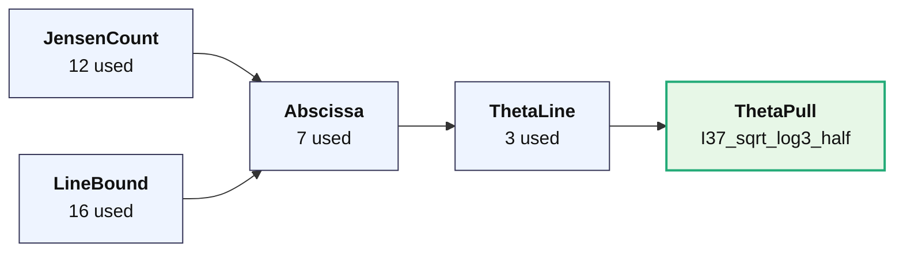

# What `Stage3.I37_sqrt_log3_half` rests on

[`Stage3.I37_sqrt_log3_half`](../lean_stage3/ThetaPull.md#Stage3-I37_sqrt_log3_half) in `lean_stage3/Stage3/ThetaPull.lean`, line 309.

**Why.** `I37_sqrt_log3` recovered. Under RH, at `θ = 1/2`, the general bound is `RHPull.I37_sqrt_log3`'s statement — `σθ (1/2) X` is `σRH X` by `rfl`, and `X^(1/2) = √X`.

**Proves**

```lean
‖I₃₇ ν ε T X (RHPull.σRH X)‖ ≤ (66600 * Real.exp 1 * B / Real.pi) * Real.sqrt X * (Real.log X) ^ 3
```

**Needs** (its hypotheses)

  - `` hRH : RiemannHypothesis ``
  - `` hX : 0 < X ``
  - `` hLX : 4 ≤ Real.log X ``
  - `` hT : 0 < T ``
  - `` hTX : T ≤ X ``
  - `` hB : 0 ≤ B ``
  - `` hMel : ∀ t : ℝ, ‖mellin (fun x ↦ (Smooth1 ν ε x : ℂ)) ((RHPull.σRH X : ℂ) + I * (t : ℂ))‖ ≤ B * ‖((RHPull.σRH X : ℂ)) + I * (t : ℂ)‖⁻¹ ``

Behind it: 39 theorems and 5 definitions in 5 files. Every one is listed below; Lean recorded each step.

## The files it passes through



An arrow A → B reads "B uses something proved or defined in A"; indirect arrows are left out. Green: the theorem itself. Yellow: a file in the other tree. The number is how many of that file's declarations are on the way.

## Every declaration on the way

Files in dependency order. ★ marks what the theorem's own proof uses directly.

### [`JensenCount`](../lean_stage3/JensenCount.md) — 12

- [`Stage3.zeta_centre_lower`](../lean_stage3/JensenCount.md#Stage3-zeta_centre_lower) — `` (1 : ℝ) / 3 ≤ ‖ζ (2 + Complex.I * T)‖ ``
- [`Stage3.zeta_disk_upper`](../lean_stage3/JensenCount.md#Stage3-zeta_disk_upper) — `` ‖ζ w‖ ≤ 28 * T ``
- [`Stage3.zeta_centre_ne_zero`](../lean_stage3/JensenCount.md#Stage3-zeta_centre_ne_zero) — `` ζ (2 + Complex.I * (T : ℂ)) ≠ 0 ``
- [`Stage3.pole_away`](../lean_stage3/JensenCount.md#Stage3-pole_away) — `` 2 * z + (2 + Complex.I * (T : ℂ)) ≠ 1 ``
- [`Stage3.pole_away_centre`](../lean_stage3/JensenCount.md#Stage3-pole_away_centre) — `` v ≠ 1 ``
- [`Stage3.zetaWindowTwo_finite`](../lean_stage3/JensenCount.md#Stage3-zetaWindowTwo_finite) — `` {ρ : ℂ | ζ ρ = 0 ∧ ‖ρ - (2 + Complex.I * (T : ℂ))‖ ≤ 2}.Finite ``
- [`Stage3.jensenF`](../lean_stage3/JensenCount.md#Stage3-jensenF) — *def*
- [`Stage3.zeta_comp_analytic`](../lean_stage3/JensenCount.md#Stage3-zeta_comp_analytic) — `` AnalyticAt ℂ (fun z : ℂ => ζ (2 * z + (2 + Complex.I * (T : ℂ)))) w ``
- [`Stage3.jensenF_analytic`](../lean_stage3/JensenCount.md#Stage3-jensenF_analytic) — `` AnalyticOnNhd ℂ (jensenF T) (Metric.closedBall (0 : ℂ) 1) ``
- [`Stage3.jensenF_zero_eq_one`](../lean_stage3/JensenCount.md#Stage3-jensenF_zero_eq_one) — `` jensenF T 0 = 1 ``
- [`Stage3.jensenF_zeros_finite`](../lean_stage3/JensenCount.md#Stage3-jensenF_zeros_finite) — `` (SetOfZeros 1 (jensenF T)).Finite ``
- [`Stage3.jensenF_bound`](../lean_stage3/JensenCount.md#Stage3-jensenF_bound) — `` ‖jensenF T z‖ ≤ 84 * T ``

### [`LineBound`](../lean_stage3/LineBound.md) — 16

- [`Slice3.zeta_ne_zero_of_RH`](../lean_stage3/LineBound.md#Slice3-zeta_ne_zero_of_RH) — `` ζ s ≠ 0 ``
- [`Slice3.finalBoundConst_le`](../lean_stage3/LineBound.md#Slice3-finalBoundConst_le) — `` 16 * ((181:ℝ)/200) ^ 2 / ((181/200) - (3/4)) ^ 3 + 1 / (((15/16:ℝ) ^ 2 / (29/32) - 29/32) * Real.log ((15/16)/(29/32))) ≤ 3991 ``
- [`Slice4.zetaE`](../lean_stage3/LineBound.md#Slice4-zetaE) — *def*
- [`Slice4.zetaE_eq`](../lean_stage3/LineBound.md#Slice4-zetaE_eq) — `` zetaE s = (s - 1) * ζ s ``
- [`Slice4.zetaE_one`](../lean_stage3/LineBound.md#Slice4-zetaE_one) — `` zetaE 1 = 1 ``
- [`Slice4.zetaE_differentiableAt_of_ne`](../lean_stage3/LineBound.md#Slice4-zetaE_differentiableAt_of_ne) — `` DifferentiableAt ℂ zetaE s ``
- [`Slice4.zetaE_differentiable`](../lean_stage3/LineBound.md#Slice4-zetaE_differentiable) — `` Differentiable ℂ zetaE ``
- [`Slice4.logDeriv_zetaE`](../lean_stage3/LineBound.md#Slice4-logDeriv_zetaE) — `` deriv zetaE s / zetaE s = 1 / (s - 1) + deriv ζ s / ζ s ``
- [`Slice4.zetaE_disk_upper`](../lean_stage3/LineBound.md#Slice4-zetaE_disk_upper) — `` ‖zetaE w‖ ≤ 430 ``
- [`Slice4.log_1300_le`](../lean_stage3/LineBound.md#Slice4-log_1300_le) — `` Real.log 1300 ≤ 7.28 ``
- [`Slice4b.logDerivZeta_norm_neg`](../lean_stage3/LineBound.md#Slice4b-logDerivZeta_norm_neg) — `` ‖deriv ζ ((σ : ℂ) + I * ((-t : ℝ) : ℂ)) / ζ ((σ : ℂ) + I * ((-t : ℝ) : ℂ))‖ = ‖deriv ζ ((σ : ℂ) + I * (t : ℂ)) / ζ ((σ : ℂ) + I * (t : ℂ))‖ ``
- [`RHPull.zeta_ne_zero_of_RH`](../lean_stage3/LineBound.md#RHPull-zeta_ne_zero_of_RH) — `` ζ s ≠ 0 ``
- ★ [`RHPull.σRH`](../lean_stage3/LineBound.md#RHPull--RH) — *def*
- [`RHPull.norm_sq_line`](../lean_stage3/LineBound.md#RHPull-norm_sq_line) — `` ‖((σ : ℂ) + I * (t : ℂ))‖ ^ 2 = σ ^ 2 + t ^ 2 ``
- [`RHPull.integral_shift_inv`](../lean_stage3/LineBound.md#RHPull-integral_shift_inv) — `` ∫ t in (0:ℝ)..T, (1 + t)⁻¹ = Real.log (1 + T) ``
- [`RHPull.integral_abs_kernel`](../lean_stage3/LineBound.md#RHPull-integral_abs_kernel) — `` ∫ t in (-T)..T, (1 + |t|)⁻¹ = 2 * Real.log (1 + T) ``

### [`Abscissa`](../lean_stage3/Abscissa.md) — 7

- ★ [`Stage3.σθ`](../lean_stage3/Abscissa.md#Stage3---) — *def*
- [`Stage3.σθ_re`](../lean_stage3/Abscissa.md#Stage3---_re) — `` ((σθ θ X : ℂ) + I * (t : ℂ)).re = σθ θ X ``
- [`Stage3.StmtZeroFreeRight`](../lean_stage3/Abscissa.md#Stage3-StmtZeroFreeRight) — *def*
- [`Stage3.zeta_ne_zero_right_of`](../lean_stage3/Abscissa.md#Stage3-zeta_ne_zero_right_of) — `` ζ s ≠ 0 ``
- ★ [`Stage3.zeroFreeRight_of_RH`](../lean_stage3/Abscissa.md#Stage3-zeroFreeRight_of_RH) — `` StmtZeroFreeRight (1/2) ``
- [`Stage3.rpow_σθ`](../lean_stage3/Abscissa.md#Stage3-rpow_--) — `` X ^ (σθ θ X) = Real.exp 1 * X ^ θ ``
- [`Stage3.logDerivZeta_crude_theta`](../lean_stage3/Abscissa.md#Stage3-logDerivZeta_crude_theta) — `` ‖deriv ζ ((σ₁ : ℂ) + I * (t : ℂ)) / ζ ((σ₁ : ℂ) + I * (t : ℂ))‖ ≤ 1996 * Real.log (84 * t) + (29 * Real.log t + 129) / (σ₁ - θ) ``

### [`ThetaLine`](../lean_stage3/ThetaLine.md) — 3

- [`Stage3.logDerivZeta_compact_theta`](../lean_stage3/ThetaLine.md#Stage3-logDerivZeta_compact_theta) — `` ‖deriv ζ ((σ₁ : ℂ) + I * (t : ℂ)) / ζ ((σ₁ : ℂ) + I * (t : ℂ))‖ ≤ 14530 + 2 / (1 - θ) + 212 / (σ₁ - θ) ``
- [`Stage3.logDerivZeta_sq_at_X_theta`](../lean_stage3/ThetaLine.md#Stage3-logDerivZeta_sq_at_X_theta) — `` ‖deriv ζ (((θ + 1/Real.log X : ℝ)) + I * (t : ℂ)) / ζ (((θ + 1/Real.log X : ℝ)) + I * (t : ℂ))‖ ≤ 11100 * (Real.log X) ^ 2 ``
- [`Stage3.logDerivZeta_line_theta`](../lean_stage3/ThetaLine.md#Stage3-logDerivZeta_line_theta) — `` ‖deriv ζ (((θ + 1/Real.log X : ℝ)) + I * (t : ℂ)) / ζ (((θ + 1/Real.log X : ℝ)) + I * (t : ℂ))‖ ≤ 11100 * (Real.log X) ^ 2 ``

### [`ThetaPull`](../lean_stage3/ThetaPull.md) — 6

- [`Stage3.half_lt_σθ`](../lean_stage3/ThetaPull.md#Stage3-half_lt_--) — `` (1:ℝ)/2 < σθ θ X ``
- [`Stage3.four_le_log_of_theta`](../lean_stage3/ThetaPull.md#Stage3-four_le_log_of_theta) — `` (4:ℝ) ≤ Real.log X ``
- [`Stage3.norm_line_ge_theta`](../lean_stage3/ThetaPull.md#Stage3-norm_line_ge_theta) — `` (1 + |t|) / 3 ≤ ‖((σθ θ X : ℂ)) + I * (t : ℂ)‖ ``
- [`Stage3.integrand_norm_le_theta`](../lean_stage3/ThetaPull.md#Stage3-integrand_norm_le_theta) — `` ‖SmoothedChebyshevIntegrand ν ε X ((σθ θ X : ℂ) + I * (t : ℂ))‖ ≤ 11100 * (Real.log X) ^ 2 * M * X ^ (σθ θ X) ``
- [`Stage3.I37_norm_le_epsfree_theta`](../lean_stage3/ThetaPull.md#Stage3-I37_norm_le_epsfree_theta) — `` ‖I₃₇ ν ε T X (σθ θ X)‖ ≤ (1 / (2 * Real.pi)) * (6 * Real.log (1 + T)) * (11100 * (Real.log X) ^ 2 * B * X ^ (σθ θ X)) ``
- ★ [`Stage3.I37_power_log3_theta`](../lean_stage3/ThetaPull.md#Stage3-I37_power_log3_theta) — `` ‖I₃₇ ν ε T X (σθ θ X)‖ ≤ (66600 * Real.exp 1 * B / Real.pi) * X ^ θ * (Real.log X) ^ 3 ``

