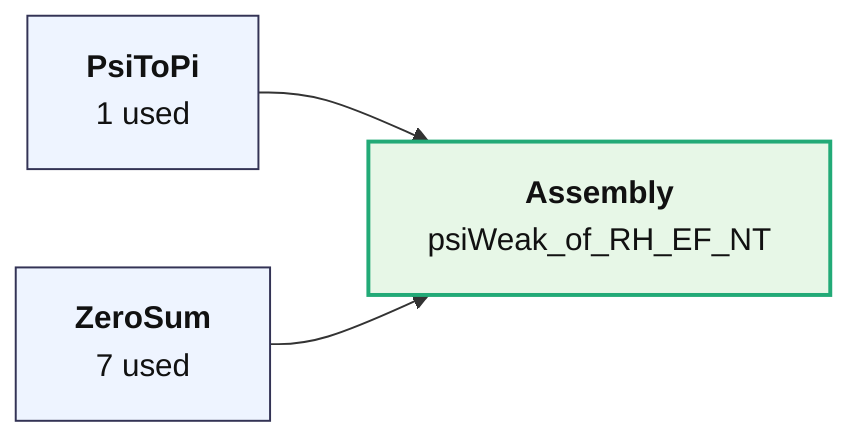

# What `Stage3.psiWeak_of_RH_EF_NT` rests on

[`Stage3.psiWeak_of_RH_EF_NT`](../lean_stage3/Assembly.md#Stage3-psiWeak_of_RH_EF_NT) in `lean_stage3/Stage3/Assembly.lean`, line 468.

**Why.** THE ASSEMBLY — the decomposition closed. Under hRH (Mathlib's `RiemannHypothesis`), hEF (`StmtExplicitFormula c₁ c₂ x₁` — the truncated explicit formula, the open leaf), and hNT (`Riemann_vonMangoldt_bound b₁ b₂ b₃` — Rosser Th. 19, the other open leaf), the ψ-side weak bound holds with computed constant: `StmtPsiWeak (9c₁ + c₂ + 28 + 16b₁ + 16b₂ + 8b₃ + 4W) 2 (max x₁ 16)`. The dyadic level is chosen from `x` itself (`K = Nat.log 2 ⌊x⌋`, so `x < 2^(K+1) ≤ 2x`). PsiToPi's `schoenfeldWeak_of_psiWeak` carries the conclusion to `π − Li`, Statement's `weakWindow_of_global` to the window, O68's arit…

**Proves**

```lean
StmtPsiWeak (9 * c₁ + c₂ + 28 + 16 * b₁ + 16 * b₂ + 8 * b₃ + 4 * W) 2 (max x₁ 16)
```

**Needs** (its hypotheses)

  - `` hRH : RiemannHypothesis ``
  - `` hc₁ : 0 ≤ c₁ ``
  - `` hc₂ : 0 ≤ c₂ ``
  - `` hb₁ : 0 ≤ b₁ ``
  - `` hb₂ : 0 ≤ b₂ ``
  - `` hb₃ : 0 ≤ b₃ ``
  - `` hWeq : W = weightedZeroHeightBucket ``
  - `` hRvM2 : 0 ≤ riemannZeta.RvM b₁ b₂ b₃ 2 ``
  - `` hEF : StmtExplicitFormulaPoly c₁ c₂ x₁ ``
  - `` hNT : riemannZeta.Riemann_vonMangoldt_bound b₁ b₂ b₃ ``

Behind it: 17 theorems and 3 definitions in 3 files. Every one is listed below; Lean recorded each step.

## The files it passes through



An arrow A → B reads "B uses something proved or defined in A"; indirect arrows are left out. Green: the theorem itself. Yellow: a file in the other tree. The number is how many of that file's declarations are on the way.

## Every declaration on the way

Files in dependency order. ★ marks what the theorem's own proof uses directly.

### [`PsiToPi`](../lean_stage3/PsiToPi.md) — 1

- ★ [`Stage3.StmtPsiWeak`](../lean_stage3/PsiToPi.md#Stage3-StmtPsiWeak) — *def*

### [`ZeroSum`](../lean_stage3/ZeroSum.md) — 7

- [`Stage3.log_two_pi_le`](../lean_stage3/ZeroSum.md#Stage3-log_two_pi_le) — `` Real.log (2 * Real.pi) ≤ 2 ``
- [`Stage3.RvM_mono`](../lean_stage3/ZeroSum.md#Stage3-RvM_mono) — `` riemannZeta.RvM b₁ b₂ b₃ T ≤ riemannZeta.RvM b₁ b₂ b₃ T' ``
- [`Stage3.abs_mainterm_le`](../lean_stage3/ZeroSum.md#Stage3-abs_mainterm_le) — `` |zetaCountingMainTerm T| ≤ T / (2 * Real.pi) * (Real.log T + 3) + 7 / 8 ``
- [`Stage3.N_abs_le`](../lean_stage3/ZeroSum.md#Stage3-N_abs_le) — `` |riemannZeta.N T| ≤ T / (2 * Real.pi) * (Real.log T + 3) + riemannZeta.RvM b₁ b₂ b₃ T + 7 / 8 ``
- [`Stage3.sum_range_add_one`](../lean_stage3/ZeroSum.md#Stage3-sum_range_add_one) — `` (∑ j ∈ range n, ((j : ℝ) + 1)) = n * (n + 1) / 2 ``
- [`Stage3.sum_inv_pow_two_le`](../lean_stage3/ZeroSum.md#Stage3-sum_inv_pow_two_le) — `` (∑ j ∈ range n, ((2 : ℝ) ^ j)⁻¹) ≤ 2 ``
- [`Stage3.dyadic_abs_N_sum_le`](../lean_stage3/ZeroSum.md#Stage3-dyadic_abs_N_sum_le) — `` (∑ j ∈ range (K + 1), ((2 : ℝ) ^ j)⁻¹ * |riemannZeta.N ((2 : ℝ) ^ (j + 1))|) ≤ Real.log 2 / (2 * Real.pi) * (K + 1) * (K + 2) + 3 * (K + 1) / Real.pi + 2 * (rie… ``

### [`Assembly`](../lean_stage3/Assembly.md) — 12

- [`Stage3.re_eq_half_of_RH`](../lean_stage3/Assembly.md#Stage3-re_eq_half_of_RH) — `` (ρ : ℂ).re = 1 / 2 ``
- [`Stage3.half_le_norm_of_RH`](../lean_stage3/Assembly.md#Stage3-half_le_norm_of_RH) — `` 1 / 2 ≤ ‖(ρ : ℂ)‖ ``
- [`Stage3.norm_cpow_of_RH`](../lean_stage3/Assembly.md#Stage3-norm_cpow_of_RH) — `` ‖(x : ℂ) ^ (ρ : ℂ)‖ = Real.sqrt x ``
- ★ [`Stage3.zeroPartialSum`](../lean_stage3/Assembly.md#Stage3-zeroPartialSum) — *def*
- ★ [`Stage3.StmtExplicitFormulaPoly`](../lean_stage3/Assembly.md#Stage3-StmtExplicitFormulaPoly) — *def*
- [`Stage3.inv_le_dyadic_sum`](../lean_stage3/Assembly.md#Stage3-inv_le_dyadic_sum) — `` ∀ γ : ℝ, 1 ≤ γ → γ < 2 ^ (K + 1) → γ⁻¹ ≤ ∑ j ∈ Finset.range (K + 1), ((2 : ℝ) ^ j)⁻¹ * (if γ < 2 ^ (j + 1) then 1 else 0) ``
- [`Stage3.norm_term_le_dyadic`](../lean_stage3/Assembly.md#Stage3-norm_term_le_dyadic) — `` ‖(x : ℂ) ^ (ρ : ℂ) / (ρ : ℂ)‖ ≤ 2 * Real.sqrt x * ∑ j ∈ Finset.range (K + 1), ((2 : ℝ) ^ j)⁻¹ * (if |(ρ : ℂ).im| < 2 ^ (j + 1) then 1 else 0) ``
- [`Stage3.norm_zeroPartialSum_le_sharp`](../lean_stage3/Assembly.md#Stage3-norm_zeroPartialSum_le_sharp) — `` ‖zeroPartialSum x ((2 : ℝ) ^ (K + 1))‖ ≤ 2 * Real.sqrt x * ∑ j ∈ Finset.range (K + 1), ((2 : ℝ) ^ j)⁻¹ * (2 * |riemannZeta.N ((2 : ℝ) ^ (j + 1))| + weightedZero… ``
- ★ [`Stage3.norm_zeroPartialSum_le_logsq`](../lean_stage3/Assembly.md#Stage3-norm_zeroPartialSum_le_logsq) — `` ‖zeroPartialSum x ((2 : ℝ) ^ (K + 1))‖ ≤ 2 * Real.sqrt x * (2 * (Real.log 2 / (2 * Real.pi) * (K + 1) * (K + 2) + 3 * (K + 1) / Real.pi + 2 * (riemannZeta.RvM b… ``
- ★ [`Stage3.rem_arith`](../lean_stage3/Assembly.md#Stage3-rem_arith) — `` c₁ * xx * G ^ 2 / TT + c₂ * L ≤ (9 * c₁ + c₂) * L ^ 2 ``
- ★ [`Stage3.zeroinner_arith`](../lean_stage3/Assembly.md#Stage3-zeroinner_arith) — `` 2 * (Real.log 2 / (2 * Real.pi) * (KK + 1) * (KK + 2) + 3 * (KK + 1) / Real.pi + 2 * (R + 7 / 8)) + 2 * W ≤ 2 * (7 + 4 * b₁ + 4 * b₂ + 2 * b₃) * L ^ 2 + 2 * W ``
- ★ [`Stage3.assembly_arith`](../lean_stage3/Assembly.md#Stage3-assembly_arith) — `` A ≤ (9 * c₁ + c₂ + 28 + 16 * b₁ + 16 * b₂ + 8 * b₃ + 4 * W) * S * L ^ 2 ``

